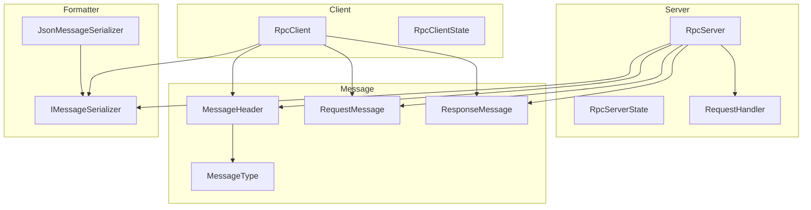
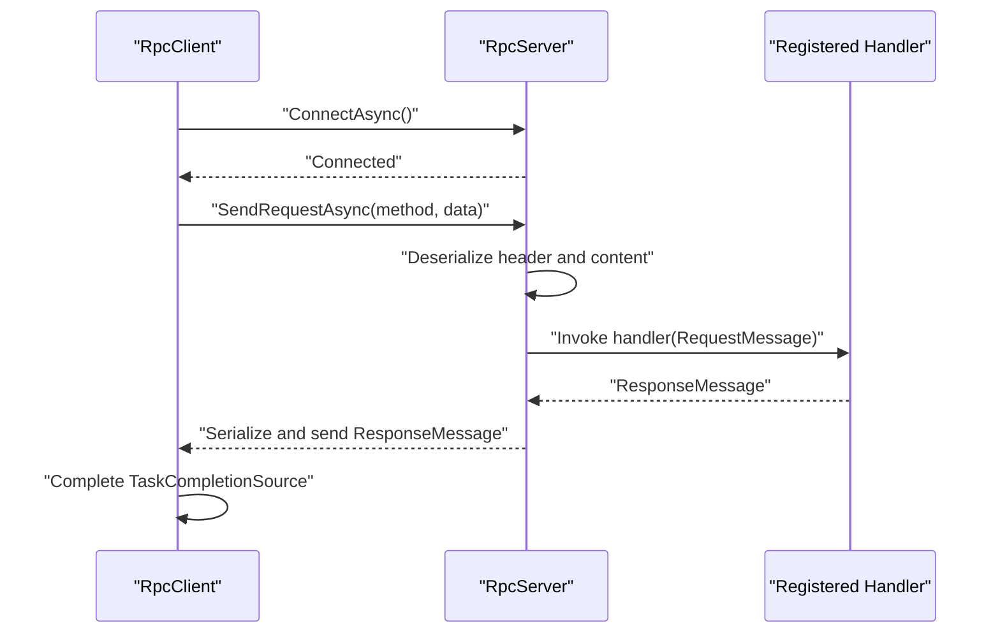
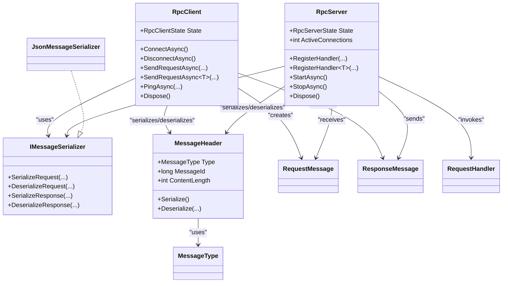

# API Reference

<cite>
**Referenced Files in This Document**
- [TcpRpc.csproj](file://TcpRpc/TcpRpc.csproj)
- [RpcClient.cs](file://TcpRpc/Client/TcpRpcClient.cs)
- [RpcClientState.cs](file://TcpRpc/Client/RpcClientState.cs)
- [IMessageSerializer.cs](file://TcpRpc/Formatter/IMessageSerializer.cs)
- [JsonMessageSerializer.cs](file://TcpRpc/Formatter/JsonMessageSerializer.cs)
- [MessageHeader.cs](file://TcpRpc/Message/MessageHeader.cs)
- [MessageType.cs](file://TcpRpc/Message/MessageType.cs)
- [RequestMessage.cs](file://TcpRpc/Message/RequestMessage.cs)
- [ResponseMessage.cs](file://TcpRpc/Message/ResponseMessage.cs)
- [RequestHandler.cs](file://TcpRpc/Server/RequestHandler.cs)
- [RpcServer.cs](file://TcpRpc/Server/TcpRpcServer.cs)
- [RpcServerState.cs](file://TcpRpc/Server/RpcServerState.cs)
</cite>

## Table of Contents
1. [Introduction](#introduction)
2. [Project Structure](#project-structure)
3. [Core Components](#core-components)
4. [Architecture Overview](#architecture-overview)
5. [Detailed Component Analysis](#detailed-component-analysis)
6. [Dependency Analysis](#dependency-analysis)
7. [Performance Considerations](#performance-considerations)
8. [Troubleshooting Guide](#troubleshooting-guide)
9. [Conclusion](#conclusion)

## Introduction
This document provides a comprehensive API reference for the TcpRpc library. It covers public interfaces and classes, focusing on RpcClient and RpcServer, the IMessageSerializer contract, and the MessageHeader structure. The documentation includes complete method signatures, parameter descriptions, return value specifications, exception types, and usage patterns organized by namespace and class hierarchy.

## Project Structure
The TcpRpc project is organized into namespaces that reflect functional areas:
- Client: RpcClient and client-side state machine
- Server: RpcServer and server-side state machine plus request handler delegate
- Message: Protocol messages and header structure
- Formatter: Serialization contract and JSON implementation

**Diagram sources**
- [RpcClient.cs:11-405](file://TcpRpc/Client/TcpRpcClient.cs#L11-L405)
- [RpcClientState.cs:3-11](file://TcpRpc/Client/RpcClientState.cs#L3-L11)
- [RpcServer.cs:12-432](file://TcpRpc/Server/TcpRpcServer.cs#L12-L432)
- [RpcServerState.cs:3-10](file://TcpRpc/Server/RpcServerState.cs#L3-L10)
- [RequestHandler.cs:5-5](file://TcpRpc/Server/RequestHandler.cs#L5-L5)
- [MessageHeader.cs:5-34](file://TcpRpc/Message/MessageHeader.cs#L5-L34)
- [MessageType.cs:3-10](file://TcpRpc/Message/MessageType.cs#L3-L10)
- [RequestMessage.cs:3-8](file://TcpRpc/Message/RequestMessage.cs#L3-L8)
- [ResponseMessage.cs:3-9](file://TcpRpc/Message/ResponseMessage.cs#L3-L9)
- [IMessageSerializer.cs:5-13](file://TcpRpc/Formatter/IMessageSerializer.cs#L5-L13)
- [JsonMessageSerializer.cs:6-85](file://TcpRpc/Formatter/JsonMessageSerializer.cs#L6-L85)

**Section sources**
- [TcpRpc.csproj:1-17](file://TcpRpc/TcpRpc.csproj#L1-L17)

## Core Components
This section documents the primary public APIs grouped by namespace.

### Client Namespace
- RpcClient: Asynchronous TCP RPC client with connection lifecycle, request sending, and heartbeat support
- RpcClientState: Enumerates client state transitions

Key members:
- RpcClient constructor with host, port, optional serializer, and optional logger
- ConnectAsync: Establishes TCP connection and starts receive loop
- DisconnectAsync: Gracefully closes connections and cancels pending requests
- SendRequestAsync(string, byte[], int): Sends raw request bytes with timeout
- SendRequestAsync<T>(string, object, int): Serializes request payload, sends, deserializes response
- PingAsync(int): Heartbeat to keep connection alive
- State property: Current client state
- Dispose: Releases resources

Exceptions:
- InvalidOperationException: Thrown when operations are invoked in invalid states
- TimeoutException: Thrown when request timeouts occur
- ObjectDisposedException: Thrown when disposed client is used

Usage patterns:
- Initialize RpcClient with host/port and optional IMessageSerializer
- Call ConnectAsync before sending requests
- Use SendRequestAsync<T> for strongly-typed requests
- Use PingAsync periodically for keepalive
- Call DisconnectAsync and Dispose when finished

**Section sources**
- [RpcClient.cs:11-405](file://TcpRpc/Client/TcpRpcClient.cs#L11-L405)
- [RpcClientState.cs:3-11](file://TcpRpc/Client/RpcClientState.cs#L3-L11)

### Server Namespace
- RpcServer: TCP listener that accepts clients, processes requests, and manages handlers
- RpcServerState: Enumerates server state transitions
- RequestHandler: Delegate type for handling incoming requests

Key members:
- RpcServer constructor with port, optional serializer, and optional logger
- RegisterHandler(string, RequestHandler): Registers a handler by method name
- RegisterHandler<TRequest, TResponse>(string, Func<TRequest, Task<TResponse>>): Registers typed handler that serializes request/response
- StartAsync: Starts listening for clients
- StopAsync: Stops accepting new clients and closes existing connections
- State property: Current server state
- ActiveConnections property: Count of currently connected clients
- Dispose: Stops server and releases resources

Exceptions:
- InvalidOperationException: Thrown when registering handlers while server is not stopped or when starting/stopping in invalid states
- ObjectDisposedException: Thrown when disposed server is used

Usage patterns:
- Construct RpcServer with desired port
- Register handlers before starting
- Call StartAsync to begin accepting clients
- Use StopAsync to gracefully shut down
- Dispose to release resources

**Section sources**
- [RpcServer.cs:12-432](file://TcpRpc/Server/TcpRpcServer.cs#L12-L432)
- [RpcServerState.cs:3-10](file://TcpRpc/Server/RpcServerState.cs#L3-L10)
- [RequestHandler.cs:5-5](file://TcpRpc/Server/RequestHandler.cs#L5-L5)

### Formatter Namespace
- IMessageSerializer: Contract for serializing/deserializing request/response messages
- JsonMessageSerializer: JSON-based implementation with validation

Key members:
- SerializeRequest(RequestMessage): Serializes request to bytes
- DeserializeRequest(byte[]): Deserializes bytes to request with validation
- SerializeResponse(ResponseMessage): Serializes response to bytes
- DeserializeResponse(byte[]): Deserializes bytes to response with validation

Validation rules:
- RequestMessage requires non-empty Method and positive MessageId
- ResponseMessage requires positive MessageId
- Empty data arrays are rejected for deserialization

Exceptions:
- ArgumentNullException: Thrown when null arguments are passed
- ArgumentException: Thrown when data is empty
- InvalidOperationException: Thrown on deserialization failures or invalid fields

Usage patterns:
- Implement IMessageSerializer for custom serialization
- Use JsonMessageSerializer for default JSON encoding with camelCase naming

**Section sources**
- [IMessageSerializer.cs:5-13](file://TcpRpc/Formatter/IMessageSerializer.cs#L5-L13)
- [JsonMessageSerializer.cs:6-85](file://TcpRpc/Formatter/JsonMessageSerializer.cs#L6-L85)

### Message Namespace
- MessageHeader: Fixed-size binary header containing type, message ID, and content length
- MessageType: Enumerated message types
- RequestMessage: Request envelope with method and data
- ResponseMessage: Response envelope with success flag, optional error, and optional data

Key members:
- MessageHeader fields: Type, MessageId, ContentLength
- MessageHeader Serialize(): Writes little-endian encoded header
- MessageHeader Deserialize(byte[]): Reads little-endian encoded header
- MessageType values: Request, Response, Ping, Pong, Error
- RequestMessage fields: MessageId, Method, Data
- ResponseMessage fields: MessageId, Success, Error, Data

Validation rules:
- Header buffer must be at least 17 bytes
- ContentLength must be validated against limits during transport
- Request/Response require positive MessageId and valid Method/Data

Utility methods:
- Serialize/Deserialize handle binary encoding/decoding

**Section sources**
- [MessageHeader.cs:5-34](file://TcpRpc/Message/MessageHeader.cs#L5-L34)
- [MessageType.cs:3-10](file://TcpRpc/Message/MessageType.cs#L3-L10)
- [RequestMessage.cs:3-8](file://TcpRpc/Message/RequestMessage.cs#L3-L8)
- [ResponseMessage.cs:3-9](file://TcpRpc/Message/ResponseMessage.cs#L3-L9)

## Architecture Overview
The system implements a simple TCP-based RPC protocol with a fixed-size header and JSON-encoded payloads. Clients send requests with method names and serialized data, servers route requests to registered handlers, and responses are sent back with correlation via MessageId.

**Diagram sources**
- [RpcClient.cs:132-189](file://TcpRpc/Client/TcpRpcClient.cs#L132-L189)
- [RpcServer.cs:318-360](file://TcpRpc/Server/TcpRpcServer.cs#L318-L360)
- [RequestHandler.cs:5-5](file://TcpRpc/Server/RequestHandler.cs#L5-L5)

## Detailed Component Analysis

### RpcClient API
- Constructor
  - Signature: RpcClient(string host, int port, IMessageSerializer? serializer = null, ILogger<RpcClient>? logger = null)
  - Parameters:
    - host: Target hostname or IP address
    - port: TCP port number
    - serializer: Optional IMessageSerializer implementation (defaults to JsonMessageSerializer)
    - logger: Optional ILogger for diagnostics
  - Exceptions: None thrown by constructor itself
  - Notes: Validates host is not null

- ConnectAsync
  - Signature: Task ConnectAsync()
  - Behavior: Establishes TCP connection, opens stream, starts receive loop
  - Exceptions: InvalidOperationException if not in Created or Disconnected state
  - Returns: Task completion when connected

- DisconnectAsync
  - Signature: Task DisconnectAsync()
  - Behavior: Cancels pending operations, closes streams, clears pending requests
  - Exceptions: None thrown by method itself
  - Returns: Task completion when disconnected

- SendRequestAsync(string, byte[], int)
  - Signature: Task<ResponseMessage> SendRequestAsync(string method, byte[] data, int timeoutMs = 30000)
  - Parameters:
    - method: Method name to invoke
    - data: Serialized request payload
    - timeoutMs: Request timeout in milliseconds
  - Exceptions:
    - InvalidOperationException: If client is not connected
    - TimeoutException: If request does not complete within timeout
    - OperationCanceledException: If cancellation occurs
  - Returns: ResponseMessage with correlation via MessageId

- SendRequestAsync<T>(string, object, int)
  - Signature: Task<T> SendRequestAsync<T>(string method, object data, int timeoutMs = 30000)
  - Behavior: Serializes data to UTF-8 bytes, sends request, deserializes response
  - Exceptions:
    - InvalidOperationException: If response indicates failure or data is null
    - TimeoutException: If request does not complete within timeout
  - Returns: Deserialized response object T

- PingAsync(int)
  - Signature: Task<bool> PingAsync(int timeoutMs = 5000)
  - Behavior: Sends Ping message and waits for Pong
  - Exceptions: None thrown by method itself
  - Returns: True if successful, false otherwise

- State property
  - Signature: RpcClientState State
  - Returns: Current client state

- Dispose
  - Signature: void Dispose()
  - Behavior: Calls DisconnectAsync, disposes internal resources

Usage examples:
- Basic client initialization and request
  - See [RpcClient.cs:35-41](file://TcpRpc/Client/TcpRpcClient.cs#L35-L41)
- Sending typed request
  - See [RpcClient.cs:191-203](file://TcpRpc/Client/TcpRpcClient.cs#L191-L203)
- Heartbeat usage
  - See [RpcClient.cs:325-382](file://TcpRpc/Client/TcpRpcClient.cs#L325-L382)

**Section sources**
- [RpcClient.cs:11-405](file://TcpRpc/Client/TcpRpcClient.cs#L11-L405)
- [RpcClientState.cs:3-11](file://TcpRpc/Client/RpcClientState.cs#L3-L11)

### RpcServer API
- Constructor
  - Signature: RpcServer(int port, IMessageSerializer? serializer = null, ILogger<RpcServer>? logger = null)
  - Parameters:
    - port: Listening port
    - serializer: Optional IMessageSerializer implementation (defaults to JsonMessageSerializer)
    - logger: Optional ILogger for diagnostics
  - Exceptions: None thrown by constructor itself

- RegisterHandler(string, RequestHandler)
  - Signature: void RegisterHandler(string method, RequestHandler handler)
  - Behavior: Registers a handler delegate for a given method name
  - Exceptions:
    - InvalidOperationException: If server is not in Stopped state
    - ArgumentNullException: If handler is null
  - Returns: void

- RegisterHandler<TRequest, TResponse>(string, Func<TRequest, Task<TResponse>>)
  - Signature: void RegisterHandler<TRequest, TResponse>(string method, Func<TRequest, Task<TResponse>> handler)
  - Behavior: Registers a typed handler that deserializes request and serializes response
  - Exceptions: None thrown by method itself
  - Returns: void

- StartAsync
  - Signature: Task StartAsync()
  - Behavior: Starts TcpListener, accepts clients, processes messages
  - Exceptions:
    - InvalidOperationException: If server is not Stopped
  - Returns: Task completion when running

- StopAsync
  - Signature: Task StopAsync()
  - Behavior: Stops accepting new clients, cancels operations, waits for clients to disconnect
  - Exceptions: None thrown by method itself
  - Returns: Task completion when stopped

- State property
  - Signature: RpcServerState State
  - Returns: Current server state

- ActiveConnections property
  - Signature: int ActiveConnections
  - Behavior: Returns count of currently connected clients (cleaned up automatically)
  - Returns: Integer count

- Dispose
  - Signature: void Dispose()
  - Behavior: Calls StopAsync, disposes cancellation tokens

Usage examples:
- Registering typed handler
  - See [RpcServer.cs:60-99](file://TcpRpc/Server/TcpRpcServer.cs#L60-L99)
- Starting server
  - See [RpcServer.cs:101-173](file://TcpRpc/Server/TcpRpcServer.cs#L101-L173)
- Stopping server
  - See [RpcServer.cs:175-226](file://TcpRpc/Server/TcpRpcServer.cs#L175-L226)

**Section sources**
- [RpcServer.cs:12-432](file://TcpRpc/Server/TcpRpcServer.cs#L12-L432)
- [RpcServerState.cs:3-10](file://TcpRpc/Server/RpcServerState.cs#L3-L10)
- [RequestHandler.cs:5-5](file://TcpRpc/Server/RequestHandler.cs#L5-L5)

### IMessageSerializer Contract
- SerializeRequest(RequestMessage)
  - Signature: byte[] SerializeRequest(RequestMessage request)
  - Behavior: Serializes request to bytes
  - Exceptions: ArgumentNullException if request is null

- DeserializeRequest(byte[])
  - Signature: RequestMessage DeserializeRequest(byte[] data)
  - Behavior: Deserializes bytes to RequestMessage
  - Validation: Requires non-empty Method and positive MessageId
  - Exceptions:
    - ArgumentNullException: If data is null
    - ArgumentException: If data is empty
    - InvalidOperationException: On deserialization failure or invalid fields

- SerializeResponse(ResponseMessage)
  - Signature: byte[] SerializeResponse(ResponseMessage response)
  - Behavior: Serializes response to bytes
  - Exceptions: ArgumentNullException if response is null

- DeserializeResponse(byte[])
  - Signature: ResponseMessage DeserializeResponse(byte[] data)
  - Behavior: Deserializes bytes to ResponseMessage
  - Validation: Requires positive MessageId
  - Exceptions:
    - ArgumentNullException: If data is null
    - ArgumentException: If data is empty
    - InvalidOperationException: On deserialization failure or invalid fields

Implementation requirements:
- Must produce/consume valid JSON with camelCase property naming
- Must validate required fields during deserialization
- Must handle null/empty data appropriately

Usage patterns:
- Use JsonMessageSerializer for default behavior
- Implement custom IMessageSerializer for alternative encodings

**Section sources**
- [IMessageSerializer.cs:5-13](file://TcpRpc/Formatter/IMessageSerializer.cs#L5-L13)
- [JsonMessageSerializer.cs:6-85](file://TcpRpc/Formatter/JsonMessageSerializer.cs#L6-L85)

### MessageHeader Structure
- Fields
  - Type: MessageType
  - MessageId: long
  - ContentLength: int

- Serialize()
  - Signature: byte[] Serialize()
  - Behavior: Writes 17-byte little-endian header
  - Layout: [Type: 1 byte][MessageId: 8 bytes][ContentLength: 4 bytes]

- Deserialize(byte[])
  - Signature: static MessageHeader Deserialize(byte[] buffer)
  - Behavior: Reads 17-byte little-endian header
  - Exceptions: ArgumentException if buffer smaller than 17 bytes

Validation rules:
- Buffer must be at least 17 bytes
- ContentLength should be validated against configured limits during transport

Utility methods:
- Serialize/Deserialize handle binary encoding/decoding

**Section sources**
- [MessageHeader.cs:5-34](file://TcpRpc/Message/MessageHeader.cs#L5-L34)
- [MessageType.cs:3-10](file://TcpRpc/Message/MessageType.cs#L3-L10)

### Supporting Message Types
- RequestMessage
  - Fields: MessageId, Method (required), Data (required)
  - Usage: Transport request envelopes

- ResponseMessage
  - Fields: MessageId, Success, Error (optional), Data (optional)
  - Usage: Transport response envelopes

**Section sources**
- [RequestMessage.cs:3-8](file://TcpRpc/Message/RequestMessage.cs#L3-L8)
- [ResponseMessage.cs:3-9](file://TcpRpc/Message/ResponseMessage.cs#L3-L9)

## Dependency Analysis
The following diagram shows key dependencies among major components:

**Diagram sources**
- [RpcClient.cs:11-405](file://TcpRpc/Client/TcpRpcClient.cs#L11-L405)
- [RpcServer.cs:12-432](file://TcpRpc/Server/TcpRpcServer.cs#L12-L432)
- [IMessageSerializer.cs:5-13](file://TcpRpc/Formatter/IMessageSerializer.cs#L5-L13)
- [JsonMessageSerializer.cs:6-85](file://TcpRpc/Formatter/JsonMessageSerializer.cs#L6-L85)
- [MessageHeader.cs:5-34](file://TcpRpc/Message/MessageHeader.cs#L5-L34)
- [MessageType.cs:3-10](file://TcpRpc/Message/MessageType.cs#L3-L10)
- [RequestMessage.cs:3-8](file://TcpRpc/Message/RequestMessage.cs#L3-L8)
- [ResponseMessage.cs:3-9](file://TcpRpc/Message/ResponseMessage.cs#L3-L9)
- [RequestHandler.cs:5-5](file://TcpRpc/Server/RequestHandler.cs#L5-L5)

**Section sources**
- [RpcClient.cs:11-405](file://TcpRpc/Client/TcpRpcClient.cs#L11-L405)
- [RpcServer.cs:12-432](file://TcpRpc/Server/TcpRpcServer.cs#L12-L432)
- [IMessageSerializer.cs:5-13](file://TcpRpc/Formatter/IMessageSerializer.cs#L5-L13)
- [JsonMessageSerializer.cs:6-85](file://TcpRpc/Formatter/JsonMessageSerializer.cs#L6-L85)
- [MessageHeader.cs:5-34](file://TcpRpc/Message/MessageHeader.cs#L5-L34)
- [MessageType.cs:3-10](file://TcpRpc/Message/MessageType.cs#L3-L10)
- [RequestMessage.cs:3-8](file://TcpRpc/Message/RequestMessage.cs#L3-L8)
- [ResponseMessage.cs:3-9](file://TcpRpc/Message/ResponseMessage.cs#L3-L9)
- [RequestHandler.cs:5-5](file://TcpRpc/Server/RequestHandler.cs#L5-L5)

## Performance Considerations
- Connection pooling: RpcClient maintains a single TcpClient per connection; reuse RpcClient instances for multiple requests to the same endpoint
- Serialization overhead: JsonMessageSerializer uses UTF-8 encoding; consider compression for large payloads
- Concurrency: Both RpcClient and RpcServer use locks and concurrent collections; avoid blocking operations in handlers
- Timeouts: Configure appropriate timeout values for SendRequestAsync to prevent resource leaks
- Backpressure: RpcServer tracks ActiveConnections; monitor to detect overload conditions
- Memory usage: MessageHeader.ContentLength limits prevent excessive memory allocation during reads

## Troubleshooting Guide
Common issues and resolutions:
- Connection errors
  - Verify server is running and reachable
  - Check firewall and port availability
  - Use PingAsync to validate connectivity
- Request timeouts
  - Increase timeoutMs parameter
  - Ensure server handlers complete promptly
  - Monitor ActiveConnections on server
- Serialization failures
  - Validate RequestMessage fields (Method, MessageId)
  - Ensure ResponseMessage fields are populated correctly
  - Check IMessageSerializer implementation
- State transitions
  - RpcClient: Ensure ConnectAsync is called before sending requests
  - RpcServer: Register handlers before StartAsync
- Resource cleanup
  - Always dispose RpcClient and RpcServer instances
  - Use StopAsync before Dispose on RpcServer

**Section sources**
- [RpcClient.cs:47-80](file://TcpRpc/Client/TcpRpcClient.cs#L47-L80)
- [RpcServer.cs:101-173](file://TcpRpc/Server/TcpRpcServer.cs#L101-L173)
- [JsonMessageSerializer.cs:22-49](file://TcpRpc/Formatter/JsonMessageSerializer.cs#L22-L49)

## Conclusion
TcpRpc provides a lightweight, extensible TCP-based RPC framework with clear separation of concerns between client, server, serialization, and messaging. The APIs are designed for simplicity while offering robust error handling, timeouts, and diagnostic logging. By following the usage patterns and validation rules outlined above, developers can build reliable distributed systems using this library.