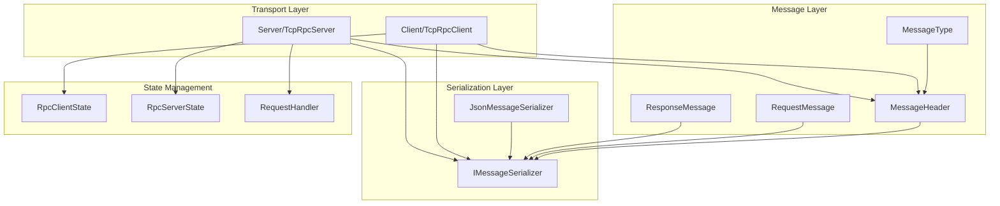
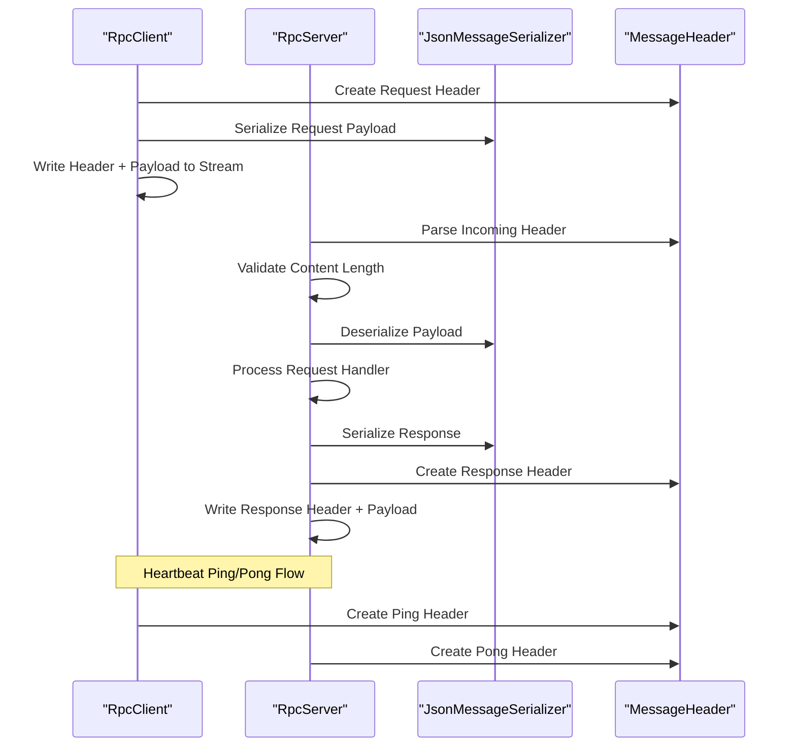
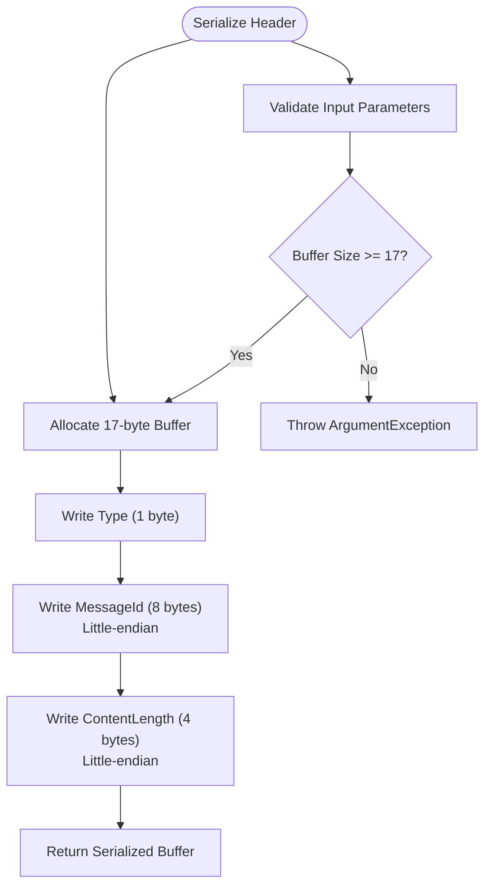
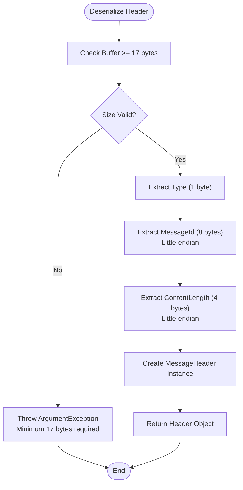
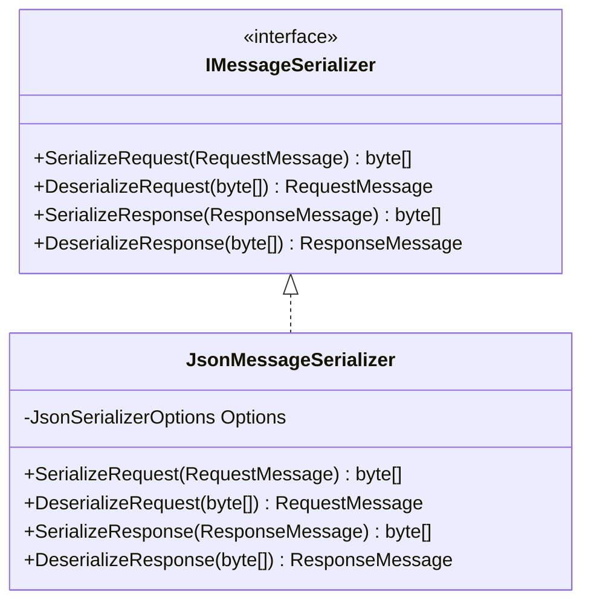
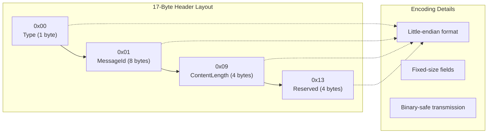
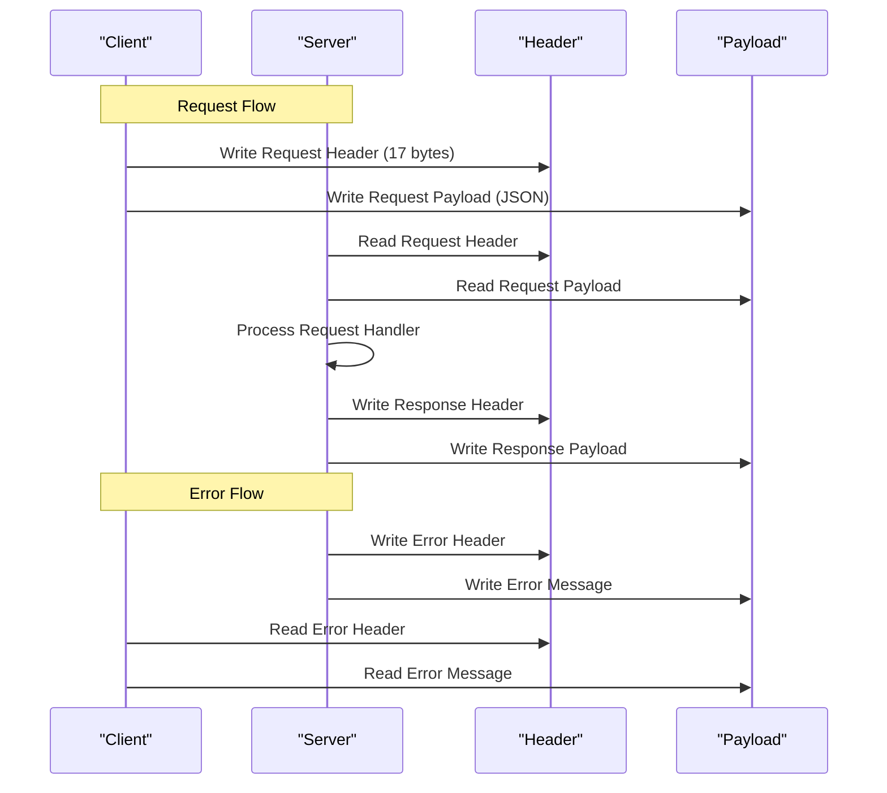
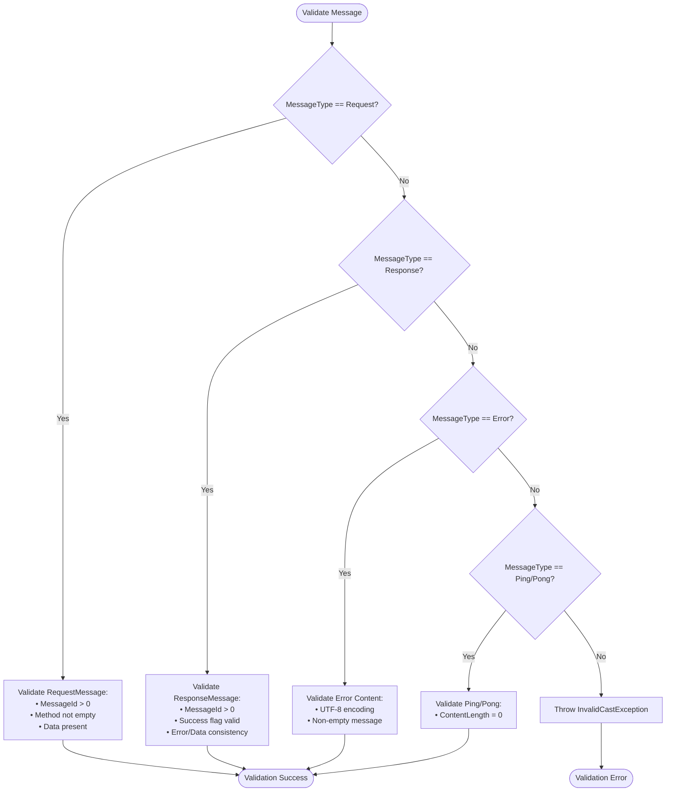
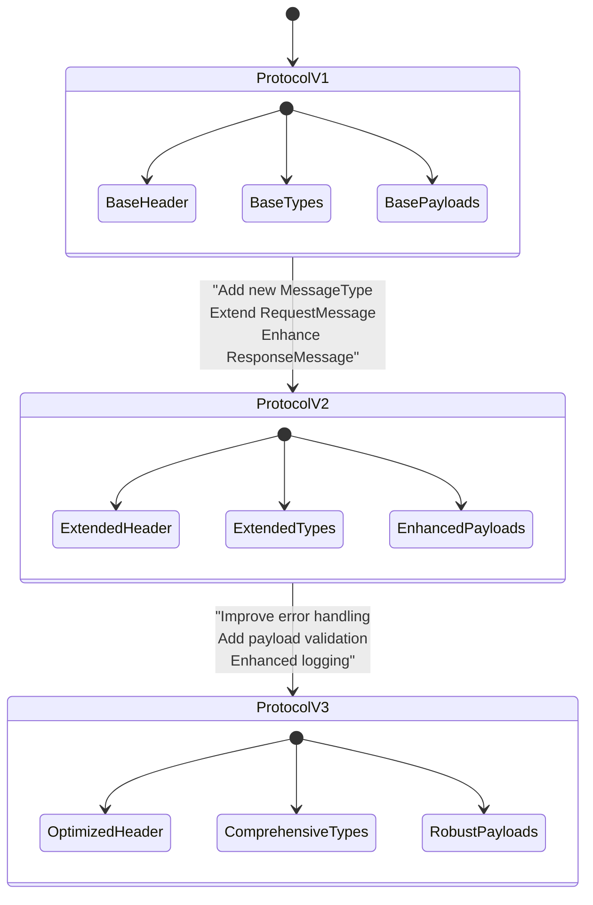

# Message Protocol API

<cite>
**Referenced Files in This Document**
- [MessageHeader.cs](file://TcpRpc/Message/MessageHeader.cs)
- [MessageType.cs](file://TcpRpc/Message/MessageType.cs)
- [RequestMessage.cs](file://TcpRpc/Message/RequestMessage.cs)
- [ResponseMessage.cs](file://TcpRpc/Message/ResponseMessage.cs)
- [IMessageSerializer.cs](file://TcpRpc/Formatter/IMessageSerializer.cs)
- [JsonMessageSerializer.cs](file://TcpRpc/Formatter/JsonMessageSerializer.cs)
- [TcpRpcClient.cs](file://TcpRpc/Client/TcpRpcClient.cs)
- [TcpRpcServer.cs](file://TcpRpc/Server/TcpRpcServer.cs)
- [RpcClientState.cs](file://TcpRpc/Client/RpcClientState.cs)
- [RpcServerState.cs](file://TcpRpc/Server/RpcServerState.cs)
- [RequestHandler.cs](file://TcpRpc/Server/RequestHandler.cs)
</cite>

## Table of Contents
1. [Introduction](#introduction)
2. [Project Structure](#project-structure)
3. [Core Components](#core-components)
4. [Architecture Overview](#architecture-overview)
5. [Detailed Component Analysis](#detailed-component-analysis)
6. [Binary Protocol Specification](#binary-protocol-specification)
7. [Message Validation and Error Handling](#message-validation-and-error-handling)
8. [Protocol Versioning Considerations](#protocol-versioning-considerations)
9. [Usage Examples](#usage-examples)
10. [Performance Considerations](#performance-considerations)
11. [Troubleshooting Guide](#troubleshooting-guide)
12. [Conclusion](#conclusion)

## Introduction

The TcpRpc message protocol defines a binary communication format for RPC (Remote Procedure Call) over TCP connections. This protocol establishes a standardized way to exchange structured messages between clients and servers, supporting request-response patterns, heartbeat pings, and error reporting.

The protocol consists of two primary components: a fixed-size binary header that describes message metadata, and a variable-length content payload containing serialized JSON data. The design emphasizes simplicity, performance, and extensibility while maintaining strict binary format compliance.

## Project Structure

The message protocol implementation is organized into distinct layers within the TcpRpc project:



**Diagram sources**
- [MessageHeader.cs:1-34](file://TcpRpc/Message/MessageHeader.cs#L1-L34)
- [IMessageSerializer.cs:1-13](file://TcpRpc/Formatter/IMessageSerializer.cs#L1-L13)
- [TcpRpcClient.cs:1-405](file://TcpRpc/Client/TcpRpcClient.cs#L1-L405)
- [TcpRpcServer.cs:1-432](file://TcpRpc/Server/TcpRpcServer.cs#L1-L432)

**Section sources**
- [MessageHeader.cs:1-34](file://TcpRpc/Message/MessageHeader.cs#L1-L34)
- [IMessageSerializer.cs:1-13](file://TcpRpc/Formatter/IMessageSerializer.cs#L1-L13)
- [TcpRpcClient.cs:1-405](file://TcpRpc/Client/TcpRpcClient.cs#L1-L405)
- [TcpRpcServer.cs:1-432](file://TcpRpc/Server/TcpRpcServer.cs#L1-L432)

## Core Components

The message protocol consists of four fundamental components that work together to provide reliable binary communication:

### MessageHeader
The MessageHeader serves as the fixed-size binary descriptor for all protocol messages. It contains three essential fields that define message identity, type, and content characteristics.

### MessageType Enumeration
The MessageType enumeration defines the protocol's message categories, establishing clear semantics for different message types and their handling behavior.

### RequestMessage and ResponseMessage
These data models represent the application-level payloads that travel within the protocol's binary framework, carrying method calls and their results.

**Section sources**
- [MessageHeader.cs:5-34](file://TcpRpc/Message/MessageHeader.cs#L5-L34)
- [MessageType.cs:1-10](file://TcpRpc/Message/MessageType.cs#L1-L10)
- [RequestMessage.cs:1-8](file://TcpRpc/Message/RequestMessage.cs#L1-L8)
- [ResponseMessage.cs:1-9](file://TcpRpc/Message/ResponseMessage.cs#L1-L9)

## Architecture Overview

The TcpRpc protocol follows a client-server architecture with clear separation of concerns between message formatting, transport, and application logic:



**Diagram sources**
- [TcpRpcClient.cs:132-189](file://TcpRpc/Client/TcpRpcClient.cs#L132-L189)
- [TcpRpcServer.cs:318-333](file://TcpRpc/Server/TcpRpcServer.cs#L318-L333)
- [JsonMessageSerializer.cs:14-49](file://TcpRpc/Formatter/JsonMessageSerializer.cs#L14-L49)

**Section sources**
- [TcpRpcClient.cs:132-189](file://TcpRpc/Client/TcpRpcClient.cs#L132-L189)
- [TcpRpcServer.cs:318-333](file://TcpRpc/Server/TcpRpcServer.cs#L318-L333)
- [JsonMessageSerializer.cs:14-49](file://TcpRpc/Formatter/JsonMessageSerializer.cs#L14-L49)

## Detailed Component Analysis

### MessageHeader Component

The MessageHeader class implements the fixed 17-byte binary protocol header that precedes all message content. This header provides essential metadata for message identification and parsing.

#### Header Structure and Field Definitions

The 17-byte header follows a strict little-endian layout:

| Offset | Size | Field | Description |
|--------|------|-------|-------------|
| 0 | 1 | Type | Message type identifier (MessageType enum) |
| 1 | 8 | MessageId | Unique message identifier (long) |
| 9 | 4 | ContentLength | Length of following content payload (int) |
| 13 | 4 | Reserved | Not currently used |

#### Serialization Implementation

The header serialization process converts strongly-typed fields into their binary representation:



**Diagram sources**
- [MessageHeader.cs:13-20](file://TcpRpc/Message/MessageHeader.cs#L13-L20)

#### Deserialization Implementation

The deserialization process reconstructs header objects from binary data with comprehensive validation:



**Diagram sources**
- [MessageHeader.cs:22-33](file://TcpRpc/Message/MessageHeader.cs#L22-L33)

**Section sources**
- [MessageHeader.cs:5-34](file://TcpRpc/Message/MessageHeader.cs#L5-L34)

### MessageType Enumeration

The MessageType enumeration defines the protocol's message categories, each serving specific communication purposes:

| Value | Name | Description | Usage Context |
|-------|------|-------------|---------------|
| 0x01 | Request | Client requests for remote procedure execution | Client-to-Server RPC calls |
| 0x02 | Response | Successful server response to client requests | Server-to-Client results |
| 0x03 | Ping | Client heartbeat/ping message | Connection health monitoring |
| 0x04 | Pong | Server acknowledgment to ping messages | Connection health response |
| 0xFF | Error | Error notification from server | Error propagation and handling |

**Section sources**
- [MessageType.cs:1-10](file://TcpRpc/Message/MessageType.cs#L1-L10)

### RequestMessage Data Model

The RequestMessage represents client-side RPC requests with the following structure:

| Property | Type | Required | Description |
|----------|------|----------|-------------|
| MessageId | long | Yes | Unique identifier matching header MessageId |
| Method | string | Yes | Target method name for remote execution |
| Data | byte[] | Yes | Serialized JSON payload containing method parameters |

#### Validation Rules

The RequestMessage enforces strict validation through the serializer:

- MessageId must be greater than 0 (positive integer)
- Method cannot be null or empty
- Data must be present and non-empty
- JSON deserialization must succeed

**Section sources**
- [RequestMessage.cs:1-8](file://TcpRpc/Message/RequestMessage.cs#L1-L8)
- [JsonMessageSerializer.cs:36-44](file://TcpRpc/Formatter/JsonMessageSerializer.cs#L36-L44)

### ResponseMessage Data Model

The ResponseMessage carries server responses with comprehensive error handling:

| Property | Type | Required | Description |
|----------|------|----------|-------------|
| MessageId | long | Yes | Matches original request MessageId |
| Success | bool | Yes | Indicates operation success/failure |
| Error | string | No | Error message when Success is false |
| Data | byte[] | No | Serialized JSON result when Success is true |

#### Validation Rules

ResponseMessage validation ensures protocol compliance:

- MessageId must be greater than 0
- Success flag determines payload structure
- Error field is mandatory when Success is false
- Data field is optional and depends on operation outcome

**Section sources**
- [ResponseMessage.cs:1-9](file://TcpRpc/Message/ResponseMessage.cs#L1-L9)
- [JsonMessageSerializer.cs:74-79](file://TcpRpc/Formatter/JsonMessageSerializer.cs#L74-L79)

### Serialization Interface

The IMessageSerializer interface defines the contract for message payload serialization:



**Diagram sources**
- [IMessageSerializer.cs:5-12](file://TcpRpc/Formatter/IMessageSerializer.cs#L5-L12)
- [JsonMessageSerializer.cs:6-12](file://TcpRpc/Formatter/JsonMessageSerializer.cs#L6-L12)

**Section sources**
- [IMessageSerializer.cs:1-13](file://TcpRpc/Formatter/IMessageSerializer.cs#L1-L13)
- [JsonMessageSerializer.cs:1-85](file://TcpRpc/Formatter/JsonMessageSerializer.cs#L1-L85)

## Binary Protocol Specification

### Fixed Header Format

The protocol establishes a strict 17-byte header format with little-endian encoding:



**Diagram sources**
- [MessageHeader.cs:7](file://TcpRpc/Message/MessageHeader.cs#L7)
- [MessageHeader.cs:13-20](file://TcpRpc/Message/MessageHeader.cs#L13-L20)

### Content Payload Format

Variable-length content follows the header and contains serialized JSON data:

- **Request Content**: JSON-encoded RequestMessage object
- **Response Content**: JSON-encoded ResponseMessage object  
- **Error Content**: UTF-8 encoded error message string
- **Ping/Pong Content**: Empty (ContentLength = 0)

### Transport Protocol Flow



**Diagram sources**
- [TcpRpcClient.cs:152-170](file://TcpRpc/Client/TcpRpcClient.cs#L152-L170)
- [TcpRpcServer.cs:362-376](file://TcpRpc/Server/TcpRpcServer.cs#L362-L376)

**Section sources**
- [MessageHeader.cs:7](file://TcpRpc/Message/MessageHeader.cs#L7)
- [TcpRpcClient.cs:152-170](file://TcpRpc/Client/TcpRpcClient.cs#L152-L170)
- [TcpRpcServer.cs:362-376](file://TcpRpc/Server/TcpRpcServer.cs#L362-L376)

## Message Validation and Error Handling

### Header Validation

The MessageHeader implements comprehensive validation during deserialization:

- **Size Validation**: Minimum 17-byte buffer requirement
- **Type Validation**: MessageType enum conversion with bounds checking
- **Numeric Validation**: Range checks for MessageId and ContentLength

### Payload Validation

The JsonMessageSerializer enforces strict payload validation:



**Diagram sources**
- [JsonMessageSerializer.cs:36-48](file://TcpRpc/Formatter/JsonMessageSerializer.cs#L36-L48)
- [JsonMessageSerializer.cs:74-83](file://TcpRpc/Formatter/JsonMessageSerializer.cs#L74-L83)

### Error Propagation

The protocol implements robust error handling across all components:

- **Client-Side**: Pending requests cancelled with timeout exceptions
- **Server-Side**: Graceful degradation with error responses
- **Transport-Level**: Connection state management and cleanup

**Section sources**
- [JsonMessageSerializer.cs:16-48](file://TcpRpc/Formatter/JsonMessageSerializer.cs#L16-L48)
- [JsonMessageSerializer.cs:53-83](file://TcpRpc/Formatter/JsonMessageSerializer.cs#L53-L83)
- [TcpRpcClient.cs:179-188](file://TcpRpc/Client/TcpRpcClient.cs#L179-L188)

## Protocol Versioning Considerations

### Current Protocol State

The TcpRpc protocol maintains backward compatibility through:

- **Fixed Header Size**: 17-byte header remains constant across versions
- **MessageType Enum**: New message types can be added without breaking existing clients
- **JSON Payloads**: Application-level versioning through JSON schema evolution

### Version Control Mechanisms



### Backward Compatibility Strategies

- **Optional Fields**: New fields marked as optional in JSON payloads
- **Default Values**: Safe defaults for unknown field values
- **Graceful Degradation**: Clients handle unknown message types gracefully

## Usage Examples

### Creating and Serializing a Request Message

```csharp
// Example: Client-side request creation
var request = new RequestMessage
{
    MessageId = messageId,
    Method = "CalculateSum",
    Data = JsonSerializer.SerializeToUtf8Bytes(parameters)
};

var requestData = serializer.SerializeRequest(request);
var header = new MessageHeader
{
    Type = MessageType.Request,
    MessageId = messageId,
    ContentLength = requestData.Length
};
```

**Section sources**
- [TcpRpcClient.cs:145-158](file://TcpRpc/Client/TcpRpcClient.cs#L145-L158)
- [JsonMessageSerializer.cs:14-20](file://TcpRpc/Formatter/JsonMessageSerializer.cs#L14-L20)

### Processing Server Responses

```csharp
// Example: Server-side response handling
var response = await ProcessRequestAsync(request);
var responseData = serializer.SerializeResponse(response);
var responseHeader = new MessageHeader
{
    Type = response.Success ? MessageType.Response : MessageType.Error,
    MessageId = response.MessageId,
    ContentLength = responseData.Length
};
```

**Section sources**
- [TcpRpcServer.cs:335-360](file://TcpRpc/Server/TcpRpcServer.cs#L335-L360)
- [JsonMessageSerializer.cs:51-57](file://TcpRpc/Formatter/JsonMessageSerializer.cs#L51-L57)

### Error Handling Implementation

```csharp
// Example: Client-side error handling
try
{
    var response = await SendRequestAsync(method, data);
    if (!response.Success)
    {
        throw new InvalidOperationException($"RPC Error: {response.Error}");
    }
}
catch (TimeoutException)
{
    // Handle request timeout
}
catch (Exception)
{
    // Handle network errors
}
```

**Section sources**
- [TcpRpcClient.cs:197-203](file://TcpRpc/Client/TcpRpcClient.cs#L197-L203)
- [TcpRpcServer.cs:344-359](file://TcpRpc/Server/TcpRpcServer.cs#L344-L359)

## Performance Considerations

### Memory Management

The protocol optimizes memory usage through:

- **Pre-allocated Buffers**: Fixed-size headers minimize allocation overhead
- **Array Reuse**: Content buffers reused across message processing
- **Streaming Operations**: Large payloads processed in chunks

### Serialization Efficiency

- **JSON Compression**: Minimal JSON formatting reduces payload size
- **UTF-8 Encoding**: Efficient character encoding for internationalization
- **Binary Headers**: Fast parsing of fixed-size metadata

### Concurrency Handling

- **Thread-Safe Operations**: Concurrent dictionaries for request tracking
- **Lock-Free Design**: Atomic operations for message ID generation
- **Async/Await Pattern**: Non-blocking I/O operations

## Troubleshooting Guide

### Common Issues and Solutions

#### Connection Problems
- **Symptom**: Connection refused or reset
- **Cause**: Server not running or port blocked
- **Solution**: Verify server startup and firewall configuration

#### Message Size Exceeded
- **Symptom**: InvalidDataException with "Message too large"
- **Cause**: ContentLength exceeding configured limits
- **Solution**: Implement chunked transfer or increase limits

#### Timeout Errors
- **Symptom**: OperationCanceledException with timeout message
- **Cause**: Slow server response or network latency
- **Solution**: Increase timeout values or optimize server performance

#### Serialization Failures
- **Symptom**: InvalidOperationException during deserialization
- **Cause**: Malformed JSON or invalid message structure
- **Solution**: Validate JSON format and message schema

**Section sources**
- [TcpRpcClient.cs:215-218](file://TcpRpc/Client/TcpRpcClient.cs#L215-L218)
- [TcpRpcServer.cs:264-270](file://TcpRpc/Server/TcpRpcServer.cs#L264-L270)
- [JsonMessageSerializer.cs:36-48](file://TcpRpc/Formatter/JsonMessageSerializer.cs#L36-L48)

### Debugging Techniques

- **Enable Logging**: Configure Microsoft.Extensions.Logging for detailed traces
- **Network Monitoring**: Use packet capture tools to inspect binary headers
- **State Inspection**: Monitor RpcClientState and RpcServerState transitions
- **Payload Analysis**: Log serialized JSON content for validation

## Conclusion

The TcpRpc message protocol provides a robust foundation for binary RPC communication over TCP networks. Its design balances simplicity with extensibility, offering clear separation between transport-level headers and application-level payloads.

Key strengths of the protocol include:

- **Binary Header Standardization**: Fixed 17-byte little-endian format ensures reliable parsing
- **Comprehensive Validation**: Multi-layer validation prevents malformed message processing
- **Flexible Payload Handling**: JSON serialization enables easy schema evolution
- **Robust Error Handling**: Graceful degradation and clear error propagation
- **Performance Optimization**: Efficient memory usage and streaming operations

The protocol's architecture supports future enhancements while maintaining backward compatibility, making it suitable for production systems requiring reliable remote procedure call capabilities.