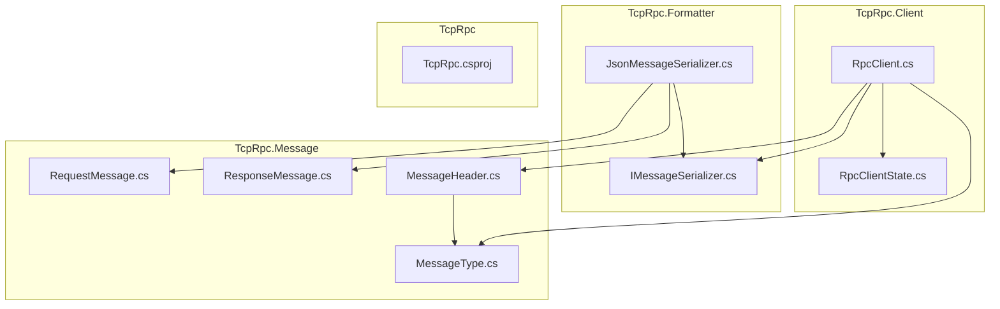
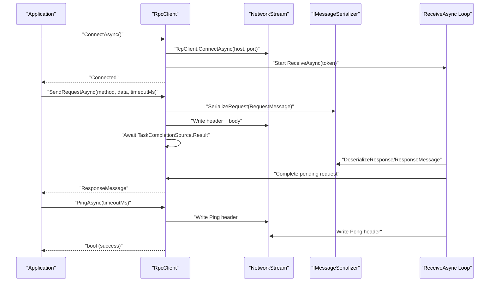
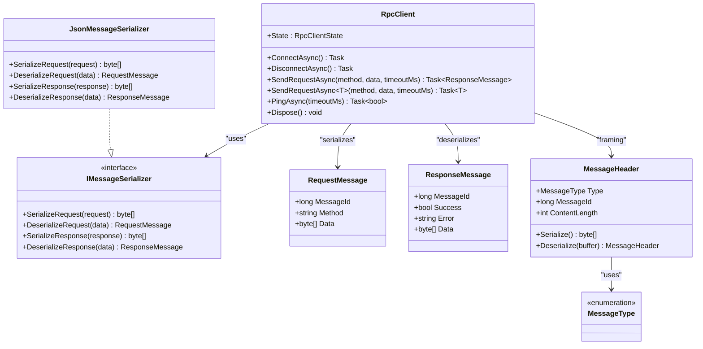

# RpcClient API

<cite>
**Referenced Files in This Document**
- [TcpRpcClient.cs](file://TcpRpc/Client/TcpRpcClient.cs)
- [RpcClientState.cs](file://TcpRpc/Client/RpcClientState.cs)
- [IMessageSerializer.cs](file://TcpRpc/Formatter/IMessageSerializer.cs)
- [JsonMessageSerializer.cs](file://TcpRpc/Formatter/JsonMessageSerializer.cs)
- [RequestMessage.cs](file://TcpRpc/Message/RequestMessage.cs)
- [ResponseMessage.cs](file://TcpRpc/Message/ResponseMessage.cs)
- [MessageHeader.cs](file://TcpRpc/Message/MessageHeader.cs)
- [MessageType.cs](file://TcpRpc/Message/MessageType.cs)
- [TcpRpc.csproj](file://TcpRpc/TcpRpc.csproj)
</cite>

## Table of Contents
1. [Introduction](#introduction)
2. [Project Structure](#project-structure)
3. [Core Components](#core-components)
4. [Architecture Overview](#architecture-overview)
5. [Detailed Component Analysis](#detailed-component-analysis)
6. [Dependency Analysis](#dependency-analysis)
7. [Performance Considerations](#performance-considerations)
8. [Troubleshooting Guide](#troubleshooting-guide)
9. [Conclusion](#conclusion)
10. [Appendices](#appendices)

## Introduction
This document provides comprehensive API documentation for the RpcClient class, the primary client-side component for TCP-based RPC communication. It covers constructor parameters, public methods, state management, threading and async patterns, timeouts and cancellation, error handling, and practical usage examples. The client communicates over a TCP stream, serializes requests and responses, manages pending requests, and supports heartbeat pings.

## Project Structure
The RpcClient resides in the client module and integrates with message and serialization components. The project targets .NET 10 and uses Microsoft.Extensions.Logging for diagnostics.

**Diagram sources**
- [TcpRpcClient.cs:1-405](file://TcpRpc/Client/TcpRpcClient.cs#L1-L405)
- [RpcClientState.cs:1-11](file://TcpRpc/Client/RpcClientState.cs#L1-L11)
- [IMessageSerializer.cs:1-13](file://TcpRpc/Formatter/IMessageSerializer.cs#L1-L13)
- [JsonMessageSerializer.cs:1-85](file://TcpRpc/Formatter/JsonMessageSerializer.cs#L1-L85)
- [RequestMessage.cs:1-8](file://TcpRpc/Message/RequestMessage.cs#L1-L8)
- [ResponseMessage.cs:1-9](file://TcpRpc/Message/ResponseMessage.cs#L1-L9)
- [MessageHeader.cs:1-34](file://TcpRpc/Message/MessageHeader.cs#L1-L34)
- [MessageType.cs:1-10](file://TcpRpc/Message/MessageType.cs#L1-L10)
- [TcpRpc.csproj:1-17](file://TcpRpc/TcpRpc.csproj#L1-L17)

**Section sources**
- [TcpRpcClient.cs:1-405](file://TcpRpc/Client/TcpRpcClient.cs#L1-L405)
- [TcpRpc.csproj:1-17](file://TcpRpc/TcpRpc.csproj#L1-L17)

## Core Components
- RpcClient: Main client class managing TCP connection, request/response lifecycle, heartbeats, and state transitions.
- RpcClientState: Enumeration representing client lifecycle states.
- IMessageSerializer and JsonMessageSerializer: Contract and default JSON-based serializer for messages.
- RequestMessage and ResponseMessage: DTOs for RPC payload transport.
- MessageHeader and MessageType: Protocol framing and message type identifiers.

Key responsibilities:
- Connection management: ConnectAsync, DisconnectAsync, internal receive loop.
- Request handling: SendRequestAsync overloads, pending request tracking, timeout and cancellation.
- Heartbeat: PingAsync with ping/pong protocol.
- Serialization: Using IMessageSerializer to encode/decode messages.
- Threading: Thread-safe state updates, send synchronization, and concurrent pending request handling.

**Section sources**
- [TcpRpcClient.cs:11-405](file://TcpRpc/Client/TcpRpcClient.cs#L11-L405)
- [RpcClientState.cs:3-11](file://TcpRpc/Client/RpcClientState.cs#L3-L11)
- [IMessageSerializer.cs:5-13](file://TcpRpc/Formatter/IMessageSerializer.cs#L5-L13)
- [JsonMessageSerializer.cs:6-85](file://TcpRpc/Formatter/JsonMessageSerializer.cs#L6-L85)
- [RequestMessage.cs:3-8](file://TcpRpc/Message/RequestMessage.cs#L3-L8)
- [ResponseMessage.cs:3-9](file://TcpRpc/Message/ResponseMessage.cs#L3-L9)
- [MessageHeader.cs:5-34](file://TcpRpc/Message/MessageHeader.cs#L5-L34)
- [MessageType.cs:3-10](file://TcpRpc/Message/MessageType.cs#L3-L10)

## Architecture Overview
The client establishes a TCP connection, starts a background receive task, and coordinates request/response exchanges. Requests are serialized with headers and sent asynchronously, while responses and errors are dispatched to pending tasks. Heartbeats use a dedicated ping/pong mechanism.

**Diagram sources**
- [TcpRpcClient.cs:47-189](file://TcpRpc/Client/TcpRpcClient.cs#L47-L189)
- [TcpRpcClient.cs:205-287](file://TcpRpc/Client/TcpRpcClient.cs#L205-L287)
- [IMessageSerializer.cs:7-12](file://TcpRpc/Formatter/IMessageSerializer.cs#L7-L12)
- [MessageHeader.cs:13-33](file://TcpRpc/Message/MessageHeader.cs#L13-L33)
- [MessageType.cs:3-10](file://TcpRpc/Message/MessageType.cs#L3-L10)

## Detailed Component Analysis

### RpcClient Constructor and Dependencies
- Purpose: Initialize RpcClient with host, port, optional serializer, and optional logger.
- Parameters:
  - host: Target hostname or IP address. Required.
  - port: TCP port number. Required.
  - serializer: Optional IMessageSerializer implementation. Defaults to JsonMessageSerializer if null.
  - logger: Optional ILogger<RpcClient>. Defaults to NullLogger if null.
- Exceptions:
  - ArgumentNullException thrown if host is null.
- Dependency Injection Pattern:
  - Serializer and logger are injected via constructor parameters, enabling testability and logging customization.
- Default Values:
  - serializer defaults to JsonMessageSerializer.
  - logger defaults to NullLogger.

Notes:
- The constructor validates host and sets internal fields for later use by connection and messaging logic.

**Section sources**
- [TcpRpcClient.cs:35-41](file://TcpRpc/Client/TcpRpcClient.cs#L35-L41)
- [IMessageSerializer.cs:5-13](file://TcpRpc/Formatter/IMessageSerializer.cs#L5-L13)
- [JsonMessageSerializer.cs:6-12](file://TcpRpc/Formatter/JsonMessageSerializer.cs#L6-L12)

### State Management and Properties
- State Property:
  - Type: RpcClientState
  - Access: Read-only
  - Description: Current lifecycle state of the client.
- RpcClientState Enumeration:
  - Values: Created, Connecting, Connected, Disconnecting, Disconnected, Faulted
  - Notes: The client tracks state with a lock to ensure thread-safe transitions.

Behavior:
- State transitions occur during ConnectAsync, DisconnectAsync, and connection loss events.
- The client checks state before performing operations and throws exceptions when invalid.

**Section sources**
- [TcpRpcClient.cs:33-31](file://TcpRpc/Client/TcpRpcClient.cs#L33-L31)
- [RpcClientState.cs:3-11](file://TcpRpc/Client/RpcClientState.cs#L3-L11)

### Connection Management

#### ConnectAsync()
- Signature: Task ConnectAsync()
- Purpose: Establish TCP connection to the configured host/port.
- Precondition: Client must be in Created or Disconnected state.
- Behavior:
  - Sets state to Connecting.
  - Creates TcpClient, connects asynchronously, obtains NetworkStream.
  - Starts ReceiveAsync task bound to a shared CancellationTokenSource.
  - On success, sets state to Connected.
  - On failure, sets state to Disconnected and rethrows the exception.
- Exceptions:
  - InvalidOperationException: If called while not in Created or Disconnected state.
  - Socket/IO exceptions propagated from TcpClient.ConnectAsync.
- Cancellation and Timeouts:
  - No explicit timeout in ConnectAsync; use cancellation via Dispose or external coordination if needed.

**Section sources**
- [TcpRpcClient.cs:47-80](file://TcpRpc/Client/TcpRpcClient.cs#L47-L80)

#### DisconnectAsync()
- Signature: Task DisconnectAsync()
- Purpose: Gracefully disconnect the client.
- Behavior:
  - Transitions to Disconnecting if currently Connected.
  - Cancels the shared CancellationTokenSource.
  - Waits up to 5 seconds for ReceiveAsync to finish; ignores timeout.
  - Closes NetworkStream and TcpClient.
  - Completes and clears all pending requests with disconnection exceptions.
  - Sets state to Disconnected.
- Exceptions: None thrown by the method itself; cleanup is best-effort.
- Notes:
  - Safe to call multiple times; idempotent when not Connected.

**Section sources**
- [TcpRpcClient.cs:85-130](file://TcpRpc/Client/TcpRpcClient.cs#L85-L130)

### Request Handling

#### SendRequestAsync(string method, byte[] data, int timeoutMs = 30000)
- Signature: Task<ResponseMessage> SendRequestAsync(string method, byte[] data, int timeoutMs = 30000)
- Purpose: Send a raw request and await a ResponseMessage.
- Parameters:
  - method: RPC method name. Required.
  - data: Serialized payload bytes. Required.
  - timeoutMs: Request timeout in milliseconds. Default 30000.
- Behavior:
  - Validates client is Connected.
  - Generates unique MessageId and registers TaskCompletionSource in pendingRequests.
  - Serializes RequestMessage via IMessageSerializer.
  - Writes MessageHeader followed by serialized request to NetworkStream.
  - Awaits completion via TCS.Result with combined cancellation (timeout + client cancellation).
- Exceptions:
  - InvalidOperationException: If not Connected or if adding pending request fails.
  - TimeoutException: If request does not complete within timeoutMs.
  - OperationCanceledException: Propagated when client is shutting down.
  - Other IO/serialization exceptions propagate.
- Concurrency:
  - Uses a SemaphoreSlim to serialize writes to the stream.
  - Pending requests are tracked in a ConcurrentDictionary for thread-safe access.

**Section sources**
- [TcpRpcClient.cs:132-189](file://TcpRpc/Client/TcpRpcClient.cs#L132-L189)

#### SendRequestAsync<T>(string method, object data, int timeoutMs = 30000)
- Signature: Task<T> SendRequestAsync<T>(string method, object data, int timeoutMs = 30000)
- Purpose: Send a typed request and deserialize the response payload.
- Parameters:
  - method: RPC method name. Required.
  - data: Serializable object. Serialized to UTF-8 bytes.
  - timeoutMs: Request timeout in milliseconds. Default 30000.
- Behavior:
  - Calls the byte[] overload internally.
  - Throws if response indicates failure.
  - Deserializes response.Data to type T.
- Exceptions:
  - InvalidOperationException: If response indicates failure or deserialization yields null.
  - TimeoutException: From underlying request timeout.
  - Serialization/IO exceptions propagate.

**Section sources**
- [TcpRpcClient.cs:191-203](file://TcpRpc/Client/TcpRpcClient.cs#L191-L203)

### Heartbeat and Ping

#### PingAsync(int timeoutMs = 5000)
- Signature: Task<bool> PingAsync(int timeoutMs = 5000)
- Purpose: Send a heartbeat ping and wait for pong.
- Behavior:
  - Validates client is Connected.
  - Registers TaskCompletionSource in pendingPings.
  - Sends a Ping header with MessageType.Ping.
  - Awaits Pong response; returns true on success, false on timeout/error.
- Exceptions:
  - Returns false on timeout or exceptions; logs warnings/errors.
- Notes:
  - Does not throw exceptions; returns boolean outcome.

**Section sources**
- [TcpRpcClient.cs:325-382](file://TcpRpc/Client/TcpRpcClient.cs#L325-L382)

### Internal Receive Loop and Message Processing

#### ReceiveAsync(CancellationToken)
- Purpose: Continuously reads headers and content, dispatching to ProcessMessageAsync.
- Behavior:
  - Reads fixed-size MessageHeader, validates content length (enforces 10MB limit).
  - Reads content bytes and processes message.
  - Handles cancellation and connection loss gracefully.
- Exceptions:
  - OperationCanceledException: Expected on shutdown.
  - Other exceptions trigger connection loss handling.

**Section sources**
- [TcpRpcClient.cs:205-236](file://TcpRpc/Client/TcpRpcClient.cs#L205-L236)

#### ProcessMessageAsync(MessageHeader, byte[])
- Purpose: Route received messages to pending request/ping completions.
- Types handled:
  - Response: Completes corresponding pending request.
  - Error: Completes pending request with exception.
  - Pong: Completes pending ping successfully.
- Safety:
  - Uses TryRemove to avoid race conditions.

**Section sources**
- [TcpRpcClient.cs:258-287](file://TcpRpc/Client/TcpRpcClient.cs#L258-L287)

#### ReadBytesAsync(int, CancellationToken)
- Purpose: Read exactly bufferSize bytes from stream.
- Behavior:
  - Continues until buffer is filled.
  - Treats zero-read as connection closure and triggers connection loss handling.
- Exceptions:
  - Throws OperationCanceledException when connection closes unexpectedly.

**Section sources**
- [TcpRpcClient.cs:238-256](file://TcpRpc/Client/TcpRpcClient.cs#L238-L256)

### Resource Disposal and Thread Safety

#### Dispose()
- Purpose: Dispose the client and release resources.
- Behavior:
  - Attempts graceful DisconnectAsync with timeout.
  - Disposes synchronization primitives and streams.
  - Suppresses finalization.
- Thread Safety:
  - Uses an interlocked flag to prevent double-dispose.
  - State transitions guarded by a lock.

**Section sources**
- [TcpRpcClient.cs:384-404](file://TcpRpc/Client/TcpRpcClient.cs#L384-L404)

#### Thread Safety Notes
- State transitions protected by a lock.
- Pending requests and pings tracked with ConcurrentDictionary.
- Send operations synchronized with SemaphoreSlim.
- Read/write loops guard against concurrent access to shared resources.

**Section sources**
- [TcpRpcClient.cs:29-31](file://TcpRpc/Client/TcpRpcClient.cs#L29-L31)
- [TcpRpcClient.cs:18-22](file://TcpRpc/Client/TcpRpcClient.cs#L18-L22)
- [TcpRpcClient.cs:314-318](file://TcpRpc/Client/TcpRpcClient.cs#L314-L318)

### Serialization Contracts

#### IMessageSerializer
- Methods:
  - SerializeRequest(RequestMessage): byte[]
  - DeserializeRequest(byte[]): RequestMessage
  - SerializeResponse(ResponseMessage): byte[]
  - DeserializeResponse(byte[]): ResponseMessage
- Default Implementation:
  - JsonMessageSerializer uses System.Text.Json with camelCase naming and no indentation.

**Section sources**
- [IMessageSerializer.cs:5-13](file://TcpRpc/Formatter/IMessageSerializer.cs#L5-L13)
- [JsonMessageSerializer.cs:6-85](file://TcpRpc/Formatter/JsonMessageSerializer.cs#L6-L85)

#### Message Types and Headers
- MessageType: Request, Response, Ping, Pong, Error.
- MessageHeader: Fixed-size header with Type, MessageId, ContentLength; little-endian encoding.

**Section sources**
- [MessageType.cs:3-10](file://TcpRpc/Message/MessageType.cs#L3-L10)
- [MessageHeader.cs:5-34](file://TcpRpc/Message/MessageHeader.cs#L5-L34)

## Dependency Analysis
The RpcClient depends on:
- IMessageSerializer for message serialization/deserialization.
- MessageHeader and MessageType for framing.
- Microsoft.Extensions.Logging for diagnostic logging.
- TcpClient and NetworkStream for transport.
- ConcurrentDictionary for pending request tracking.
- SemaphoreSlim for write serialization.

**Diagram sources**
- [TcpRpcClient.cs:11-405](file://TcpRpc/Client/TcpRpcClient.cs#L11-L405)
- [IMessageSerializer.cs:5-13](file://TcpRpc/Formatter/IMessageSerializer.cs#L5-L13)
- [JsonMessageSerializer.cs:6-85](file://TcpRpc/Formatter/JsonMessageSerializer.cs#L6-L85)
- [RequestMessage.cs:3-8](file://TcpRpc/Message/RequestMessage.cs#L3-L8)
- [ResponseMessage.cs:3-9](file://TcpRpc/Message/ResponseMessage.cs#L3-L9)
- [MessageHeader.cs:5-34](file://TcpRpc/Message/MessageHeader.cs#L5-L34)
- [MessageType.cs:3-10](file://TcpRpc/Message/MessageType.cs#L3-L10)

**Section sources**
- [TcpRpcClient.cs:11-405](file://TcpRpc/Client/TcpRpcClient.cs#L11-L405)
- [IMessageSerializer.cs:5-13](file://TcpRpc/Formatter/IMessageSerializer.cs#L5-L13)
- [JsonMessageSerializer.cs:6-85](file://TcpRpc/Formatter/JsonMessageSerializer.cs#L6-L85)
- [RequestMessage.cs:3-8](file://TcpRpc/Message/RequestMessage.cs#L3-L8)
- [ResponseMessage.cs:3-9](file://TcpRpc/Message/ResponseMessage.cs#L3-L9)
- [MessageHeader.cs:5-34](file://TcpRpc/Message/MessageHeader.cs#L5-L34)
- [MessageType.cs:3-10](file://TcpRpc/Message/MessageType.cs#L3-L10)

## Performance Considerations
- Serialization overhead: JSON serialization adds CPU cost; consider binary serializers if throughput is critical.
- Concurrency: SemaphoreSlim ensures single-writer to the stream; concurrent requests are queued. For high concurrency, consider batching or connection pooling.
- Pending tracking: ConcurrentDictionary provides O(1) average-time operations; ensure message IDs are unique and bounded.
- Timeouts: Configure appropriate timeoutMs to balance responsiveness and reliability.
- Logging: Excessive logging can impact performance; tune log levels appropriately.

[No sources needed since this section provides general guidance]

## Troubleshooting Guide
Common issues and resolutions:
- Cannot connect from current state:
  - Cause: ConnectAsync called while not in Created or Disconnected.
  - Resolution: Ensure client is Disconnected before connecting.
- Client not connected:
  - Cause: SendRequestAsync called while not Connected.
  - Resolution: Call ConnectAsync first; check State property.
- TimeoutException:
  - Cause: Request did not complete within timeoutMs.
  - Resolution: Increase timeoutMs or investigate server latency/network issues.
- Connection lost:
  - Cause: Server closed connection or network error.
  - Resolution: Reconnect using ConnectAsync; pending requests are canceled.
- Ping failures:
  - Cause: Network issues or server not responding.
  - Resolution: Retry with shorter timeoutMs; monitor logs.

**Section sources**
- [TcpRpcClient.cs:47-80](file://TcpRpc/Client/TcpRpcClient.cs#L47-L80)
- [TcpRpcClient.cs:132-189](file://TcpRpc/Client/TcpRpcClient.cs#L132-L189)
- [TcpRpcClient.cs:205-236](file://TcpRpc/Client/TcpRpcClient.cs#L205-L236)
- [TcpRpcClient.cs:325-382](file://TcpRpc/Client/TcpRpcClient.cs#L325-L382)

## Conclusion
RpcClient provides a robust, asynchronous TCP-based RPC client with clear state management, serialization support, and heartbeat capabilities. It handles timeouts, cancellations, and concurrent requests safely. Use the documented APIs to initialize, connect, send requests, and gracefully shut down the client.

[No sources needed since this section summarizes without analyzing specific files]

## Appendices

### Practical Usage Examples

- Initialization and Dependency Injection
  - Instantiate RpcClient with host, port, optional serializer, and logger.
  - Example path: [TcpRpcClient.cs:35-41](file://TcpRpc/Client/TcpRpcClient.cs#L35-L41)

- Establish Connection
  - Call ConnectAsync; handle InvalidOperationException if state is invalid.
  - Example path: [TcpRpcClient.cs:47-80](file://TcpRpc/Client/TcpRpcClient.cs#L47-L80)

- Send Typed Request and Handle Response
  - Use SendRequestAsync<T> for strongly-typed requests; handle failure and deserialization errors.
  - Example path: [TcpRpcClient.cs:191-203](file://TcpRpc/Client/TcpRpcClient.cs#L191-L203)

- Send Raw Request and Handle ResponseMessage
  - Use SendRequestAsync with byte[] payload; process ResponseMessage.Success and Data.
  - Example path: [TcpRpcClient.cs:132-189](file://TcpRpc/Client/TcpRpcClient.cs#L132-L189)

- Heartbeat Ping
  - Use PingAsync to probe connectivity; returns boolean outcome.
  - Example path: [TcpRpcClient.cs:325-382](file://TcpRpc/Client/TcpRpcClient.cs#L325-L382)

- Graceful Shutdown
  - Call DisconnectAsync to cancel and close resources; Dispose for cleanup.
  - Example path: [TcpRpcClient.cs:85-130](file://TcpRpc/Client/TcpRpcClient.cs#L85-L130), [TcpRpcClient.cs:384-404](file://TcpRpc/Client/TcpRpcClient.cs#L384-L404)

- Timeout and Cancellation
  - Configure timeoutMs in SendRequestAsync and PingAsync.
  - Combine with CancellationTokenSource for cooperative cancellation.
  - Example path: [TcpRpcClient.cs:162-163](file://TcpRpc/Client/TcpRpcClient.cs#L162-L163), [TcpRpcClient.cs:350-351](file://TcpRpc/Client/TcpRpcClient.cs#L350-L351)

- Concurrent Request Handling
  - Multiple SendRequestAsync calls are safe; internal synchronization prevents interleaving.
  - Example path: [TcpRpcClient.cs:18-22](file://TcpRpc/Client/TcpRpcClient.cs#L18-L22), [TcpRpcClient.cs:132-189](file://TcpRpc/Client/TcpRpcClient.cs#L132-L189)

### API Reference Summary

- Constructors
  - RpcClient(string host, int port, IMessageSerializer? serializer = null, ILogger<RpcClient>? logger = null)
  - Parameters: host (required), port (required), serializer (optional), logger (optional)
  - Exceptions: ArgumentNullException for null host

- Properties
  - State: RpcClientState (read-only)

- Methods
  - ConnectAsync(): Task
  - DisconnectAsync(): Task
  - SendRequestAsync(string method, byte[] data, int timeoutMs = 30000): Task<ResponseMessage>
  - SendRequestAsync<T>(string method, object data, int timeoutMs = 30000): Task<T>
  - PingAsync(int timeoutMs = 5000): Task<bool>
  - Dispose(): void

- Exceptions
  - InvalidOperationException: Invalid state transitions, not connected, or request registration failure
  - TimeoutException: Request or ping timeout
  - OperationCanceledException: Client shutdown or cancellation
  - Other IO/serialization exceptions propagate

**Section sources**
- [TcpRpcClient.cs:35-41](file://TcpRpc/Client/TcpRpcClient.cs#L35-L41)
- [TcpRpcClient.cs:47-80](file://TcpRpc/Client/TcpRpcClient.cs#L47-L80)
- [TcpRpcClient.cs:85-130](file://TcpRpc/Client/TcpRpcClient.cs#L85-L130)
- [TcpRpcClient.cs:132-203](file://TcpRpc/Client/TcpRpcClient.cs#L132-L203)
- [TcpRpcClient.cs:325-382](file://TcpRpc/Client/TcpRpcClient.cs#L325-L382)
- [TcpRpcClient.cs:384-404](file://TcpRpc/Client/TcpRpcClient.cs#L384-L404)