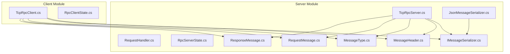
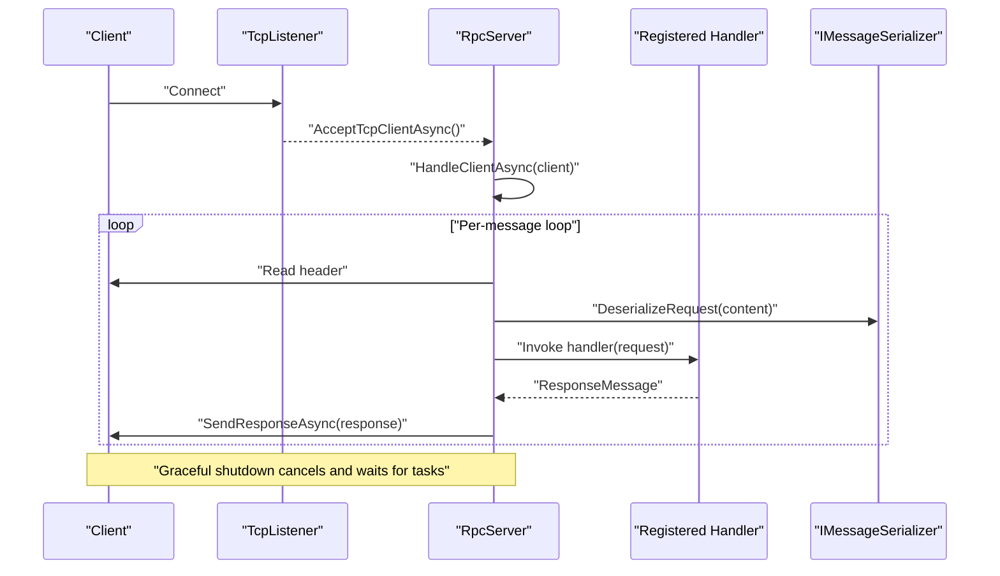
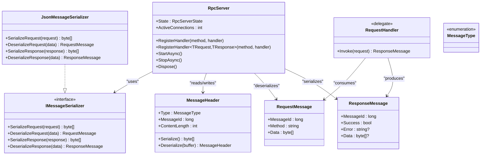

# RpcServer API

<cite>
**Referenced Files in This Document**
- [TcpRpcServer.cs](file://TcpRpc/Server/TcpRpcServer.cs)
- [RequestHandler.cs](file://TcpRpc/Server/RequestHandler.cs)
- [RpcServerState.cs](file://TcpRpc/Server/RpcServerState.cs)
- [IMessageSerializer.cs](file://TcpRpc/Formatter/IMessageSerializer.cs)
- [JsonMessageSerializer.cs](file://TcpRpc/Formatter/JsonMessageSerializer.cs)
- [MessageHeader.cs](file://TcpRpc/Message/MessageHeader.cs)
- [MessageType.cs](file://TcpRpc/Message/MessageType.cs)
- [RequestMessage.cs](file://TcpRpc/Message/RequestMessage.cs)
- [ResponseMessage.cs](file://TcpRpc/Message/ResponseMessage.cs)
- [TcpRpcClient.cs](file://TcpRpc/Client/TcpRpcClient.cs)
- [RpcClientState.cs](file://TcpRpc/Client/RpcClientState.cs)
</cite>

## Table of Contents
1. [Introduction](#introduction)
2. [Project Structure](#project-structure)
3. [Core Components](#core-components)
4. [Architecture Overview](#architecture-overview)
5. [Detailed Component Analysis](#detailed-component-analysis)
6. [Dependency Analysis](#dependency-analysis)
7. [Performance Considerations](#performance-considerations)
8. [Troubleshooting Guide](#troubleshooting-guide)
9. [Conclusion](#conclusion)
10. [Appendices](#appendices)

## Introduction
This document provides comprehensive API documentation for the RpcServer class, the server-side component that manages TCP-based RPC services. It covers constructor parameters, handler registration mechanisms, server lifecycle methods, state management, and operational behavior. It also documents the RequestHandler delegate signature and usage patterns, concurrent request processing, graceful shutdown procedures, and monitoring approaches.

## Project Structure
The RpcServer resides in the server module alongside supporting message and serialization infrastructure. The client module demonstrates the complementary RPC client behavior for reference.

**Diagram sources**
- [TcpRpcServer.cs:1-432](file://TcpRpc/Server/TcpRpcServer.cs#L1-L432)
- [RequestHandler.cs:1-5](file://TcpRpc/Server/RequestHandler.cs#L1-L5)
- [RpcServerState.cs:1-10](file://TcpRpc/Server/RpcServerState.cs#L1-L10)
- [IMessageSerializer.cs:1-13](file://TcpRpc/Formatter/IMessageSerializer.cs#L1-L13)
- [JsonMessageSerializer.cs:1-85](file://TcpRpc/Formatter/JsonMessageSerializer.cs#L1-L85)
- [MessageHeader.cs:1-34](file://TcpRpc/Message/MessageHeader.cs#L1-L34)
- [MessageType.cs:1-10](file://TcpRpc/Message/MessageType.cs#L1-L10)
- [RequestMessage.cs:1-8](file://TcpRpc/Message/RequestMessage.cs#L1-L8)
- [ResponseMessage.cs:1-9](file://TcpRpc/Message/ResponseMessage.cs#L1-L9)
- [TcpRpcClient.cs:1-405](file://TcpRpc/Client/TcpRpcClient.cs#L1-L405)
- [RpcClientState.cs:1-11](file://TcpRpc/Client/RpcClientState.cs#L1-L11)

**Section sources**
- [TcpRpcServer.cs:1-432](file://TcpRpc/Server/TcpRpcServer.cs#L1-L432)
- [IMessageSerializer.cs:1-13](file://TcpRpc/Formatter/IMessageSerializer.cs#L1-L13)
- [MessageHeader.cs:1-34](file://TcpRpc/Message/MessageHeader.cs#L1-L34)

## Core Components
- RpcServer: The primary server class managing TCP listener, client connections, handler dispatch, and lifecycle.
- RequestHandler: Delegate type for implementing business logic handlers.
- RpcServerState: Enumeration representing server operational states.
- IMessageSerializer and JsonMessageSerializer: Serialization contract and default JSON implementation.
- Message types: MessageHeader, MessageType, RequestMessage, ResponseMessage define the wire protocol.

Key responsibilities:
- Manage TCP listener and accept client connections asynchronously.
- Maintain handler registry keyed by method name.
- Process inbound messages (requests and pings) and send responses.
- Enforce state transitions and guard conditions.
- Provide graceful shutdown with cancellation and resource cleanup.

**Section sources**
- [TcpRpcServer.cs:12-432](file://TcpRpc/Server/TcpRpcServer.cs#L12-L432)
- [RequestHandler.cs:1-5](file://TcpRpc/Server/RequestHandler.cs#L1-L5)
- [RpcServerState.cs:1-10](file://TcpRpc/Server/RpcServerState.cs#L1-L10)
- [IMessageSerializer.cs:1-13](file://TcpRpc/Formatter/IMessageSerializer.cs#L1-L13)
- [JsonMessageSerializer.cs:1-85](file://TcpRpc/Formatter/JsonMessageSerializer.cs#L1-L85)
- [MessageHeader.cs:1-34](file://TcpRpc/Message/MessageHeader.cs#L1-L34)
- [MessageType.cs:1-10](file://TcpRpc/Message/MessageType.cs#L1-L10)
- [RequestMessage.cs:1-8](file://TcpRpc/Message/RequestMessage.cs#L1-L8)
- [ResponseMessage.cs:1-9](file://TcpRpc/Message/ResponseMessage.cs#L1-L9)

## Architecture Overview
The server operates a TCP listener, spawns a per-client task for each accepted connection, and processes requests concurrently. Handlers are registered by method name and invoked to produce responses. The server tracks state and active connections and supports graceful shutdown.

**Diagram sources**
- [TcpRpcServer.cs:101-173](file://TcpRpc/Server/TcpRpcServer.cs#L101-L173)
- [TcpRpcServer.cs:228-316](file://TcpRpc/Server/TcpRpcServer.cs#L228-L316)
- [TcpRpcServer.cs:318-360](file://TcpRpc/Server/TcpRpcServer.cs#L318-L360)
- [IMessageSerializer.cs:1-13](file://TcpRpc/Formatter/IMessageSerializer.cs#L1-L13)

## Detailed Component Analysis

### RpcServer Class API
- Constructor
  - Parameters:
    - port: Port number to bind the TCP listener.
    - serializer: Optional IMessageSerializer instance; defaults to JsonMessageSerializer.
    - logger: Optional ILogger<RpcServer>; defaults to NullLogger.
  - Behavior: Stores parameters and initializes internal state and synchronization primitives.

- Properties
  - State: Current RpcServerState (Stopped, Starting, Running, Stopping, Faulted).
  - ActiveConnections: Approximate count of currently connected clients (removes completed tasks internally).

- Handler Registration
  - RegisterHandler(method, RequestHandler): Registers a delegate that receives RequestMessage and returns ResponseMessage.
  - RegisterHandler<TRequest, TResponse>(method, Func<TRequest, Task<TResponse>>): Registers a typed handler that accepts strongly-typed request and returns strongly-typed response. The server serializes/deserializes automatically and wraps exceptions into ResponseMessage with Success=false and Error populated.

- Lifecycle Methods
  - StartAsync(): Starts the TCP listener, transitions to Running, and begins accepting clients. Throws if already started or disposed. On fault, sets Faulted and rethrows.
  - StopAsync(): Stops accepting new connections, cancels all operations, waits up to 10 seconds for active client tasks to finish, clears client tasks, and transitions to Stopped.
  - Dispose(): Calls StopAsync() with timeout, disposes cancellation tokens, and suppresses finalization.

- Client Connection Management
  - Each accepted TcpClient is handled in a dedicated Task with HandleClientAsync(client, clientId, cancellationToken).
  - Reads message headers and content with timeouts, validates content length limits, and processes requests or pings.
  - On errors, logs and continues to next message; on shutdown, cancels and exits gracefully.

- Concurrency and Threading
  - Uses a CancellationTokenSource per server instance to coordinate shutdown across all tasks.
  - Maintains a concurrent dictionary of handlers keyed by method name.
  - Uses locks around state transitions and client task lists to ensure thread safety.
  - Each client runs independently on its own task; handlers are awaited synchronously per message.

- Error Handling and Exceptions
  - Handler exceptions are caught and returned as ResponseMessage with Success=false and Error set.
  - Message deserialization failures return explicit error responses.
  - OperationCanceledException during shutdown is treated as normal termination.
  - Logging via ILogger<RpcServer> is used for informational and error events.

- Monitoring and Observability
  - Logs server start/stop, client connect/disconnect, timeouts, and errors.
  - Exposes State and ActiveConnections for external monitoring.

**Section sources**
- [TcpRpcServer.cs:43-48](file://TcpRpc/Server/TcpRpcServer.cs#L43-L48)
- [TcpRpcServer.cs:50-99](file://TcpRpc/Server/TcpRpcServer.cs#L50-L99)
- [TcpRpcServer.cs:101-173](file://TcpRpc/Server/TcpRpcServer.cs#L101-L173)
- [TcpRpcServer.cs:175-226](file://TcpRpc/Server/TcpRpcServer.cs#L175-L226)
- [TcpRpcServer.cs:228-316](file://TcpRpc/Server/TcpRpcServer.cs#L228-L316)
- [TcpRpcServer.cs:318-360](file://TcpRpc/Server/TcpRpcServer.cs#L318-L360)
- [TcpRpcServer.cs:362-406](file://TcpRpc/Server/TcpRpcServer.cs#L362-L406)
- [RpcServerState.cs:1-10](file://TcpRpc/Server/RpcServerState.cs#L1-L10)

### RequestHandler Delegate
- Signature: Task<ResponseMessage> RequestHandler(RequestMessage request)
- Purpose: Encapsulates business logic for a given method. Receives serialized request data and returns a ResponseMessage indicating success or failure along with optional data payload.
- Usage patterns:
  - Implement a delegate that performs validation, invokes domain services, and returns a ResponseMessage.
  - Use RegisterHandler overload to register delegates directly.
  - Use RegisterHandler<TRequest, TResponse> to register strongly-typed handlers; the server handles serialization/deserialization and exception wrapping.

**Section sources**
- [RequestHandler.cs:1-5](file://TcpRpc/Server/RequestHandler.cs#L1-L5)
- [TcpRpcServer.cs:50-99](file://TcpRpc/Server/TcpRpcServer.cs#L50-L99)

### RpcServerState Enumeration
- Values: Stopped, Starting, Running, Stopping, Faulted
- Impact:
  - Guards operations (e.g., cannot register handlers while not Stopped).
  - Controls StartAsync/StopAsync behavior and prevents invalid transitions.
  - Used for logging and monitoring.

**Section sources**
- [RpcServerState.cs:1-10](file://TcpRpc/Server/RpcServerState.cs#L1-L10)
- [TcpRpcServer.cs:54-55](file://TcpRpc/Server/TcpRpcServer.cs#L54-L55)
- [TcpRpcServer.cs:107-108](file://TcpRpc/Server/TcpRpcServer.cs#L107-L108)
- [TcpRpcServer.cs:157-161](file://TcpRpc/Server/TcpRpcServer.cs#L157-L161)
- [TcpRpcServer.cs:181-182](file://TcpRpc/Server/TcpRpcServer.cs#L181-L182)

### Message Protocol and Serialization
- MessageHeader: Fixed-size header containing MessageType, MessageId, and ContentLength.
- MessageType: Request, Response, Ping, Pong, Error.
- RequestMessage: Contains MessageId, Method, and Data.
- ResponseMessage: Contains MessageId, Success, optional Error, and optional Data.
- IMessageSerializer: Contract for serializing/deserializing messages.
- JsonMessageSerializer: Default JSON implementation with validation and error handling.

**Section sources**
- [MessageHeader.cs:1-34](file://TcpRpc/Message/MessageHeader.cs#L1-L34)
- [MessageType.cs:1-10](file://TcpRpc/Message/MessageType.cs#L1-L10)
- [RequestMessage.cs:1-8](file://TcpRpc/Message/RequestMessage.cs#L1-L8)
- [ResponseMessage.cs:1-9](file://TcpRpc/Message/ResponseMessage.cs#L1-L9)
- [IMessageSerializer.cs:1-13](file://TcpRpc/Formatter/IMessageSerializer.cs#L1-L13)
- [JsonMessageSerializer.cs:1-85](file://TcpRpc/Formatter/JsonMessageSerializer.cs#L1-L85)

### Client-Side Reference
While not part of the server API, TcpRpcClient demonstrates the complementary client behavior for context:
- ConnectAsync/DisconnectAsync manage connection lifecycle.
- SendRequestAsync supports both raw byte arrays and strongly-typed objects.
- Supports ping/pong and error propagation.

**Section sources**
- [TcpRpcClient.cs:47-80](file://TcpRpc/Client/TcpRpcClient.cs#L47-L80)
- [TcpRpcClient.cs:132-203](file://TcpRpc/Client/TcpRpcClient.cs#L132-L203)
- [TcpRpcClient.cs:205-287](file://TcpRpc/Client/TcpRpcClient.cs#L205-L287)
- [RpcClientState.cs:1-11](file://TcpRpc/Client/RpcClientState.cs#L1-L11)

## Dependency Analysis

**Diagram sources**
- [TcpRpcServer.cs:12-432](file://TcpRpc/Server/TcpRpcServer.cs#L12-L432)
- [RequestHandler.cs:1-5](file://TcpRpc/Server/RequestHandler.cs#L1-L5)
- [IMessageSerializer.cs:1-13](file://TcpRpc/Formatter/IMessageSerializer.cs#L1-L13)
- [JsonMessageSerializer.cs:1-85](file://TcpRpc/Formatter/JsonMessageSerializer.cs#L1-L85)
- [MessageHeader.cs:1-34](file://TcpRpc/Message/MessageHeader.cs#L1-L34)
- [MessageType.cs:1-10](file://TcpRpc/Message/MessageType.cs#L1-L10)
- [RequestMessage.cs:1-8](file://TcpRpc/Message/RequestMessage.cs#L1-L8)
- [ResponseMessage.cs:1-9](file://TcpRpc/Message/ResponseMessage.cs#L1-L9)

**Section sources**
- [TcpRpcServer.cs:1-432](file://TcpRpc/Server/TcpRpcServer.cs#L1-L432)
- [IMessageSerializer.cs:1-13](file://TcpRpc/Formatter/IMessageSerializer.cs#L1-L13)
- [JsonMessageSerializer.cs:1-85](file://TcpRpc/Formatter/JsonMessageSerializer.cs#L1-L85)
- [MessageHeader.cs:1-34](file://TcpRpc/Message/MessageHeader.cs#L1-L34)
- [RequestMessage.cs:1-8](file://TcpRpc/Message/RequestMessage.cs#L1-L8)
- [ResponseMessage.cs:1-9](file://TcpRpc/Message/ResponseMessage.cs#L1-L9)

## Performance Considerations
- Concurrency: Each client connection is handled in a separate task, enabling concurrent request processing. The server maintains a list of client tasks and removes completed ones periodically.
- Backpressure: The server does not enforce a queue depth for incoming requests; each client task processes messages sequentially until cancellation occurs.
- Timeouts: Message reads use per-operation cancellation tokens with timeouts to prevent indefinite blocking. Content length limits protect against oversized messages.
- Serialization: JSON serialization is used for request/response payloads. Consider compression or binary formats if throughput is critical.
- Resource cleanup: Dispose patterns ensure cancellation tokens and streams are released promptly during shutdown.

[No sources needed since this section provides general guidance]

## Troubleshooting Guide
Common scenarios and resolutions:
- Cannot register handler while server is running: Ensure the server is Stopped before registering handlers.
- StartAsync fails with "already started": Verify State is Stopped before calling StartAsync.
- Handler exceptions: The server wraps exceptions into ResponseMessage with Success=false and Error populated.
- Client disconnects: The server logs and continues processing other messages; client tasks exit gracefully on disconnect.
- Shutdown hangs: StopAsync waits up to 10 seconds for active clients; ensure clients close connections or cancel operations.

Operational checks:
- Monitor State transitions and ActiveConnections for health.
- Review logs for connection events, timeouts, and errors.

**Section sources**
- [TcpRpcServer.cs:54-55](file://TcpRpc/Server/TcpRpcServer.cs#L54-L55)
- [TcpRpcServer.cs:107-108](file://TcpRpc/Server/TcpRpcServer.cs#L107-L108)
- [TcpRpcServer.cs:340-359](file://TcpRpc/Server/TcpRpcServer.cs#L340-L359)
- [TcpRpcServer.cs:290-304](file://TcpRpc/Server/TcpRpcServer.cs#L290-L304)
- [TcpRpcServer.cs:206-211](file://TcpRpc/Server/TcpRpcServer.cs#L206-L211)

## Conclusion
RpcServer provides a robust, asynchronous TCP-based RPC server with strong typing support for handlers, comprehensive state management, and graceful shutdown semantics. Its design enables concurrent client handling, clear error propagation, and straightforward monitoring. Proper use of handler registration, lifecycle methods, and cancellation ensures reliable operation under load.

[No sources needed since this section summarizes without analyzing specific files]

## Appendices

### API Reference Summary

- RpcServer
  - Constructor: RpcServer(port, serializer = null, logger = null)
  - Properties: State, ActiveConnections
  - Methods: RegisterHandler(method, RequestHandler), RegisterHandler<TRequest, TResponse>(method, Func<TRequest, Task<TResponse>>), StartAsync(), StopAsync(), Dispose()

- RequestHandler
  - Signature: Task<ResponseMessage> RequestHandler(RequestMessage)

- RpcServerState
  - Values: Stopped, Starting, Running, Stopping, Faulted

- IMessageSerializer
  - Methods: SerializeRequest, DeserializeRequest, SerializeResponse, DeserializeResponse

- JsonMessageSerializer
  - Implements IMessageSerializer with JSON serialization and validation

- Message Types
  - MessageHeader, MessageType, RequestMessage, ResponseMessage

**Section sources**
- [TcpRpcServer.cs:43-48](file://TcpRpc/Server/TcpRpcServer.cs#L43-L48)
- [TcpRpcServer.cs:50-99](file://TcpRpc/Server/TcpRpcServer.cs#L50-L99)
- [TcpRpcServer.cs:101-173](file://TcpRpc/Server/TcpRpcServer.cs#L101-L173)
- [TcpRpcServer.cs:175-226](file://TcpRpc/Server/TcpRpcServer.cs#L175-L226)
- [RequestHandler.cs:1-5](file://TcpRpc/Server/RequestHandler.cs#L1-L5)
- [RpcServerState.cs:1-10](file://TcpRpc/Server/RpcServerState.cs#L1-L10)
- [IMessageSerializer.cs:1-13](file://TcpRpc/Formatter/IMessageSerializer.cs#L1-L13)
- [JsonMessageSerializer.cs:1-85](file://TcpRpc/Formatter/JsonMessageSerializer.cs#L1-L85)
- [MessageHeader.cs:1-34](file://TcpRpc/Message/MessageHeader.cs#L1-L34)
- [MessageType.cs:1-10](file://TcpRpc/Message/MessageType.cs#L1-L10)
- [RequestMessage.cs:1-8](file://TcpRpc/Message/RequestMessage.cs#L1-L8)
- [ResponseMessage.cs:1-9](file://TcpRpc/Message/ResponseMessage.cs#L1-L9)

### Example Scenarios (Code Paths)
- Server setup and handler registration:
  - [TcpRpcServer.cs:43-48](file://TcpRpc/Server/TcpRpcServer.cs#L43-L48)
  - [TcpRpcServer.cs:50-58](file://TcpRpc/Server/TcpRpcServer.cs#L50-L58)
  - [TcpRpcServer.cs:60-99](file://TcpRpc/Server/TcpRpcServer.cs#L60-L99)

- Concurrent client handling:
  - [TcpRpcServer.cs:136-147](file://TcpRpc/Server/TcpRpcServer.cs#L136-L147)
  - [TcpRpcServer.cs:228-316](file://TcpRpc/Server/TcpRpcServer.cs#L228-L316)

- Graceful shutdown:
  - [TcpRpcServer.cs:175-226](file://TcpRpc/Server/TcpRpcServer.cs#L175-L226)

- Handler invocation and response:
  - [TcpRpcServer.cs:318-360](file://TcpRpc/Server/TcpRpcServer.cs#L318-L360)
  - [TcpRpcServer.cs:362-376](file://TcpRpc/Server/TcpRpcServer.cs#L362-L376)

- Threading and cancellation:
  - [TcpRpcServer.cs:17-27](file://TcpRpc/Server/TcpRpcServer.cs#L17-L27)
  - [TcpRpcServer.cs:119-123](file://TcpRpc/Server/TcpRpcServer.cs#L119-L123)
  - [TcpRpcServer.cs:193-193](file://TcpRpc/Server/TcpRpcServer.cs#L193-L193)

- Monitoring and logging:
  - [TcpRpcServer.cs:132-132](file://TcpRpc/Server/TcpRpcServer.cs#L132-L132)
  - [TcpRpcServer.cs:231-231](file://TcpRpc/Server/TcpRpcServer.cs#L231-L231)
  - [TcpRpcServer.cs:302-302](file://TcpRpc/Server/TcpRpcServer.cs#L302-L302)
  - [TcpRpcServer.cs:210-210](file://TcpRpc/Server/TcpRpcServer.cs#L210-L210)