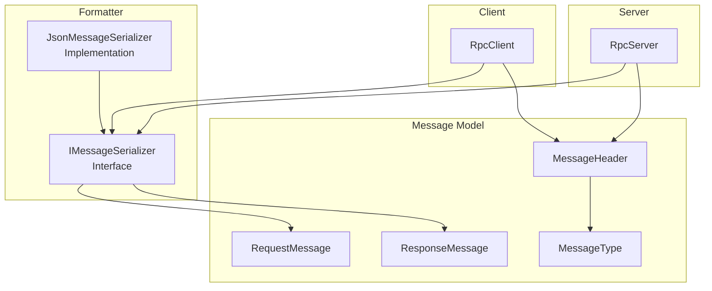
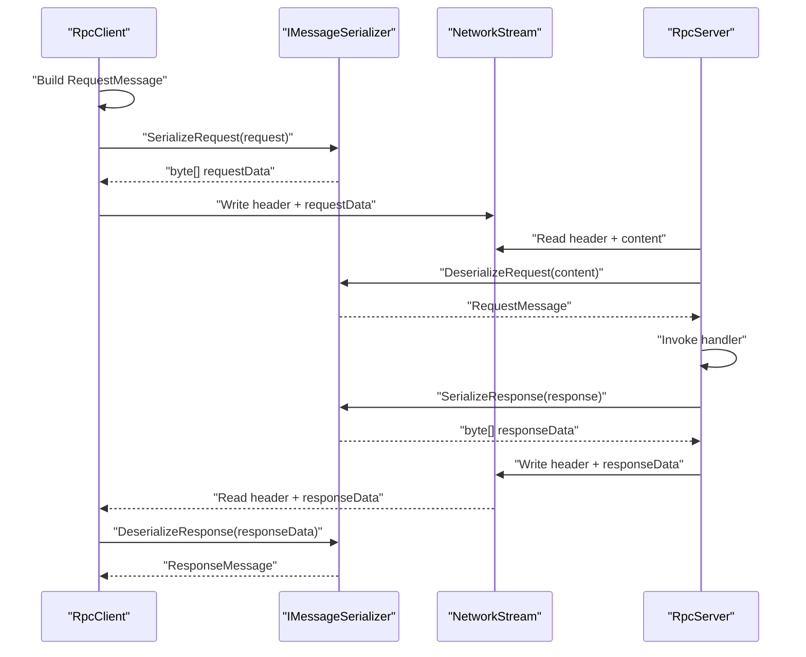
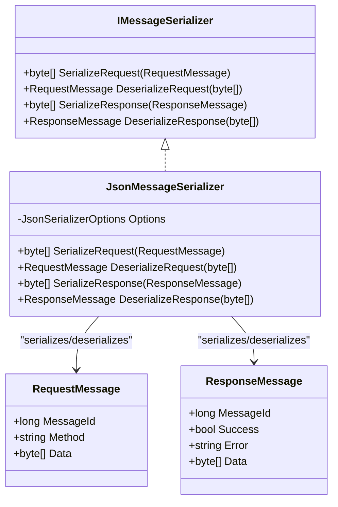
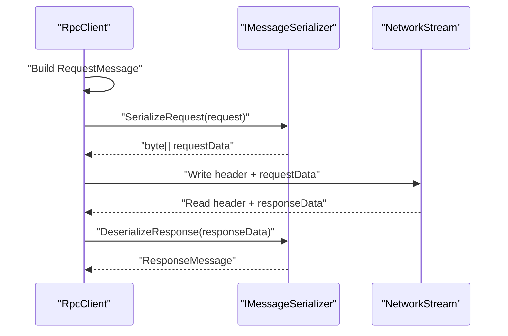
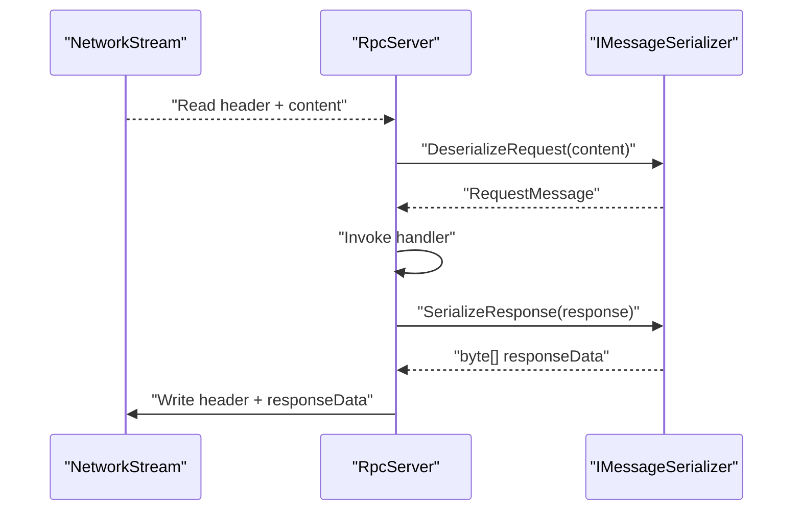
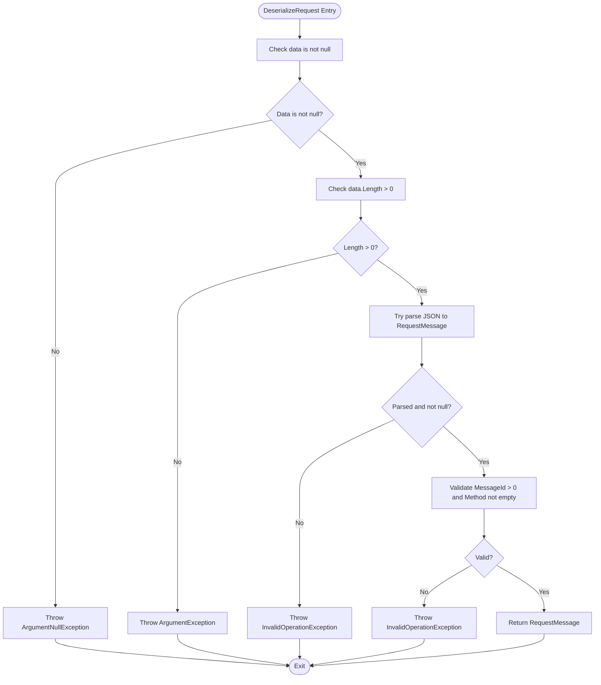
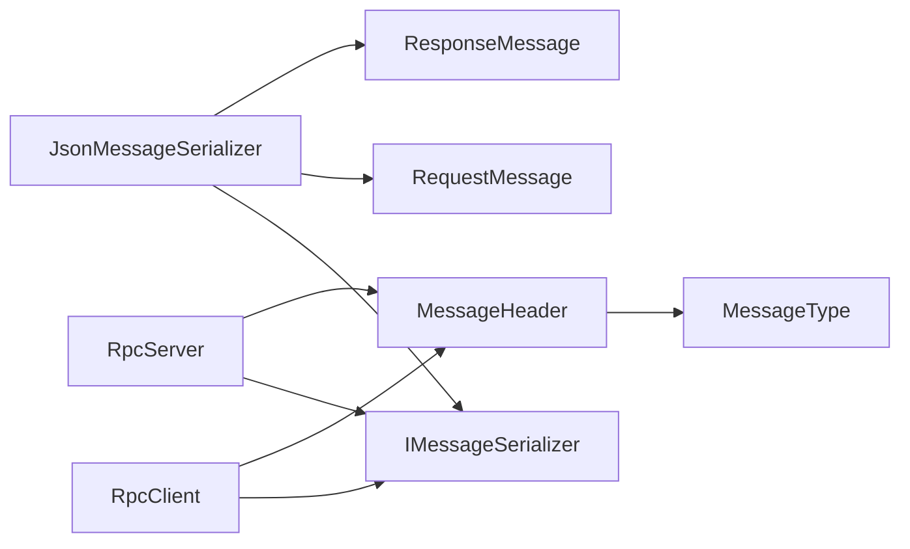

# Serialization API

<cite>
**Referenced Files in This Document**
- [IMessageSerializer.cs](file://TcpRpc/Formatter/IMessageSerializer.cs)
- [JsonMessageSerializer.cs](file://TcpRpc/Formatter/JsonMessageSerializer.cs)
- [RequestMessage.cs](file://TcpRpc/Message/RequestMessage.cs)
- [ResponseMessage.cs](file://TcpRpc/Message/ResponseMessage.cs)
- [MessageHeader.cs](file://TcpRpc/Message/MessageHeader.cs)
- [MessageType.cs](file://TcpRpc/Message/MessageType.cs)
- [TcpRpcClient.cs](file://TcpRpc/Client/TcpRpcClient.cs)
- [TcpRpcServer.cs](file://TcpRpc/Server/TcpRpcServer.cs)
- [RpcClientState.cs](file://TcpRpc/Client/RpcClientState.cs)
- [RpcServerState.cs](file://TcpRpc/Server/RpcServerState.cs)
</cite>

## Table of Contents
1. [Introduction](#introduction)
2. [Project Structure](#project-structure)
3. [Core Components](#core-components)
4. [Architecture Overview](#architecture-overview)
5. [Detailed Component Analysis](#detailed-component-analysis)
6. [Dependency Analysis](#dependency-analysis)
7. [Performance Considerations](#performance-considerations)
8. [Troubleshooting Guide](#troubleshooting-guide)
9. [Conclusion](#conclusion)

## Introduction
This document provides detailed API documentation for the serialization system that powers pluggable message serialization in the TCP RPC framework. It covers the IMessageSerializer interface contract, the default JsonMessageSerializer implementation, and how these integrate with RpcClient and RpcServer. It also documents method specifications, parameter and return value requirements, exception types, validation mechanisms, performance characteristics, and integration patterns.

## Project Structure
The serialization system resides under the Formatter namespace and integrates with the Message model and the client/server transport layers.

**Diagram sources**
- [IMessageSerializer.cs:5-13](file://TcpRpc/Formatter/IMessageSerializer.cs#L5-L13)
- [JsonMessageSerializer.cs:6-85](file://TcpRpc/Formatter/JsonMessageSerializer.cs#L6-L85)
- [RequestMessage.cs:3-8](file://TcpRpc/Message/RequestMessage.cs#L3-L8)
- [ResponseMessage.cs:3-9](file://TcpRpc/Message/ResponseMessage.cs#L3-L9)
- [MessageHeader.cs:5-34](file://TcpRpc/Message/MessageHeader.cs#L5-L34)
- [MessageType.cs:3-10](file://TcpRpc/Message/MessageType.cs#L3-L10)
- [TcpRpcClient.cs:11-41](file://TcpRpc/Client/TcpRpcClient.cs#L11-L41)
- [TcpRpcServer.cs:12-48](file://TcpRpc/Server/TcpRpcServer.cs#L12-L48)

**Section sources**
- [IMessageSerializer.cs:1-13](file://TcpRpc/Formatter/IMessageSerializer.cs#L1-L13)
- [JsonMessageSerializer.cs:1-85](file://TcpRpc/Formatter/JsonMessageSerializer.cs#L1-L85)
- [RequestMessage.cs:1-8](file://TcpRpc/Message/RequestMessage.cs#L1-L8)
- [ResponseMessage.cs:1-9](file://TcpRpc/Message/ResponseMessage.cs#L1-L9)
- [MessageHeader.cs:1-34](file://TcpRpc/Message/MessageHeader.cs#L1-L34)
- [MessageType.cs:1-10](file://TcpRpc/Message/MessageType.cs#L1-L10)
- [TcpRpcClient.cs:1-405](file://TcpRpc/Client/TcpRpcClient.cs#L1-L405)
- [TcpRpcServer.cs:1-432](file://TcpRpc/Server/TcpRpcServer.cs#L1-L432)

## Core Components
- IMessageSerializer: Defines the contract for serializing and deserializing RPC messages.
- JsonMessageSerializer: Default implementation using System.Text.Json with specific options and validation.
- Message model: RequestMessage and ResponseMessage define the payload structures.
- MessageHeader and MessageType: Define the wire header format and message types used by RpcClient and RpcServer.

Key integration points:
- RpcClient constructs RequestMessage, serializes via IMessageSerializer, writes header and payload to the stream, and deserializes ResponseMessage.
- RpcServer reads header and payload, deserializes RequestMessage, invokes handlers, serializes ResponseMessage, and writes header and payload.

**Section sources**
- [IMessageSerializer.cs:5-13](file://TcpRpc/Formatter/IMessageSerializer.cs#L5-L13)
- [JsonMessageSerializer.cs:6-85](file://TcpRpc/Formatter/JsonMessageSerializer.cs#L6-L85)
- [RequestMessage.cs:3-8](file://TcpRpc/Message/RequestMessage.cs#L3-L8)
- [ResponseMessage.cs:3-9](file://TcpRpc/Message/ResponseMessage.cs#L3-L9)
- [MessageHeader.cs:5-34](file://TcpRpc/Message/MessageHeader.cs#L5-L34)
- [MessageType.cs:3-10](file://TcpRpc/Message/MessageType.cs#L3-L10)
- [TcpRpcClient.cs:132-287](file://TcpRpc/Client/TcpRpcClient.cs#L132-L287)
- [TcpRpcServer.cs:318-376](file://TcpRpc/Server/TcpRpcServer.cs#L318-L376)

## Architecture Overview
The serialization pipeline is symmetric between client and server. The client sends requests and receives responses; the server receives requests and sends responses. Both sides rely on IMessageSerializer to convert strongly typed messages to/from bytes.

**Diagram sources**
- [TcpRpcClient.cs:132-189](file://TcpRpc/Client/TcpRpcClient.cs#L132-L189)
- [TcpRpcServer.cs:318-376](file://TcpRpc/Server/TcpRpcServer.cs#L318-L376)
- [IMessageSerializer.cs:7-12](file://TcpRpc/Formatter/IMessageSerializer.cs#L7-L12)
- [JsonMessageSerializer.cs:14-84](file://TcpRpc/Formatter/JsonMessageSerializer.cs#L14-L84)

## Detailed Component Analysis

### IMessageSerializer Interface Contract
Defines four methods for pluggable serialization:
- SerializeRequest(RequestMessage): Converts a RequestMessage to a byte array.
- DeserializeRequest(byte[]): Converts a byte array to a RequestMessage.
- SerializeResponse(ResponseMessage): Converts a ResponseMessage to a byte array.
- DeserializeResponse(byte[]): Converts a byte array to a ResponseMessage.

Exceptions:
- Methods may throw exceptions when given invalid inputs (e.g., null or empty data) depending on the implementation.

Integration:
- Used by RpcClient and RpcServer to serialize/deserialize messages around the wire.

**Section sources**
- [IMessageSerializer.cs:5-13](file://TcpRpc/Formatter/IMessageSerializer.cs#L5-L13)
- [TcpRpcClient.cs:152-263](file://TcpRpc/Client/TcpRpcClient.cs#L152-L263)
- [TcpRpcServer.cs:324-365](file://TcpRpc/Server/TcpRpcServer.cs#L324-L365)

### JsonMessageSerializer Implementation
Overview:
- Implements IMessageSerializer using System.Text.Json with predefined options.
- Provides validation for required fields during deserialization.

Configuration options:
- PropertyNamingPolicy: camelCase.
- WriteIndented: false.

Validation and error handling:
- Throws ArgumentNullException for null inputs.
- Throws ArgumentException for empty data arrays.
- Throws InvalidOperationException for null deserialized objects or invalid MessageId.
- Wraps JsonException in InvalidOperationException with a contextual message.

Method specifications:
- SerializeRequest(RequestMessage): throws on null input; returns UTF-8 bytes.
- DeserializeRequest(byte[]): validates non-empty data, deserializes RequestMessage, enforces MessageId > 0 and non-empty Method.
- SerializeResponse(ResponseMessage): throws on null input; returns UTF-8 bytes.
- DeserializeResponse(byte[]): validates non-empty data, deserializes ResponseMessage, enforces MessageId > 0.

Compatibility considerations:
- Uses UTF-8 encoding for serialization.
- Expects RequestMessage and ResponseMessage to be compatible with System.Text.Json attributes and naming policy.

Customization possibilities:
- Subclass JsonMessageSerializer to override JsonSerializerOptions.
- Override individual methods to change validation or add pre/post-processing.

**Section sources**
- [JsonMessageSerializer.cs:6-85](file://TcpRpc/Formatter/JsonMessageSerializer.cs#L6-L85)
- [RequestMessage.cs:3-8](file://TcpRpc/Message/RequestMessage.cs#L3-L8)
- [ResponseMessage.cs:3-9](file://TcpRpc/Message/ResponseMessage.cs#L3-L9)

### Message Model
RequestMessage:
- Properties: MessageId, Method, Data.
- Used as the serialized request payload.

ResponseMessage:
- Properties: MessageId, Success, Error, Data.
- Used as the serialized response payload.

MessageHeader and MessageType:
- MessageHeader defines a fixed-size header with Type, MessageId, and ContentLength.
- MessageType enumerates supported message types.

These components are used by RpcClient and RpcServer to frame messages on the wire.

**Section sources**
- [RequestMessage.cs:3-8](file://TcpRpc/Message/RequestMessage.cs#L3-L8)
- [ResponseMessage.cs:3-9](file://TcpRpc/Message/ResponseMessage.cs#L3-L9)
- [MessageHeader.cs:5-34](file://TcpRpc/Message/MessageHeader.cs#L5-L34)
- [MessageType.cs:3-10](file://TcpRpc/Message/MessageType.cs#L3-L10)

### RpcClient Integration
- Constructs RequestMessage with MessageId, Method, and Data.
- Serializes using IMessageSerializer.
- Writes MessageHeader followed by serialized request.
- Deserializes ResponseMessage from server response.
- Manages timeouts and pending requests.

Key integration points:
- SendRequestAsync builds RequestMessage and calls _serializer.SerializeRequest.
- ReceiveAsync reads header and content, then calls _serializer.DeserializeResponse for Response messages.

**Section sources**
- [TcpRpcClient.cs:132-287](file://TcpRpc/Client/TcpRpcClient.cs#L132-L287)

### RpcServer Integration
- Reads MessageHeader and content from client.
- Deserializes RequestMessage via IMessageSerializer.
- Invokes registered handlers and serializes ResponseMessage.
- Writes response header and payload back to the client.

Key integration points:
- ProcessClientMessageAsync calls _serializer.DeserializeRequest for Request messages.
- SendResponseAsync calls _serializer.SerializeResponse for Response messages.

**Section sources**
- [TcpRpcServer.cs:318-376](file://TcpRpc/Server/TcpRpcServer.cs#L318-L376)

### Class Diagram: Serialization Contract and Implementation

**Diagram sources**
- [IMessageSerializer.cs:5-13](file://TcpRpc/Formatter/IMessageSerializer.cs#L5-L13)
- [JsonMessageSerializer.cs:6-85](file://TcpRpc/Formatter/JsonMessageSerializer.cs#L6-L85)
- [RequestMessage.cs:3-8](file://TcpRpc/Message/RequestMessage.cs#L3-L8)
- [ResponseMessage.cs:3-9](file://TcpRpc/Message/ResponseMessage.cs#L3-L9)

### Sequence Diagram: Client Request Flow

**Diagram sources**
- [TcpRpcClient.cs:132-189](file://TcpRpc/Client/TcpRpcClient.cs#L132-L189)
- [IMessageSerializer.cs:7-12](file://TcpRpc/Formatter/IMessageSerializer.cs#L7-L12)
- [JsonMessageSerializer.cs:14-84](file://TcpRpc/Formatter/JsonMessageSerializer.cs#L14-L84)

### Sequence Diagram: Server Request Flow

**Diagram sources**
- [TcpRpcServer.cs:318-376](file://TcpRpc/Server/TcpRpcServer.cs#L318-L376)
- [IMessageSerializer.cs:7-12](file://TcpRpc/Formatter/IMessageSerializer.cs#L7-L12)
- [JsonMessageSerializer.cs:14-84](file://TcpRpc/Formatter/JsonMessageSerializer.cs#L14-L84)

### Flowchart: JsonMessageSerializer.DeserializeRequest Validation

**Diagram sources**
- [JsonMessageSerializer.cs:22-49](file://TcpRpc/Formatter/JsonMessageSerializer.cs#L22-L49)

## Dependency Analysis
- RpcClient depends on IMessageSerializer for serialization and uses MessageHeader for framing.
- RpcServer depends on IMessageSerializer for serialization and uses MessageHeader for framing.
- JsonMessageSerializer depends on System.Text.Json and the message model types.
- MessageHeader and MessageType define the wire protocol used by both client and server.

**Diagram sources**
- [TcpRpcClient.cs:11-41](file://TcpRpc/Client/TcpRpcClient.cs#L11-L41)
- [TcpRpcServer.cs:12-48](file://TcpRpc/Server/TcpRpcServer.cs#L12-L48)
- [IMessageSerializer.cs:5-13](file://TcpRpc/Formatter/IMessageSerializer.cs#L5-L13)
- [JsonMessageSerializer.cs:6-85](file://TcpRpc/Formatter/JsonMessageSerializer.cs#L6-L85)
- [MessageHeader.cs:5-34](file://TcpRpc/Message/MessageHeader.cs#L5-L34)
- [MessageType.cs:3-10](file://TcpRpc/Message/MessageType.cs#L3-L10)

**Section sources**
- [TcpRpcClient.cs:11-41](file://TcpRpc/Client/TcpRpcClient.cs#L11-L41)
- [TcpRpcServer.cs:12-48](file://TcpRpc/Server/TcpRpcServer.cs#L12-L48)
- [IMessageSerializer.cs:5-13](file://TcpRpc/Formatter/IMessageSerializer.cs#L5-L13)
- [JsonMessageSerializer.cs:6-85](file://TcpRpc/Formatter/JsonMessageSerializer.cs#L6-L85)
- [MessageHeader.cs:5-34](file://TcpRpc/Message/MessageHeader.cs#L5-L34)
- [MessageType.cs:3-10](file://TcpRpc/Message/MessageType.cs#L3-L10)

## Performance Considerations
- JSON serialization options:
  - camelCase property naming improves interoperability with typical JSON APIs.
  - WriteIndented false reduces payload size and CPU overhead.
- Memory usage:
  - System.Text.Json produces UTF-8 byte arrays; avoid unnecessary allocations by reusing buffers where possible.
  - MessageHeader uses a fixed 17-byte layout to minimize framing overhead.
- Throughput:
  - Consider pooling serializers or using source-generated serializers for high-throughput scenarios.
  - Avoid excessive string conversions; keep payloads compact.
- Protocol compliance:
  - Respect message size limits enforced by RpcClient and RpcServer to prevent resource exhaustion.
  - Ensure MessageId is unique and monotonic to support request-response correlation.

[No sources needed since this section provides general guidance]

## Troubleshooting Guide
Common issues and resolutions:
- Null or empty data:
  - JsonMessageSerializer throws ArgumentNullException for null inputs and ArgumentException for empty arrays. Ensure non-null, non-empty byte arrays are passed.
- Invalid deserialization:
  - JsonMessageSerializer wraps JsonException in InvalidOperationException with a contextual message. Verify payload format and field presence.
- Validation failures:
  - DeserializeRequest enforces MessageId > 0 and non-empty Method. Fix client-side message construction.
  - DeserializeResponse enforces MessageId > 0. Ensure server sets valid MessageId.
- Transport errors:
  - RpcClient and RpcServer enforce message size limits and handle connection loss. Investigate network interruptions and timeouts.

**Section sources**
- [JsonMessageSerializer.cs:16-17](file://TcpRpc/Formatter/JsonMessageSerializer.cs#L16-L17)
- [JsonMessageSerializer.cs:26-27](file://TcpRpc/Formatter/JsonMessageSerializer.cs#L26-L27)
- [JsonMessageSerializer.cs:45-48](file://TcpRpc/Formatter/JsonMessageSerializer.cs#L45-L48)
- [JsonMessageSerializer.cs:79-83](file://TcpRpc/Formatter/JsonMessageSerializer.cs#L79-L83)
- [TcpRpcClient.cs:215-218](file://TcpRpc/Client/TcpRpcClient.cs#L215-L218)
- [TcpRpcServer.cs:264-270](file://TcpRpc/Server/TcpRpcServer.cs#L264-L270)

## Conclusion
The serialization system provides a clean, pluggable contract via IMessageSerializer with a robust JSON implementation. JsonMessageSerializer offers sensible defaults, strong validation, and clear error semantics. RpcClient and RpcServer integrate seamlessly with the serializer to deliver a reliable RPC transport. By adhering to the interface contract and leveraging the provided implementation, developers can implement custom serializers tailored to their performance and compatibility needs.