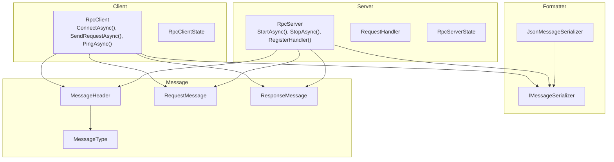
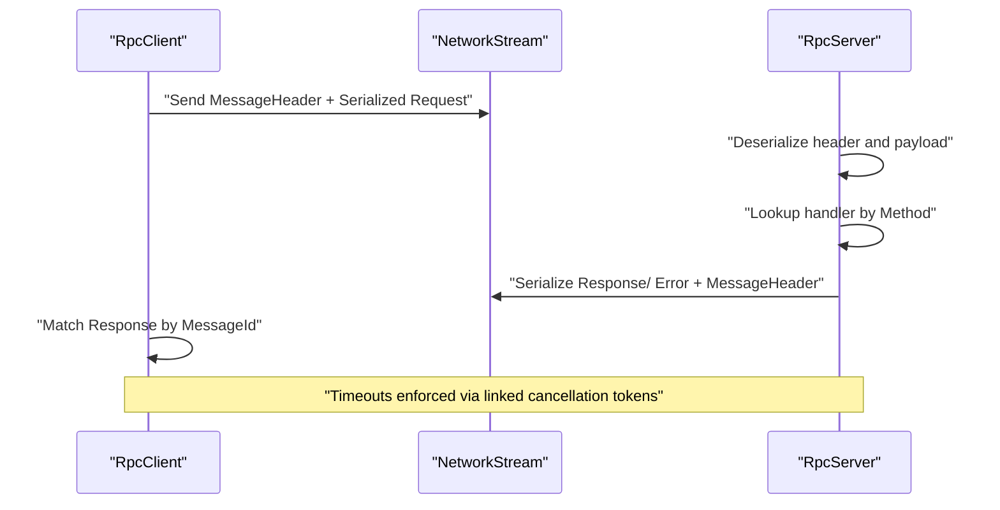
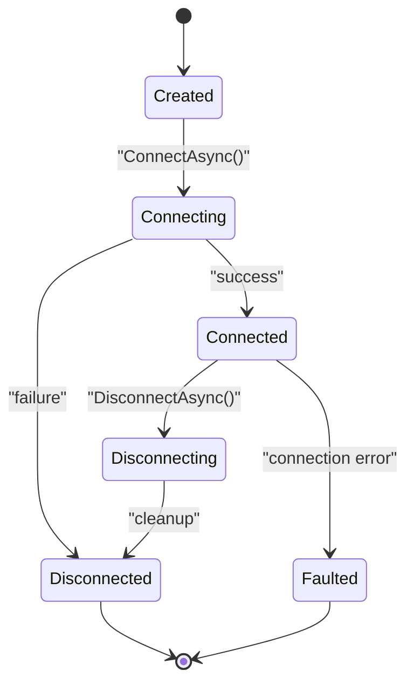
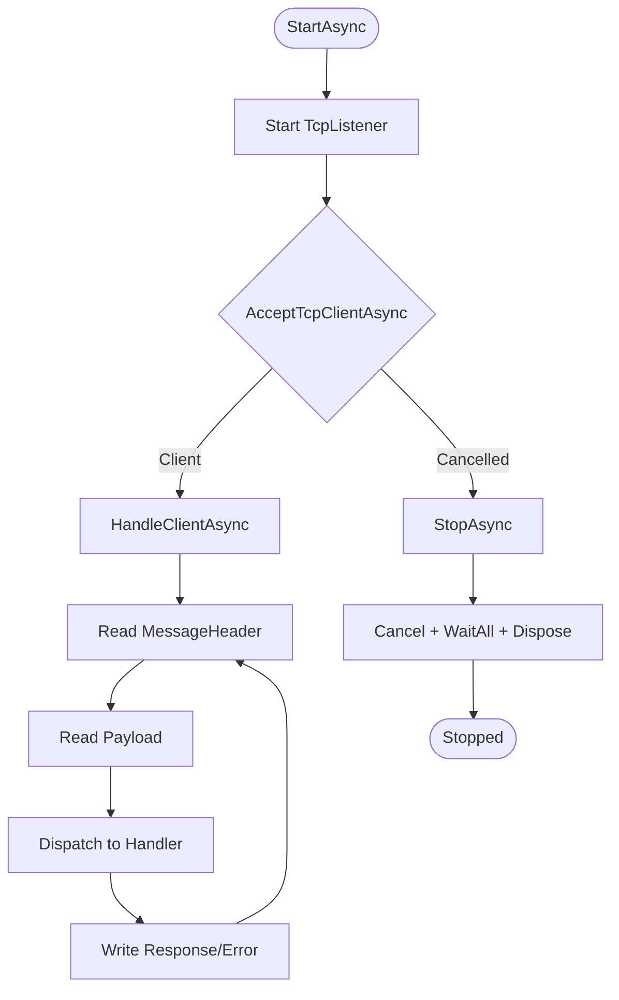
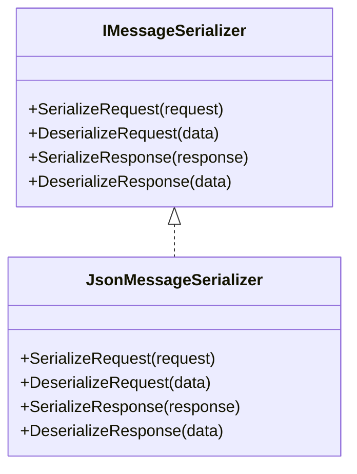
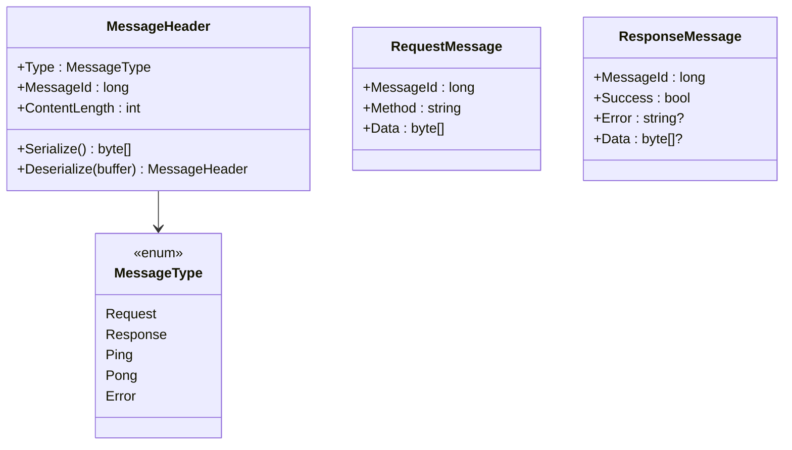

# Advanced Topics & Integration

<cite>
**Referenced Files in This Document**
- [TcpRpc.csproj](file://TcpRpc/TcpRpc.csproj)
- [TcpRpcClient.cs](file://TcpRpc/TcpRpc/Client/TcpRpcClient.cs)
- [RpcClientState.cs](file://TcpRpc/TcpRpc/Client/RpcClientState.cs)
- [TcpRpcServer.cs](file://TcpRpc/TcpRpc/Server/TcpRpcServer.cs)
- [RpcServerState.cs](file://TcpRpc/TcpRpc/Server/RpcServerState.cs)
- [RequestHandler.cs](file://TcpRpc/TcpRpc/Server/RequestHandler.cs)
- [IMessageSerializer.cs](file://TcpRpc/TcpRpc/Formatter/IMessageSerializer.cs)
- [JsonMessageSerializer.cs](file://TcpRpc/TcpRpc/Formatter/JsonMessageSerializer.cs)
- [MessageHeader.cs](file://TcpRpc/TcpRpc/Message/MessageHeader.cs)
- [MessageType.cs](file://TcpRpc/TcpRpc/Message/MessageType.cs)
- [RequestMessage.cs](file://TcpRpc/TcpRpc/Message/RequestMessage.cs)
- [ResponseMessage.cs](file://TcpRpc/TcpRpc/Message/ResponseMessage.cs)
</cite>

## Table of Contents
1. [Introduction](#introduction)
2. [Project Structure](#project-structure)
3. [Core Components](#core-components)
4. [Architecture Overview](#architecture-overview)
5. [Detailed Component Analysis](#detailed-component-analysis)
6. [Dependency Injection Integration](#dependency-injection-integration)
7. [Logging Integration](#logging-integration)
8. [Performance Optimization](#performance-optimization)
9. [Security Considerations](#security-considerations)
10. [Advanced Configuration Scenarios](#advanced-configuration-scenarios)
11. [Monitoring and Observability](#monitoring-and-observability)
12. [Scaling and High Availability](#scaling-and-high-availability)
13. [Troubleshooting Guide](#troubleshooting-guide)
14. [Conclusion](#conclusion)

## Introduction
This document provides advanced guidance for integrating and operating TcpRpc in enterprise environments. It covers dependency injection patterns, logging integration, performance optimization, security hardening, extensibility via custom serializers and protocol extensions, monitoring and observability, and production-grade scaling and high-availability strategies. The content is grounded in the repository’s implementation and aims to help teams adopt TcpRpc safely and efficiently at scale.

## Project Structure
The project is organized around a clean separation of concerns:
- Client: RpcClient manages connection lifecycle, request/response coordination, timeouts, and heartbeats.
- Server: RpcServer hosts handlers, accepts connections, processes messages, and manages active client tasks.
- Formatter: Pluggable IMessageSerializer abstraction enabling custom serialization strategies.
- Message: Protocol primitives (headers, message types, request/response models).
- Logging: Uses Microsoft.Extensions.Logging throughout for structured logging and diagnostics.

**Diagram sources**
- [TcpRpcClient.cs:11-405](file://TcpRpc/TcpRpc/Client/TcpRpcClient.cs#L11-L405)
- [RpcClientState.cs:3-11](file://TcpRpc/TcpRpc/Client/RpcClientState.cs#L3-L11)
- [TcpRpcServer.cs:12-432](file://TcpRpc/TcpRpc/Server/TcpRpcServer.cs#L12-L432)
- [RequestHandler.cs:5-5](file://TcpRpc/TcpRpc/Server/RequestHandler.cs#L5-L5)
- [RpcServerState.cs:3-10](file://TcpRpc/TcpRpc/Server/RpcServerState.cs#L3-L10)
- [IMessageSerializer.cs:5-13](file://TcpRpc/TcpRpc/Formatter/IMessageSerializer.cs#L5-L13)
- [JsonMessageSerializer.cs:6-85](file://TcpRpc/TcpRpc/Formatter/JsonMessageSerializer.cs#L6-L85)
- [MessageHeader.cs:5-34](file://TcpRpc/TcpRpc/Message/MessageHeader.cs#L5-L34)
- [MessageType.cs:3-10](file://TcpRpc/TcpRpc/Message/MessageType.cs#L3-L10)
- [RequestMessage.cs:3-8](file://TcpRpc/TcpRpc/Message/RequestMessage.cs#L3-L8)
- [ResponseMessage.cs:3-9](file://TcpRpc/TcpRpc/Message/ResponseMessage.cs#L3-L9)

**Section sources**
- [TcpRpc.csproj:1-17](file://TcpRpc/TcpRpc.csproj#L1-L17)
- [TcpRpcClient.cs:11-405](file://TcpRpc/TcpRpc/Client/TcpRpcClient.cs#L11-L405)
- [TcpRpcServer.cs:12-432](file://TcpRpc/TcpRpc/Server/TcpRpcServer.cs#L12-L432)
- [IMessageSerializer.cs:5-13](file://TcpRpc/TcpRpc/Formatter/IMessageSerializer.cs#L5-L13)
- [JsonMessageSerializer.cs:6-85](file://TcpRpc/TcpRpc/Formatter/JsonMessageSerializer.cs#L6-L85)
- [MessageHeader.cs:5-34](file://TcpRpc/TcpRpc/Message/MessageHeader.cs#L5-L34)
- [MessageType.cs:3-10](file://TcpRpc/TcpRpc/Message/MessageType.cs#L3-L10)
- [RequestMessage.cs:3-8](file://TcpRpc/TcpRpc/Message/RequestMessage.cs#L3-L8)
- [ResponseMessage.cs:3-9](file://TcpRpc/TcpRpc/Message/ResponseMessage.cs#L3-L9)

## Core Components
- RpcClient: Asynchronous TCP client with connection state machine, request correlation via message IDs, timeout-aware send/receive, and heartbeat support.
- RpcServer: Listener-based server accepting TcpClient connections, per-client receive loops, handler dispatch, and graceful shutdown with cancellation.
- IMessageSerializer: Contract for serializing/deserializing requests and responses; JsonMessageSerializer provides a default implementation.
- Message types: Strongly typed header and message models with fixed-size binary header and JSON payload.

Key capabilities:
- Structured logging via Microsoft.Extensions.Logging.
- Configurable serializer for payload encoding.
- Built-in ping/pong for liveness checks.
- Controlled resource disposal and cancellation propagation.

**Section sources**
- [TcpRpcClient.cs:11-405](file://TcpRpc/TcpRpc/Client/TcpRpcClient.cs#L11-L405)
- [RpcClientState.cs:3-11](file://TcpRpc/TcpRpc/Client/RpcClientState.cs#L3-L11)
- [TcpRpcServer.cs:12-432](file://TcpRpc/TcpRpc/Server/TcpRpcServer.cs#L12-L432)
- [RpcServerState.cs:3-10](file://TcpRpc/TcpRpc/Server/RpcServerState.cs#L3-L10)
- [RequestHandler.cs:5-5](file://TcpRpc/TcpRpc/Server/RequestHandler.cs#L5-L5)
- [IMessageSerializer.cs:5-13](file://TcpRpc/TcpRpc/Formatter/IMessageSerializer.cs#L5-L13)
- [JsonMessageSerializer.cs:6-85](file://TcpRpc/TcpRpc/Formatter/JsonMessageSerializer.cs#L6-L85)
- [MessageHeader.cs:5-34](file://TcpRpc/TcpRpc/Message/MessageHeader.cs#L5-L34)
- [MessageType.cs:3-10](file://TcpRpc/TcpRpc/Message/MessageType.cs#L3-L10)
- [RequestMessage.cs:3-8](file://TcpRpc/TcpRpc/Message/RequestMessage.cs#L3-L8)
- [ResponseMessage.cs:3-9](file://TcpRpc/TcpRpc/Message/ResponseMessage.cs#L3-L9)

## Architecture Overview
The system follows a request-response protocol over TCP with a compact binary header followed by a serialized payload. Clients send Request messages; servers route to registered handlers and return Response or Error messages. Ping/Pong supports keepalive and liveness checks.

**Diagram sources**
- [TcpRpcClient.cs:132-189](file://TcpRpc/TcpRpc/Client/TcpRpcClient.cs#L132-L189)
- [TcpRpcServer.cs:318-376](file://TcpRpc/TcpRpc/Server/TcpRpcServer.cs#L318-L376)
- [MessageHeader.cs:13-33](file://TcpRpc/TcpRpc/Message/MessageHeader.cs#L13-L33)
- [RequestMessage.cs:3-8](file://TcpRpc/TcpRpc/Message/RequestMessage.cs#L3-L8)
- [ResponseMessage.cs:3-9](file://TcpRpc/TcpRpc/Message/ResponseMessage.cs#L3-L9)

## Detailed Component Analysis

### RpcClient
- State machine: Created → Connecting → Connected → Disconnecting → Disconnected/Faulted.
- Concurrency: ConcurrentDictionary tracks pending requests; SemaphoreSlim ensures serialized writes; CancellationTokenSource enables cooperative cancellation.
- Timeouts: Per-request timeout combined with client-wide cancellation; exceptions distinguish between cancel and timeout.
- Heartbeat: PingAsync sends Ping and expects Pong; pending pings tracked separately.

**Diagram sources**
- [RpcClientState.cs:3-11](file://TcpRpc/TcpRpc/Client/RpcClientState.cs#L3-L11)
- [TcpRpcClient.cs:47-130](file://TcpRpc/TcpRpc/Client/TcpRpcClient.cs#L47-L130)

**Section sources**
- [TcpRpcClient.cs:11-405](file://TcpRpc/TcpRpc/Client/TcpRpcClient.cs#L11-L405)
- [RpcClientState.cs:3-11](file://TcpRpc/TcpRpc/Client/RpcClientState.cs#L3-L11)

### RpcServer
- Handler registration: Methods mapped to RequestHandler delegates; generic overload deserializes request and re-serializes response.
- Client lifecycle: AcceptTcpClientAsync loop; per-client task handles header/payload reads until EOF or cancellation.
- Graceful shutdown: Stops listener, cancels all operations, waits for active client tasks with timeout.

**Diagram sources**
- [TcpRpcServer.cs:101-226](file://TcpRpc/TcpRpc/Server/TcpRpcServer.cs#L101-L226)
- [RequestHandler.cs:5-5](file://TcpRpc/TcpRpc/Server/RequestHandler.cs#L5-L5)

**Section sources**
- [TcpRpcServer.cs:12-432](file://TcpRpc/TcpRpc/Server/TcpRpcServer.cs#L12-L432)
- [RpcServerState.cs:3-10](file://TcpRpc/TcpRpc/Server/RpcServerState.cs#L3-L10)
- [RequestHandler.cs:5-5](file://TcpRpc/TcpRpc/Server/RequestHandler.cs#L5-L5)

### IMessageSerializer and JsonMessageSerializer
- Contract defines Serialize/Deserialize for Request and Response.
- JsonMessageSerializer uses camelCase, no indentation, validates required fields, and throws meaningful errors on malformed data.

**Diagram sources**
- [IMessageSerializer.cs:5-13](file://TcpRpc/TcpRpc/Formatter/IMessageSerializer.cs#L5-L13)
- [JsonMessageSerializer.cs:6-85](file://TcpRpc/TcpRpc/Formatter/JsonMessageSerializer.cs#L6-L85)

**Section sources**
- [IMessageSerializer.cs:5-13](file://TcpRpc/TcpRpc/Formatter/IMessageSerializer.cs#L5-L13)
- [JsonMessageSerializer.cs:6-85](file://TcpRpc/TcpRpc/Formatter/JsonMessageSerializer.cs#L6-L85)

### Message Protocol
- MessageHeader: Fixed-size little-endian header with Type, MessageId, and ContentLength.
- MessageType: Enumerates Request, Response, Ping, Pong, Error.
- RequestMessage/ResponseMessage: Strongly-typed payloads carrying method, data, and optional error.

**Diagram sources**
- [MessageHeader.cs:5-34](file://TcpRpc/TcpRpc/Message/MessageHeader.cs#L5-L34)
- [MessageType.cs:3-10](file://TcpRpc/TcpRpc/Message/MessageType.cs#L3-L10)
- [RequestMessage.cs:3-8](file://TcpRpc/TcpRpc/Message/RequestMessage.cs#L3-L8)
- [ResponseMessage.cs:3-9](file://TcpRpc/TcpRpc/Message/ResponseMessage.cs#L3-L9)

**Section sources**
- [MessageHeader.cs:5-34](file://TcpRpc/TcpRpc/Message/MessageHeader.cs#L5-L34)
- [MessageType.cs:3-10](file://TcpRpc/TcpRpc/Message/MessageType.cs#L3-L10)
- [RequestMessage.cs:3-8](file://TcpRpc/TcpRpc/Message/RequestMessage.cs#L3-L8)
- [ResponseMessage.cs:3-9](file://TcpRpc/TcpRpc/Message/ResponseMessage.cs#L3-L9)

## Dependency Injection Integration
Recommended integration patterns with Microsoft.Extensions.DependencyInjection:
- Client registration:
  - Transient: RpcClient with injected IMessageSerializer and ILogger<RpcClient>.
  - Configure serializer and logger via DI container.
- Server registration:
  - Singleton: RpcServer with injected IMessageSerializer and ILogger<RpcServer>.
  - Register RequestHandler delegates via factory or service provider.
- Lifetime management:
  - Use hosted services to manage StartAsync/StopAsync lifecycle.
  - Dispose RpcClient/RpcServer deterministically on shutdown.

Implementation guidance:
- Register IMessageSerializer as singleton or transient depending on serializer immutability.
- Inject ILogger<T> into RpcClient and RpcServer constructors.
- For multi-tenant or multi-region deployments, consider factory-based registration to create scoped clients/servers.

[No sources needed since this section provides general guidance]

## Logging Integration
- Structured logging: Both client and server use Microsoft.Extensions.Logging with strongly-typed loggers.
- Log levels:
  - Information: Startup, shutdown, connection events, active connection count.
  - Warning: Timeouts, disconnects, shutdown wait timeouts.
  - Error: Exceptions during message processing, deserialization failures.
- Custom log providers:
  - Add providers (e.g., Console, Serilog sink) via Host builder configuration.
  - Use correlation IDs and scopes to track requests across client/server boundaries.

Best practices:
- Include MessageId, Method, and RemoteEndPoint in log contexts.
- Avoid logging sensitive payload data; log lengths and metadata instead.

**Section sources**
- [TcpRpcClient.cs:35-41](file://TcpRpc/TcpRpc/Client/TcpRpcClient.cs#L35-L41)
- [TcpRpcServer.cs:43-48](file://TcpRpc/TcpRpc/Server/TcpRpcServer.cs#L43-L48)
- [TcpRpc.csproj:11-14](file://TcpRpc/TcpRpc.csproj#L11-L14)

## Performance Optimization
- Connection pooling:
  - Reuse RpcClient instances per target endpoint; avoid frequent Connect/Disconnect churn.
  - For high concurrency, maintain multiple pooled clients behind a façade.
- Memory management:
  - Prefer ArrayPool<byte> for temporary buffers in hot paths; avoid excessive allocations.
  - Use ValueBuffers and Span<T>/Memory<T> where appropriate to reduce GC pressure.
- Throughput tuning:
  - Adjust per-request timeoutMs to balance responsiveness and resource usage.
  - Tune serializer options (e.g., Utf8Json) for lower overhead if JSON is not mandatory.
- Resource cleanup:
  - Ensure CancellationTokenSource and streams are disposed; handle OperationCanceledException gracefully.
  - Monitor ActiveConnections on server to prevent overload.

[No sources needed since this section provides general guidance]

## Security Considerations
- Transport security:
  - Use TLS termination at reverse proxy or implement SSL/TLS at TcpListener/TcpClient level.
- Authentication:
  - Implement method-level authorization inside RequestHandler delegates.
  - Enforce per-call authentication tokens in request payloads or headers.
- Data protection:
  - Encrypt sensitive payloads using symmetric/asymmetric keys; integrate with DPAPI or platform key stores.
- Input validation:
  - Validate Method names and enforce allowlists.
  - Apply strict size limits and reject oversized messages early.

[No sources needed since this section provides general guidance]

## Advanced Configuration Scenarios
- Custom serializer:
  - Implement IMessageSerializer with alternative encodings (e.g., Protocol Buffers, MessagePack).
  - Register as singleton for thread-safety; ensure deterministic serialization.
- Protocol extensions:
  - Extend MessageType with new values; update MessageHeader and both client/server message processors.
  - Add optional compression or encryption layers around payloads.
- Health checks:
  - Expose server ActiveConnections and State metrics.
  - Implement client-side health probe via PingAsync with thresholds.

[No sources needed since this section provides general guidance]

## Monitoring and Observability
- Metrics:
  - Track requests per second, latency percentiles, error rates, and queue depths.
  - Expose ActiveConnections and State transitions.
- Tracing:
  - Correlate MessageId across client/server spans.
  - Capture remote endpoint and method name in traces.
- Alerts:
  - Alert on sustained timeouts, high error rates, or connection backlog growth.

[No sources needed since this section provides general guidance]

## Scaling and High Availability
- Horizontal scaling:
  - Run multiple RpcServer instances behind a load balancer; ensure sticky sessions only if required.
  - Use RpcClient pool per backend endpoint.
- High availability:
  - Implement retry/backoff with jitter for transient failures.
  - Use circuit breaker patterns around unhealthy endpoints.
- Load balancing:
  - Place a reverse proxy (e.g., Nginx, Envoy) to distribute connections and terminate TLS.

[No sources needed since this section provides general guidance]

## Troubleshooting Guide
Common symptoms and actions:
- Requests timing out:
  - Verify per-request timeoutMs and server handler latency; check for blocking operations.
- Frequent disconnects:
  - Inspect server shutdown logs and client cancellation propagation.
- Serialization errors:
  - Validate IMessageSerializer contract compliance and payload shape.
- Memory pressure:
  - Profile buffers and consider pooling; review serializer options.

Operational checks:
- Client: Confirm State transitions and pending request counts.
- Server: Verify ActiveConnections and handler registration completeness.

**Section sources**
- [TcpRpcClient.cs:162-189](file://TcpRpc/TcpRpc/Client/TcpRpcClient.cs#L162-L189)
- [TcpRpcServer.cs:175-226](file://TcpRpc/TcpRpc/Server/TcpRpcServer.cs#L175-L226)
- [JsonMessageSerializer.cs:22-49](file://TcpRpc/TcpRpc/Formatter/JsonMessageSerializer.cs#L22-L49)

## Conclusion
TcpRpc offers a compact, extensible RPC foundation suitable for high-performance, low-latency scenarios. By leveraging Microsoft.Extensions.DependencyInjection for lifecycle management, Microsoft.Extensions.Logging for observability, and thoughtful performance and security practices, teams can operate TcpRpc reliably at enterprise scale. Extensibility via IMessageSerializer and protocol augmentation enables tailored solutions for specialized workloads.