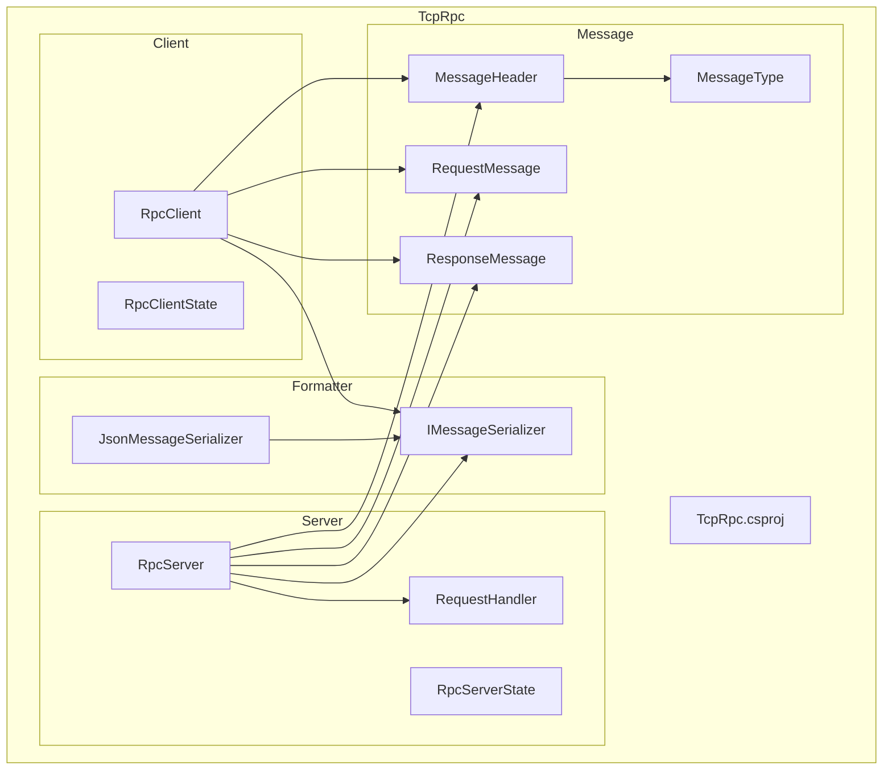
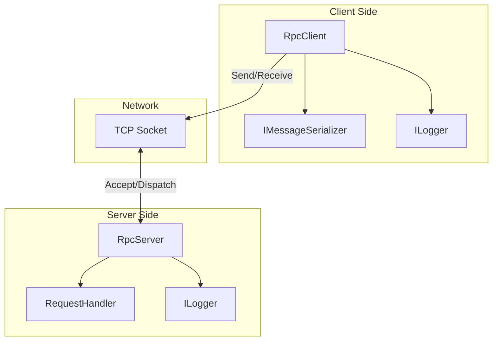
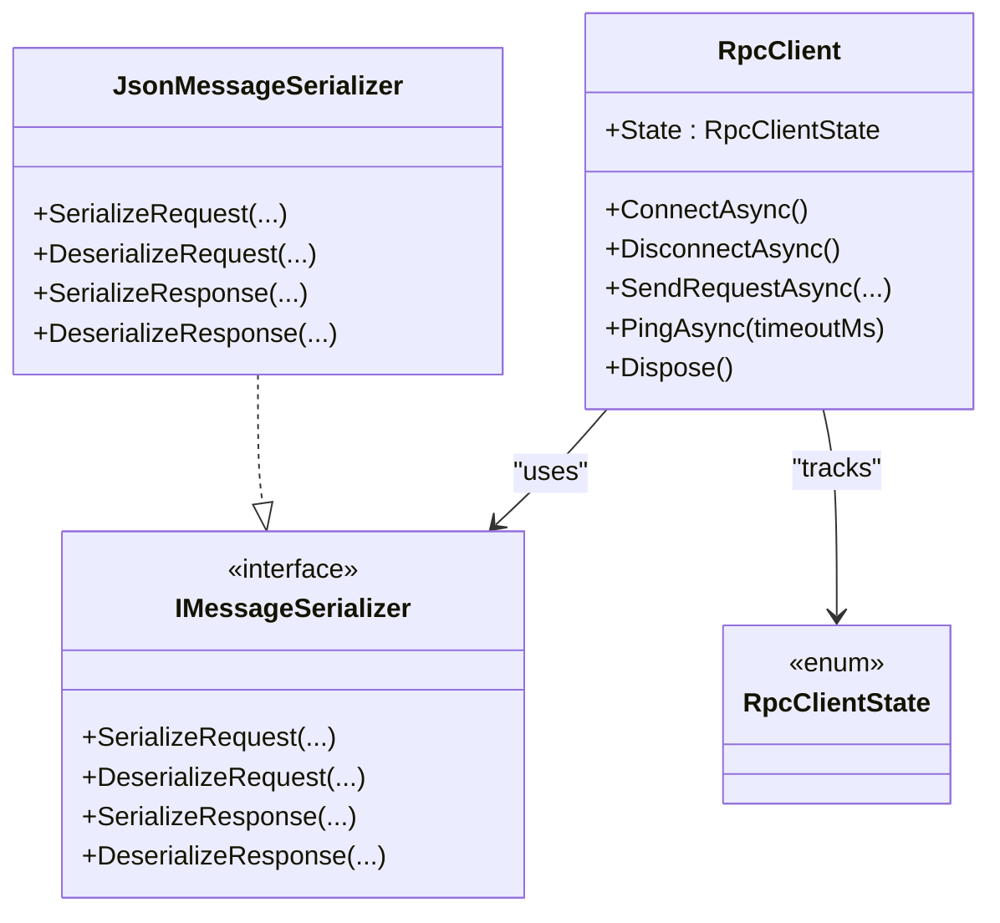
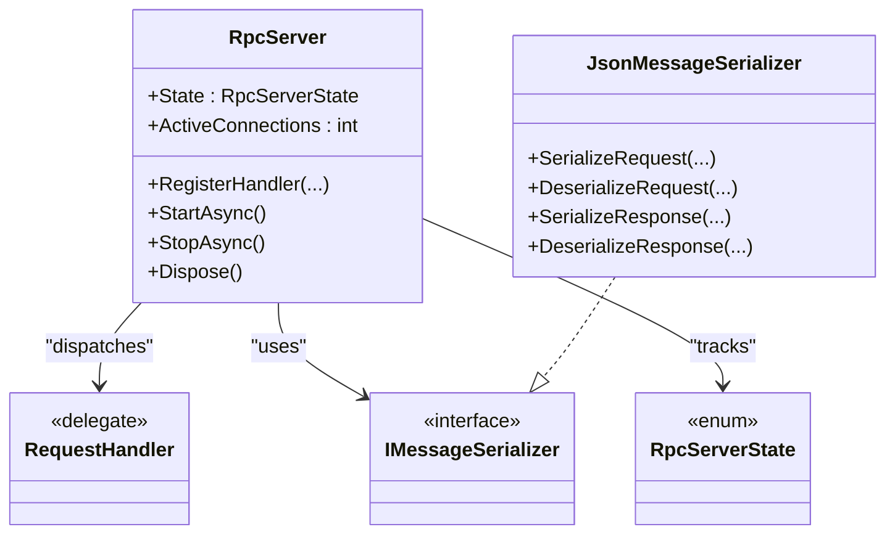
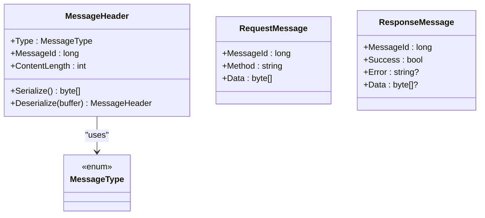
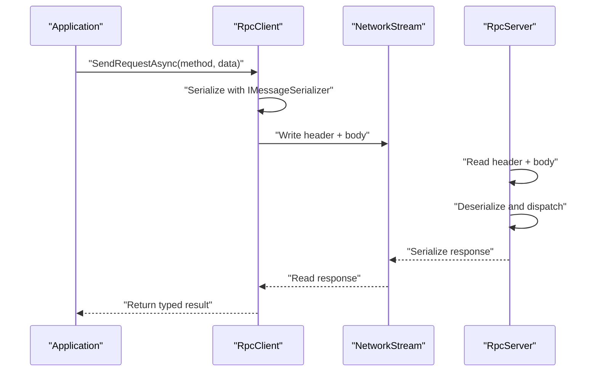
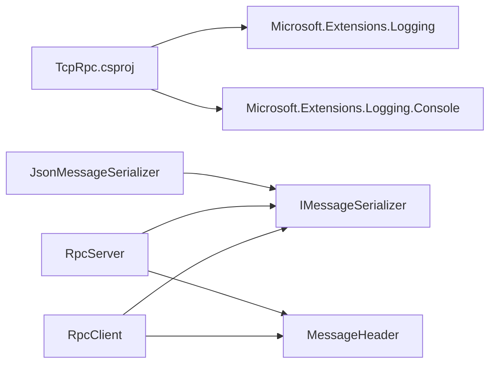

# Dependency Injection Integration

<cite>
**Referenced Files in This Document**
- [TcpRpc.csproj](file://TcpRpc/TcpRpc.csproj)
- [TcpRpcClient.cs](file://TcpRpc/Client/TcpRpcClient.cs)
- [RpcClientState.cs](file://TcpRpc/Client/RpcClientState.cs)
- [IMessageSerializer.cs](file://TcpRpc/Formatter/IMessageSerializer.cs)
- [JsonMessageSerializer.cs](file://TcpRpc/Formatter/JsonMessageSerializer.cs)
- [MessageHeader.cs](file://TcpRpc/Message/MessageHeader.cs)
- [MessageType.cs](file://TcpRpc/Message/MessageType.cs)
- [RequestMessage.cs](file://TcpRpc/Message/RequestMessage.cs)
- [ResponseMessage.cs](file://TcpRpc/Message/ResponseMessage.cs)
- [RequestHandler.cs](file://TcpRpc/Server/RequestHandler.cs)
- [RpcServer.cs](file://TcpRpc/Server/TcpRpcServer.cs)
- [RpcServerState.cs](file://TcpRpc/Server/RpcServerState.cs)
</cite>

## Table of Contents
1. [Introduction](#introduction)
2. [Project Structure](#project-structure)
3. [Core Components](#core-components)
4. [Architecture Overview](#architecture-overview)
5. [Detailed Component Analysis](#detailed-component-analysis)
6. [Dependency Analysis](#dependency-analysis)
7. [Performance Considerations](#performance-considerations)
8. [Troubleshooting Guide](#troubleshooting-guide)
9. [Conclusion](#conclusion)
10. [Appendices](#appendices)

## Introduction
This document explains how to integrate TcpRpc with Microsoft.Extensions.DependencyInjection. It focuses on service registration patterns for RpcClient and RpcServer across singleton, scoped, and transient lifetimes, configuration via the IOptions pattern, constructor injection for IMessageSerializer implementations, and logging provider integration. It also covers factory patterns for dynamic client creation, service resolution strategies, dependency scoping considerations, and proper disposal during application shutdown.

## Project Structure
TcpRpc is organized into cohesive feature areas:
- Client: RpcClient and client-side state machine
- Server: RpcServer with request handlers and lifecycle management
- Formatter: Serialization contract and JSON implementation
- Message: Protocol primitives (headers, messages, types)
- Project metadata: NuGet package references for Microsoft.Extensions.Logging

**Diagram sources**
- [TcpRpcClient.cs:11-41](file://TcpRpc/Client/TcpRpcClient.cs#L11-L41)
- [RpcClientState.cs:3-11](file://TcpRpc/Client/RpcClientState.cs#L3-L11)
- [RpcServer.cs:12-48](file://TcpRpc/Server/TcpRpcServer.cs#L12-L48)
- [RequestHandler.cs:5-5](file://TcpRpc/Server/RequestHandler.cs#L5-L5)
- [RpcServerState.cs:3-10](file://TcpRpc/Server/RpcServerState.cs#L3-L10)
- [IMessageSerializer.cs:5-13](file://TcpRpc/Formatter/IMessageSerializer.cs#L5-L13)
- [JsonMessageSerializer.cs:6-85](file://TcpRpc/Formatter/JsonMessageSerializer.cs#L6-L85)
- [MessageHeader.cs:5-34](file://TcpRpc/Message/MessageHeader.cs#L5-L34)
- [MessageType.cs:3-10](file://TcpRpc/Message/MessageType.cs#L3-L10)
- [RequestMessage.cs:3-8](file://TcpRpc/Message/RequestMessage.cs#L3-L8)
- [ResponseMessage.cs:3-9](file://TcpRpc/Message/ResponseMessage.cs#L3-L9)
- [TcpRpc.csproj:11-14](file://TcpRpc/TcpRpc.csproj#L11-L14)

**Section sources**
- [TcpRpc.csproj:11-14](file://TcpRpc/TcpRpc.csproj#L11-L14)

## Core Components
- RpcClient: TCP-based RPC client with connection lifecycle, request/response handling, ping/pong, and cancellation support. It accepts IMessageSerializer and ILogger via constructor injection and exposes ConnectAsync, DisconnectAsync, SendRequestAsync, and PingAsync.
- RpcServer: TCP listener that accepts clients, reads messages, dispatches to registered handlers, and responds. It supports StartAsync/StopAsync and maintains active connection counts.
- IMessageSerializer: Contract for serializing/deserializing RequestMessage and ResponseMessage.
- JsonMessageSerializer: Default JSON-based implementation with validation and error handling.
- Message protocol: MessageHeader defines fixed-size binary header; MessageType enumerates supported message kinds; RequestMessage and ResponseMessage define payload structures.

Key DI-relevant observations:
- Both RpcClient and RpcServer accept IMessageSerializer and ILogger via constructor injection, enabling flexible configuration and testing.
- Logging is integrated through Microsoft.Extensions.Logging abstractions.
- No built-in extension methods for IServiceCollection registration are present in the codebase; registration must be performed externally.

**Section sources**
- [TcpRpcClient.cs:11-41](file://TcpRpc/Client/TcpRpcClient.cs#L11-L41)
- [RpcServer.cs:12-48](file://TcpRpc/Server/TcpRpcServer.cs#L12-L48)
- [IMessageSerializer.cs:5-13](file://TcpRpc/Formatter/IMessageSerializer.cs#L5-L13)
- [JsonMessageSerializer.cs:6-85](file://TcpRpc/Formatter/JsonMessageSerializer.cs#L6-L85)
- [MessageHeader.cs:5-34](file://TcpRpc/Message/MessageHeader.cs#L5-L34)
- [MessageType.cs:3-10](file://TcpRpc/Message/MessageType.cs#L3-L10)
- [RequestMessage.cs:3-8](file://TcpRpc/Message/RequestMessage.cs#L3-L8)
- [ResponseMessage.cs:3-9](file://TcpRpc/Message/ResponseMessage.cs#L3-L9)

## Architecture Overview
The runtime architecture centers on RpcClient and RpcServer communicating over TCP with a structured message protocol. RpcClient sends requests and receives responses; RpcServer registers handlers and executes them per incoming requests.

**Diagram sources**
- [TcpRpcClient.cs:11-41](file://TcpRpc/Client/TcpRpcClient.cs#L11-L41)
- [RpcServer.cs:12-48](file://TcpRpc/Server/TcpRpcServer.cs#L12-L48)
- [IMessageSerializer.cs:5-13](file://TcpRpc/Formatter/IMessageSerializer.cs#L5-L13)
- [RequestHandler.cs:5-5](file://TcpRpc/Server/RequestHandler.cs#L5-L5)

## Detailed Component Analysis

### RpcClient Lifetime and Disposal
- Constructor injection: Accepts IMessageSerializer and ILogger. Defaults to JsonMessageSerializer and NullLogger if not provided.
- State machine: Created → Connecting → Connected → Disconnecting → Disconnected/Faulted.
- Disposal: Implements IDisposable and ensures graceful DisconnectAsync with resource cleanup. Dispose guards against repeated disposal.

**Diagram sources**
- [TcpRpcClient.cs:11-41](file://TcpRpc/Client/TcpRpcClient.cs#L11-L41)
- [IMessageSerializer.cs:5-13](file://TcpRpc/Formatter/IMessageSerializer.cs#L5-L13)
- [JsonMessageSerializer.cs:6-85](file://TcpRpc/Formatter/JsonMessageSerializer.cs#L6-L85)
- [RpcClientState.cs:3-11](file://TcpRpc/Client/RpcClientState.cs#L3-L11)

**Section sources**
- [TcpRpcClient.cs:11-41](file://TcpRpc/Client/TcpRpcClient.cs#L11-L41)
- [RpcClientState.cs:3-11](file://TcpRpc/Client/RpcClientState.cs#L3-L11)

### RpcServer Registration and Handler Dispatch
- Constructor injection: Accepts IMessageSerializer and ILogger. Defaults applied similarly to RpcClient.
- Handler registration: Supports string-to-RequestHandler mapping and generic handler registration that deserializes request and serializes response.
- Lifecycle: StartAsync initializes listener and cancellation; StopAsync halts listener and cancels active operations.

**Diagram sources**
- [RpcServer.cs:12-48](file://TcpRpc/Server/TcpRpcServer.cs#L12-L48)
- [RequestHandler.cs:5-5](file://TcpRpc/Server/RequestHandler.cs#L5-L5)
- [IMessageSerializer.cs:5-13](file://TcpRpc/Formatter/IMessageSerializer.cs#L5-L13)
- [JsonMessageSerializer.cs:6-85](file://TcpRpc/Formatter/JsonMessageSerializer.cs#L6-L85)
- [RpcServerState.cs:3-10](file://TcpRpc/Server/RpcServerState.cs#L3-L10)

**Section sources**
- [RpcServer.cs:50-99](file://TcpRpc/Server/TcpRpcServer.cs#L50-L99)
- [RpcServer.cs:101-173](file://TcpRpc/Server/TcpRpcServer.cs#L101-L173)
- [RpcServer.cs:175-226](file://TcpRpc/Server/TcpRpcServer.cs#L175-L226)
- [RpcServerState.cs:3-10](file://TcpRpc/Server/RpcServerState.cs#L3-L10)

### Message Protocol and Serialization
- MessageHeader: Fixed-size header with type, message ID, and content length; serialized in little-endian format.
- MessageType: Enumerates Request, Response, Ping, Pong, Error.
- RequestMessage and ResponseMessage: Payload envelopes for RPC calls.

**Diagram sources**
- [MessageHeader.cs:5-34](file://TcpRpc/Message/MessageHeader.cs#L5-L34)
- [MessageType.cs:3-10](file://TcpRpc/Message/MessageType.cs#L3-L10)
- [RequestMessage.cs:3-8](file://TcpRpc/Message/RequestMessage.cs#L3-L8)
- [ResponseMessage.cs:3-9](file://TcpRpc/Message/ResponseMessage.cs#L3-L9)

**Section sources**
- [MessageHeader.cs:5-34](file://TcpRpc/Message/MessageHeader.cs#L5-L34)
- [MessageType.cs:3-10](file://TcpRpc/Message/MessageType.cs#L3-L10)
- [RequestMessage.cs:3-8](file://TcpRpc/Message/RequestMessage.cs#L3-L8)
- [ResponseMessage.cs:3-9](file://TcpRpc/Message/ResponseMessage.cs#L3-L9)

### Sequence: Client Request Flow

**Diagram sources**
- [TcpRpcClient.cs:132-189](file://TcpRpc/Client/TcpRpcClient.cs#L132-L189)
- [RpcServer.cs:318-376](file://TcpRpc/Server/TcpRpcServer.cs#L318-L376)
- [IMessageSerializer.cs:5-13](file://TcpRpc/Formatter/IMessageSerializer.cs#L5-L13)

## Dependency Analysis
- External logging: Both RpcClient and RpcServer depend on Microsoft.Extensions.Logging abstractions. The project references Microsoft.Extensions.Logging and Microsoft.Extensions.Logging.Console.
- Serialization: IMessageSerializer is injected into both client and server; JsonMessageSerializer is the default implementation.
- Protocol: MessageHeader and message types are shared across client and server.

**Diagram sources**
- [TcpRpc.csproj:11-14](file://TcpRpc/TcpRpc.csproj#L11-L14)
- [TcpRpcClient.cs:11-41](file://TcpRpc/Client/TcpRpcClient.cs#L11-L41)
- [RpcServer.cs:12-48](file://TcpRpc/Server/TcpRpcServer.cs#L12-L48)
- [IMessageSerializer.cs:5-13](file://TcpRpc/Formatter/IMessageSerializer.cs#L5-L13)
- [JsonMessageSerializer.cs:6-85](file://TcpRpc/Formatter/JsonMessageSerializer.cs#L6-L85)
- [MessageHeader.cs:5-34](file://TcpRpc/Message/MessageHeader.cs#L5-L34)

**Section sources**
- [TcpRpc.csproj:11-14](file://TcpRpc/TcpRpc.csproj#L11-L14)

## Performance Considerations
- Concurrency: Both RpcClient and RpcServer use locks and thread-safe collections to manage state and concurrent operations. Avoid holding locks for extended periods.
- Serialization overhead: JSON serialization/deserialization occurs per message; consider payload sizes and avoid excessive allocations.
- Network I/O: Large message limits are enforced; ensure upstream serialization respects these constraints.
- Logging: Excessive logging can impact throughput; tune log levels appropriately.

[No sources needed since this section provides general guidance]

## Troubleshooting Guide
Common issues and mitigations:
- Connection errors: RpcClient logs connection loss and cancels pending requests; ensure proper error handling around SendRequestAsync and PingAsync.
- Handler errors: RpcServer wraps exceptions in error responses; inspect server logs for handler failures.
- Timeouts: RpcClient applies per-request timeouts; adjust timeoutMs as needed.
- Graceful shutdown: RpcServer cancels all operations and waits for clients; ensure StopAsync is awaited during application shutdown.

**Section sources**
- [TcpRpcClient.cs:205-236](file://TcpRpc/Client/TcpRpcClient.cs#L205-L236)
- [TcpRpcClient.cs:289-306](file://TcpRpc/Client/TcpRpcClient.cs#L289-L306)
- [RpcServer.cs:175-226](file://TcpRpc/Server/TcpRpcServer.cs#L175-L226)
- [RpcServer.cs:318-376](file://TcpRpc/Server/TcpRpcServer.cs#L318-L376)

## Conclusion
TcpRpc integrates cleanly with Microsoft.Extensions.DependencyInjection by relying on constructor injection for IMessageSerializer and ILogger. Because no built-in extension methods are provided, you can register RpcClient and RpcServer with desired lifetimes and configure serialization/logging as needed. Proper disposal and lifecycle management are handled internally, but application code must still coordinate startup/shutdown and ensure resources are released during application termination.

[No sources needed since this section summarizes without analyzing specific files]

## Appendices

### Service Registration Patterns and Factory Guidance
- Singleton lifetime:
  - RpcServer: Recommended for long-running servers; ensure handlers are thread-safe and stateless where possible.
  - RpcClient: Suitable for frequently reused clients; consider pooling if many concurrent clients are needed.
- Scoped lifetime:
  - RpcServer: Not recommended due to listener and cancellation token ownership across scopes.
  - RpcClient: Suitable for short-lived operations within a request scope; dispose promptly.
- Transient lifetime:
  - RpcServer: Not recommended for the same reasons as scoped.
  - RpcClient: Suitable for ad-hoc usage; ensure disposal after use.
- Factory patterns:
  - Use a factory to create RpcClient instances with host/port derived from configuration. This enables dynamic client creation per tenant or endpoint.
- Configuration binding:
  - Bind connection settings (host, port) to strongly-typed options and pass them to constructors.
- Logging integration:
  - Inject ILogger<RpcClient>/ILogger<RpcServer> to leverage configured providers (Console, Serilog, etc.).

Note: The codebase does not include extension methods for IServiceCollection. Implement registration in your application’s Program.cs or Startup.cs by resolving dependencies from the container and constructing RpcClient/RpcServer with injected IMessageSerializer and ILogger.

**Section sources**
- [TcpRpcClient.cs:35-41](file://TcpRpc/Client/TcpRpcClient.cs#L35-L41)
- [RpcServer.cs:43-48](file://TcpRpc/Server/TcpRpcServer.cs#L43-L48)
- [IMessageSerializer.cs:5-13](file://TcpRpc/Formatter/IMessageSerializer.cs#L5-L13)
- [JsonMessageSerializer.cs:6-85](file://TcpRpc/Formatter/JsonMessageSerializer.cs#L6-L85)

### Practical Example Scenarios
- Registering services in Program.cs or Startup.cs:
  - Register IMessageSerializer (default JsonMessageSerializer) and ILogger provider.
  - Register RpcServer as a singleton service and start/stop it during app lifecycle.
  - Register RpcClient with desired lifetime; construct per operation or pool as appropriate.
- Configuration binding:
  - Bind connection settings to options and inject into constructors.
- Integration with existing DI containers:
  - Resolve IMessageSerializer and ILogger from the container; pass to RpcClient/RpcServer constructors.

[No sources needed since this section provides general guidance]

### Disposal and Shutdown
- RpcClient.Dispose triggers DisconnectAsync with a bounded wait and cleans up streams and tokens.
- RpcServer.Dispose triggers StopAsync with a bounded wait and cancels active operations.
- Application shutdown:
  - Stop RpcServer gracefully.
  - Dispose RpcClient instances or rely on scope disposal.
  - Ensure cancellation tokens propagate to prevent hanging I/O.

**Section sources**
- [TcpRpcClient.cs:384-404](file://TcpRpc/Client/TcpRpcClient.cs#L384-L404)
- [RpcServer.cs:415-431](file://TcpRpc/Server/TcpRpcServer.cs#L415-L431)