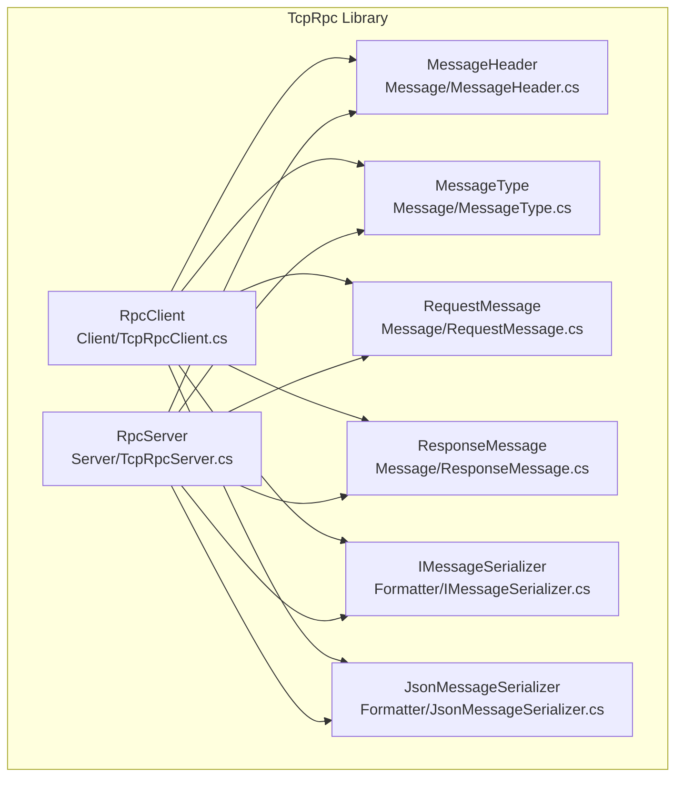
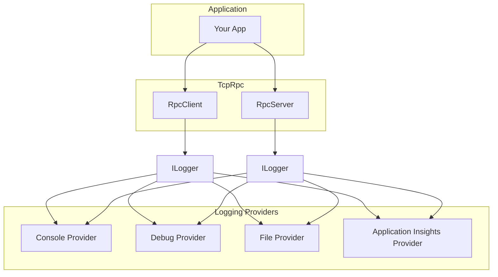
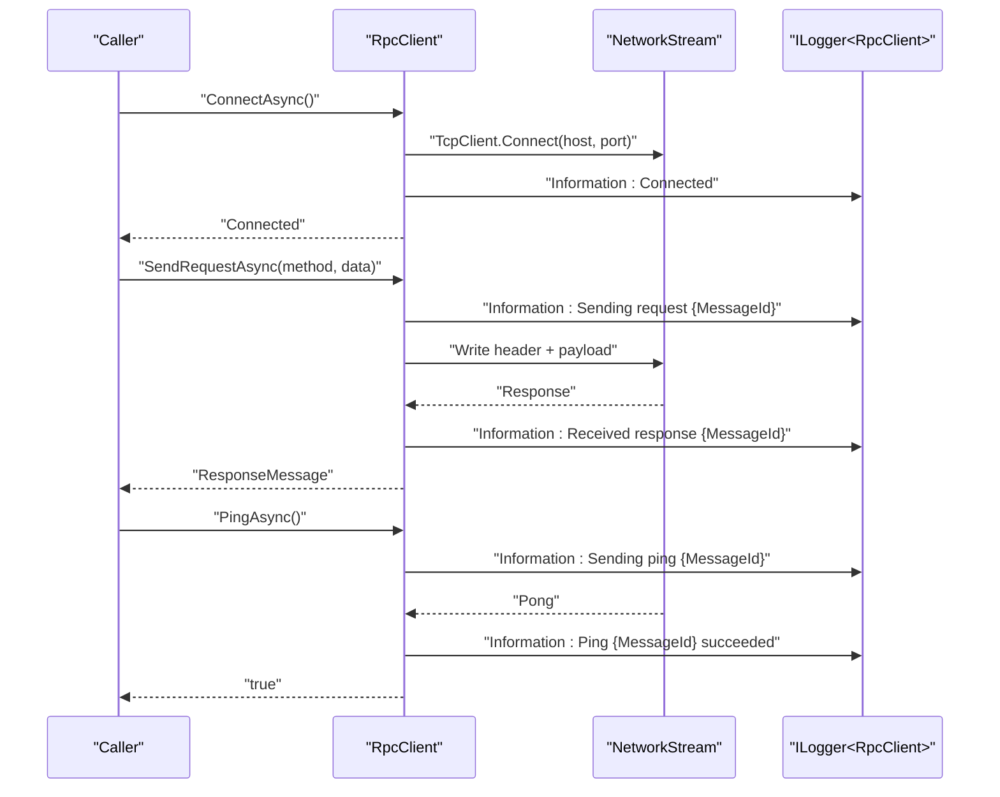
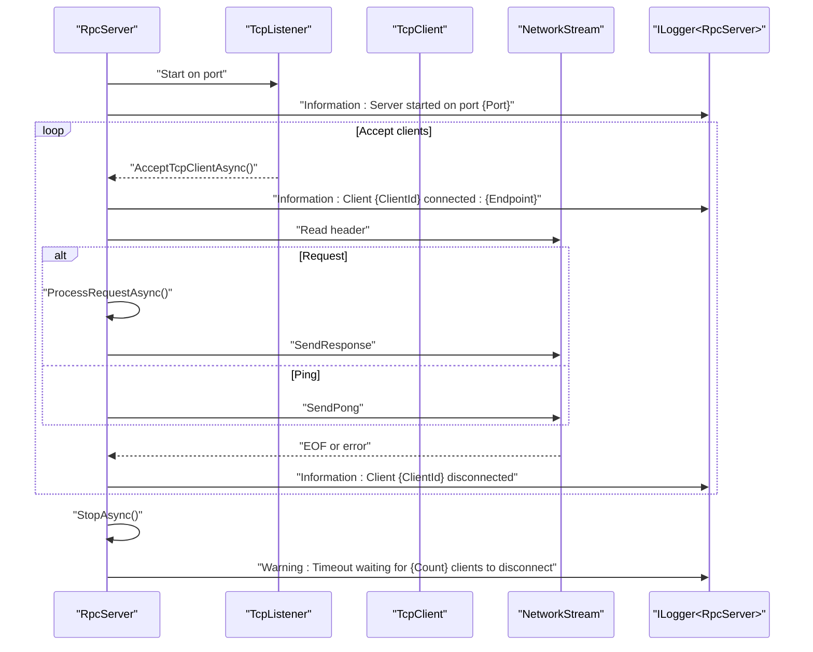
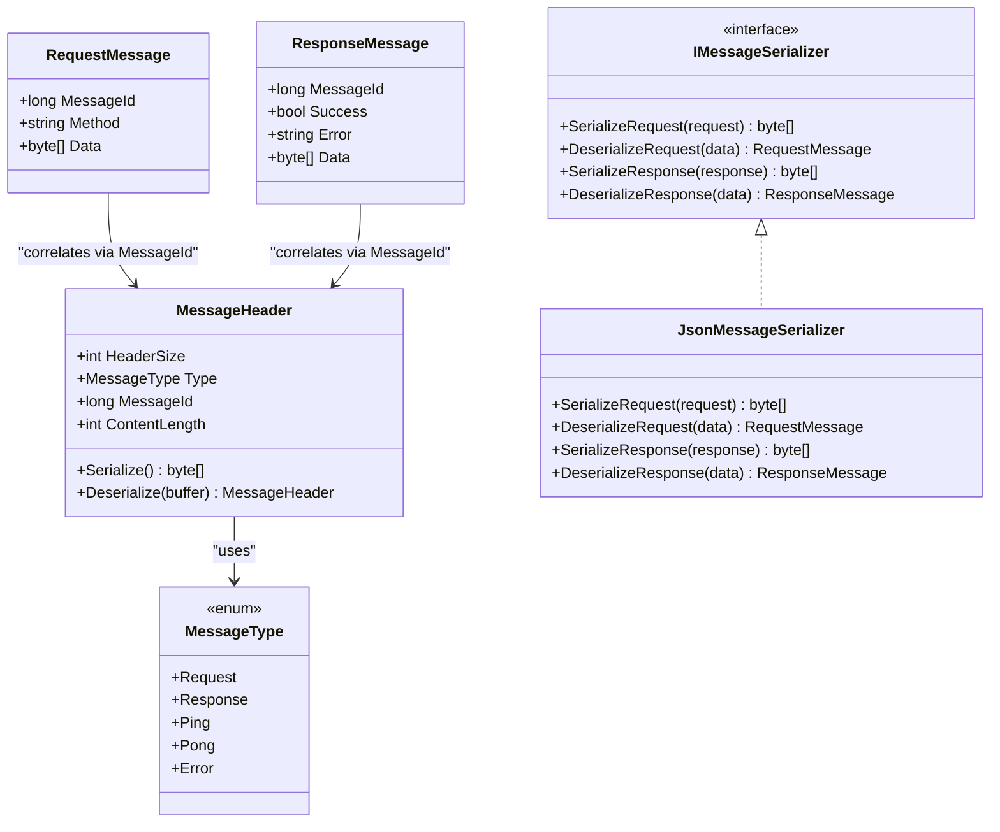
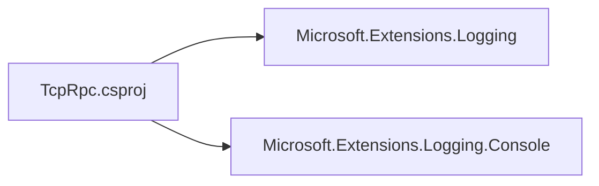

# Logging & Monitoring Integration

<cite>
**Referenced Files in This Document**
- [TcpRpc.csproj](file://TcpRpc/TcpRpc.csproj)
- [TcpRpcClient.cs](file://TcpRpc/Client/TcpRpcClient.cs)
- [RpcClientState.cs](file://TcpRpc/Client/RpcClientState.cs)
- [TcpRpcServer.cs](file://TcpRpc/Server/TcpRpcServer.cs)
- [RpcServerState.cs](file://TcpRpc/Server/RpcServerState.cs)
- [MessageHeader.cs](file://TcpRpc/Message/MessageHeader.cs)
- [MessageType.cs](file://TcpRpc/Message/MessageType.cs)
- [RequestMessage.cs](file://TcpRpc/Message/RequestMessage.cs)
- [ResponseMessage.cs](file://TcpRpc/Message/ResponseMessage.cs)
- [IMessageSerializer.cs](file://TcpRpc/Formatter/IMessageSerializer.cs)
- [JsonMessageSerializer.cs](file://TcpRpc/Formatter/JsonMessageSerializer.cs)
- [RequestHandler.cs](file://TcpRpc/Server/RequestHandler.cs)
</cite>

## Table of Contents
1. [Introduction](#introduction)
2. [Project Structure](#project-structure)
3. [Core Components](#core-components)
4. [Architecture Overview](#architecture-overview)
5. [Detailed Component Analysis](#detailed-component-analysis)
6. [Dependency Analysis](#dependency-analysis)
7. [Performance Considerations](#performance-considerations)
8. [Troubleshooting Guide](#troubleshooting-guide)
9. [Conclusion](#conclusion)
10. [Appendices](#appendices)

## Introduction
This document explains how Microsoft.Extensions.Logging integrates with TcpRpc’s client and server components. It covers structured logging patterns for connection lifecycle, request/response metrics, error conditions, and heartbeat monitoring. It also details log level categorization, configuring custom log providers (Console, Debug, File, Application Insights), filtering strategies, sensitive data handling, and production best practices for distributed systems.

## Project Structure
TcpRpc exposes two primary components:
- Client: RpcClient manages connection state, request/response lifecycle, and heartbeat (ping/pong).
- Server: RpcServer accepts connections, processes requests, and responds with structured messages.

Both components rely on Microsoft.Extensions.Logging for diagnostic output and integrate with standard provider packages.

**Diagram sources**
- [TcpRpcClient.cs:11-41](file://TcpRpc/Client/TcpRpcClient.cs#L11-L41)
- [TcpRpcServer.cs:12-48](file://TcpRpc/Server/TcpRpcServer.cs#L12-L48)
- [MessageHeader.cs:5-34](file://TcpRpc/Message/MessageHeader.cs#L5-L34)
- [MessageType.cs:3-10](file://TcpRpc/Message/MessageType.cs#L3-L10)
- [RequestMessage.cs:3-8](file://TcpRpc/Message/RequestMessage.cs#L3-L8)
- [ResponseMessage.cs:3-9](file://TcpRpc/Message/ResponseMessage.cs#L3-L9)
- [IMessageSerializer.cs:5-13](file://TcpRpc/Formatter/IMessageSerializer.cs#L5-L13)
- [JsonMessageSerializer.cs:6-85](file://TcpRpc/Formatter/JsonMessageSerializer.cs#L6-L85)

**Section sources**
- [TcpRpc.csproj:11-14](file://TcpRpc/TcpRpc.csproj#L11-L14)
- [RpcClientState.cs:3-11](file://TcpRpc/Client/RpcClientState.cs#L3-L11)
- [RpcServerState.cs:3-10](file://TcpRpc/Server/RpcServerState.cs#L3-L10)

## Core Components
- RpcClient: Implements connection lifecycle, request sending with correlation via MessageId, response routing, and heartbeat (Ping/Pong). Uses structured logging for connection events, timeouts, errors, and cleanup.
- RpcServer: Manages server lifecycle, client connections, request processing, and response/error sending. Emits structured logs for startup, client connect/disconnect, per-message errors, and graceful shutdown.

Key logging surfaces:
- Connection lifecycle: start, connect, disconnect, shutdown
- Request/response correlation: MessageId, Method, Success/Error
- Heartbeat: Ping/Pong success/failure/timeouts
- Errors: exceptions, timeouts, invalid messages, deserialization failures

**Section sources**
- [TcpRpcClient.cs:47-80](file://TcpRpc/Client/TcpRpcClient.cs#L47-L80)
- [TcpRpcClient.cs:85-130](file://TcpRpc/Client/TcpRpcClient.cs#L85-L130)
- [TcpRpcClient.cs:132-203](file://TcpRpc/Client/TcpRpcClient.cs#L132-L203)
- [TcpRpcClient.cs:205-287](file://TcpRpc/Client/TcpRpcClient.cs#L205-L287)
- [TcpRpcClient.cs:325-382](file://TcpRpc/Client/TcpRpcClient.cs#L325-L382)
- [TcpRpcServer.cs:101-173](file://TcpRpc/Server/TcpRpcServer.cs#L101-L173)
- [TcpRpcServer.cs:175-226](file://TcpRpc/Server/TcpRpcServer.cs#L175-L226)
- [TcpRpcServer.cs:228-316](file://TcpRpc/Server/TcpRpcServer.cs#L228-L316)
- [TcpRpcServer.cs:318-406](file://TcpRpc/Server/TcpRpcServer.cs#L318-L406)

## Architecture Overview
The logging architecture leverages Microsoft.Extensions.Logging abstractions. Providers (Console, Debug, File, Application Insights) are configured externally. TcpRpc components pass ILogger<T> instances to constructors, enabling structured, contextual logging.

[No sources needed since this diagram shows conceptual workflow, not actual code structure]

## Detailed Component Analysis

### RpcClient Logging Patterns
RpcClient logs connection lifecycle, request/response correlation, and heartbeat events. Structured logging keys include MessageId, Method, Port, and TimeoutMs.

- Connection lifecycle
  - ConnectAsync: Validates state transitions and logs success or failure.
  - DisconnectAsync: Logs cleanup and cancellation of pending requests.
- Request/response correlation
  - SendRequestAsync: Tracks MessageId, Method, and handles timeouts and exceptions.
  - ReceiveAsync: Processes Response/Error/Pong messages and routes to pending tasks.
- Heartbeat (Ping/Pong)
  - PingAsync: Logs warnings on add-failure, timeouts, and errors; returns boolean outcome.

**Diagram sources**
- [TcpRpcClient.cs:47-80](file://TcpRpc/Client/TcpRpcClient.cs#L47-L80)
- [TcpRpcClient.cs:132-203](file://TcpRpc/Client/TcpRpcClient.cs#L132-L203)
- [TcpRpcClient.cs:205-287](file://TcpRpc/Client/TcpRpcClient.cs#L205-L287)
- [TcpRpcClient.cs:325-382](file://TcpRpc/Client/TcpRpcClient.cs#L325-L382)

**Section sources**
- [RpcClientState.cs:3-11](file://TcpRpc/Client/RpcClientState.cs#L3-L11)
- [TcpRpcClient.cs:47-80](file://TcpRpc/Client/TcpRpcClient.cs#L47-L80)
- [TcpRpcClient.cs:85-130](file://TcpRpc/Client/TcpRpcClient.cs#L85-L130)
- [TcpRpcClient.cs:132-203](file://TcpRpc/Client/TcpRpcClient.cs#L132-L203)
- [TcpRpcClient.cs:205-287](file://TcpRpc/Client/TcpRpcClient.cs#L205-L287)
- [TcpRpcClient.cs:325-382](file://TcpRpc/Client/TcpRpcClient.cs#L325-L382)

### RpcServer Logging Patterns
RpcServer logs server lifecycle, client connect/disconnect, per-request processing, and error conditions. Structured logging keys include ClientId, Endpoint, and MessageId.

- Server lifecycle
  - StartAsync: Logs startup and state transitions.
  - StopAsync: Logs graceful shutdown and client disconnection timeouts.
- Client handling
  - HandleClientAsync: Logs connection, disconnection, and per-message errors.
- Request processing
  - ProcessClientMessageAsync: Routes Request/Ping messages.
  - ProcessRequestAsync: Executes registered handlers and returns structured responses or errors.

**Diagram sources**
- [TcpRpcServer.cs:101-173](file://TcpRpc/Server/TcpRpcServer.cs#L101-L173)
- [TcpRpcServer.cs:175-226](file://TcpRpc/Server/TcpRpcServer.cs#L175-L226)
- [TcpRpcServer.cs:228-316](file://TcpRpc/Server/TcpRpcServer.cs#L228-L316)
- [TcpRpcServer.cs:318-406](file://TcpRpc/Server/TcpRpcServer.cs#L318-L406)

**Section sources**
- [RpcServerState.cs:3-10](file://TcpRpc/Server/RpcServerState.cs#L3-L10)
- [TcpRpcServer.cs:101-173](file://TcpRpc/Server/TcpRpcServer.cs#L101-L173)
- [TcpRpcServer.cs:175-226](file://TcpRpc/Server/TcpRpcServer.cs#L175-L226)
- [TcpRpcServer.cs:228-316](file://TcpRpc/Server/TcpRpcServer.cs#L228-L316)
- [TcpRpcServer.cs:318-406](file://TcpRpc/Server/TcpRpcServer.cs#L318-L406)

### Message Types and Serialization Logging Context
MessageHeader defines the wire protocol with Type, MessageId, and ContentLength. MessageType enumerates Request, Response, Ping, Pong, and Error. JsonMessageSerializer provides structured serialization/deserialization with validation and error handling.

**Diagram sources**
- [MessageHeader.cs:5-34](file://TcpRpc/Message/MessageHeader.cs#L5-L34)
- [MessageType.cs:3-10](file://TcpRpc/Message/MessageType.cs#L3-L10)
- [RequestMessage.cs:3-8](file://TcpRpc/Message/RequestMessage.cs#L3-L8)
- [ResponseMessage.cs:3-9](file://TcpRpc/Message/ResponseMessage.cs#L3-L9)
- [IMessageSerializer.cs:5-13](file://TcpRpc/Formatter/IMessageSerializer.cs#L5-L13)
- [JsonMessageSerializer.cs:6-85](file://TcpRpc/Formatter/JsonMessageSerializer.cs#L6-L85)

**Section sources**
- [MessageHeader.cs:5-34](file://TcpRpc/Message/MessageHeader.cs#L5-L34)
- [MessageType.cs:3-10](file://TcpRpc/Message/MessageType.cs#L3-L10)
- [RequestMessage.cs:3-8](file://TcpRpc/Message/RequestMessage.cs#L3-L8)
- [ResponseMessage.cs:3-9](file://TcpRpc/Message/ResponseMessage.cs#L3-L9)
- [IMessageSerializer.cs:5-13](file://TcpRpc/Formatter/IMessageSerializer.cs#L5-L13)
- [JsonMessageSerializer.cs:6-85](file://TcpRpc/Formatter/JsonMessageSerializer.cs#L6-L85)

### Logging Configuration for RpcClient and RpcServer
- Constructor injection: Both RpcClient and RpcServer accept ILogger<T> via constructor parameters. Passing null falls back to NullLogger<T>.
- Provider packages: The project references Microsoft.Extensions.Logging and Microsoft.Extensions.Logging.Console. Additional providers (Debug, File, Application Insights) can be added via package references and configured in your host application.

Recommended configuration steps:
- Add provider package references (e.g., Microsoft.Extensions.Logging.Debug, Microsoft.Extensions.Logging.File, Microsoft.ApplicationInsights.NLog.Targets.ApplicationInsights).
- Configure provider(s) in your host app (e.g., Program.cs or Startup.cs) with desired log levels and filters.
- Bind RpcClient and RpcServer to the configured ILogger<T>.

**Section sources**
- [TcpRpc.csproj:11-14](file://TcpRpc/TcpRpc.csproj#L11-L14)
- [TcpRpcClient.cs:35-41](file://TcpRpc/Client/TcpRpcClient.cs#L35-L41)
- [TcpRpcServer.cs:43-48](file://TcpRpc/Server/TcpRpcServer.cs#L43-L48)

### Log Level Categorization
- Information: Lifecycle events (connect, disconnect, server start/stop), successful operations (pong), and periodic health signals.
- Warning: Non-fatal issues (ping timeouts, pending ping add failures, shutdown wait timeouts).
- Error: Exceptions, invalid messages, deserialization failures, and unexpected connection closures.

Examples of categorized logs:
- RpcClient: Connection success/failure, request timeouts, ping failures, connection lost.
- RpcServer: Server start, client connect/disconnect, per-message errors, handler exceptions.

**Section sources**
- [TcpRpcClient.cs:336-376](file://TcpRpc/Client/TcpRpcClient.cs#L336-L376)
- [TcpRpcServer.cs:132-314](file://TcpRpc/Server/TcpRpcServer.cs#L132-L314)

### Integrating Popular Logging Providers
- Console: Provided by Microsoft.Extensions.Logging.Console; configure minimum level and filter expressions.
- Debug: Use Microsoft.Extensions.Logging.Debug; useful for development and diagnostics.
- File: Use Microsoft.Extensions.Logging.File; supports rolling file policies and structured formatting.
- Application Insights: Use Application Insights provider; enables telemetry ingestion and query capabilities.

Provider selection depends on environment needs (local dev, staging, production).

**Section sources**
- [TcpRpc.csproj:11-14](file://TcpRpc/TcpRpc.csproj#L11-L14)

### Request Correlation Tracking
- MessageId: Unique identifier for each request; used to correlate requests with responses and pings.
- Method: Identifies the operation being invoked; included in logs for visibility.
- Pending collections: RpcClient tracks pending requests and pings keyed by MessageId; ensures correlation and cleanup on disconnect.

Best practices:
- Always log MessageId and Method for request/response events.
- On timeouts or errors, include MessageId and elapsed time for observability.

**Section sources**
- [RequestMessage.cs:5-7](file://TcpRpc/Message/RequestMessage.cs#L5-L7)
- [ResponseMessage.cs:5-8](file://TcpRpc/Message/ResponseMessage.cs#L5-L8)
- [TcpRpcClient.cs:139-143](file://TcpRpc/Client/TcpRpcClient.cs#L139-L143)
- [TcpRpcClient.cs:263-267](file://TcpRpc/Client/TcpRpcClient.cs#L263-L267)
- [TcpRpcClient.cs:272-275](file://TcpRpc/Client/TcpRpcClient.cs#L272-L275)
- [TcpRpcClient.cs:332-339](file://TcpRpc/Client/TcpRpcClient.cs#L332-L339)

### Heartbeat Monitoring (Ping/Pong)
- RpcClient sends Ping messages and waits for Pong; logs outcomes and timeouts.
- RpcServer responds to Ping with Pong; maintains no persistent state for pings.

Monitoring tips:
- Track ping success rate and latency.
- Treat repeated ping timeouts as early indicators of network or server issues.

**Section sources**
- [TcpRpcClient.cs:325-382](file://TcpRpc/Client/TcpRpcClient.cs#L325-L382)
- [TcpRpcServer.cs:329-331](file://TcpRpc/Server/TcpRpcServer.cs#L329-L331)
- [MessageType.cs:7-8](file://TcpRpc/Message/MessageType.cs#L7-L8)

### Error Conditions and Logging
- RpcClient: Handles connection loss, read failures, and request timeouts; cleans up pending requests.
- RpcServer: Catches per-message exceptions, deserialization errors, and invalid content length; sends Error responses.

Filtering and suppression:
- Use provider filters to reduce noise (e.g., suppress verbose debug logs in production).
- Avoid logging sensitive data; redact or avoid emitting raw request/response payloads unless necessary.

**Section sources**
- [TcpRpcClient.cs:230-235](file://TcpRpc/Client/TcpRpcClient.cs#L230-L235)
- [TcpRpcClient.cs:248-251](file://TcpRpc/Client/TcpRpcClient.cs#L248-L251)
- [TcpRpcClient.cs:289-299](file://TcpRpc/Client/TcpRpcClient.cs#L289-L299)
- [TcpRpcServer.cs:264-270](file://TcpRpc/Server/TcpRpcServer.cs#L264-L270)
- [TcpRpcServer.cs:300-304](file://TcpRpc/Server/TcpRpcServer.cs#L300-L304)
- [JsonMessageSerializer.cs:36-48](file://TcpRpc/Formatter/JsonMessageSerializer.cs#L36-L48)

### Performance Monitoring Through Logging
- Measure request durations by correlating send and receive logs via MessageId.
- Track throughput by counting logged requests per interval.
- Monitor error rates and latency percentiles using provider-specific aggregation (e.g., Application Insights analytics).

Recommendations:
- Use structured logs with consistent keys for downstream analytics.
- Avoid excessive logging in hot paths; prefer sampling or counters for high-frequency events.

[No sources needed since this section provides general guidance]

## Dependency Analysis
TcpRpc components depend on Microsoft.Extensions.Logging abstractions and optional provider packages. The library itself does not hardcode provider behavior; it delegates to the host’s logging configuration.

**Diagram sources**
- [TcpRpc.csproj:11-14](file://TcpRpc/TcpRpc.csproj#L11-L14)

**Section sources**
- [TcpRpc.csproj:11-14](file://TcpRpc/TcpRpc.csproj#L11-L14)

## Performance Considerations
- Minimize allocations in logging hot paths; use structured logging with preformatted keys.
- Prefer Information for normal operations; reserve Warning/Error for exceptional cases.
- Use provider batching and asynchronous sinks for high-throughput environments.
- Avoid logging large payloads; truncate or skip sensitive content.

[No sources needed since this section provides general guidance]

## Troubleshooting Guide
Common scenarios and where to look in logs:
- Connection failures: Check RpcClient.ConnectAsync and RpcServer.HandleClientAsync logs for exceptions and state transitions.
- Timeouts: Inspect request timeouts and ping timeouts; verify network stability and server load.
- Unexpected disconnects: Review read failures and EOF conditions in ReceiveAsync and HandleClientAsync.
- Handler errors: Look for ProcessRequestAsync error responses and RpcServer error logs.

Filtering strategies:
- Use provider filters to raise minimum levels in production and enable debug only when needed.
- Scope logs by category (TcpRpc.Client.RpcClient, TcpRpc.Server.RpcServer) for targeted inspection.

Sensitive data handling:
- Do not log raw request/response payloads.
- Redact identifiers and secrets; use placeholders or hashes where necessary.

**Section sources**
- [TcpRpcClient.cs:230-235](file://TcpRpc/Client/TcpRpcClient.cs#L230-L235)
- [TcpRpcClient.cs:248-251](file://TcpRpc/Client/TcpRpcClient.cs#L248-L251)
- [TcpRpcClient.cs:368-376](file://TcpRpc/Client/TcpRpcClient.cs#L368-L376)
- [TcpRpcServer.cs:254-258](file://TcpRpc/Server/TcpRpcServer.cs#L254-L258)
- [TcpRpcServer.cs:290-299](file://TcpRpc/Server/TcpRpcServer.cs#L290-L299)
- [TcpRpcServer.cs:351-359](file://TcpRpc/Server/TcpRpcServer.cs#L351-L359)

## Conclusion
TcpRpc integrates cleanly with Microsoft.Extensions.Logging, providing structured, contextual logs for connection lifecycle, request/response correlation, heartbeat monitoring, and error handling. By selecting appropriate providers, applying filters, and following best practices for sensitive data, teams can achieve robust observability across distributed deployments.

[No sources needed since this section summarizes without analyzing specific files]

## Appendices

### Appendix A: Log Level Reference
- Information: Lifecycle, success, and periodic signals
- Warning: Timeouts, cleanup, and non-fatal issues
- Error: Exceptions, invalid messages, and failures

**Section sources**
- [TcpRpcClient.cs:336-376](file://TcpRpc/Client/TcpRpcClient.cs#L336-L376)
- [TcpRpcServer.cs:132-314](file://TcpRpc/Server/TcpRpcServer.cs#L132-L314)

### Appendix B: Handler Registration and Request Processing
- RpcServer.RegisterHandler supports both generic and delegate forms; processing occurs in ProcessRequestAsync and returns structured ResponseMessage or Error.

**Section sources**
- [TcpRpcServer.cs:50-99](file://TcpRpc/Server/TcpRpcServer.cs#L50-L99)
- [TcpRpcServer.cs:335-360](file://TcpRpc/Server/TcpRpcServer.cs#L335-L360)
- [RequestHandler.cs:5-5](file://TcpRpc/Server/RequestHandler.cs#L5-L5)