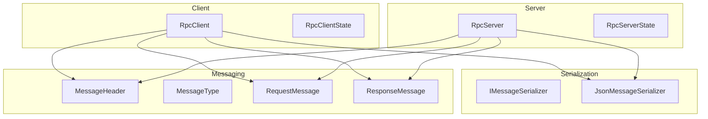
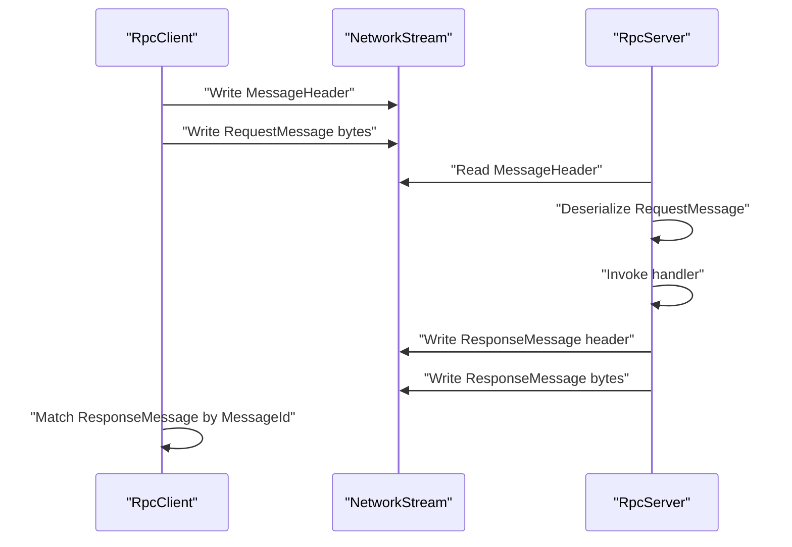
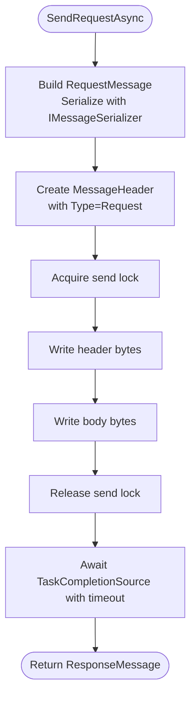
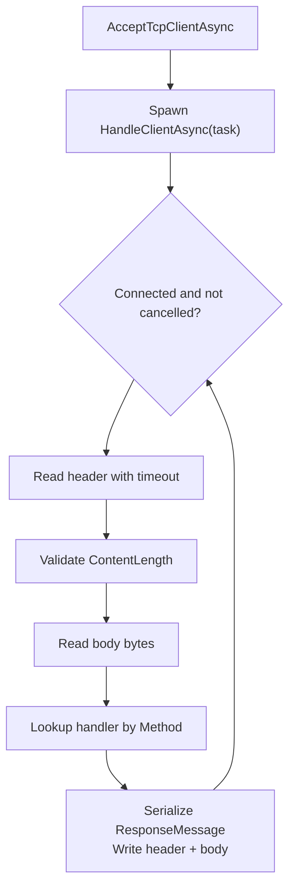
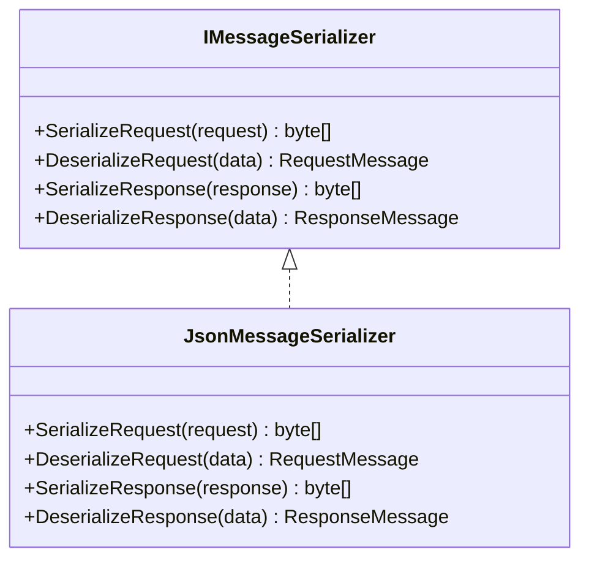
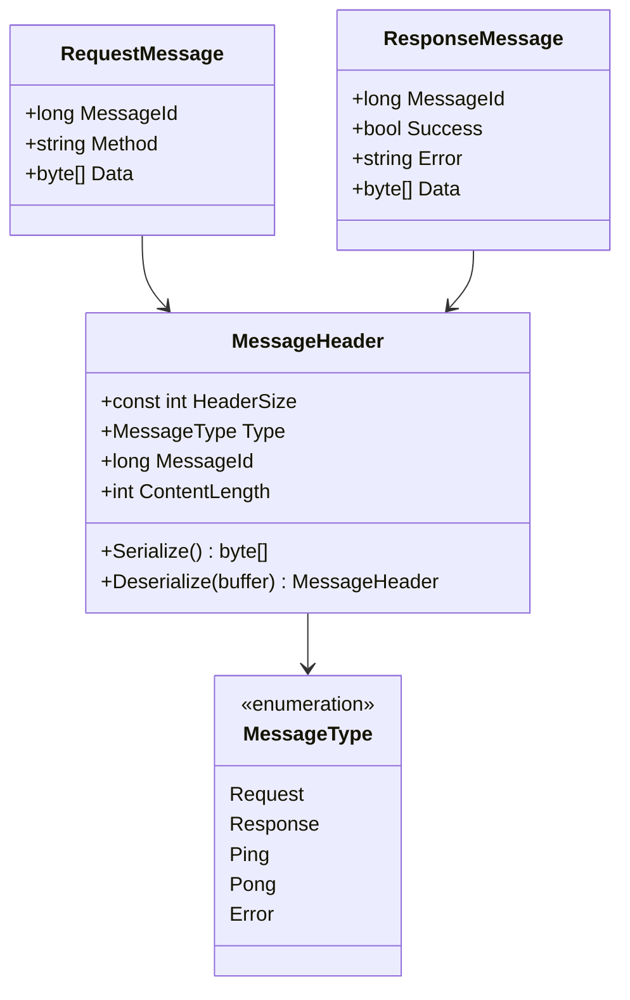
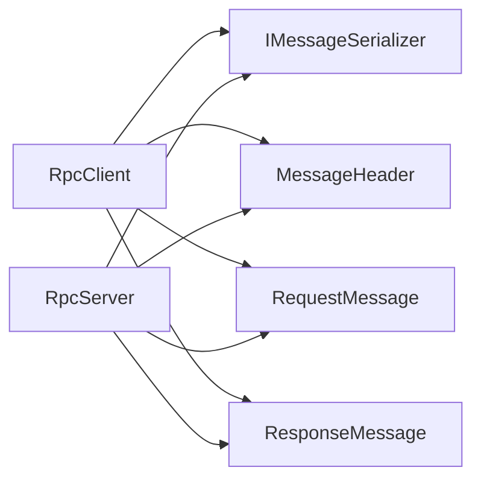

# Performance Optimization & Tuning

<cite>
**Referenced Files in This Document**
- [TcpRpc.csproj](file://TcpRpc/TcpRpc.csproj)
- [RpcClient.cs](file://TcpRpc/Client/TcpRpcClient.cs)
- [RpcClientState.cs](file://TcpRpc/Client/RpcClientState.cs)
- [RpcServer.cs](file://TcpRpc/Server/TcpRpcServer.cs)
- [RpcServerState.cs](file://TcpRpc/Server/RpcServerState.cs)
- [IMessageSerializer.cs](file://TcpRpc/Formatter/IMessageSerializer.cs)
- [JsonMessageSerializer.cs](file://TcpRpc/Formatter/JsonMessageSerializer.cs)
- [MessageHeader.cs](file://TcpRpc/Message/MessageHeader.cs)
- [MessageType.cs](file://TcpRpc/Message/MessageType.cs)
- [RequestMessage.cs](file://TcpRpc/Message/RequestMessage.cs)
- [ResponseMessage.cs](file://TcpRpc/Message/ResponseMessage.cs)
</cite>

## Table of Contents
1. [Introduction](#introduction)
2. [Project Structure](#project-structure)
3. [Core Components](#core-components)
4. [Architecture Overview](#architecture-overview)
5. [Detailed Component Analysis](#detailed-component-analysis)
6. [Dependency Analysis](#dependency-analysis)
7. [Performance Considerations](#performance-considerations)
8. [Troubleshooting Guide](#troubleshooting-guide)
9. [Conclusion](#conclusion)
10. [Appendices](#appendices)

## Introduction
This document provides a comprehensive guide to optimizing TcpRpc deployments for high throughput and resilience. It focuses on connection pooling strategies, memory management, throughput optimization, serialization performance tuning, buffer management, concurrent operation patterns, timeout and retry configurations, circuit breaker patterns, benchmarking and profiling techniques, monitoring strategies, TCP socket tuning, and production scaling approaches. The guidance is grounded in the actual implementation of the TcpRpc client and server components.

## Project Structure
The project is organized around a small, focused set of components:
- Client: RpcClient manages connections, request/response lifecycle, timeouts, and pings.
- Server: RpcServer accepts connections, handles requests concurrently, and streams responses.
- Serialization: IMessageSerializer and JsonMessageSerializer define the message contract and JSON encoding.
- Messaging: MessageHeader, MessageType, RequestMessage, ResponseMessage define the framing and payload model.

**Diagram sources**
- [RpcClient.cs:11-405](file://TcpRpc/Client/TcpRpcClient.cs#L11-L405)
- [RpcServer.cs:12-432](file://TcpRpc/Server/TcpRpcServer.cs#L12-L432)
- [JsonMessageSerializer.cs:6-85](file://TcpRpc/Formatter/JsonMessageSerializer.cs#L6-L85)
- [MessageHeader.cs:5-34](file://TcpRpc/Message/MessageHeader.cs#L5-L34)
- [RequestMessage.cs:3-8](file://TcpRpc/Message/RequestMessage.cs#L3-L8)
- [ResponseMessage.cs:3-9](file://TcpRpc/Message/ResponseMessage.cs#L3-L9)

**Section sources**
- [TcpRpc.csproj:1-17](file://TcpRpc/TcpRpc.csproj#L1-L17)

## Core Components
- RpcClient: Manages a single TcpClient connection, serializes outbound messages, tracks pending requests, enforces per-request timeouts, and supports periodic ping/pong for liveness checks. It uses a send lock to serialize writes and maintains in-memory dictionaries for pending requests and pings.
- RpcServer: Accepts incoming TcpClient connections, spawns per-client receive loops, deserializes requests, dispatches to registered handlers, and streams responses. It tracks active connections and cleans up completed tasks.
- JsonMessageSerializer: Encodes/decodes RequestMessage and ResponseMessage using UTF-8 JSON with camelCase naming policy.
- MessageHeader: Fixed-size binary header (type, message ID, content length) enabling efficient framing.

Key performance-relevant characteristics:
- Single-connection-per-client model with serialized writes.
- Per-request timeout cancellation via linked cancellation tokens.
- Minimal allocations for headers; request/response payloads are byte arrays.
- No built-in connection pooling; each RpcClient instance owns one connection.

**Section sources**
- [RpcClient.cs:11-405](file://TcpRpc/Client/TcpRpcClient.cs#L11-L405)
- [RpcServer.cs:12-432](file://TcpRpc/Server/TcpRpcServer.cs#L12-L432)
- [JsonMessageSerializer.cs:6-85](file://TcpRpc/Formatter/JsonMessageSerializer.cs#L6-L85)
- [MessageHeader.cs:5-34](file://TcpRpc/Message/MessageHeader.cs#L5-L34)

## Architecture Overview
The system uses a simple request-response protocol over TCP:
- Client sends a MessageHeader followed by a serialized RequestMessage.
- Server reads the header, validates content length, reads the payload, deserializes, invokes the handler, and writes a ResponseMessage header plus payload.
- Client correlates responses to pending requests by message ID.

**Diagram sources**
- [RpcClient.cs:132-189](file://TcpRpc/Client/TcpRpcClient.cs#L132-L189)
- [RpcServer.cs:318-376](file://TcpRpc/Server/TcpRpcServer.cs#L318-L376)
- [MessageHeader.cs:13-33](file://TcpRpc/Message/MessageHeader.cs#L13-L33)
- [RequestMessage.cs:3-8](file://TcpRpc/Message/RequestMessage.cs#L3-L8)
- [ResponseMessage.cs:3-9](file://TcpRpc/Message/ResponseMessage.cs#L3-L9)

## Detailed Component Analysis

### RpcClient: Connection, Concurrency, and Timeouts
- Connection lifecycle: ConnectAsync initializes TcpClient and NetworkStream, starts a receive loop, and transitions state. DisconnectAsync cancels the receive loop, closes streams, and completes pending requests with exceptions.
- Pending correlation: Uses ConcurrentDictionary<long, TaskCompletionSource<ResponseMessage>> for request correlation and SemaphoreSlim for serialized writes.
- Timeouts: Per-request timeout via CancellationTokenSource with a linked cancellation token to the client’s lifetime. PingAsync uses a separate dictionary and timeout mechanism.
- Buffering: Reads fixed-size headers and then content-length buffers; enforces a 10 MB maximum message size.

**Diagram sources**
- [RpcClient.cs:132-189](file://TcpRpc/Client/TcpRpcClient.cs#L132-L189)
- [MessageHeader.cs:13-20](file://TcpRpc/Message/MessageHeader.cs#L13-L20)
- [JsonMessageSerializer.cs:14-19](file://TcpRpc/Formatter/JsonMessageSerializer.cs#L14-L19)

**Section sources**
- [RpcClient.cs:47-130](file://TcpRpc/Client/TcpRpcClient.cs#L47-L130)
- [RpcClient.cs:132-189](file://TcpRpc/Client/TcpRpcClient.cs#L132-L189)
- [RpcClient.cs:205-236](file://TcpRpc/Client/TcpRpcClient.cs#L205-L236)
- [RpcClient.cs:325-382](file://TcpRpc/Client/TcpRpcClient.cs#L325-L382)
- [RpcClientState.cs:3-11](file://TcpRpc/Client/RpcClientState.cs#L3-L11)

### RpcServer: Concurrency Model and Backpressure
- Accept loop: Starts TcpListener and accepts TcpClient connections in a loop, spawning a per-client receive task.
- Per-client receive loop: Reads headers with a per-read timeout, validates content length, reads payload, and processes messages.
- Handler dispatch: Looks up handler by method name and executes synchronously per message.
- Backpressure: No explicit queueing; per-connection concurrency is bounded by a single receive loop per client.

**Diagram sources**
- [RpcServer.cs:101-173](file://TcpRpc/Server/TcpRpcServer.cs#L101-L173)
- [RpcServer.cs:228-316](file://TcpRpc/Server/TcpRpcServer.cs#L228-L316)
- [RpcServer.cs:318-376](file://TcpRpc/Server/TcpRpcServer.cs#L318-L376)

**Section sources**
- [RpcServer.cs:101-173](file://TcpRpc/Server/TcpRpcServer.cs#L101-L173)
- [RpcServer.cs:228-316](file://TcpRpc/Server/TcpRpcServer.cs#L228-L316)
- [RpcServer.cs:318-376](file://TcpRpc/Server/TcpRpcServer.cs#L318-L376)
- [RpcServerState.cs:3-10](file://TcpRpc/Server/RpcServerState.cs#L3-L10)

### Serialization: JSON Encoding and Validation
- JsonMessageSerializer uses UTF-8 JSON with camelCase naming and disables indentation to reduce payload size.
- Validates required fields (MessageId > 0, Method not empty) and throws meaningful errors on invalid data.
- Request/Response payloads are byte arrays; the serializer does not own the buffers.

**Diagram sources**
- [IMessageSerializer.cs:5-13](file://TcpRpc/Formatter/IMessageSerializer.cs#L5-L13)
- [JsonMessageSerializer.cs:6-85](file://TcpRpc/Formatter/JsonMessageSerializer.cs#L6-L85)

**Section sources**
- [JsonMessageSerializer.cs:8-84](file://TcpRpc/Formatter/JsonMessageSerializer.cs#L8-L84)
- [RequestMessage.cs:3-8](file://TcpRpc/Message/RequestMessage.cs#L3-L8)
- [ResponseMessage.cs:3-9](file://TcpRpc/Message/ResponseMessage.cs#L3-L9)

### Messaging Protocol: Header and Framing
- MessageHeader is a fixed-size binary structure containing MessageType, MessageId, and ContentLength.
- Little-endian encoding ensures cross-platform compatibility.
- Servers enforce upper bounds on content length to prevent memory exhaustion.

**Diagram sources**
- [MessageHeader.cs:5-34](file://TcpRpc/Message/MessageHeader.cs#L5-L34)
- [MessageType.cs:3-10](file://TcpRpc/Message/MessageType.cs#L3-L10)
- [RequestMessage.cs:3-8](file://TcpRpc/Message/RequestMessage.cs#L3-L8)
- [ResponseMessage.cs:3-9](file://TcpRpc/Message/ResponseMessage.cs#L3-L9)

**Section sources**
- [MessageHeader.cs:7-33](file://TcpRpc/Message/MessageHeader.cs#L7-L33)
- [MessageType.cs:3-10](file://TcpRpc/Message/MessageType.cs#L3-L10)

## Dependency Analysis
- RpcClient depends on IMessageSerializer and NetworkStream for IO.
- RpcServer depends on IMessageSerializer and NetworkStream for IO.
- Both components depend on MessageHeader and message models for framing and payload.
- Logging is optional and injected via Microsoft.Extensions.Logging abstractions.

**Diagram sources**
- [RpcClient.cs:11-405](file://TcpRpc/Client/TcpRpcClient.cs#L11-L405)
- [RpcServer.cs:12-432](file://TcpRpc/Server/TcpRpcServer.cs#L12-L432)
- [IMessageSerializer.cs:5-13](file://TcpRpc/Formatter/IMessageSerializer.cs#L5-L13)
- [MessageHeader.cs:5-34](file://TcpRpc/Message/MessageHeader.cs#L5-L34)
- [RequestMessage.cs:3-8](file://TcpRpc/Message/RequestMessage.cs#L3-L8)
- [ResponseMessage.cs:3-9](file://TcpRpc/Message/ResponseMessage.cs#L3-L9)

**Section sources**
- [RpcClient.cs:1-8](file://TcpRpc/Client/TcpRpcClient.cs#L1-L8)
- [RpcServer.cs:1-8](file://TcpRpc/Server/TcpRpcServer.cs#L1-L8)

## Performance Considerations

### Connection Pooling Strategies
- Current design: Each RpcClient instance owns a single TcpClient connection. There is no built-in connection pool.
- Recommended patterns:
  - Application-level pooling: Maintain a pool of RpcClient instances keyed by target endpoint. Use a producer-consumer queue to distribute requests across pooled clients.
  - Health checks: Periodically ping pooled clients and remove unhealthy ones.
  - Load balancing: Round-robin or weighted distribution across pooled clients.
  - Backpressure: Enforce per-pool limits and queue lengths to avoid unbounded growth.

[No sources needed since this section provides general guidance]

### Memory Management Techniques
- Minimize allocations:
  - Reuse buffers for headers when possible; current implementation allocates a new header buffer per write.
  - Avoid intermediate copies by passing byte arrays directly to serializers and streams.
- Control payload sizes:
  - Enforce strict limits on content length (already present in server).
  - Compress payloads when feasible (e.g., gzip) and configure compression thresholds.
- Reduce contention:
  - Use per-client send locks to serialize writes; consider per-message locks only if handlers are CPU-bound.
  - Avoid blocking operations inside handlers; offload heavy work to thread pools.

[No sources needed since this section provides general guidance]

### Throughput Optimization Approaches
- Batch requests: Group multiple small requests into fewer larger messages when latency allows.
- Pipelining: Allow multiple outstanding requests per connection; coordinate with correlation IDs.
- Handler parallelism: Increase server-side handler concurrency by using async handlers and avoiding blocking calls.
- Backpressure: Monitor ActiveConnections and reject or queue requests when thresholds are exceeded.

[No sources needed since this section provides general guidance]

### Serialization Performance Tuning
- JSON options: Keep camelCase and disable indentation (already configured).
- Payload shape: Prefer compact JSON and avoid unnecessary fields.
- Streaming: For large payloads, consider streaming or chunking strategies.
- Serializer choice: Evaluate alternative serializers (e.g., System.Text.Json with source generators) if applicable.

**Section sources**
- [JsonMessageSerializer.cs:8-12](file://TcpRpc/Formatter/JsonMessageSerializer.cs#L8-L12)

### Buffer Management
- Header allocation: Allocate a new header buffer per write; consider preallocating and reusing buffers for hot paths.
- Content buffers: Server allocates content buffers sized to ContentLength; ensure limits are enforced.
- Stream reads: Use ReadAsync with memory slices to minimize copying.

**Section sources**
- [RpcClient.cs:238-256](file://TcpRpc/Client/TcpRpcClient.cs#L238-L256)
- [RpcServer.cs:273-285](file://TcpRpc/Server/TcpRpcServer.cs#L273-L285)

### Concurrent Operation Patterns
- Client concurrency: Use SemaphoreSlim to serialize writes; consider per-request locks only if handlers are CPU-bound.
- Server concurrency: Each client connection runs a single receive loop; scale by increasing the number of connections or using pooling.

**Section sources**
- [RpcClient.cs:20-21](file://TcpRpc/Client/TcpRpcClient.cs#L20-L21)
- [RpcServer.cs:18-27](file://TcpRpc/Server/TcpRpcServer.cs#L18-L27)

### Timeout Configuration and Retry Mechanisms
- Client timeouts: Per-request timeout via CancellationTokenSource; combine with client lifetime cancellation.
- Retry strategies: Exponential backoff with jitter for transient failures; avoid retrying non-transient errors.
- Circuit breaker: Track failure rates and open the circuit after threshold breaches; allow half-open checks periodically.

**Section sources**
- [RpcClient.cs:162-163](file://TcpRpc/Client/TcpRpcClient.cs#L162-L163)
- [RpcClient.cs:349-351](file://TcpRpc/Client/TcpRpcClient.cs#L349-L351)

### Circuit Breaker Patterns
- Failure detection: Count timeouts and errors; track rolling failure rate.
- Open state: Block new requests; fail fast with a transient error.
- Recovery: Allow probe requests in half-open state; close circuit on success.

[No sources needed since this section provides general guidance]

### Benchmarking Methodologies
- Microbenchmarks: Measure serialization, deserialization, and framing overhead using BenchmarkDotNet.
- End-to-end: Run realistic workloads with varying payload sizes and concurrency levels.
- Metrics: Latency percentiles, throughput, CPU utilization, memory allocations, and GC pressure.

[No sources needed since this section provides general guidance]

### Profiling Techniques
- Allocation profiling: Identify hot paths causing allocations (headers, buffers, JSON).
- CPU profiling: Focus on handler execution and serialization costs.
- Network profiling: Capture RTT, bandwidth utilization, and connection counts.

[No sources needed since this section provides general guidance]

### Performance Monitoring Strategies
- Metrics: Requests per second, average/percentile latency, error rates, active connections, and queue depths.
- Tracing: Add correlation IDs to requests; propagate context across services.
- Alerts: Threshold-based alerts for latency spikes, error rates, and resource exhaustion.

[No sources needed since this section provides general guidance]

### Network-Level Optimizations and TCP Socket Tuning
- TCP_NODELAY: Disable Nagle’s algorithm for lower latency.
- SO_KEEPALIVE: Enable keepalive with tuned intervals.
- Buffer sizes: Adjust SO_SNDBUF/SO_RCVBUF for throughput vs. latency trade-offs.
- TIME_WAIT: Reuse addresses cautiously; consider SO_REUSEADDR on server.

[No sources needed since this section provides general guidance]

### Resource Cleanup Patterns
- Dispose patterns: Ensure TcpClient and NetworkStream are disposed; cancel tasks and clear pending collections.
- Graceful shutdown: Cancel CTS, wait for receive loops, and drain pending requests.

**Section sources**
- [RpcClient.cs:384-404](file://TcpRpc/Client/TcpRpcClient.cs#L384-L404)
- [RpcServer.cs:415-431](file://TcpRpc/Server/TcpRpcServer.cs#L415-L431)

### Scaling Considerations and Load Testing
- Horizontal scaling: Deploy multiple server instances behind a load balancer; use client-side connection pooling.
- Vertical scaling: Tune server worker threads and handler concurrency.
- Load testing: Use tools like k6 or Locust to simulate realistic traffic; measure saturation points.

[No sources needed since this section provides general guidance]

## Troubleshooting Guide
- Connection errors: Inspect ReceiveAsync and HandleConnectionLostAsync for error propagation and pending request completion.
- Timeouts: Verify per-request timeout cancellation tokens and ping timeouts.
- Large messages: Confirm content length limits and error responses.

**Section sources**
- [RpcClient.cs:205-236](file://TcpRpc/Client/TcpRpcClient.cs#L205-L236)
- [RpcClient.cs:289-306](file://TcpRpc/Client/TcpRpcClient.cs#L289-L306)
- [RpcServer.cs:264-270](file://TcpRpc/Server/TcpRpcServer.cs#L264-L270)

## Conclusion
TcpRpc provides a minimal, reliable foundation for RPC over TCP. For high-throughput, production-grade deployments, adopt connection pooling, optimize serialization and buffer management, implement robust timeout/retry/circuit breaker patterns, and instrument comprehensive monitoring. The current single-connection-per-client design can be scaled horizontally and vertically with careful attention to resource limits and concurrency controls.

## Appendices

### Appendix A: Timeout and Retry Reference
- Client per-request timeout: [RpcClient.cs:162-163](file://TcpRpc/Client/TcpRpcClient.cs#L162-L163)
- Ping timeout: [RpcClient.cs:349-351](file://TcpRpc/Client/TcpRpcClient.cs#L349-L351)
- Server per-read timeout: [RpcServer.cs:244-247](file://TcpRpc/Server/TcpRpcServer.cs#L244-L247)

### Appendix B: Serialization Reference
- JSON options: [JsonMessageSerializer.cs:8-12](file://TcpRpc/Formatter/JsonMessageSerializer.cs#L8-L12)
- Request serialization: [JsonMessageSerializer.cs:14-19](file://TcpRpc/Formatter/JsonMessageSerializer.cs#L14-L19)
- Response serialization: [JsonMessageSerializer.cs:51-57](file://TcpRpc/Formatter/JsonMessageSerializer.cs#L51-L57)

### Appendix C: Framing Reference
- Header layout: [MessageHeader.cs:7-20](file://TcpRpc/Message/MessageHeader.cs#L7-L20)
- MessageType enum: [MessageType.cs:3-10](file://TcpRpc/Message/MessageType.cs#L3-L10)