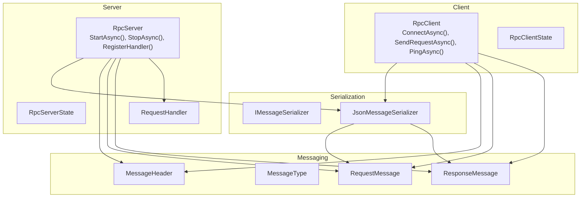
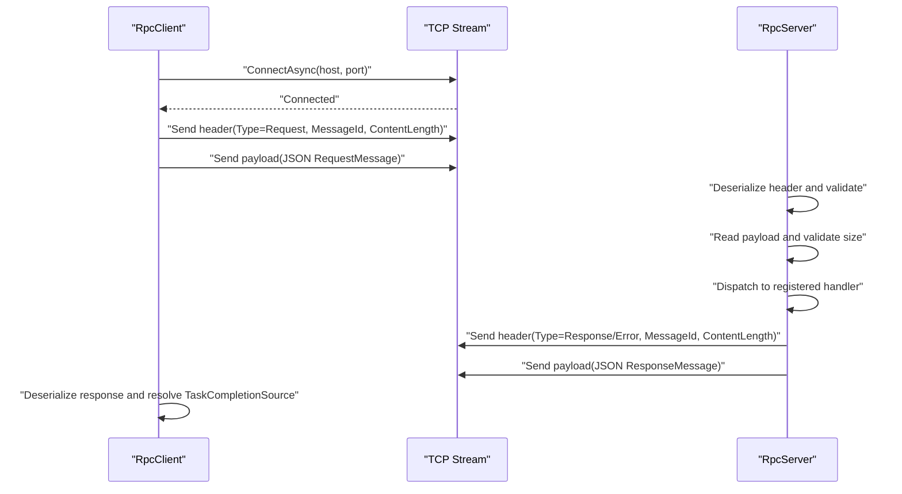
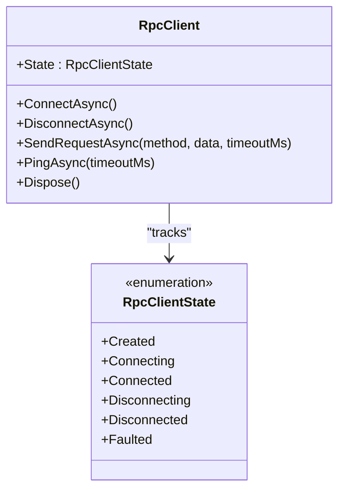
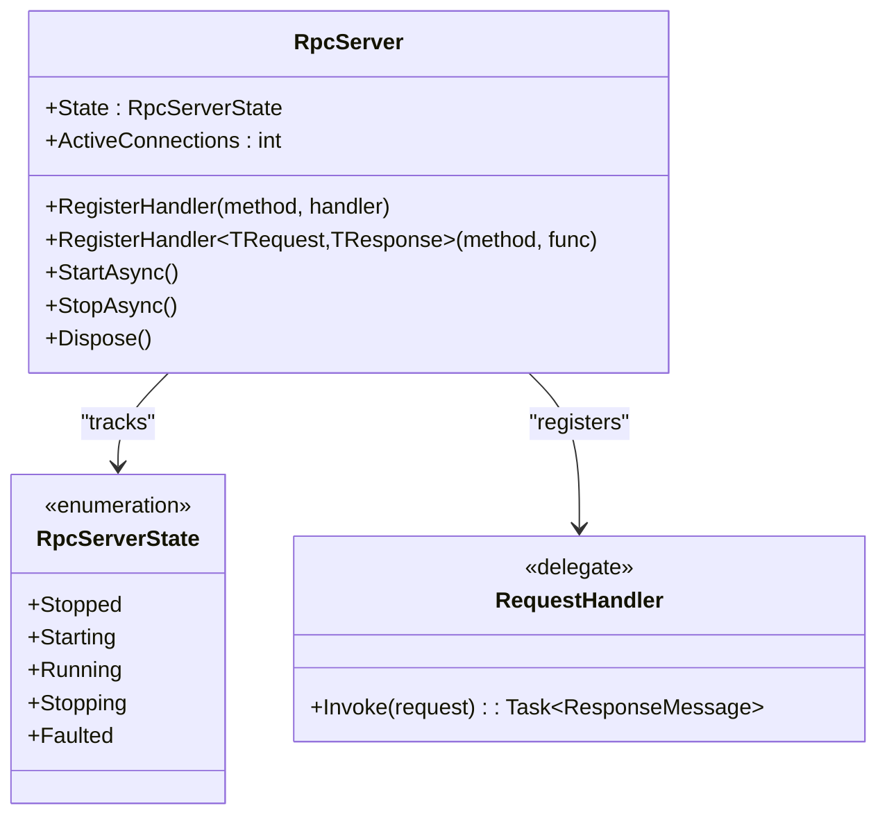
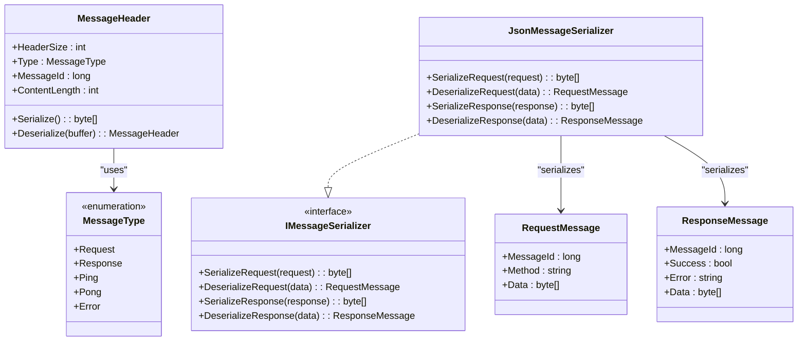
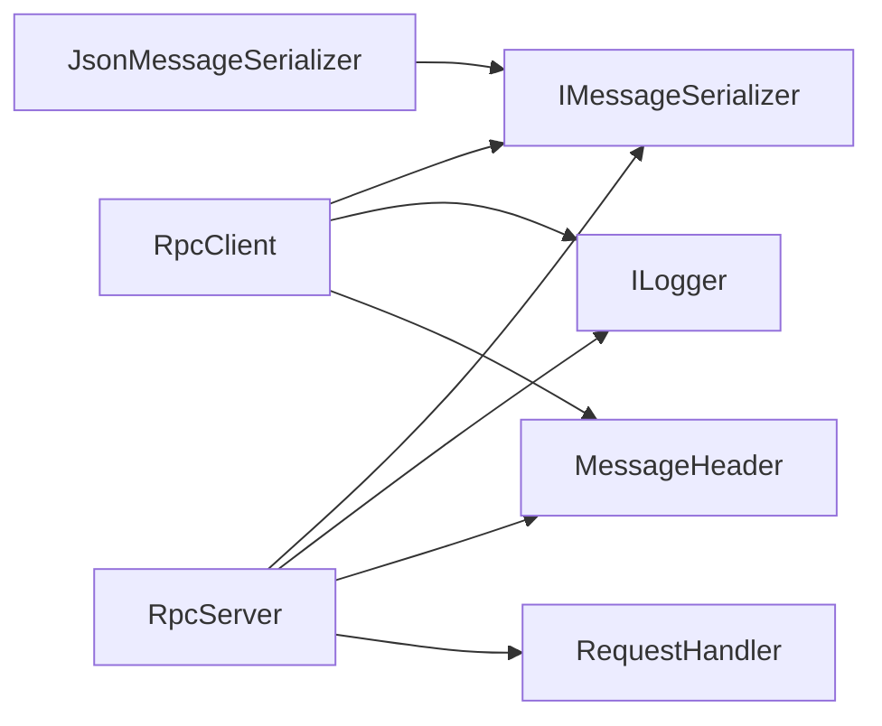

# Security & Enterprise Deployment

<cite>
**Referenced Files in This Document**
- [TcpRpc.csproj](file://TcpRpc/TcpRpc.csproj)
- [TcpRpcClient.cs](file://TcpRpc/Client/TcpRpcClient.cs)
- [RpcClientState.cs](file://TcpRpc/Client/RpcClientState.cs)
- [TcpRpcServer.cs](file://TcpRpc/Server/TcpRpcServer.cs)
- [RpcServerState.cs](file://TcpRpc/Server/RpcServerState.cs)
- [MessageHeader.cs](file://TcpRpc/Message/MessageHeader.cs)
- [MessageType.cs](file://TcpRpc/Message/MessageType.cs)
- [RequestMessage.cs](file://TcpRpc/Message/RequestMessage.cs)
- [ResponseMessage.cs](file://TcpRpc/Message/ResponseMessage.cs)
- [IMessageSerializer.cs](file://TcpRpc/Formatter/IMessageSerializer.cs)
- [JsonMessageSerializer.cs](file://TcpRpc/Formatter/JsonMessageSerializer.cs)
</cite>

## Table of Contents
1. [Introduction](#introduction)
2. [Project Structure](#project-structure)
3. [Core Components](#core-components)
4. [Architecture Overview](#architecture-overview)
5. [Detailed Component Analysis](#detailed-component-analysis)
6. [Dependency Analysis](#dependency-analysis)
7. [Performance Considerations](#performance-considerations)
8. [Security Considerations](#security-considerations)
9. [Enterprise Deployment Patterns](#enterprise-deployment-patterns)
10. [Monitoring, Logging, and Auditing](#monitoring-logging-and-auditing)
11. [Firewall and Network Segmentation](#firewall-and-network-segmentation)
12. [Troubleshooting Guide](#troubleshooting-guide)
13. [Conclusion](#conclusion)

## Introduction
This document provides comprehensive security and enterprise deployment guidance for TcpRpc. It focuses on network security, authentication and authorization patterns, TLS/SSL configuration, certificate management, high availability, load balancing, monitoring, auditing, and compliance-aligned operational practices. The content is grounded in the repository’s codebase and designed to be accessible to both technical and non-technical stakeholders.

## Project Structure
TcpRpc is a lightweight TCP-based RPC library with three primary layers:
- Client: Establishes TCP connections, sends requests, receives responses, and manages lifecycle.
- Server: Accepts TCP connections, processes messages, and dispatches to registered handlers.
- Messaging and Serialization: Defines message headers, types, and JSON serialization contracts.

**Diagram sources**
- [TcpRpcClient.cs:11-405](file://TcpRpc/Client/TcpRpcClient.cs#L11-L405)
- [RpcClientState.cs:1-11](file://TcpRpc/Client/RpcClientState.cs#L1-L11)
- [TcpRpcServer.cs:12-432](file://TcpRpc/Server/TcpRpcServer.cs#L12-L432)
- [RpcServerState.cs:1-10](file://TcpRpc/Server/RpcServerState.cs#L1-L10)
- [MessageHeader.cs:5-34](file://TcpRpc/Message/MessageHeader.cs#L5-L34)
- [MessageType.cs:3-10](file://TcpRpc/Message/MessageType.cs#L3-L10)
- [RequestMessage.cs:3-8](file://TcpRpc/Message/RequestMessage.cs#L3-L8)
- [ResponseMessage.cs:3-9](file://TcpRpc/Message/ResponseMessage.cs#L3-L9)
- [IMessageSerializer.cs:5-13](file://TcpRpc/Formatter/IMessageSerializer.cs#L5-L13)
- [JsonMessageSerializer.cs:6-85](file://TcpRpc/Formatter/JsonMessageSerializer.cs#L6-L85)

**Section sources**
- [TcpRpc.csproj:1-17](file://TcpRpc/TcpRpc.csproj#L1-L17)
- [TcpRpcClient.cs:11-405](file://TcpRpc/Client/TcpRpcClient.cs#L11-L405)
- [TcpRpcServer.cs:12-432](file://TcpRpc/Server/TcpRpcServer.cs#L12-L432)
- [MessageHeader.cs:5-34](file://TcpRpc/Message/MessageHeader.cs#L5-L34)
- [IMessageSerializer.cs:5-13](file://TcpRpc/Formatter/IMessageSerializer.cs#L5-L13)

## Core Components
- RpcClient: Manages TCP connectivity, request/response lifecycle, timeouts, and pings. Supports state transitions and graceful disconnects.
- RpcServer: Accepts TCP connections, reads and validates headers, enforces message size limits, and routes requests to registered handlers.
- Message Types and Headers: Define wire protocol semantics and enforce minimal metadata for each frame.
- JSON Serializer: Provides structured serialization/deserialization for requests and responses with validation.

Key capabilities relevant to security and operations:
- Client-side timeouts and cancellation tokens prevent resource leaks.
- Server enforces content length limits to mitigate memory exhaustion.
- Logging via Microsoft.Extensions.Logging enables observability.
- Explicit state machines support controlled lifecycle transitions.

**Section sources**
- [TcpRpcClient.cs:11-405](file://TcpRpc/Client/TcpRpcClient.cs#L11-L405)
- [RpcClientState.cs:1-11](file://TcpRpc/Client/RpcClientState.cs#L1-L11)
- [TcpRpcServer.cs:12-432](file://TcpRpc/Server/TcpRpcServer.cs#L12-L432)
- [RpcServerState.cs:1-10](file://TcpRpc/Server/RpcServerState.cs#L1-L10)
- [MessageHeader.cs:5-34](file://TcpRpc/Message/MessageHeader.cs#L5-L34)
- [MessageType.cs:3-10](file://TcpRpc/Message/MessageType.cs#L3-L10)
- [RequestMessage.cs:3-8](file://TcpRpc/Message/RequestMessage.cs#L3-L8)
- [ResponseMessage.cs:3-9](file://TcpRpc/Message/ResponseMessage.cs#L3-L9)
- [IMessageSerializer.cs:5-13](file://TcpRpc/Formatter/IMessageSerializer.cs#L5-L13)
- [JsonMessageSerializer.cs:6-85](file://TcpRpc/Formatter/JsonMessageSerializer.cs#L6-L85)

## Architecture Overview
The system operates over TCP with a simple framing protocol:
- Each message consists of a fixed-size header followed by a variable-length payload.
- The header encodes message type, message ID, and content length.
- Requests and responses are serialized as JSON and validated by the serializer.

**Diagram sources**
- [TcpRpcClient.cs:132-189](file://TcpRpc/Client/TcpRpcClient.cs#L132-L189)
- [TcpRpcServer.cs:228-333](file://TcpRpc/Server/TcpRpcServer.cs#L228-L333)
- [MessageHeader.cs:13-33](file://TcpRpc/Message/MessageHeader.cs#L13-L33)
- [JsonMessageSerializer.cs:14-84](file://TcpRpc/Formatter/JsonMessageSerializer.cs#L14-L84)

## Detailed Component Analysis

### RpcClient
- Connectivity: Establishes TCP connection and starts a receive loop; supports graceful disconnect and cancellation.
- Request/Response: Assigns unique message IDs, serializes requests, writes header and payload, and awaits responses with timeout.
- Health checks: Implements ping/pong to detect dead connections.
- Concurrency: Uses locks and semaphores to serialize writes and coordinate state.

**Diagram sources**
- [TcpRpcClient.cs:11-405](file://TcpRpc/Client/TcpRpcClient.cs#L11-L405)
- [RpcClientState.cs:1-11](file://TcpRpc/Client/RpcClientState.cs#L1-L11)

**Section sources**
- [TcpRpcClient.cs:47-130](file://TcpRpc/Client/TcpRpcClient.cs#L47-L130)
- [TcpRpcClient.cs:132-189](file://TcpRpc/Client/TcpRpcClient.cs#L132-L189)
- [TcpRpcClient.cs:205-287](file://TcpRpc/Client/TcpRpcClient.cs#L205-L287)
- [RpcClientState.cs:1-11](file://TcpRpc/Client/RpcClientState.cs#L1-L11)

### RpcServer
- Lifecycle: Starts a listener, accepts clients, and coordinates per-client tasks; exposes active connection count.
- Message processing: Reads and validates headers, enforces content length limits, deserializes requests, and dispatches to handlers.
- Responses: Serializes responses or error messages and writes them back to the client.
- Handler registration: Supports strongly-typed handler registration for typed request/response pairs.

**Diagram sources**
- [TcpRpcServer.cs:12-432](file://TcpRpc/Server/TcpRpcServer.cs#L12-L432)
- [RpcServerState.cs:1-10](file://TcpRpc/Server/RpcServerState.cs#L1-L10)

**Section sources**
- [TcpRpcServer.cs:101-173](file://TcpRpc/Server/TcpRpcServer.cs#L101-L173)
- [TcpRpcServer.cs:228-333](file://TcpRpc/Server/TcpRpcServer.cs#L228-L333)
- [TcpRpcServer.cs:335-376](file://TcpRpc/Server/TcpRpcServer.cs#L335-L376)

### Message Protocol and Serialization
- MessageHeader: Fixed-size header with little-endian encoding for message type, message ID, and content length.
- MessageType: Enumerates supported message types including Request, Response, Ping, Pong, and Error.
- RequestMessage/ResponseMessage: DTOs for transport.
- JsonMessageSerializer: Validates required fields and throws on malformed payloads.

**Diagram sources**
- [MessageHeader.cs:5-34](file://TcpRpc/Message/MessageHeader.cs#L5-L34)
- [MessageType.cs:3-10](file://TcpRpc/Message/MessageType.cs#L3-L10)
- [RequestMessage.cs:3-8](file://TcpRpc/Message/RequestMessage.cs#L3-L8)
- [ResponseMessage.cs:3-9](file://TcpRpc/Message/ResponseMessage.cs#L3-L9)
- [IMessageSerializer.cs:5-13](file://TcpRpc/Formatter/IMessageSerializer.cs#L5-L13)
- [JsonMessageSerializer.cs:6-85](file://TcpRpc/Formatter/JsonMessageSerializer.cs#L6-L85)

**Section sources**
- [MessageHeader.cs:13-33](file://TcpRpc/Message/MessageHeader.cs#L13-L33)
- [MessageType.cs:3-10](file://TcpRpc/Message/MessageType.cs#L3-L10)
- [JsonMessageSerializer.cs:14-84](file://TcpRpc/Formatter/JsonMessageSerializer.cs#L14-L84)

## Dependency Analysis
- Client depends on:
  - Network primitives (TcpClient, NetworkStream)
  - Serializer contract and implementation
  - Logging abstraction
- Server depends on:
  - Listener and streams
  - Serializer and message types
  - Logging abstraction
  - Request handler delegate

**Diagram sources**
- [TcpRpcClient.cs:1-8](file://TcpRpc/Client/TcpRpcClient.cs#L1-L8)
- [TcpRpcServer.cs:1-8](file://TcpRpc/Server/TcpRpcServer.cs#L1-L8)
- [IMessageSerializer.cs:5-13](file://TcpRpc/Formatter/IMessageSerializer.cs#L5-L13)
- [JsonMessageSerializer.cs:6-85](file://TcpRpc/Formatter/JsonMessageSerializer.cs#L6-L85)

**Section sources**
- [TcpRpcClient.cs:1-8](file://TcpRpc/Client/TcpRpcClient.cs#L1-L8)
- [TcpRpcServer.cs:1-8](file://TcpRpc/Server/TcpRpcServer.cs#L1-L8)
- [IMessageSerializer.cs:5-13](file://TcpRpc/Formatter/IMessageSerializer.cs#L5-L13)

## Performance Considerations
- Concurrency control: Client uses a semaphore to serialize writes; server processes each client concurrently with per-client tasks.
- Timeouts: Client enforces per-request timeouts; server applies read timeouts and enforces content length limits.
- Memory limits: Server rejects oversized messages to protect memory usage.
- Logging overhead: Logging is available but should be tuned in production to avoid excessive I/O.

[No sources needed since this section provides general guidance]

## Security Considerations
This section outlines security posture and hardening guidance aligned with the repository’s TCP transport and message framing. The codebase does not implement built-in authentication or authorization; therefore, enterprise-grade protections must be layered externally.

- Transport encryption (TLS/SSL)
  - The codebase uses raw TCP sockets. To enable encrypted communication, deploy a TLS terminator (reverse proxy or sidecar) that terminates TLS and forwards plaintext TCP to the server process.
  - Alternatively, instrument the client and server to use TLS streams around the existing NetworkStream. This requires extending the client and server to accept TLS configuration and certificates.

- Certificate management
  - Use short-lived certificates issued by a trusted CA or service mesh CA.
  - Store certificates securely (e.g., platform stores or secret managers) and rotate regularly.
  - Enforce certificate pinning on the client where feasible.

- Authentication and authorization
  - No built-in authentication exists. Implement at the TLS layer (mutual TLS) or behind a gateway that enforces identity and policy.
  - For method-level authorization, implement handler-side checks using caller identity propagated by the TLS layer or API gateway.

- Message integrity and confidentiality
  - TLS protects payload confidentiality and integrity. Ensure cipher suites and protocols meet organizational standards.
  - Validate and sanitize all inputs at the handler boundary to prevent injection and deserialization risks.

- Denial-of-Service protections
  - Server enforces content length limits; consider adding rate limiting and connection pooling controls at the TLS terminator or gateway.
  - Monitor for abnormal connection churn and implement circuit breaker patterns at the client.

- Audit logging and compliance
  - Enable structured logs with correlation IDs and timestamps. Log sensitive fields minimally and avoid storing secrets.
  - Comply with data retention and deletion policies; support log anonymization where required.

[No sources needed since this section provides general guidance]

## Enterprise Deployment Patterns
- Load balancing and high availability
  - Place multiple RpcServer instances behind a load balancer or service mesh. Distribute client traffic across instances.
  - Use health checks (ping/pong) to detect unhealthy nodes; remove failing instances from rotation.
  - Employ sticky sessions only if required; otherwise, design stateless handlers.

- Failover strategies
  - Implement leader-less failover with shared state externalized (e.g., database or cache) if persistence is needed.
  - Use circuit breakers and retries with jitter on the client to handle transient failures.

- Secure service discovery
  - Integrate with service meshes (e.g., mTLS, policy enforcement) or API gateways for discovery and routing.
  - Restrict service exposure to internal networks and apply network policies.

- Secrets and configuration
  - Externalize TLS certificates and credentials via secret managers or mounted volumes.
  - Parameterize ports, timeouts, and limits via environment variables or config maps.

[No sources needed since this section provides general guidance]

## Monitoring, Logging, and Auditing
- Logging
  - Utilize Microsoft.Extensions.Logging providers to emit structured logs. Configure log levels per component (client/server).
  - Include correlation IDs and timestamps for traceability across client-server interactions.

- Metrics
  - Track request rates, latency percentiles, error rates, and active connections.
  - Instrument client ping success/failure and server handler execution times.

- Alerting
  - Alert on elevated error rates, timeouts, connection drops, and memory pressure.
  - Combine with certificate expiration alerts and policy violations.

- Auditing
  - Log access events with principal identity (when available), method invoked, and outcome.
  - Retain audit logs per compliance requirements and support incident investigations.

[No sources needed since this section provides general guidance]

## Firewall and Network Segmentation
- Ports and exposure
  - Open only the RPC port(s) required for inbound client traffic.
  - Restrict inbound access to trusted networks or service mesh ingress.

- Network segmentation
  - Place servers in private subnets with egress-only internet access.
  - Use VPC/firewall rules to permit only necessary east-west traffic.

- Service discovery and DNS
  - Use internal DNS or service mesh registries to resolve endpoints.
  - Avoid exposing RPC endpoints to untrusted networks.

[No sources needed since this section provides general guidance]

## Troubleshooting Guide
Common operational issues and mitigations:
- Connection failures
  - Verify server is listening on the configured port and address.
  - Confirm firewall rules and network ACLs allow client egress and server ingress.

- Timeouts
  - Increase client timeout for long-running handlers.
  - Investigate server overload or handler bottlenecks.

- Oversized messages
  - Server rejects messages exceeding configured limits; reduce payload sizes or adjust limits carefully.

- Unexpected disconnects
  - Use ping/pong to detect dead connections; implement retry with exponential backoff.

- Handler errors
  - Inspect server logs for handler exceptions and method resolution failures.

**Section sources**
- [TcpRpcClient.cs:205-236](file://TcpRpc/Client/TcpRpcClient.cs#L205-L236)
- [TcpRpcServer.cs:264-270](file://TcpRpc/Server/TcpRpcServer.cs#L264-L270)
- [TcpRpcServer.cs:300-304](file://TcpRpc/Server/TcpRpcServer.cs#L300-L304)

## Conclusion
TcpRpc provides a minimal, extensible TCP transport for RPC with strong foundations for observability and safety. For enterprise-grade deployments, layer on TLS termination, identity management, authorization, and operational tooling. Apply load balancing, high availability, and strict network controls to achieve resilient, secure production systems.