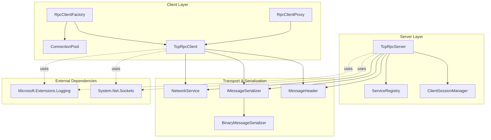
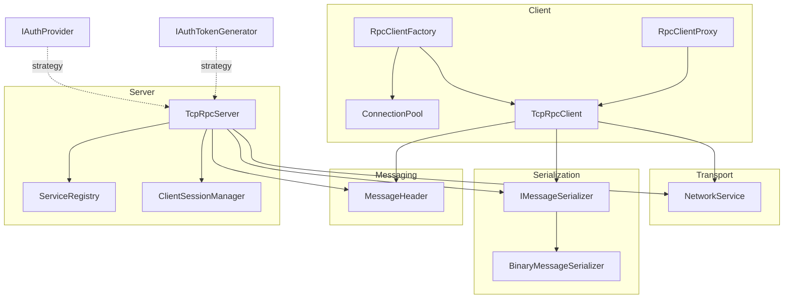
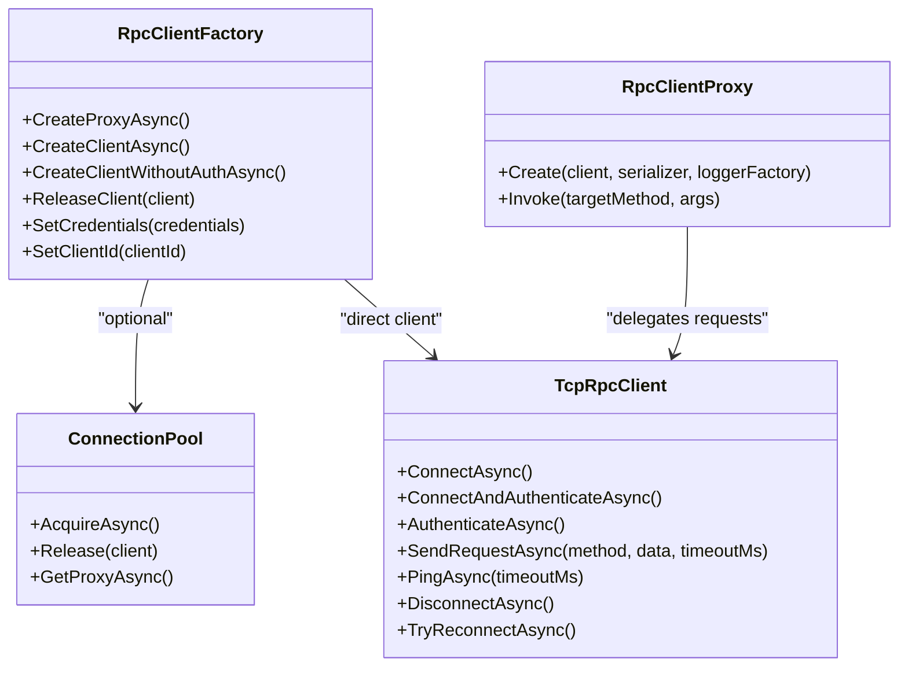
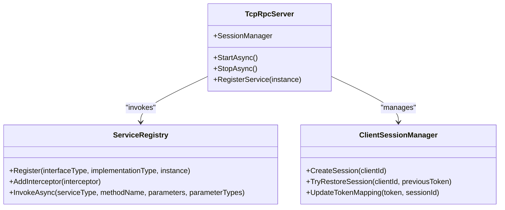
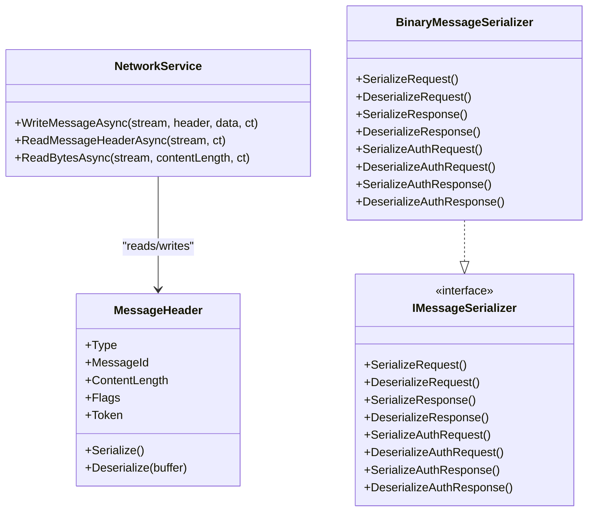
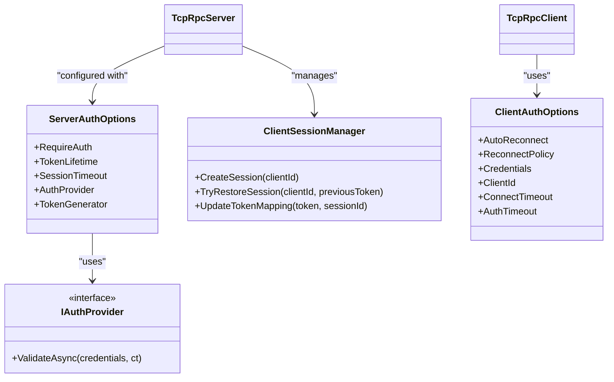
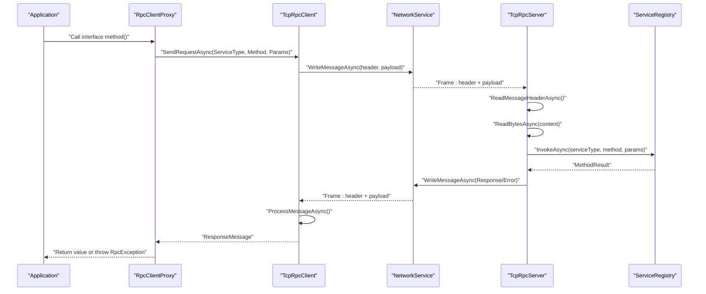
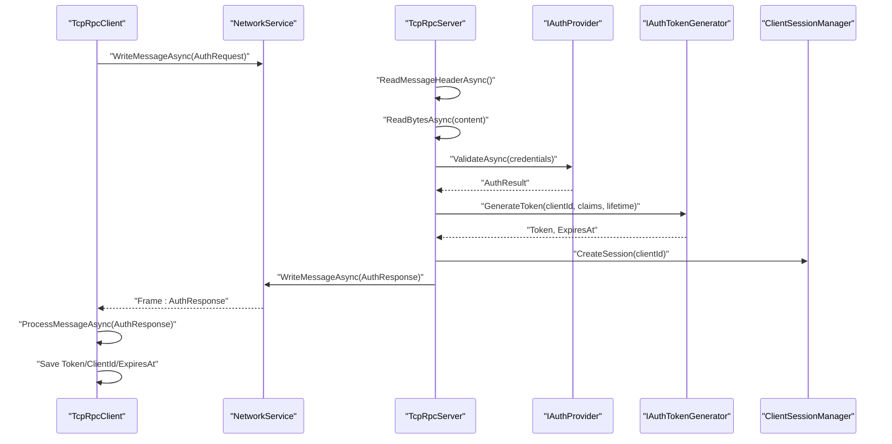
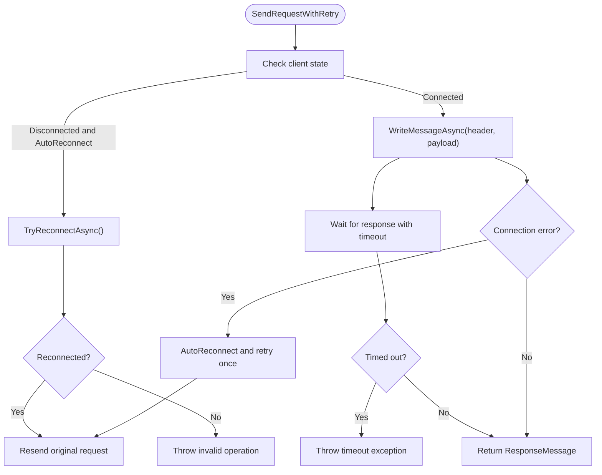
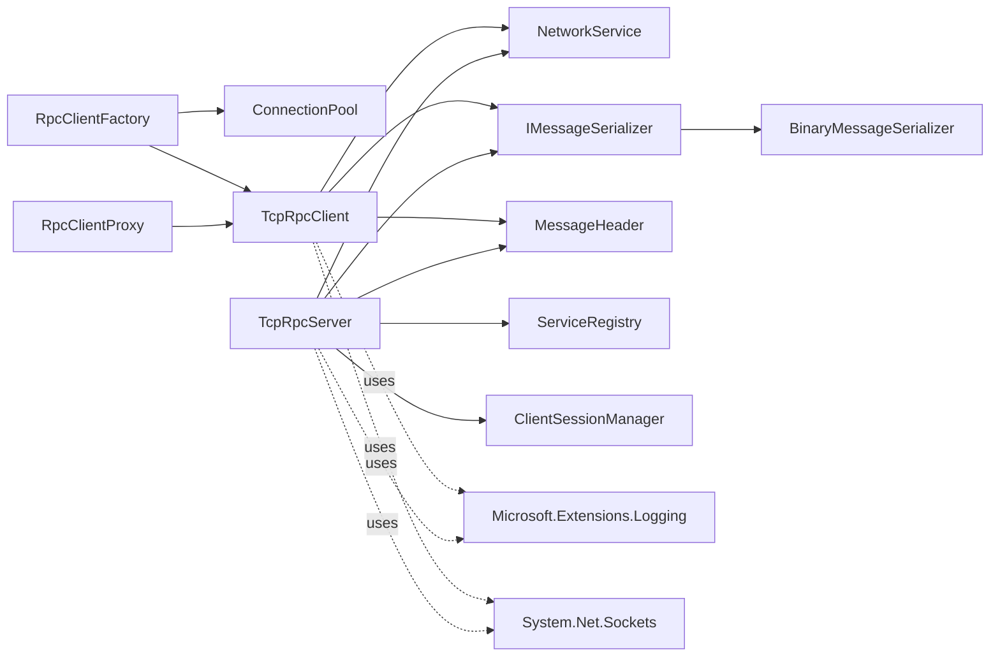

# Architecture & Design

<cite>
**Referenced Files in This Document**
- [TcpRpc.csproj](file://TcpRpc/TcpRpc.csproj)
- [RpcClientFactory.cs](file://TcpRpc/Client/RpcClientFactory.cs)
- [ConnectionPool.cs](file://TcpRpc/Client/ConnectionPool.cs)
- [RpcClientProxy.cs](file://TcpRpc/Client/RpcClientProxy.cs)
- [TcpRpcClient.cs](file://TcpRpc/Client/TcpRpcClient.cs)
- [ClientAuthOptions.cs](file://TcpRpc/Client/ClientAuthOptions.cs)
- [NetworkService.cs](file://TcpRpc/Network/NetworkService.cs)
- [IMessageSerializer.cs](file://TcpRpc/Formatter/IMessageSerializer.cs)
- [BinaryMessageSerializer.cs](file://TcpRpc/Formatter/BinaryMessageSerializer.cs)
- [MessageHeader.cs](file://TcpRpc/Message/MessageHeader.cs)
- [TcpRpcServer.cs](file://TcpRpc/Server/TcpRpcServer.cs)
- [ServiceRegistry.cs](file://TcpRpc/Server/ServiceRegistry.cs)
- [IAuthProvider.cs](file://TcpRpc/Server/Auth/IAuthProvider.cs)
- [ClientSessionManager.cs](file://TcpRpc/Server/Auth/ClientSessionManager.cs)
- [ServerAuthOptions.cs](file://TcpRpc/Server/ServerAuthOptions.cs)
</cite>

## Table of Contents
1. [Introduction](#introduction)
2. [Project Structure](#project-structure)
3. [Core Components](#core-components)
4. [Architecture Overview](#architecture-overview)
5. [Detailed Component Analysis](#detailed-component-analysis)
6. [Dependency Analysis](#dependency-analysis)
7. [Performance Considerations](#performance-considerations)
8. [Troubleshooting Guide](#troubleshooting-guide)
9. [Conclusion](#conclusion)

## Introduction
This document describes the TcpRpc framework architecture and design. It focuses on the layered architecture separating client, server, message handling, and authentication concerns. It explains the core architectural patterns used:
- Factory pattern for client creation and connection pooling
- Proxy pattern for transparent remote method calls
- Observer-like state management for connection lifecycle
- Strategy pattern for pluggable authentication providers and token generators

It also documents component interactions, end-to-end request flows from client through network services to server processing and response handling, and the integration points with external dependencies such as Microsoft.Extensions.Logging and System.Net.Sockets.

## Project Structure
The TcpRpc solution is organized into cohesive layers:
- Client: RPC client, proxy, connection management, and factory/pooling
- Server: TCP server, service registry, interceptors, and authentication subsystem
- Network: Transport abstraction for message framing and IO
- Formatter: Pluggable serialization for messages
- Message: Typed message models and headers
- Shared contracts and projects for client/server usage

**Diagram sources**
- [RpcClientFactory.cs:1-110](file://TcpRpc/Client/RpcClientFactory.cs#L1-110)
- [ConnectionPool.cs:1-189](file://TcpRpc/Client/ConnectionPool.cs#L1-189)
- [RpcClientProxy.cs:1-160](file://TcpRpc/Client/RpcClientProxy.cs#L1-160)
- [TcpRpcClient.cs:1-684](file://TcpRpc/Client/TcpRpcClient.cs#L1-684)
- [TcpRpcServer.cs:1-707](file://TcpRpc/Server/TcpRpcServer.cs#L1-707)
- [ServiceRegistry.cs:1-272](file://TcpRpc/Server/ServiceRegistry.cs#L1-272)
- [ClientSessionManager.cs:1-188](file://TcpRpc/Server/Auth/ClientSessionManager.cs#L1-188)
- [NetworkService.cs:1-99](file://TcpRpc/Network/NetworkService.cs#L1-99)
- [IMessageSerializer.cs:1-35](file://TcpRpc/Formatter/IMessageSerializer.cs#L1-35)
- [BinaryMessageSerializer.cs:1-444](file://TcpRpc/Formatter/BinaryMessageSerializer.cs#L1-444)
- [MessageHeader.cs:1-73](file://TcpRpc/Message/MessageHeader.cs#L1-73)
- [TcpRpc.csproj:11-14](file://TcpRpc/TcpRpc.csproj#L11-L14)

**Section sources**
- [TcpRpc.csproj:1-17](file://TcpRpc/TcpRpc.csproj#L1-17)

## Core Components
- Client-side
  - RpcClientFactory: Centralized creation of proxies and clients, with optional connection pooling and authentication options.
  - ConnectionPool: Manages a bounded set of reusable TcpRpcClient instances with idle cleanup and semaphore-based concurrency control.
  - RpcClientProxy: DispatchProxy-based transparent client-side proxy that converts interface calls into RPC requests.
  - TcpRpcClient: Core client implementing connection, authentication, request/response lifecycle, reconnection, and ping/pong.
  - ClientAuthOptions: Configures timeouts, credentials, auto-reconnect, and reconnect policy.
- Transport and Serialization
  - NetworkService: Encodes/decodes framed messages (header size + header + payload) over NetworkStream.
  - IMessageSerializer and BinaryMessageSerializer: Contract and implementation for serializing/deserializing Request/Response/Auth messages.
  - MessageHeader: Typed header with flags, message ID, content length, and optional token.
- Server-side
  - TcpRpcServer: Accepts TCP connections, handles per-client tasks, processes messages, enforces auth, and routes to services.
  - ServiceRegistry: Registers service implementations and builds interceptor chains for invocation.
  - ServerAuthOptions: Controls auth enablement, token lifetime, session management, and pluggable auth provider/token generator.
  - ClientSessionManager: Manages sessions, token-to-session mapping, restoration, and periodic cleanup.
- External integrations
  - Microsoft.Extensions.Logging: Used pervasively for logging across client and server.
  - System.Net.Sockets: TcpClient/TcpListener and NetworkStream underpin transport.

**Section sources**
- [RpcClientFactory.cs:1-110](file://TcpRpc/Client/RpcClientFactory.cs#L1-110)
- [ConnectionPool.cs:1-189](file://TcpRpc/Client/ConnectionPool.cs#L1-189)
- [RpcClientProxy.cs:1-160](file://TcpRpc/Client/RpcClientProxy.cs#L1-160)
- [TcpRpcClient.cs:1-684](file://TcpRpc/Client/TcpRpcClient.cs#L1-684)
- [ClientAuthOptions.cs:1-38](file://TcpRpc/Client/ClientAuthOptions.cs#L1-38)
- [NetworkService.cs:1-99](file://TcpRpc/Network/NetworkService.cs#L1-99)
- [IMessageSerializer.cs:1-35](file://TcpRpc/Formatter/IMessageSerializer.cs#L1-35)
- [BinaryMessageSerializer.cs:1-444](file://TcpRpc/Formatter/BinaryMessageSerializer.cs#L1-444)
- [MessageHeader.cs:1-73](file://TcpRpc/Message/MessageHeader.cs#L1-73)
- [TcpRpcServer.cs:1-707](file://TcpRpc/Server/TcpRpcServer.cs#L1-707)
- [ServiceRegistry.cs:1-272](file://TcpRpc/Server/ServiceRegistry.cs#L1-272)
- [ServerAuthOptions.cs:1-40](file://TcpRpc/Server/ServerAuthOptions.cs#L1-40)
- [ClientSessionManager.cs:1-188](file://TcpRpc/Server/Auth/ClientSessionManager.cs#L1-188)

## Architecture Overview
TcpRpc follows a layered architecture:
- Presentation/Client Layer: RpcClientFactory, ConnectionPool, RpcClientProxy, TcpRpcClient
- Transport Layer: NetworkService
- Serialization Layer: IMessageSerializer, BinaryMessageSerializer
- Messaging Model: MessageHeader, Request/Response/Auth messages
- Server Layer: TcpRpcServer, ServiceRegistry, ClientSessionManager
- Authentication Strategy: IAuthProvider, IAuthTokenGenerator, ServerAuthOptions, ClientSessionManager

**Diagram sources**
- [RpcClientFactory.cs:1-110](file://TcpRpc/Client/RpcClientFactory.cs#L1-110)
- [ConnectionPool.cs:1-189](file://TcpRpc/Client/ConnectionPool.cs#L1-189)
- [RpcClientProxy.cs:1-160](file://TcpRpc/Client/RpcClientProxy.cs#L1-160)
- [TcpRpcClient.cs:1-684](file://TcpRpc/Client/TcpRpcClient.cs#L1-684)
- [NetworkService.cs:1-99](file://TcpRpc/Network/NetworkService.cs#L1-99)
- [IMessageSerializer.cs:1-35](file://TcpRpc/Formatter/IMessageSerializer.cs#L1-35)
- [BinaryMessageSerializer.cs:1-444](file://TcpRpc/Formatter/BinaryMessageSerializer.cs#L1-444)
- [MessageHeader.cs:1-73](file://TcpRpc/Message/MessageHeader.cs#L1-73)
- [TcpRpcServer.cs:1-707](file://TcpRpc/Server/TcpRpcServer.cs#L1-707)
- [ServiceRegistry.cs:1-272](file://TcpRpc/Server/ServiceRegistry.cs#L1-272)
- [ClientSessionManager.cs:1-188](file://TcpRpc/Server/Auth/ClientSessionManager.cs#L1-188)
- [IAuthProvider.cs:1-41](file://TcpRpc/Server/Auth/IAuthProvider.cs#L1-41)
- [ServerAuthOptions.cs:1-40](file://TcpRpc/Server/ServerAuthOptions.cs#L1-40)

## Detailed Component Analysis

### Client Layer: Factory, Pool, Proxy, and Client
- Factory pattern: RpcClientFactory centralizes creation of proxies and clients, supports pooling, and exposes convenience methods for connecting with or without authentication and updating credentials.
- Pooling: ConnectionPool manages a bounded set of TcpRpcClient instances, enforces concurrency via SemaphoreSlim, and cleans idle connections periodically.
- Proxy pattern: RpcClientProxy derives from DispatchProxy to transparently forward interface calls to the server, handling parameter serialization, response deserialization, exception propagation, and Task<T> conversions.
- Client lifecycle: TcpRpcClient encapsulates connection, authentication, request sending with retries, receive loop, ping/pong, and automatic reconnection according to policy.

**Diagram sources**
- [RpcClientFactory.cs:1-110](file://TcpRpc/Client/RpcClientFactory.cs#L1-110)
- [ConnectionPool.cs:1-189](file://TcpRpc/Client/ConnectionPool.cs#L1-189)
- [RpcClientProxy.cs:1-160](file://TcpRpc/Client/RpcClientProxy.cs#L1-160)
- [TcpRpcClient.cs:1-684](file://TcpRpc/Client/TcpRpcClient.cs#L1-684)

**Section sources**
- [RpcClientFactory.cs:18-109](file://TcpRpc/Client/RpcClientFactory.cs#L18-109)
- [ConnectionPool.cs:43-114](file://TcpRpc/Client/ConnectionPool.cs#L43-114)
- [RpcClientProxy.cs:22-126](file://TcpRpc/Client/RpcClientProxy.cs#L22-126)
- [TcpRpcClient.cs:75-407](file://TcpRpc/Client/TcpRpcClient.cs#L75-407)

### Server Layer: TCP Server, Service Registry, and Sessions
- TcpRpcServer: Accepts TcpClient connections, spawns per-client tasks, reads framed messages, processes auth and requests, validates tokens, routes to ServiceRegistry, and writes responses.
- ServiceRegistry: Holds registered service descriptors, resolves methods by name, converts parameters, and executes interceptor chains around the target method.
- ClientSessionManager: Creates and manages sessions, maps tokens to sessions, supports session restoration for reconnect scenarios, and periodically cleans expired sessions.

**Diagram sources**
- [TcpRpcServer.cs:66-171](file://TcpRpc/Server/TcpRpcServer.cs#L66-171)
- [ServiceRegistry.cs:24-138](file://TcpRpc/Server/ServiceRegistry.cs#L24-138)
- [ClientSessionManager.cs:30-116](file://TcpRpc/Server/Auth/ClientSessionManager.cs#L30-116)

**Section sources**
- [TcpRpcServer.cs:85-451](file://TcpRpc/Server/TcpRpcServer.cs#L85-451)
- [ServiceRegistry.cs:72-138](file://TcpRpc/Server/ServiceRegistry.cs#L72-138)
- [ClientSessionManager.cs:88-179](file://TcpRpc/Server/Auth/ClientSessionManager.cs#L88-179)

### Transport and Serialization
- NetworkService: Writes/reads header size (Int32), serialized header, and payload; includes defensive checks for header size and content length.
- IMessageSerializer and BinaryMessageSerializer: Define and implement serialization for Request/Response/Auth messages, including typed object encoding and JSON fallback for complex types.
- MessageHeader: Encapsulates message type, ID, length, flags (void, exception, compressed), and optional token.

**Diagram sources**
- [NetworkService.cs:10-99](file://TcpRpc/Network/NetworkService.cs#L10-99)
- [IMessageSerializer.cs:8-35](file://TcpRpc/Formatter/IMessageSerializer.cs#L8-35)
- [BinaryMessageSerializer.cs:11-444](file://TcpRpc/Formatter/BinaryMessageSerializer.cs#L11-444)
- [MessageHeader.cs:9-73](file://TcpRpc/Message/MessageHeader.cs#L9-73)

**Section sources**
- [NetworkService.cs:10-99](file://TcpRpc/Network/NetworkService.cs#L10-99)
- [IMessageSerializer.cs:8-35](file://TcpRpc/Formatter/IMessageSerializer.cs#L8-35)
- [BinaryMessageSerializer.cs:30-440](file://TcpRpc/Formatter/BinaryMessageSerializer.cs#L30-440)
- [MessageHeader.cs:41-72](file://TcpRpc/Message/MessageHeader.cs#L41-72)

### Authentication Subsystem
- Strategy pattern: ServerAuthOptions holds IAuthProvider and optional IAuthTokenGenerator, enabling pluggable authentication and token generation strategies.
- ClientAuthOptions: Provides credential storage, timeouts, auto-reconnect, and reconnect policy for the client.
- Session management: ClientSessionManager maintains sessions, token mappings, and supports restoration for reconnect scenarios.

**Diagram sources**
- [ServerAuthOptions.cs:8-39](file://TcpRpc/Server/ServerAuthOptions.cs#L8-39)
- [IAuthProvider.cs:32-40](file://TcpRpc/Server/Auth/IAuthProvider.cs#L32-40)
- [ClientAuthOptions.cs:6-37](file://TcpRpc/Client/ClientAuthOptions.cs#L6-37)
- [ClientSessionManager.cs:30-116](file://TcpRpc/Server/Auth/ClientSessionManager.cs#L30-116)
- [TcpRpcServer.cs:100-111](file://TcpRpc/Server/TcpRpcServer.cs#L100-111)
- [TcpRpcClient.cs:144-227](file://TcpRpc/Client/TcpRpcClient.cs#L144-227)

**Section sources**
- [ServerAuthOptions.cs:8-39](file://TcpRpc/Server/ServerAuthOptions.cs#L8-39)
- [IAuthProvider.cs:6-40](file://TcpRpc/Server/Auth/IAuthProvider.cs#L6-40)
- [ClientAuthOptions.cs:6-37](file://TcpRpc/Client/ClientAuthOptions.cs#L6-37)
- [ClientSessionManager.cs:88-116](file://TcpRpc/Server/Auth/ClientSessionManager.cs#L88-116)
- [TcpRpcServer.cs:453-547](file://TcpRpc/Server/TcpRpcServer.cs#L453-547)
- [TcpRpcClient.cs:144-227](file://TcpRpc/Client/TcpRpcClient.cs#L144-227)

### End-to-End Request Flow (Sequence)
This sequence illustrates a typical client call routed through the network to the server and back.

**Diagram sources**
- [RpcClientProxy.cs:115-126](file://TcpRpc/Client/RpcClientProxy.cs#L115-126)
- [TcpRpcClient.cs:324-407](file://TcpRpc/Client/TcpRpcClient.cs#L324-407)
- [NetworkService.cs:10-28](file://TcpRpc/Network/NetworkService.cs#L10-28)
- [TcpRpcServer.cs:380-451](file://TcpRpc/Server/TcpRpcServer.cs#L380-451)
- [ServiceRegistry.cs:72-138](file://TcpRpc/Server/ServiceRegistry.cs#L72-138)

**Section sources**
- [RpcClientProxy.cs:38-126](file://TcpRpc/Client/RpcClientProxy.cs#L38-126)
- [TcpRpcClient.cs:414-540](file://TcpRpc/Client/TcpRpcClient.cs#L414-540)
- [NetworkService.cs:30-52](file://TcpRpc/Network/NetworkService.cs#L30-52)
- [TcpRpcServer.cs:226-451](file://TcpRpc/Server/TcpRpcServer.cs#L226-451)
- [ServiceRegistry.cs:72-138](file://TcpRpc/Server/ServiceRegistry.cs#L72-138)

### Authentication Flow (Sequence)

**Diagram sources**
- [TcpRpcClient.cs:144-227](file://TcpRpc/Client/TcpRpcClient.cs#L144-227)
- [NetworkService.cs:10-28](file://TcpRpc/Network/NetworkService.cs#L10-28)
- [TcpRpcServer.cs:453-547](file://TcpRpc/Server/TcpRpcServer.cs#L453-547)
- [IAuthProvider.cs:32-40](file://TcpRpc/Server/Auth/IAuthProvider.cs#L32-40)
- [ClientSessionManager.cs:30-42](file://TcpRpc/Server/Auth/ClientSessionManager.cs#L30-42)

**Section sources**
- [TcpRpcClient.cs:144-227](file://TcpRpc/Client/TcpRpcClient.cs#L144-227)
- [TcpRpcServer.cs:453-547](file://TcpRpc/Server/TcpRpcServer.cs#L453-547)
- [IAuthProvider.cs:32-40](file://TcpRpc/Server/Auth/IAuthProvider.cs#L32-40)
- [ClientSessionManager.cs:30-42](file://TcpRpc/Server/Auth/ClientSessionManager.cs#L30-42)

### Retry and Reconnection Logic (Flowchart)

**Diagram sources**
- [TcpRpcClient.cs:334-407](file://TcpRpc/Client/TcpRpcClient.cs#L334-407)

**Section sources**
- [TcpRpcClient.cs:334-407](file://TcpRpc/Client/TcpRpcClient.cs#L334-407)

## Dependency Analysis
- Internal dependencies
  - Client depends on NetworkService, IMessageSerializer, MessageHeader, and Microsoft.Extensions.Logging.
  - Server depends on NetworkService, IMessageSerializer, MessageHeader, ServiceRegistry, and ClientSessionManager.
  - Both sides depend on BinaryMessageSerializer via IMessageSerializer.
- External dependencies
  - Microsoft.Extensions.Logging: Used for structured logging across client/server.
  - System.Net.Sockets: TcpClient/TcpListener and NetworkStream for transport.

**Diagram sources**
- [TcpRpc.csproj:11-14](file://TcpRpc/TcpRpc.csproj#L11-L14)
- [RpcClientFactory.cs:1-110](file://TcpRpc/Client/RpcClientFactory.cs#L1-110)
- [ConnectionPool.cs:1-189](file://TcpRpc/Client/ConnectionPool.cs#L1-189)
- [RpcClientProxy.cs:1-160](file://TcpRpc/Client/RpcClientProxy.cs#L1-160)
- [TcpRpcClient.cs:1-684](file://TcpRpc/Client/TcpRpcClient.cs#L1-684)
- [TcpRpcServer.cs:1-707](file://TcpRpc/Server/TcpRpcServer.cs#L1-707)
- [ServiceRegistry.cs:1-272](file://TcpRpc/Server/ServiceRegistry.cs#L1-272)
- [ClientSessionManager.cs:1-188](file://TcpRpc/Server/Auth/ClientSessionManager.cs#L1-188)
- [NetworkService.cs:1-99](file://TcpRpc/Network/NetworkService.cs#L1-99)
- [IMessageSerializer.cs:1-35](file://TcpRpc/Formatter/IMessageSerializer.cs#L1-35)
- [BinaryMessageSerializer.cs:1-444](file://TcpRpc/Formatter/BinaryMessageSerializer.cs#L1-444)
- [MessageHeader.cs:1-73](file://TcpRpc/Message/MessageHeader.cs#L1-73)

**Section sources**
- [TcpRpc.csproj:11-14](file://TcpRpc/TcpRpc.csproj#L11-L14)

## Performance Considerations
- Connection pooling reduces connection establishment overhead and limits concurrent connections.
- Binary serialization minimizes overhead compared to text-based formats; complex objects fall back to JSON with type metadata.
- Framed transport with header size and content-length enables streaming reads/writes and protects against malformed frames.
- Async IO and cancellation tokens prevent blocking and support graceful shutdown.
- Session cleanup timers proactively remove stale sessions to bound memory usage.

## Troubleshooting Guide
- Authentication failures
  - Verify credentials and provider configuration in ServerAuthOptions.
  - Check token generation and expiration; ensure ClientAuthOptions match server settings.
- Connection drops and timeouts
  - Inspect TcpRpcClient logs for connection errors and reconnection attempts.
  - Confirm timeouts (connect/auth/request) and reconnect policy settings.
- Request timeouts
  - Review request timeout configuration and server-side processing time.
  - Consider retry logic and backoff policies.
- Serialization issues
  - Ensure parameter types match between client and server; verify BinaryMessageSerializer compatibility.
- Session restoration
  - Validate ClientId and PreviousToken consistency; confirm session not expired.

**Section sources**
- [TcpRpcClient.cs:144-227](file://TcpRpc/Client/TcpRpcClient.cs#L144-227)
- [TcpRpcServer.cs:453-547](file://TcpRpc/Server/TcpRpcServer.cs#L453-547)
- [ClientAuthOptions.cs:31-37](file://TcpRpc/Client/ClientAuthOptions.cs#L31-37)
- [ServerAuthOptions.cs:18-23](file://TcpRpc/Server/ServerAuthOptions.cs#L18-23)

## Conclusion
TcpRpc employs a clean layered architecture with strong separation of concerns:
- Client layer focuses on transparent RPC calls, connection management, and reconnection.
- Server layer manages transport, authentication, and service invocation with interception.
- Transport and serialization layers are decoupled via interfaces, enabling pluggable strategies.
- Authentication is modeled as a strategy, allowing flexible providers and token generators.
This design yields extensibility, testability, and robustness in distributed RPC scenarios.