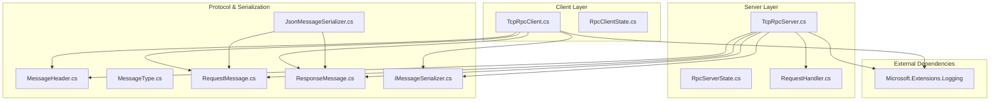
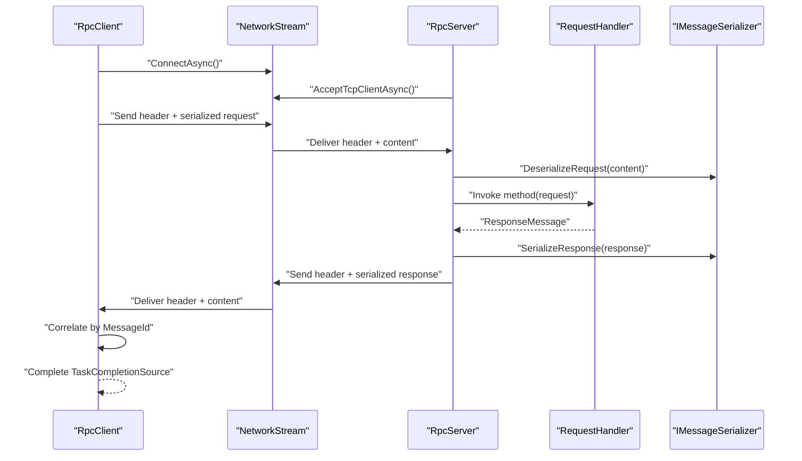
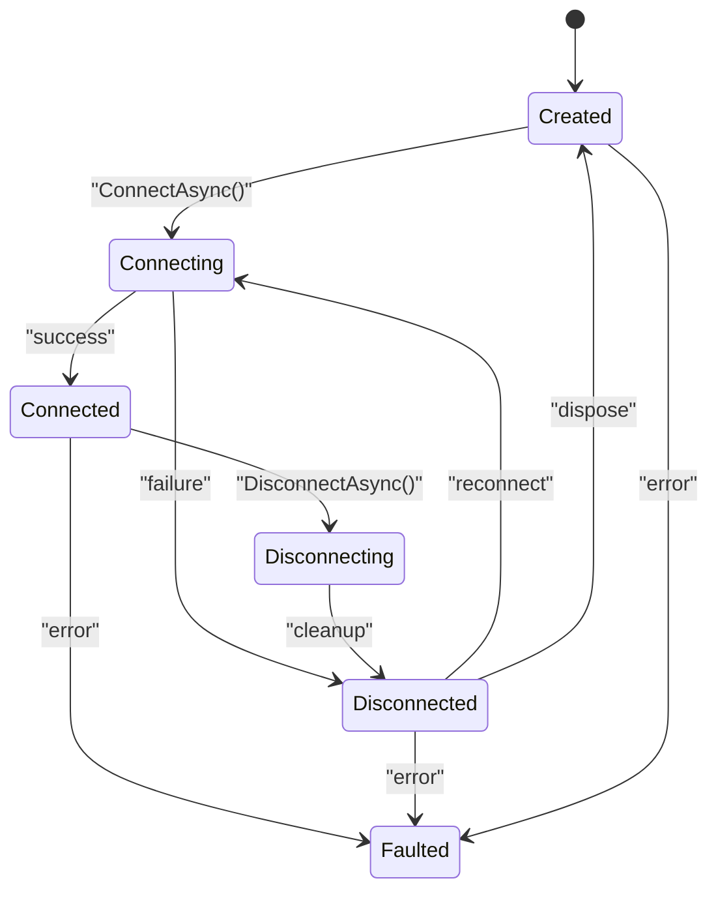
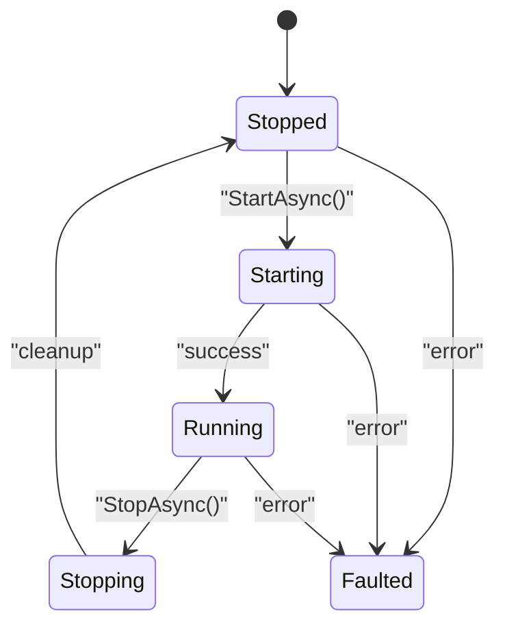
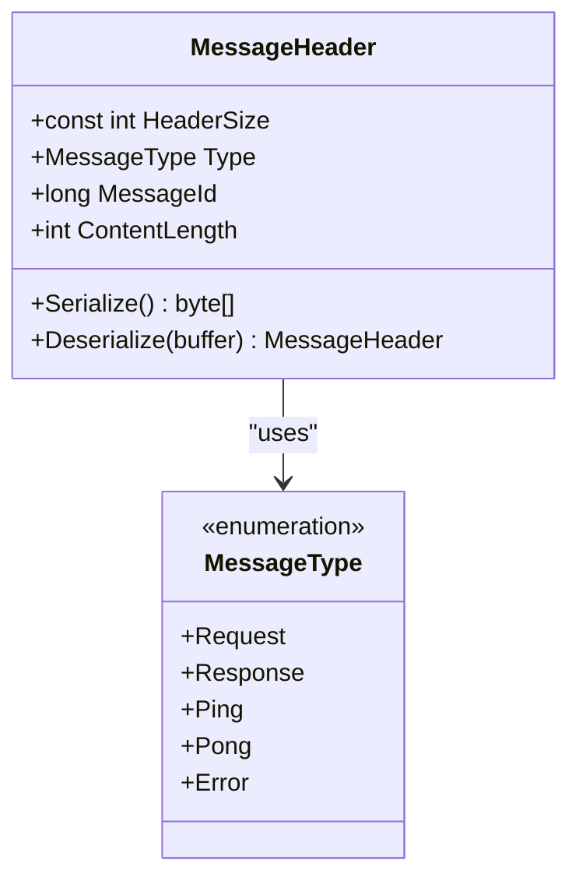
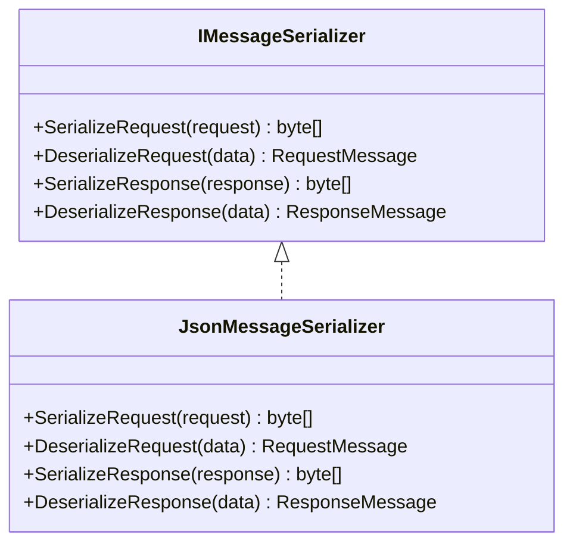
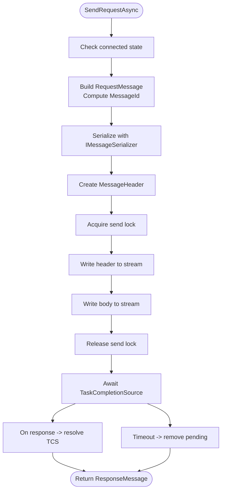
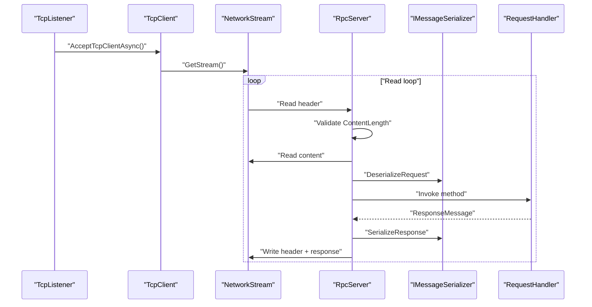
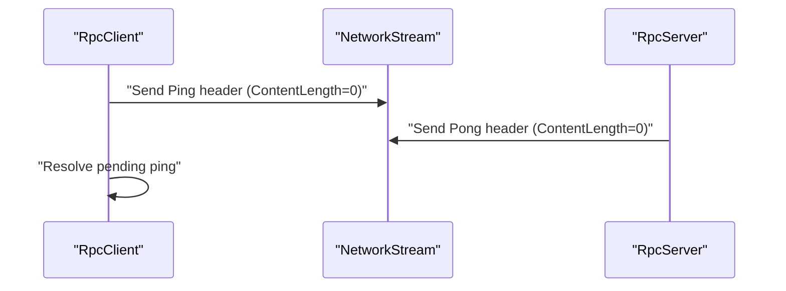
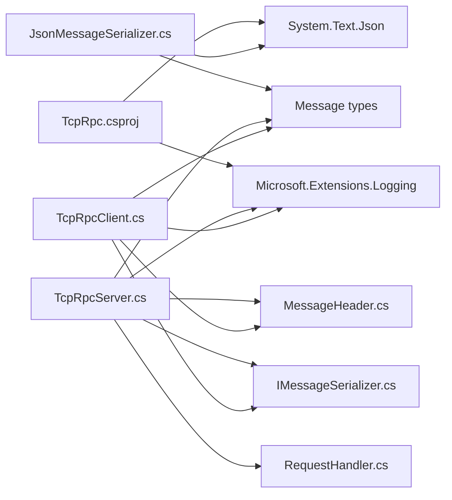

# Architecture & Design

<cite>
**Referenced Files in This Document**
- [TcpRpc.csproj](file://TcpRpc/TcpRpc.csproj)
- [RpcClientState.cs](file://TcpRpc/Client/RpcClientState.cs)
- [RpcServerState.cs](file://TcpRpc/Server/RpcServerState.cs)
- [IMessageSerializer.cs](file://TcpRpc/Formatter/IMessageSerializer.cs)
- [JsonMessageSerializer.cs](file://TcpRpc/Formatter/JsonMessageSerializer.cs)
- [MessageHeader.cs](file://TcpRpc/Message/MessageHeader.cs)
- [MessageType.cs](file://TcpRpc/Message/MessageType.cs)
- [RequestMessage.cs](file://TcpRpc/Message/RequestMessage.cs)
- [ResponseMessage.cs](file://TcpRpc/Message/ResponseMessage.cs)
- [RequestHandler.cs](file://TcpRpc/Server/RequestHandler.cs)
- [TcpRpcClient.cs](file://TcpRpc/Client/TcpRpcClient.cs)
- [TcpRpcServer.cs](file://TcpRpc/Server/TcpRpcServer.cs)
</cite>

## Table of Contents
1. [Introduction](#introduction)
2. [Project Structure](#project-structure)
3. [Core Components](#core-components)
4. [Architecture Overview](#architecture-overview)
5. [Detailed Component Analysis](#detailed-component-analysis)
6. [Dependency Analysis](#dependency-analysis)
7. [Performance Considerations](#performance-considerations)
8. [Troubleshooting Guide](#troubleshooting-guide)
9. [Conclusion](#conclusion)
10. [Appendices](#appendices)

## Introduction
This document describes the architecture and design of the TcpRpc framework. It explains the layered architecture, state machine patterns for lifecycle management, the binary protocol design with MessageHeader, the strategy pattern for pluggable serialization, threading and concurrency considerations, and operational trade-offs for production deployments. The framework provides a lightweight TCP-based RPC mechanism with explicit message framing, minimal overhead, and extensibility for serialization and logging.

## Project Structure
The project is organized into cohesive layers:
- Client: RpcClient and RpcClientState manage connection lifecycle, request/response coordination, and ping/pong heartbeats.
- Server: RpcServer and RpcServerState manage listening, client handling, and request routing.
- Message: Typed messages and protocol primitives (MessageHeader, MessageType).
- Formatter: Pluggable serialization strategy via IMessageSerializer and JsonMessageSerializer.
- Logging: Uses Microsoft.Extensions.Logging abstractions for diagnostics.

**Diagram sources**
- [TcpRpcClient.cs:1-405](file://TcpRpc/Client/TcpRpcClient.cs#L1-L405)
- [RpcClientState.cs:1-11](file://TcpRpc/Client/RpcClientState.cs#L1-L11)
- [TcpRpcServer.cs:1-432](file://TcpRpc/Server/TcpRpcServer.cs#L1-L432)
- [RpcServerState.cs:1-10](file://TcpRpc/Server/RpcServerState.cs#L1-L10)
- [RequestHandler.cs:1-5](file://TcpRpc/Server/RequestHandler.cs#L1-L5)
- [MessageHeader.cs:1-34](file://TcpRpc/Message/MessageHeader.cs#L1-L34)
- [MessageType.cs:1-10](file://TcpRpc/Message/MessageType.cs#L1-L10)
- [RequestMessage.cs:1-8](file://TcpRpc/Message/RequestMessage.cs#L1-L8)
- [ResponseMessage.cs:1-9](file://TcpRpc/Message/ResponseMessage.cs#L1-L9)
- [IMessageSerializer.cs:1-13](file://TcpRpc/Formatter/IMessageSerializer.cs#L1-L13)
- [JsonMessageSerializer.cs:1-85](file://TcpRpc/Formatter/JsonMessageSerializer.cs#L1-L85)
- [TcpRpc.csproj:1-17](file://TcpRpc/TcpRpc.csproj#L1-L17)

**Section sources**
- [TcpRpc.csproj:1-17](file://TcpRpc/TcpRpc.csproj#L1-L17)
- [TcpRpcClient.cs:1-405](file://TcpRpc/Client/TcpRpcClient.cs#L1-L405)
- [TcpRpcServer.cs:1-432](file://TcpRpc/Server/TcpRpcServer.cs#L1-L432)

## Core Components
- RpcClient: Asynchronous TCP client with state machine, request/response correlation, ping/pong, and cancellation support. Uses a serializer strategy and Microsoft.Extensions.Logging.
- RpcServer: TCP listener that accepts clients, reads framed messages, routes requests to handlers, and writes responses. Tracks active connections and enforces timeouts.
- MessageHeader: Fixed-size binary header with little-endian encoding and validation rules.
- IMessageSerializer: Strategy interface for serializing/deserializing RequestMessage and ResponseMessage.
- JsonMessageSerializer: Default JSON-based implementation with validation and camelCase naming policy.
- MessageType: Enumerated message types for framing and routing.
- RequestMessage/ResponseMessage: DTOs for RPC payload transport.

Key design characteristics:
- Explicit framing with MessageHeader to prevent head-of-line blocking and enable streaming.
- Strategy pattern for serialization to allow alternate encodings (e.g., Protocol Buffers).
- Minimal runtime dependencies beyond .NET and Microsoft.Extensions.Logging.

**Section sources**
- [TcpRpcClient.cs:1-405](file://TcpRpc/Client/TcpRpcClient.cs#L1-L405)
- [TcpRpcServer.cs:1-432](file://TcpRpc/Server/TcpRpcServer.cs#L1-L432)
- [MessageHeader.cs:1-34](file://TcpRpc/Message/MessageHeader.cs#L1-L34)
- [IMessageSerializer.cs:1-13](file://TcpRpc/Formatter/IMessageSerializer.cs#L1-L13)
- [JsonMessageSerializer.cs:1-85](file://TcpRpc/Formatter/JsonMessageSerializer.cs#L1-L85)
- [MessageType.cs:1-10](file://TcpRpc/Message/MessageType.cs#L1-L10)
- [RequestMessage.cs:1-8](file://TcpRpc/Message/RequestMessage.cs#L1-L8)
- [ResponseMessage.cs:1-9](file://TcpRpc/Message/ResponseMessage.cs#L1-L9)

## Architecture Overview
The system follows a client-server architecture with explicit message framing and a pluggable serialization strategy. The client manages connection state, request correlation, and heartbeats. The server listens for connections, validates messages, dispatches to handlers, and returns responses.

**Diagram sources**
- [TcpRpcClient.cs:132-189](file://TcpRpc/Client/TcpRpcClient.cs#L132-L189)
- [TcpRpcServer.cs:318-376](file://TcpRpc/Server/TcpRpcServer.cs#L318-L376)
- [IMessageSerializer.cs:1-13](file://TcpRpc/Formatter/IMessageSerializer.cs#L1-L13)
- [JsonMessageSerializer.cs:1-85](file://TcpRpc/Formatter/JsonMessageSerializer.cs#L1-L85)

## Detailed Component Analysis

### State Machines: RpcClientState and RpcServerState
Both client and server use finite state machines to manage lifecycle transitions and enforce valid state transitions.

**Diagram sources**
- [RpcClientState.cs:1-11](file://TcpRpc/Client/RpcClientState.cs#L1-L11)

**Diagram sources**
- [RpcServerState.cs:1-10](file://TcpRpc/Server/RpcServerState.cs#L1-L10)

Operational implications:
- State transitions are guarded by locks and volatile fields to ensure thread-safe checks.
- Faulted state indicates unrecoverable errors; callers should dispose and recreate the component.
- Disconnection events cancel in-flight operations and clear pending correlators.

**Section sources**
- [TcpRpcClient.cs:47-130](file://TcpRpc/Client/TcpRpcClient.cs#L47-L130)
- [TcpRpcClient.cs:289-306](file://TcpRpc/Client/TcpRpcClient.cs#L289-L306)
- [TcpRpcServer.cs:101-173](file://TcpRpc/Server/TcpRpcServer.cs#L101-L173)
- [TcpRpcServer.cs:175-226](file://TcpRpc/Server/TcpRpcServer.cs#L175-L226)

### Binary Protocol: MessageHeader and MessageType
MessageHeader defines a fixed-size frame with:
- MessageType: 1 byte discriminator.
- MessageId: 8-byte signed integer for correlation.
- ContentLength: 4-byte unsigned integer indicating payload length.

Encoding and validation:
- Little-endian encoding for numeric fields using System.Buffers.Binary primitives.
- HeaderSize constant ensures consistent framing.
- Deserialization validates minimum buffer size and throws on invalid sizes.
- Servers enforce upper bounds on ContentLength to prevent memory exhaustion.

**Diagram sources**
- [MessageHeader.cs:1-34](file://TcpRpc/Message/MessageHeader.cs#L1-L34)
- [MessageType.cs:1-10](file://TcpRpc/Message/MessageType.cs#L1-L10)

Validation rules observed:
- Minimum header size enforced during deserialization.
- ContentLength limits: client-side ~10 MB, server-side ~100 MB.
- MessageId must be positive for requests/responses.
- Method must be non-empty for requests.

**Section sources**
- [MessageHeader.cs:13-33](file://TcpRpc/Message/MessageHeader.cs#L13-L33)
- [MessageType.cs:1-10](file://TcpRpc/Message/MessageType.cs#L1-L10)
- [JsonMessageSerializer.cs:36-48](file://TcpRpc/Formatter/JsonMessageSerializer.cs#L36-L48)
- [JsonMessageSerializer.cs:74-83](file://TcpRpc/Formatter/JsonMessageSerializer.cs#L74-L83)
- [TcpRpcClient.cs:215-218](file://TcpRpc/Client/TcpRpcClient.cs#L215-L218)
- [TcpRpcServer.cs:264-270](file://TcpRpc/Server/TcpRpcServer.cs#L264-L270)

### Strategy Pattern: IMessageSerializer and JsonMessageSerializer
The IMessageSerializer interface decouples serialization from transport logic. The default JsonMessageSerializer uses System.Text.Json with camelCase naming and compact output.

**Diagram sources**
- [IMessageSerializer.cs:1-13](file://TcpRpc/Formatter/IMessageSerializer.cs#L1-L13)
- [JsonMessageSerializer.cs:1-85](file://TcpRpc/Formatter/JsonMessageSerializer.cs#L1-L85)

Design benefits:
- Pluggable serializers enable alternate encodings (e.g., Protobuf, MessagePack).
- Validation in deserializers prevents malformed messages from propagating.
- Centralized JSON options (camelCase, no indentation) reduce payload size.

**Section sources**
- [IMessageSerializer.cs:1-13](file://TcpRpc/Formatter/IMessageSerializer.cs#L1-L13)
- [JsonMessageSerializer.cs:1-85](file://TcpRpc/Formatter/JsonMessageSerializer.cs#L1-L85)

### Client-Side Processing Flow
The client coordinates request sending, response reception, and correlation via MessageId. It maintains:
- Pending request map keyed by MessageId.
- Pending ping map keyed by MessageId.
- Send lock to serialize writes.
- CancellationTokenSource to coordinate shutdown.

**Diagram sources**
- [TcpRpcClient.cs:132-189](file://TcpRpc/Client/TcpRpcClient.cs#L132-L189)
- [MessageHeader.cs:13-20](file://TcpRpc/Message/MessageHeader.cs#L13-L20)

**Section sources**
- [TcpRpcClient.cs:132-189](file://TcpRpc/Client/TcpRpcClient.cs#L132-L189)
- [TcpRpcClient.cs:205-287](file://TcpRpc/Client/TcpRpcClient.cs#L205-L287)

### Server-Side Processing Flow
The server accepts clients, reads headers, validates content length, deserializes requests, invokes handlers, and sends responses or errors.

**Diagram sources**
- [TcpRpcServer.cs:228-316](file://TcpRpc/Server/TcpRpcServer.cs#L228-L316)
- [TcpRpcServer.cs:318-376](file://TcpRpc/Server/TcpRpcServer.cs#L318-L376)

**Section sources**
- [TcpRpcServer.cs:228-316](file://TcpRpc/Server/TcpRpcServer.cs#L228-L316)
- [TcpRpcServer.cs:318-376](file://TcpRpc/Server/TcpRpcServer.cs#L318-L376)

### Heartbeat and Health Monitoring
The client supports a Ping/Pong mechanism to detect connectivity issues. Pending pings are tracked similarly to pending requests and resolved upon receiving a Pong.

**Diagram sources**
- [TcpRpcClient.cs:325-382](file://TcpRpc/Client/TcpRpcClient.cs#L325-L382)
- [TcpRpcServer.cs:394-406](file://TcpRpc/Server/TcpRpcServer.cs#L394-L406)

**Section sources**
- [TcpRpcClient.cs:325-382](file://TcpRpc/Client/TcpRpcClient.cs#L325-L382)
- [TcpRpcServer.cs:394-406](file://TcpRpc/Server/TcpRpcServer.cs#L394-L406)

## Dependency Analysis
External dependencies:
- Microsoft.Extensions.Logging: Used for structured logging across client and server.
- System.Text.Json: Used by JsonMessageSerializer for serialization/deserialization.
- System.Net.Sockets: Used by TcpRpcClient and TcpRpcServer for TCP communication.
- System.Buffers.Binary: Used by MessageHeader for little-endian encoding.

Internal dependencies:
- Client depends on Message types, MessageHeader, IMessageSerializer, and logging.
- Server depends on Message types, MessageHeader, IMessageSerializer, RequestHandler, and logging.
- JsonMessageSerializer depends on Message types and System.Text.Json.

**Diagram sources**
- [TcpRpc.csproj:1-17](file://TcpRpc/TcpRpc.csproj#L1-L17)
- [TcpRpcClient.cs:1-8](file://TcpRpc/Client/TcpRpcClient.cs#L1-L8)
- [TcpRpcServer.cs:1-8](file://TcpRpc/Server/TcpRpcServer.cs#L1-L8)
- [JsonMessageSerializer.cs:1-2](file://TcpRpc/Formatter/JsonMessageSerializer.cs#L1-L2)
- [IMessageSerializer.cs:1-13](file://TcpRpc/Formatter/IMessageSerializer.cs#L1-L13)
- [MessageHeader.cs:1-1](file://TcpRpc/Message/MessageHeader.cs#L1-L1)
- [RequestHandler.cs:1-5](file://TcpRpc/Server/RequestHandler.cs#L1-L5)

**Section sources**
- [TcpRpc.csproj:11-14](file://TcpRpc/TcpRpc.csproj#L11-L14)
- [TcpRpcClient.cs:1-8](file://TcpRpc/Client/TcpRpcClient.cs#L1-L8)
- [TcpRpcServer.cs:1-8](file://TcpRpc/Server/TcpRpcServer.cs#L1-L8)
- [JsonMessageSerializer.cs:1-2](file://TcpRpc/Formatter/JsonMessageSerializer.cs#L1-L2)

## Performance Considerations
- Framing overhead: Each message carries a 17-byte header plus content. This is efficient for small payloads but can be significant for micro-requests.
- Serialization cost: JSON serialization adds CPU overhead; consider alternative serializers for high-throughput scenarios.
- Concurrency: Client uses a semaphore to serialize writes; server handles multiple clients concurrently with per-client read loops.
- Memory: Servers enforce upper bounds on content length to mitigate memory pressure.
- Timeouts: Both client and server apply timeouts to prevent indefinite waits.
- Logging: Structured logs are emitted for diagnostics; keep log verbosity appropriate for production throughput.

[No sources needed since this section provides general guidance]

## Troubleshooting Guide
Common issues and mitigations:
- Connection failures: Verify network reachability, firewall rules, and server startup state.
- Timeouts: Increase timeout values for slow operations; check for server overload.
- Serialization errors: Ensure RequestMessage and ResponseMessage fields meet validation rules (positive MessageId, non-empty Method).
- Large payloads: Adjust ContentLength limits if necessary; consider compression or alternate serialization.
- Heartbeat failures: Confirm Ping/Pong flow and network stability; inspect pending ping tracking.

**Section sources**
- [TcpRpcClient.cs:162-188](file://TcpRpc/Client/TcpRpcClient.cs#L162-L188)
- [TcpRpcServer.cs:244-299](file://TcpRpc/Server/TcpRpcServer.cs#L244-L299)
- [JsonMessageSerializer.cs:36-48](file://TcpRpc/Formatter/JsonMessageSerializer.cs#L36-L48)
- [JsonMessageSerializer.cs:74-83](file://TcpRpc/Formatter/JsonMessageSerializer.cs#L74-L83)

## Conclusion
TcpRpc provides a clean, layered architecture with explicit framing, pluggable serialization, and robust state machines for lifecycle management. Its design emphasizes simplicity, extensibility, and observability. Production deployments should consider serialization alternatives, payload sizing, and logging volume to balance performance and reliability.

[No sources needed since this section summarizes without analyzing specific files]

## Appendices

### Threading Model and Thread Safety
- Client:
  - State transitions guarded by a lock; volatile state field for visibility.
  - Send operations serialized via SemaphoreSlim to avoid interleaved writes.
  - Pending request/ping maps protected by concurrent collections; correlation by MessageId.
  - CancellationTokenSource used to coordinate shutdown and propagate cancellation.
- Server:
  - State transitions guarded by a lock; volatile state field.
  - Per-client read loop runs concurrently; shared handler registry is thread-safe.
  - ActiveConnections property cleans completed tasks before reporting count.

**Section sources**
- [TcpRpcClient.cs:28-31](file://TcpRpc/Client/TcpRpcClient.cs#L28-L31)
- [TcpRpcClient.cs:165-175](file://TcpRpc/Client/TcpRpcClient.cs#L165-L175)
- [TcpRpcServer.cs:23-27](file://TcpRpc/Server/TcpRpcServer.cs#L23-L27)
- [TcpRpcServer.cs:134-147](file://TcpRpc/Server/TcpRpcServer.cs#L134-L147)

### Scalability Considerations
- Backpressure: Client pending request map bounds concurrent in-flight requests; consider batching or queueing strategies.
- Handler throughput: Implement asynchronous handlers and avoid blocking operations.
- Serialization throughput: Evaluate alternative serializers (e.g., binary protocols) for higher throughput.
- Network tuning: Adjust socket buffers and keep-alive settings at deployment level.
- Observability: Use structured logs and metrics to monitor latency, error rates, and resource utilization.

[No sources needed since this section provides general guidance]