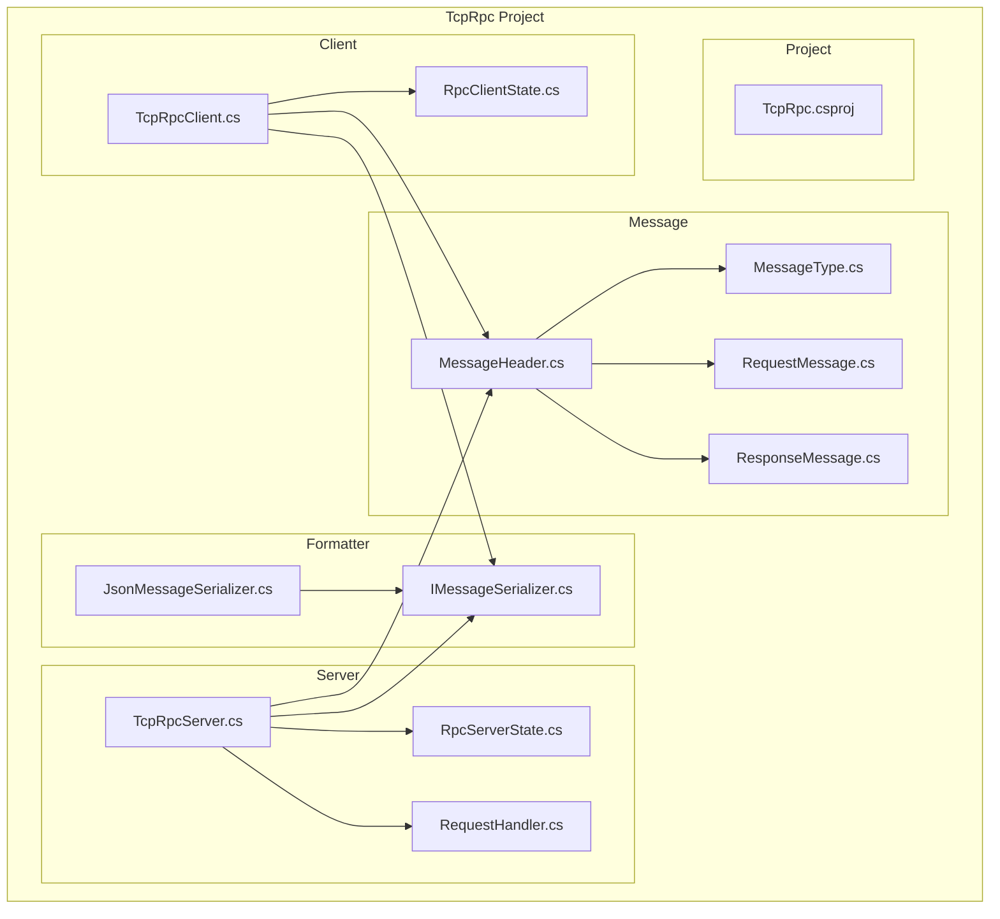
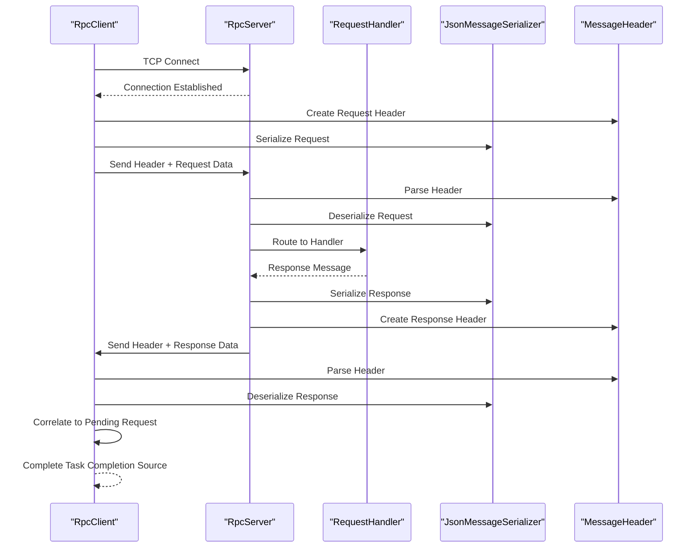
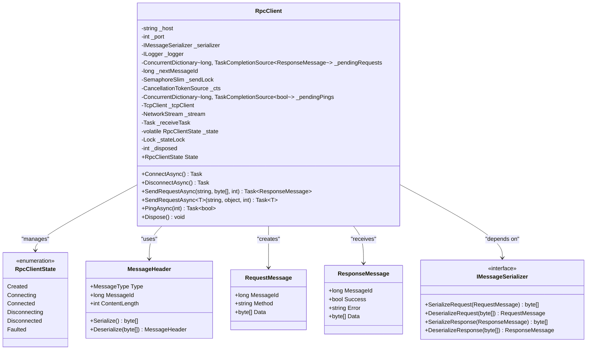
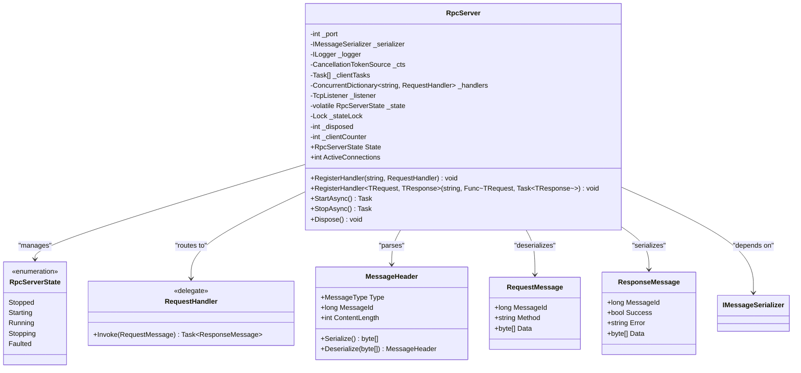
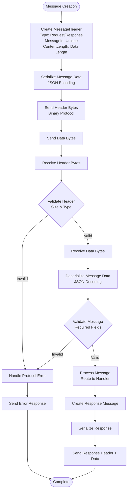
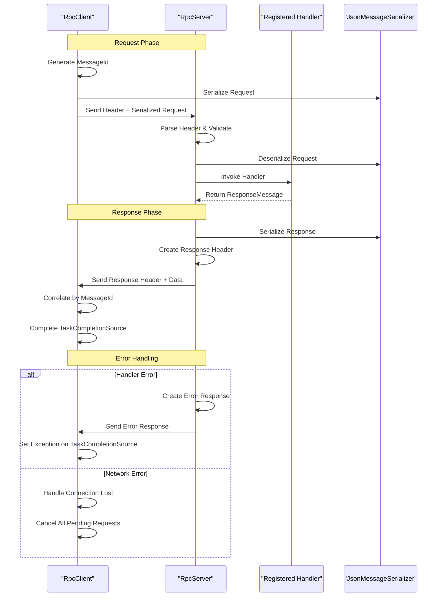
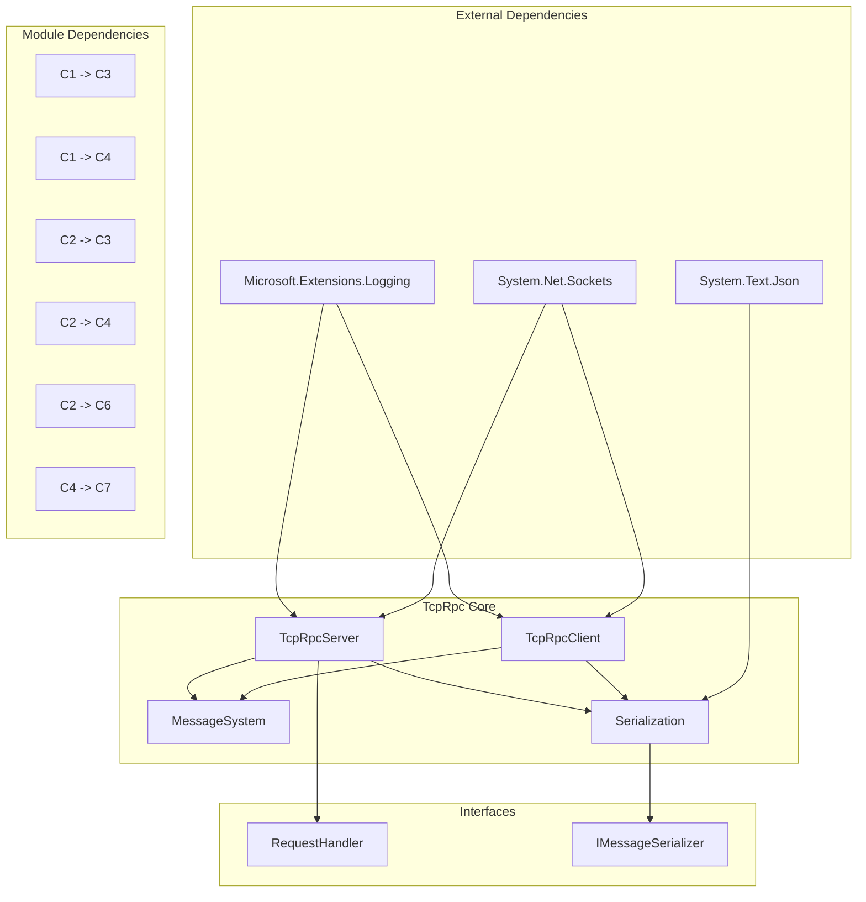

# Component Relationships & Data Flow

<cite>
**Referenced Files in This Document**
- [TcpRpc.csproj](file://TcpRpc/TcpRpc.csproj)
- [TcpRpcClient.cs](file://TcpRpc/Client/TcpRpcClient.cs)
- [RpcClientState.cs](file://TcpRpc/Client/RpcClientState.cs)
- [TcpRpcServer.cs](file://TcpRpc/Server/TcpRpcServer.cs)
- [RpcServerState.cs](file://TcpRpc/Server/RpcServerState.cs)
- [RequestHandler.cs](file://TcpRpc/Server/RequestHandler.cs)
- [IMessageSerializer.cs](file://TcpRpc/Formatter/IMessageSerializer.cs)
- [JsonMessageSerializer.cs](file://TcpRpc/Formatter/JsonMessageSerializer.cs)
- [MessageHeader.cs](file://TcpRpc/Message/MessageHeader.cs)
- [MessageType.cs](file://TcpRpc/Message/MessageType.cs)
- [RequestMessage.cs](file://TcpRpc/Message/RequestMessage.cs)
- [ResponseMessage.cs](file://TcpRpc/Message/ResponseMessage.cs)
</cite>

## Table of Contents
1. [Introduction](#introduction)
2. [Project Structure](#project-structure)
3. [Core Components](#core-components)
4. [Architecture Overview](#architecture-overview)
5. [Detailed Component Analysis](#detailed-component-analysis)
6. [Dependency Analysis](#dependency-analysis)
7. [Performance Considerations](#performance-considerations)
8. [Troubleshooting Guide](#troubleshooting-guide)
9. [Conclusion](#conclusion)

## Introduction
This document provides comprehensive technical documentation for the TcpRpc component relationships and data flow architecture. It focuses on the interaction patterns between RpcClient and RpcServer, including bidirectional communication channels and message correlation mechanisms. The document explains the data flow from client request through MessageHeader serialization to server processing and response delivery. It also documents the component dependency graph showing how TcpRpcClient depends on Message and Formatter modules, and how RpcServer integrates with RequestHandler delegates. The message routing system is detailed, including how requests are matched to handlers and responses are correlated back to original requests. Sequence diagrams illustrate typical request/response flows, error propagation patterns, and state synchronization between components. Component lifecycle management, resource sharing, and cleanup procedures are addressed.

## Project Structure
The TcpRpc project is organized into distinct functional areas:
- Client: RpcClient implementation with connection management, request sending, and response correlation
- Server: RpcServer implementation with listener management, client handling, and request routing
- Message: Core message types and serialization metadata
- Formatter: Serialization interfaces and JSON implementation
- Project configuration: .NET SDK project with logging dependencies

**Diagram sources**
- [TcpRpcClient.cs:1-405](file://TcpRpc/Client/TcpRpcClient.cs#L1-L405)
- [TcpRpcServer.cs:1-432](file://TcpRpc/Server/TcpRpcServer.cs#L1-L432)
- [MessageHeader.cs:1-34](file://TcpRpc/Message/MessageHeader.cs#L1-L34)
- [IMessageSerializer.cs:1-13](file://TcpRpc/Formatter/IMessageSerializer.cs#L1-L13)
- [JsonMessageSerializer.cs:1-85](file://TcpRpc/Formatter/JsonMessageSerializer.cs#L1-L85)

**Section sources**
- [TcpRpc.csproj:1-17](file://TcpRpc/TcpRpc.csproj#L1-L17)

## Core Components
This section analyzes the primary components and their responsibilities:

### RpcClient
The RpcClient manages TCP connections and handles bidirectional communication with the server. Key responsibilities include:
- Connection lifecycle management (ConnectAsync, DisconnectAsync)
- Request sending with correlation tracking
- Response reception and correlation resolution
- Heartbeat/ping functionality for connection health
- State management and thread-safe operations

### RpcServer
The RpcServer manages incoming client connections and request processing. Key responsibilities include:
- TCP listener management and client acceptance
- Per-client connection handling with concurrent task management
- Request routing to registered handlers
- Response serialization and delivery
- Graceful shutdown with resource cleanup

### Message System
The message system provides structured communication primitives:
- MessageHeader: Binary protocol header with type, message ID, and content length
- RequestMessage/ResponseMessage: Typed message containers
- MessageType: Enumerated message types (Request, Response, Ping, Pong, Error)

### Serialization System
The serialization system provides pluggable message encoding:
- IMessageSerializer: Interface defining serialization contract
- JsonMessageSerializer: JSON-based implementation with validation

**Section sources**
- [TcpRpcClient.cs:11-405](file://TcpRpc/Client/TcpRpcClient.cs#L11-L405)
- [TcpRpcServer.cs:12-432](file://TcpRpc/Server/TcpRpcServer.cs#L12-L432)
- [MessageHeader.cs:5-34](file://TcpRpc/Message/MessageHeader.cs#L5-L34)
- [IMessageSerializer.cs:5-13](file://TcpRpc/Formatter/IMessageSerializer.cs#L5-L13)

## Architecture Overview
The TcpRpc architecture implements a client-server RPC pattern over TCP with explicit message framing and correlation:

**Diagram sources**
- [TcpRpcClient.cs:132-189](file://TcpRpc/Client/TcpRpcClient.cs#L132-L189)
- [TcpRpcServer.cs:318-360](file://TcpRpc/Server/TcpRpcServer.cs#L318-L360)
- [JsonMessageSerializer.cs:14-57](file://TcpRpc/Formatter/JsonMessageSerializer.cs#L14-L57)

The architecture ensures:
- Explicit message framing with binary headers
- Strong correlation through message IDs
- Pluggable serialization through IMessageSerializer
- Robust error handling and propagation
- Thread-safe concurrent operation

## Detailed Component Analysis

### RpcClient Component Analysis
The RpcClient implements a sophisticated client-side RPC framework with comprehensive state management and error handling.

**Diagram sources**
- [TcpRpcClient.cs:11-405](file://TcpRpc/Client/TcpRpcClient.cs#L11-L405)
- [RpcClientState.cs:3-11](file://TcpRpc/Client/RpcClientState.cs#L3-L11)
- [MessageHeader.cs:5-34](file://TcpRpc/Message/MessageHeader.cs#L5-L34)
- [RequestMessage.cs:3-8](file://TcpRpc/Message/RequestMessage.cs#L3-L8)
- [ResponseMessage.cs:3-9](file://TcpRpc/Message/ResponseMessage.cs#L3-L9)
- [IMessageSerializer.cs:5-13](file://TcpRpc/Formatter/IMessageSerializer.cs#L5-L13)

Key implementation patterns in RpcClient:
- **Concurrent Dictionary Correlation**: Uses `_pendingRequests` dictionary keyed by message ID for response correlation
- **Thread-Safe State Management**: Implements lock-based state transitions with volatile state field
- **Resource Management**: Comprehensive disposal pattern with cancellation tokens and graceful shutdown
- **Error Propagation**: Converts network errors into TaskCompletionSource exceptions
- **Heartbeat Mechanism**: Separate ping/pong handling with dedicated correlation dictionary

**Section sources**
- [TcpRpcClient.cs:11-405](file://TcpRpc/Client/TcpRpcClient.cs#L11-L405)
- [RpcClientState.cs:3-11](file://TcpRpc/Client/RpcClientState.cs#L3-L11)

### RpcServer Component Analysis
The RpcServer implements a scalable server-side RPC framework with concurrent client handling and robust error management.

**Diagram sources**
- [TcpRpcServer.cs:12-432](file://TcpRpc/Server/TcpRpcServer.cs#L12-L432)
- [RpcServerState.cs:3-10](file://TcpRpc/Server/RpcServerState.cs#L3-L10)
- [RequestHandler.cs:5](file://TcpRpc/Server/RequestHandler.cs#L5)
- [MessageHeader.cs:5-34](file://TcpRpc/Message/MessageHeader.cs#L5-L34)
- [RequestMessage.cs:3-8](file://TcpRpc/Message/RequestMessage.cs#L3-L8)
- [ResponseMessage.cs:3-9](file://TcpRpc/Message/ResponseMessage.cs#L3-L9)

Key implementation patterns in RpcServer:
- **Handler Registration**: Supports both delegate-based and generic handler registration
- **Concurrent Client Management**: Tracks active client tasks and cleans up completed ones
- **Robust Error Handling**: Converts handler exceptions to structured error responses
- **Graceful Shutdown**: Comprehensive cancellation and resource cleanup
- **Connection Tracking**: Monitors active connections and client counts

**Section sources**
- [TcpRpcServer.cs:12-432](file://TcpRpc/Server/TcpRpcServer.cs#L12-L432)
- [RpcServerState.cs:3-10](file://TcpRpc/Server/RpcServerState.cs#L3-L10)

### Message Flow and Serialization Analysis
The message system implements a binary protocol with explicit framing and JSON serialization.

**Diagram sources**
- [MessageHeader.cs:13-33](file://TcpRpc/Message/MessageHeader.cs#L13-L33)
- [JsonMessageSerializer.cs:14-84](file://TcpRpc/Formatter/JsonMessageSerializer.cs#L14-L84)
- [RequestMessage.cs:3-8](file://TcpRpc/Message/RequestMessage.cs#L3-L8)
- [ResponseMessage.cs:3-9](file://TcpRpc/Message/ResponseMessage.cs#L3-L9)

Message flow characteristics:
- **Binary Header Protocol**: Fixed-size 17-byte header with little-endian encoding
- **JSON Serialization**: Structured data encoding with validation
- **Message Correlation**: Message ID-based correlation between requests and responses
- **Error Propagation**: Structured error messages with descriptive details

**Section sources**
- [MessageHeader.cs:5-34](file://TcpRpc/Message/MessageHeader.cs#L5-L34)
- [JsonMessageSerializer.cs:6-85](file://TcpRpc/Formatter/JsonMessageSerializer.cs#L6-L85)

### Request/Response Processing Sequence
The request/response processing follows a well-defined sequence with correlation and error handling:

**Diagram sources**
- [TcpRpcClient.cs:132-189](file://TcpRpc/Client/TcpRpcClient.cs#L132-L189)
- [TcpRpcServer.cs:318-360](file://TcpRpc/Server/TcpRpcServer.cs#L318-L360)
- [JsonMessageSerializer.cs:51-84](file://TcpRpc/Formatter/JsonMessageSerializer.cs#L51-L84)

**Section sources**
- [TcpRpcClient.cs:132-189](file://TcpRpc/Client/TcpRpcClient.cs#L132-L189)
- [TcpRpcServer.cs:318-360](file://TcpRpc/Server/TcpRpcServer.cs#L318-L360)

## Dependency Analysis
The TcpRpc system exhibits clean dependency separation with clear module boundaries:

**Diagram sources**
- [TcpRpcClient.cs:1-8](file://TcpRpc/Client/TcpRpcClient.cs#L1-L8)
- [TcpRpcServer.cs:1-8](file://TcpRpc/Server/TcpRpcServer.cs#L1-L8)
- [IMessageSerializer.cs:1-2](file://TcpRpc/Formatter/IMessageSerializer.cs#L1-L2)

Dependency characteristics:
- **Client Dependencies**: TcpClient, NetworkStream, Concurrent collections, logging
- **Server Dependencies**: TcpListener, concurrent collections, logging
- **Serialization Dependencies**: System.Text.Json for JSON operations
- **Interface-Based Design**: Loose coupling through IMessageSerializer and RequestHandler

**Section sources**
- [TcpRpcClient.cs:1-8](file://TcpRpc/Client/TcpRpcClient.cs#L1-L8)
- [TcpRpcServer.cs:1-8](file://TcpRpc/Server/TcpRpcServer.cs#L1-L8)

## Performance Considerations
The TcpRpc implementation incorporates several performance optimization strategies:

### Concurrency and Threading
- **SemaphoreSlim for Serialization**: Single-threaded send operations prevent header/data interleaving
- **Concurrent Collections**: Thread-safe dictionaries for request correlation and client tracking
- **Task-Based Asynchronous Operations**: Non-blocking I/O operations for scalability

### Memory Management
- **Array Reuse**: Pre-allocated buffers for header and content reading
- **Object Pooling**: Minimal object allocation during message processing
- **Stream Operations**: Direct stream writes/read operations without intermediate buffering

### Network Efficiency
- **Binary Protocol**: Compact 17-byte headers reduce overhead
- **Message Size Limits**: Configurable limits prevent memory exhaustion
- **Connection Reuse**: Persistent connections eliminate handshake overhead

### Resource Management
- **Proper Disposal**: Comprehensive disposal patterns for streams, sockets, and tokens
- **Cancellation Support**: Cancellation tokens enable graceful shutdown
- **Timeout Handling**: Configurable timeouts prevent resource leaks

## Troubleshooting Guide
Common issues and their resolution patterns:

### Connection Issues
- **Connection Refused**: Verify server is running and listening on correct port
- **Connection Reset**: Check firewall settings and network connectivity
- **Timeout During Connect**: Increase timeout values or check network latency

### Message Correlation Failures
- **Pending Request Not Found**: Verify message ID generation and correlation dictionary
- **Response Timing Out**: Check client timeout configuration and server processing time
- **Message ID Conflicts**: Ensure unique message ID generation across concurrent requests

### Serialization Errors
- **JSON Deserialization**: Validate message format and required fields
- **Empty Data**: Check for proper message framing and content length
- **Type Mismatch**: Verify request/response type compatibility

### Server-Side Issues
- **Handler Registration**: Ensure handlers are registered before server start
- **Resource Exhaustion**: Monitor active connections and memory usage
- **Graceful Shutdown**: Use StopAsync method for proper cleanup

**Section sources**
- [TcpRpcClient.cs:289-306](file://TcpRpc/Client/TcpRpcClient.cs#L289-L306)
- [TcpRpcServer.cs:175-226](file://TcpRpc/Server/TcpRpcServer.cs#L175-L226)

## Conclusion
The TcpRpc system provides a robust foundation for distributed RPC communication over TCP with strong architectural principles:

### Strengths
- **Clean Separation of Concerns**: Well-defined modules with clear responsibilities
- **Strong Typing**: Compile-time safety through strongly-typed message contracts
- **Extensibility**: Plugin-based serialization and handler registration
- **Reliability**: Comprehensive error handling and graceful degradation

### Design Principles
- **Binary Protocol**: Efficient network communication with explicit framing
- **Correlation Mechanisms**: Message ID-based request-response correlation
- **State Management**: Thread-safe state transitions with proper lifecycle management
- **Resource Safety**: Comprehensive disposal patterns and cleanup procedures

### Areas for Enhancement
- **Connection Pooling**: Support for multiple concurrent connections
- **Load Balancing**: Distribution of requests across multiple handlers
- **Monitoring**: Enhanced metrics collection and observability
- **Security**: Transport encryption and authentication mechanisms

The architecture demonstrates sound engineering practices with clear interfaces, comprehensive error handling, and scalable design patterns suitable for production deployment scenarios.