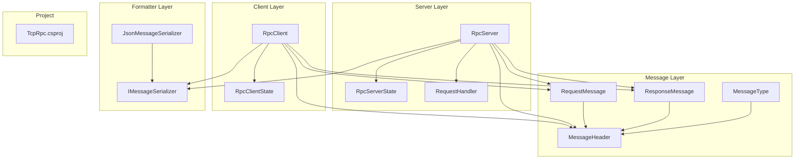
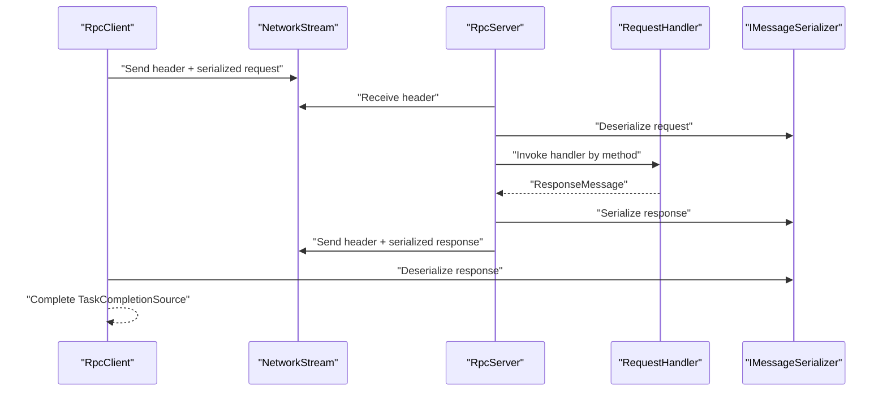
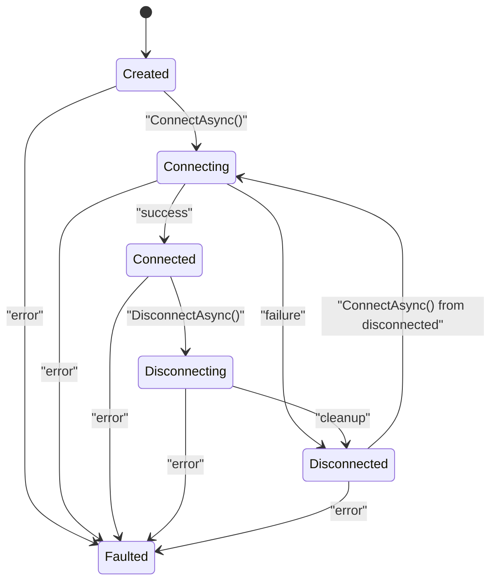
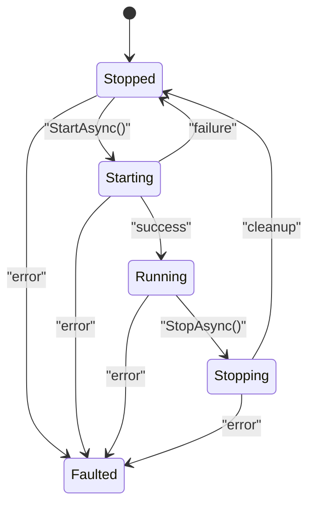
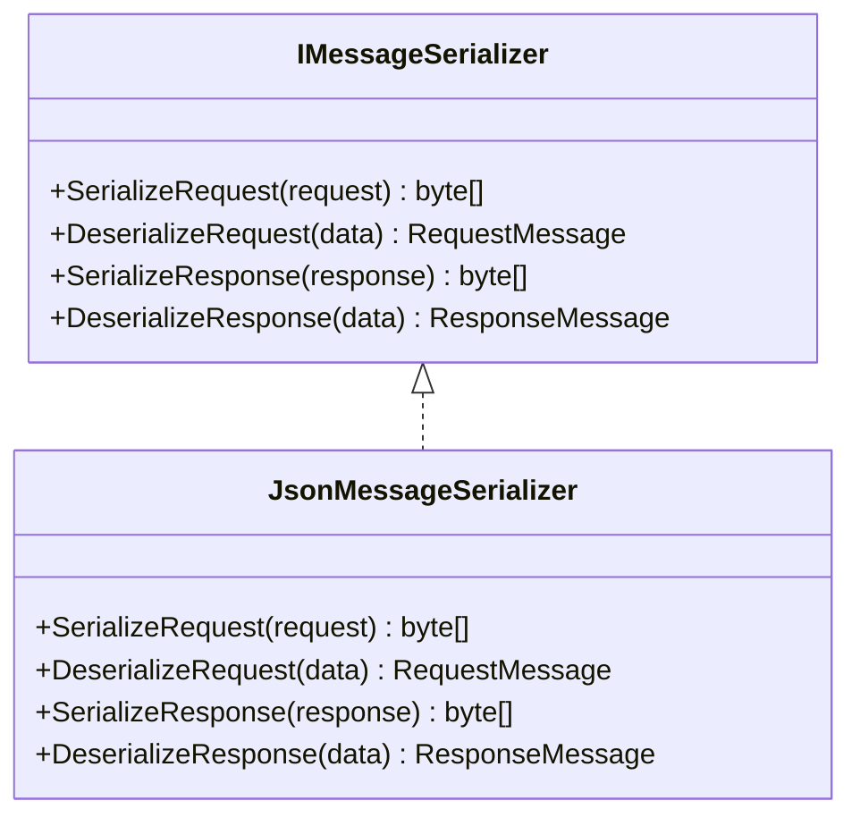
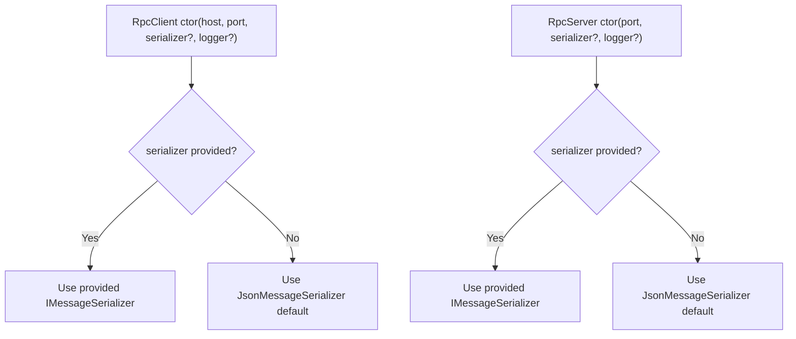
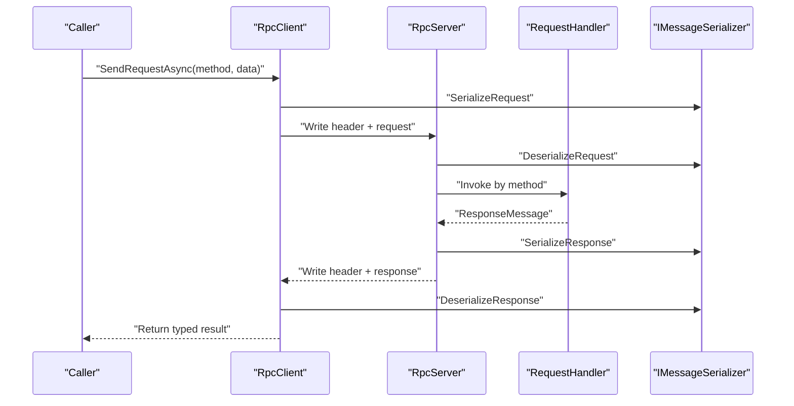
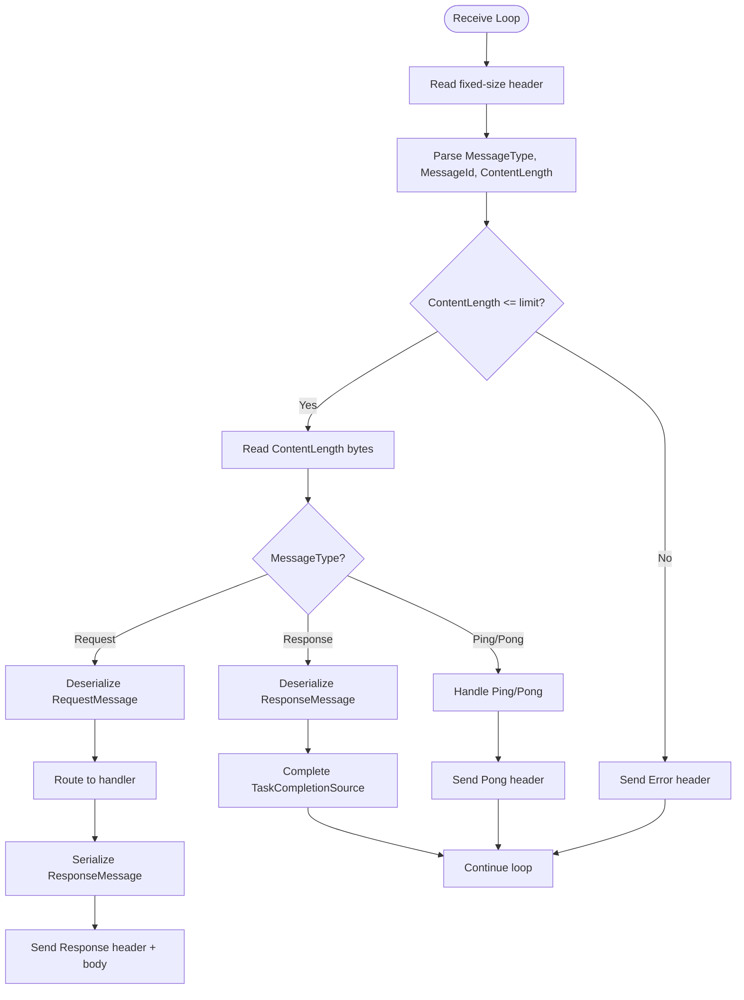
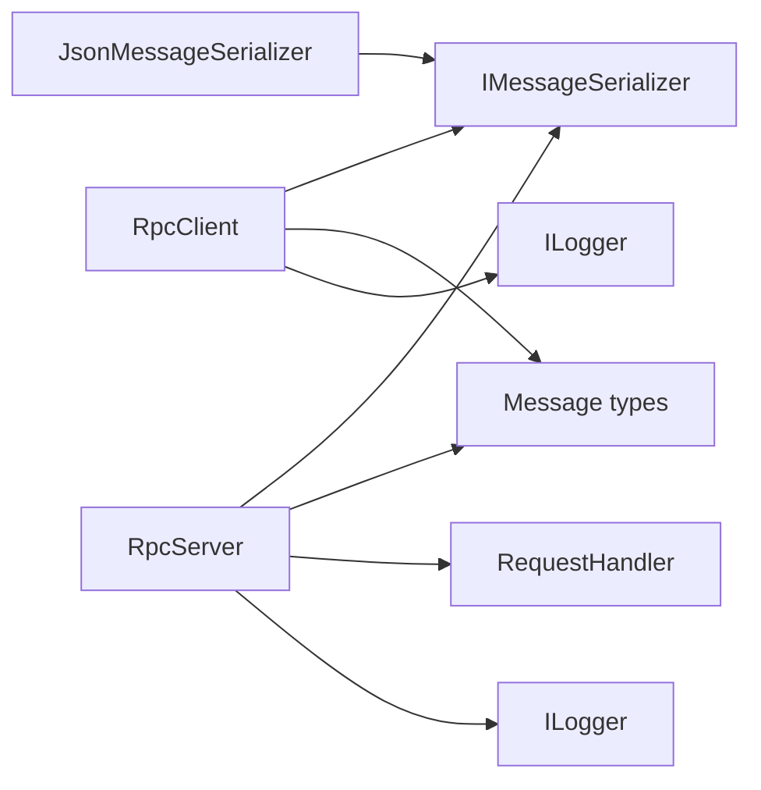

# Design Principles & Patterns

<cite>
**Referenced Files in This Document**
- [TcpRpc.csproj](file://TcpRpc/TcpRpc.csproj)
- [RpcClientState.cs](file://TcpRpc/Client/RpcClientState.cs)
- [TcpRpcClient.cs](file://TcpRpc/Client/TcpRpcClient.cs)
- [RpcServerState.cs](file://TcpRpc/Server/RpcServerState.cs)
- [TcpRpcServer.cs](file://TcpRpc/Server/TcpRpcServer.cs)
- [RequestHandler.cs](file://TcpRpc/Server/RequestHandler.cs)
- [IMessageSerializer.cs](file://TcpRpc/Formatter/IMessageSerializer.cs)
- [JsonMessageSerializer.cs](file://TcpRpc/Formatter/JsonMessageSerializer.cs)
- [RequestMessage.cs](file://TcpRpc/Message/RequestMessage.cs)
- [ResponseMessage.cs](file://TcpRpc/Message/ResponseMessage.cs)
- [MessageHeader.cs](file://TcpRpc/Message/MessageHeader.cs)
- [MessageType.cs](file://TcpRpc/Message/MessageType.cs)
</cite>

## Table of Contents
1. [Introduction](#introduction)
2. [Project Structure](#project-structure)
3. [Core Components](#core-components)
4. [Architecture Overview](#architecture-overview)
5. [Detailed Component Analysis](#detailed-component-analysis)
6. [Dependency Analysis](#dependency-analysis)
7. [Performance Considerations](#performance-considerations)
8. [Troubleshooting Guide](#troubleshooting-guide)
9. [Conclusion](#conclusion)

## Introduction
This document explains the design principles and architectural patterns of the TcpRpc framework. It focuses on a layered architecture separating concerns among client, server, message protocol, and serialization layers. It documents the state machine pattern for lifecycle management, the strategy pattern for pluggable serialization, the observer pattern for logging and event-like notifications, the factory-like instantiation model, and the command pattern for request/response handling. The goal is to clarify how these patterns contribute to modularity, testability, and maintainability.

## Project Structure
The project is organized by functional layers:
- Client: connection lifecycle, request sending, receive loop, and state management
- Server: listener, per-client handling, request routing, and response emission
- Message: protocol-level data structures and header encoding/decoding
- Formatter: serialization abstraction and JSON implementation
- Root project: NuGet package references for logging

**Diagram sources**
- [TcpRpcClient.cs:11-405](file://TcpRpc/Client/TcpRpcClient.cs#L11-L405)
- [RpcClientState.cs:3-11](file://TcpRpc/Client/RpcClientState.cs#L3-L11)
- [TcpRpcServer.cs:12-432](file://TcpRpc/Server/TcpRpcServer.cs#L12-L432)
- [RpcServerState.cs:3-10](file://TcpRpc/Server/RpcServerState.cs#L3-L10)
- [RequestHandler.cs:5-5](file://TcpRpc/Server/RequestHandler.cs#L5-L5)
- [IMessageSerializer.cs:5-13](file://TcpRpc/Formatter/IMessageSerializer.cs#L5-L13)
- [JsonMessageSerializer.cs:6-85](file://TcpRpc/Formatter/JsonMessageSerializer.cs#L6-L85)
- [RequestMessage.cs:3-8](file://TcpRpc/Message/RequestMessage.cs#L3-L8)
- [ResponseMessage.cs:3-9](file://TcpRpc/Message/ResponseMessage.cs#L3-L9)
- [MessageHeader.cs:5-34](file://TcpRpc/Message/MessageHeader.cs#L5-L34)
- [MessageType.cs:3-10](file://TcpRpc/Message/MessageType.cs#L3-L10)
- [TcpRpc.csproj:1-17](file://TcpRpc/TcpRpc.csproj#L1-L17)

**Section sources**
- [TcpRpc.csproj:1-17](file://TcpRpc/TcpRpc.csproj#L1-L17)

## Core Components
- Client: RpcClient manages TCP connectivity, request/response lifecycle, and internal state transitions. It uses a state machine and thread-safe constructs for concurrency.
- Server: RpcServer listens for connections, handles multiple clients concurrently, routes requests to handlers, and emits responses.
- Message Protocol: MessageHeader defines a compact binary header with type, message ID, and content length. MessageType enumerates supported packet types.
- Serialization: IMessageSerializer defines the contract for serializing/deserializing requests and responses. JsonMessageSerializer provides a concrete implementation using System.Text.Json.
- Handlers: RequestHandler delegates define the server-side method dispatch contract.

Key responsibilities:
- Client: connection orchestration, request queuing, response correlation, ping/pong, and error propagation
- Server: accept loop, per-client receive loop, message parsing, handler invocation, and response emission
- Message: framing and transport-level metadata
- Formatter: pluggable serialization strategy
- Handler: server-side method resolution and execution

**Section sources**
- [TcpRpcClient.cs:11-405](file://TcpRpc/Client/TcpRpcClient.cs#L11-L405)
- [RpcClientState.cs:3-11](file://TcpRpc/Client/RpcClientState.cs#L3-L11)
- [TcpRpcServer.cs:12-432](file://TcpRpc/Server/TcpRpcServer.cs#L12-L432)
- [RpcServerState.cs:3-10](file://TcpRpc/Server/RpcServerState.cs#L3-L10)
- [IMessageSerializer.cs:5-13](file://TcpRpc/Formatter/IMessageSerializer.cs#L5-L13)
- [JsonMessageSerializer.cs:6-85](file://TcpRpc/Formatter/JsonMessageSerializer.cs#L6-L85)
- [RequestHandler.cs:5-5](file://TcpRpc/Server/RequestHandler.cs#L5-L5)
- [MessageHeader.cs:5-34](file://TcpRpc/Message/MessageHeader.cs#L5-L34)
- [MessageType.cs:3-10](file://TcpRpc/Message/MessageType.cs#L3-L10)

## Architecture Overview
The framework follows a layered architecture:
- Transport: TCP sockets
- Protocol: framed messages with a fixed-size header and typed payload
- Application: request/response commands routed by method name
- Serialization: strategy pattern via IMessageSerializer
- Lifecycle: state machines in client and server

**Diagram sources**
- [TcpRpcClient.cs:132-189](file://TcpRpc/Client/TcpRpcClient.cs#L132-L189)
- [TcpRpcServer.cs:318-376](file://TcpRpc/Server/TcpRpcServer.cs#L318-L376)
- [IMessageSerializer.cs:5-13](file://TcpRpc/Formatter/IMessageSerializer.cs#L5-L13)
- [JsonMessageSerializer.cs:14-49](file://TcpRpc/Formatter/JsonMessageSerializer.cs#L14-L49)

## Detailed Component Analysis

### State Machine Pattern: RpcClientState and RpcServerState
Both client and server implement a finite state machine to manage lifecycle transitions and enforce valid state transitions.

**Diagram sources**
- [RpcClientState.cs:3-11](file://TcpRpc/Client/RpcClientState.cs#L3-L11)

**Diagram sources**
- [RpcServerState.cs:3-10](file://TcpRpc/Server/RpcServerState.cs#L3-L10)

Design notes:
- Volatile state with lock-protected transitions to ensure thread safety
- Dedicated cancellation tokens and cleanup tasks to recover from errors
- Clear invalid-state exceptions to prevent illegal transitions

**Section sources**
- [TcpRpcClient.cs:47-80](file://TcpRpc/Client/TcpRpcClient.cs#L47-L80)
- [TcpRpcClient.cs:85-130](file://TcpRpc/Client/TcpRpcClient.cs#L85-L130)
- [TcpRpcClient.cs:289-306](file://TcpRpc/Client/TcpRpcClient.cs#L289-L306)
- [TcpRpcServer.cs:101-173](file://TcpRpc/Server/TcpRpcServer.cs#L101-L173)
- [TcpRpcServer.cs:175-226](file://TcpRpc/Server/TcpRpcServer.cs#L175-L226)

### Strategy Pattern: Pluggable Serialization via IMessageSerializer
The IMessageSerializer interface decouples serialization from the rest of the system, enabling multiple implementations.

**Diagram sources**
- [IMessageSerializer.cs:5-13](file://TcpRpc/Formatter/IMessageSerializer.cs#L5-L13)
- [JsonMessageSerializer.cs:6-85](file://TcpRpc/Formatter/JsonMessageSerializer.cs#L6-L85)

Benefits:
- Extensibility: new serializers can be introduced without changing protocol or client/server logic
- Testability: unit tests can inject a mock serializer
- Portability: different encodings (e.g., Protobuf) can be swapped in

Trade-offs:
- Contract maintenance: adding/removing methods requires updating all implementations
- Performance: JSON serialization is straightforward but may not be optimal for high-throughput scenarios

**Section sources**
- [IMessageSerializer.cs:5-13](file://TcpRpc/Formatter/IMessageSerializer.cs#L5-L13)
- [JsonMessageSerializer.cs:6-85](file://TcpRpc/Formatter/JsonMessageSerializer.cs#L6-L85)
- [TcpRpcClient.cs:152-158](file://TcpRpc/Client/TcpRpcClient.cs#L152-L158)
- [TcpRpcServer.cs:362-376](file://TcpRpc/Server/TcpRpcServer.cs#L362-L376)

### Observer Pattern: Logging and Event-like Notifications
Logging is integrated via Microsoft.Extensions.Logging abstractions. While not a traditional observer subject/publisher, the framework emits log events at lifecycle boundaries and error conditions.

Patterns observed:
- Event-like notifications: state changes, connection events, timeouts, and errors are logged
- Decoupled observers: consumers can subscribe to logs without coupling to internals

**Section sources**
- [TcpRpcClient.cs:325-382](file://TcpRpc/Client/TcpRpcClient.cs#L325-L382)
- [TcpRpcServer.cs:132-132](file://TcpRpc/Server/TcpRpcServer.cs#L132-L132)
- [TcpRpcServer.cs:231-231](file://TcpRpc/Server/TcpRpcServer.cs#L231-L231)
- [TcpRpcServer.cs:302-302](file://TcpRpc/Server/TcpRpcServer.cs#L302-L302)
- [TcpRpcServer.cs:408-413](file://TcpRpc/Server/TcpRpcServer.cs#L408-L413)

### Factory Pattern: Client/Server Instantiation
RpcClient and RpcServer act as factories/factories-with-defaults:
- Constructors accept optional serializer and logger instances
- Defaults to JsonMessageSerializer and NullLogger when not provided
- Encapsulates creation-time wiring and dependency injection-friendly initialization

**Diagram sources**
- [TcpRpcClient.cs:35-41](file://TcpRpc/Client/TcpRpcClient.cs#L35-L41)
- [TcpRpcServer.cs:43-48](file://TcpRpc/Server/TcpRpcServer.cs#L43-L48)

**Section sources**
- [TcpRpcClient.cs:35-41](file://TcpRpc/Client/TcpRpcClient.cs#L35-L41)
- [TcpRpcServer.cs:43-48](file://TcpRpc/Server/TcpRpcServer.cs#L43-L48)

### Command Pattern: Request/Response Handling
The request/response exchange is modeled as a command:
- Client composes a RequestMessage and sends it
- Server deserializes, resolves a handler, executes, and serializes a ResponseMessage
- Client correlates responses to pending requests using message IDs

**Diagram sources**
- [TcpRpcClient.cs:132-203](file://TcpRpc/Client/TcpRpcClient.cs#L132-L203)
- [TcpRpcServer.cs:318-376](file://TcpRpc/Server/TcpRpcServer.cs#L318-L376)
- [IMessageSerializer.cs:5-13](file://TcpRpc/Formatter/IMessageSerializer.cs#L5-L13)
- [JsonMessageSerializer.cs:14-49](file://TcpRpc/Formatter/JsonMessageSerializer.cs#L14-L49)

**Section sources**
- [RequestMessage.cs:3-8](file://TcpRpc/Message/RequestMessage.cs#L3-L8)
- [ResponseMessage.cs:3-9](file://TcpRpc/Message/ResponseMessage.cs#L3-L9)
- [MessageHeader.cs:5-34](file://TcpRpc/Message/MessageHeader.cs#L5-L34)
- [MessageType.cs:3-10](file://TcpRpc/Message/MessageType.cs#L3-L10)

### Message Framing and Protocol
MessageHeader provides a compact binary frame with:
- MessageType discriminator
- MessageId for correlation
- ContentLength for boundary detection

**Diagram sources**
- [MessageHeader.cs:13-33](file://TcpRpc/Message/MessageHeader.cs#L13-L33)
- [MessageType.cs:3-10](file://TcpRpc/Message/MessageType.cs#L3-L10)
- [TcpRpcServer.cs:238-333](file://TcpRpc/Server/TcpRpcServer.cs#L238-L333)
- [TcpRpcClient.cs:205-287](file://TcpRpc/Client/TcpRpcClient.cs#L205-L287)

**Section sources**
- [MessageHeader.cs:5-34](file://TcpRpc/Message/MessageHeader.cs#L5-L34)
- [MessageType.cs:3-10](file://TcpRpc/Message/MessageType.cs#L3-L10)
- [TcpRpcServer.cs:238-333](file://TcpRpc/Server/TcpRpcServer.cs#L238-L333)
- [TcpRpcClient.cs:205-287](file://TcpRpc/Client/TcpRpcClient.cs#L205-L287)

## Dependency Analysis
High-level dependencies:
- Client depends on IMessageSerializer, Message types, and Microsoft.Extensions.Logging
- Server depends on IMessageSerializer, Message types, RequestHandler, and Microsoft.Extensions.Logging
- Both depend on TcpListener/TcpClient and NetworkStream for transport
- JsonMessageSerializer implements IMessageSerializer

**Diagram sources**
- [TcpRpcClient.cs:11-41](file://TcpRpc/Client/TcpRpcClient.cs#L11-L41)
- [TcpRpcServer.cs:12-48](file://TcpRpc/Server/TcpRpcServer.cs#L12-L48)
- [IMessageSerializer.cs:5-13](file://TcpRpc/Formatter/IMessageSerializer.cs#L5-L13)
- [JsonMessageSerializer.cs:6-85](file://TcpRpc/Formatter/JsonMessageSerializer.cs#L6-L85)

**Section sources**
- [TcpRpcClient.cs:11-41](file://TcpRpc/Client/TcpRpcClient.cs#L11-L41)
- [TcpRpcServer.cs:12-48](file://TcpRpc/Server/TcpRpcServer.cs#L12-L48)
- [IMessageSerializer.cs:5-13](file://TcpRpc/Formatter/IMessageSerializer.cs#L5-L13)
- [JsonMessageSerializer.cs:6-85](file://TcpRpc/Formatter/JsonMessageSerializer.cs#L6-L85)

## Performance Considerations
- Concurrency primitives: SemaphoreSlim for send serialization, concurrent dictionaries for pending requests/pings, and locks for state transitions
- Backpressure: pending request collections prevent unbounded growth; timeouts cancel operations
- Memory: byte arrays for network I/O; small header overhead; configurable size limits
- Serialization: JSON is human-readable and portable but may not be optimal for throughput; consider binary encodings for high-performance scenarios
- Logging: minimal allocations in hot paths; structured logging for observability

[No sources needed since this section provides general guidance]

## Troubleshooting Guide
Common issues and recovery mechanisms:
- Connection failures: client transitions to Disconnected/Faulted; server transitions to Faulted on startup errors; ensure correct host/port and firewall rules
- Timeouts: request timeouts cancel pending operations and remove entries from pending collections; adjust timeout values per workload
- Message too large: server rejects oversized messages and sends an Error header; increase limits cautiously
- Handler errors: server returns ResponseMessage with Success=false and Error populated; inspect handler logs
- Ping failures: client logs warnings and returns false; indicates network or server health issues

Operational tips:
- Monitor ActiveConnections on the server to detect spikes
- Use structured logs to correlate MessageId across client/server
- Ensure proper disposal to release resources and avoid resource leaks

**Section sources**
- [TcpRpcClient.cs:179-188](file://TcpRpc/Client/TcpRpcClient.cs#L179-L188)
- [TcpRpcServer.cs:264-270](file://TcpRpc/Server/TcpRpcServer.cs#L264-L270)
- [TcpRpcServer.cs:344-349](file://TcpRpc/Server/TcpRpcServer.cs#L344-L349)
- [TcpRpcServer.cs:378-392](file://TcpRpc/Server/TcpRpcServer.cs#L378-L392)
- [TcpRpcClient.cs:368-377](file://TcpRpc/Client/TcpRpcClient.cs#L368-L377)

## Conclusion
TcpRpc’s architecture demonstrates a clean separation of concerns across client, server, protocol, and serialization layers. The state machine patterns provide robust lifecycle management with explicit transitions and error recovery. The strategy pattern for serialization enables extensibility without protocol changes. The observer pattern via logging offers observability without tight coupling. The factory-like constructors simplify instantiation and DI integration. The command pattern cleanly models request/response exchanges. Together, these patterns yield a modular, testable, and maintainable RPC framework suitable for diverse deployment scenarios.