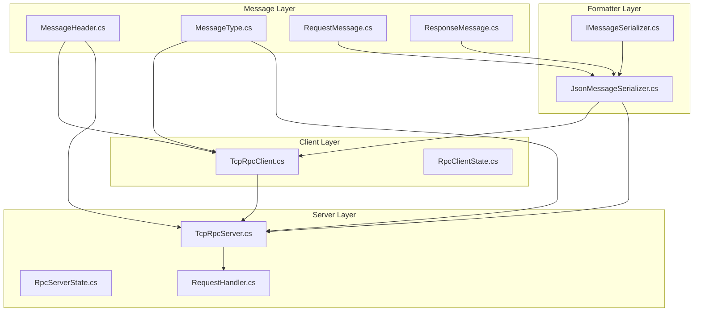
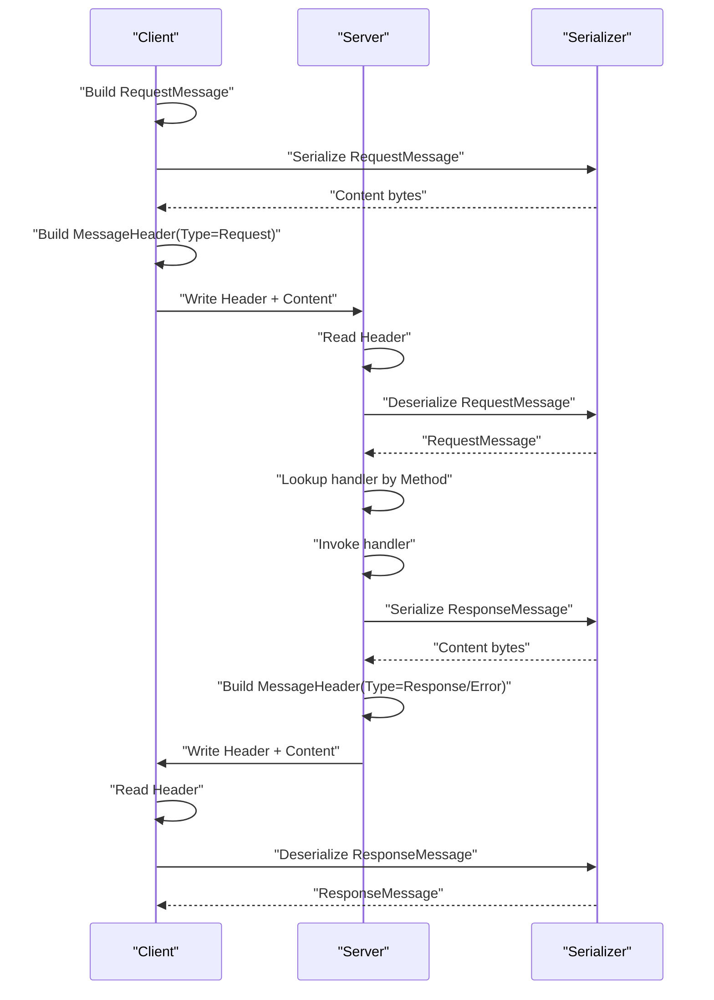
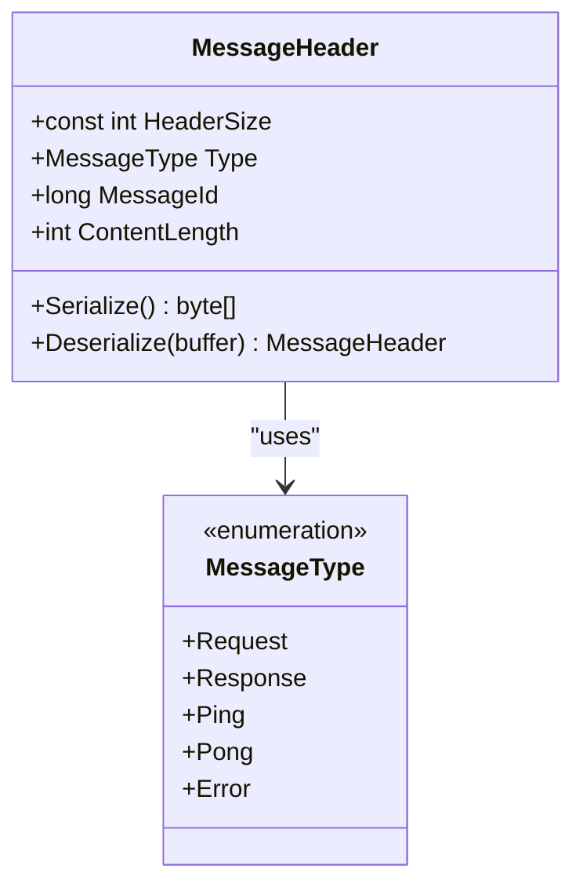
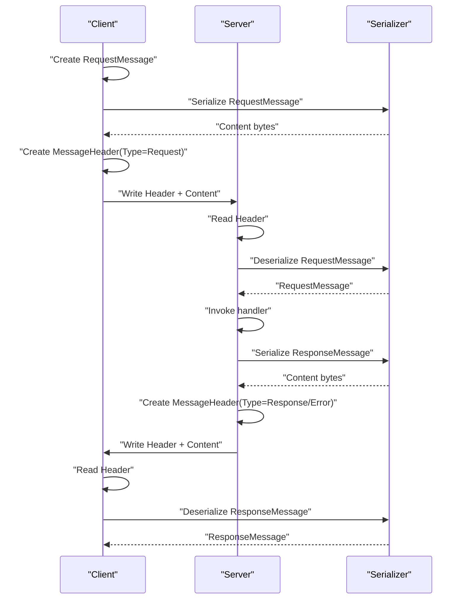
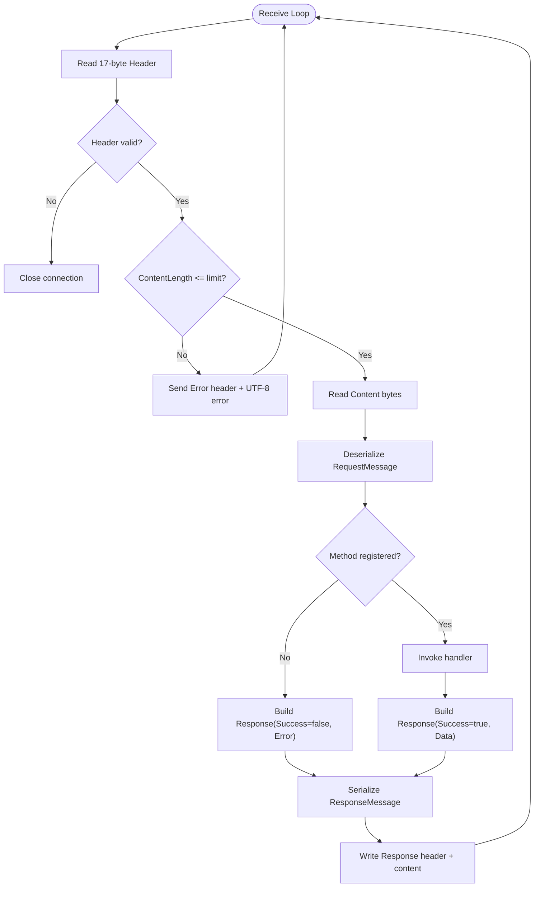
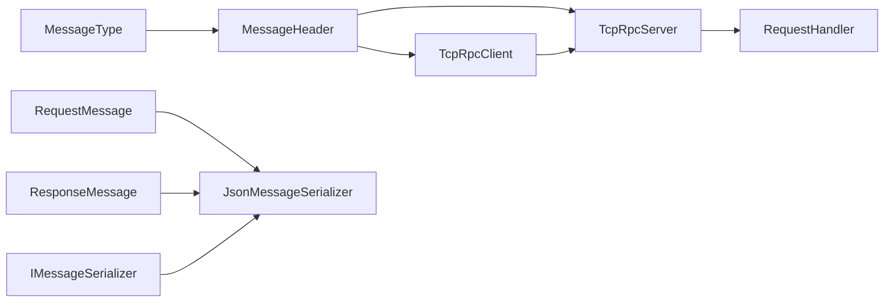

# Protocol Design & Message Structure

<cite>
**Referenced Files in This Document**
- [MessageHeader.cs](file://TcpRpc/Message/MessageHeader.cs)
- [MessageType.cs](file://TcpRpc/Message/MessageType.cs)
- [RequestMessage.cs](file://TcpRpc/Message/RequestMessage.cs)
- [ResponseMessage.cs](file://TcpRpc/Message/ResponseMessage.cs)
- [JsonMessageSerializer.cs](file://TcpRpc/Formatter/JsonMessageSerializer.cs)
- [IMessageSerializer.cs](file://TcpRpc/Formatter/IMessageSerializer.cs)
- [TcpRpcClient.cs](file://TcpRpc/Client/TcpRpcClient.cs)
- [RpcClientState.cs](file://TcpRpc/Client/RpcClientState.cs)
- [TcpRpcServer.cs](file://TcpRpc/Server/TcpRpcServer.cs)
- [RpcServerState.cs](file://TcpRpc/Server/RpcServerState.cs)
- [RequestHandler.cs](file://TcpRpc/Server/RequestHandler.cs)
- [TcpRpc.csproj](file://TcpRpc/TcpRpc.csproj)
</cite>

## Table of Contents
1. [Introduction](#introduction)
2. [Project Structure](#project-structure)
3. [Core Components](#core-components)
4. [Architecture Overview](#architecture-overview)
5. [Detailed Component Analysis](#detailed-component-analysis)
6. [Dependency Analysis](#dependency-analysis)
7. [Performance Considerations](#performance-considerations)
8. [Troubleshooting Guide](#troubleshooting-guide)
9. [Conclusion](#conclusion)

## Introduction
This document specifies the TcpRpc binary protocol design and message structure. It focuses on the MessageHeader architecture with a fixed 17-byte header, little-endian encoding, and validation rules. It documents the MessageType enumeration and the RequestMessage and ResponseMessage structures, including method identification, correlation IDs, success flags, error information, and data payload handling. It also covers the binary protocol specification, field ordering, size constraints, validation mechanisms, protocol versioning considerations, backward compatibility requirements, extensibility patterns, and performance characteristics.

## Project Structure
The protocol is implemented across several namespaces:
- Message: Defines the binary header and message models.
- Formatter: Provides serialization/deserialization contracts and JSON implementation.
- Client: Implements the RPC client with connection lifecycle, request/response correlation, and ping/pong.
- Server: Implements the RPC server with handler registration, request processing, and response/error emission.

**Diagram sources**
- [MessageHeader.cs:1-34](file://TcpRpc/Message/MessageHeader.cs#L1-L34)
- [MessageType.cs:1-10](file://TcpRpc/Message/MessageType.cs#L1-L10)
- [RequestMessage.cs:1-8](file://TcpRpc/Message/RequestMessage.cs#L1-L8)
- [ResponseMessage.cs:1-9](file://TcpRpc/Message/ResponseMessage.cs#L1-L9)
- [JsonMessageSerializer.cs:1-85](file://TcpRpc/Formatter/JsonMessageSerializer.cs#L1-L85)
- [IMessageSerializer.cs:1-13](file://TcpRpc/Formatter/IMessageSerializer.cs#L1-L13)
- [TcpRpcClient.cs:1-405](file://TcpRpc/Client/TcpRpcClient.cs#L1-L405)
- [RpcClientState.cs:1-11](file://TcpRpc/Client/RpcClientState.cs#L1-L11)
- [TcpRpcServer.cs:1-432](file://TcpRpc/Server/TcpRpcServer.cs#L1-L432)
- [RpcServerState.cs:1-10](file://TcpRpc/Server/RpcServerState.cs#L1-L10)
- [RequestHandler.cs:1-5](file://TcpRpc/Server/RequestHandler.cs#L1-L5)

**Section sources**
- [TcpRpc.csproj:1-17](file://TcpRpc/TcpRpc.csproj#L1-L17)

## Core Components
This section documents the core protocol components and their roles.

- MessageHeader: Fixed-size 17-byte header containing MessageType, MessageId, and ContentLength. Serialization and deserialization use little-endian encoding.
- MessageType: Enumeration of message types: Request, Response, Ping, Pong, Error.
- RequestMessage: Encapsulates method name, correlation MessageId, and serialized data payload.
- ResponseMessage: Encapsulates MessageId, success flag, optional error text, and optional data payload.
- JsonMessageSerializer: Contract and implementation for serializing/deserializing RequestMessage and ResponseMessage using JSON.

Key responsibilities:
- Header framing and validation for reliable transport.
- Strongly-typed message models for request/response semantics.
- Pluggable serializer abstraction enabling alternate encodings.

**Section sources**
- [MessageHeader.cs:1-34](file://TcpRpc/Message/MessageHeader.cs#L1-L34)
- [MessageType.cs:1-10](file://TcpRpc/Message/MessageType.cs#L1-L10)
- [RequestMessage.cs:1-8](file://TcpRpc/Message/RequestMessage.cs#L1-L8)
- [ResponseMessage.cs:1-9](file://TcpRpc/Message/ResponseMessage.cs#L1-L9)
- [IMessageSerializer.cs:1-13](file://TcpRpc/Formatter/IMessageSerializer.cs#L1-L13)
- [JsonMessageSerializer.cs:1-85](file://TcpRpc/Formatter/JsonMessageSerializer.cs#L1-L85)

## Architecture Overview
The protocol uses a framed binary design:
- Each message consists of a 17-byte header followed by a variable-length content body.
- The header encodes the message type, correlation ID, and content length.
- The content body is serialized using a pluggable serializer (default JSON).

**Diagram sources**
- [TcpRpcClient.cs:132-189](file://TcpRpc/Client/TcpRpcClient.cs#L132-L189)
- [TcpRpcServer.cs:318-376](file://TcpRpc/Server/TcpRpcServer.cs#L318-L376)
- [JsonMessageSerializer.cs:14-49](file://TcpRpc/Formatter/JsonMessageSerializer.cs#L14-L49)
- [JsonMessageSerializer.cs:51-84](file://TcpRpc/Formatter/JsonMessageSerializer.cs#L51-L84)

## Detailed Component Analysis

### MessageHeader Specification
Fixed 17-byte header layout (little-endian):
- Offset 0: MessageType (1 byte)
- Offset 1: MessageId (8 bytes)
- Offset 9: ContentLength (4 bytes)
- Remaining: Content bytes (variable)

Validation rules:
- Deserialize requires at least 17 bytes.
- ContentLength validated against configured limits during receive.
- MessageId must be positive for requests/responses.

Serialization/Deserialization:
- Uses System.Buffers.Binary primitives for efficient little-endian encoding/decoding.
- Header buffer is preallocated and filled in-place.

**Diagram sources**
- [MessageHeader.cs:1-34](file://TcpRpc/Message/MessageHeader.cs#L1-L34)
- [MessageType.cs:1-10](file://TcpRpc/Message/MessageType.cs#L1-L10)

**Section sources**
- [MessageHeader.cs:1-34](file://TcpRpc/Message/MessageHeader.cs#L1-L34)

### MessageType Enumeration
Defines the protocol’s message categories:
- Request: Initiates a remote procedure call.
- Response: Successful response to a request.
- Ping: Health check or keepalive probe.
- Pong: Acknowledgement to Ping.
- Error: Non-success response with textual error.

These values are single-byte identifiers suitable for framing and routing.

**Section sources**
- [MessageType.cs:1-10](file://TcpRpc/Message/MessageType.cs#L1-L10)

### RequestMessage Structure
Fields:
- MessageId: Correlation identifier matching MessageHeader.MessageId.
- Method: String identifying the remote procedure to invoke.
- Data: Serialized request payload bytes.

Validation:
- Serializer enforces non-empty Method and positive MessageId.
- Data must be present and non-empty for deserialization.

Usage:
- Client constructs RequestMessage and serializes it before sending.
- Server deserializes and routes to registered handlers.

**Section sources**
- [RequestMessage.cs:1-8](file://TcpRpc/Message/RequestMessage.cs#L1-L8)
- [JsonMessageSerializer.cs:14-49](file://TcpRpc/Formatter/JsonMessageSerializer.cs#L14-L49)

### ResponseMessage Structure
Fields:
- MessageId: Correlation identifier matching the original request.
- Success: Boolean indicating operation outcome.
- Error: Optional textual error when Success is false.
- Data: Optional serialized response payload when Success is true.

Validation:
- Serializer enforces positive MessageId.
- Error and Data are optional; only one is typically present depending on Success.

Usage:
- Server emits ResponseMessage; client correlates by MessageId.
- Client treats non-success responses as exceptions.

**Section sources**
- [ResponseMessage.cs:1-9](file://TcpRpc/Message/ResponseMessage.cs#L1-L9)
- [JsonMessageSerializer.cs:51-84](file://TcpRpc/Formatter/JsonMessageSerializer.cs#L51-L84)

### Binary Protocol Specification
Field ordering and sizes:
- Header: 17 bytes total.
  - MessageType: 1 byte.
  - MessageId: 8 bytes (signed 64-bit integer).
  - ContentLength: 4 bytes (unsigned 32-bit integer).
- Content: Variable-length bytes determined by ContentLength.

Encoding:
- All numeric fields are encoded in little-endian order.
- Textual error payloads are UTF-8 encoded.

Validation mechanisms:
- Header deserialization validates minimum buffer size.
- Receiver enforces maximum content length thresholds.
- Serializer validates required fields and throws on malformed content.

Extensibility patterns:
- MessageType can be extended by adding new values with explicit byte assignments.
- New fields can be added to RequestMessage and ResponseMessage; existing consumers must handle unknown fields gracefully.
- Future protocol versions can introduce new MessageTypes or content encodings while maintaining backward compatibility for known types.

Backward compatibility:
- Consumers should ignore unknown MessageTypes and skip unsupported content.
- Default JSON property handling allows optional fields to be omitted.

**Section sources**
- [MessageHeader.cs:1-34](file://TcpRpc/Message/MessageHeader.cs#L1-L34)
- [MessageType.cs:1-10](file://TcpRpc/Message/MessageType.cs#L1-L10)
- [JsonMessageSerializer.cs:1-85](file://TcpRpc/Formatter/JsonMessageSerializer.cs#L1-L85)

### Client-Side Flow: Request/Response and Ping/Pong
Client responsibilities:
- Assigns unique MessageId per request.
- Serializes RequestMessage and writes header + content.
- Tracks pending requests by MessageId for correlation.
- Processes incoming Response, Error, and Pong messages.
- Supports ping/pong with correlation via MessageId.

**Diagram sources**
- [TcpRpcClient.cs:132-189](file://TcpRpc/Client/TcpRpcClient.cs#L132-L189)
- [TcpRpcServer.cs:318-376](file://TcpRpc/Server/TcpRpcServer.cs#L318-L376)
- [JsonMessageSerializer.cs:14-49](file://TcpRpc/Formatter/JsonMessageSerializer.cs#L14-L49)
- [JsonMessageSerializer.cs:51-84](file://TcpRpc/Formatter/JsonMessageSerializer.cs#L51-L84)

**Section sources**
- [TcpRpcClient.cs:132-189](file://TcpRpc/Client/TcpRpcClient.cs#L132-L189)
- [RpcClientState.cs:1-11](file://TcpRpc/Client/RpcClientState.cs#L1-L11)

### Server-Side Flow: Handler Dispatch and Response/Emission
Server responsibilities:
- Accepts TCP connections and reads headers.
- Validates ContentLength and enforces size limits.
- Deserializes RequestMessage and dispatches to registered handlers.
- Emits Response or Error based on handler outcome.
- Supports Ping/Pong responses.

**Diagram sources**
- [TcpRpcServer.cs:228-333](file://TcpRpc/Server/TcpRpcServer.cs#L228-L333)
- [JsonMessageSerializer.cs:14-49](file://TcpRpc/Formatter/JsonMessageSerializer.cs#L14-L49)
- [JsonMessageSerializer.cs:51-84](file://TcpRpc/Formatter/JsonMessageSerializer.cs#L51-L84)

**Section sources**
- [TcpRpcServer.cs:228-333](file://TcpRpc/Server/TcpRpcServer.cs#L228-L333)
- [RpcServerState.cs:1-10](file://TcpRpc/Server/RpcServerState.cs#L1-L10)
- [RequestHandler.cs:1-5](file://TcpRpc/Server/RequestHandler.cs#L1-L5)

## Dependency Analysis
The protocol components exhibit clear separation of concerns:
- MessageHeader depends on MessageType and System.Buffers.Binary.
- RequestMessage and ResponseMessage are data carriers used by the serializer.
- JsonMessageSerializer implements IMessageSerializer and validates message fields.
- Client and Server depend on the serializer and header for framing and parsing.

**Diagram sources**
- [MessageType.cs:1-10](file://TcpRpc/Message/MessageType.cs#L1-L10)
- [MessageHeader.cs:1-34](file://TcpRpc/Message/MessageHeader.cs#L1-L34)
- [RequestMessage.cs:1-8](file://TcpRpc/Message/RequestMessage.cs#L1-L8)
- [ResponseMessage.cs:1-9](file://TcpRpc/Message/ResponseMessage.cs#L1-L9)
- [IMessageSerializer.cs:1-13](file://TcpRpc/Formatter/IMessageSerializer.cs#L1-L13)
- [JsonMessageSerializer.cs:1-85](file://TcpRpc/Formatter/JsonMessageSerializer.cs#L1-L85)
- [TcpRpcClient.cs:1-405](file://TcpRpc/Client/TcpRpcClient.cs#L1-L405)
- [TcpRpcServer.cs:1-432](file://TcpRpc/Server/TcpRpcServer.cs#L1-L432)
- [RequestHandler.cs:1-5](file://TcpRpc/Server/RequestHandler.cs#L1-L5)

**Section sources**
- [IMessageSerializer.cs:1-13](file://TcpRpc/Formatter/IMessageSerializer.cs#L1-L13)
- [JsonMessageSerializer.cs:1-85](file://TcpRpc/Formatter/JsonMessageSerializer.cs#L1-L85)
- [TcpRpcClient.cs:1-405](file://TcpRpc/Client/TcpRpcClient.cs#L1-L405)
- [TcpRpcServer.cs:1-432](file://TcpRpc/Server/TcpRpcServer.cs#L1-L432)

## Performance Considerations
- Fixed header size reduces overhead and enables zero-copy framing.
- Little-endian encoding via System.Buffers.Binary provides efficient, platform-appropriate reads/writes.
- JSON serialization is human-readable and interoperable; consider binary serializers for higher throughput.
- Backpressure and timeouts:
  - Client enforces per-request timeouts and cancellation.
  - Server enforces per-message read timeouts and maximum content lengths.
- Memory efficiency:
  - Pre-sized buffers for header and content reduce allocations.
  - Streaming reads prevent loading entire messages into memory at once.
- Network optimization:
  - Single write for header and content minimizes syscalls.
  - Concurrency control via send locks prevents interleaving.

[No sources needed since this section provides general guidance]

## Troubleshooting Guide
Common issues and diagnostics:
- Header size errors: Ensure at least 17 bytes are available before deserialization.
- Content length violations: Verify sender’s ContentLength does not exceed configured limits.
- Invalid MessageId: Confirm positive MessageId values in serialized messages.
- Method not found: Server responds with non-success ResponseMessage carrying an error.
- Connection loss: Client cancels pending requests and transitions to disconnected state.
- Ping failures: Indicate connectivity or server health issues.

Operational controls:
- Client-side timeouts and cancellation tokens protect against hanging requests.
- Server-side per-client loops and cancellation tokens enable graceful shutdowns.

**Section sources**
- [MessageHeader.cs:22-33](file://TcpRpc/Message/MessageHeader.cs#L22-L33)
- [TcpRpcClient.cs:205-236](file://TcpRpc/Client/TcpRpcClient.cs#L205-L236)
- [TcpRpcServer.cs:228-333](file://TcpRpc/Server/TcpRpcServer.cs#L228-L333)
- [JsonMessageSerializer.cs:36-48](file://TcpRpc/Formatter/JsonMessageSerializer.cs#L36-L48)
- [JsonMessageSerializer.cs:74-84](file://TcpRpc/Formatter/JsonMessageSerializer.cs#L74-L84)

## Conclusion
The TcpRpc protocol defines a compact, little-endian framed message format with a 17-byte header and JSON-serialized content. Its design balances simplicity, performance, and extensibility. The MessageType enumeration and Request/Response models provide clear semantics, while the serializer abstraction enables future encoding alternatives. Robust validation and size limits ensure reliability, and the client/server implementations demonstrate practical correlation, timeouts, and error handling.