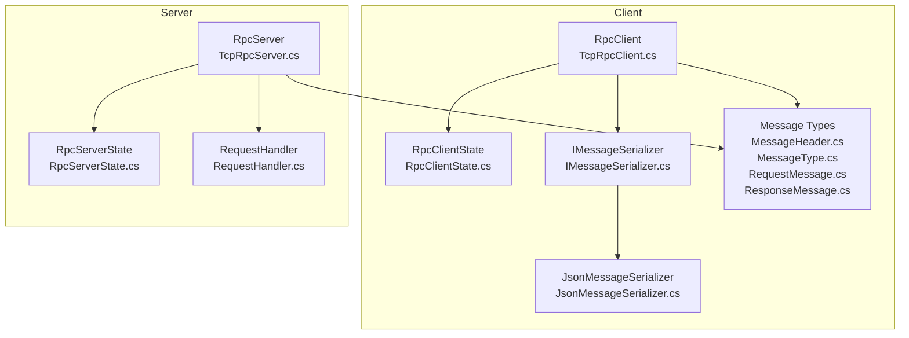
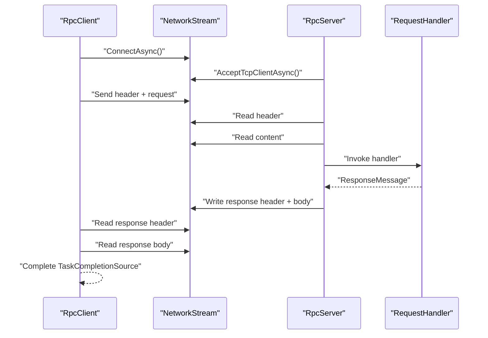
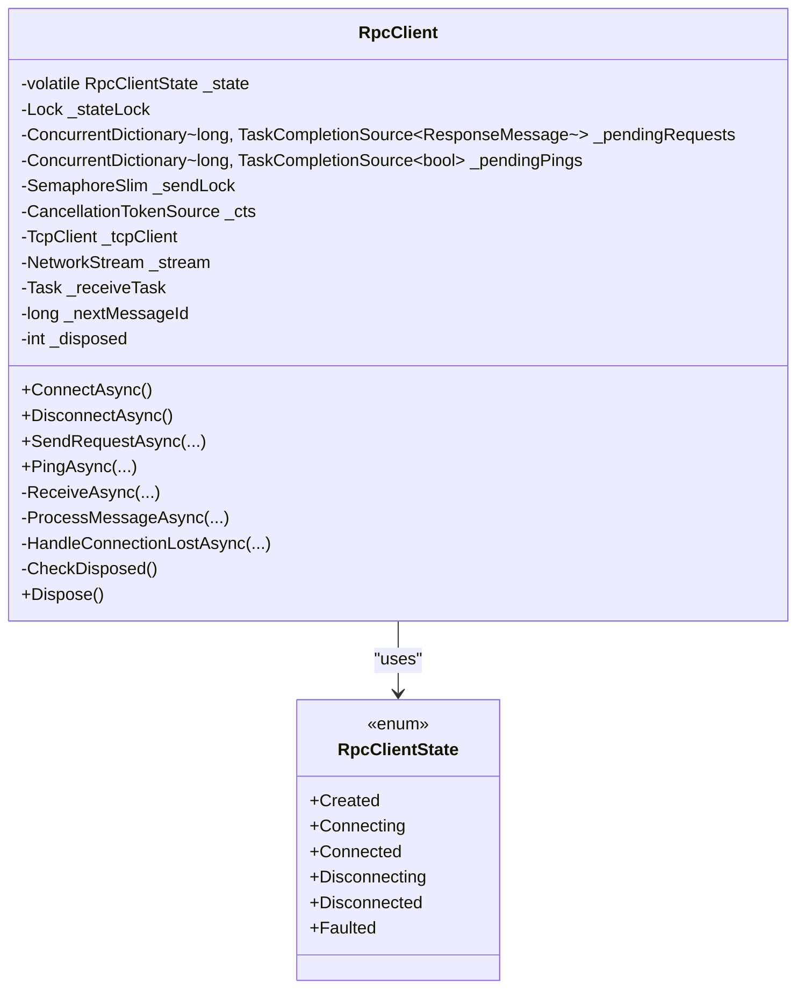
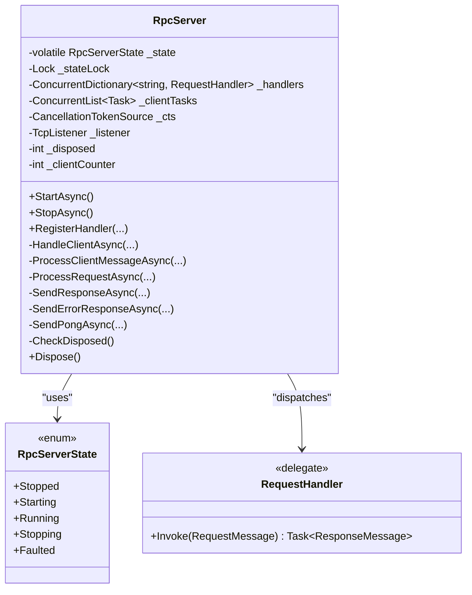
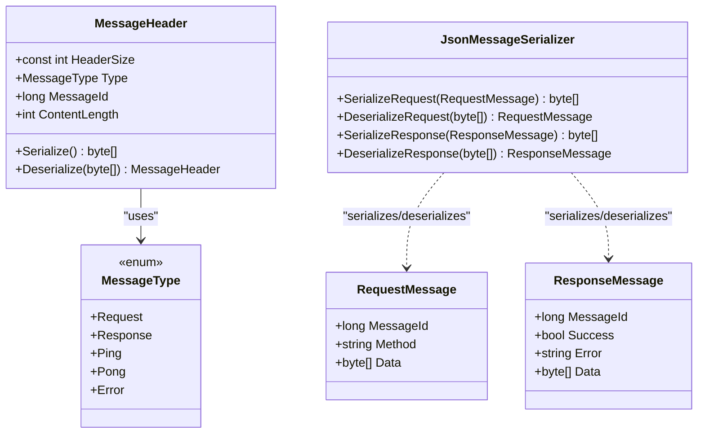
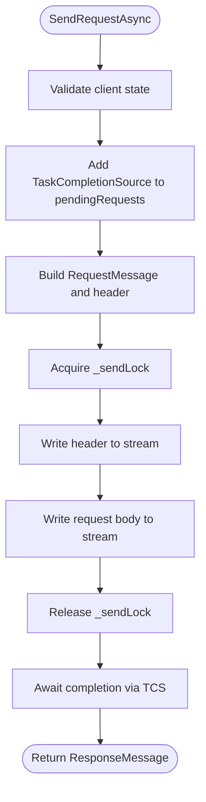
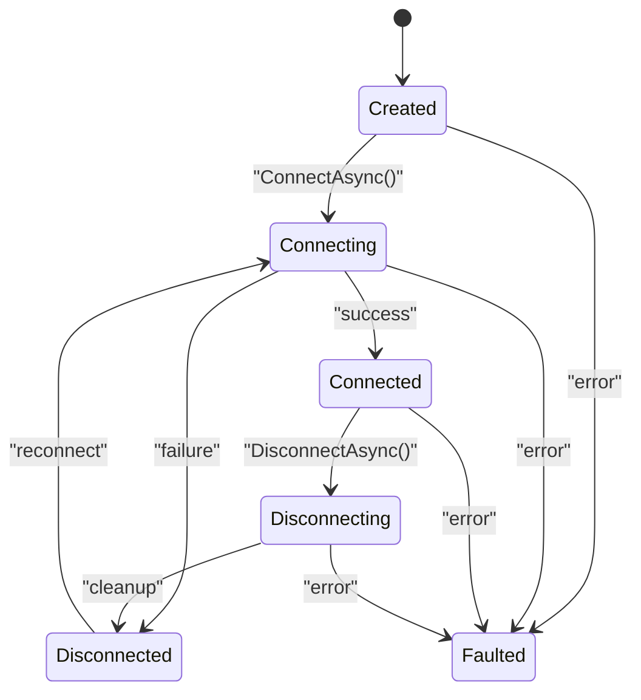
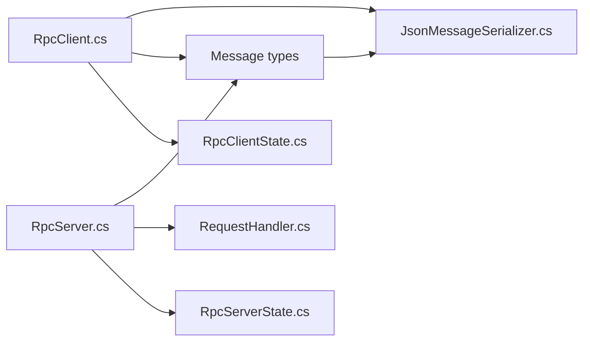

# Threading Model & Concurrency Control

<cite>
**Referenced Files in This Document**
- [RpcClientState.cs](file://TcpRpc/Client/RpcClientState.cs)
- [TcpRpcClient.cs](file://TcpRpc/Client/TcpRpcClient.cs)
- [RpcServerState.cs](file://TcpRpc/Server/RpcServerState.cs)
- [TcpRpcServer.cs](file://TcpRpc/Server/TcpRpcServer.cs)
- [RequestHandler.cs](file://TcpRpc/Server/RequestHandler.cs)
- [MessageHeader.cs](file://TcpRpc/Message/MessageHeader.cs)
- [MessageType.cs](file://TcpRpc/Message/MessageType.cs)
- [RequestMessage.cs](file://TcpRpc/Message/RequestMessage.cs)
- [ResponseMessage.cs](file://TcpRpc/Message/ResponseMessage.cs)
- [IMessageSerializer.cs](file://TcpRpc/Formatter/IMessageSerializer.cs)
- [JsonMessageSerializer.cs](file://TcpRpc/Formatter/JsonMessageSerializer.cs)
</cite>

## Table of Contents
1. [Introduction](#introduction)
2. [Project Structure](#project-structure)
3. [Core Components](#core-components)
4. [Architecture Overview](#architecture-overview)
5. [Detailed Component Analysis](#detailed-component-analysis)
6. [Dependency Analysis](#dependency-analysis)
7. [Performance Considerations](#performance-considerations)
8. [Troubleshooting Guide](#troubleshooting-guide)
9. [Conclusion](#conclusion)

## Introduction
This document explains the threading model and concurrency control mechanisms in the TcpRpc library. It focuses on:
- Thread safety in RpcClientState and RpcServerState
- Atomic state transitions and lock-free operations
- Asynchronous programming patterns for non-blocking I/O
- Thread pool utilization, connection pooling strategies, and resource management
- Producer-consumer patterns for message queuing
- Reader-writer lock usage for shared state access
- Deadlock prevention mechanisms
- Memory barriers, volatile field usage, and atomic operations
- Performance considerations, scalability limits, and best practices

## Project Structure
The project is organized around client and server components, message types, and serialization utilities. The core concurrency concerns are concentrated in the client and server classes, with supporting message and formatter types.

**Diagram sources**
- [TcpRpcClient.cs:1-405](file://TcpRpc/Client/TcpRpcClient.cs#L1-L405)
- [RpcClientState.cs:1-11](file://TcpRpc/Client/RpcClientState.cs#L1-L11)
- [IMessageSerializer.cs:1-13](file://TcpRpc/Formatter/IMessageSerializer.cs#L1-L13)
- [JsonMessageSerializer.cs:1-85](file://TcpRpc/Formatter/JsonMessageSerializer.cs#L1-L85)
- [MessageHeader.cs:1-34](file://TcpRpc/Message/MessageHeader.cs#L1-L34)
- [MessageType.cs:1-10](file://TcpRpc/Message/MessageType.cs#L1-L10)
- [RequestMessage.cs:1-8](file://TcpRpc/Message/RequestMessage.cs#L1-L8)
- [ResponseMessage.cs:1-9](file://TcpRpc/Message/ResponseMessage.cs#L1-L9)
- [TcpRpcServer.cs:1-432](file://TcpRpc/Server/TcpRpcServer.cs#L1-L432)
- [RpcServerState.cs:1-10](file://TcpRpc/Server/RpcServerState.cs#L1-L10)
- [RequestHandler.cs:1-5](file://TcpRpc/Server/RequestHandler.cs#L1-L5)

**Section sources**
- [TcpRpcClient.cs:1-405](file://TcpRpc/Client/TcpRpcClient.cs#L1-L405)
- [TcpRpcServer.cs:1-432](file://TcpRpc/Server/TcpRpcServer.cs#L1-L432)

## Core Components
- RpcClient: Manages connection lifecycle, request/response coordination, and ping/pong heartbeats. Uses concurrent collections for pending requests, a semaphore for serialized writes, and cancellation tokens for cooperative shutdown.
- RpcServer: Accepts connections, spawns per-client tasks, and dispatches handlers. Tracks active connections and enforces state transitions.
- Message types: Define the wire protocol with fixed-size headers and typed messages.
- Serializers: Provide JSON-based serialization/deserialization with validation.

Key concurrency primitives:
- volatile state fields for visibility across threads
- Locks for mutual exclusion around state transitions and shared mutable collections
- Interlocked operations for atomic counters and disposed flags
- SemaphoreSlim for write serialization
- ConcurrentDictionary for thread-safe pending request management
- CancellationTokenSource for coordinated cancellation

**Section sources**
- [RpcClientState.cs:1-11](file://TcpRpc/Client/RpcClientState.cs#L1-L11)
- [RpcServerState.cs:1-10](file://TcpRpc/Server/RpcServerState.cs#L1-L10)
- [TcpRpcClient.cs:1-405](file://TcpRpc/Client/TcpRpcClient.cs#L1-L405)
- [TcpRpcServer.cs:1-432](file://TcpRpc/Server/TcpRpcServer.cs#L1-L432)
- [IMessageSerializer.cs:1-13](file://TcpRpc/Formatter/IMessageSerializer.cs#L1-L13)
- [JsonMessageSerializer.cs:1-85](file://TcpRpc/Formatter/JsonMessageSerializer.cs#L1-L85)
- [MessageHeader.cs:1-34](file://TcpRpc/Message/MessageHeader.cs#L1-L34)
- [MessageType.cs:1-10](file://TcpRpc/Message/MessageType.cs#L1-L10)
- [RequestMessage.cs:1-8](file://TcpRpc/Message/RequestMessage.cs#L1-L8)
- [ResponseMessage.cs:1-9](file://TcpRpc/Message/ResponseMessage.cs#L1-L9)

## Architecture Overview
The system follows a classic client-server model with asynchronous I/O and per-client task processing on the server side. The client maintains a single connection and coordinates multiple concurrent requests using a dictionary keyed by message ID. On the server side, each accepted client is handled by a dedicated task, enabling concurrent request processing per connection.

**Diagram sources**
- [TcpRpcClient.cs:132-189](file://TcpRpc/Client/TcpRpcClient.cs#L132-L189)
- [TcpRpcServer.cs:228-360](file://TcpRpc/Server/TcpRpcServer.cs#L228-L360)
- [RequestHandler.cs:1-5](file://TcpRpc/Server/RequestHandler.cs#L1-L5)

## Detailed Component Analysis

### RpcClient Threading Model
- State management:
  - volatile RpcClientState for visibility across threads
  - Lock around state transitions to prevent races during connect/disconnect
  - Interlocked disposed flag for fast disposal checks
- Pending request coordination:
  - ConcurrentDictionary<long, TaskCompletionSource<ResponseMessage>> for O(1) lookup and removal
  - Interlocked increment for monotonic message IDs
- Serialization and I/O:
  - SemaphoreSlim(1,1) ensures serialized writes to the stream
  - CancellationTokenSource for cooperative cancellation and timeouts
  - Non-blocking reads/writes with cancellation support
- Heartbeat:
  - Separate ConcurrentDictionary<long, TaskCompletionSource<bool>> for ping/pong
  - Dedicated ping method with timeout and logging
- Error handling:
  - Connection loss triggers cleanup of pending requests and state update
  - Exceptions propagate to pending TCS instances

**Diagram sources**
- [TcpRpcClient.cs:11-405](file://TcpRpc/Client/TcpRpcClient.cs#L11-L405)
- [RpcClientState.cs:1-11](file://TcpRpc/Client/RpcClientState.cs#L1-L11)

**Section sources**
- [TcpRpcClient.cs:18-31](file://TcpRpc/Client/TcpRpcClient.cs#L18-L31)
- [TcpRpcClient.cs:47-80](file://TcpRpc/Client/TcpRpcClient.cs#L47-L80)
- [TcpRpcClient.cs:85-130](file://TcpRpc/Client/TcpRpcClient.cs#L85-L130)
- [TcpRpcClient.cs:132-189](file://TcpRpc/Client/TcpRpcClient.cs#L132-L189)
- [TcpRpcClient.cs:205-236](file://TcpRpc/Client/TcpRpcClient.cs#L205-L236)
- [TcpRpcClient.cs:258-287](file://TcpRpc/Client/TcpRpcClient.cs#L258-L287)
- [TcpRpcClient.cs:289-306](file://TcpRpc/Client/TcpRpcClient.cs#L289-L306)
- [TcpRpcClient.cs:325-382](file://TcpRpc/Client/TcpRpcClient.cs#L325-L382)

### RpcServer Threading Model
- State management:
  - volatile RpcServerState for visibility across threads
  - Lock around state transitions to enforce ordered lifecycle
  - Interlocked disposed flag and client counter
- Per-client tasks:
  - Each client connection runs in its own Task
  - ConcurrentList-like tracking with periodic cleanup
- Handler dispatch:
  - ConcurrentDictionary<string, RequestHandler> for method routing
  - Handlers are invoked asynchronously; responses are written back
- I/O and timeouts:
  - Per-message read loops with cancellation and timeout CTS
  - Dedicated error and pong responses

**Diagram sources**
- [TcpRpcServer.cs:12-432](file://TcpRpc/Server/TcpRpcServer.cs#L12-L432)
- [RpcServerState.cs:1-10](file://TcpRpc/Server/RpcServerState.cs#L1-L10)
- [RequestHandler.cs:1-5](file://TcpRpc/Server/RequestHandler.cs#L1-L5)

**Section sources**
- [TcpRpcServer.cs:23-28](file://TcpRpc/Server/TcpRpcServer.cs#L23-L28)
- [TcpRpcServer.cs:101-173](file://TcpRpc/Server/TcpRpcServer.cs#L101-L173)
- [TcpRpcServer.cs:175-226](file://TcpRpc/Server/TcpRpcServer.cs#L175-L226)
- [TcpRpcServer.cs:228-316](file://TcpRpc/Server/TcpRpcServer.cs#L228-L316)
- [TcpRpcServer.cs:318-360](file://TcpRpc/Server/TcpRpcServer.cs#L318-L360)
- [TcpRpcServer.cs:362-406](file://TcpRpc/Server/TcpRpcServer.cs#L362-L406)

### Message Protocol and Serialization
- MessageHeader defines a fixed-size header with type, message ID, and content length.
- MessageType enumerates supported message kinds.
- RequestMessage and ResponseMessage carry method names, IDs, and payload data.
- JsonMessageSerializer validates deserialized messages and throws meaningful exceptions.

**Diagram sources**
- [MessageHeader.cs:1-34](file://TcpRpc/Message/MessageHeader.cs#L1-L34)
- [MessageType.cs:1-10](file://TcpRpc/Message/MessageType.cs#L1-L10)
- [RequestMessage.cs:1-8](file://TcpRpc/Message/RequestMessage.cs#L1-L8)
- [ResponseMessage.cs:1-9](file://TcpRpc/Message/ResponseMessage.cs#L1-L9)
- [JsonMessageSerializer.cs:1-85](file://TcpRpc/Formatter/JsonMessageSerializer.cs#L1-L85)

**Section sources**
- [MessageHeader.cs:7-33](file://TcpRpc/Message/MessageHeader.cs#L7-L33)
- [MessageType.cs:1-10](file://TcpRpc/Message/MessageType.cs#L1-L10)
- [RequestMessage.cs:1-8](file://TcpRpc/Message/RequestMessage.cs#L1-L8)
- [ResponseMessage.cs:1-9](file://TcpRpc/Message/ResponseMessage.cs#L1-L9)
- [JsonMessageSerializer.cs:14-84](file://TcpRpc/Formatter/JsonMessageSerializer.cs#L14-L84)

### Asynchronous Programming Model
- Non-blocking I/O:
  - All network operations use async/await with cancellation tokens
  - Reads and writes are performed on NetworkStream with timeouts
- Concurrent request handling:
  - Client: multiple requests share a single connection; each request is tracked independently via message ID
  - Server: each client connection runs a dedicated task; handlers are awaited concurrently
- Continuation scheduling:
  - TaskCompletionSource configured to schedule continuations asynchronously for fairness

**Diagram sources**
- [TcpRpcClient.cs:132-189](file://TcpRpc/Client/TcpRpcClient.cs#L132-L189)

**Section sources**
- [TcpRpcClient.cs:132-189](file://TcpRpc/Client/TcpRpcClient.cs#L132-L189)
- [TcpRpcServer.cs:228-360](file://TcpRpc/Server/TcpRpcServer.cs#L228-L360)

### Thread Safety Implementation
- Atomic state transitions:
  - volatile state fields ensure visibility across threads
  - Locks protect state transitions and shared mutable structures
  - Interlocked operations for disposed flags and counters
- Lock-free operations:
  - Interlocked.Increment for message IDs
  - ConcurrentDictionary for pending request management
- Reader-writer semantics:
  - Single writer lock for state transitions
  - Readers access state via volatile reads
- Deadlock prevention:
  - Single-writer model for state updates
  - No nested locks; consistent lock ordering
  - Cooperative cancellation via CancellationTokenSource

**Diagram sources**
- [RpcClientState.cs:1-11](file://TcpRpc/Client/RpcClientState.cs#L1-L11)

**Section sources**
- [TcpRpcClient.cs:28-31](file://TcpRpc/Client/TcpRpcClient.cs#L28-L31)
- [TcpRpcClient.cs:47-80](file://TcpRpc/Client/TcpRpcClient.cs#L47-L80)
- [TcpRpcClient.cs:85-130](file://TcpRpc/Client/TcpRpcClient.cs#L85-L130)
- [TcpRpcClient.cs:289-306](file://TcpRpc/Client/TcpRpcClient.cs#L289-L306)
- [TcpRpcServer.cs:23-28](file://TcpRpc/Server/TcpRpcServer.cs#L23-L28)
- [TcpRpcServer.cs:101-173](file://TcpRpc/Server/TcpRpcServer.cs#L101-L173)
- [TcpRpcServer.cs:175-226](file://TcpRpc/Server/TcpRpcServer.cs#L175-L226)

### Producer-Consumer Patterns and Resource Management
- Producer-consumer:
  - Client produces requests and consumes responses via TCS
  - Server consumes incoming messages and produces responses
- Connection pooling:
  - Client maintains a single TcpClient per connection
  - Server accepts new connections and manages per-client tasks
- Resource management:
  - Cancellation tokens drive graceful shutdown
  - SemaphoreSlim serializes writes to avoid interleaved frames
  - ConcurrentDictionary cleanup on disconnect and server stop

**Section sources**
- [TcpRpcClient.cs:18-31](file://TcpRpc/Client/TcpRpcClient.cs#L18-L31)
- [TcpRpcClient.cs:165-175](file://TcpRpc/Client/TcpRpcClient.cs#L165-L175)
- [TcpRpcServer.cs:17-28](file://TcpRpc/Server/TcpRpcServer.cs#L17-L28)
- [TcpRpcServer.cs:136-148](file://TcpRpc/Server/TcpRpcServer.cs#L136-L148)

### Memory Barriers, Volatile Fields, and Atomic Operations
- volatile RpcClientState and RpcServerState ensure visibility of state changes across threads
- Interlocked.Increment for atomic message ID generation
- Interlocked.CompareExchange and Exchange for disposed flag checks and assignment
- Locks provide memory barriers around critical sections

**Section sources**
- [TcpRpcClient.cs:28-31](file://TcpRpc/Client/TcpRpcClient.cs#L28-L31)
- [TcpRpcClient.cs:314-318](file://TcpRpc/Client/TcpRpcClient.cs#L314-L318)
- [TcpRpcClient.cs:384-404](file://TcpRpc/Client/TcpRpcClient.cs#L384-L404)
- [TcpRpcServer.cs:23-28](file://TcpRpc/Server/TcpRpcServer.cs#L23-L28)
- [TcpRpcServer.cs:408-413](file://TcpRpc/Server/TcpRpcServer.cs#L408-L413)
- [TcpRpcServer.cs:415-431](file://TcpRpc/Server/TcpRpcServer.cs#L415-L431)

## Dependency Analysis
The client depends on message types and serializers; the server depends on handlers and message types. Both components rely on the .NET async I/O stack and synchronization primitives.

**Diagram sources**
- [TcpRpcClient.cs:1-405](file://TcpRpc/Client/TcpRpcClient.cs#L1-L405)
- [RpcClientState.cs:1-11](file://TcpRpc/Client/RpcClientState.cs#L1-L11)
- [TcpRpcServer.cs:1-432](file://TcpRpc/Server/TcpRpcServer.cs#L1-L432)
- [RpcServerState.cs:1-10](file://TcpRpc/Server/RpcServerState.cs#L1-L10)
- [RequestHandler.cs:1-5](file://TcpRpc/Server/RequestHandler.cs#L1-L5)
- [JsonMessageSerializer.cs:1-85](file://TcpRpc/Formatter/JsonMessageSerializer.cs#L1-L85)
- [MessageHeader.cs:1-34](file://TcpRpc/Message/MessageHeader.cs#L1-L34)
- [MessageType.cs:1-10](file://TcpRpc/Message/MessageType.cs#L1-L10)
- [RequestMessage.cs:1-8](file://TcpRpc/Message/RequestMessage.cs#L1-L8)
- [ResponseMessage.cs:1-9](file://TcpRpc/Message/ResponseMessage.cs#L1-L9)

**Section sources**
- [TcpRpcClient.cs:1-405](file://TcpRpc/Client/TcpRpcClient.cs#L1-L405)
- [TcpRpcServer.cs:1-432](file://TcpRpc/Server/TcpRpcServer.cs#L1-L432)

## Performance Considerations
- Throughput:
  - Serialized writes via SemaphoreSlim reduce contention but may limit throughput under heavy load
  - Consider batching headers/bodies or using multiple connections for extreme concurrency
- Latency:
  - Non-blocking I/O with cancellation minimizes blocking
  - Per-request timeouts prevent indefinite waits
- Scalability:
  - Server scales per-client tasks; limit concurrent requests per connection to avoid memory pressure
  - Use connection pooling across clients for high-throughput scenarios
- Memory:
  - ConcurrentDictionary growth; monitor pending request counts
  - Message size limits prevent oversized allocations
- Best practices:
  - Use CancellationTokenSource for cooperative cancellation
  - Avoid holding locks while awaiting I/O
  - Prefer TaskCreationOptions.RunContinuationsAsynchronously for fairness

[No sources needed since this section provides general guidance]

## Troubleshooting Guide
- Connection errors:
  - Client handles connection loss by transitioning to Disconnected and completing pending requests with exceptions
  - Server logs client disconnections and continues serving others
- Timeouts:
  - Client request timeouts remove pending entries and surface TimeoutException
  - Server per-message timeouts continue loop instead of failing the connection
- Serialization failures:
  - Deserialization errors in JsonMessageSerializer throw InvalidOperationException with context
- State inconsistencies:
  - Locks around state transitions prevent invalid state changes
  - Interlocked disposed checks prevent operations on disposed instances

**Section sources**
- [TcpRpcClient.cs:289-306](file://TcpRpc/Client/TcpRpcClient.cs#L289-L306)
- [TcpRpcClient.cs:179-188](file://TcpRpc/Client/TcpRpcClient.cs#L179-L188)
- [TcpRpcServer.cs:290-304](file://TcpRpc/Server/TcpRpcServer.cs#L290-L304)
- [JsonMessageSerializer.cs:45-48](file://TcpRpc/Formatter/JsonMessageSerializer.cs#L45-L48)
- [JsonMessageSerializer.cs:79-83](file://TcpRpc/Formatter/JsonMessageSerializer.cs#L79-L83)

## Conclusion
The TcpRpc library implements a robust, thread-safe client-server RPC over TCP with careful use of:
- Volatile state fields and locks for safe state transitions
- Interlocked operations for counters and disposed flags
- Concurrent collections and semaphores for request coordination and serialized writes
- Asynchronous I/O with cancellation for responsive, scalable operation
- Clear producer-consumer boundaries and explicit error propagation

These mechanisms enable predictable behavior under high concurrency while maintaining simplicity and reliability.