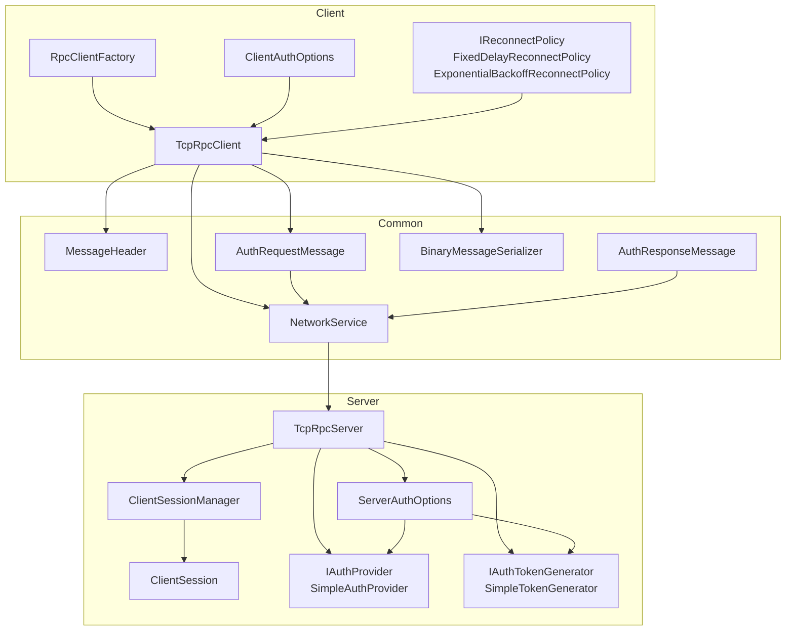
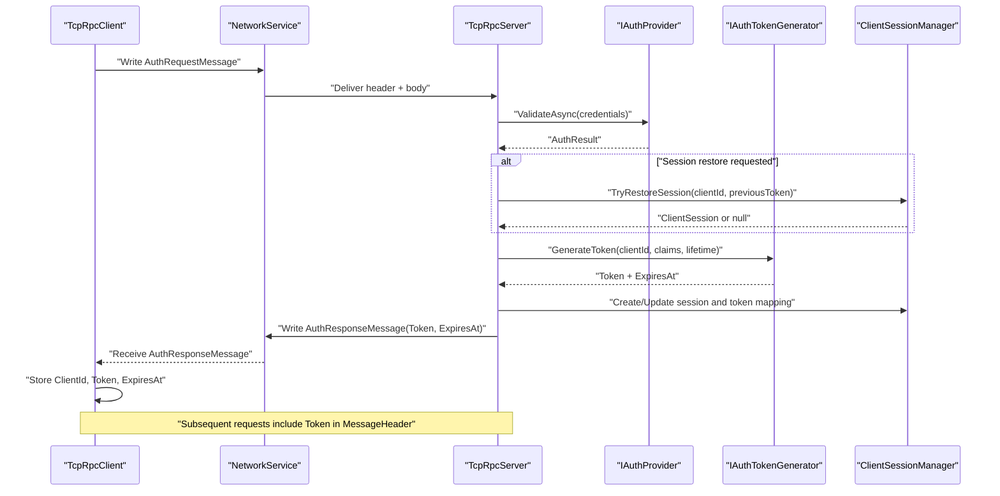
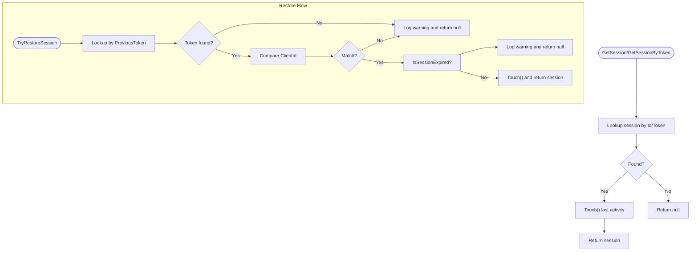
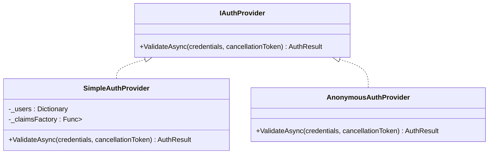
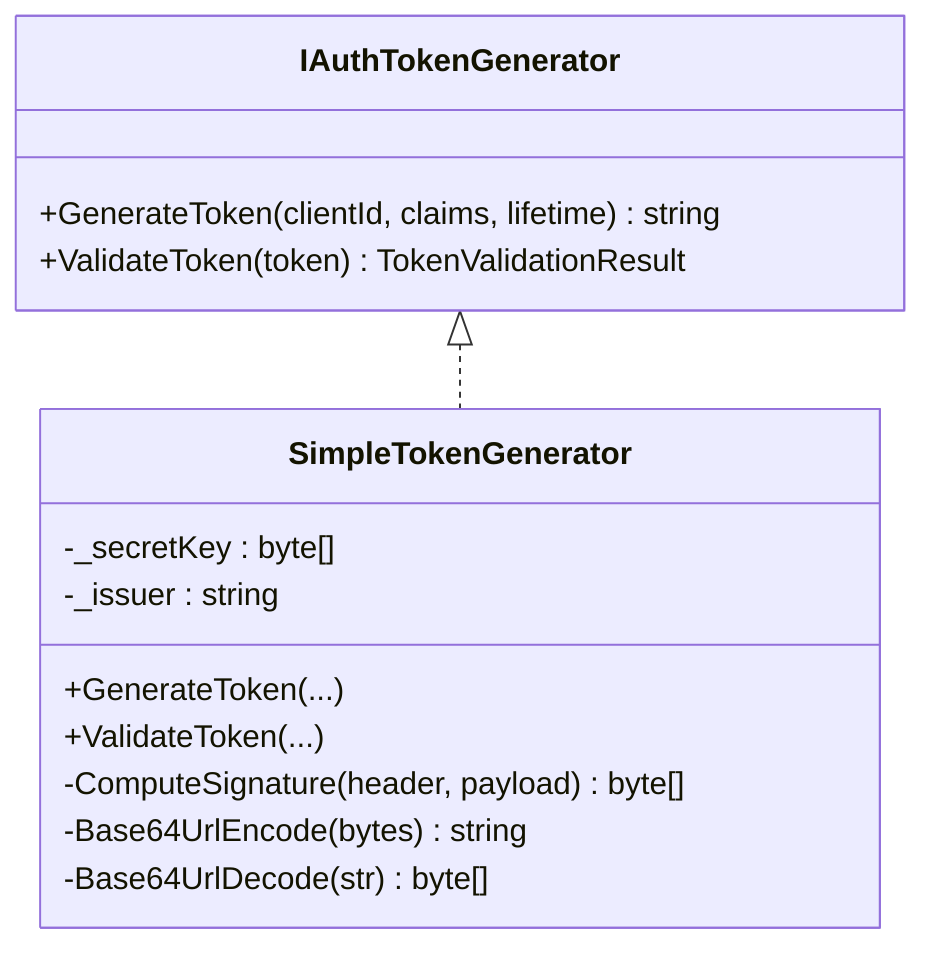
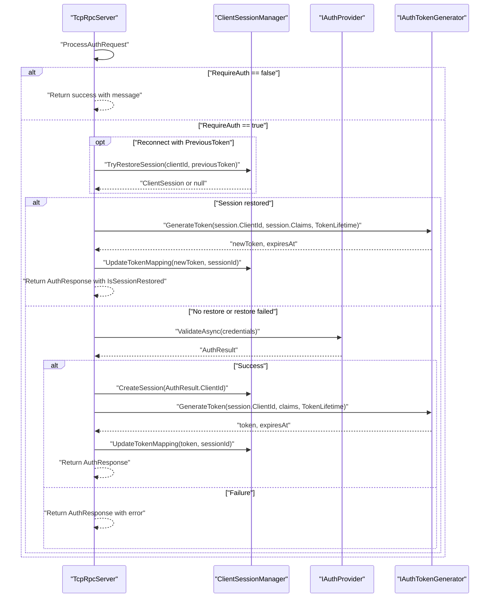
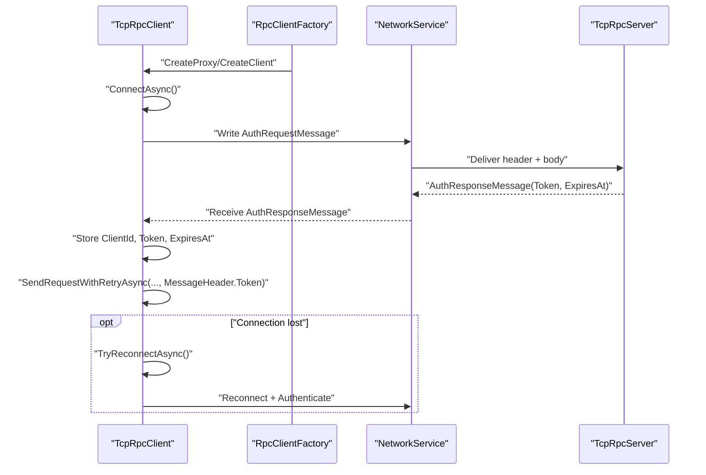
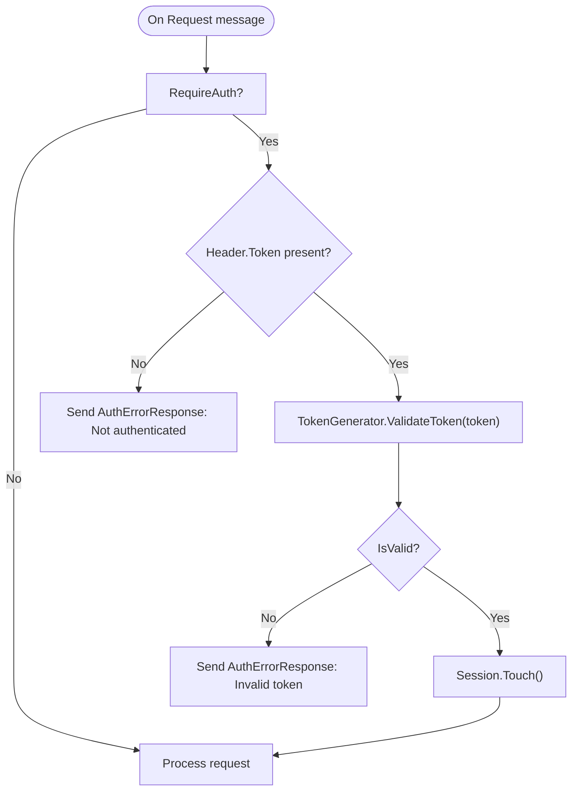
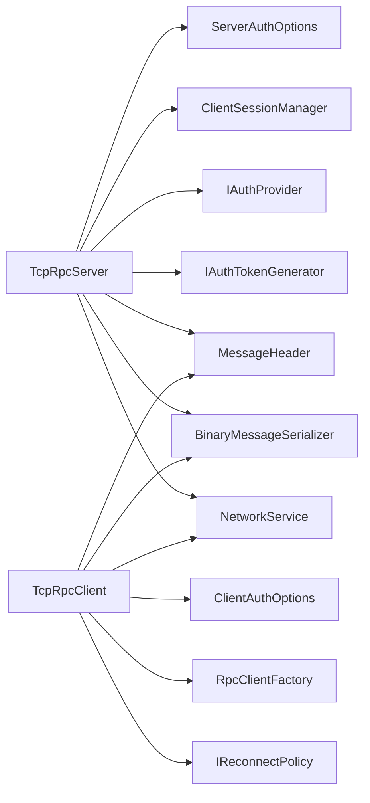

# Authentication & Security

<cite>
**Referenced Files in This Document**
- [ClientSessionManager.cs](file://TcpRpc/TcpRpc/Server/Auth/ClientSessionManager.cs)
- [ClientSession.cs](file://TcpRpc/TcpRpc/Server/Auth/ClientSession.cs)
- [IAuthProvider.cs](file://TcpRpc/TcpRpc/Server/Auth/IAuthProvider.cs)
- [IAuthTokenGenerator.cs](file://TcpRpc/TcpRpc/Server/Auth/IAuthTokenGenerator.cs)
- [SimpleTokenGenerator.cs](file://TcpRpc/TcpRpc/Server/Auth/SimpleTokenGenerator.cs)
- [ServerAuthOptions.cs](file://TcpRpc/TcpRpc/Server/ServerAuthOptions.cs)
- [TcpRpcServer.cs](file://TcpRpc/TcpRpc/Server/TcpRpcServer.cs)
- [ClientAuthOptions.cs](file://TcpRpc/TcpRpc/Client/ClientAuthOptions.cs)
- [RpcClientFactory.cs](file://TcpRpc/TcpRpc/Client/RpcClientFactory.cs)
- [TcpRpcClient.cs](file://TcpRpc/TcpRpc/Client/TcpRpcClient.cs)
- [AuthRequestMessage.cs](file://TcpRpc/TcpRpc/Message/AuthRequestMessage.cs)
- [AuthResponseMessage.cs](file://TcpRpc/TcpRpc/Message/AuthResponseMessage.cs)
- [MessageHeader.cs](file://TcpRpc/TcpRpc/Message/MessageHeader.cs)
- [NetworkService.cs](file://TcpRpc/TcpRpc/Network/NetworkService.cs)
- [BinaryMessageSerializer.cs](file://TcpRpc/TcpRpc/Formatter/BinaryMessageSerializer.cs)
- [IReconnectPolicy.cs](file://TcpRpc/TcpRpc/Client/IReconnectPolicy.cs)
- [SimpleAuthProvider.cs](file://TcpRpc/TcpRpc.Server/SimpleAuthProvider.cs)
</cite>

## Table of Contents
1. [Introduction](#introduction)
2. [Project Structure](#project-structure)
3. [Core Components](#core-components)
4. [Architecture Overview](#architecture-overview)
5. [Detailed Component Analysis](#detailed-component-analysis)
6. [Dependency Analysis](#dependency-analysis)
7. [Performance Considerations](#performance-considerations)
8. [Troubleshooting Guide](#troubleshooting-guide)
9. [Conclusion](#conclusion)
10. [Appendices](#appendices)

## Introduction
This document explains the authentication and security model of TcpRpc, focusing on token-based authentication, session lifecycle, and secure credential transmission. It covers the server-side session manager and token generator, the client-side authentication flow and reconnection policy, and the message protocol used for authentication. It also provides guidance on implementing custom authentication providers and token generators, configuring timeouts and retry policies, and securing deployments.

## Project Structure
The authentication and security features span both client and server assemblies:
- Server-side: session management, authentication provider interface, token generation, and server configuration
- Client-side: authentication options, reconnection policies, and client implementation
- Messaging: authentication messages, message headers, and binary serialization
- Networking: low-level network service utilities

**Diagram sources**
- [TcpRpcClient.cs](file://TcpRpc/TcpRpc/Client/TcpRpcClient.cs)
- [RpcClientFactory.cs](file://TcpRpc/TcpRpc/Client/RpcClientFactory.cs)
- [ClientAuthOptions.cs](file://TcpRpc/TcpRpc/Client/ClientAuthOptions.cs)
- [IReconnectPolicy.cs](file://TcpRpc/TcpRpc/Client/IReconnectPolicy.cs)
- [MessageHeader.cs](file://TcpRpc/TcpRpc/Message/MessageHeader.cs)
- [AuthRequestMessage.cs](file://TcpRpc/TcpRpc/Message/AuthRequestMessage.cs)
- [AuthResponseMessage.cs](file://TcpRpc/TcpRpc/Message/AuthResponseMessage.cs)
- [BinaryMessageSerializer.cs](file://TcpRpc/TcpRpc/Formatter/BinaryMessageSerializer.cs)
- [NetworkService.cs](file://TcpRpc/TcpRpc/Network/NetworkService.cs)
- [TcpRpcServer.cs](file://TcpRpc/TcpRpc/Server/TcpRpcServer.cs)
- [ServerAuthOptions.cs](file://TcpRpc/TcpRpc/Server/ServerAuthOptions.cs)
- [ClientSessionManager.cs](file://TcpRpc/TcpRpc/Server/Auth/ClientSessionManager.cs)
- [ClientSession.cs](file://TcpRpc/TcpRpc/Server/Auth/ClientSession.cs)
- [IAuthProvider.cs](file://TcpRpc/TcpRpc/Server/Auth/IAuthProvider.cs)
- [SimpleAuthProvider.cs](file://TcpRpc/TcpRpc.Server/SimpleAuthProvider.cs)
- [IAuthTokenGenerator.cs](file://TcpRpc/TcpRpc/Server/Auth/IAuthTokenGenerator.cs)
- [SimpleTokenGenerator.cs](file://TcpRpc/TcpRpc/Server/Auth/SimpleTokenGenerator.cs)

**Section sources**
- [TcpRpcServer.cs](file://TcpRpc/TcpRpc/Server/TcpRpcServer.cs)
- [TcpRpcClient.cs](file://TcpRpc/TcpRpc/Client/TcpRpcClient.cs)
- [ServerAuthOptions.cs](file://TcpRpc/TcpRpc/Server/ServerAuthOptions.cs)
- [ClientAuthOptions.cs](file://TcpRpc/TcpRpc/Client/ClientAuthOptions.cs)

## Core Components
- ClientSessionManager: Manages client sessions, token-to-session mapping, activity touch, expiration checks, and periodic cleanup.
- ClientSession: Holds per-client identity, tokens, claims, and timestamps; exposes token expiration and activity touch.
- IAuthProvider: Validates client credentials and returns an AuthResult with ClientId and optional Claims.
- IAuthTokenGenerator: Generates and validates JWT-like tokens with signature verification and expiration checks.
- SimpleTokenGenerator: Reference implementation of IAuthTokenGenerator using HMAC-SHA256 with Base64Url encoding.
- ServerAuthOptions: Server-side configuration for enabling auth, token lifetime, session timeout/cleanup, and pluggable AuthProvider and TokenGenerator.
- TcpRpcServer: Orchestrates authentication handshake, session creation/restoration, token validation on requests, and token renewal.
- ClientAuthOptions: Client-side configuration for credentials, client ID, timeouts, and reconnect policy.
- RpcClientFactory: Builds proxies and clients, manages credentials and client ID updates.
- TcpRpcClient: Performs connection, authentication, request sending with token propagation, and automatic reconnection.
- AuthRequestMessage/AuthResponseMessage: Serialized authentication messages exchanged between client and server.
- MessageHeader: Extends the wire protocol to carry optional Token for request messages.
- NetworkService/BinaryMessageSerializer: Low-level transport and serialization for messages and headers.

**Section sources**
- [ClientSessionManager.cs](file://TcpRpc/TcpRpc/Server/Auth/ClientSessionManager.cs)
- [ClientSession.cs](file://TcpRpc/TcpRpc/Server/Auth/ClientSession.cs)
- [IAuthProvider.cs](file://TcpRpc/TcpRpc/Server/Auth/IAuthProvider.cs)
- [IAuthTokenGenerator.cs](file://TcpRpc/TcpRpc/Server/Auth/IAuthTokenGenerator.cs)
- [SimpleTokenGenerator.cs](file://TcpRpc/TcpRpc/Server/Auth/SimpleTokenGenerator.cs)
- [ServerAuthOptions.cs](file://TcpRpc/TcpRpc/Server/ServerAuthOptions.cs)
- [TcpRpcServer.cs](file://TcpRpc/TcpRpc/Server/TcpRpcServer.cs)
- [ClientAuthOptions.cs](file://TcpRpc/TcpRpc/Client/ClientAuthOptions.cs)
- [RpcClientFactory.cs](file://TcpRpc/TcpRpc/Client/RpcClientFactory.cs)
- [TcpRpcClient.cs](file://TcpRpc/TcpRpc/Client/TcpRpcClient.cs)
- [AuthRequestMessage.cs](file://TcpRpc/TcpRpc/Message/AuthRequestMessage.cs)
- [AuthResponseMessage.cs](file://TcpRpc/TcpRpc/Message/AuthResponseMessage.cs)
- [MessageHeader.cs](file://TcpRpc/TcpRpc/Message/MessageHeader.cs)
- [NetworkService.cs](file://TcpRpc/TcpRpc/Network/NetworkService.cs)
- [BinaryMessageSerializer.cs](file://TcpRpc/TcpRpc/Formatter/BinaryMessageSerializer.cs)

## Architecture Overview
The authentication and security architecture follows a token-based model:
- Clients send an AuthRequestMessage containing either fresh credentials or a PreviousToken for reconnection.
- The server validates credentials via IAuthProvider and creates/restore a ClientSession.
- The server generates a signed token via IAuthTokenGenerator and returns it in AuthResponseMessage.
- Subsequent requests embed the token in MessageHeader.Token for per-request validation.
- Sessions are tracked and cleaned up periodically based on ServerAuthOptions.

**Diagram sources**
- [TcpRpcClient.cs](file://TcpRpc/TcpRpc/Client/TcpRpcClient.cs)
- [NetworkService.cs](file://TcpRpc/TcpRpc/Network/NetworkService.cs)
- [TcpRpcServer.cs](file://TcpRpc/TcpRpc/Server/TcpRpcServer.cs)
- [IAuthProvider.cs](file://TcpRpc/TcpRpc/Server/Auth/IAuthProvider.cs)
- [IAuthTokenGenerator.cs](file://TcpRpc/TcpRpc/Server/Auth/IAuthTokenGenerator.cs)
- [ClientSessionManager.cs](file://TcpRpc/TcpRpc/Server/Auth/ClientSessionManager.cs)
- [AuthRequestMessage.cs](file://TcpRpc/TcpRpc/Message/AuthRequestMessage.cs)
- [AuthResponseMessage.cs](file://TcpRpc/TcpRpc/Message/AuthResponseMessage.cs)
- [MessageHeader.cs](file://TcpRpc/TcpRpc/Message/MessageHeader.cs)

## Detailed Component Analysis

### ClientSessionManager
Responsibilities:
- Create sessions with unique identifiers and associate a ClientId.
- Maintain a token-to-session map for fast lookup by token.
- Touch sessions on access to update LastActivityAt.
- Restore sessions using PreviousToken for reconnection.
- Periodic cleanup of expired sessions based on configured SessionTimeout and cleanup interval.

Key behaviors:
- Expiration check compares LastActivityAt with UTC now minus SessionTimeout.
- Cleanup runs on a timer with configurable interval and logs expired sessions removed.

**Diagram sources**
- [ClientSessionManager.cs](file://TcpRpc/TcpRpc/Server/Auth/ClientSessionManager.cs)
- [ClientSession.cs](file://TcpRpc/TcpRpc/Server/Auth/ClientSession.cs)

**Section sources**
- [ClientSessionManager.cs](file://TcpRpc/TcpRpc/Server/Auth/ClientSessionManager.cs)
- [ClientSession.cs](file://TcpRpc/TcpRpc/Server/Auth/ClientSession.cs)

### ClientSession
Responsibilities:
- Store SessionId, ClientId, CurrentToken, TokenExpiresAt, CreatedAt, LastActivityAt.
- Track authentication state via IsAuthenticated.
- Provide Touch() to refresh LastActivityAt.
- Check token expiration via IsTokenExpired().
- SetAuthInfo() to update token and expiry and touch.

Security considerations:
- Token storage is in-memory; ensure minimal exposure and avoid logging sensitive fields.
- Token expiration is enforced by both session manager and per-request validation.

**Section sources**
- [ClientSession.cs](file://TcpRpc/TcpRpc/Server/Auth/ClientSession.cs)

### IAuthProvider and SimpleAuthProvider
IAuthProvider contract:
- ValidateAsync(credentials) returns AuthResult with Success, optional ErrorMessage, ClientId, and Claims.

SimpleAuthProvider:
- Validates username/password against an in-memory dictionary.
- Supports optional Claims factory to attach role or tenant metadata.
- AnonymousAuthProvider allows unauthenticated development/test scenarios.

**Diagram sources**
- [IAuthProvider.cs](file://TcpRpc/TcpRpc/Server/Auth/IAuthProvider.cs)
- [SimpleAuthProvider.cs](file://TcpRpc/TcpRpc.Server/SimpleAuthProvider.cs)

**Section sources**
- [IAuthProvider.cs](file://TcpRpc/TcpRpc/Server/Auth/IAuthProvider.cs)
- [SimpleAuthProvider.cs](file://TcpRpc/TcpRpc.Server/SimpleAuthProvider.cs)

### IAuthTokenGenerator and SimpleTokenGenerator
IAuthTokenGenerator contract:
- GenerateToken(clientId, claims?, lifetime) produces a token string.
- ValidateToken(token) returns TokenValidationResult with validity, ClientId, ExpiresAt, Claims, and optional error.

SimpleTokenGenerator:
- Produces a JWT-like token with HS256 signature.
- Encodes Header, Payload, Signature using Base64Url.
- Validates signature using constant-time comparison and parses payload to extract claims and expiration.
- Enforces expiration by comparing exp against UTC now.

**Diagram sources**
- [IAuthTokenGenerator.cs](file://TcpRpc/TcpRpc/Server/Auth/IAuthTokenGenerator.cs)
- [SimpleTokenGenerator.cs](file://TcpRpc/TcpRpc/Server/Auth/SimpleTokenGenerator.cs)

**Section sources**
- [IAuthTokenGenerator.cs](file://TcpRpc/TcpRpc/Server/Auth/IAuthTokenGenerator.cs)
- [SimpleTokenGenerator.cs](file://TcpRpc/TcpRpc/Server/Auth/SimpleTokenGenerator.cs)

### ServerAuthOptions and TcpRpcServer
ServerAuthOptions:
- RequireAuth: enable/disable authentication globally.
- TokenLifetime: default token validity duration.
- SessionTimeout and SessionCleanupInterval: session idle expiration and cleanup cadence.
- AuthProvider and TokenGenerator: pluggable authentication and token generation.

TcpRpcServer orchestration:
- Starts ClientSessionManager and initializes TokenGenerator if not provided.
- Processes AuthRequestMessage: validate via AuthProvider, create/restore session, generate token, update token mapping.
- On regular requests, validates MessageHeader.Token via TokenGenerator and enforces authentication gating.
- Supports AuthRenew flow to issue refreshed tokens.

**Diagram sources**
- [TcpRpcServer.cs](file://TcpRpc/TcpRpc/Server/TcpRpcServer.cs)
- [ServerAuthOptions.cs](file://TcpRpc/TcpRpc/Server/ServerAuthOptions.cs)
- [ClientSessionManager.cs](file://TcpRpc/TcpRpc/Server/Auth/ClientSessionManager.cs)
- [IAuthProvider.cs](file://TcpRpc/TcpRpc/Server/Auth/IAuthProvider.cs)
- [IAuthTokenGenerator.cs](file://TcpRpc/TcpRpc/Server/Auth/IAuthTokenGenerator.cs)

**Section sources**
- [ServerAuthOptions.cs](file://TcpRpc/TcpRpc/Server/ServerAuthOptions.cs)
- [TcpRpcServer.cs](file://TcpRpc/TcpRpc/Server/TcpRpcServer.cs)

### Client Authentication Flow and Reconnection
ClientAuthOptions:
- AutoReconnect, ReconnectPolicy, Credentials, ClientId, ConnectTimeout, AuthTimeout.

TcpRpcClient:
- ConnectAsync establishes TCP connection with ConnectTimeout.
- AuthenticateAsync sends AuthRequestMessage with either Credentials or PreviousToken and waits for AuthResponseMessage with Token and ExpiresAt.
- Stores ClientId, Token, and ExpiresAt; subsequent requests include MessageHeader.Token.
- TryReconnectAsync uses configured ReconnectPolicy to attempt reconnection and re-authentication.
- SendRequestWithRetryAsync handles transient failures and triggers reconnect when appropriate.

**Diagram sources**
- [RpcClientFactory.cs](file://TcpRpc/TcpRpc/Client/RpcClientFactory.cs)
- [TcpRpcClient.cs](file://TcpRpc/TcpRpc/Client/TcpRpcClient.cs)
- [NetworkService.cs](file://TcpRpc/TcpRpc/Network/NetworkService.cs)
- [TcpRpcServer.cs](file://TcpRpc/TcpRpc/Server/TcpRpcServer.cs)
- [AuthRequestMessage.cs](file://TcpRpc/TcpRpc/Message/AuthRequestMessage.cs)
- [AuthResponseMessage.cs](file://TcpRpc/TcpRpc/Message/AuthResponseMessage.cs)

**Section sources**
- [ClientAuthOptions.cs](file://TcpRpc/TcpRpc/Client/ClientAuthOptions.cs)
- [RpcClientFactory.cs](file://TcpRpc/TcpRpc/Client/RpcClientFactory.cs)
- [TcpRpcClient.cs](file://TcpRpc/TcpRpc/Client/TcpRpcClient.cs)
- [IReconnectPolicy.cs](file://TcpRpc/TcpRpc/Client/IReconnectPolicy.cs)

### Token Validation and Request Processing
MessageHeader.Token is validated on Request messages:
- If RequireAuth is true and a token is present, TcpRpcServer calls TokenGenerator.ValidateToken.
- On invalid token, responds with AuthErrorResponse.
- On success, continues request processing and touches session.

**Diagram sources**
- [TcpRpcServer.cs](file://TcpRpc/TcpRpc/Server/TcpRpcServer.cs)
- [MessageHeader.cs](file://TcpRpc/TcpRpc/Message/MessageHeader.cs)
- [IAuthTokenGenerator.cs](file://TcpRpc/TcpRpc/Server/Auth/IAuthTokenGenerator.cs)

**Section sources**
- [TcpRpcServer.cs](file://TcpRpc/TcpRpc/Server/TcpRpcServer.cs)
- [MessageHeader.cs](file://TcpRpc/TcpRpc/Message/MessageHeader.cs)

## Dependency Analysis
- TcpRpcServer depends on ServerAuthOptions, ClientSessionManager, IAuthProvider, and IAuthTokenGenerator.
- ClientTcpRpcClient depends on ClientAuthOptions, RpcClientFactory, and IReconnectPolicy.
- MessageHeader carries Token to propagate authentication state on requests.
- BinaryMessageSerializer serializes/deserializes AuthRequest/AuthResponse messages.
- NetworkService provides transport primitives for header and body exchange.

**Diagram sources**
- [TcpRpcServer.cs](file://TcpRpc/TcpRpc/Server/TcpRpcServer.cs)
- [ServerAuthOptions.cs](file://TcpRpc/TcpRpc/Server/ServerAuthOptions.cs)
- [ClientSessionManager.cs](file://TcpRpc/TcpRpc/Server/Auth/ClientSessionManager.cs)
- [IAuthProvider.cs](file://TcpRpc/TcpRpc/Server/Auth/IAuthProvider.cs)
- [IAuthTokenGenerator.cs](file://TcpRpc/TcpRpc/Server/Auth/IAuthTokenGenerator.cs)
- [MessageHeader.cs](file://TcpRpc/TcpRpc/Message/MessageHeader.cs)
- [BinaryMessageSerializer.cs](file://TcpRpc/TcpRpc/Formatter/BinaryMessageSerializer.cs)
- [NetworkService.cs](file://TcpRpc/TcpRpc/Network/NetworkService.cs)
- [TcpRpcClient.cs](file://TcpRpc/TcpRpc/Client/TcpRpcClient.cs)
- [ClientAuthOptions.cs](file://TcpRpc/TcpRpc/Client/ClientAuthOptions.cs)
- [RpcClientFactory.cs](file://TcpRpc/TcpRpc/Client/RpcClientFactory.cs)
- [IReconnectPolicy.cs](file://TcpRpc/TcpRpc/Client/IReconnectPolicy.cs)

**Section sources**
- [TcpRpcServer.cs](file://TcpRpc/TcpRpc/Server/TcpRpcServer.cs)
- [TcpRpcClient.cs](file://TcpRpc/TcpRpc/Client/TcpRpcClient.cs)

## Performance Considerations
- Session cleanup interval: tune SessionCleanupInterval to balance memory usage and CPU overhead.
- Token lifetime: shorter lifetimes increase renewal traffic but reduce risk window; longer lifetimes reduce overhead but increase exposure.
- Reconnect policy: exponential backoff reduces server load during outages; configure MaxReconnectAttempts and MaxDelay appropriately.
- Serialization overhead: BinaryMessageSerializer is compact; keep Auth messages small to minimize bandwidth.
- Network buffers: NetworkService reads content in chunks; ensure reasonable message sizes to avoid excessive buffering.

[No sources needed since this section provides general guidance]

## Troubleshooting Guide
Common issues and resolutions:
- Authentication failure: Verify credentials match IAuthProvider expectations; check AuthResponseMessage.ErrorMessage for details.
- Token invalid/expired: Ensure token was generated by the same TokenGenerator and not tampered; confirm system clocks are synchronized.
- Session restore fails: Confirm PreviousToken matches stored mapping and ClientId matches; check IsSessionExpired.
- Connection drops and reconnection: Enable AutoReconnect and choose an appropriate IReconnectPolicy; monitor logs for repeated failures.
- Request blocked due to missing token: Ensure MessageHeader.Token is populated on outgoing requests; handle token renewal when nearing expiration.

**Section sources**
- [TcpRpcServer.cs](file://TcpRpc/TcpRpc/Server/TcpRpcServer.cs)
- [TcpRpcClient.cs](file://TcpRpc/TcpRpc/Client/TcpRpcClient.cs)
- [ClientSessionManager.cs](file://TcpRpc/TcpRpc/Server/Auth/ClientSessionManager.cs)
- [IAuthTokenGenerator.cs](file://TcpRpc/TcpRpc/Server/Auth/IAuthTokenGenerator.cs)

## Conclusion
TcpRpc’s authentication model centers on a lightweight, pluggable token scheme with robust session management and secure credential validation. The design supports reconnection, token renewal, and extensibility for custom providers and token generators. Proper configuration of timeouts, retries, and security controls enables production-grade deployments.

[No sources needed since this section summarizes without analyzing specific files]

## Appendices

### A. Implementing a Custom Authentication Provider
Steps:
- Implement IAuthProvider.ValidateAsync to validate incoming credentials and produce an AuthResult with ClientId and optional Claims.
- Optionally integrate with external identity stores (e.g., database, LDAP, OAuth).
- Register your provider in ServerAuthOptions.AuthProvider.

Example references:
- [IAuthProvider.cs](file://TcpRpc/TcpRpc/Server/Auth/IAuthProvider.cs)
- [SimpleAuthProvider.cs](file://TcpRpc/TcpRpc.Server/SimpleAuthProvider.cs)
- [ServerAuthOptions.cs](file://TcpRpc/TcpRpc/Server/ServerAuthOptions.cs)

**Section sources**
- [IAuthProvider.cs](file://TcpRpc/TcpRpc/Server/Auth/IAuthProvider.cs)
- [SimpleAuthProvider.cs](file://TcpRpc/TcpRpc.Server/SimpleAuthProvider.cs)
- [ServerAuthOptions.cs](file://TcpRpc/TcpRpc/Server/ServerAuthOptions.cs)

### B. Implementing a Custom Token Generator
Steps:
- Implement IAuthTokenGenerator.GenerateToken and ValidateToken to produce and verify tokens.
- Ensure cryptographic safety: use strong random keys, constant-time comparisons, and include exp claim.
- Register your generator in ServerAuthOptions.TokenGenerator.

Example references:
- [IAuthTokenGenerator.cs](file://TcpRpc/TcpRpc/Server/Auth/IAuthTokenGenerator.cs)
- [SimpleTokenGenerator.cs](file://TcpRpc/TcpRpc/Server/Auth/SimpleTokenGenerator.cs)
- [ServerAuthOptions.cs](file://TcpRpc/TcpRpc/Server/ServerAuthOptions.cs)

**Section sources**
- [IAuthTokenGenerator.cs](file://TcpRpc/TcpRpc/Server/Auth/IAuthTokenGenerator.cs)
- [SimpleTokenGenerator.cs](file://TcpRpc/TcpRpc/Server/Auth/SimpleTokenGenerator.cs)
- [ServerAuthOptions.cs](file://TcpRpc/TcpRpc/Server/ServerAuthOptions.cs)

### C. Authentication Configuration Options
Client-side (ClientAuthOptions):
- AutoReconnect: enable/disable automatic reconnection
- ReconnectPolicy: choose FixedDelay, ExponentialBackoff, or NoReconnect
- Credentials: dictionary of credential key-value pairs
- ClientId: identifier used for session restoration
- ConnectTimeout: TCP connect timeout
- AuthTimeout: authentication request timeout

Server-side (ServerAuthOptions):
- RequireAuth: enable/disable authentication
- TokenLifetime: default token validity
- SessionTimeout: idle timeout for sessions
- SessionCleanupInterval: cleanup frequency
- AuthProvider: IAuthProvider implementation
- TokenGenerator: IAuthTokenGenerator implementation

Example references:
- [ClientAuthOptions.cs](file://TcpRpc/TcpRpc/Client/ClientAuthOptions.cs)
- [ServerAuthOptions.cs](file://TcpRpc/TcpRpc/Server/ServerAuthOptions.cs)

**Section sources**
- [ClientAuthOptions.cs](file://TcpRpc/TcpRpc/Client/ClientAuthOptions.cs)
- [ServerAuthOptions.cs](file://TcpRpc/TcpRpc/Server/ServerAuthOptions.cs)

### D. Secure Credential Transmission
- Transport security: deploy TLS at the network boundary to protect credentials and tokens in transit.
- Token scope: limit claims to the minimum required for authorization.
- Rotation: regularly rotate signing keys for token generators.
- Logging: avoid logging tokens or sensitive claims; sanitize logs.

[No sources needed since this section provides general guidance]

### E. Integration with External Authentication Systems
- For OAuth/OpenID Connect, implement IAuthProvider to validate external tokens via a discovery and validation library, then map external claims to local ClientId and Claims.
- For SSO or enterprise identity providers, adapt credentials to match provider requirements and enforce tenant or group claims.

[No sources needed since this section provides general guidance]