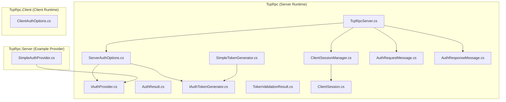
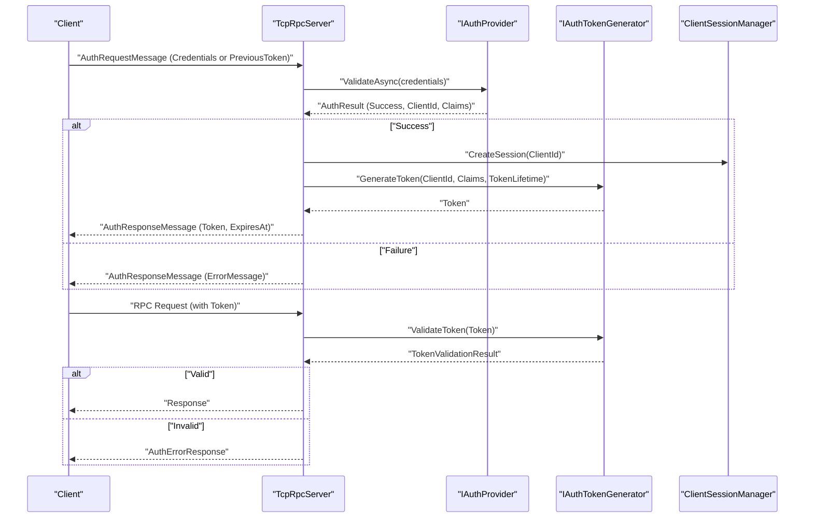
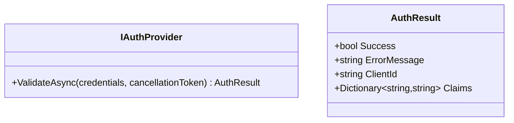
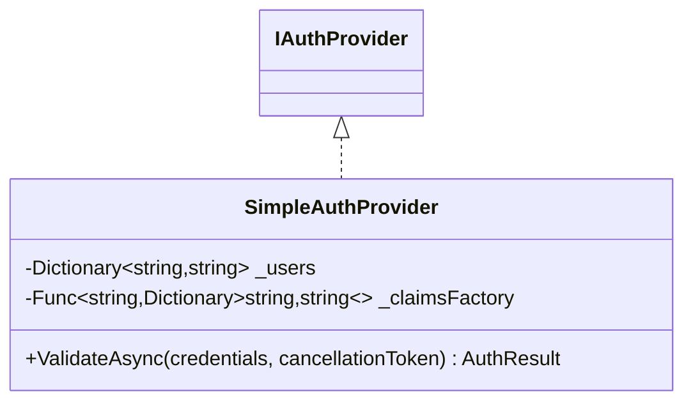
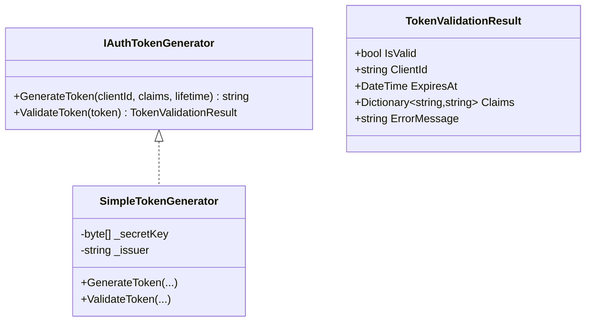
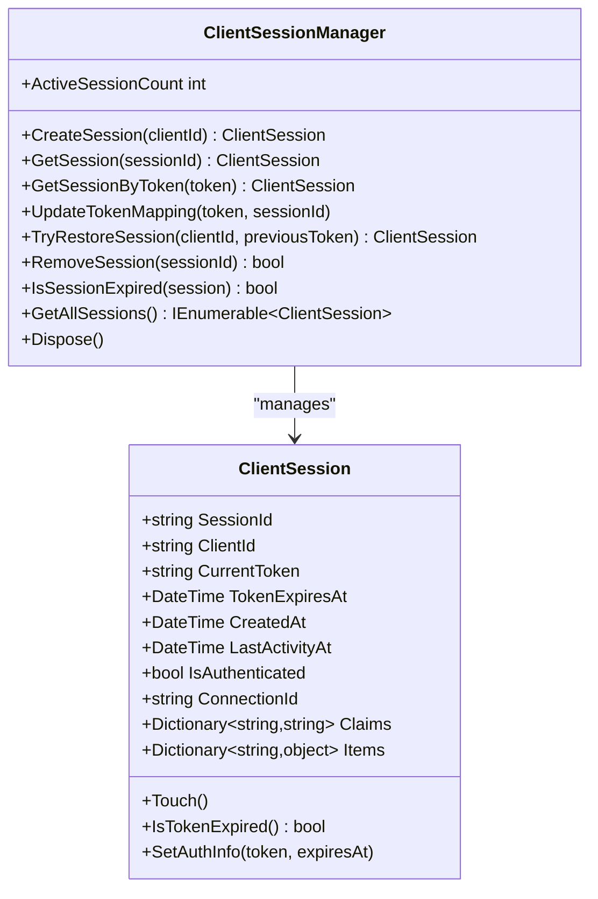
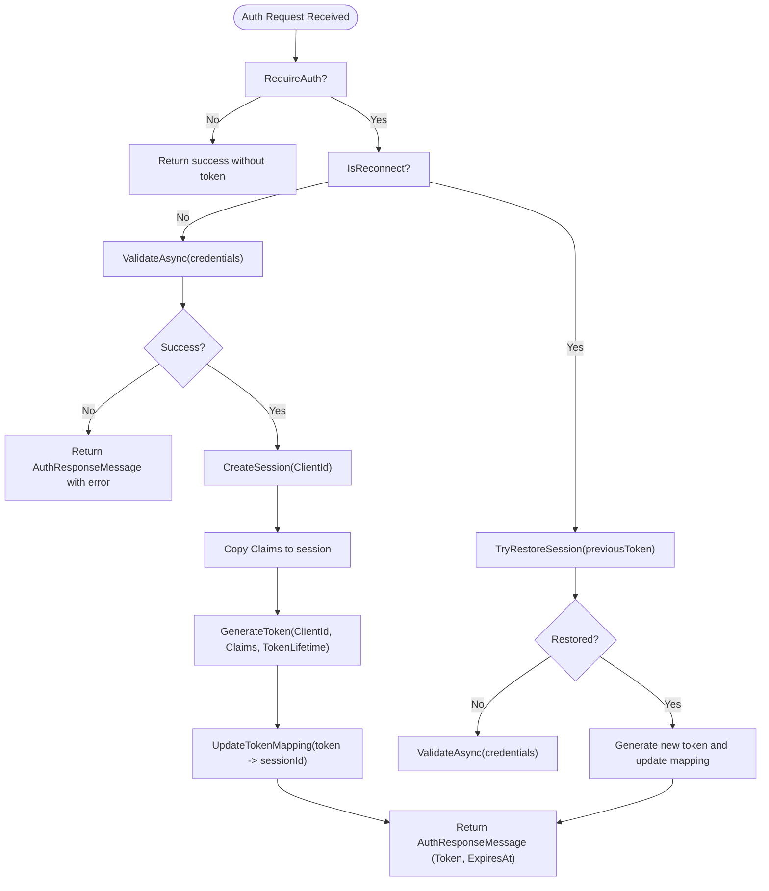
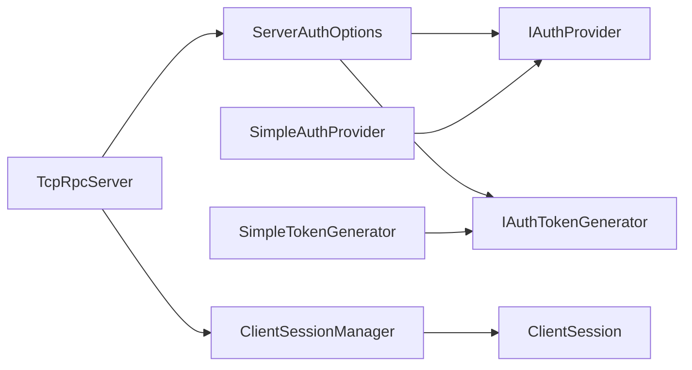

# Custom Authentication Providers

<cite>
**Referenced Files in This Document**
- [IAuthProvider.cs](file://TcpRpc/TcpRpc/Server/Auth/IAuthProvider.cs)
- [AuthResult.cs](file://TcpRpc/TcpRpc/Server/Auth/AuthResult.cs)
- [IAuthTokenGenerator.cs](file://TcpRpc/TcpRpc/Server/Auth/IAuthTokenGenerator.cs)
- [TokenValidationResult.cs](file://TcpRpc/TcpRpc/Server/Auth/TokenValidationResult.cs)
- [SimpleTokenGenerator.cs](file://TcpRpc/TcpRpc/Server/Auth/SimpleTokenGenerator.cs)
- [ClientSession.cs](file://TcpRpc/TcpRpc/Server/Auth/ClientSession.cs)
- [ClientSessionManager.cs](file://TcpRpc/TcpRpc/Server/Auth/ClientSessionManager.cs)
- [ServerAuthOptions.cs](file://TcpRpc/TcpRpc/Server/ServerAuthOptions.cs)
- [TcpRpcServer.cs](file://TcpRpc/TcpRpc/Server/TcpRpcServer.cs)
- [AuthRequestMessage.cs](file://TcpRpc/TcpRpc/Message/AuthRequestMessage.cs)
- [AuthResponseMessage.cs](file://TcpRpc/TcpRpc/Message/AuthResponseMessage.cs)
- [ClientAuthOptions.cs](file://TcpRpc/TcpRpc/Client/ClientAuthOptions.cs)
- [SimpleAuthProvider.cs](file://TcpRpc/TcpRpc.Server/SimpleAuthProvider.cs)
</cite>

## Table of Contents
1. [Introduction](#introduction)
2. [Project Structure](#project-structure)
3. [Core Components](#core-components)
4. [Architecture Overview](#architecture-overview)
5. [Detailed Component Analysis](#detailed-component-analysis)
6. [Dependency Analysis](#dependency-analysis)
7. [Performance Considerations](#performance-considerations)
8. [Troubleshooting Guide](#troubleshooting-guide)
9. [Conclusion](#conclusion)
10. [Appendices](#appendices)

## Introduction
This document explains how to implement custom authentication providers in TcpRpc. It covers the IAuthProvider interface contract, credential validation, user identity resolution, and integration with the server’s authentication pipeline. It also documents the SimpleAuthProvider example, the registration and DI configuration, and how authentication integrates with ClientSessionManager. Step-by-step examples show how to implement LDAP authentication, OAuth integration, and custom credential validation schemes. Additional topics include configuration options, error handling, logging, advanced scenarios (multi-factor, certificate-based, federated identity), performance and caching strategies, security best practices, and testing/debugging approaches.

## Project Structure
The authentication subsystem spans several assemblies:
- TcpRpc (server runtime): authentication interfaces, token generation/validation, session management, server orchestration, and message contracts.
- TcpRpc.Server (example provider): a built-in SimpleAuthProvider for reference.
- TcpRpc.Client (client runtime): client-side authentication options and message contracts.

**Diagram sources**
- [TcpRpcServer.cs](file://TcpRpc/TcpRpc/Server/TcpRpcServer.cs)
- [ServerAuthOptions.cs](file://TcpRpc/TcpRpc/Server/ServerAuthOptions.cs)
- [ClientSessionManager.cs](file://TcpRpc/TcpRpc/Server/Auth/ClientSessionManager.cs)
- [ClientSession.cs](file://TcpRpc/TcpRpc/Server/Auth/ClientSession.cs)
- [IAuthProvider.cs](file://TcpRpc/TcpRpc/Server/Auth/IAuthProvider.cs)
- [IAuthTokenGenerator.cs](file://TcpRpc/TcpRpc/Server/Auth/IAuthTokenGenerator.cs)
- [SimpleTokenGenerator.cs](file://TcpRpc/TcpRpc/Server/Auth/SimpleTokenGenerator.cs)
- [AuthRequestMessage.cs](file://TcpRpc/TcpRpc/Message/AuthRequestMessage.cs)
- [AuthResponseMessage.cs](file://TcpRpc/TcpRpc/Message/AuthResponseMessage.cs)
- [SimpleAuthProvider.cs](file://TcpRpc/TcpRpc.Server/SimpleAuthProvider.cs)
- [ClientAuthOptions.cs](file://TcpRpc/TcpRpc/Client/ClientAuthOptions.cs)

**Section sources**
- [TcpRpcServer.cs](file://TcpRpc/TcpRpc/Server/TcpRpcServer.cs)
- [ServerAuthOptions.cs](file://TcpRpc/TcpRpc/Server/ServerAuthOptions.cs)
- [ClientSessionManager.cs](file://TcpRpc/TcpRpc/Server/Auth/ClientSessionManager.cs)
- [ClientSession.cs](file://TcpRpc/TcpRpc/Server/Auth/ClientSession.cs)
- [IAuthProvider.cs](file://TcpRpc/TcpRpc/Server/Auth/IAuthProvider.cs)
- [IAuthTokenGenerator.cs](file://TcpRpc/TcpRpc/Server/Auth/IAuthTokenGenerator.cs)
- [SimpleTokenGenerator.cs](file://TcpRpc/TcpRpc/Server/Auth/SimpleTokenGenerator.cs)
- [AuthRequestMessage.cs](file://TcpRpc/TcpRpc/Message/AuthRequestMessage.cs)
- [AuthResponseMessage.cs](file://TcpRpc/TcpRpc/Message/AuthResponseMessage.cs)
- [SimpleAuthProvider.cs](file://TcpRpc/TcpRpc.Server/SimpleAuthProvider.cs)
- [ClientAuthOptions.cs](file://TcpRpc/TcpRpc/Client/ClientAuthOptions.cs)

## Core Components
- IAuthProvider: Validates client credentials and resolves ClientId and optional claims. Returns an AuthResult indicating success/failure, error message, ClientId, and Claims.
- AuthResult: Encapsulates authentication outcome and associated metadata.
- IAuthTokenGenerator and TokenValidationResult: Abstractions for JWT-like token generation and validation, including signature verification, expiration checks, and claim extraction.
- SimpleTokenGenerator: Reference implementation of a symmetric JWT generator/validator.
- ClientSession and ClientSessionManager: Track per-client sessions, tokens, activity timestamps, and support session restoration and cleanup.
- ServerAuthOptions: Holds configuration for RequireAuth, TokenLifetime, SessionTimeout, SessionCleanupInterval, AuthProvider, and TokenGenerator.
- TcpRpcServer: Orchestrates authentication lifecycle, handles AuthRequest/AuthResponse messages, validates tokens on requests, and manages sessions.
- AuthRequestMessage and AuthResponseMessage: Serialized contracts for authentication handshake.
- SimpleAuthProvider: Example provider validating username/password against an in-memory dictionary and optionally generating claims via a factory.

**Section sources**
- [IAuthProvider.cs](file://TcpRpc/TcpRpc/Server/Auth/IAuthProvider.cs)
- [AuthResult.cs](file://TcpRpc/TcpRpc/Server/Auth/AuthResult.cs)
- [IAuthTokenGenerator.cs](file://TcpRpc/TcpRpc/Server/Auth/IAuthTokenGenerator.cs)
- [TokenValidationResult.cs](file://TcpRpc/TcpRpc/Server/Auth/TokenValidationResult.cs)
- [SimpleTokenGenerator.cs](file://TcpRpc/TcpRpc/Server/Auth/SimpleTokenGenerator.cs)
- [ClientSession.cs](file://TcpRpc/TcpRpc/Server/Auth/ClientSession.cs)
- [ClientSessionManager.cs](file://TcpRpc/TcpRpc/Server/Auth/ClientSessionManager.cs)
- [ServerAuthOptions.cs](file://TcpRpc/TcpRpc/Server/ServerAuthOptions.cs)
- [TcpRpcServer.cs](file://TcpRpc/TcpRpc/Server/TcpRpcServer.cs)
- [AuthRequestMessage.cs](file://TcpRpc/TcpRpc/Message/AuthRequestMessage.cs)
- [AuthResponseMessage.cs](file://TcpRpc/TcpRpc/Message/AuthResponseMessage.cs)
- [SimpleAuthProvider.cs](file://TcpRpc/TcpRpc.Server/SimpleAuthProvider.cs)

## Architecture Overview
The authentication flow is request-driven and message-based:
- Clients send AuthRequestMessage with either Credentials (initial auth) or PreviousToken (reconnect).
- TcpRpcServer delegates to IAuthProvider to validate credentials and obtain ClientId and Claims.
- On success, a ClientSession is created, a token is generated by IAuthTokenGenerator, and an AuthResponseMessage is returned.
- Subsequent requests include the token in the message header; TcpRpcServer validates it before processing RPC requests.

**Diagram sources**
- [TcpRpcServer.cs](file://TcpRpc/TcpRpc/Server/TcpRpcServer.cs)
- [IAuthProvider.cs](file://TcpRpc/TcpRpc/Server/Auth/IAuthProvider.cs)
- [IAuthTokenGenerator.cs](file://TcpRpc/TcpRpc/Server/Auth/IAuthTokenGenerator.cs)
- [SimpleTokenGenerator.cs](file://TcpRpc/TcpRpc/Server/Auth/SimpleTokenGenerator.cs)
- [ClientSessionManager.cs](file://TcpRpc/TcpRpc/Server/Auth/ClientSessionManager.cs)
- [AuthRequestMessage.cs](file://TcpRpc/TcpRpc/Message/AuthRequestMessage.cs)
- [AuthResponseMessage.cs](file://TcpRpc/TcpRpc/Message/AuthResponseMessage.cs)

## Detailed Component Analysis

### IAuthProvider Contract and AuthResult
- Purpose: Validate incoming credentials and produce an AuthResult.
- Inputs: credentials dictionary (provider-specific keys).
- Outputs: AuthResult with Success, ErrorMessage, ClientId, and Claims.
- Implementation pattern: Guard against missing/invalid credentials, perform backend lookup/validation, and return appropriate results.

**Diagram sources**
- [IAuthProvider.cs](file://TcpRpc/TcpRpc/Server/Auth/IAuthProvider.cs)
- [AuthResult.cs](file://TcpRpc/TcpRpc/Server/Auth/AuthResult.cs)

**Section sources**
- [IAuthProvider.cs](file://TcpRpc/TcpRpc/Server/Auth/IAuthProvider.cs)
- [AuthResult.cs](file://TcpRpc/TcpRpc/Server/Auth/AuthResult.cs)

### SimpleAuthProvider Example
- Validates username/password from credentials.
- Supports optional claims factory to enrich AuthResult.Claims.
- Suitable as a template for building custom providers.

**Diagram sources**
- [SimpleAuthProvider.cs](file://TcpRpc/TcpRpc.Server/SimpleAuthProvider.cs)
- [IAuthProvider.cs](file://TcpRpc/TcpRpc/Server/Auth/IAuthProvider.cs)

**Section sources**
- [SimpleAuthProvider.cs](file://TcpRpc/TcpRpc.Server/SimpleAuthProvider.cs)

### Token Generation and Validation
- IAuthTokenGenerator defines GenerateToken and ValidateToken.
- SimpleTokenGenerator implements a compact JWT-like scheme with HS256 signature, issuer, issuance/expiry, and Base64Url encoding.
- TokenValidationResult carries validity, ClientId, ExpiresAt, Claims, and ErrorMessage.

**Diagram sources**
- [IAuthTokenGenerator.cs](file://TcpRpc/TcpRpc/Server/Auth/IAuthTokenGenerator.cs)
- [SimpleTokenGenerator.cs](file://TcpRpc/TcpRpc/Server/Auth/SimpleTokenGenerator.cs)
- [TokenValidationResult.cs](file://TcpRpc/TcpRpc/Server/Auth/TokenValidationResult.cs)

**Section sources**
- [IAuthTokenGenerator.cs](file://TcpRpc/TcpRpc/Server/Auth/IAuthTokenGenerator.cs)
- [SimpleTokenGenerator.cs](file://TcpRpc/TcpRpc/Server/Auth/SimpleTokenGenerator.cs)
- [TokenValidationResult.cs](file://TcpRpc/TcpRpc/Server/Auth/TokenValidationResult.cs)

### Session Management
- ClientSession tracks SessionId, ClientId, CurrentToken, TokenExpiresAt, timestamps, Claims, and Items.
- ClientSessionManager creates sessions, maps tokens to sessions, restores sessions on reconnect, cleans up expired sessions, and exposes metrics.

**Diagram sources**
- [ClientSession.cs](file://TcpRpc/TcpRpc/Server/Auth/ClientSession.cs)
- [ClientSessionManager.cs](file://TcpRpc/TcpRpc/Server/Auth/ClientSessionManager.cs)

**Section sources**
- [ClientSession.cs](file://TcpRpc/TcpRpc/Server/Auth/ClientSession.cs)
- [ClientSessionManager.cs](file://TcpRpc/TcpRpc/Server/Auth/ClientSessionManager.cs)

### Server Authentication Orchestration
- TcpRpcServer initializes ClientSessionManager and default token generator when authentication is enabled.
- Processes AuthRequestMessage via IAuthProvider, constructs ClientSession, generates token, and responds with AuthResponseMessage.
- On subsequent requests, validates token via IAuthTokenGenerator and updates session activity.

**Diagram sources**
- [TcpRpcServer.cs](file://TcpRpc/TcpRpc/Server/TcpRpcServer.cs)
- [ServerAuthOptions.cs](file://TcpRpc/TcpRpc/Server/ServerAuthOptions.cs)
- [ClientSessionManager.cs](file://TcpRpc/TcpRpc/Server/Auth/ClientSessionManager.cs)
- [IAuthProvider.cs](file://TcpRpc/TcpRpc/Server/Auth/IAuthProvider.cs)
- [IAuthTokenGenerator.cs](file://TcpRpc/TcpRpc/Server/Auth/IAuthTokenGenerator.cs)

**Section sources**
- [TcpRpcServer.cs](file://TcpRpc/TcpRpc/Server/TcpRpcServer.cs)
- [ServerAuthOptions.cs](file://TcpRpc/TcpRpc/Server/ServerAuthOptions.cs)
- [ClientSessionManager.cs](file://TcpRpc/TcpRpc/Server/Auth/ClientSessionManager.cs)
- [IAuthProvider.cs](file://TcpRpc/TcpRpc/Server/Auth/IAuthProvider.cs)
- [IAuthTokenGenerator.cs](file://TcpRpc/TcpRpc/Server/Auth/IAuthTokenGenerator.cs)

### Authentication Provider Registration and DI
- Configure ServerAuthOptions with:
  - RequireAuth: enable/disable authentication.
  - TokenLifetime: token validity period.
  - SessionTimeout and SessionCleanupInterval: session lifecycle.
  - AuthProvider: your IAuthProvider implementation.
  - TokenGenerator: IAuthTokenGenerator (defaults to SimpleTokenGenerator if not provided).
- TcpRpcServer reads ServerAuthOptions at startup to initialize session management and token generator.

Recommended DI registration pattern:
- Register your IAuthProvider implementation.
- Optionally register IAuthTokenGenerator (or rely on default).
- Build ServerAuthOptions and pass to TcpRpcServer constructor.

**Section sources**
- [ServerAuthOptions.cs](file://TcpRpc/TcpRpc/Server/ServerAuthOptions.cs)
- [TcpRpcServer.cs](file://TcpRpc/TcpRpc/Server/TcpRpcServer.cs)

### Client-Side Authentication Options
- ClientAuthOptions supports:
  - Credentials: dictionary passed to server as AuthRequestMessage.Credentials.
  - ClientId: used for reconnect and session restoration.
  - AutoReconnect and ReconnectPolicy: connection resilience.
  - ConnectTimeout and AuthTimeout: operational timeouts.

**Section sources**
- [ClientAuthOptions.cs](file://TcpRpc/TcpRpc/Client/ClientAuthOptions.cs)
- [AuthRequestMessage.cs](file://TcpRpc/TcpRpc/Message/AuthRequestMessage.cs)

## Dependency Analysis
- TcpRpcServer depends on ServerAuthOptions, IAuthProvider, IAuthTokenGenerator, and ClientSessionManager.
- ServerAuthOptions holds references to IAuthProvider and IAuthTokenGenerator.
- SimpleAuthProvider depends on IAuthProvider.
- SimpleTokenGenerator implements IAuthTokenGenerator.
- ClientSessionManager depends on ILoggerFactory and manages ClientSession instances.

**Diagram sources**
- [TcpRpcServer.cs](file://TcpRpc/TcpRpc/Server/TcpRpcServer.cs)
- [ServerAuthOptions.cs](file://TcpRpc/TcpRpc/Server/ServerAuthOptions.cs)
- [IAuthProvider.cs](file://TcpRpc/TcpRpc/Server/Auth/IAuthProvider.cs)
- [IAuthTokenGenerator.cs](file://TcpRpc/TcpRpc/Server/Auth/IAuthTokenGenerator.cs)
- [ClientSessionManager.cs](file://TcpRpc/TcpRpc/Server/Auth/ClientSessionManager.cs)
- [ClientSession.cs](file://TcpRpc/TcpRpc/Server/Auth/ClientSession.cs)
- [SimpleAuthProvider.cs](file://TcpRpc/TcpRpc.Server/SimpleAuthProvider.cs)
- [SimpleTokenGenerator.cs](file://TcpRpc/TcpRpc/Server/Auth/SimpleTokenGenerator.cs)

**Section sources**
- [TcpRpcServer.cs](file://TcpRpc/TcpRpc/Server/TcpRpcServer.cs)
- [ServerAuthOptions.cs](file://TcpRpc/TcpRpc/Server/ServerAuthOptions.cs)
- [IAuthProvider.cs](file://TcpRpc/TcpRpc/Server/Auth/IAuthProvider.cs)
- [IAuthTokenGenerator.cs](file://TcpRpc/TcpRpc/Server/Auth/IAuthTokenGenerator.cs)
- [ClientSessionManager.cs](file://TcpRpc/TcpRpc/Server/Auth/ClientSessionManager.cs)
- [ClientSession.cs](file://TcpRpc/TcpRpc/Server/Auth/ClientSession.cs)
- [SimpleAuthProvider.cs](file://TcpRpc/TcpRpc.Server/SimpleAuthProvider.cs)
- [SimpleTokenGenerator.cs](file://TcpRpc/TcpRpc/Server/Auth/SimpleTokenGenerator.cs)

## Performance Considerations
- Token generation and validation: Prefer efficient hashing and avoid unnecessary allocations. SimpleTokenGenerator uses HMACSHA256; keep secret keys sufficiently random and sized.
- Session management: Tune SessionTimeout and SessionCleanupInterval to balance memory usage and responsiveness.
- Credential validation: For external systems (LDAP/OAuth), cache validated identities with short TTLs to reduce latency and external load. Invalidate cache entries on logout or token refresh.
- Concurrency: ClientSessionManager uses concurrent collections; ensure AuthProvider operations remain fast and non-blocking.
- Logging overhead: Keep authentication logs at appropriate levels; excessive debug logs can impact throughput.

[No sources needed since this section provides general guidance]

## Troubleshooting Guide
Common issues and remedies:
- Authentication fails immediately:
  - Verify credentials dictionary keys match provider expectations.
  - Check AuthResult.ErrorMessage for explicit reasons.
- Token invalid or expired:
  - Confirm TokenLifetime and server time synchronization.
  - Validate signatures and payload parsing errors.
- Session restore fails:
  - Ensure PreviousToken matches stored mapping and ClientId matches.
  - Check session timeout and cleanup intervals.
- Logging:
  - TcpRpcServer and ClientSessionManager log warnings and errors during authentication and cleanup cycles.

**Section sources**
- [TcpRpcServer.cs](file://TcpRpc/TcpRpc/Server/TcpRpcServer.cs)
- [ClientSessionManager.cs](file://TcpRpc/TcpRpc/Server/Auth/ClientSessionManager.cs)
- [AuthResponseMessage.cs](file://TcpRpc/TcpRpc/Message/AuthResponseMessage.cs)

## Conclusion
TcpRpc’s authentication model centers on a clean IAuthProvider interface, flexible token generation/validation, and robust session management. By implementing IAuthProvider and integrating with ServerAuthOptions, you can plug in any credential validation scheme. The SimpleAuthProvider and SimpleTokenGenerator serve as practical references for building secure, performant, and maintainable authentication providers.

[No sources needed since this section summarizes without analyzing specific files]

## Appendices

### Step-by-Step: Implementing Custom Authentication Providers

- Implement IAuthProvider:
  - Define ValidateAsync to parse credentials and return AuthResult with Success, ClientId, and optional Claims.
  - Keep validation logic fast and resilient; avoid blocking calls.

- Register with ServerAuthOptions:
  - Set RequireAuth, TokenLifetime, SessionTimeout, SessionCleanupInterval.
  - Assign your IAuthProvider instance to AuthProvider.
  - Optionally set TokenGenerator; otherwise, TcpRpcServer initializes a default.

- Integrate with TcpRpcServer:
  - Pass ServerAuthOptions to TcpRpcServer constructor.
  - TcpRpcServer will initialize session manager and token generator automatically when RequireAuth is true.

- Client-side:
  - Populate ClientAuthOptions.Credentials with provider-specific key-value pairs.
  - Set ClientId for reconnect scenarios.
  - Use AutoReconnect and ReconnectPolicy for resilience.

**Section sources**
- [IAuthProvider.cs](file://TcpRpc/TcpRpc/Server/Auth/IAuthProvider.cs)
- [ServerAuthOptions.cs](file://TcpRpc/TcpRpc/Server/ServerAuthOptions.cs)
- [TcpRpcServer.cs](file://TcpRpc/TcpRpc/Server/TcpRpcServer.cs)
- [ClientAuthOptions.cs](file://TcpRpc/TcpRpc/Client/ClientAuthOptions.cs)

### Example Scenarios

- LDAP Authentication:
  - In ValidateAsync, read credentials (e.g., username, password).
  - Query LDAP directory synchronously or asynchronously; handle network exceptions.
  - On success, populate ClientId and Claims (e.g., roles, groups).
  - Consider caching validated users with TTL to reduce repeated LDAP calls.

- OAuth Integration:
  - Accept an OAuth token in credentials (e.g., access_token).
  - Validate the token with the OAuth provider’s introspection endpoint or local JWT validator.
  - Extract subject (sub) as ClientId and scopes/roles as Claims.
  - Enforce token expiration and revocation checks.

- Custom Credential Validation:
  - Define your own credential keys (e.g., api_key, nonce, timestamp).
  - Implement challenge-response or HMAC-based validation.
  - Return structured Claims for downstream authorization.

[No sources needed since this section provides conceptual guidance]

### Advanced Scenarios

- Multi-Factor Authentication (MFA):
  - Require primary credentials plus secondary factor (e.g., OTP).
  - Store factor state in ClientSession.Items or Claims.
  - Enforce factor completion before marking session authenticated.

- Certificate-Based Authentication:
  - Validate client certificates presented during TLS handshake.
  - Map certificate thumbprints or subject to ClientId.
  - Include certificate attributes in Claims for fine-grained policies.

- Federated Identity Management:
  - Delegate to an identity provider (e.g., SAML, OIDC).
  - Validate ID tokens and extract claims.
  - Maintain trust with the identity provider and enforce policy.

[No sources needed since this section provides conceptual guidance]

### Security Best Practices
- Credential handling:
  - Never log raw credentials.
  - Treat passwords and tokens as sensitive; clear memory after use.
- Token security:
  - Use strong, randomly generated secrets for signing.
  - Enforce HTTPS/TLS to protect tokens in transit.
  - Validate token expiration and issuer.
- Session hygiene:
  - Regularly clean up expired sessions.
  - Limit session lifetime and activity windows.
- Error handling:
  - Return generic error messages to clients; log detailed info securely.

[No sources needed since this section provides general guidance]

### Testing Approaches
- Unit tests for IAuthProvider:
  - Mock external dependencies (LDAP/OAuth).
  - Test success paths, missing credentials, invalid credentials, and error conditions.
- Integration tests:
  - Spin up TcpRpcServer with your provider and ServerAuthOptions.
  - Exercise AuthRequest/AuthResponse exchange and token validation on RPC requests.
- Load tests:
  - Measure authentication throughput under concurrency.
  - Validate cleanup and session limits.

[No sources needed since this section provides general guidance]

### Debugging Techniques
- Enable detailed logging for TcpRpcServer and ClientSessionManager.
- Inspect AuthResponseMessage.ErrorMessage for provider failures.
- Verify token format and claims using TokenValidationResult.
- Monitor ActiveSessionCount and cleanup logs for resource leaks.

**Section sources**
- [TcpRpcServer.cs](file://TcpRpc/TcpRpc/Server/TcpRpcServer.cs)
- [ClientSessionManager.cs](file://TcpRpc/TcpRpc/Server/Auth/ClientSessionManager.cs)
- [AuthResponseMessage.cs](file://TcpRpc/TcpRpc/Message/AuthResponseMessage.cs)
- [TokenValidationResult.cs](file://TcpRpc/TcpRpc/Server/Auth/TokenValidationResult.cs)