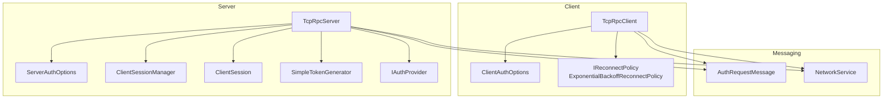
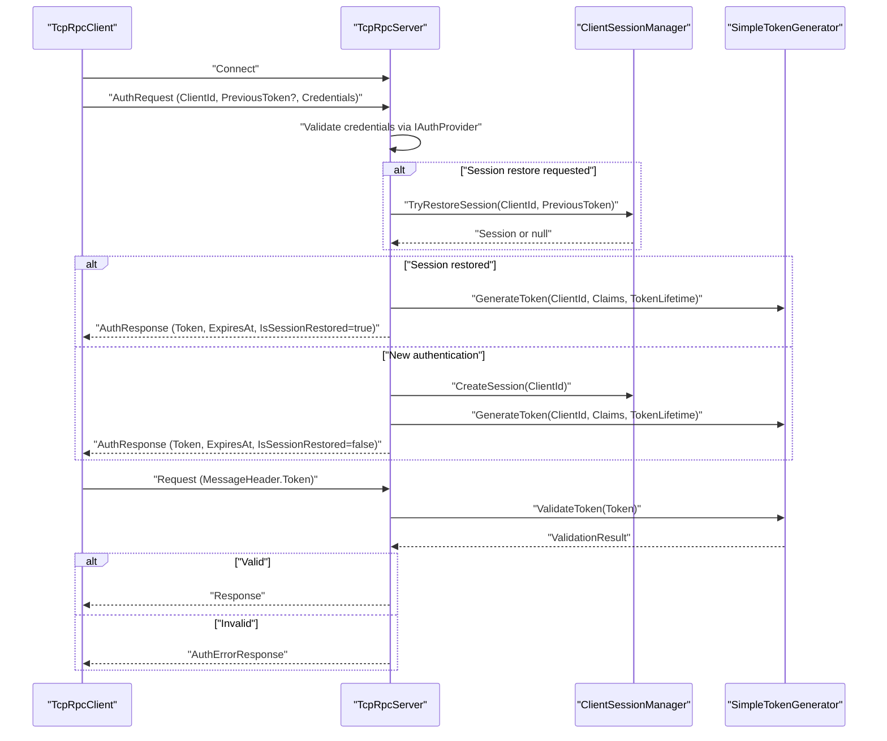
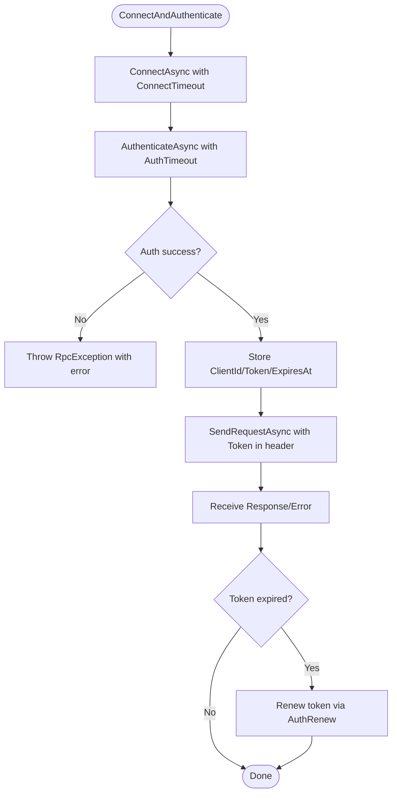
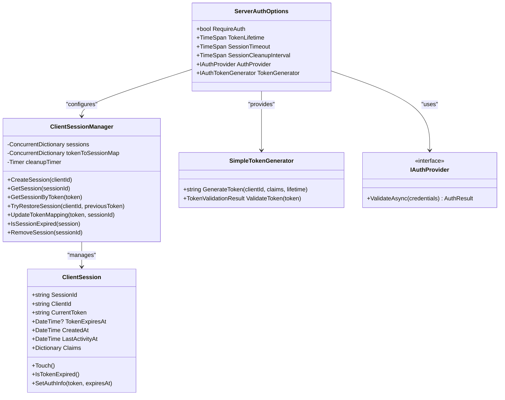
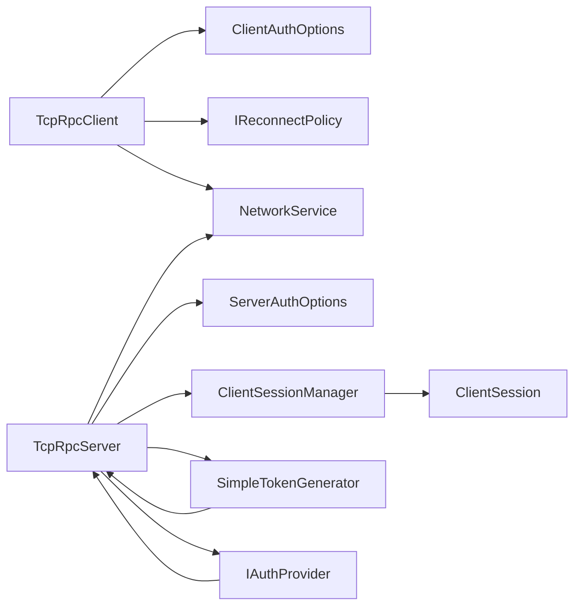

# Security Configuration & Best Practices

<cite>
**Referenced Files in This Document**
- [ClientAuthOptions.cs](file://TcpRpc/Client/ClientAuthOptions.cs)
- [ServerAuthOptions.cs](file://TcpRpc/Server/ServerAuthOptions.cs)
- [TcpRpcClient.cs](file://TcpRpc/Client/TcpRpcClient.cs)
- [TcpRpcServer.cs](file://TcpRpc/Server/TcpRpcServer.cs)
- [ClientSessionManager.cs](file://TcpRpc/Server/Auth/ClientSessionManager.cs)
- [ClientSession.cs](file://TcpRpc/Server/Auth/ClientSession.cs)
- [SimpleTokenGenerator.cs](file://TcpRpc/Server/Auth/SimpleTokenGenerator.cs)
- [IAuthProvider.cs](file://TcpRpc/Server/Auth/IAuthProvider.cs)
- [AuthRequestMessage.cs](file://TcpRpc/Message/AuthRequestMessage.cs)
- [NetworkService.cs](file://TcpRpc/Network/NetworkService.cs)
- [RpcException.cs](file://TcpRpc/RpcException.cs)
- [IReconnectPolicy.cs](file://TcpRpc/Client/IReconnectPolicy.cs)
- [SimpleAuthProvider.cs](file://TcpRpc.Server/SimpleAuthProvider.cs)
</cite>

## Table of Contents
1. [Introduction](#introduction)
2. [Project Structure](#project-structure)
3. [Core Components](#core-components)
4. [Architecture Overview](#architecture-overview)
5. [Detailed Component Analysis](#detailed-component-analysis)
6. [Dependency Analysis](#dependency-analysis)
7. [Performance Considerations](#performance-considerations)
8. [Troubleshooting Guide](#troubleshooting-guide)
9. [Conclusion](#conclusion)
10. [Appendices](#appendices)

## Introduction
This document provides comprehensive guidance for securing TcpRpc deployments. It focuses on authentication configuration, token lifecycle, session management, error handling, and operational best practices. It also covers production-grade recommendations for timeouts, retries, token expiration, secure transport, logging, monitoring, vulnerability mitigations, compliance, and incident response.

## Project Structure
TcpRpc organizes security-relevant code across client, server, authentication, messaging, and network layers. The client-side handles connection, authentication, token usage, and automatic reconnection. The server manages authentication providers, token generation/validation, session lifecycle, and per-request authorization checks.

**Diagram sources**
- [ClientAuthOptions.cs](file://TcpRpc/Client/ClientAuthOptions.cs)
- [TcpRpcClient.cs](file://TcpRpc/Client/TcpRpcClient.cs)
- [IReconnectPolicy.cs](file://TcpRpc/Client/IReconnectPolicy.cs)
- [ServerAuthOptions.cs](file://TcpRpc/Server/ServerAuthOptions.cs)
- [TcpRpcServer.cs](file://TcpRpc/Server/TcpRpcServer.cs)
- [ClientSessionManager.cs](file://TcpRpc/Server/Auth/ClientSessionManager.cs)
- [ClientSession.cs](file://TcpRpc/Server/Auth/ClientSession.cs)
- [SimpleTokenGenerator.cs](file://TcpRpc/Server/Auth/SimpleTokenGenerator.cs)
- [IAuthProvider.cs](file://TcpRpc/Server/Auth/IAuthProvider.cs)
- [AuthRequestMessage.cs](file://TcpRpc/Message/AuthRequestMessage.cs)
- [NetworkService.cs](file://TcpRpc/Network/NetworkService.cs)

**Section sources**
- [ClientAuthOptions.cs](file://TcpRpc/Client/ClientAuthOptions.cs)
- [ServerAuthOptions.cs](file://TcpRpc/Server/ServerAuthOptions.cs)
- [TcpRpcClient.cs](file://TcpRpc/Client/TcpRpcClient.cs)
- [TcpRpcServer.cs](file://TcpRpc/Server/TcpRpcServer.cs)
- [ClientSessionManager.cs](file://TcpRpc/Server/Auth/ClientSessionManager.cs)
- [ClientSession.cs](file://TcpRpc/Server/Auth/ClientSession.cs)
- [SimpleTokenGenerator.cs](file://TcpRpc/Server/Auth/SimpleTokenGenerator.cs)
- [IAuthProvider.cs](file://TcpRpc/Server/Auth/IAuthProvider.cs)
- [AuthRequestMessage.cs](file://TcpRpc/Message/AuthRequestMessage.cs)
- [NetworkService.cs](file://TcpRpc/Network/NetworkService.cs)

## Core Components
- ClientAuthOptions: Controls client-side authentication behavior, including timeouts, credentials, reconnect policy, and optional client identifier.
- ServerAuthOptions: Governs server-side authentication, token lifetime, session timeout/cleanup, and pluggable authentication provider/token generator.
- TcpRpcClient: Implements connection establishment, authentication handshake, token propagation, request sending, and automatic reconnection with retry policies.
- TcpRpcServer: Enforces authentication, validates tokens, manages sessions, and routes requests to handlers.
- ClientSessionManager and ClientSession: Track active sessions, activity-based expiration, token-to-session mapping, and restoration for reconnect scenarios.
- SimpleTokenGenerator: Generates and validates JWT-like tokens with HMAC signature verification and expiration checks.
- IAuthProvider: Pluggable authentication provider interface; SimpleAuthProvider demonstrates username/password validation with optional claims.
- NetworkService: Provides safe framing and streaming utilities for messages and headers.
- RpcException: Wraps server-side exceptions for clients, preserving remote type and stack trace metadata.

**Section sources**
- [ClientAuthOptions.cs](file://TcpRpc/Client/ClientAuthOptions.cs)
- [ServerAuthOptions.cs](file://TcpRpc/Server/ServerAuthOptions.cs)
- [TcpRpcClient.cs](file://TcpRpc/Client/TcpRpcClient.cs)
- [TcpRpcServer.cs](file://TcpRpc/Server/TcpRpcServer.cs)
- [ClientSessionManager.cs](file://TcpRpc/Server/Auth/ClientSessionManager.cs)
- [ClientSession.cs](file://TcpRpc/Server/Auth/ClientSession.cs)
- [SimpleTokenGenerator.cs](file://TcpRpc/Server/Auth/SimpleTokenGenerator.cs)
- [IAuthProvider.cs](file://TcpRpc/Server/Auth/IAuthProvider.cs)
- [NetworkService.cs](file://TcpRpc/Network/NetworkService.cs)
- [RpcException.cs](file://TcpRpc/RpcException.cs)

## Architecture Overview
The authentication flow integrates client and server components with explicit timeouts and robust error handling.

**Diagram sources**
- [TcpRpcClient.cs](file://TcpRpc/Client/TcpRpcClient.cs)
- [TcpRpcServer.cs](file://TcpRpc/Server/TcpRpcServer.cs)
- [ClientSessionManager.cs](file://TcpRpc/Server/Auth/ClientSessionManager.cs)
- [SimpleTokenGenerator.cs](file://TcpRpc/Server/Auth/SimpleTokenGenerator.cs)
- [AuthRequestMessage.cs](file://TcpRpc/Message/AuthRequestMessage.cs)

## Detailed Component Analysis

### Client Authentication Options
- AutoReconnect: Enables automatic reconnection on transient failures.
- ReconnectPolicy: Configurable exponential backoff or fixed delay policy with max attempts.
- Credentials: Dictionary of credential key-value pairs passed to the server’s IAuthProvider.
- ClientId: Optional client identifier used to resume sessions after reconnect.
- ConnectTimeout: Limits connection establishment duration.
- AuthTimeout: Limits authentication round-trip duration.

Operational implications:
- Short ConnectTimeout reduces slow-start risk but may fail on high-latency networks.
- AuthTimeout should exceed expected provider latency plus token generation overhead.
- ReconnectPolicy prevents thundering herd and conserves resources under sustained failure.

**Section sources**
- [ClientAuthOptions.cs](file://TcpRpc/Client/ClientAuthOptions.cs)
- [IReconnectPolicy.cs](file://TcpRpc/Client/IReconnectPolicy.cs)

### Server Authentication Options
- RequireAuth: Enables or disables authentication globally.
- TokenLifetime: Sets token validity window; controls how often clients must renew.
- SessionTimeout: Activity-based session expiration; triggers cleanup of idle sessions.
- SessionCleanupInterval: Frequency of periodic cleanup tasks.
- AuthProvider: Pluggable authentication provider implementing IAuthProvider.
- TokenGenerator: Pluggable token generator; defaults to SimpleTokenGenerator if not provided.

Operational implications:
- Short TokenLifetime improves security by limiting token exposure; increases renewal frequency.
- SessionTimeout protects against idle session hijacking.
- SessionCleanupInterval balances memory usage and cleanup overhead.

**Section sources**
- [ServerAuthOptions.cs](file://TcpRpc/Server/ServerAuthOptions.cs)
- [IAuthProvider.cs](file://TcpRpc/Server/Auth/IAuthProvider.cs)

### Client Authentication Workflow
- ConnectAsync uses ConnectTimeout to bound connection establishment.
- AuthenticateAsync sends an AuthRequestMessage with optional PreviousToken and Credentials; waits up to AuthTimeout for AuthResponse.
- On success, client stores ClientId, Token, and ExpiresAt.
- Requests include MessageHeader.Token for per-request authorization.
- Automatic reconnection uses configured IReconnectPolicy with bounded attempts.

**Diagram sources**
- [TcpRpcClient.cs](file://TcpRpc/Client/TcpRpcClient.cs)
- [AuthRequestMessage.cs](file://TcpRpc/Message/AuthRequestMessage.cs)

**Section sources**
- [TcpRpcClient.cs](file://TcpRpc/Client/TcpRpcClient.cs)
- [AuthRequestMessage.cs](file://TcpRpc/Message/AuthRequestMessage.cs)

### Server Authentication and Session Management
- TcpRpcServer initializes ClientSessionManager and SimpleTokenGenerator when authentication is enabled.
- ProcessAuthRequestAsync validates credentials, restores sessions when PreviousToken is present, creates sessions, generates tokens, and updates token-to-session mappings.
- Per-request authorization checks enforce authentication and validate tokens using TokenGenerator.ValidateToken.
- ClientSessionManager tracks activity, enforces SessionTimeout, and periodically cleans up expired sessions.

**Diagram sources**
- [ServerAuthOptions.cs](file://TcpRpc/Server/ServerAuthOptions.cs)
- [ClientSessionManager.cs](file://TcpRpc/Server/Auth/ClientSessionManager.cs)
- [ClientSession.cs](file://TcpRpc/Server/Auth/ClientSession.cs)
- [SimpleTokenGenerator.cs](file://TcpRpc/Server/Auth/SimpleTokenGenerator.cs)
- [IAuthProvider.cs](file://TcpRpc/Server/Auth/IAuthProvider.cs)

**Section sources**
- [TcpRpcServer.cs](file://TcpRpc/Server/TcpRpcServer.cs)
- [ClientSessionManager.cs](file://TcpRpc/Server/Auth/ClientSessionManager.cs)
- [ClientSession.cs](file://TcpRpc/Server/Auth/ClientSession.cs)
- [SimpleTokenGenerator.cs](file://TcpRpc/Server/Auth/SimpleTokenGenerator.cs)
- [IAuthProvider.cs](file://TcpRpc/Server/Auth/IAuthProvider.cs)

### Token Generation and Validation
- SimpleTokenGenerator produces a three-part token (header.payload.signature) using HMAC-SHA256.
- ValidateToken checks signature integrity, parses payload, verifies expiration, and extracts claims.
- Claims are stored in ClientSession and included in subsequent token generations.

Security considerations:
- Use a strong, random secret key for HMAC.
- Ensure token lifetime aligns with operational needs and threat model.
- Avoid leaking sensitive claims in logs.

**Section sources**
- [SimpleTokenGenerator.cs](file://TcpRpc/Server/Auth/SimpleTokenGenerator.cs)
- [ClientSession.cs](file://TcpRpc/Server/Auth/ClientSession.cs)

### Error Handling and RpcException
- TcpRpcClient throws RpcException on authentication failure with server-provided error details.
- TcpRpcServer wraps service exceptions into ResponseMessage with ExceptionType and StackTrace for clients.
- RpcException preserves RemoteExceptionType and RemoteStackTrace for accurate diagnostics.

Operational guidance:
- Log sanitized error messages at the server boundary.
- Avoid exposing internal stack traces to untrusted clients.
- Use structured logging with correlation IDs for tracing.

**Section sources**
- [TcpRpcClient.cs](file://TcpRpc/Client/TcpRpcClient.cs)
- [TcpRpcServer.cs](file://TcpRpc/Server/TcpRpcServer.cs)
- [RpcException.cs](file://TcpRpc/RpcException.cs)

### Secure Communication Channel Setup
- Transport security: Deploy TLS termination at the server boundary or use encrypted channels. While the current code operates over raw TCP streams, production deployments should enforce TLS.
- NetworkService framing: Validates header sizes and content lengths defensively; ensure upstream proxies and firewalls preserve message boundaries.
- Heartbeats: Ping/Pong support helps detect stale connections and enables timely reconnection.

**Section sources**
- [NetworkService.cs](file://TcpRpc/Network/NetworkService.cs)
- [TcpRpcClient.cs](file://TcpRpc/Client/TcpRpcClient.cs)
- [TcpRpcServer.cs](file://TcpRpc/Server/TcpRpcServer.cs)

## Dependency Analysis

**Diagram sources**
- [TcpRpcClient.cs](file://TcpRpc/Client/TcpRpcClient.cs)
- [ClientAuthOptions.cs](file://TcpRpc/Client/ClientAuthOptions.cs)
- [IReconnectPolicy.cs](file://TcpRpc/Client/IReconnectPolicy.cs)
- [NetworkService.cs](file://TcpRpc/Network/NetworkService.cs)
- [TcpRpcServer.cs](file://TcpRpc/Server/TcpRpcServer.cs)
- [ServerAuthOptions.cs](file://TcpRpc/Server/ServerAuthOptions.cs)
- [ClientSessionManager.cs](file://TcpRpc/Server/Auth/ClientSessionManager.cs)
- [ClientSession.cs](file://TcpRpc/Server/Auth/ClientSession.cs)
- [SimpleTokenGenerator.cs](file://TcpRpc/Server/Auth/SimpleTokenGenerator.cs)
- [IAuthProvider.cs](file://TcpRpc/Server/Auth/IAuthProvider.cs)

**Section sources**
- [TcpRpcClient.cs](file://TcpRpc/Client/TcpRpcClient.cs)
- [TcpRpcServer.cs](file://TcpRpc/Server/TcpRpcServer.cs)

## Performance Considerations
- Token lifetime vs. renewal overhead: Short lifetimes improve security but increase renewal traffic. Tune TokenLifetime to balance risk and performance.
- Session cleanup interval: Lower intervals reduce stale session accumulation but increase CPU usage.
- Reconnect backoff: Exponential backoff prevents network amplification during outages; cap MaxDelay to avoid long recovery times.
- Request timeouts: Align request timeouts with expected service latency and retry budgets.

[No sources needed since this section provides general guidance]

## Troubleshooting Guide
Common authentication failures and mitigations:
- Authentication timeout: Increase AuthTimeout on the client or optimize server-side provider latency.
- Invalid token errors: Verify token generation secrets, clock synchronization, and token expiration.
- Session restore failures: Ensure PreviousToken matches the original session and is not expired; confirm ClientId consistency.
- Connection loss leading to reconnection: Enable AutoReconnect and configure IReconnectPolicy with sensible MaxReconnectAttempts and delays.
- Unexpected disconnections: Use Ping/Pong to detect dead connections and trigger reconnection promptly.

**Section sources**
- [TcpRpcClient.cs](file://TcpRpc/Client/TcpRpcClient.cs)
- [TcpRpcServer.cs](file://TcpRpc/Server/TcpRpcServer.cs)
- [ClientSessionManager.cs](file://TcpRpc/Server/Auth/ClientSessionManager.cs)
- [SimpleTokenGenerator.cs](file://TcpRpc/Server/Auth/SimpleTokenGenerator.cs)

## Conclusion
TcpRpc provides a modular, extensible foundation for secure RPC communications. By tuning authentication options, enforcing strict session and token policies, and adopting robust error handling and logging, teams can achieve secure and resilient deployments. Production hardening should include transport encryption, continuous monitoring, and strict operational controls.

[No sources needed since this section summarizes without analyzing specific files]

## Appendices

### Recommended Production Security Configuration
- Transport security
  - Enforce TLS termination at the server boundary or deploy encrypted channels.
  - Use strong ciphers and modern TLS versions.
- Authentication and session
  - RequireAuth: true
  - TokenLifetime: 5–60 minutes depending on risk tolerance
  - SessionTimeout: 15–60 minutes
  - SessionCleanupInterval: 1–5 minutes
- Client behavior
  - ConnectTimeout: 10–30 seconds
  - AuthTimeout: 10–30 seconds
  - AutoReconnect: true
  - ReconnectPolicy: ExponentialBackoffReconnectPolicy with MaxReconnectAttempts ≥ 3 and reasonable MaxDelay
- Credential handling
  - Pass minimal credentials via Credentials dictionary keys.
  - Avoid storing secrets in plaintext; rotate keys regularly.
- Logging and auditing
  - Log authentication events (success/failure, session restore attempts).
  - Record token issuance/renewal and expiration.
  - Mask sensitive fields in logs; include correlation IDs for traceability.
- Monitoring and alerting
  - Track authentication failure rates, token renewal frequency, and session churn.
  - Alert on spikes in invalid token errors or session restore failures.
- Compliance and policy enforcement
  - Align token lifetimes and retention with organizational policies.
  - Integrate with enterprise identity providers via IAuthProvider implementations.
- Incident response
  - Procedures for compromised tokens: invalidate affected sessions, rotate secrets, and notify impacted clients.
  - Forensic analysis: collect logs around authentication events and token validation outcomes.

[No sources needed since this section provides general guidance]

### Security Assessment Checklist
- Authentication
  - RequireAuth enabled in production
  - Strong token secret rotation
  - Token lifetime appropriate for workload
  - Session timeout and cleanup configured
- Transport
  - TLS enforced
  - Strong cipher suites
  - Certificate management and revocation
- Resilience
  - Reconnect policy tuned
  - Timeouts validated under load
- Observability
  - Audit logs for auth events
  - Metrics on auth failures and renewals
- Vulnerabilities
  - Mitigations for replay, token theft, session fixation, and denial-of-service
  - Least privilege claims in tokens

[No sources needed since this section provides general guidance]

### Penetration Testing Recommendations
- Validate authentication bypasses via malformed tokens and missing tokens.
- Test session fixation by persisting PreviousToken across connections.
- Assess resilience under high failure rates and rapid reconnect loops.
- Evaluate token renewal flows and expiration handling.
- Verify that sensitive claims are not leaked in logs or error messages.

[No sources needed since this section provides general guidance]