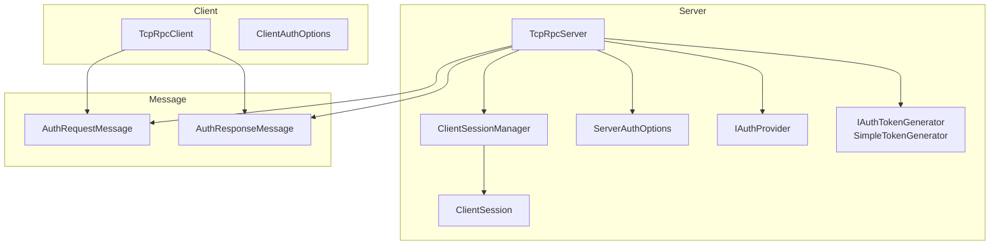
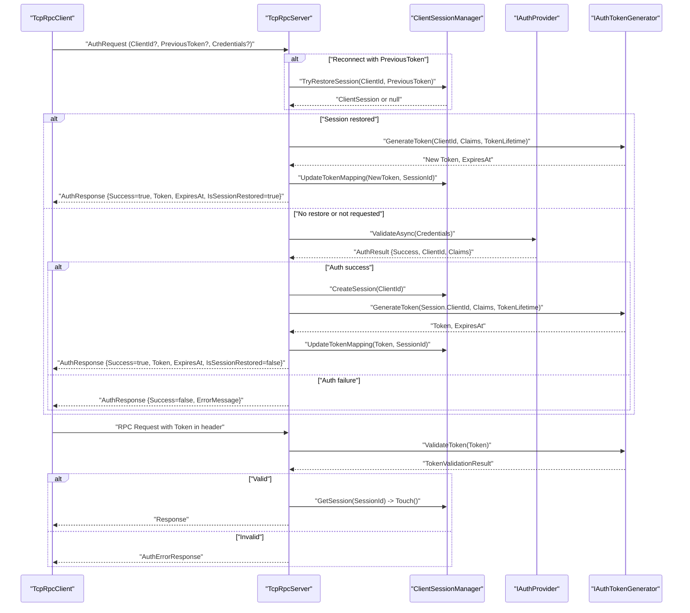
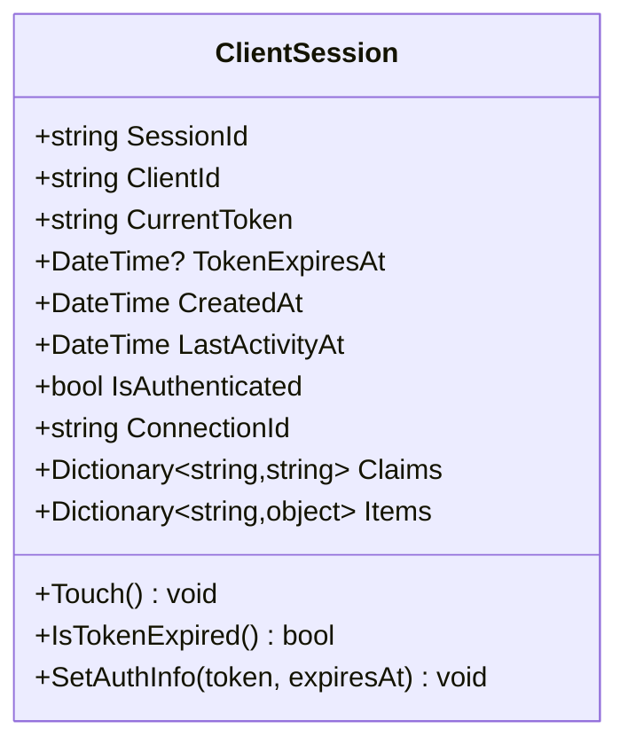
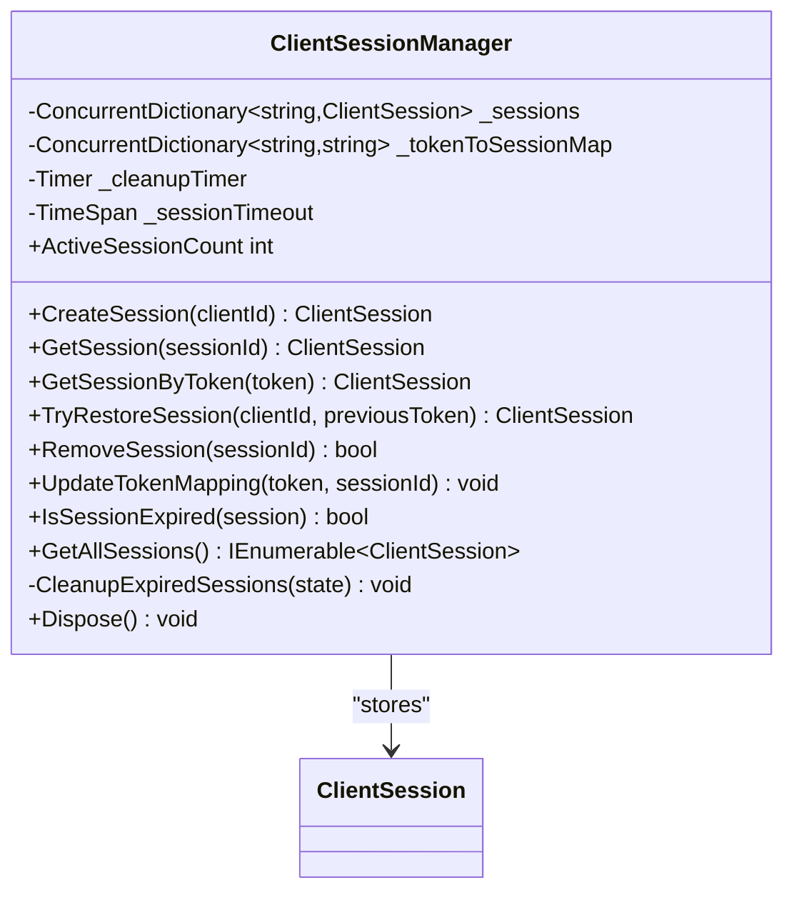
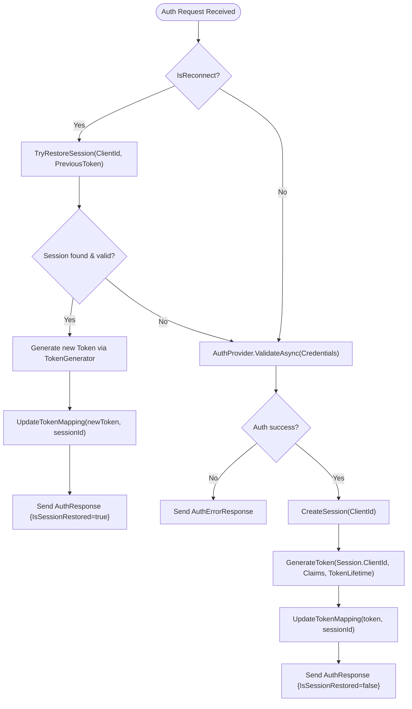
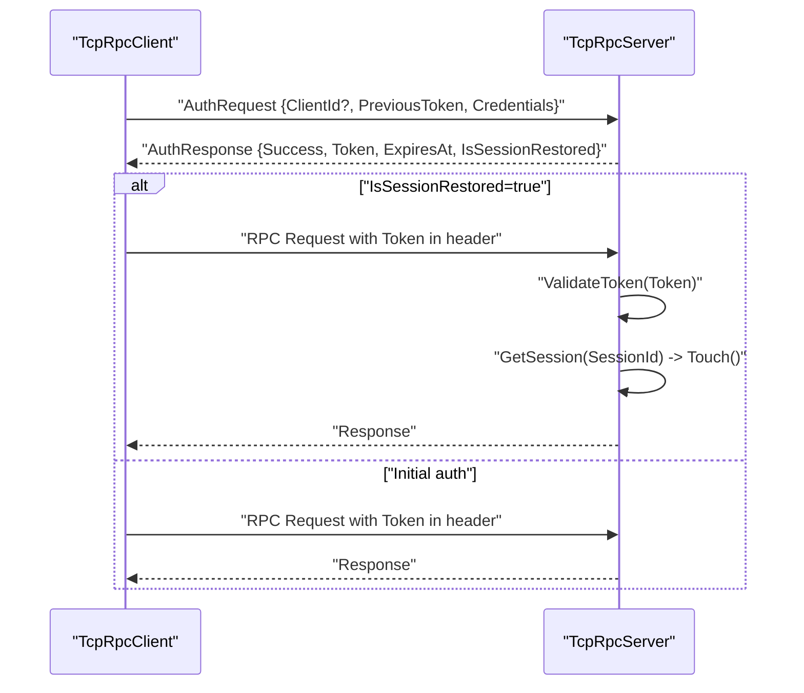
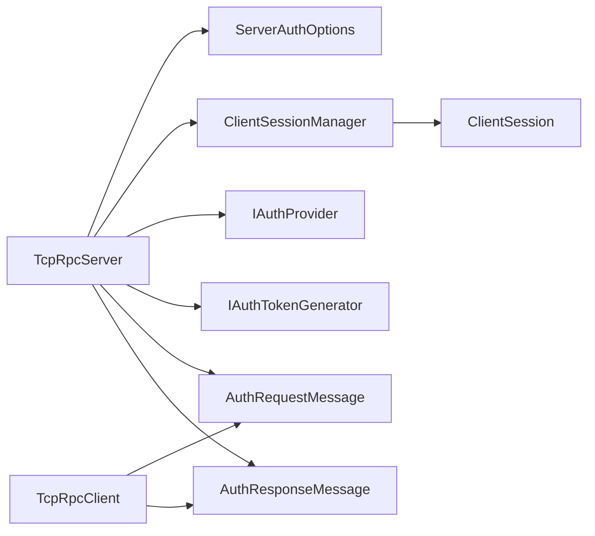

# Session Management

<cite>
**Referenced Files in This Document**
- [ClientSession.cs](file://TcpRpc/TcpRpc/Server/Auth/ClientSession.cs)
- [ClientSessionManager.cs](file://TcpRpc/TcpRpc/Server/Auth/ClientSessionManager.cs)
- [IAuthProvider.cs](file://TcpRpc/TcpRpc/Server/Auth/IAuthProvider.cs)
- [IAuthTokenGenerator.cs](file://TcpRpc/TcpRpc/Server/Auth/IAuthTokenGenerator.cs)
- [SimpleTokenGenerator.cs](file://TcpRpc/TcpRpc/Server/Auth/SimpleTokenGenerator.cs)
- [ServerAuthOptions.cs](file://TcpRpc/TcpRpc/Server/ServerAuthOptions.cs)
- [TcpRpcServer.cs](file://TcpRpc/TcpRpc/Server/TcpRpcServer.cs)
- [AuthRequestMessage.cs](file://TcpRpc/TcpRpc/Message/AuthRequestMessage.cs)
- [AuthResponseMessage.cs](file://TcpRpc/TcpRpc/Message/AuthResponseMessage.cs)
- [TcpRpcClient.cs](file://TcpRpc/TcpRpc/Client/TcpRpcClient.cs)
- [ClientAuthOptions.cs](file://TcpRpc/TcpRpc/Client/ClientAuthOptions.cs)
</cite>

## Table of Contents
1. [Introduction](#introduction)
2. [Project Structure](#project-structure)
3. [Core Components](#core-components)
4. [Architecture Overview](#architecture-overview)
5. [Detailed Component Analysis](#detailed-component-analysis)
6. [Dependency Analysis](#dependency-analysis)
7. [Performance Considerations](#performance-considerations)
8. [Troubleshooting Guide](#troubleshooting-guide)
9. [Conclusion](#conclusion)
10. [Appendices](#appendices)

## Introduction
This document explains the TcpRpc session management system with a focus on the server-side ClientSessionManager and ClientSession data model. It covers session lifecycle, creation, restoration for reconnect scenarios, timeouts, cleanup, concurrency, and integration with authentication. Practical examples are provided via code-path references to show how to create sessions, retrieve active sessions, handle session restoration, and manage expiration. Thread-safety, performance, memory management, and scalability considerations are also addressed.

## Project Structure
The session management spans several assemblies:
- Server/Auth: session model and manager, authentication provider and token generator interfaces
- Server: server orchestration, authentication options, and message processing
- Message: protocol messages exchanged during authentication and RPC requests
- Client: client-side authentication flow and reconnect logic

**Diagram sources**
- [TcpRpcServer.cs](file://TcpRpc/TcpRpc/Server/TcpRpcServer.cs)
- [ClientSessionManager.cs](file://TcpRpc/TcpRpc/Server/Auth/ClientSessionManager.cs)
- [ClientSession.cs](file://TcpRpc/TcpRpc/Server/Auth/ClientSession.cs)
- [ServerAuthOptions.cs](file://TcpRpc/TcpRpc/Server/ServerAuthOptions.cs)
- [IAuthProvider.cs](file://TcpRpc/TcpRpc/Server/Auth/IAuthProvider.cs)
- [IAuthTokenGenerator.cs](file://TcpRpc/TcpRpc/Server/Auth/IAuthTokenGenerator.cs)
- [SimpleTokenGenerator.cs](file://TcpRpc/TcpRpc/Server/Auth/SimpleTokenGenerator.cs)
- [AuthRequestMessage.cs](file://TcpRpc/TcpRpc/Message/AuthRequestMessage.cs)
- [AuthResponseMessage.cs](file://TcpRpc/TcpRpc/Message/AuthResponseMessage.cs)
- [TcpRpcClient.cs](file://TcpRpc/TcpRpc/Client/TcpRpcClient.cs)
- [ClientAuthOptions.cs](file://TcpRpc/TcpRpc/Client/ClientAuthOptions.cs)

**Section sources**
- [TcpRpcServer.cs](file://TcpRpc/TcpRpc/Server/TcpRpcServer.cs)
- [ClientSessionManager.cs](file://TcpRpc/TcpRpc/Server/Auth/ClientSessionManager.cs)
- [ClientSession.cs](file://TcpRpc/TcpRpc/Server/Auth/ClientSession.cs)
- [ServerAuthOptions.cs](file://TcpRpc/TcpRpc/Server/ServerAuthOptions.cs)
- [IAuthProvider.cs](file://TcpRpc/TcpRpc/Server/Auth/IAuthProvider.cs)
- [IAuthTokenGenerator.cs](file://TcpRpc/TcpRpc/Server/Auth/IAuthTokenGenerator.cs)
- [SimpleTokenGenerator.cs](file://TcpRpc/TcpRpc/Server/Auth/SimpleTokenGenerator.cs)
- [AuthRequestMessage.cs](file://TcpRpc/TcpRpc/Message/AuthRequestMessage.cs)
- [AuthResponseMessage.cs](file://TcpRpc/TcpRpc/Message/AuthResponseMessage.cs)
- [TcpRpcClient.cs](file://TcpRpc/TcpRpc/Client/TcpRpcClient.cs)
- [ClientAuthOptions.cs](file://TcpRpc/TcpRpc/Client/ClientAuthOptions.cs)

## Core Components
- ClientSession: immutable SessionId and ClientId, mutable CurrentToken and TokenExpiresAt, timestamps CreatedAt and LastActivityAt, Claims and Items dictionaries, IsAuthenticated flag, ConnectionId for reconnect matching, and helper methods Touch(), IsTokenExpired(), SetAuthInfo().
- ClientSessionManager: manages sessions in ConcurrentDictionary keyed by SessionId; maintains a secondary ConcurrentDictionary mapping tokens to session ids; exposes CreateSession, GetSession, GetSessionByToken, TryRestoreSession, RemoveSession, UpdateTokenMapping, IsSessionExpired, GetAllSessions, ActiveSessionCount, and periodic cleanup via Timer.

Key properties and behaviors:
- SessionId: globally unique identifier generated per session
- ClientId: identifies the client; used to match during session restoration
- CurrentToken and TokenExpiresAt: JWT-like token and expiration stored on session
- CreatedAt and LastActivityAt: timestamps for lifecycle and timeout calculations
- Touch(): updates LastActivityAt on each request to keep session alive
- IsTokenExpired(): checks token expiry against UTC time
- IsAuthenticated: convenience property indicating presence of CurrentToken
- Claims and Items: extensibility points for metadata and custom data

**Section sources**
- [ClientSession.cs](file://TcpRpc/TcpRpc/Server/Auth/ClientSession.cs)
- [ClientSessionManager.cs](file://TcpRpc/TcpRpc/Server/Auth/ClientSessionManager.cs)

## Architecture Overview
The server initializes authentication and session management when authentication is enabled. On each incoming request, the server validates authentication and updates session activity. Clients send AuthRequest messages with optional PreviousToken for reconnect scenarios. The server authenticates or restores sessions, generates tokens, and updates token-to-session mappings.

**Diagram sources**
- [TcpRpcServer.cs](file://TcpRpc/TcpRpc/Server/TcpRpcServer.cs)
- [ClientSessionManager.cs](file://TcpRpc/TcpRpc/Server/Auth/ClientSessionManager.cs)
- [ClientSession.cs](file://TcpRpc/TcpRpc/Server/Auth/ClientSession.cs)
- [IAuthProvider.cs](file://TcpRpc/TcpRpc/Server/Auth/IAuthProvider.cs)
- [IAuthTokenGenerator.cs](file://TcpRpc/TcpRpc/Server/Auth/IAuthTokenGenerator.cs)
- [SimpleTokenGenerator.cs](file://TcpRpc/TcpRpc/Server/Auth/SimpleTokenGenerator.cs)
- [AuthRequestMessage.cs](file://TcpRpc/TcpRpc/Message/AuthRequestMessage.cs)
- [AuthResponseMessage.cs](file://TcpRpc/TcpRpc/Message/AuthResponseMessage.cs)
- [TcpRpcClient.cs](file://TcpRpc/TcpRpc/Client/TcpRpcClient.cs)

## Detailed Component Analysis

### ClientSession Data Model
ClientSession encapsulates all session state and behavior:
- Immutable identifiers: SessionId, ClientId
- Authentication state: CurrentToken, TokenExpiresAt, IsAuthenticated
- Lifecycle timestamps: CreatedAt, LastActivityAt
- Extensibility: Claims dictionary for token claims, Items dictionary for runtime data
- Helper methods: Touch() updates LastActivityAt, IsTokenExpired() compares UTC time, SetAuthInfo() updates token and touches

**Diagram sources**
- [ClientSession.cs](file://TcpRpc/TcpRpc/Server/Auth/ClientSession.cs)

**Section sources**
- [ClientSession.cs](file://TcpRpc/TcpRpc/Server/Auth/ClientSession.cs)

### ClientSessionManager Implementation
Responsibilities:
- Concurrent session storage: ConcurrentDictionary<string, ClientSession> for O(1) average-time operations
- Token-to-session mapping: ConcurrentDictionary<string, string> for fast lookup by token
- Session lifecycle:
  - CreateSession(clientId): generates SessionId, creates ClientSession, stores it
  - GetSession(sessionId): retrieves and Touch() to refresh activity
  - GetSessionByToken(token): resolves sessionId via token map, then GetSession
  - TryRestoreSession(clientId, previousToken): validates token, matches ClientId, checks expiration, Touch() on success
  - RemoveSession(sessionId): removes session and cleans token mapping
  - UpdateTokenMapping(token, sessionId): removes old mapping for session’s current token, adds new mapping
- Expiration and cleanup:
  - IsSessionExpired(session): compares LastActivityAt with configured timeout
  - Periodic cleanup: Timer triggers CleanupExpiredSessions(interval), iterates values, removes expired sessions, logs counts
- Enumeration and metrics:
  - GetAllSessions(): returns snapshot of sessions
  - ActiveSessionCount: exposes current count

Thread-safety:
- Uses ConcurrentDictionary for session and token-to-session maps
- Touch() and GetSession() update LastActivityAt atomically
- Timer runs outside user-controlled code paths; exceptions are caught and logged

Practical examples (code-path references):
- Create a session: [CreateSession](file://TcpRpc/TcpRpc/Server/Auth/ClientSessionManager.cs)
- Retrieve a session and update activity: [GetSession](file://TcpRpc/TcpRpc/Server/Auth/ClientSessionManager.cs)
- Restore a session for reconnect: [TryRestoreSession](file://TcpRpc/TcpRpc/Server/Auth/ClientSessionManager.cs)
- Remove a session: [RemoveSession](file://TcpRpc/TcpRpc/Server/Auth/ClientSessionManager.cs)
- Enumerate active sessions: [GetAllSessions](file://TcpRpc/TcpRpc/Server/Auth/ClientSessionManager.cs)

**Diagram sources**
- [ClientSessionManager.cs](file://TcpRpc/TcpRpc/Server/Auth/ClientSessionManager.cs)
- [ClientSession.cs](file://TcpRpc/TcpRpc/Server/Auth/ClientSession.cs)

**Section sources**
- [ClientSessionManager.cs](file://TcpRpc/TcpRpc/Server/Auth/ClientSessionManager.cs)

### Authentication and Token Integration
- ServerAuthOptions configures RequireAuth, TokenLifetime, SessionTimeout, SessionCleanupInterval, AuthProvider, and TokenGenerator
- TcpRpcServer initializes ClientSessionManager when authentication is enabled and wires up token generation/validation
- AuthRequestMessage supports reconnect via PreviousToken and carries Credentials for initial auth
- AuthResponseMessage returns Token, ExpiresAt, ClientId, and IsSessionRestored flag
- SimpleTokenGenerator implements JWT-like signing and validation with Base64Url encoding and HMAC-SHA256

**Diagram sources**
- [ServerAuthOptions.cs](file://TcpRpc/TcpRpc/Server/ServerAuthOptions.cs)
- [TcpRpcServer.cs](file://TcpRpc/TcpRpc/Server/TcpRpcServer.cs)
- [ClientSessionManager.cs](file://TcpRpc/TcpRpc/Server/Auth/ClientSessionManager.cs)
- [AuthRequestMessage.cs](file://TcpRpc/TcpRpc/Message/AuthRequestMessage.cs)
- [AuthResponseMessage.cs](file://TcpRpc/TcpRpc/Message/AuthResponseMessage.cs)
- [IAuthProvider.cs](file://TcpRpc/TcpRpc/Server/Auth/IAuthProvider.cs)
- [IAuthTokenGenerator.cs](file://TcpRpc/TcpRpc/Server/Auth/IAuthTokenGenerator.cs)
- [SimpleTokenGenerator.cs](file://TcpRpc/TcpRpc/Server/Auth/SimpleTokenGenerator.cs)

**Section sources**
- [ServerAuthOptions.cs](file://TcpRpc/TcpRpc/Server/ServerAuthOptions.cs)
- [TcpRpcServer.cs](file://TcpRpc/TcpRpc/Server/TcpRpcServer.cs)
- [AuthRequestMessage.cs](file://TcpRpc/TcpRpc/Message/AuthRequestMessage.cs)
- [AuthResponseMessage.cs](file://TcpRpc/TcpRpc/Message/AuthResponseMessage.cs)
- [IAuthProvider.cs](file://TcpRpc/TcpRpc/Server/Auth/IAuthProvider.cs)
- [IAuthTokenGenerator.cs](file://TcpRpc/TcpRpc/Server/Auth/IAuthTokenGenerator.cs)
- [SimpleTokenGenerator.cs](file://TcpRpc/TcpRpc/Server/Auth/SimpleTokenGenerator.cs)

### Client-Side Session Restoration and Reconnect
- TcpRpcClient sends AuthRequest with PreviousToken when reconnecting
- On successful authentication, it stores ClientId, Token, and ExpiresAt
- On reconnect, it sets MessageHeader.Token on subsequent RPC requests
- Automatic reconnection policy and exponential backoff are supported via ClientAuthOptions and IReconnectPolicy

**Diagram sources**
- [TcpRpcClient.cs](file://TcpRpc/TcpRpc/Client/TcpRpcClient.cs)
- [AuthRequestMessage.cs](file://TcpRpc/TcpRpc/Message/AuthRequestMessage.cs)
- [AuthResponseMessage.cs](file://TcpRpc/TcpRpc/Message/AuthResponseMessage.cs)
- [TcpRpcServer.cs](file://TcpRpc/TcpRpc/Server/TcpRpcServer.cs)

**Section sources**
- [TcpRpcClient.cs](file://TcpRpc/TcpRpc/Client/TcpRpcClient.cs)
- [ClientAuthOptions.cs](file://TcpRpc/TcpRpc/Client/ClientAuthOptions.cs)
- [AuthRequestMessage.cs](file://TcpRpc/TcpRpc/Message/AuthRequestMessage.cs)
- [AuthResponseMessage.cs](file://TcpRpc/TcpRpc/Message/AuthResponseMessage.cs)
- [TcpRpcServer.cs](file://TcpRpc/TcpRpc/Server/TcpRpcServer.cs)

## Dependency Analysis
- TcpRpcServer depends on ServerAuthOptions, ClientSessionManager, IAuthProvider, and IAuthTokenGenerator
- ClientSessionManager depends on ClientSession and uses ConcurrentDictionary and Timer
- AuthRequestMessage and AuthResponseMessage define the wire protocol for authentication
- TcpRpcClient depends on ClientAuthOptions and uses AuthRequest/AuthResponse messages and token propagation

**Diagram sources**
- [TcpRpcServer.cs](file://TcpRpc/TcpRpc/Server/TcpRpcServer.cs)
- [ClientSessionManager.cs](file://TcpRpc/TcpRpc/Server/Auth/ClientSessionManager.cs)
- [ClientSession.cs](file://TcpRpc/TcpRpc/Server/Auth/ClientSession.cs)
- [ServerAuthOptions.cs](file://TcpRpc/TcpRpc/Server/ServerAuthOptions.cs)
- [IAuthProvider.cs](file://TcpRpc/TcpRpc/Server/Auth/IAuthProvider.cs)
- [IAuthTokenGenerator.cs](file://TcpRpc/TcpRpc/Server/Auth/IAuthTokenGenerator.cs)
- [AuthRequestMessage.cs](file://TcpRpc/TcpRpc/Message/AuthRequestMessage.cs)
- [AuthResponseMessage.cs](file://TcpRpc/TcpRpc/Message/AuthResponseMessage.cs)
- [TcpRpcClient.cs](file://TcpRpc/TcpRpc/Client/TcpRpcClient.cs)
- [ClientAuthOptions.cs](file://TcpRpc/TcpRpc/Client/ClientAuthOptions.cs)

**Section sources**
- [TcpRpcServer.cs](file://TcpRpc/TcpRpc/Server/TcpRpcServer.cs)
- [ClientSessionManager.cs](file://TcpRpc/TcpRpc/Server/Auth/ClientSessionManager.cs)
- [ClientSession.cs](file://TcpRpc/TcpRpc/Server/Auth/ClientSession.cs)
- [ServerAuthOptions.cs](file://TcpRpc/TcpRpc/Server/ServerAuthOptions.cs)
- [IAuthProvider.cs](file://TcpRpc/TcpRpc/Server/Auth/IAuthProvider.cs)
- [IAuthTokenGenerator.cs](file://TcpRpc/TcpRpc/Server/Auth/IAuthTokenGenerator.cs)
- [AuthRequestMessage.cs](file://TcpRpc/TcpRpc/Message/AuthRequestMessage.cs)
- [AuthResponseMessage.cs](file://TcpRpc/TcpRpc/Message/AuthResponseMessage.cs)
- [TcpRpcClient.cs](file://TcpRpc/TcpRpc/Client/TcpRpcClient.cs)
- [ClientAuthOptions.cs](file://TcpRpc/TcpRpc/Client/ClientAuthOptions.cs)

## Performance Considerations
- Storage complexity:
  - ConcurrentDictionary operations for session and token maps are O(1) average-case
  - GetAllSessions() returns a snapshot by converting to List, which is O(n)
- Cleanup overhead:
  - CleanupExpiredSessions enumerates sessions and removes expired ones; frequency controlled by SessionCleanupInterval
  - Logging inside cleanup scales with number of expired sessions
- Memory management:
  - Sessions hold Claims and Items dictionaries; avoid storing large objects to prevent memory pressure
  - Cleanup removes expired sessions; ensure cleanup interval aligns with expected session churn
- Concurrency:
  - Touch() updates LastActivityAt under concurrent access; ConcurrentDictionary ensures thread-safe storage
  - Timer-based cleanup avoids blocking user operations; exceptions are caught and logged
- Token validation cost:
  - SimpleTokenGenerator performs signature verification and payload parsing; keep TokenLifetime reasonable to minimize renewal traffic

[No sources needed since this section provides general guidance]

## Troubleshooting Guide
Common issues and diagnostics:
- Session not found during restore:
  - Verify PreviousToken is present and valid
  - Confirm ClientId matches between request and stored session
  - Check IsSessionExpired() logic and SessionTimeout configuration
  - See [TryRestoreSession](file://TcpRpc/TcpRpc/Server/Auth/ClientSessionManager.cs)
- Authentication failures:
  - Validate credentials via IAuthProvider
  - Ensure TokenLifetime and TokenGenerator are configured correctly
  - See [ProcessAuthRequestAsync](file://TcpRpc/TcpRpc/Server/TcpRpcServer.cs)
- Token validation errors:
  - Check signature and expiration in SimpleTokenGenerator
  - See [ValidateToken](file://TcpRpc/TcpRpc/Server/Auth/SimpleTokenGenerator.cs)
- Cleanup anomalies:
  - Review cleanup timer interval and logging
  - See [CleanupExpiredSessions](file://TcpRpc/TcpRpc/Server/Auth/ClientSessionManager.cs)
- Client reconnect behavior:
  - Ensure ClientAuthOptions.AutoReconnect and ReconnectPolicy are configured
  - See [TcpRpcClient.cs](file://TcpRpc/TcpRpc/Client/TcpRpcClient.cs)

**Section sources**
- [ClientSessionManager.cs](file://TcpRpc/TcpRpc/Server/Auth/ClientSessionManager.cs)
- [TcpRpcServer.cs](file://TcpRpc/TcpRpc/Server/TcpRpcServer.cs)
- [SimpleTokenGenerator.cs](file://TcpRpc/TcpRpc/Server/Auth/SimpleTokenGenerator.cs)
- [TcpRpcClient.cs](file://TcpRpc/TcpRpc/Client/TcpRpcClient.cs)

## Conclusion
The TcpRpc session management system provides a robust, concurrent, and extensible foundation for client sessions with strong defaults. ClientSessionManager offers efficient storage, automatic cleanup, and seamless integration with authentication and token lifecycles. The design supports reconnect scenarios, activity-based timeouts, and scalable operation through concurrent collections and periodic maintenance.

[No sources needed since this section summarizes without analyzing specific files]

## Appendices

### Configuration Reference
- ServerAuthOptions:
  - RequireAuth: enable/disable authentication
  - TokenLifetime: validity window for tokens
  - SessionTimeout: inactivity threshold for session expiration
  - SessionCleanupInterval: frequency of cleanup cycles
  - AuthProvider: credential validator
  - TokenGenerator: token creation and validation
- ClientAuthOptions:
  - AutoReconnect: enable automatic reconnection
  - ReconnectPolicy: retry strategy
  - Credentials: initial auth credentials
  - ClientId: persistent client identity for reconnect
  - ConnectTimeout and AuthTimeout: operational timeouts

**Section sources**
- [ServerAuthOptions.cs](file://TcpRpc/TcpRpc/Server/ServerAuthOptions.cs)
- [ClientAuthOptions.cs](file://TcpRpc/TcpRpc/Client/ClientAuthOptions.cs)

### Practical Examples (Code Paths)
- Create a session:
  - [CreateSession](file://TcpRpc/TcpRpc/Server/Auth/ClientSessionManager.cs)
- Retrieve active sessions:
  - [GetAllSessions](file://TcpRpc/TcpRpc/Server/Auth/ClientSessionManager.cs)
- Handle session restoration for reconnect:
  - [TryRestoreSession](file://TcpRpc/TcpRpc/Server/Auth/ClientSessionManager.cs)
  - [ProcessAuthRequestAsync](file://TcpRpc/TcpRpc/Server/TcpRpcServer.cs)
- Manage session expiration:
  - [IsSessionExpired](file://TcpRpc/TcpRpc/Server/Auth/ClientSessionManager.cs)
  - [CleanupExpiredSessions](file://TcpRpc/TcpRpc/Server/Auth/ClientSessionManager.cs)
- Activity tracking ("touch"):
  - [Touch](file://TcpRpc/TcpRpc/Server/Auth/ClientSession.cs)
  - [GetSession](file://TcpRpc/TcpRpc/Server/Auth/ClientSessionManager.cs)
- Integration with authentication flow:
  - [AuthRequestMessage](file://TcpRpc/TcpRpc/Message/AuthRequestMessage.cs)
  - [AuthResponseMessage](file://TcpRpc/TcpRpc/Message/AuthResponseMessage.cs)
  - [IAuthProvider](file://TcpRpc/TcpRpc/Server/Auth/IAuthProvider.cs)
  - [IAuthTokenGenerator](file://TcpRpc/TcpRpc/Server/Auth/IAuthTokenGenerator.cs)
  - [SimpleTokenGenerator](file://TcpRpc/TcpRpc/Server/Auth/SimpleTokenGenerator.cs)