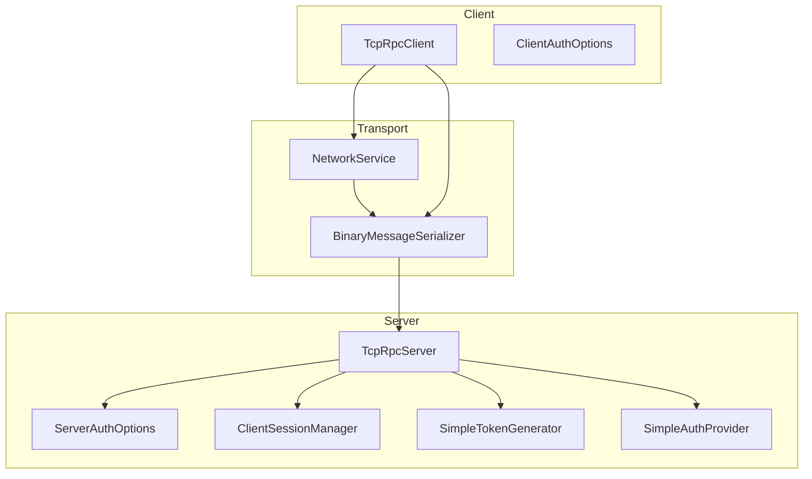
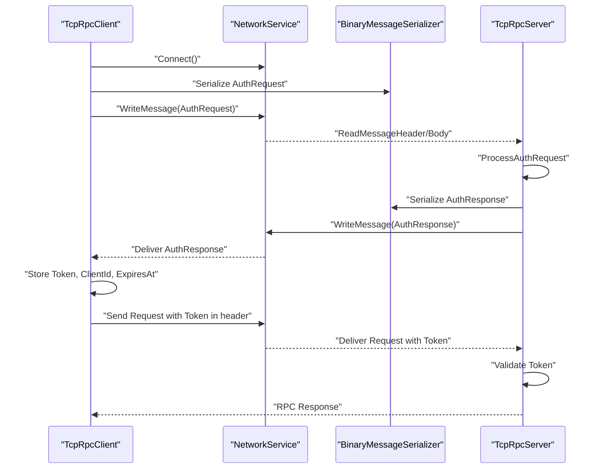
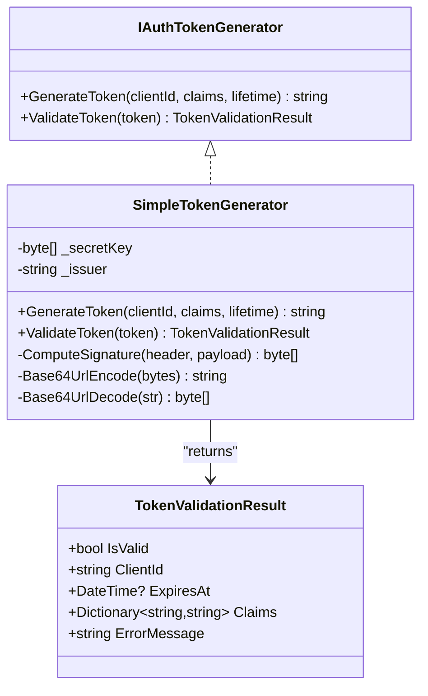
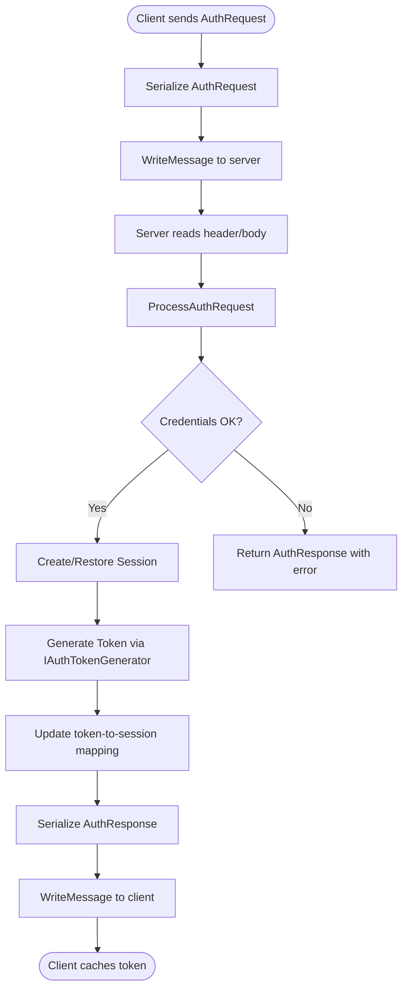
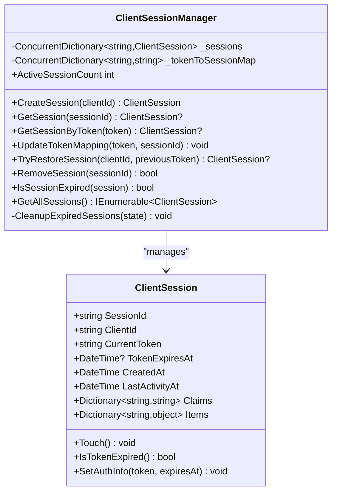
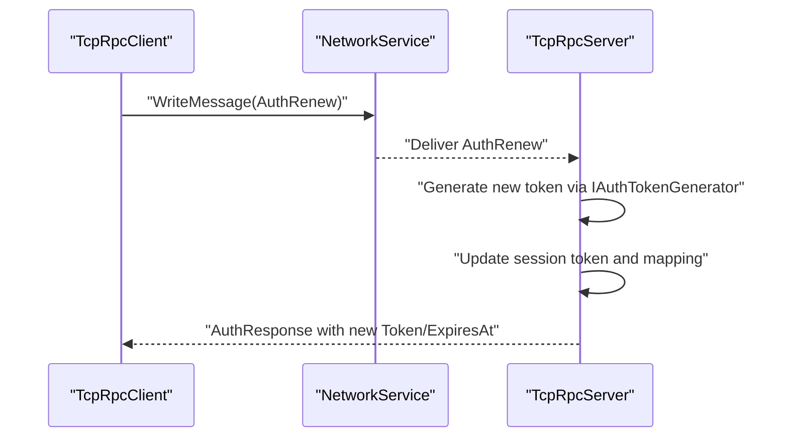
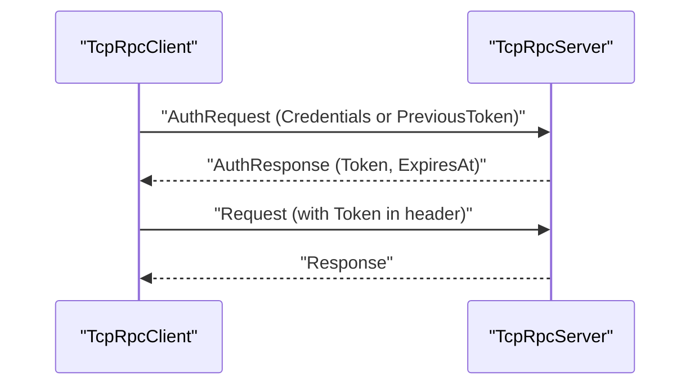
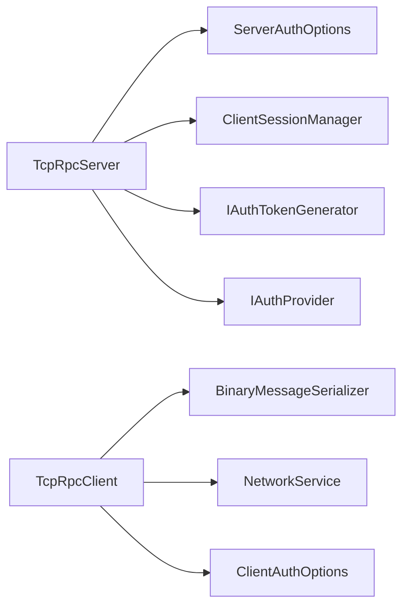

# Token-Based Authentication

<cite>
**Referenced Files in This Document**
- [IAuthTokenGenerator.cs](file://TcpRpc/TcpRpc/Server/Auth/IAuthTokenGenerator.cs)
- [SimpleTokenGenerator.cs](file://TcpRpc/TcpRpc/Server/Auth/SimpleTokenGenerator.cs)
- [AuthRequestMessage.cs](file://TcpRpc/TcpRpc/Message/AuthRequestMessage.cs)
- [AuthResponseMessage.cs](file://TcpRpc/TcpRpc/Message/AuthResponseMessage.cs)
- [ClientSession.cs](file://TcpRpc/TcpRpc/Server/Auth/ClientSession.cs)
- [ClientSessionManager.cs](file://TcpRpc/TcpRpc/Server/Auth/ClientSessionManager.cs)
- [IAuthProvider.cs](file://TcpRpc/TcpRpc/Server/Auth/IAuthProvider.cs)
- [ServerAuthOptions.cs](file://TcpRpc/TcpRpc/Server/ServerAuthOptions.cs)
- [TcpRpcServer.cs](file://TcpRpc/TcpRpc/Server/TcpRpcServer.cs)
- [TcpRpcClient.cs](file://TcpRpc/TcpRpc/Client/TcpRpcClient.cs)
- [BinaryMessageSerializer.cs](file://TcpRpc/TcpRpc/Formatter/BinaryMessageSerializer.cs)
- [NetworkService.cs](file://TcpRpc/TcpRpc/Network/NetworkService.cs)
- [SimpleAuthProvider.cs](file://TcpRpc/TcpRpc.Server/SimpleAuthProvider.cs)
</cite>

## Table of Contents
1. [Introduction](#introduction)
2. [Project Structure](#project-structure)
3. [Core Components](#core-components)
4. [Architecture Overview](#architecture-overview)
5. [Detailed Component Analysis](#detailed-component-analysis)
6. [Dependency Analysis](#dependency-analysis)
7. [Performance Considerations](#performance-considerations)
8. [Security Considerations](#security-considerations)
9. [Troubleshooting Guide](#troubleshooting-guide)
10. [Conclusion](#conclusion)

## Introduction
This document explains the token-based authentication system used by the TcpRpc framework. It covers the end-to-end authentication flow from initial connection through token validation and session establishment, details the token generator interface and its HMAC-based implementation, describes the authentication message formats and transport protocol, and documents token lifecycle management including renewal and cleanup. Security aspects such as token expiration, replay protection, and secure storage recommendations are included, along with guidance on token rotation, multi-device session management, and integration with external identity providers.

## Project Structure
The authentication system spans client and server components:
- Client-side: TcpRpcClient manages connection, authentication, token caching, and request sending with token inclusion.
- Server-side: TcpRpcServer handles incoming connections, authenticates clients, validates tokens, manages sessions, and supports token renewal.
- Shared messaging: AuthRequestMessage and AuthResponseMessage define the authentication protocol.
- Token generation: IAuthTokenGenerator and SimpleTokenGenerator implement JWT-like tokens with HMAC signatures.
- Session management: ClientSession and ClientSessionManager track active sessions and maintain token-to-session mappings.
- Serialization and transport: BinaryMessageSerializer serializes auth messages; NetworkService writes/read message headers and bodies.

**Diagram sources**
- [TcpRpcClient.cs:10-684](file://TcpRpc/TcpRpc/Client/TcpRpcClient.cs#L10-L684)
- [NetworkService.cs:7-99](file://TcpRpc/TcpRpc/Network/NetworkService.cs#L7-L99)
- [BinaryMessageSerializer.cs:11-444](file://TcpRpc/TcpRpc/Formatter/BinaryMessageSerializer.cs#L11-L444)
- [TcpRpcServer.cs:15-707](file://TcpRpc/TcpRpc/Server/TcpRpcServer.cs#L15-L707)
- [ServerAuthOptions.cs:8-40](file://TcpRpc/TcpRpc/Server/ServerAuthOptions.cs#L8-L40)
- [ClientSessionManager.cs:9-188](file://TcpRpc/TcpRpc/Server/Auth/ClientSessionManager.cs#L9-L188)
- [SimpleTokenGenerator.cs:11-163](file://TcpRpc/TcpRpc/Server/Auth/SimpleTokenGenerator.cs#L11-L163)
- [SimpleAuthProvider.cs:8-76](file://TcpRpc/TcpRpc.Server/SimpleAuthProvider.cs#L8-L76)

**Section sources**
- [TcpRpcClient.cs:10-684](file://TcpRpc/TcpRpc/Client/TcpRpcClient.cs#L10-L684)
- [TcpRpcServer.cs:15-707](file://TcpRpc/TcpRpc/Server/TcpRpcServer.cs#L15-L707)
- [BinaryMessageSerializer.cs:11-444](file://TcpRpc/TcpRpc/Formatter/BinaryMessageSerializer.cs#L11-L444)
- [NetworkService.cs:7-99](file://TcpRpc/TcpRpc/Network/NetworkService.cs#L7-L99)
- [ServerAuthOptions.cs:8-40](file://TcpRpc/TcpRpc/Server/ServerAuthOptions.cs#L8-L40)
- [ClientSessionManager.cs:9-188](file://TcpRpc/TcpRpc/Server/Auth/ClientSessionManager.cs#L9-L188)
- [SimpleTokenGenerator.cs:11-163](file://TcpRpc/TcpRpc/Server/Auth/SimpleTokenGenerator.cs#L11-L163)
- [SimpleAuthProvider.cs:8-76](file://TcpRpc/TcpRpc.Server/SimpleAuthProvider.cs#L8-L76)

## Core Components
- IAuthTokenGenerator: Defines token generation and validation APIs.
- SimpleTokenGenerator: Implements HS256-based token generation and validation with HMAC-SHA256 and Base64Url encoding.
- AuthRequestMessage and AuthResponseMessage: Define the authentication handshake payload and response.
- ClientSession and ClientSessionManager: Track per-client sessions, token metadata, activity timestamps, and cleanup.
- IAuthProvider: Validates client credentials and returns identity and claims.
- TcpRpcServer: Orchestrates authentication, session creation/restoration, token validation on requests, and renewal.
- TcpRpcClient: Initiates authentication, stores tokens, and attaches tokens to requests.

**Section sources**
- [IAuthTokenGenerator.cs:34-54](file://TcpRpc/TcpRpc/Server/Auth/IAuthTokenGenerator.cs#L34-L54)
- [SimpleTokenGenerator.cs:11-163](file://TcpRpc/TcpRpc/Server/Auth/SimpleTokenGenerator.cs#L11-L163)
- [AuthRequestMessage.cs:6-27](file://TcpRpc/TcpRpc/Message/AuthRequestMessage.cs#L6-L27)
- [AuthResponseMessage.cs:6-42](file://TcpRpc/TcpRpc/Message/AuthResponseMessage.cs#L6-L42)
- [ClientSession.cs:6-94](file://TcpRpc/TcpRpc/Server/Auth/ClientSession.cs#L6-L94)
- [ClientSessionManager.cs:9-188](file://TcpRpc/TcpRpc/Server/Auth/ClientSessionManager.cs#L9-L188)
- [IAuthProvider.cs:32-40](file://TcpRpc/TcpRpc/Server/Auth/IAuthProvider.cs#L32-L40)
- [TcpRpcServer.cs:380-547](file://TcpRpc/TcpRpc/Server/TcpRpcServer.cs#L380-L547)
- [TcpRpcClient.cs:144-227](file://TcpRpc/TcpRpc/Client/TcpRpcClient.cs#L144-L227)

## Architecture Overview
The authentication flow consists of:
- Initial connection and optional authentication requirement.
- Client sends an AuthRequestMessage containing either fresh credentials or a PreviousToken for reconnection.
- Server validates credentials via IAuthProvider, creates/restore a session, generates a token via IAuthTokenGenerator, and responds with AuthResponseMessage.
- Client caches the token and includes it in subsequent request headers.
- On each request, the server validates the token and updates session activity.

**Diagram sources**
- [TcpRpcClient.cs:144-227](file://TcpRpc/TcpRpc/Client/TcpRpcClient.cs#L144-L227)
- [BinaryMessageSerializer.cs:325-440](file://TcpRpc/TcpRpc/Formatter/BinaryMessageSerializer.cs#L325-L440)
- [NetworkService.cs:10-52](file://TcpRpc/TcpRpc/Network/NetworkService.cs#L10-L52)
- [TcpRpcServer.cs:380-451](file://TcpRpc/TcpRpc/Server/TcpRpcServer.cs#L380-L451)

## Detailed Component Analysis

### Token Generation and Validation
- IAuthTokenGenerator defines:
  - GenerateToken(clientId, claims?, lifetime): produces a signed token string.
  - ValidateToken(token): verifies signature, parses payload, checks expiration, and returns claims and metadata.
- SimpleTokenGenerator:
  - Uses HMAC-SHA256 with a securely generated or supplied key.
  - Produces a compact JWT-like token with Base64Url-encoded header, payload, and signature.
  - Payload includes subject (clientId), issuer, issued-at, expiration, and custom claims.
  - Validation enforces fixed-time comparison to prevent timing attacks and rejects malformed or expired tokens.

**Diagram sources**
- [IAuthTokenGenerator.cs:34-54](file://TcpRpc/TcpRpc/Server/Auth/IAuthTokenGenerator.cs#L34-L54)
- [SimpleTokenGenerator.cs:11-163](file://TcpRpc/TcpRpc/Server/Auth/SimpleTokenGenerator.cs#L11-L163)

**Section sources**
- [IAuthTokenGenerator.cs:34-54](file://TcpRpc/TcpRpc/Server/Auth/IAuthTokenGenerator.cs#L34-L54)
- [SimpleTokenGenerator.cs:11-163](file://TcpRpc/TcpRpc/Server/Auth/SimpleTokenGenerator.cs#L11-L163)

### Authentication Messages and Transport
- AuthRequestMessage carries:
  - ClientId (optional)
  - PreviousToken (when reconnecting)
  - Credentials (for initial authentication)
- AuthResponseMessage carries:
  - Success flag and optional error message
  - ClientId, Token, ExpiresAt
  - IsSessionRestored indicator
  - Optional message text
- Transport:
  - NetworkService writes a 4-byte little-endian header size followed by serialized header bytes and optional body.
  - BinaryMessageSerializer encodes/decodes AuthRequest and AuthResponse messages.

**Diagram sources**
- [AuthRequestMessage.cs:6-27](file://TcpRpc/TcpRpc/Message/AuthRequestMessage.cs#L6-L27)
- [AuthResponseMessage.cs:6-42](file://TcpRpc/TcpRpc/Message/AuthResponseMessage.cs#L6-L42)
- [BinaryMessageSerializer.cs:325-440](file://TcpRpc/TcpRpc/Formatter/BinaryMessageSerializer.cs#L325-L440)
- [NetworkService.cs:10-52](file://TcpRpc/TcpRpc/Network/NetworkService.cs#L10-L52)
- [TcpRpcServer.cs:453-547](file://TcpRpc/TcpRpc/Server/TcpRpcServer.cs#L453-L547)

**Section sources**
- [AuthRequestMessage.cs:6-27](file://TcpRpc/TcpRpc/Message/AuthRequestMessage.cs#L6-L27)
- [AuthResponseMessage.cs:6-42](file://TcpRpc/TcpRpc/Message/AuthResponseMessage.cs#L6-L42)
- [BinaryMessageSerializer.cs:325-440](file://TcpRpc/TcpRpc/Formatter/BinaryMessageSerializer.cs#L325-L440)
- [NetworkService.cs:10-52](file://TcpRpc/TcpRpc/Network/NetworkService.cs#L10-L52)
- [TcpRpcServer.cs:453-547](file://TcpRpc/TcpRpc/Server/TcpRpcServer.cs#L453-L547)

### Session Management and Token Mapping
- ClientSession holds:
  - SessionId, ClientId, CurrentToken, TokenExpiresAt, CreatedAt, LastActivityAt, Claims, Items.
  - Helpers to update activity and check expiration.
- ClientSessionManager:
  - Creates sessions, retrieves by sessionId or token, updates token-to-session mapping, restores sessions via PreviousToken, removes sessions, and periodically cleans up expired ones based on inactivity.

**Diagram sources**
- [ClientSession.cs:6-94](file://TcpRpc/TcpRpc/Server/Auth/ClientSession.cs#L6-L94)
- [ClientSessionManager.cs:9-188](file://TcpRpc/TcpRpc/Server/Auth/ClientSessionManager.cs#L9-L188)

**Section sources**
- [ClientSession.cs:6-94](file://TcpRpc/TcpRpc/Server/Auth/ClientSession.cs#L6-L94)
- [ClientSessionManager.cs:9-188](file://TcpRpc/TcpRpc/Server/Auth/ClientSessionManager.cs#L9-L188)

### Token Renewal and Request Processing
- Renewal endpoint: MessageType.AuthRenew triggers server-side token regeneration, updating session info and returning a new token.
- Request processing:
  - Enforce authentication if required.
  - Validate token from message header if present.
  - Update session activity on successful request.

**Diagram sources**
- [TcpRpcServer.cs:429-449](file://TcpRpc/TcpRpc/Server/TcpRpcServer.cs#L429-L449)

**Section sources**
- [TcpRpcServer.cs:429-449](file://TcpRpc/TcpRpc/Server/TcpRpcServer.cs#L429-L449)

### Client Authentication Flow
- TcpRpcClient:
  - Builds AuthRequestMessage with ClientId, PreviousToken (if reconnecting), and Credentials.
  - Sends AuthRequest and waits for AuthResponse.
  - On success, stores ClientId, Token, and ExpiresAt.
  - Subsequent requests attach the token in the message header.

**Diagram sources**
- [TcpRpcClient.cs:144-227](file://TcpRpc/TcpRpc/Client/TcpRpcClient.cs#L144-L227)
- [TcpRpcServer.cs:380-451](file://TcpRpc/TcpRpc/Server/TcpRpcServer.cs#L380-L451)

**Section sources**
- [TcpRpcClient.cs:144-227](file://TcpRpc/TcpRpc/Client/TcpRpcClient.cs#L144-L227)
- [TcpRpcServer.cs:380-451](file://TcpRpc/TcpRpc/Server/TcpRpcServer.cs#L380-L451)

## Dependency Analysis
- TcpRpcServer depends on:
  - ServerAuthOptions for configuration (RequireAuth, TokenLifetime, SessionTimeout, AuthProvider, TokenGenerator).
  - ClientSessionManager for session lifecycle.
  - IAuthTokenGenerator for token operations.
  - IAuthProvider for credential validation.
- TcpRpcClient depends on:
  - BinaryMessageSerializer and NetworkService for transport.
  - ClientAuthOptions for configuration and credentials.

**Diagram sources**
- [TcpRpcServer.cs:66-111](file://TcpRpc/TcpRpc/Server/TcpRpcServer.cs#L66-L111)
- [ServerAuthOptions.cs:8-40](file://TcpRpc/TcpRpc/Server/ServerAuthOptions.cs#L8-L40)
- [TcpRpcClient.cs:62-69](file://TcpRpc/TcpRpc/Client/TcpRpcClient.cs#L62-L69)

**Section sources**
- [TcpRpcServer.cs:66-111](file://TcpRpc/TcpRpc/Server/TcpRpcServer.cs#L66-L111)
- [ServerAuthOptions.cs:8-40](file://TcpRpc/TcpRpc/Server/ServerAuthOptions.cs#L8-L40)
- [TcpRpcClient.cs:62-69](file://TcpRpc/TcpRpc/Client/TcpRpcClient.cs#L62-L69)

## Performance Considerations
- Token validation uses constant-time comparison to mitigate timing attacks.
- Session cleanup runs on a timer to remove stale sessions, reducing memory footprint.
- Message serialization is compact and efficient for binary transport.
- Consider adjusting ServerAuthOptions for TokenLifetime, SessionTimeout, and cleanup intervals to balance security and resource usage.

[No sources needed since this section provides general guidance]

## Security Considerations
- Token expiration: Tokens carry exp and servers reject expired tokens.
- Replay attack prevention: Fixed-time signature verification and short-lived tokens reduce risk.
- Secret key management: SimpleTokenGenerator supports random key generation; ensure keys are securely stored and rotated.
- Transport security: The current transport is plaintext TCP; consider TLS termination or an encrypted transport layer for production.
- Token storage: Clients cache tokens in memory; avoid logging tokens and ensure secure disposal on logout/disconnect.
- Claims separation: Non-standard claims are extracted separately to avoid accidental exposure of standard JWT fields.
- Session restoration: Requires matching ClientId and valid PreviousToken; prevents cross-session hijacking.

**Section sources**
- [SimpleTokenGenerator.cs:79-137](file://TcpRpc/TcpRpc/Server/Auth/SimpleTokenGenerator.cs#L79-L137)
- [ClientSessionManager.cs:88-116](file://TcpRpc/TcpRpc/Server/Auth/ClientSessionManager.cs#L88-L116)
- [TcpRpcServer.cs:406-415](file://TcpRpc/TcpRpc/Server/TcpRpcServer.cs#L406-L415)

## Troubleshooting Guide
Common failure scenarios and handling:
- Authentication failures:
  - Server returns AuthResponse with Success=false and ErrorMessage; client throws RpcException on AuthenticateAsync.
- Token invalidation:
  - Requests with invalid/expired tokens receive an AuthErrorResponse; client should trigger re-authentication or renewal.
- Session restore:
  - If PreviousToken not found or ClientId mismatch, server logs warnings and falls back to re-authentication.
- Connection loss:
  - Client attempts reconnect based on policy; on success, it re-authenticates automatically.

Operational tips:
- Verify ServerAuthOptions RequireAuth and TokenLifetime align with expected usage.
- Monitor session cleanup logs for frequent expirations indicating short lifetimes or connectivity issues.
- Ensure IAuthProvider credentials match expected keys (e.g., username/password).

**Section sources**
- [TcpRpcServer.cs:406-415](file://TcpRpc/TcpRpc/Server/TcpRpcServer.cs#L406-L415)
- [TcpRpcServer.cs:497-500](file://TcpRpc/TcpRpc/Server/TcpRpcServer.cs#L497-L500)
- [TcpRpcClient.cs:196-226](file://TcpRpc/TcpRpc/Client/TcpRpcClient.cs#L196-L226)
- [ClientSessionManager.cs:159-179](file://TcpRpc/TcpRpc/Server/Auth/ClientSessionManager.cs#L159-L179)

## Conclusion
The TcpRpc token-based authentication system provides a clear, extensible flow for establishing and maintaining secure client sessions over TCP. It leverages HMAC-signed tokens, robust session management, and a clean message protocol. For production deployments, combine this with transport encryption, secure secret management, and periodic token rotation to strengthen security posture.