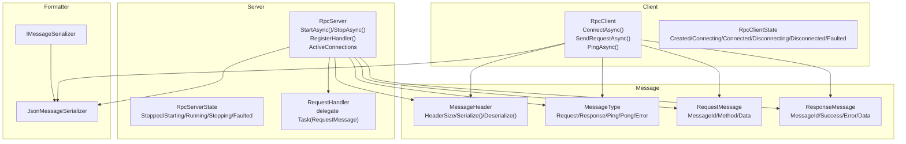
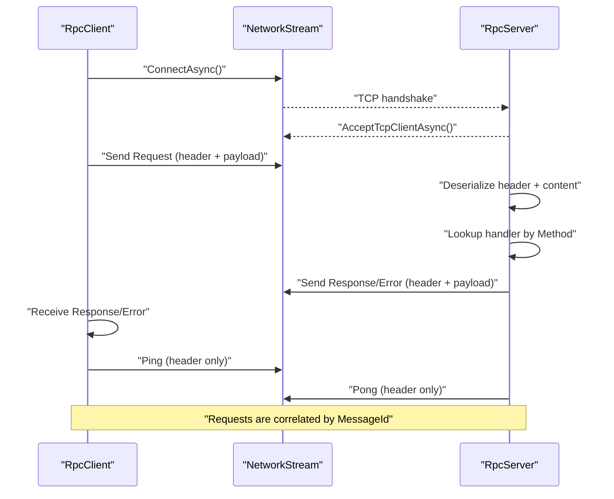
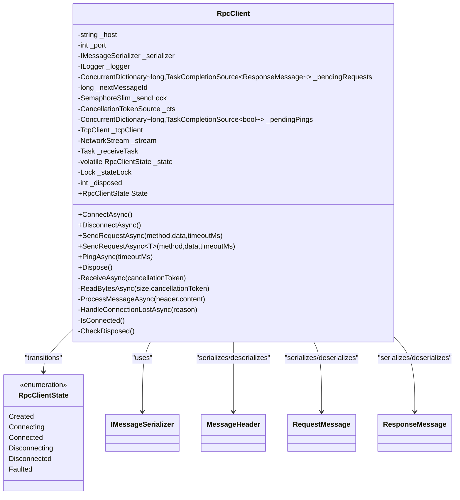
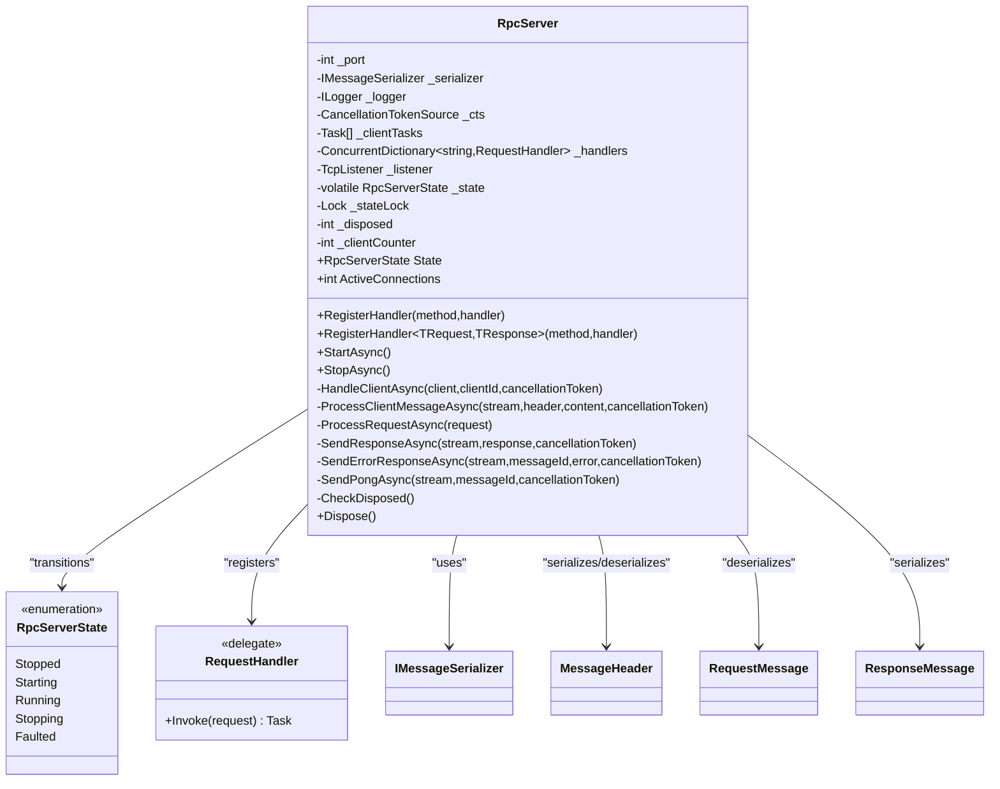
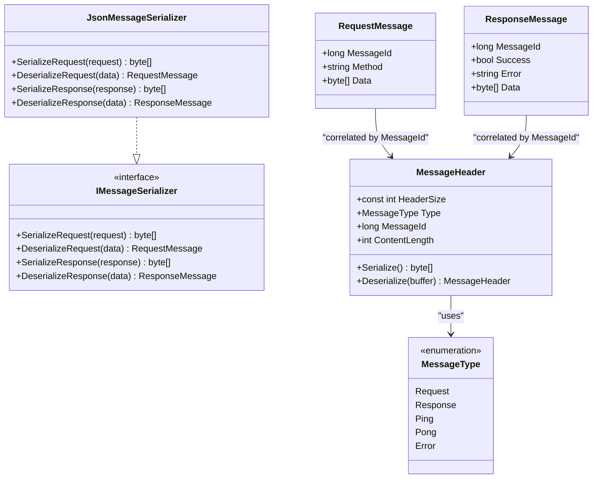
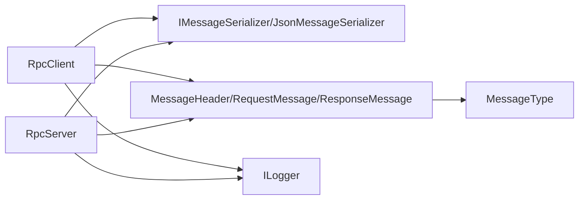

# Client & Server Components

<cite>
**Referenced Files in This Document**
- [TcpRpcClient.cs](file://TcpRpc/Client/TcpRpcClient.cs)
- [RpcClientState.cs](file://TcpRpc/Client/RpcClientState.cs)
- [TcpRpcServer.cs](file://TcpRpc/Server/TcpRpcServer.cs)
- [RpcServerState.cs](file://TcpRpc/Server/RpcServerState.cs)
- [RequestHandler.cs](file://TcpRpc/Server/RequestHandler.cs)
- [IMessageSerializer.cs](file://TcpRpc/Formatter/IMessageSerializer.cs)
- [JsonMessageSerializer.cs](file://TcpRpc/Formatter/JsonMessageSerializer.cs)
- [MessageHeader.cs](file://TcpRpc/Message/MessageHeader.cs)
- [MessageType.cs](file://TcpRpc/Message/MessageType.cs)
- [RequestMessage.cs](file://TcpRpc/Message/RequestMessage.cs)
- [ResponseMessage.cs](file://TcpRpc/Message/ResponseMessage.cs)
- [TcpRpc.csproj](file://TcpRpc/TcpRpc.csproj)
</cite>

## Table of Contents
1. [Introduction](#introduction)
2. [Project Structure](#project-structure)
3. [Core Components](#core-components)
4. [Architecture Overview](#architecture-overview)
5. [Detailed Component Analysis](#detailed-component-analysis)
6. [Dependency Analysis](#dependency-analysis)
7. [Performance Considerations](#performance-considerations)
8. [Troubleshooting Guide](#troubleshooting-guide)
9. [Conclusion](#conclusion)
10. [Appendices](#appendices)

## Introduction
This document provides comprehensive documentation for the TcpRpc client and server components. It explains the RpcClient class for establishing TCP connections, correlating requests and responses, performing heartbeats, and managing state transitions through RpcClientState. It also documents the RpcServer class for lifecycle management, handler registration via RequestHandler delegates, concurrent client support, and graceful shutdown via RpcServerState. The guide covers bidirectional communication patterns, asynchronous operations, error propagation, configuration options, timeouts, and performance tuning. Practical examples illustrate connection establishment, handler registration, concurrent request processing, and resource cleanup. Integration patterns, troubleshooting, and monitoring guidance are included.

## Project Structure
The TcpRpc library is organized into cohesive layers:
- Client: RpcClient and RpcClientState manage connection, request/response correlation, and heartbeat.
- Server: RpcServer, RpcServerState, and RequestHandler handle server lifecycle, handler registration, and concurrent client processing.
- Formatter: IMessageSerializer and JsonMessageSerializer define serialization contracts and JSON-based implementations.
- Message: MessageHeader, MessageType, RequestMessage, and ResponseMessage define the wire protocol and message model.

**Diagram sources**
- [TcpRpcClient.cs:11-405](file://TcpRpc/Client/TcpRpcClient.cs#L11-L405)
- [RpcClientState.cs:3-11](file://TcpRpc/Client/RpcClientState.cs#L3-L11)
- [TcpRpcServer.cs:12-432](file://TcpRpc/Server/TcpRpcServer.cs#L12-L432)
- [RpcServerState.cs:3-10](file://TcpRpc/Server/RpcServerState.cs#L3-L10)
- [RequestHandler.cs:5-5](file://TcpRpc/Server/RequestHandler.cs#L5-L5)
- [IMessageSerializer.cs:5-13](file://TcpRpc/Formatter/IMessageSerializer.cs#L5-L13)
- [JsonMessageSerializer.cs:6-85](file://TcpRpc/Formatter/JsonMessageSerializer.cs#L6-L85)
- [MessageHeader.cs:5-34](file://TcpRpc/Message/MessageHeader.cs#L5-L34)
- [MessageType.cs:3-10](file://TcpRpc/Message/MessageType.cs#L3-L10)
- [RequestMessage.cs:3-8](file://TcpRpc/Message/RequestMessage.cs#L3-L8)
- [ResponseMessage.cs:3-9](file://TcpRpc/Message/ResponseMessage.cs#L3-L9)

**Section sources**
- [TcpRpc.csproj:1-17](file://TcpRpc/TcpRpc.csproj#L1-L17)

## Core Components
- RpcClient: Asynchronous TCP client with connection management, request/response correlation, heartbeat (Ping), and state transitions controlled by RpcClientState. It uses a serializer to encode/decode messages and a dedicated receive loop to process inbound responses and errors.
- RpcServer: Asynchronous TCP server that accepts clients, maintains handlers registered via RequestHandler delegates, processes requests concurrently per client, and supports graceful shutdown via RpcServerState. It tracks active connections and enforces message size limits.

Key capabilities:
- Bidirectional communication: Requests from client to server, responses/errors from server to client, and ping/pong for heartbeat.
- Asynchronous operations: All I/O and handler execution are asynchronous to maximize throughput.
- Error propagation: Exceptions are surfaced to callers and logged; connection loss triggers cancellation of pending requests.
- Concurrency: Client supports multiple concurrent requests; server handles multiple clients concurrently.

**Section sources**
- [TcpRpcClient.cs:11-405](file://TcpRpc/Client/TcpRpcClient.cs#L11-L405)
- [RpcClientState.cs:3-11](file://TcpRpc/Client/RpcClientState.cs#L3-L11)
- [TcpRpcServer.cs:12-432](file://TcpRpc/Server/TcpRpcServer.cs#L12-L432)
- [RpcServerState.cs:3-10](file://TcpRpc/Server/RpcServerState.cs#L3-L10)
- [RequestHandler.cs:5-5](file://TcpRpc/Server/RequestHandler.cs#L5-L5)

## Architecture Overview
The system implements a simple binary protocol over TCP:
- Each message consists of a fixed-size header followed by content.
- The header encodes type, message ID, and content length.
- Supported message types include Request, Response, Error, Ping, and Pong.

**Diagram sources**
- [TcpRpcClient.cs:47-80](file://TcpRpc/Client/TcpRpcClient.cs#L47-L80)
- [TcpRpcClient.cs:132-189](file://TcpRpc/Client/TcpRpcClient.cs#L132-L189)
- [TcpRpcClient.cs:205-236](file://TcpRpc/Client/TcpRpcClient.cs#L205-L236)
- [TcpRpcServer.cs:101-173](file://TcpRpc/Server/TcpRpcServer.cs#L101-L173)
- [TcpRpcServer.cs:228-316](file://TcpRpc/Server/TcpRpcServer.cs#L228-L316)
- [TcpRpcServer.cs:318-360](file://TcpRpc/Server/TcpRpcServer.cs#L318-L360)
- [MessageHeader.cs:13-33](file://TcpRpc/Message/MessageHeader.cs#L13-L33)
- [MessageType.cs:3-10](file://TcpRpc/Message/MessageType.cs#L3-L10)

## Detailed Component Analysis

### RpcClient
RpcClient manages a single TCP connection and provides:
- Connection lifecycle: ConnectAsync(), DisconnectAsync(), and internal state transitions.
- Request/response correlation: Pending requests tracked by message ID; responses resolve TaskCompletionSource instances.
- Heartbeat: PingAsync() sends a Ping message and expects a Pong response.
- Error handling: Connection loss cancels pending requests; timeouts raise TimeoutException; deserialization errors propagate as exceptions.

**Diagram sources**
- [TcpRpcClient.cs:11-405](file://TcpRpc/Client/TcpRpcClient.cs#L11-L405)
- [RpcClientState.cs:3-11](file://TcpRpc/Client/RpcClientState.cs#L3-L11)
- [IMessageSerializer.cs:5-13](file://TcpRpc/Formatter/IMessageSerializer.cs#L5-L13)
- [MessageHeader.cs:5-34](file://TcpRpc/Message/MessageHeader.cs#L5-L34)
- [RequestMessage.cs:3-8](file://TcpRpc/Message/RequestMessage.cs#L3-L8)
- [ResponseMessage.cs:3-9](file://TcpRpc/Message/ResponseMessage.cs#L3-L9)

Key behaviors:
- State machine: Created -> Connecting -> Connected; error transitions to Disconnected; explicit disconnect sets Disconnecting -> Disconnected.
- Request correlation: Each request gets a unique message ID; responses are matched by ID.
- Concurrency: Send operations are serialized via a semaphore; receive loop processes messages concurrently.
- Heartbeat: PingAsync() registers a pending ping, writes a Ping header, waits for a Pong, and cleans up.

Common usage patterns:
- Establish connection: Call ConnectAsync() before sending requests.
- Send typed request: Use SendRequestAsync<T>() to serialize request and deserialize response.
- Monitor connectivity: Use PingAsync() periodically to detect liveness.
- Graceful shutdown: Call DisconnectAsync() to cancel pending operations and close streams.

**Section sources**
- [TcpRpcClient.cs:35-41](file://TcpRpc/Client/TcpRpcClient.cs#L35-L41)
- [TcpRpcClient.cs:47-80](file://TcpRpc/Client/TcpRpcClient.cs#L47-L80)
- [TcpRpcClient.cs:85-130](file://TcpRpc/Client/TcpRpcClient.cs#L85-L130)
- [TcpRpcClient.cs:132-189](file://TcpRpc/Client/TcpRpcClient.cs#L132-L189)
- [TcpRpcClient.cs:191-203](file://TcpRpc/Client/TcpRpcClient.cs#L191-L203)
- [TcpRpcClient.cs:205-236](file://TcpRpc/Client/TcpRpcClient.cs#L205-L236)
- [TcpRpcClient.cs:258-287](file://TcpRpc/Client/TcpRpcClient.cs#L258-L287)
- [TcpRpcClient.cs:289-306](file://TcpRpc/Client/TcpRpcClient.cs#L289-L306)
- [TcpRpcClient.cs:325-382](file://TcpRpc/Client/TcpRpcClient.cs#L325-L382)
- [RpcClientState.cs:3-11](file://TcpRpc/Client/RpcClientState.cs#L3-L11)

### RpcServer
RpcServer manages:
- Server lifecycle: StartAsync() begins accepting clients; StopAsync() gracefully shuts down.
- Handler registration: RegisterHandler() for raw delegates and generic overload for strongly-typed requests/responses.
- Concurrent client support: Each accepted client is handled in a separate task; ActiveConnections exposes live count.
- Error handling: Deserialization failures and handler exceptions are converted to error responses; connection losses are logged.

**Diagram sources**
- [TcpRpcServer.cs:12-432](file://TcpRpc/Server/TcpRpcServer.cs#L12-L432)
- [RpcServerState.cs:3-10](file://TcpRpc/Server/RpcServerState.cs#L3-L10)
- [RequestHandler.cs:5-5](file://TcpRpc/Server/RequestHandler.cs#L5-L5)
- [IMessageSerializer.cs:5-13](file://TcpRpc/Formatter/IMessageSerializer.cs#L5-L13)
- [MessageHeader.cs:5-34](file://TcpRpc/Message/MessageHeader.cs#L5-L34)
- [RequestMessage.cs:3-8](file://TcpRpc/Message/RequestMessage.cs#L3-L8)
- [ResponseMessage.cs:3-9](file://TcpRpc/Message/ResponseMessage.cs#L3-L9)

Lifecycle and concurrency:
- Lifecycle: Stopped -> Starting -> Running; StopAsync() transitions to Stopping and then Stopped; exceptions set Faulted.
- Concurrency: StartAsync() loops accept clients; each client runs HandleClientAsync() in its own task; ActiveConnections removes completed tasks before reporting.
- Handler registration: Methods are mapped to RequestHandler delegates; generic overload automatically serializes request/response.

**Section sources**
- [TcpRpcServer.cs:43-48](file://TcpRpc/Server/TcpRpcServer.cs#L43-L48)
- [TcpRpcServer.cs:50-58](file://TcpRpc/Server/TcpRpcServer.cs#L50-L58)
- [TcpRpcServer.cs:60-99](file://TcpRpc/Server/TcpRpcServer.cs#L60-L99)
- [TcpRpcServer.cs:101-173](file://TcpRpc/Server/TcpRpcServer.cs#L101-L173)
- [TcpRpcServer.cs:175-226](file://TcpRpc/Server/TcpRpcServer.cs#L175-L226)
- [TcpRpcServer.cs:228-316](file://TcpRpc/Server/TcpRpcServer.cs#L228-L316)
- [TcpRpcServer.cs:318-360](file://TcpRpc/Server/TcpRpcServer.cs#L318-L360)
- [RpcServerState.cs:3-10](file://TcpRpc/Server/RpcServerState.cs#L3-L10)

### Serialization and Protocol
The formatter and message model define the wire protocol:
- IMessageSerializer: Contract for serializing/deserialating requests and responses.
- JsonMessageSerializer: Implements the contract using System.Text.Json with camelCase naming policy.
- MessageHeader: Fixed-size header with little-endian encoding for type, message ID, and content length.
- MessageType: Enumerates supported message types.
- RequestMessage and ResponseMessage: DTOs for request/response payloads.

**Diagram sources**
- [IMessageSerializer.cs:5-13](file://TcpRpc/Formatter/IMessageSerializer.cs#L5-L13)
- [JsonMessageSerializer.cs:6-85](file://TcpRpc/Formatter/JsonMessageSerializer.cs#L6-L85)
- [MessageHeader.cs:5-34](file://TcpRpc/Message/MessageHeader.cs#L5-L34)
- [MessageType.cs:3-10](file://TcpRpc/Message/MessageType.cs#L3-L10)
- [RequestMessage.cs:3-8](file://TcpRpc/Message/RequestMessage.cs#L3-L8)
- [ResponseMessage.cs:3-9](file://TcpRpc/Message/ResponseMessage.cs#L3-L9)

**Section sources**
- [IMessageSerializer.cs:5-13](file://TcpRpc/Formatter/IMessageSerializer.cs#L5-L13)
- [JsonMessageSerializer.cs:8-12](file://TcpRpc/Formatter/JsonMessageSerializer.cs#L8-L12)
- [JsonMessageSerializer.cs:14-49](file://TcpRpc/Formatter/JsonMessageSerializer.cs#L14-L49)
- [JsonMessageSerializer.cs:51-84](file://TcpRpc/Formatter/JsonMessageSerializer.cs#L51-L84)
- [MessageHeader.cs:7](file://TcpRpc/Message/MessageHeader.cs#L7)
- [MessageHeader.cs:13-33](file://TcpRpc/Message/MessageHeader.cs#L13-L33)
- [MessageType.cs:3-10](file://TcpRpc/Message/MessageType.cs#L3-L10)
- [RequestMessage.cs:5-8](file://TcpRpc/Message/RequestMessage.cs#L5-L8)
- [ResponseMessage.cs:5-9](file://TcpRpc/Message/ResponseMessage.cs#L5-L9)

## Dependency Analysis
The components exhibit clean separation of concerns:
- Client depends on IMessageSerializer, MessageHeader, RequestMessage, ResponseMessage, and logging.
- Server depends on IMessageSerializer, MessageHeader, RequestMessage, ResponseMessage, and logging.
- Both depend on System.Net.Sockets and Microsoft.Extensions.Logging.

**Diagram sources**
- [TcpRpcClient.cs:15-40](file://TcpRpc/Client/TcpRpcClient.cs#L15-L40)
- [TcpRpcServer.cs:15-47](file://TcpRpc/Server/TcpRpcServer.cs#L15-L47)
- [IMessageSerializer.cs:5-13](file://TcpRpc/Formatter/IMessageSerializer.cs#L5-L13)
- [JsonMessageSerializer.cs:6-85](file://TcpRpc/Formatter/JsonMessageSerializer.cs#L6-L85)
- [MessageHeader.cs:5-34](file://TcpRpc/Message/MessageHeader.cs#L5-L34)
- [MessageType.cs:3-10](file://TcpRpc/Message/MessageType.cs#L3-L10)
- [RequestMessage.cs:3-8](file://TcpRpc/Message/RequestMessage.cs#L3-L8)
- [ResponseMessage.cs:3-9](file://TcpRpc/Message/ResponseMessage.cs#L3-L9)

**Section sources**
- [TcpRpcClient.cs:15-40](file://TcpRpc/Client/TcpRpcClient.cs#L15-L40)
- [TcpRpcServer.cs:15-47](file://TcpRpc/Server/TcpRpcServer.cs#L15-L47)

## Performance Considerations
- Concurrency:
  - Client: Uses a semaphore to serialize outbound writes; receive loop processes inbound messages concurrently.
  - Server: Accepts clients asynchronously and handles each client in a dedicated task; ActiveConnections cleans completed tasks before reporting.
- Backpressure:
  - Client: Pending requests are tracked in a concurrent dictionary; timeouts cancel pending operations.
  - Server: Message size limits prevent oversized payloads; timeouts during header/content reads continue processing.
- Throughput:
  - JSON serialization is efficient; consider custom serializers if needed.
  - Avoid blocking operations; all I/O is asynchronous.
- Resource usage:
  - Streams and cancellation tokens are disposed; ensure proper disposal via Dispose() or using blocks.

[No sources needed since this section provides general guidance]

## Troubleshooting Guide
Common issues and resolutions:
- Connection refused:
  - Verify server is started and listening on the configured port.
  - Check firewall and network connectivity.
- Timeout during request:
  - Increase timeoutMs for SendRequestAsync; consider retry logic.
  - Investigate server handler latency or overload.
- Connection lost:
  - Client cancels pending requests and transitions to Disconnected; reconnect as needed.
  - Server logs client disconnections; inspect logs for repeated disconnects.
- Handler not found:
  - Ensure RegisterHandler was called with the correct method name.
  - Confirm method casing and spelling match client requests.
- Deserialization errors:
  - Validate request/response types on both sides.
  - Check JSON serialization settings and payload correctness.
- Heartbeat failure:
  - PingAsync() returns false on timeout; investigate network stability or server load.

Operational tips:
- Enable logging to capture state transitions and errors.
- Monitor ActiveConnections to detect spikes or leaks.
- Use graceful shutdown via StopAsync() to ensure client tasks finish.

**Section sources**
- [TcpRpcClient.cs:180-188](file://TcpRpc/Client/TcpRpcClient.cs#L180-L188)
- [TcpRpcClient.cs:289-306](file://TcpRpc/Client/TcpRpcClient.cs#L289-L306)
- [TcpRpcServer.cs:344-349](file://TcpRpc/Server/TcpRpcServer.cs#L344-L349)
- [TcpRpcServer.cs:290-304](file://TcpRpc/Server/TcpRpcServer.cs#L290-L304)

## Conclusion
TcpRpc provides a lightweight, asynchronous RPC framework over TCP with clear client and server abstractions. RpcClient offers robust connection management, request/response correlation, and heartbeat capabilities, while RpcServer delivers lifecycle control, handler registration, and concurrent client support. The protocol and serialization are straightforward, enabling easy integration and customization. Proper configuration of timeouts, logging, and graceful shutdown ensures reliable operation in production environments.

[No sources needed since this section summarizes without analyzing specific files]

## Appendices

### Practical Examples

- Client connection establishment:
  - Instantiate RpcClient with host, port, serializer, and logger.
  - Call ConnectAsync() before sending requests.
  - Example path: [TcpRpcClient.cs:35-41](file://TcpRpc/Client/TcpRpcClient.cs#L35-L41), [TcpRpcClient.cs:47-80](file://TcpRpc/Client/TcpRpcClient.cs#L47-L80)

- Server handler registration:
  - Register handlers via RegisterHandler(method, handler) or generic overload for typed requests/responses.
  - Example path: [TcpRpcServer.cs:50-58](file://TcpRpc/Server/TcpRpcServer.cs#L50-L58), [TcpRpcServer.cs:60-99](file://TcpRpc/Server/TcpRpcServer.cs#L60-L99)

- Concurrent request processing:
  - Server spawns a task per client; handlers execute concurrently per client.
  - Example path: [TcpRpcServer.cs:138-147](file://TcpRpc/Server/TcpRpcServer.cs#L138-L147), [TcpRpcServer.cs:228-316](file://TcpRpc/Server/TcpRpcServer.cs#L228-L316)

- Resource cleanup:
  - Dispose RpcClient and RpcServer to ensure graceful shutdown and resource release.
  - Example path: [TcpRpcClient.cs:384-404](file://TcpRpc/Client/TcpRpcClient.cs#L384-L404), [TcpRpcServer.cs:415-431](file://TcpRpc/Server/TcpRpcServer.cs#L415-L431)

### Configuration Options and Timeouts
- Client:
  - SendRequestAsync(timeoutMs): Controls request timeout.
  - PingAsync(timeoutMs): Controls heartbeat timeout.
  - Example path: [TcpRpcClient.cs:132](file://TcpRpc/Client/TcpRpcClient.cs#L132), [TcpRpcClient.cs:325](file://TcpRpc/Client/TcpRpcClient.cs#L325)

- Server:
  - Header/content read timeout: 30 seconds per message read.
  - StopAsync() wait timeout: 10 seconds for client tasks to finish.
  - Example path: [TcpRpcServer.cs:245-247](file://TcpRpc/Server/TcpRpcServer.cs#L245-L247), [TcpRpcServer.cs:206](file://TcpRpc/Server/TcpRpcServer.cs#L206)

### Monitoring and Health
- State monitoring:
  - RpcClient.State and RpcServer.State reflect current state; monitor transitions.
  - Example path: [TcpRpcClient.cs:33](file://TcpRpc/Client/TcpRpcClient.cs#L33), [RpcClientState.cs:3-11](file://TcpRpc/Client/RpcClientState.cs#L3-L11), [TcpRpcServer.cs:29](file://TcpRpc/Server/TcpRpcServer.cs#L29), [RpcServerState.cs:3-10](file://TcpRpc/Server/RpcServerState.cs#L3-L10)

- Active connections:
  - RpcServer.ActiveConnections provides live client count.
  - Example path: [TcpRpcServer.cs:31-41](file://TcpRpc/Server/TcpRpcServer.cs#L31-L41)

- Logging:
  - Both client and server use ILogger for diagnostics; configure providers accordingly.
  - Example path: [TcpRpc.csproj:12-13](file://TcpRpc/TcpRpc.csproj#L12-L13)