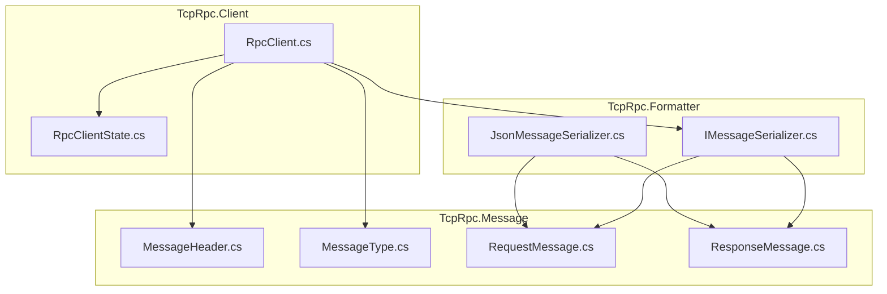
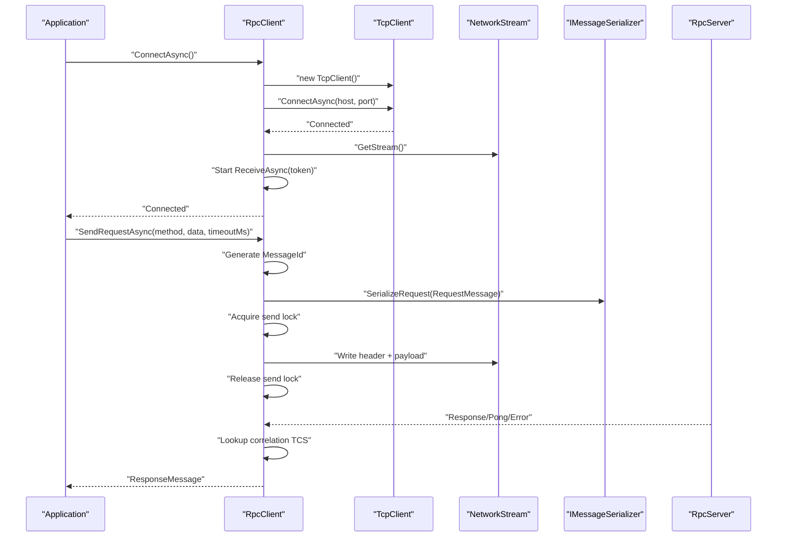
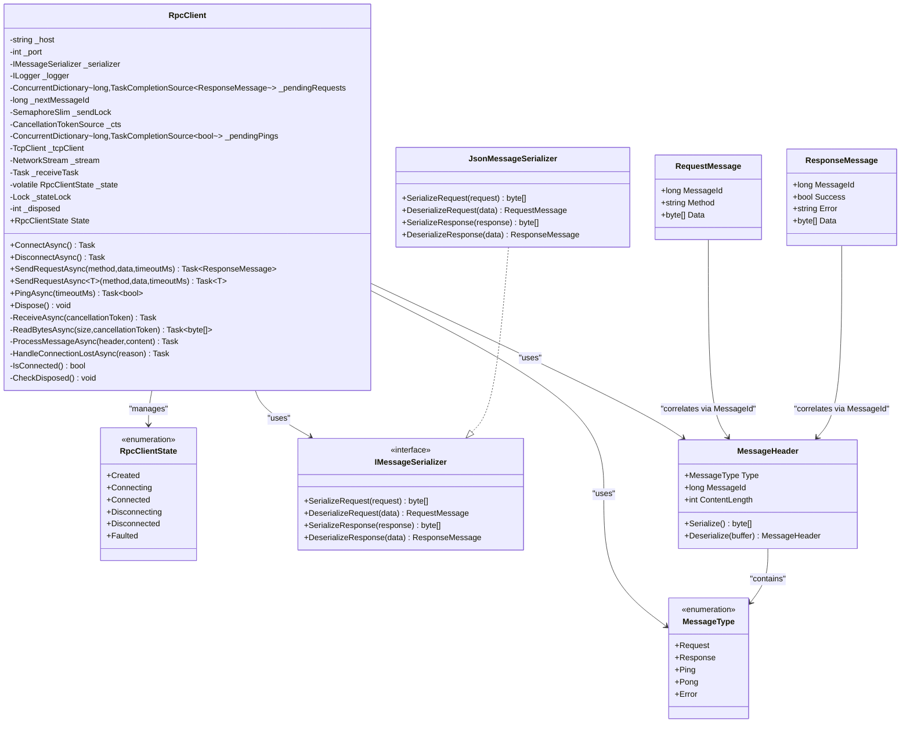
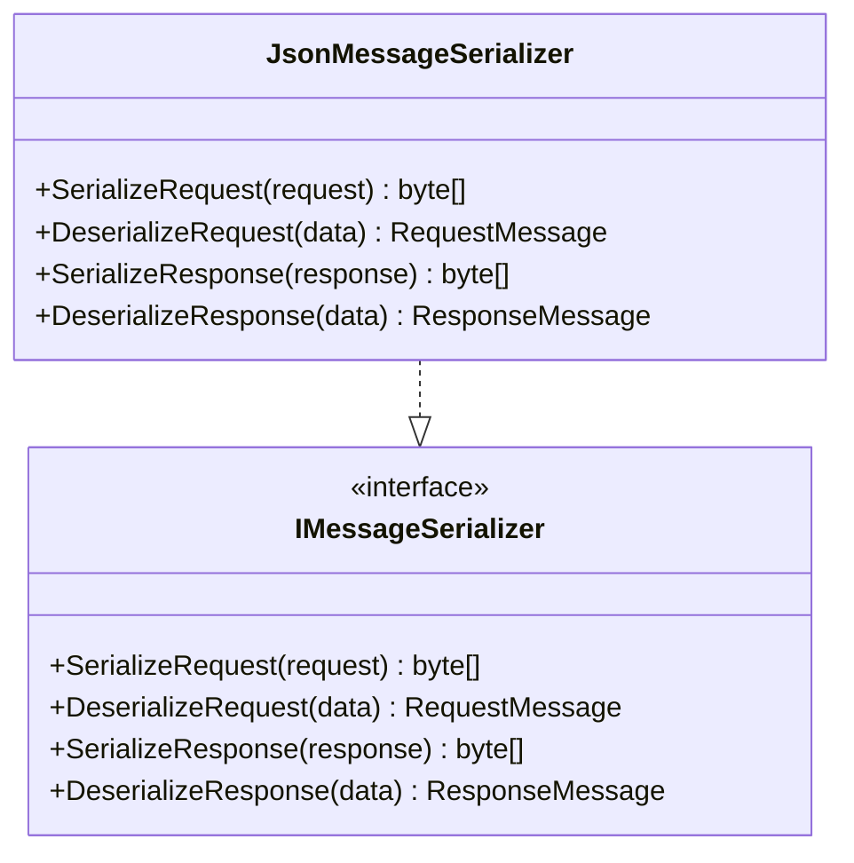
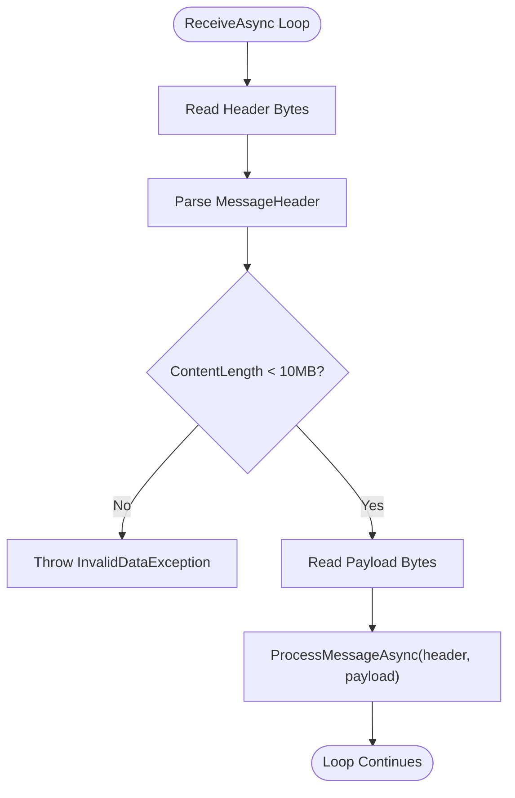
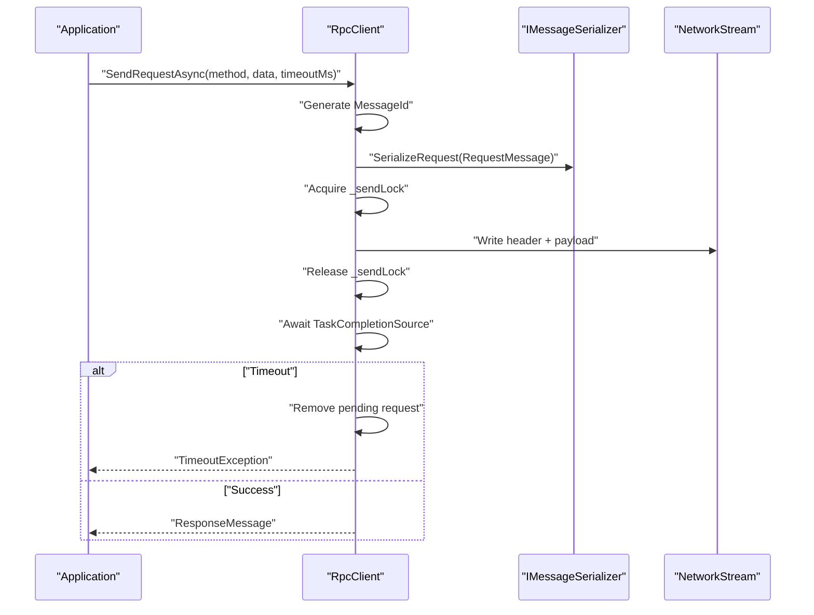
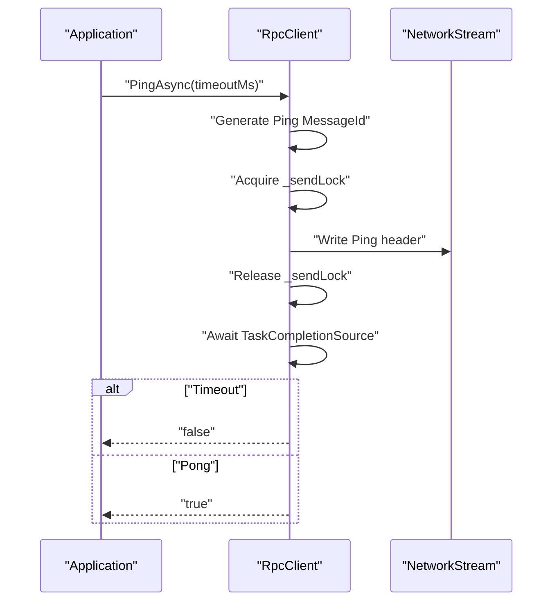
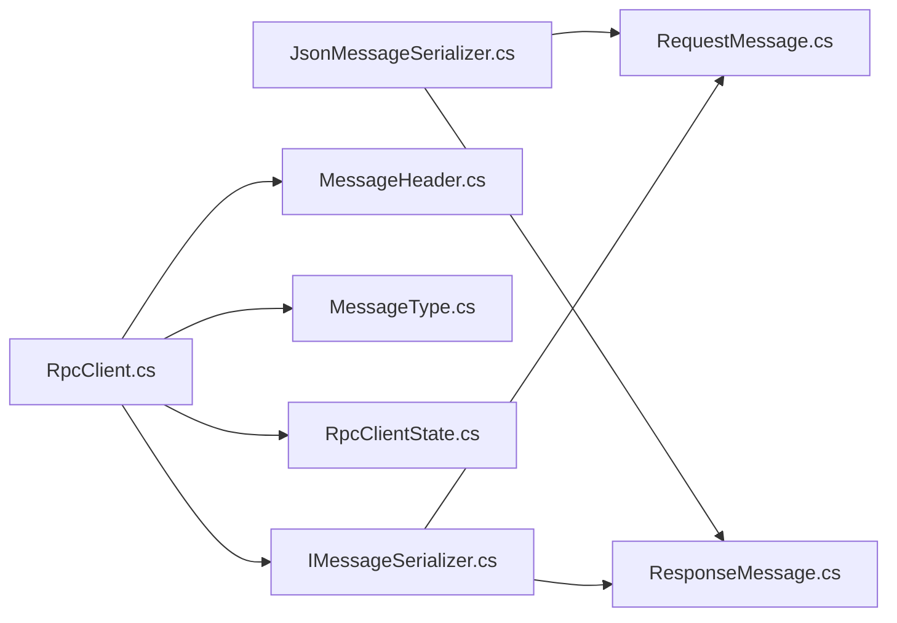

# Client Architecture & Design

<cite>
**Referenced Files in This Document**
- [TcpRpcClient.cs](file://TcpRpc/Client/TcpRpcClient.cs)
- [RpcClientState.cs](file://TcpRpc/Client/RpcClientState.cs)
- [IMessageSerializer.cs](file://TcpRpc/Formatter/IMessageSerializer.cs)
- [JsonMessageSerializer.cs](file://TcpRpc/Formatter/JsonMessageSerializer.cs)
- [MessageHeader.cs](file://TcpRpc/Message/MessageHeader.cs)
- [MessageType.cs](file://TcpRpc/Message/MessageType.cs)
- [RequestMessage.cs](file://TcpRpc/Message/RequestMessage.cs)
- [ResponseMessage.cs](file://TcpRpc/Message/ResponseMessage.cs)
- [TcpRpc.csproj](file://TcpRpc/TcpRpc.csproj)
</cite>

## Table of Contents
1. [Introduction](#introduction)
2. [Project Structure](#project-structure)
3. [Core Components](#core-components)
4. [Architecture Overview](#architecture-overview)
5. [Detailed Component Analysis](#detailed-component-analysis)
6. [Dependency Analysis](#dependency-analysis)
7. [Performance Considerations](#performance-considerations)
8. [Troubleshooting Guide](#troubleshooting-guide)
9. [Conclusion](#conclusion)

## Introduction
This document provides comprehensive documentation for the RpcClient architecture and design patterns. It explains the overall client structure, including TcpClient integration, NetworkStream management, and asynchronous I/O handling. It documents the separation of concerns between connection management, message processing, and state coordination. It covers the use of concurrent collections for request correlation, semaphore-based send locking for thread safety, and cancellation token architecture for graceful shutdown. Finally, it details the client lifecycle from creation through disposal, including proper resource cleanup and exception handling strategies.

## Project Structure
The RpcClient resides in the TcpRpc.Client namespace and integrates with formatter and message abstractions. The project targets .NET 10 and uses Microsoft.Extensions.Logging for diagnostics.

**Diagram sources**
- [TcpRpcClient.cs:1-405](file://TcpRpc/Client/TcpRpcClient.cs#L1-L405)
- [RpcClientState.cs:1-11](file://TcpRpc/Client/RpcClientState.cs#L1-L11)
- [IMessageSerializer.cs:1-13](file://TcpRpc/Formatter/IMessageSerializer.cs#L1-L13)
- [JsonMessageSerializer.cs:1-85](file://TcpRpc/Formatter/JsonMessageSerializer.cs#L1-L85)
- [MessageHeader.cs:1-34](file://TcpRpc/Message/MessageHeader.cs#L1-L34)
- [MessageType.cs:1-10](file://TcpRpc/Message/MessageType.cs#L1-L10)
- [RequestMessage.cs:1-8](file://TcpRpc/Message/RequestMessage.cs#L1-L8)
- [ResponseMessage.cs:1-9](file://TcpRpc/Message/ResponseMessage.cs#L1-L9)

**Section sources**
- [TcpRpc.csproj:1-17](file://TcpRpc/TcpRpc.csproj#L1-L17)

## Core Components
- RpcClient: The primary client responsible for connection lifecycle, sending requests, receiving responses, and managing state transitions. It encapsulates TcpClient, NetworkStream, and asynchronous receive loop.
- RpcClientState: Enumerates the client’s state machine (Created, Connecting, Connected, Disconnecting, Disconnected, Faulted).
- IMessageSerializer and JsonMessageSerializer: Pluggable serialization abstraction and JSON-based implementation for RequestMessage and ResponseMessage.
- MessageHeader: Fixed-size binary header containing type, message ID, and content length.
- MessageType: Enumerates message types (Request, Response, Ping, Pong, Error).
- RequestMessage and ResponseMessage: DTOs for RPC messages.

Key design patterns:
- State machine with explicit transitions guarded by a lock.
- Asynchronous I/O with cancellation tokens and timeouts.
- Correlation via message ID using concurrent dictionaries.
- Thread-safe send operations using SemaphoreSlim.
- Heartbeat/ping mechanism using separate correlation dictionary.

**Section sources**
- [TcpRpcClient.cs:11-41](file://TcpRpc/Client/TcpRpcClient.cs#L11-L41)
- [RpcClientState.cs:3-11](file://TcpRpc/Client/RpcClientState.cs#L3-L11)
- [IMessageSerializer.cs:5-13](file://TcpRpc/Formatter/IMessageSerializer.cs#L5-L13)
- [JsonMessageSerializer.cs:6-85](file://TcpRpc/Formatter/JsonMessageSerializer.cs#L6-L85)
- [MessageHeader.cs:5-34](file://TcpRpc/Message/MessageHeader.cs#L5-L34)
- [MessageType.cs:3-10](file://TcpRpc/Message/MessageType.cs#L3-L10)
- [RequestMessage.cs:3-8](file://TcpRpc/Message/RequestMessage.cs#L3-L8)
- [ResponseMessage.cs:3-9](file://TcpRpc/Message/ResponseMessage.cs#L3-L9)

## Architecture Overview
The RpcClient composes TcpClient and NetworkStream for transport, and delegates serialization to IMessageSerializer. A dedicated receive loop decodes incoming frames, validates sizes, and dispatches to correlation handlers. Send operations are serialized via a semaphore to ensure atomic writes and consistent framing.

**Diagram sources**
- [TcpRpcClient.cs:47-80](file://TcpRpc/Client/TcpRpcClient.cs#L47-L80)
- [TcpRpcClient.cs:132-189](file://TcpRpc/Client/TcpRpcClient.cs#L132-L189)
- [TcpRpcClient.cs:205-236](file://TcpRpc/Client/TcpRpcClient.cs#L205-L236)
- [IMessageSerializer.cs:7-12](file://TcpRpc/Formatter/IMessageSerializer.cs#L7-L12)
- [MessageHeader.cs:13-20](file://TcpRpc/Message/MessageHeader.cs#L13-L20)

## Detailed Component Analysis

### RpcClient: Lifecycle, State, and Concurrency
- Connection Management
  - ConnectAsync initializes TcpClient, connects asynchronously, obtains NetworkStream, and starts ReceiveAsync with a shared CancellationTokenSource.
  - DisconnectAsync cancels the token, waits for receive loop termination with timeout, closes streams, and clears pending requests.
- Message Processing
  - ReceiveAsync reads fixed-size headers, validates content length, reads payload, and dispatches to ProcessMessageAsync.
  - ProcessMessageAsync handles Response, Error, and Pong messages by resolving TaskCompletionSource instances keyed by MessageId.
- Correlation and Thread Safety
  - _pendingRequests correlates outgoing requests with incoming responses using message IDs.
  - _pendingPings correlates heartbeat pings with pongs.
  - _sendLock ensures only one write operation occurs at a time, preventing interleaved frames.
  - _stateLock guards state transitions; State property exposes current state.
  - _disposed flag prevents reuse after disposal.
- Cancellation and Timeouts
  - _cts drives graceful shutdown; ReceiveAsync and SendRequestAsync honor cancellation.
  - Per-call timeouts are enforced via linked CancellationTokenSource combining per-request and global cancellation.
- Heartbeat
  - PingAsync sends Ping headers and awaits Pong responses with timeout.

**Diagram sources**
- [TcpRpcClient.cs:11-405](file://TcpRpc/Client/TcpRpcClient.cs#L11-L405)
- [RpcClientState.cs:3-11](file://TcpRpc/Client/RpcClientState.cs#L3-L11)
- [IMessageSerializer.cs:5-13](file://TcpRpc/Formatter/IMessageSerializer.cs#L5-L13)
- [JsonMessageSerializer.cs:6-85](file://TcpRpc/Formatter/JsonMessageSerializer.cs#L6-L85)
- [MessageHeader.cs:5-34](file://TcpRpc/Message/MessageHeader.cs#L5-L34)
- [MessageType.cs:3-10](file://TcpRpc/Message/MessageType.cs#L3-L10)
- [RequestMessage.cs:3-8](file://TcpRpc/Message/RequestMessage.cs#L3-L8)
- [ResponseMessage.cs:3-9](file://TcpRpc/Message/ResponseMessage.cs#L3-L9)

**Section sources**
- [TcpRpcClient.cs:47-130](file://TcpRpc/Client/TcpRpcClient.cs#L47-L130)
- [TcpRpcClient.cs:132-189](file://TcpRpc/Client/TcpRpcClient.cs#L132-L189)
- [TcpRpcClient.cs:205-287](file://TcpRpc/Client/TcpRpcClient.cs#L205-L287)
- [RpcClientState.cs:3-11](file://TcpRpc/Client/RpcClientState.cs#L3-L11)

### Serialization Abstraction and Implementation
- IMessageSerializer defines contract for serializing/deserializing RequestMessage and ResponseMessage.
- JsonMessageSerializer implements the contract using System.Text.Json with camelCase naming policy and strict validation of required fields.

**Diagram sources**
- [IMessageSerializer.cs:5-13](file://TcpRpc/Formatter/IMessageSerializer.cs#L5-L13)
- [JsonMessageSerializer.cs:6-85](file://TcpRpc/Formatter/JsonMessageSerializer.cs#L6-L85)

**Section sources**
- [IMessageSerializer.cs:5-13](file://TcpRpc/Formatter/IMessageSerializer.cs#L5-L13)
- [JsonMessageSerializer.cs:14-84](file://TcpRpc/Formatter/JsonMessageSerializer.cs#L14-L84)

### Message Framing and Types
- MessageHeader encodes type, message ID, and content length in a fixed-size little-endian layout.
- MessageType enumerates supported message categories.
- RequestMessage and ResponseMessage carry method, data, and error information.

**Diagram sources**
- [TcpRpcClient.cs:205-236](file://TcpRpc/Client/TcpRpcClient.cs#L205-L236)
- [MessageHeader.cs:13-33](file://TcpRpc/Message/MessageHeader.cs#L13-L33)

**Section sources**
- [MessageHeader.cs:5-34](file://TcpRpc/Message/MessageHeader.cs#L5-L34)
- [MessageType.cs:3-10](file://TcpRpc/Message/MessageType.cs#L3-L10)
- [RequestMessage.cs:3-8](file://TcpRpc/Message/RequestMessage.cs#L3-L8)
- [ResponseMessage.cs:3-9](file://TcpRpc/Message/ResponseMessage.cs#L3-L9)

### Request Correlation and Timeout Handling
- Each request gets a unique message ID and a TaskCompletionSource stored in _pendingRequests.
- SendRequestAsync serializes the request, writes header and payload, and waits for completion with a combined cancellation token.
- On timeout, the pending request is removed and a TimeoutException is thrown.
- On errors, pending requests are cleared and exceptions propagated.

**Diagram sources**
- [TcpRpcClient.cs:132-189](file://TcpRpc/Client/TcpRpcClient.cs#L132-L189)
- [IMessageSerializer.cs:7-12](file://TcpRpc/Formatter/IMessageSerializer.cs#L7-L12)

**Section sources**
- [TcpRpcClient.cs:132-189](file://TcpRpc/Client/TcpRpcClient.cs#L132-L189)

### Heartbeat and Ping Mechanism
- PingAsync generates a message ID, registers a TaskCompletionSource in _pendingPings, sends a Ping header, and waits for a Pong.
- On timeout or error, the operation logs warnings and returns false.

**Diagram sources**
- [TcpRpcClient.cs:325-382](file://TcpRpc/Client/TcpRpcClient.cs#L325-L382)

**Section sources**
- [TcpRpcClient.cs:325-382](file://TcpRpc/Client/TcpRpcClient.cs#L325-L382)

## Dependency Analysis
- Internal dependencies
  - RpcClient depends on IMessageSerializer, MessageHeader, MessageType, and RpcClientState.
  - JsonMessageSerializer depends on RequestMessage and ResponseMessage.
- External dependencies
  - Microsoft.Extensions.Logging is referenced by the project for logging capabilities.

**Diagram sources**
- [TcpRpcClient.cs:1-8](file://TcpRpc/Client/TcpRpcClient.cs#L1-L8)
- [IMessageSerializer.cs:1-13](file://TcpRpc/Formatter/IMessageSerializer.cs#L1-L13)
- [JsonMessageSerializer.cs:1-85](file://TcpRpc/Formatter/JsonMessageSerializer.cs#L1-L85)
- [MessageHeader.cs:1-34](file://TcpRpc/Message/MessageHeader.cs#L1-L34)
- [MessageType.cs:1-10](file://TcpRpc/Message/MessageType.cs#L1-L10)
- [RequestMessage.cs:1-8](file://TcpRpc/Message/RequestMessage.cs#L1-L8)
- [ResponseMessage.cs:1-9](file://TcpRpc/Message/ResponseMessage.cs#L1-L9)

**Section sources**
- [TcpRpc.csproj:11-14](file://TcpRpc/TcpRpc.csproj#L11-L14)

## Performance Considerations
- Asynchronous I/O: All network operations use async/await to avoid blocking threads.
- Backpressure: Only one send operation at a time via SemaphoreSlim prevents interleaving and reduces contention.
- Concurrency: ConcurrentDictionary-based correlation scales under load; ensure message IDs are unique and bounded.
- Timeouts: Per-operation cancellation tokens prevent indefinite waits; tune timeoutMs based on expected latency.
- Logging overhead: Excessive logging can impact performance; consider log level tuning in production.
- Buffering: ReadBytesAsync reads in chunks until full; ensure content length limits are enforced to avoid memory pressure.

## Troubleshooting Guide
- Connection failures
  - Verify host/port and network connectivity before calling ConnectAsync.
  - Inspect exceptions during ConnectAsync; state transitions to Disconnected on failure.
- Timeouts
  - Increase timeoutMs for SendRequestAsync if operations are slow.
  - PingAsync returning false indicates network issues or server overload.
- Disconnection handling
  - ReceiveAsync catches connection errors and triggers HandleConnectionLostAsync, clearing pending requests and transitioning state.
  - DisconnectAsync cancels the token, waits up to 5 seconds for graceful exit, and cleans resources.
- Resource leaks
  - Ensure Dispose is called to release send lock, cancellation token, and streams.
  - Avoid holding references to disposed clients.

**Section sources**
- [TcpRpcClient.cs:47-80](file://TcpRpc/Client/TcpRpcClient.cs#L47-L80)
- [TcpRpcClient.cs:85-130](file://TcpRpc/Client/TcpRpcClient.cs#L85-L130)
- [TcpRpcClient.cs:205-236](file://TcpRpc/Client/TcpRpcClient.cs#L205-L236)
- [TcpRpcClient.cs:289-306](file://TcpRpc/Client/TcpRpcClient.cs#L289-L306)
- [TcpRpcClient.cs:384-404](file://TcpRpc/Client/TcpRpcClient.cs#L384-L404)

## Conclusion
The RpcClient implements a robust, asynchronous RPC client over TCP with strong separation of concerns. It manages connection lifecycle, serializes messages, coordinates request/response correlation, and enforces thread safety through semaphores and locks. The design leverages cancellation tokens for graceful shutdown, concurrent collections for scalability, and a clear state machine for predictable behavior. Proper disposal and exception handling ensure reliable operation across diverse network conditions.