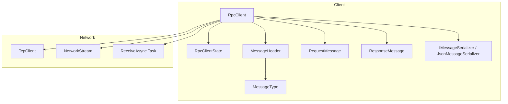
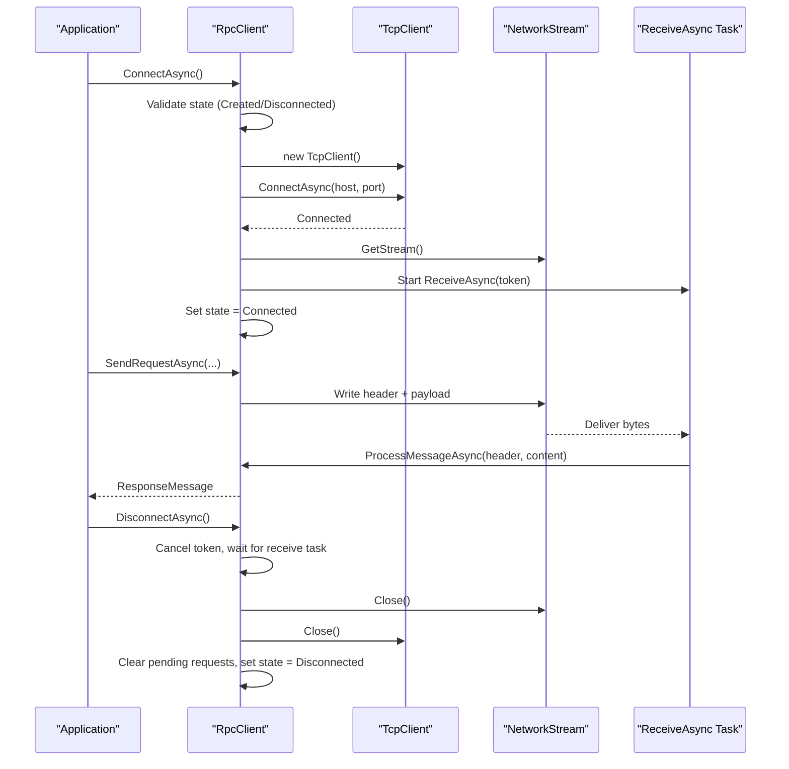
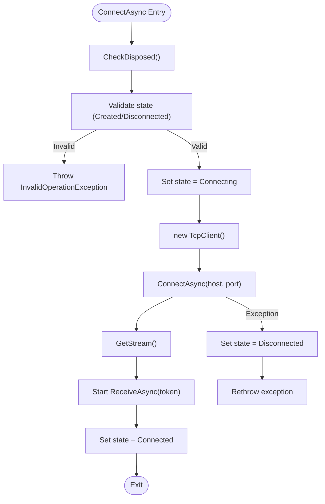
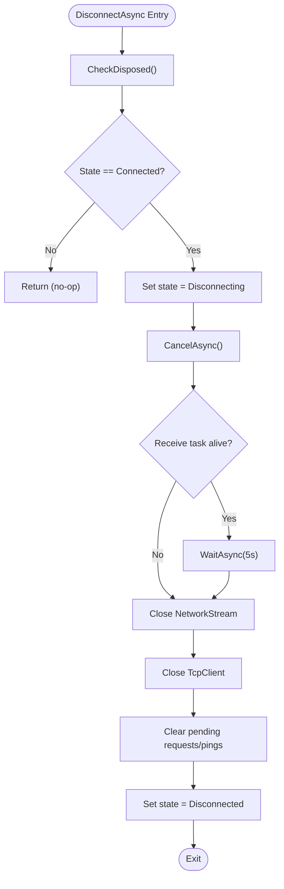
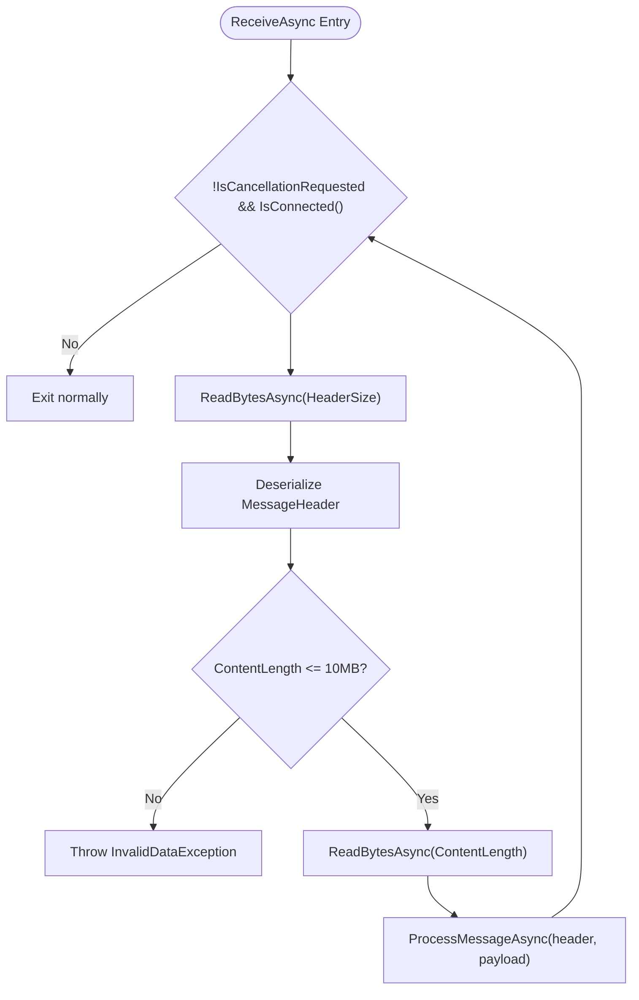
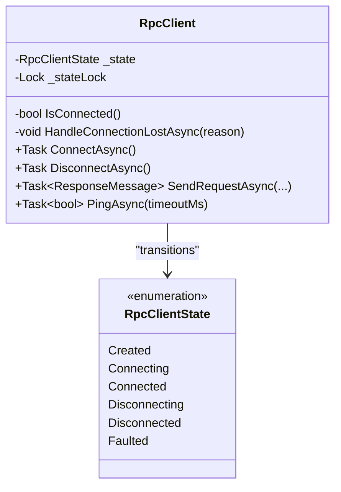
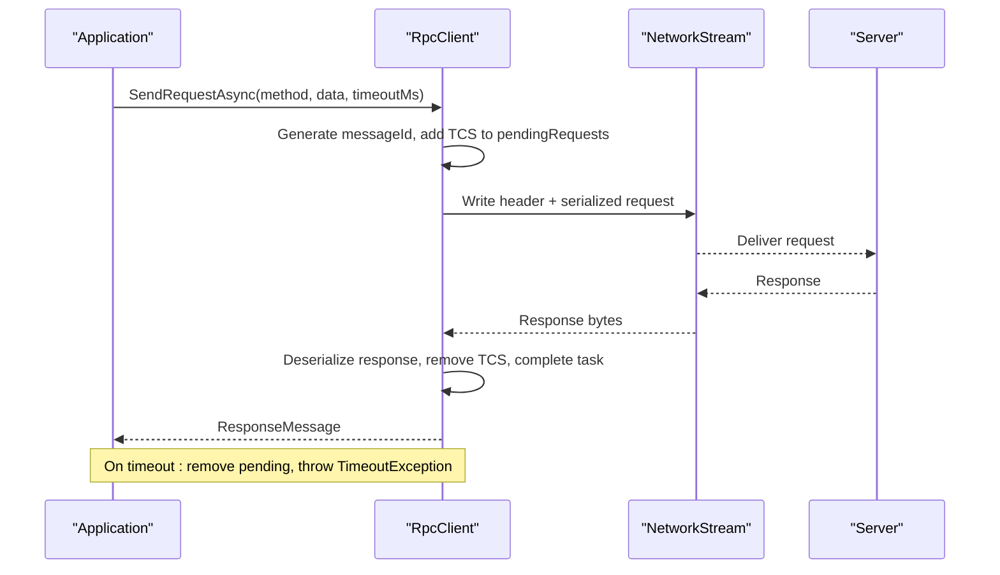
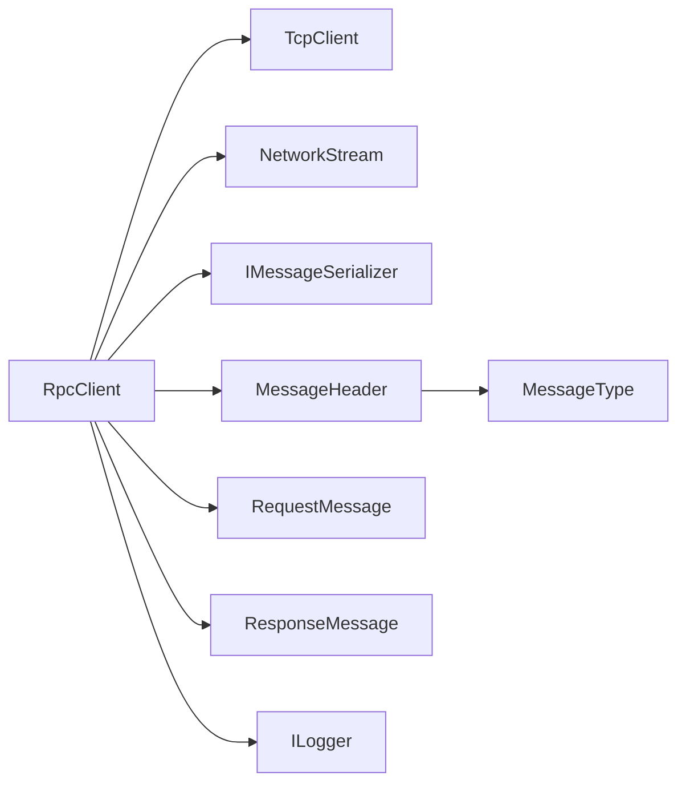

# Connection Management

<cite>
**Referenced Files in This Document**
- [TcpRpcClient.cs](file://TcpRpc/Client/TcpRpcClient.cs)
- [RpcClientState.cs](file://TcpRpc/Client/RpcClientState.cs)
- [MessageHeader.cs](file://TcpRpc/Message/MessageHeader.cs)
- [MessageType.cs](file://TcpRpc/Message/MessageType.cs)
- [RequestMessage.cs](file://TcpRpc/Message/RequestMessage.cs)
- [ResponseMessage.cs](file://TcpRpc/Message/ResponseMessage.cs)
- [IMessageSerializer.cs](file://TcpRpc/Formatter/IMessageSerializer.cs)
- [JsonMessageSerializer.cs](file://TcpRpc/Formatter/JsonMessageSerializer.cs)
- [TcpRpc.csproj](file://TcpRpc/TcpRpc.csproj)
</cite>

## Table of Contents
1. [Introduction](#introduction)
2. [Project Structure](#project-structure)
3. [Core Components](#core-components)
4. [Architecture Overview](#architecture-overview)
5. [Detailed Component Analysis](#detailed-component-analysis)
6. [Dependency Analysis](#dependency-analysis)
7. [Performance Considerations](#performance-considerations)
8. [Troubleshooting Guide](#troubleshooting-guide)
9. [Conclusion](#conclusion)

## Introduction
This document provides comprehensive documentation for RpcClient connection management capabilities. It explains how connections are established and torn down, how the background receive task operates, and how errors are handled. It covers connection state validation, automatic cleanup procedures, and practical guidance for implementing retry logic and handling timeouts.

## Project Structure
The connection management logic resides in the client-side RpcClient class and its supporting types. The client manages:
- TCP socket establishment via TcpClient
- Stream initialization via NetworkStream
- Background receive task for continuous message reading
- Request/response lifecycle with timeouts and cancellation
- Connection state transitions and cleanup

**Diagram sources**
- [TcpRpcClient.cs:11-405](file://TcpRpc/Client/TcpRpcClient.cs#L11-L405)
- [RpcClientState.cs:3-11](file://TcpRpc/Client/RpcClientState.cs#L3-L11)
- [MessageHeader.cs:5-34](file://TcpRpc/Message/MessageHeader.cs#L5-L34)
- [MessageType.cs:3-10](file://TcpRpc/Message/MessageType.cs#L3-L10)
- [RequestMessage.cs:3-8](file://TcpRpc/Message/RequestMessage.cs#L3-L8)
- [ResponseMessage.cs:3-9](file://TcpRpc/Message/ResponseMessage.cs#L3-L9)
- [IMessageSerializer.cs:5-13](file://TcpRpc/Formatter/IMessageSerializer.cs#L5-L13)
- [JsonMessageSerializer.cs:6-85](file://TcpRpc/Formatter/JsonMessageSerializer.cs#L6-L85)

**Section sources**
- [TcpRpcClient.cs:11-405](file://TcpRpc/Client/TcpRpcClient.cs#L11-L405)
- [RpcClientState.cs:3-11](file://TcpRpc/Client/RpcClientState.cs#L3-L11)
- [TcpRpc.csproj:1-17](file://TcpRpc/TcpRpc.csproj#L1-L17)

## Core Components
- RpcClient: Orchestrates connection lifecycle, manages state, coordinates send/receive operations, and cleans up resources.
- RpcClientState: Enumerates connection states (Created, Connecting, Connected, Disconnecting, Disconnected, Faulted).
- MessageHeader: Defines the fixed-size protocol header for all messages.
- MessageType: Enumerates message types (Request, Response, Ping, Pong, Error).
- RequestMessage/ResponseMessage: Data contracts for request/response payloads.
- IMessageSerializer/JsonMessageSerializer: Serialization/deserialization for requests and responses.

Key responsibilities:
- Establish TCP socket and initialize NetworkStream
- Start background receive task
- Validate connection state before operations
- Handle connection loss and cleanup pending requests
- Implement timeouts for requests and pings
- Provide graceful disconnect with resource cleanup

**Section sources**
- [RpcClientState.cs:3-11](file://TcpRpc/Client/RpcClientState.cs#L3-L11)
- [MessageHeader.cs:5-34](file://TcpRpc/Message/MessageHeader.cs#L5-L34)
- [MessageType.cs:3-10](file://TcpRpc/Message/MessageType.cs#L3-L10)
- [RequestMessage.cs:3-8](file://TcpRpc/Message/RequestMessage.cs#L3-L8)
- [ResponseMessage.cs:3-9](file://TcpRpc/Message/ResponseMessage.cs#L3-L9)
- [IMessageSerializer.cs:5-13](file://TcpRpc/Formatter/IMessageSerializer.cs#L5-L13)
- [JsonMessageSerializer.cs:6-85](file://TcpRpc/Formatter/JsonMessageSerializer.cs#L6-L85)

## Architecture Overview
The RpcClient maintains a strict state machine and uses a dedicated receive task to process inbound messages. It links requests to responses via message IDs and enforces timeouts using linked cancellation tokens.

**Diagram sources**
- [TcpRpcClient.cs:47-130](file://TcpRpc/Client/TcpRpcClient.cs#L47-L130)
- [TcpRpcClient.cs:205-236](file://TcpRpc/Client/TcpRpcClient.cs#L205-L236)
- [TcpRpcClient.cs:132-189](file://TcpRpc/Client/TcpRpcClient.cs#L132-L189)

## Detailed Component Analysis

### ConnectAsync: TCP Socket Establishment and Stream Initialization
- Validates disposal and state (must be Created or Disconnected).
- Sets state to Connecting.
- Creates TcpClient, performs asynchronous ConnectAsync to host/port.
- Retrieves NetworkStream and starts ReceiveAsync task.
- On success, sets state to Connected; on failure, restores state to Disconnected and rethrows.

**Diagram sources**
- [TcpRpcClient.cs:47-80](file://TcpRpc/Client/TcpRpcClient.cs#L47-L80)

**Section sources**
- [TcpRpcClient.cs:47-80](file://TcpRpc/Client/TcpRpcClient.cs#L47-L80)

### DisconnectAsync: Graceful Shutdown and Cleanup
- Validates disposal and ensures state is Connected.
- Transitions to Disconnecting.
- Cancels the shared cancellation token to signal shutdown.
- Waits for the receive task with a bounded timeout.
- Closes NetworkStream and TcpClient.
- Clears all pending requests and sets state to Disconnected.

**Diagram sources**
- [TcpRpcClient.cs:85-130](file://TcpRpc/Client/TcpRpcClient.cs#L85-L130)

**Section sources**
- [TcpRpcClient.cs:85-130](file://TcpRpc/Client/TcpRpcClient.cs#L85-L130)

### ReceiveAsync: Background Receive Task
- Continuously runs until cancellation or connection loss.
- Reads a fixed-size MessageHeader, validates content length, then reads the payload.
- Processes messages based on type:
  - Response: resolves corresponding pending request
  - Error: completes the pending request with an exception
  - Pong: resolves pending ping
- Detects connection closure when ReadAsync returns zero bytes and triggers connection loss handling.

**Diagram sources**
- [TcpRpcClient.cs:205-236](file://TcpRpc/Client/TcpRpcClient.cs#L205-L236)
- [TcpRpcClient.cs:238-256](file://TcpRpc/Client/TcpRpcClient.cs#L238-L256)
- [TcpRpcClient.cs:258-287](file://TcpRpc/Client/TcpRpcClient.cs#L258-L287)

**Section sources**
- [TcpRpcClient.cs:205-236](file://TcpRpc/Client/TcpRpcClient.cs#L205-L236)
- [TcpRpcClient.cs:238-256](file://TcpRpc/Client/TcpRpcClient.cs#L238-L256)
- [TcpRpcClient.cs:258-287](file://TcpRpc/Client/TcpRpcClient.cs#L258-L287)

### Connection State Validation and Error Handling
- State transitions are guarded by a lock and a volatile state field.
- IsConnected checks TcpClient.Connected, presence of NetworkStream, and state equality.
- On connection errors in ReceiveAsync, connection loss is handled by transitioning to Disconnected and completing all pending requests with exceptions.
- SendRequestAsync validates state and uses a linked cancellation token combining a per-request timeout and the client-wide cancellation token.

**Diagram sources**
- [TcpRpcClient.cs:29-312](file://TcpRpc/Client/TcpRpcClient.cs#L29-L312)
- [RpcClientState.cs:3-11](file://TcpRpc/Client/RpcClientState.cs#L3-L11)

**Section sources**
- [TcpRpcClient.cs:29-312](file://TcpRpc/Client/TcpRpcClient.cs#L29-L312)
- [RpcClientState.cs:3-11](file://TcpRpc/Client/RpcClientState.cs#L3-L11)

### Request/Response Lifecycle and Timeouts
- Each request gets a unique message ID and a TaskCompletionSource stored in a concurrent dictionary.
- Header contains type, message ID, and content length.
- SendRequestAsync writes header and serialized payload, then waits for completion with a per-request timeout.
- On timeout, the pending request is removed and a TimeoutException is thrown.
- Responses are deserialized and matched to pending requests by message ID.

**Diagram sources**
- [TcpRpcClient.cs:132-189](file://TcpRpc/Client/TcpRpcClient.cs#L132-L189)
- [MessageHeader.cs:13-33](file://TcpRpc/Message/MessageHeader.cs#L13-L33)
- [IMessageSerializer.cs:7-12](file://TcpRpc/Formatter/IMessageSerializer.cs#L7-L12)
- [JsonMessageSerializer.cs:14-49](file://TcpRpc/Formatter/JsonMessageSerializer.cs#L14-L49)

**Section sources**
- [TcpRpcClient.cs:132-189](file://TcpRpc/Client/TcpRpcClient.cs#L132-L189)
- [MessageHeader.cs:13-33](file://TcpRpc/Message/MessageHeader.cs#L13-L33)
- [IMessageSerializer.cs:7-12](file://TcpRpc/Formatter/IMessageSerializer.cs#L7-L12)
- [JsonMessageSerializer.cs:14-49](file://TcpRpc/Formatter/JsonMessageSerializer.cs#L14-L49)

### Practical Examples and Retry Logic
- Connection establishment: Call ConnectAsync and verify State becomes Connected.
- Handling connection failures: Catch exceptions from ConnectAsync; the state is restored to Disconnected automatically.
- Implementing retry logic: After a failure, wait with exponential backoff and call ConnectAsync again.
- Connection timeout scenarios: SendRequestAsync throws TimeoutException when the per-request timeout elapses; the pending request is removed.
- Proper disconnection: Call DisconnectAsync to cancel the receive task, close streams, and clean up pending requests.

Guidelines:
- Always check State before sending requests; throw if not Connected.
- Use a reasonable per-request timeout (default 30 seconds) and adjust based on workload.
- Implement retry with jitter for transient failures.
- Ensure proper disposal via Dispose to trigger graceful disconnect.

**Section sources**
- [TcpRpcClient.cs:47-80](file://TcpRpc/Client/TcpRpcClient.cs#L47-L80)
- [TcpRpcClient.cs:85-130](file://TcpRpc/Client/TcpRpcClient.cs#L85-L130)
- [TcpRpcClient.cs:132-189](file://TcpRpc/Client/TcpRpcClient.cs#L132-L189)

## Dependency Analysis
The RpcClient depends on:
- TcpClient and NetworkStream for transport
- IMessageSerializer for message serialization
- MessageHeader and MessageType for framing
- RequestMessage and ResponseMessage for payload contracts
- Logging for diagnostics

**Diagram sources**
- [TcpRpcClient.cs:11-41](file://TcpRpc/Client/TcpRpcClient.cs#L11-L41)
- [IMessageSerializer.cs:5-13](file://TcpRpc/Formatter/IMessageSerializer.cs#L5-L13)
- [MessageHeader.cs:5-34](file://TcpRpc/Message/MessageHeader.cs#L5-L34)
- [MessageType.cs:3-10](file://TcpRpc/Message/MessageType.cs#L3-L10)
- [RequestMessage.cs:3-8](file://TcpRpc/Message/RequestMessage.cs#L3-L8)
- [ResponseMessage.cs:3-9](file://TcpRpc/Message/ResponseMessage.cs#L3-L9)

**Section sources**
- [TcpRpcClient.cs:11-41](file://TcpRpc/Client/TcpRpcClient.cs#L11-L41)
- [IMessageSerializer.cs:5-13](file://TcpRpc/Formatter/IMessageSerializer.cs#L5-L13)
- [MessageHeader.cs:5-34](file://TcpRpc/Message/MessageHeader.cs#L5-L34)
- [MessageType.cs:3-10](file://TcpRpc/Message/MessageType.cs#L3-L10)
- [RequestMessage.cs:3-8](file://TcpRpc/Message/RequestMessage.cs#L3-L8)
- [ResponseMessage.cs:3-9](file://TcpRpc/Message/ResponseMessage.cs#L3-L9)

## Performance Considerations
- Single-threaded send operations: A SemaphoreSlim ensures serialized writes to the stream, preventing interleaved frames.
- Backpressure via pending dictionaries: Pending requests are tracked by message ID; keep the number of concurrent requests reasonable to avoid memory pressure.
- Receive loop efficiency: Fixed-size header read minimizes overhead; payload reads occur in a tight loop until completion.
- Timeouts: Per-request and ping timeouts prevent indefinite blocking; ensure timeouts are tuned to network conditions.
- Resource cleanup: Dispose pattern closes streams and sockets promptly; avoid lingering connections.

## Troubleshooting Guide
Common issues and resolutions:
- Cannot connect from current state: Ensure the client is in Created or Disconnected before calling ConnectAsync.
- Connection lost during operation: ReceiveAsync detects zero-byte reads and transitions to Disconnected; pending requests are completed with exceptions.
- Timeout during request: SendRequestAsync removes the pending request and throws TimeoutException; consider increasing timeout or implementing retry.
- Graceful shutdown: Always call DisconnectAsync to cancel the receive task and clear pending requests; Dispose can be used for deterministic cleanup.

Operational tips:
- Monitor State to detect unexpected transitions.
- Log warnings for ping failures and timeouts.
- Use structured logging to capture message IDs and reasons for failures.

**Section sources**
- [TcpRpcClient.cs:47-80](file://TcpRpc/Client/TcpRpcClient.cs#L47-L80)
- [TcpRpcClient.cs:205-236](file://TcpRpc/Client/TcpRpcClient.cs#L205-L236)
- [TcpRpcClient.cs:289-306](file://TcpRpc/Client/TcpRpcClient.cs#L289-L306)
- [TcpRpcClient.cs:132-189](file://TcpRpc/Client/TcpRpcClient.cs#L132-L189)

## Conclusion
RpcClient provides robust connection management with explicit state transitions, a dedicated receive task, and comprehensive error handling. It supports timeouts, graceful shutdown, and cleanup of pending operations. By following the documented patterns for connection establishment, failure handling, and retry logic, applications can build reliable TCP-based RPC clients.