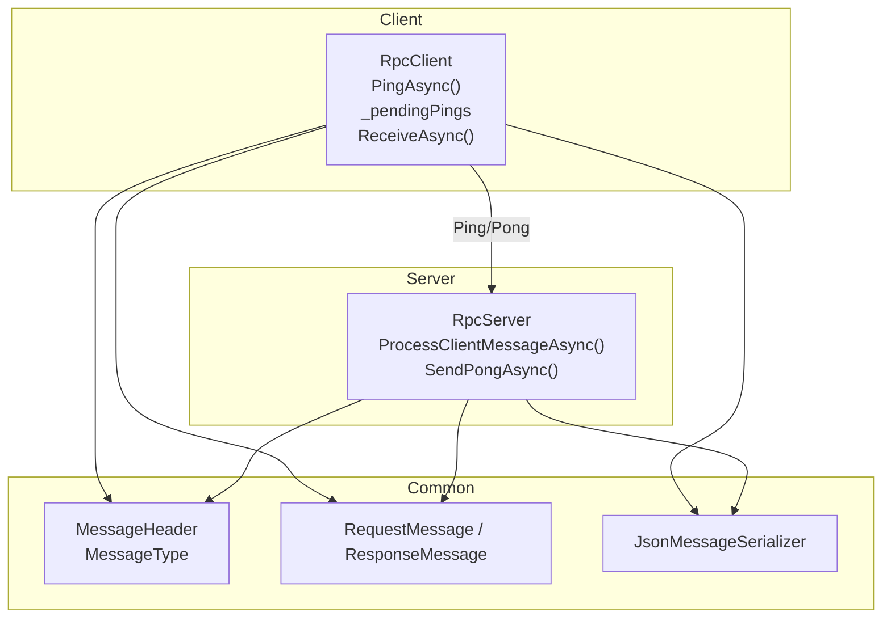
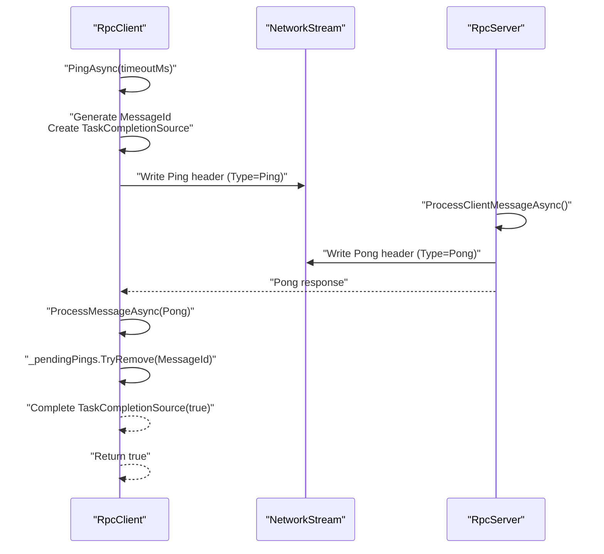
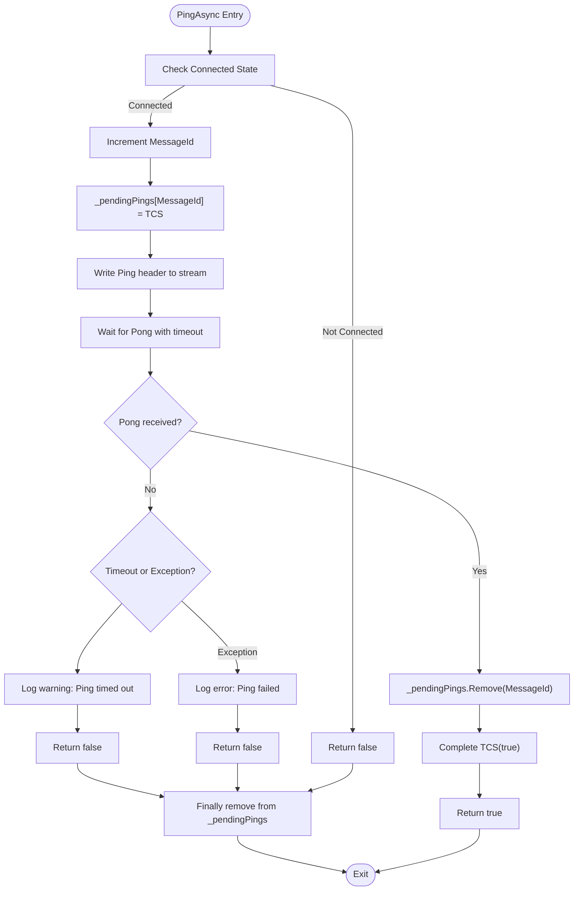
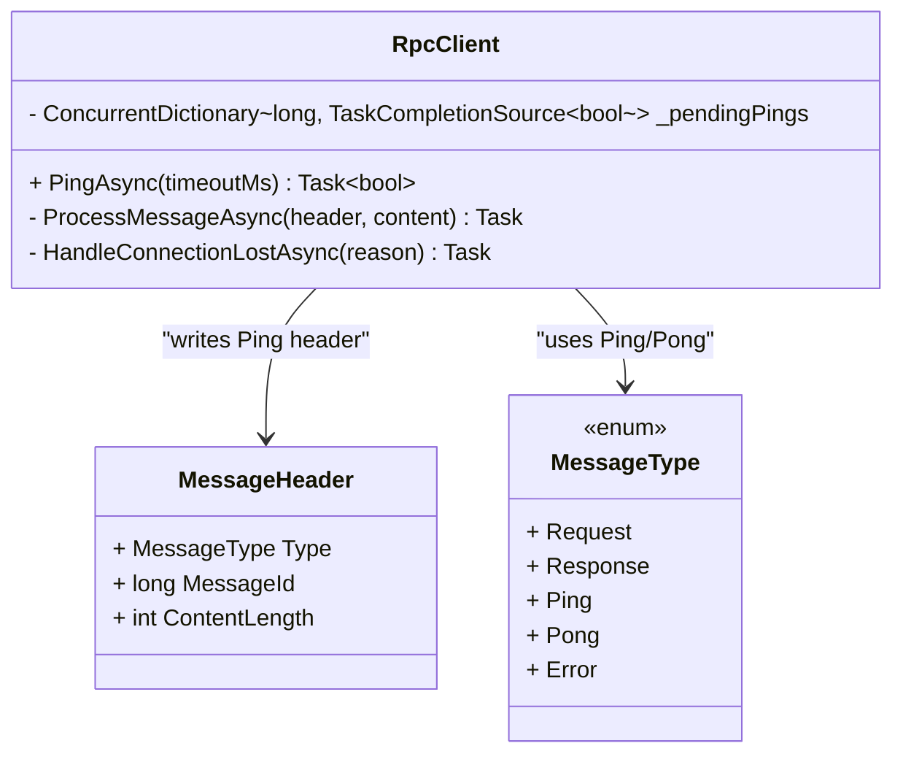
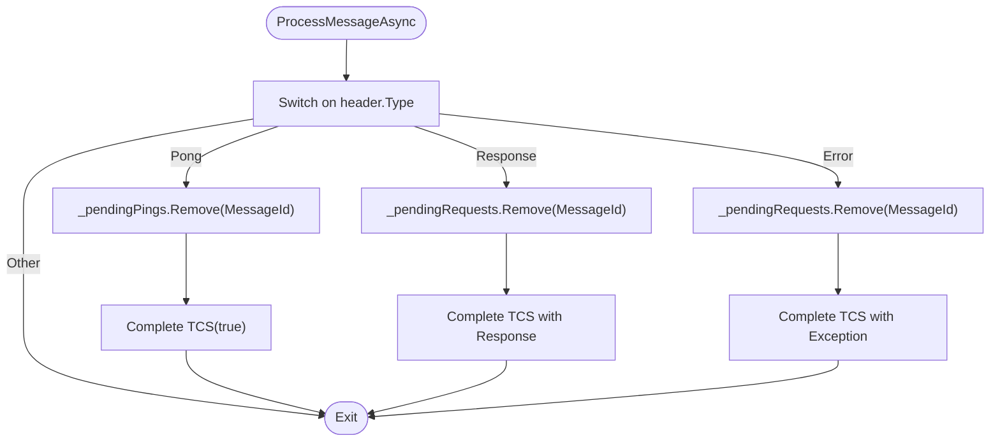
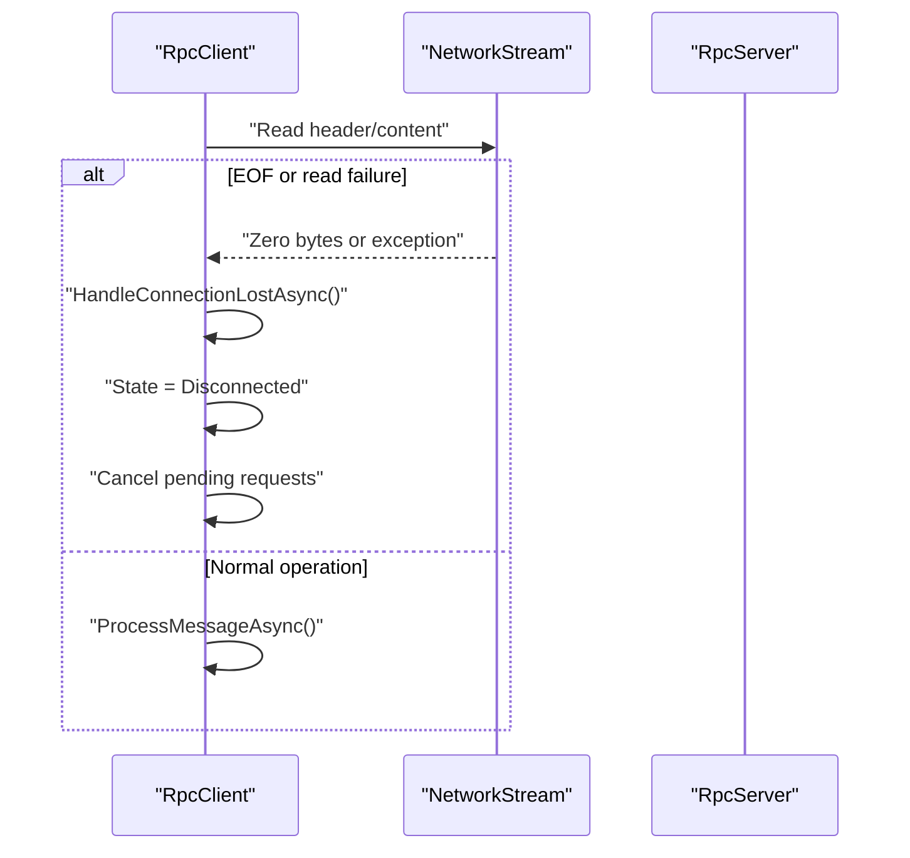
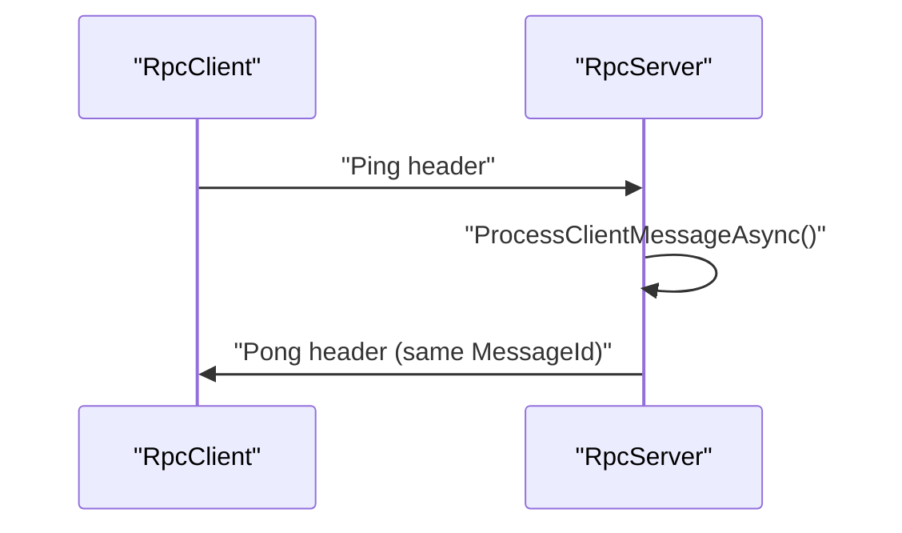
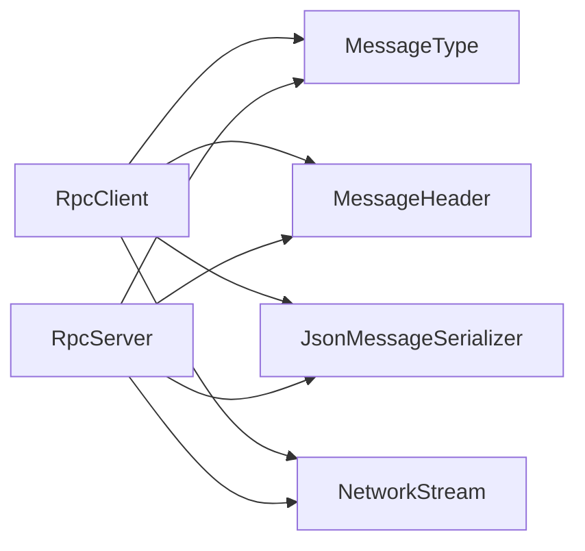

# Heartbeat & Connection Health

<cite>
**Referenced Files in This Document**
- [TcpRpcClient.cs](file://TcpRpc/Client/TcpRpcClient.cs)
- [RpcClientState.cs](file://TcpRpc/Client/RpcClientState.cs)
- [MessageType.cs](file://TcpRpc/Message/MessageType.cs)
- [MessageHeader.cs](file://TcpRpc/Message/MessageHeader.cs)
- [RequestMessage.cs](file://TcpRpc/Message/RequestMessage.cs)
- [ResponseMessage.cs](file://TcpRpc/Message/ResponseMessage.cs)
- [IMessageSerializer.cs](file://TcpRpc/Formatter/IMessageSerializer.cs)
- [JsonMessageSerializer.cs](file://TcpRpc/Formatter/JsonMessageSerializer.cs)
- [TcpRpcServer.cs](file://TcpRpc/Server/TcpRpcServer.cs)
- [RequestHandler.cs](file://TcpRpc/Server/RequestHandler.cs)
- [RpcServerState.cs](file://TcpRpc/Server/RpcServerState.cs)
</cite>

## Table of Contents
1. [Introduction](#introduction)
2. [Project Structure](#project-structure)
3. [Core Components](#core-components)
4. [Architecture Overview](#architecture-overview)
5. [Detailed Component Analysis](#detailed-component-analysis)
6. [Dependency Analysis](#dependency-analysis)
7. [Performance Considerations](#performance-considerations)
8. [Troubleshooting Guide](#troubleshooting-guide)
9. [Conclusion](#conclusion)
10. [Appendices](#appendices)

## Introduction
This document explains the RpcClient heartbeat mechanism and connection health monitoring in the TcpRpc project. It focuses on the PingAsync method, the Ping/Pong message exchange, the role of the _pendingPings dictionary, timeout-based health checking, connection loss detection via stream read operations, automatic state transitions to Disconnected, and cleanup of pending requests. Practical examples demonstrate how to implement periodic heartbeat checks, handle connection timeouts, and build robust health monitoring systems around PingAsync.

## Project Structure
The heartbeat and health monitoring logic spans several modules:
- Client-side RpcClient: connection lifecycle, sending Ping messages, receiving Pong responses, and managing pending pings.
- Message types and headers: defines MessageType.Ping, MessageType.Pong, and the wire protocol used for heartbeats.
- Server-side RpcServer: responds to Ping with Pong, enabling the heartbeat loop.
- Serialization: JSON-based serialization for messages and headers.

**Diagram sources**
- [TcpRpcClient.cs:325-382](file://TcpRpc/Client/TcpRpcClient.cs#L325-L382)
- [MessageType.cs:3-10](file://TcpRpc/Message/MessageType.cs#L3-L10)
- [MessageHeader.cs:5-34](file://TcpRpc/Message/MessageHeader.cs#L5-L34)
- [RequestMessage.cs:3-8](file://TcpRpc/Message/RequestMessage.cs#L3-L8)
- [ResponseMessage.cs:3-9](file://TcpRpc/Message/ResponseMessage.cs#L3-L9)
- [JsonMessageSerializer.cs:6-85](file://TcpRpc/Formatter/JsonMessageSerializer.cs#L6-L85)
- [TcpRpcServer.cs:318-406](file://TcpRpc/Server/TcpRpcServer.cs#L318-L406)

**Section sources**
- [TcpRpcClient.cs:1-405](file://TcpRpc/Client/TcpRpcClient.cs#L1-L405)
- [RpcClientState.cs:3-11](file://TcpRpc/Client/RpcClientState.cs#L3-L11)
- [MessageType.cs:3-10](file://TcpRpc/Message/MessageType.cs#L3-L10)
- [MessageHeader.cs:5-34](file://TcpRpc/Message/MessageHeader.cs#L5-L34)
- [RequestMessage.cs:3-8](file://TcpRpc/Message/RequestMessage.cs#L3-L8)
- [ResponseMessage.cs:3-9](file://TcpRpc/Message/ResponseMessage.cs#L3-L9)
- [IMessageSerializer.cs:5-13](file://TcpRpc/Formatter/IMessageSerializer.cs#L5-L13)
- [JsonMessageSerializer.cs:6-85](file://TcpRpc/Formatter/JsonMessageSerializer.cs#L6-L85)
- [TcpRpcServer.cs:12-432](file://TcpRpc/Server/TcpRpcServer.cs#L12-L432)
- [RequestHandler.cs](file://TcpRpc/Server/RequestHandler.cs#L5)
- [RpcServerState.cs:3-10](file://TcpRpc/Server/RpcServerState.cs#L3-L10)

## Core Components
- RpcClient: Implements connection management, request/response handling, and heartbeat via PingAsync. Maintains _pendingPings to track active ping operations and uses ReceiveAsync to process incoming messages.
- MessageType: Defines Ping and Pong message types used for heartbeat.
- MessageHeader: Encodes/decodes message headers including type, message ID, and content length.
- RpcServer: Processes Ping messages and replies with Pong, enabling the heartbeat loop.

Key responsibilities:
- PingAsync: Sends a Ping message, registers a TaskCompletionSource in _pendingPings, waits for a Pong response with timeout, logs failures, and cleans up.
- ReceiveAsync: Reads headers and content, dispatches to ProcessMessageAsync, and triggers HandleConnectionLostAsync on errors or closure.
- ProcessMessageAsync: Handles Response, Error, and Pong messages; completes pending pings on Pong.
- HandleConnectionLostAsync: Transitions to Disconnected and cancels pending requests.

**Section sources**
- [TcpRpcClient.cs:325-382](file://TcpRpc/Client/TcpRpcClient.cs#L325-L382)
- [TcpRpcClient.cs:205-236](file://TcpRpc/Client/TcpRpcClient.cs#L205-L236)
- [TcpRpcClient.cs:258-287](file://TcpRpc/Client/TcpRpcClient.cs#L258-L287)
- [TcpRpcClient.cs:289-306](file://TcpRpc/Client/TcpRpcClient.cs#L289-L306)
- [MessageType.cs:3-10](file://TcpRpc/Message/MessageType.cs#L3-L10)
- [MessageHeader.cs:5-34](file://TcpRpc/Message/MessageHeader.cs#L5-L34)
- [TcpRpcServer.cs:318-406](file://TcpRpc/Server/TcpRpcServer.cs#L318-L406)

## Architecture Overview
The heartbeat architecture relies on a simple Ping/Pong exchange:
- Client sends MessageType.Ping with a unique MessageId.
- Server responds with MessageType.Pong carrying the same MessageId.
- Client’s ProcessMessageAsync removes the pending ping and completes the TaskCompletionSource.
- PingAsync waits for completion or cancellation on timeout.

**Diagram sources**
- [TcpRpcClient.cs:325-382](file://TcpRpc/Client/TcpRpcClient.cs#L325-L382)
- [TcpRpcClient.cs:258-287](file://TcpRpc/Client/TcpRpcClient.cs#L258-L287)
- [TcpRpcServer.cs:318-406](file://TcpRpc/Server/TcpRpcServer.cs#L318-L406)
- [MessageType.cs:3-10](file://TcpRpc/Message/MessageType.cs#L3-L10)
- [MessageHeader.cs:5-34](file://TcpRpc/Message/MessageHeader.cs#L5-L34)

## Detailed Component Analysis

### RpcClient PingAsync Implementation
- Validates state and increments MessageId.
- Registers a TaskCompletionSource in _pendingPings keyed by MessageId.
- Writes a Ping header with zero-length content.
- Waits for Pong completion with a combined timeout (Ping timeout plus global cancellation).
- On success, returns true; on timeout, logs a warning and returns false; on exceptions, logs an error and returns false.
- Ensures cleanup of _pendingPings in finally.

**Diagram sources**
- [TcpRpcClient.cs:325-382](file://TcpRpc/Client/TcpRpcClient.cs#L325-L382)

**Section sources**
- [TcpRpcClient.cs:325-382](file://TcpRpc/Client/TcpRpcClient.cs#L325-L382)

### Pending Pings Dictionary (_pendingPings)
- Purpose: Tracks active ping operations keyed by MessageId.
- Behavior: Added before sending Ping, removed upon receiving Pong or on timeout/exception.
- Thread-safety: Uses ConcurrentDictionary for safe concurrent access.

**Diagram sources**
- [TcpRpcClient.cs:22-22](file://TcpRpc/Client/TcpRpcClient.cs#L22-L22)
- [TcpRpcClient.cs:325-382](file://TcpRpc/Client/TcpRpcClient.cs#L325-L382)
- [MessageHeader.cs:5-34](file://TcpRpc/Message/MessageHeader.cs#L5-L34)
- [MessageType.cs:3-10](file://TcpRpc/Message/MessageType.cs#L3-L10)

**Section sources**
- [TcpRpcClient.cs:22-22](file://TcpRpc/Client/TcpRpcClient.cs#L22-L22)
- [TcpRpcClient.cs:325-382](file://TcpRpc/Client/TcpRpcClient.cs#L325-L382)

### ProcessMessageAsync Handling of Pong Responses
- Receives incoming messages and routes by MessageType.
- On MessageType.Pong, removes the corresponding TaskCompletionSource from _pendingPings and completes it with true.
- Completes pending RPC requests on Response/Error.
- No special handling for Ping here; server handles Ping and sends Pong.

**Diagram sources**
- [TcpRpcClient.cs:258-287](file://TcpRpc/Client/TcpRpcClient.cs#L258-L287)

**Section sources**
- [TcpRpcClient.cs:258-287](file://TcpRpc/Client/TcpRpcClient.cs#L258-L287)

### Connection Loss Detection and State Transitions
- ReceiveAsync reads headers and content in a loop while connected.
- ReadBytesAsync detects EOF (read == 0) and triggers HandleConnectionLostAsync.
- HandleConnectionLostAsync:
  - Sets state to Disconnected if currently Connected.
  - Cancels all pending RPC requests with a connection-lost exception.
  - Clears pending requests.
- DisconnectAsync also transitions to Disconnected and cancels pending requests.

**Diagram sources**
- [TcpRpcClient.cs:205-236](file://TcpRpc/Client/TcpRpcClient.cs#L205-L236)
- [TcpRpcClient.cs:238-256](file://TcpRpc/Client/TcpRpcClient.cs#L238-L256)
- [TcpRpcClient.cs:289-306](file://TcpRpc/Client/TcpRpcClient.cs#L289-L306)
- [RpcClientState.cs:3-11](file://TcpRpc/Client/RpcClientState.cs#L3-L11)

**Section sources**
- [TcpRpcClient.cs:205-236](file://TcpRpc/Client/TcpRpcClient.cs#L205-L236)
- [TcpRpcClient.cs:238-256](file://TcpRpc/Client/TcpRpcClient.cs#L238-L256)
- [TcpRpcClient.cs:289-306](file://TcpRpc/Client/TcpRpcClient.cs#L289-L306)
- [RpcClientState.cs:3-11](file://TcpRpc/Client/RpcClientState.cs#L3-L11)

### Server-Side Ping Handling
- RpcServer.ProcessClientMessageAsync recognizes MessageType.Ping and calls SendPongAsync.
- SendPongAsync writes a Pong header with the same MessageId, enabling the client to correlate responses.

**Diagram sources**
- [TcpRpcServer.cs:318-406](file://TcpRpc/Server/TcpRpcServer.cs#L318-L406)
- [MessageType.cs:3-10](file://TcpRpc/Message/MessageType.cs#L3-L10)
- [MessageHeader.cs:5-34](file://TcpRpc/Message/MessageHeader.cs#L5-L34)

**Section sources**
- [TcpRpcServer.cs:318-406](file://TcpRpc/Server/TcpRpcServer.cs#L318-L406)

## Dependency Analysis
- RpcClient depends on:
  - MessageHeader and MessageType for encoding/decoding Ping/Pong.
  - JsonMessageSerializer for request/response serialization (used elsewhere).
  - NetworkStream for IO operations.
  - ConcurrentDictionary for _pendingPings and _pendingRequests.
- RpcServer depends on:
  - MessageHeader and MessageType for Ping/Pong handling.
  - JsonMessageSerializer for request/response serialization.
  - NetworkStream for IO operations.

**Diagram sources**
- [TcpRpcClient.cs:1-41](file://TcpRpc/Client/TcpRpcClient.cs#L1-L41)
- [TcpRpcServer.cs:1-48](file://TcpRpc/Server/TcpRpcServer.cs#L1-L48)
- [MessageType.cs:3-10](file://TcpRpc/Message/MessageType.cs#L3-L10)
- [MessageHeader.cs:5-34](file://TcpRpc/Message/MessageHeader.cs#L5-L34)
- [JsonMessageSerializer.cs:6-85](file://TcpRpc/Formatter/JsonMessageSerializer.cs#L6-L85)

**Section sources**
- [TcpRpcClient.cs:1-41](file://TcpRpc/Client/TcpRpcClient.cs#L1-L41)
- [TcpRpcServer.cs:1-48](file://TcpRpc/Server/TcpRpcServer.cs#L1-L48)
- [JsonMessageSerializer.cs:6-85](file://TcpRpc/Formatter/JsonMessageSerializer.cs#L6-L85)

## Performance Considerations
- Ping frequency: Choose a balance between responsiveness and overhead. Too frequent pings increase network traffic; too infrequent may delay failure detection.
- Timeout tuning: Ping timeout should exceed typical RTTs and account for potential delays. Combine with global cancellation to prevent indefinite waits.
- Concurrency: _pendingPings and _pendingRequests are thread-safe dictionaries; keep ping operations minimal and avoid blocking operations inside handlers.
- Logging: Excessive warnings/errors can impact performance. Use appropriate log levels and consider sampling for high-frequency heartbeats.

## Troubleshooting Guide
Common scenarios and remedies:
- Ping timeouts:
  - Verify server availability and network connectivity.
  - Increase Ping timeout if latency is high.
  - Check for server overload or slow handlers.
- Connection drops:
  - Inspect ReadBytesAsync EOF handling and HandleConnectionLostAsync behavior.
  - Ensure DisconnectAsync is called to clean up resources and pending requests.
- Pending ping not completing:
  - Confirm ProcessMessageAsync receives MessageType.Pong and removes entries from _pendingPings.
  - Validate MessageId correlation between Ping and Pong.
- Logging:
  - Ping timeout warnings indicate potential network issues or server unresponsiveness.
  - Ping failures are logged with exceptions for diagnostics.

**Section sources**
- [TcpRpcClient.cs:368-377](file://TcpRpc/Client/TcpRpcClient.cs#L368-L377)
- [TcpRpcClient.cs:289-306](file://TcpRpc/Client/TcpRpcClient.cs#L289-L306)
- [TcpRpcClient.cs:258-287](file://TcpRpc/Client/TcpRpcClient.cs#L258-L287)

## Conclusion
The RpcClient heartbeat mechanism leverages a lightweight Ping/Pong exchange to monitor connection health. _pendingPings coordinates active ping operations, while ProcessMessageAsync correlates Pong responses to complete pending operations. Connection loss is detected via stream read failures, transitioning the client to Disconnected and cleaning up pending requests. By tuning ping intervals and timeouts, and integrating robust logging, developers can build reliable health monitoring systems around PingAsync.

## Appendices

### Practical Examples

- Periodic heartbeat checks:
  - Run a background task that periodically calls PingAsync with a reasonable timeout.
  - Track consecutive failures and trigger reconnection attempts when thresholds are exceeded.
  - Example pattern: schedule a timer to call PingAsync every N seconds; on false, increment failure counter; on success, reset counter.

- Handling connection timeouts:
  - Use PingAsync with a shorter timeout to detect stalls quickly.
  - On timeout, mark the connection unhealthy, cancel pending requests, and attempt reconnect.
  - Combine with DisconnectAsync to ensure cleanup.

- Building health monitoring systems:
  - Expose a health endpoint that reports last successful ping time and failure count.
  - Integrate with external monitoring to alert on sustained ping failures or state transitions to Disconnected.
  - Log heartbeat outcomes and include correlation IDs for traceability.

[No sources needed since this section provides general guidance]