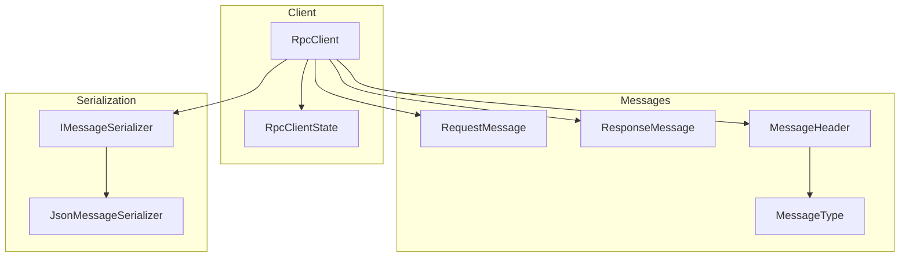
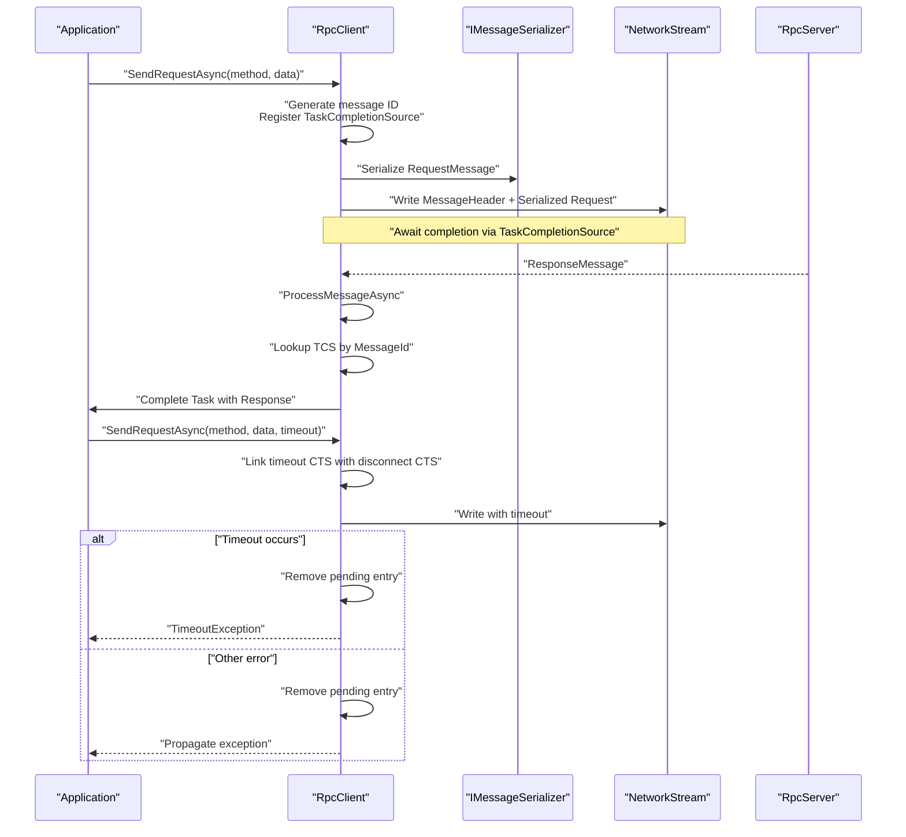
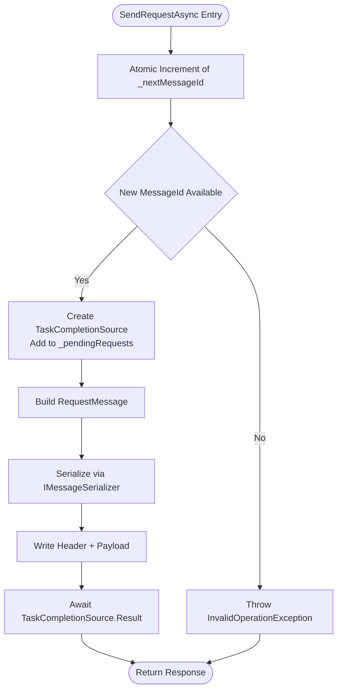
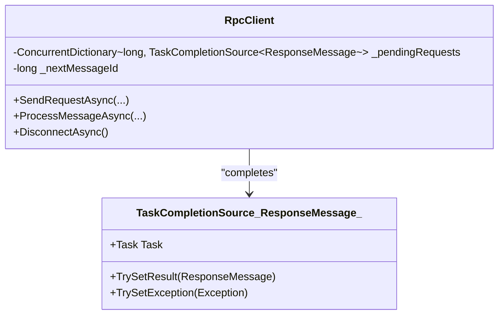
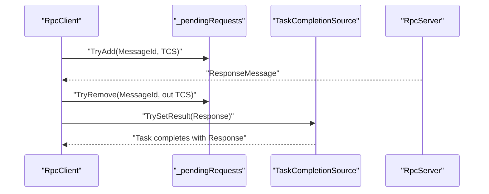
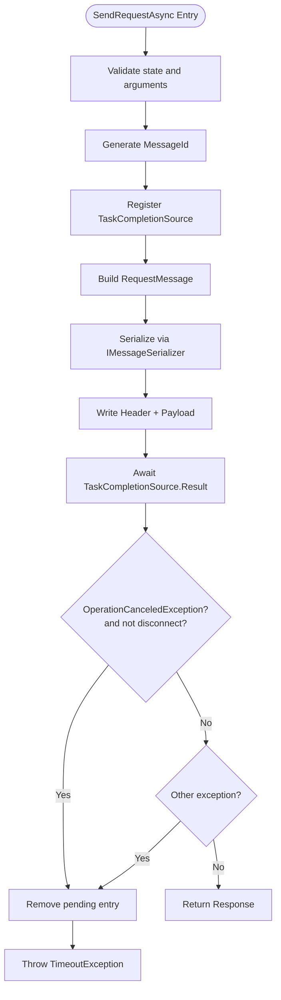
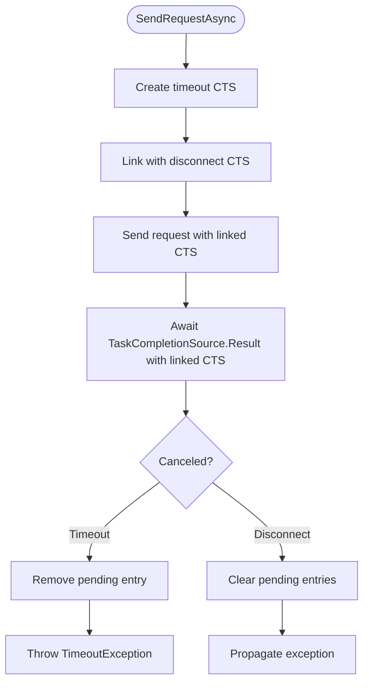
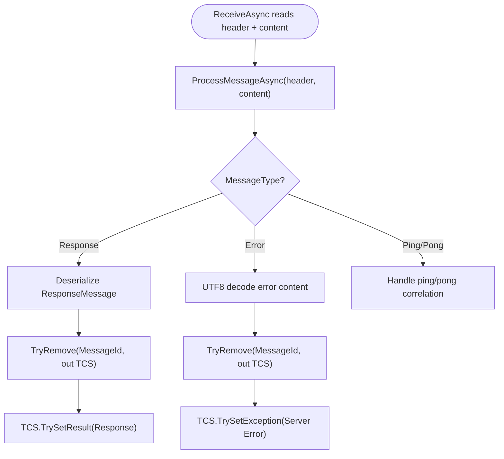
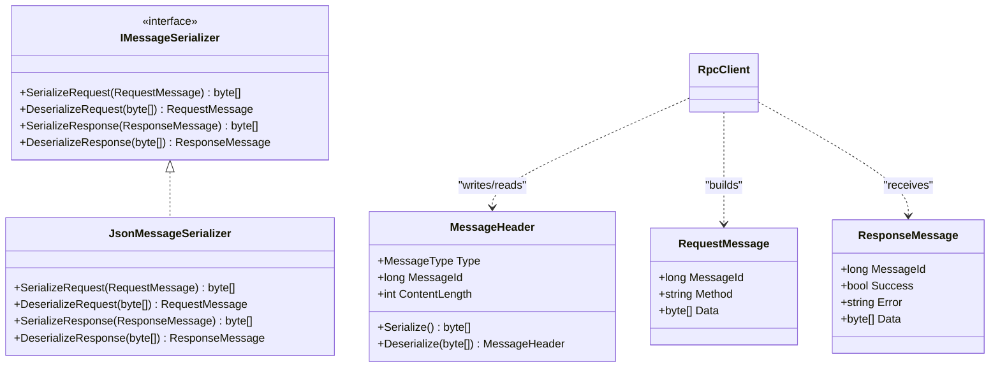
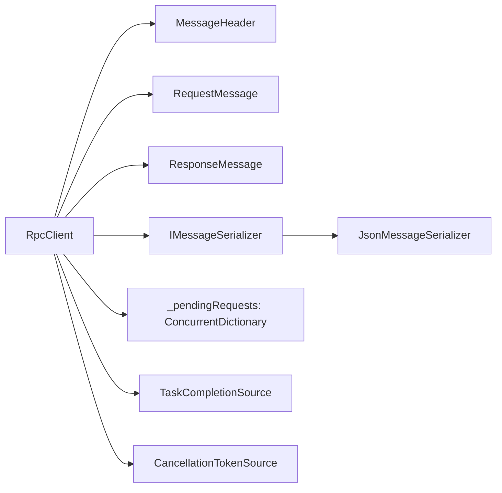

# Request/Response Correlation

<cite>
**Referenced Files in This Document**
- [TcpRpcClient.cs](file://TcpRpc/Client/TcpRpcClient.cs)
- [RpcClientState.cs](file://TcpRpc/Client/RpcClientState.cs)
- [RequestMessage.cs](file://TcpRpc/Message/RequestMessage.cs)
- [ResponseMessage.cs](file://TcpRpc/Message/ResponseMessage.cs)
- [MessageHeader.cs](file://TcpRpc/Message/MessageHeader.cs)
- [MessageType.cs](file://TcpRpc/Message/MessageType.cs)
- [IMessageSerializer.cs](file://TcpRpc/Formatter/IMessageSerializer.cs)
- [JsonMessageSerializer.cs](file://TcpRpc/Formatter/JsonMessageSerializer.cs)
</cite>

## Table of Contents
1. [Introduction](#introduction)
2. [Project Structure](#project-structure)
3. [Core Components](#core-components)
4. [Architecture Overview](#architecture-overview)
5. [Detailed Component Analysis](#detailed-component-analysis)
6. [Dependency Analysis](#dependency-analysis)
7. [Performance Considerations](#performance-considerations)
8. [Troubleshooting Guide](#troubleshooting-guide)
9. [Conclusion](#conclusion)

## Introduction
This document explains the request/response correlation mechanism in the RpcClient, focusing on how message IDs are generated and tracked, how asynchronous responses are coordinated, and how timeouts and errors are handled. It covers the thread-safe sequential ID generation using atomic increments, the concurrent dictionary-based pending requests tracking system, and the TaskCompletionSource-based async response handling. It also documents the SendRequestAsync method (both generic and byte-array overloads), timeout handling with cancellation tokens, and the ProcessMessageAsync method that routes responses to waiting requests, handles server error messages, and manages correlation cleanup.

## Project Structure
The RpcClient resides in the client layer and interacts with message serialization, message headers, and message types. The key components involved in correlation are:
- RpcClient: orchestrates connection, sending requests, receiving responses, and correlation cleanup
- Message types and headers: define the wire protocol and carry correlation metadata
- Serializers: convert typed messages to/from bytes for transport
- Client state machine: guards operations and ensures safe transitions

**Diagram sources**
- [TcpRpcClient.cs:11-41](file://TcpRpc/Client/TcpRpcClient.cs#L11-L41)
- [RequestMessage.cs:3-8](file://TcpRpc/Message/RequestMessage.cs#L3-L8)
- [ResponseMessage.cs:3-9](file://TcpRpc/Message/ResponseMessage.cs#L3-L9)
- [MessageHeader.cs:5-34](file://TcpRpc/Message/MessageHeader.cs#L5-L34)
- [MessageType.cs:3-10](file://TcpRpc/Message/MessageType.cs#L3-L10)
- [IMessageSerializer.cs:5-13](file://TcpRpc/Formatter/IMessageSerializer.cs#L5-L13)
- [JsonMessageSerializer.cs:6-85](file://TcpRpc/Formatter/JsonMessageSerializer.cs#L6-L85)
- [RpcClientState.cs:3-11](file://TcpRpc/Client/RpcClientState.cs#L3-L11)

**Section sources**
- [TcpRpcClient.cs:11-41](file://TcpRpc/Client/TcpRpcClient.cs#L11-L41)
- [RpcClientState.cs:3-11](file://TcpRpc/Client/RpcClientState.cs#L3-L11)

## Core Components
- Message ID generation: Uses atomic increment to produce sequential, thread-safe IDs for correlating requests and responses.
- Pending requests tracking: Maintains a concurrent dictionary keyed by message ID to coordinate awaiting tasks.
- Async response coordination: Uses TaskCompletionSource to complete pending tasks when correlated responses arrive.
- SendRequestAsync: Creates a request, registers a pending correlation, serializes and sends the request, and waits for completion with timeout.
- ProcessMessageAsync: Receives messages, deserializes them, routes responses to the correct pending task, handles error messages, and cleans up correlation entries.

**Section sources**
- [TcpRpcClient.cs:18-19](file://TcpRpc/Client/TcpRpcClient.cs#L18-L19)
- [TcpRpcClient.cs:139](file://TcpRpc/Client/TcpRpcClient.cs#L139)
- [TcpRpcClient.cs:140](file://TcpRpc/Client/TcpRpcClient.cs#L140)
- [TcpRpcClient.cs:258-287](file://TcpRpc/Client/TcpRpcClient.cs#L258-L287)

## Architecture Overview
The correlation mechanism spans request creation, transmission, reception, and response routing. The diagram below shows the end-to-end flow for a single request.

**Diagram sources**
- [TcpRpcClient.cs:132-189](file://TcpRpc/Client/TcpRpcClient.cs#L132-L189)
- [TcpRpcClient.cs:258-287](file://TcpRpc/Client/TcpRpcClient.cs#L258-L287)
- [IMessageSerializer.cs:7-12](file://TcpRpc/Formatter/IMessageSerializer.cs#L7-L12)
- [MessageHeader.cs:13-20](file://TcpRpc/Message/MessageHeader.cs#L13-L20)

## Detailed Component Analysis

### Message ID Generation and Thread Safety
- Sequential IDs: The next message ID is generated atomically using an increment operation on a shared counter. This guarantees monotonic, unique IDs across threads.
- Atomicity: The increment operation prevents race conditions when multiple requests are sent concurrently.
- Overflow behavior: Long overflow semantics are acceptable for correlation keys; the risk of collisions is mitigated by the short-lived nature of pending entries and the high uniqueness of IDs under typical load.

**Diagram sources**
- [TcpRpcClient.cs:139](file://TcpRpc/Client/TcpRpcClient.cs#L139)
- [TcpRpcClient.cs:140](file://TcpRpc/Client/TcpRpcClient.cs#L140)
- [TcpRpcClient.cs:145-150](file://TcpRpc/Client/TcpRpcClient.cs#L145-L150)
- [IMessageSerializer.cs:7-12](file://TcpRpc/Formatter/IMessageSerializer.cs#L7-L12)

**Section sources**
- [TcpRpcClient.cs:139](file://TcpRpc/Client/TcpRpcClient.cs#L139)
- [TcpRpcClient.cs:140](file://TcpRpc/Client/TcpRpcClient.cs#L140)

### Pending Requests Tracking with ConcurrentDictionary
- Registration: Each outgoing request registers a TaskCompletionSource under its message ID in a concurrent dictionary for fast lookup.
- Lookup and completion: Incoming responses remove the entry and complete the associated TaskCompletionSource with the response.
- Cleanup: On disconnect or connection loss, all pending entries are canceled to prevent indefinite waits.

**Diagram sources**
- [TcpRpcClient.cs:18](file://TcpRpc/Client/TcpRpcClient.cs#L18)
- [TcpRpcClient.cs:140](file://TcpRpc/Client/TcpRpcClient.cs#L140)
- [TcpRpcClient.cs:264](file://TcpRpc/Client/TcpRpcClient.cs#L264)

**Section sources**
- [TcpRpcClient.cs:18](file://TcpRpc/Client/TcpRpcClient.cs#L18)
- [TcpRpcClient.cs:140](file://TcpRpc/Client/TcpRpcClient.cs#L140)
- [TcpRpcClient.cs:264](file://TcpRpc/Client/TcpRpcClient.cs#L264)

### TaskCompletionSource-Based Async Response Handling
- Continuation scheduling: TaskCompletionSource is created with options to schedule continuations asynchronously, avoiding potential deadlocks.
- Completion paths:
  - Successful response: completes the task with the response
  - Server error: completes the task with an exception containing server error details
  - Timeout or disconnect: removes the pending entry and propagates exceptions
- Backpressure: The send lock ensures serialized writes, preventing interleaving and simplifying correlation.

**Diagram sources**
- [TcpRpcClient.cs:140](file://TcpRpc/Client/TcpRpcClient.cs#L140)
- [TcpRpcClient.cs:264](file://TcpRpc/Client/TcpRpcClient.cs#L264)
- [TcpRpcClient.cs:274](file://TcpRpc/Client/TcpRpcClient.cs#L274)

**Section sources**
- [TcpRpcClient.cs:140](file://TcpRpc/Client/TcpRpcClient.cs#L140)
- [TcpRpcClient.cs:264](file://TcpRpc/Client/TcpRpcClient.cs#L264)
- [TcpRpcClient.cs:274](file://TcpRpc/Client/TcpRpcClient.cs#L274)

### SendRequestAsync Method: Generic and Byte Array Overloads
- Byte array overload:
  - Generates message ID, registers TaskCompletionSource, builds RequestMessage, serializes it, writes header and payload, and awaits completion with a combined cancellation token (timeout plus disconnect).
  - Handles timeout and other exceptions by removing the pending entry and rethrowing.
- Generic overload:
  - Serializes the data to bytes, delegates to the byte array overload, checks response success, and deserializes the result.

**Diagram sources**
- [TcpRpcClient.cs:132-189](file://TcpRpc/Client/TcpRpcClient.cs#L132-L189)
- [TcpRpcClient.cs:191-203](file://TcpRpc/Client/TcpRpcClient.cs#L191-L203)
- [IMessageSerializer.cs:7-12](file://TcpRpc/Formatter/IMessageSerializer.cs#L7-L12)

**Section sources**
- [TcpRpcClient.cs:132-189](file://TcpRpc/Client/TcpRpcClient.cs#L132-L189)
- [TcpRpcClient.cs:191-203](file://TcpRpc/Client/TcpRpcClient.cs#L191-L203)

### Timeout Handling with CancellationTokenSource
- Combined cancellation: The method creates a timeout cancellation token and links it with the client’s disconnect cancellation token. This ensures that either a timeout or a disconnect cancels the operation.
- Timeout propagation: When cancellation occurs due to timeout, the pending entry is removed and a timeout exception is thrown.
- Disconnect propagation: When cancellation occurs due to disconnect, pending entries are cleared and exceptions are set to indicate connection loss.

**Diagram sources**
- [TcpRpcClient.cs:162-188](file://TcpRpc/Client/TcpRpcClient.cs#L162-L188)
- [TcpRpcClient.cs:119-123](file://TcpRpc/Client/TcpRpcClient.cs#L119-L123)
- [TcpRpcClient.cs:299-303](file://TcpRpc/Client/TcpRpcClient.cs#L299-L303)

**Section sources**
- [TcpRpcClient.cs:162-188](file://TcpRpc/Client/TcpRpcClient.cs#L162-L188)
- [TcpRpcClient.cs:119-123](file://TcpRpc/Client/TcpRpcClient.cs#L119-L123)
- [TcpRpcClient.cs:299-303](file://TcpRpc/Client/TcpRpcClient.cs#L299-L303)

### ProcessMessageAsync: Routing Responses and Error Handling
- Response routing: Deserializes the response, looks up the TaskCompletionSource by message ID, removes the entry, and completes it with the response.
- Error handling: For server error messages, deserializes the error content, removes the pending entry, and completes the TaskCompletionSource with an exception containing server error details.
- Cleanup: Ensures correlation entries are removed upon successful routing or error propagation.

**Diagram sources**
- [TcpRpcClient.cs:205-236](file://TcpRpc/Client/TcpRpcClient.cs#L205-L236)
- [TcpRpcClient.cs:258-287](file://TcpRpc/Client/TcpRpcClient.cs#L258-L287)
- [IMessageSerializer.cs:11-12](file://TcpRpc/Formatter/IMessageSerializer.cs#L11-L12)

**Section sources**
- [TcpRpcClient.cs:258-287](file://TcpRpc/Client/TcpRpcClient.cs#L258-L287)

### Concurrent Request Handling Example Scenarios
- Multiple concurrent requests: Each request generates a unique message ID, registers a separate TaskCompletionSource, and awaits independently. Responses are routed back to the correct awaiting task based on the message ID.
- Timeout scenario: If a request does not receive a response within the configured timeout, the pending entry is removed and a timeout exception is thrown.
- Proper error handling: On server-side errors, the response carries an error flag and message; the client completes the TaskCompletionSource with an exception, allowing callers to handle failures gracefully.

[No sources needed since this section provides conceptual examples]

### Wire Protocol and Serialization
- MessageHeader: Encodes type, message ID, and content length for framing.
- RequestMessage: Carries method name and serialized data payload.
- ResponseMessage: Carries success flag, optional error message, and optional data payload.
- JsonMessageSerializer: Converts typed messages to/from UTF-8 JSON bytes with validation.

**Diagram sources**
- [MessageHeader.cs:5-34](file://TcpRpc/Message/MessageHeader.cs#L5-L34)
- [RequestMessage.cs:3-8](file://TcpRpc/Message/RequestMessage.cs#L3-L8)
- [ResponseMessage.cs:3-9](file://TcpRpc/Message/ResponseMessage.cs#L3-L9)
- [IMessageSerializer.cs:5-13](file://TcpRpc/Formatter/IMessageSerializer.cs#L5-L13)
- [JsonMessageSerializer.cs:6-85](file://TcpRpc/Formatter/JsonMessageSerializer.cs#L6-L85)

**Section sources**
- [MessageHeader.cs:5-34](file://TcpRpc/Message/MessageHeader.cs#L5-L34)
- [RequestMessage.cs:3-8](file://TcpRpc/Message/RequestMessage.cs#L3-L8)
- [ResponseMessage.cs:3-9](file://TcpRpc/Message/ResponseMessage.cs#L3-L9)
- [IMessageSerializer.cs:5-13](file://TcpRpc/Formatter/IMessageSerializer.cs#L5-L13)
- [JsonMessageSerializer.cs:6-85](file://TcpRpc/Formatter/JsonMessageSerializer.cs#L6-L85)

## Dependency Analysis
The RpcClient depends on:
- Message types and headers for framing and correlation
- Serializer interface for transport encoding/decoding
- ConcurrentDictionary for thread-safe correlation tracking
- TaskCompletionSource for async coordination
- CancellationTokenSource for timeout and disconnect propagation

**Diagram sources**
- [TcpRpcClient.cs:11-41](file://TcpRpc/Client/TcpRpcClient.cs#L11-L41)
- [IMessageSerializer.cs:5-13](file://TcpRpc/Formatter/IMessageSerializer.cs#L5-L13)
- [JsonMessageSerializer.cs:6-85](file://TcpRpc/Formatter/JsonMessageSerializer.cs#L6-L85)
- [MessageHeader.cs:5-34](file://TcpRpc/Message/MessageHeader.cs#L5-L34)
- [RequestMessage.cs:3-8](file://TcpRpc/Message/RequestMessage.cs#L3-L8)
- [ResponseMessage.cs:3-9](file://TcpRpc/Message/ResponseMessage.cs#L3-L9)

**Section sources**
- [TcpRpcClient.cs:11-41](file://TcpRpc/Client/TcpRpcClient.cs#L11-L41)
- [IMessageSerializer.cs:5-13](file://TcpRpc/Formatter/IMessageSerializer.cs#L5-L13)
- [JsonMessageSerializer.cs:6-85](file://TcpRpc/Formatter/JsonMessageSerializer.cs#L6-L85)
- [MessageHeader.cs:5-34](file://TcpRpc/Message/MessageHeader.cs#L5-L34)
- [RequestMessage.cs:3-8](file://TcpRpc/Message/RequestMessage.cs#L3-L8)
- [ResponseMessage.cs:3-9](file://TcpRpc/Message/ResponseMessage.cs#L3-L9)

## Performance Considerations
- Atomic ID generation: Interlocked.Increment is lock-free and efficient for generating unique IDs.
- ConcurrentDictionary: Provides O(1) average-time operations for registration and lookup, suitable for high concurrency.
- TaskCompletionSource continuation scheduling: Asynchronous continuation scheduling avoids potential deadlocks in synchronous contexts.
- Serialization overhead: JSON serialization/deserialization adds CPU cost; consider binary serializers for higher throughput if needed.
- Backpressure: The send lock prevents interleaving and simplifies correlation correctness at the cost of serialized writes; consider batching or pipelining if latency is critical.

[No sources needed since this section provides general guidance]

## Troubleshooting Guide
Common issues and resolutions:
- TimeoutException: Indicates the request did not complete within the configured timeout. Verify server responsiveness and adjust timeout values accordingly.
- InvalidOperationException on server error: The server responded with an error; inspect the error message and fix the underlying issue.
- Connection lost during request: Pending requests are completed with exceptions indicating connection loss; reconnect and retry as appropriate.
- Duplicate message ID registration: Should not occur under normal operation; investigate if repeated IDs are observed.

**Section sources**
- [TcpRpcClient.cs:180-188](file://TcpRpc/Client/TcpRpcClient.cs#L180-L188)
- [TcpRpcClient.cs:197-199](file://TcpRpc/Client/TcpRpcClient.cs#L197-L199)
- [TcpRpcClient.cs:299-303](file://TcpRpc/Client/TcpRpcClient.cs#L299-L303)

## Conclusion
The RpcClient’s request/response correlation mechanism combines atomic message ID generation, concurrent dictionary tracking, and TaskCompletionSource-based async coordination to provide reliable, thread-safe request-response semantics over TCP. The design cleanly separates concerns between request construction, transport framing, response routing, and error handling, enabling robust handling of timeouts, disconnects, and server errors.