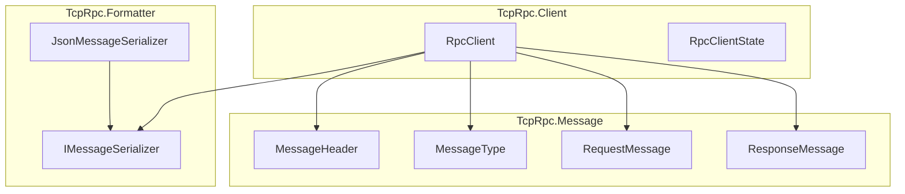
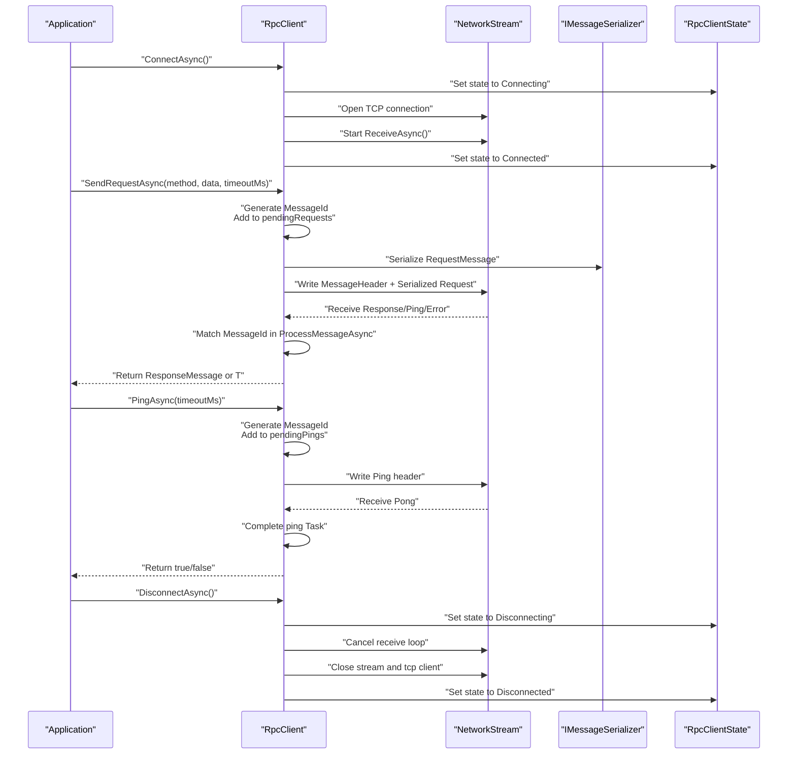
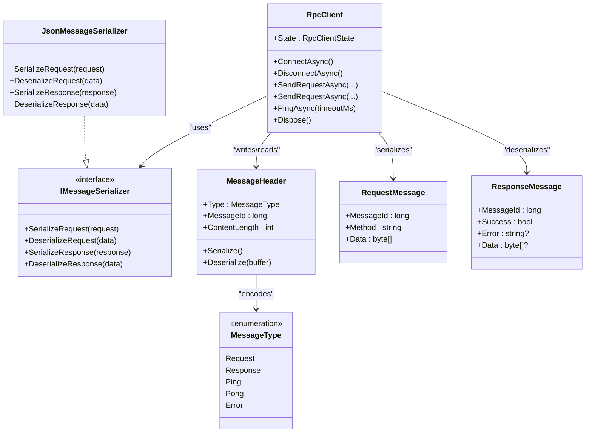
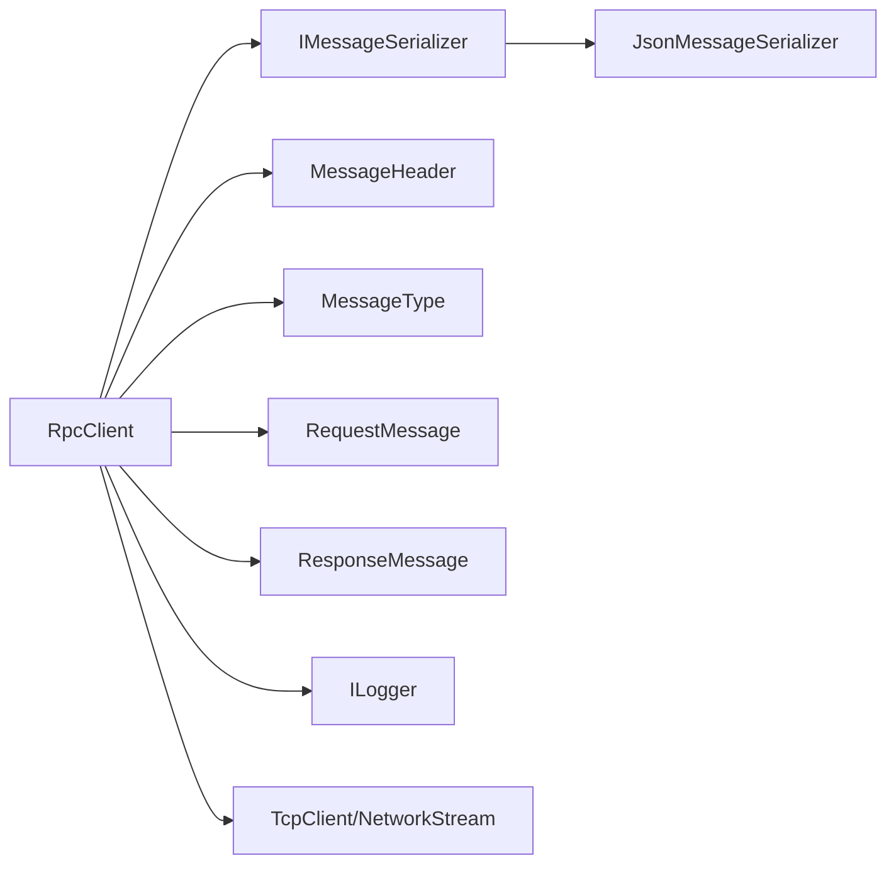

# RpcClient Implementation

<cite>
**Referenced Files in This Document**
- [TcpRpcClient.cs](file://TcpRpc/Client/TcpRpcClient.cs)
- [RpcClientState.cs](file://TcpRpc/Client/RpcClientState.cs)
- [IMessageSerializer.cs](file://TcpRpc/Formatter/IMessageSerializer.cs)
- [JsonMessageSerializer.cs](file://TcpRpc/Formatter/JsonMessageSerializer.cs)
- [MessageHeader.cs](file://TcpRpc/Message/MessageHeader.cs)
- [MessageType.cs](file://TcpRpc/Message/MessageType.cs)
- [RequestMessage.cs](file://TcpRpc/Message/RequestMessage.cs)
- [ResponseMessage.cs](file://TcpRpc/Message/ResponseMessage.cs)
- [TcpRpc.csproj](file://TcpRpc/TcpRpc.csproj)
</cite>

## Table of Contents
1. [Introduction](#introduction)
2. [Project Structure](#project-structure)
3. [Core Components](#core-components)
4. [Architecture Overview](#architecture-overview)
5. [Detailed Component Analysis](#detailed-component-analysis)
6. [Dependency Analysis](#dependency-analysis)
7. [Performance Considerations](#performance-considerations)
8. [Troubleshooting Guide](#troubleshooting-guide)
9. [Conclusion](#conclusion)
10. [Appendices](#appendices)

## Introduction
This document provides comprehensive documentation for the RpcClient implementation, focusing on the TcpRpcClient class architecture and the RpcClientState class that manages client state transitions. It explains connection establishment, TCP socket management, bidirectional communication handling, request/response correlation, heartbeat/ping-pong mechanisms, automatic reconnection behavior, graceful disconnection procedures, and configuration parameters such as timeouts. Practical examples demonstrate initialization, connection establishment, request sending with correlation, and proper resource cleanup.

## Project Structure
The RpcClient resides in the TcpRpc.Client namespace and integrates with message serialization, message headers, and message types defined in the TcpRpc.Message and TcpRpc.Formatter namespaces. The project targets .NET 10 and uses Microsoft.Extensions.Logging for logging.



**Diagram sources**
- [TcpRpcClient.cs:11-405](file://TcpRpc/Client/TcpRpcClient.cs#L11-L405)
- [RpcClientState.cs:3-11](file://TcpRpc/Client/RpcClientState.cs#L3-L11)
- [IMessageSerializer.cs:5-13](file://TcpRpc/Formatter/IMessageSerializer.cs#L5-L13)
- [JsonMessageSerializer.cs:6-85](file://TcpRpc/Formatter/JsonMessageSerializer.cs#L6-L85)
- [MessageHeader.cs:5-34](file://TcpRpc/Message/MessageHeader.cs#L5-L34)
- [MessageType.cs:3-10](file://TcpRpc/Message/MessageType.cs#L3-L10)
- [RequestMessage.cs:3-8](file://TcpRpc/Message/RequestMessage.cs#L3-L8)
- [ResponseMessage.cs:3-9](file://TcpRpc/Message/ResponseMessage.cs#L3-L9)

**Section sources**
- [TcpRpc.csproj:1-17](file://TcpRpc/TcpRpc.csproj#L1-L17)

## Core Components
- RpcClient: Implements asynchronous TCP-based RPC client with connection lifecycle management, request/response correlation, and heartbeat support.
- RpcClientState: Enumerates client state transitions (Created, Connecting, Connected, Disconnecting, Disconnected, Faulted).
- IMessageSerializer and JsonMessageSerializer: Define and implement message serialization/deserialization for requests and responses.
- MessageHeader and MessageType: Define the wire protocol header and message types (Request, Response, Ping, Pong, Error).
- RequestMessage and ResponseMessage: Represent structured request and response messages with correlation via MessageId.

Key responsibilities:
- Connection establishment and teardown with thread-safe state transitions.
- Bidirectional communication via NetworkStream with serialized headers and payloads.
- Request/response correlation using MessageId and concurrent dictionaries for pending requests and pings.
- Heartbeat/ping-pong mechanism for connection health monitoring.
- Timeout handling for requests and pings.
- Graceful disconnection and resource cleanup.

**Section sources**
- [TcpRpcClient.cs:11-405](file://TcpRpc/Client/TcpRpcClient.cs#L11-L405)
- [RpcClientState.cs:3-11](file://TcpRpc/Client/RpcClientState.cs#L3-L11)
- [IMessageSerializer.cs:5-13](file://TcpRpc/Formatter/IMessageSerializer.cs#L5-L13)
- [JsonMessageSerializer.cs:6-85](file://TcpRpc/Formatter/JsonMessageSerializer.cs#L6-L85)
- [MessageHeader.cs:5-34](file://TcpRpc/Message/MessageHeader.cs#L5-L34)
- [MessageType.cs:3-10](file://TcpRpc/Message/MessageType.cs#L3-L10)
- [RequestMessage.cs:3-8](file://TcpRpc/Message/RequestMessage.cs#L3-L8)
- [ResponseMessage.cs:3-9](file://TcpRpc/Message/ResponseMessage.cs#L3-L9)

## Architecture Overview
The RpcClient architecture centers around a single-threaded receive loop that processes incoming messages, correlating responses and pings to their respective TaskCompletionSource instances. Outgoing requests are serialized with headers and sent atomically using a semaphore lock. Heartbeats are implemented as ping messages with dedicated correlation tracking.



**Diagram sources**
- [TcpRpcClient.cs:47-130](file://TcpRpc/Client/TcpRpcClient.cs#L47-L130)
- [TcpRpcClient.cs:132-189](file://TcpRpc/Client/TcpRpcClient.cs#L132-L189)
- [TcpRpcClient.cs:205-287](file://TcpRpc/Client/TcpRpcClient.cs#L205-L287)
- [TcpRpcClient.cs:325-382](file://TcpRpc/Client/TcpRpcClient.cs#L325-L382)
- [RpcClientState.cs:3-11](file://TcpRpc/Client/RpcClientState.cs#L3-L11)

## Detailed Component Analysis

### RpcClientState
The RpcClientState enum defines the client’s lifecycle states:
- Created: Initial state after construction.
- Connecting: Transition during ConnectAsync().
- Connected: Ready for RPC operations.
- Disconnecting: Transition during DisconnectAsync().
- Disconnected: No active connection.
- Faulted: Not currently used in the provided implementation.

Thread-safety: State transitions are guarded by a lock to prevent race conditions during state changes.

**Section sources**
- [RpcClientState.cs:3-11](file://TcpRpc/Client/RpcClientState.cs#L3-L11)
- [TcpRpcClient.cs:29-31](file://TcpRpc/Client/TcpRpcClient.cs#L29-L31)
- [TcpRpcClient.cs:47-80](file://TcpRpc/Client/TcpRpcClient.cs#L47-L80)
- [TcpRpcClient.cs:85-130](file://TcpRpc/Client/TcpRpcClient.cs#L85-L130)
- [TcpRpcClient.cs:289-306](file://TcpRpc/Client/TcpRpcClient.cs#L289-L306)

### TcpRpcClient
The RpcClient class encapsulates:
- Host/port configuration and optional serializer/logger injection.
- Pending request and ping tracking via concurrent dictionaries keyed by MessageId.
- Atomic send operations using a semaphore lock.
- Cancellation token source for coordinated shutdown.
- Receive loop that reads headers, validates payload sizes, and dispatches messages to ProcessMessageAsync.
- Correlation handling for responses and pings.
- Heartbeat support via PingAsync with configurable timeout.
- Graceful disconnect with cancellation, receive task join, and cleanup of pending tasks.

Key methods and behaviors:
- ConnectAsync(): Establishes TCP connection, starts receive loop, and updates state.
- DisconnectAsync(): Cancels operations, waits for receive loop, closes streams, clears pending tasks, and sets state to Disconnected.
- SendRequestAsync(string, byte[], timeoutMs): Generates MessageId, serializes request, writes header and payload, waits for correlated response or timeout.
- SendRequestAsync<T>(string, object, timeoutMs): Serializes typed data, sends request, deserializes response, and throws on failure.
- PingAsync(timeoutMs): Sends Ping header and awaits Pong with timeout.
- ReceiveAsync(): Reads headers and payloads, validates sizes, and routes messages.
- ProcessMessageAsync(): Matches MessageId to pending requests/pings and completes tasks.
- HandleConnectionLostAsync(): Marks state as Disconnected and fails pending requests.

Concurrency and thread-safety:
- State transitions protected by a lock.
- Pending collections are concurrent dictionaries.
- Send operations synchronized by a semaphore.
- Cancellation tokens coordinate shutdown across tasks.

Error handling:
- OperationCanceledException indicates timeouts or shutdown.
- Connection loss triggers cleanup of pending requests.
- Exceptions during receive lead to connection loss handling.

**Section sources**
- [TcpRpcClient.cs:11-405](file://TcpRpc/Client/TcpRpcClient.cs#L11-L405)

### Message Serialization and Protocol
- IMessageSerializer defines methods for serializing/deserializing requests and responses.
- JsonMessageSerializer uses System.Text.Json with camelCase naming policy and no indentation.
- MessageHeader encodes MessageType, MessageId, and ContentLength in a fixed-size little-endian layout.
- MessageType enumerates Request, Response, Ping, Pong, and Error.



**Diagram sources**
- [TcpRpcClient.cs:11-405](file://TcpRpc/Client/TcpRpcClient.cs#L11-L405)
- [IMessageSerializer.cs:5-13](file://TcpRpc/Formatter/IMessageSerializer.cs#L5-L13)
- [JsonMessageSerializer.cs:6-85](file://TcpRpc/Formatter/JsonMessageSerializer.cs#L6-L85)
- [MessageHeader.cs:5-34](file://TcpRpc/Message/MessageHeader.cs#L5-L34)
- [MessageType.cs:3-10](file://TcpRpc/Message/MessageType.cs#L3-L10)
- [RequestMessage.cs:3-8](file://TcpRpc/Message/RequestMessage.cs#L3-L8)
- [ResponseMessage.cs:3-9](file://TcpRpc/Message/ResponseMessage.cs#L3-L9)

## Dependency Analysis
The RpcClient depends on:
- IMessageSerializer for request/response serialization.
- MessageHeader and MessageType for framing and routing.
- RequestMessage and ResponseMessage for structured data.
- Microsoft.Extensions.Logging for diagnostic output.
- System.Net.Sockets for TCP connectivity.
- System.Text.Json for JSON serialization.



**Diagram sources**
- [TcpRpcClient.cs:11-405](file://TcpRpc/Client/TcpRpcClient.cs#L11-L405)
- [IMessageSerializer.cs:5-13](file://TcpRpc/Formatter/IMessageSerializer.cs#L5-L13)
- [JsonMessageSerializer.cs:6-85](file://TcpRpc/Formatter/JsonMessageSerializer.cs#L6-L85)
- [MessageHeader.cs:5-34](file://TcpRpc/Message/MessageHeader.cs#L5-L34)
- [MessageType.cs:3-10](file://TcpRpc/Message/MessageType.cs#L3-L10)
- [RequestMessage.cs:3-8](file://TcpRpc/Message/RequestMessage.cs#L3-L8)
- [ResponseMessage.cs:3-9](file://TcpRpc/Message/ResponseMessage.cs#L3-L9)

**Section sources**
- [TcpRpcClient.cs:11-405](file://TcpRpc/Client/TcpRpcClient.cs#L11-L405)
- [TcpRpc.csproj:11-14](file://TcpRpc/TcpRpc.csproj#L11-L14)

## Performance Considerations
- Concurrency: The receive loop processes messages sequentially, avoiding contention on shared resources. Pending request/ping dictionaries enable O(1) correlation lookups.
- Serialization: JSON serialization is efficient and compact; camelCase naming improves interoperability.
- Backpressure: The semaphore ensures only one write operation occurs at a time, preventing interleaved frames.
- Memory: Byte arrays are allocated per read; consider pooling for high-throughput scenarios.
- Timeouts: Configurable request and ping timeouts prevent indefinite blocking and reduce resource usage under failure conditions.

[No sources needed since this section provides general guidance]

## Troubleshooting Guide
Common scenarios and resolutions:
- Connection failures during ConnectAsync():
  - Verify host/port reachability and firewall rules.
  - Inspect exceptions thrown during connection and review logs.
  - Ensure state transitions to Disconnected on failure.

- Timeout handling:
  - Requests exceeding timeoutMs throw a timeout exception; adjust timeout based on expected latency.
  - Pings that exceed timeoutMs return false; consider increasing timeout or reducing network latency.

- Concurrent request management:
  - Multiple concurrent requests are supported; each uses a separate MessageId and TaskCompletionSource.
  - Ensure callers handle exceptions appropriately and avoid deadlocks by not synchronously blocking on tasks.

- Graceful disconnection:
  - Call DisconnectAsync() to cancel operations, wait for receive loop, close streams, and clear pending tasks.
  - After disconnection, all pending requests are faulted with a connection lost error.

- Resource cleanup:
  - Dispose the RpcClient to ensure graceful shutdown and release of underlying resources.

**Section sources**
- [TcpRpcClient.cs:47-80](file://TcpRpc/Client/TcpRpcClient.cs#L47-L80)
- [TcpRpcClient.cs:85-130](file://TcpRpc/Client/TcpRpcClient.cs#L85-L130)
- [TcpRpcClient.cs:132-189](file://TcpRpc/Client/TcpRpcClient.cs#L132-L189)
- [TcpRpcClient.cs:325-382](file://TcpRpc/Client/TcpRpcClient.cs#L325-L382)
- [TcpRpcClient.cs:289-306](file://TcpRpc/Client/TcpRpcClient.cs#L289-L306)

## Conclusion
The RpcClient provides a robust, asynchronous TCP-based RPC client with strong guarantees around request/response correlation, thread-safe state management, and heartbeat monitoring. Its design emphasizes simplicity, reliability, and ease of use, while offering clear extension points through the IMessageSerializer interface. Proper configuration of timeouts and careful handling of errors and concurrency ensure predictable behavior in production environments.

[No sources needed since this section summarizes without analyzing specific files]

## Appendices

### Practical Examples

- Initialization and connection establishment:
  - Construct RpcClient with host, port, optional serializer, and logger.
  - Call ConnectAsync() to establish a TCP connection and start the receive loop.
  - Observe state transitions from Created to Connecting to Connected.

- Sending a request with correlation:
  - Call SendRequestAsync(method, data, timeoutMs) to send a request.
  - The client generates a MessageId, tracks the TaskCompletionSource, serializes the request, and writes header plus payload.
  - On receiving a Response or Error, the client correlates by MessageId and completes the task.
  - Handle exceptions for timeouts or server errors.

- Typed request/response:
  - Use SendRequestAsync<T>(method, data, timeoutMs) to serialize an object, send the request, and deserialize the response.
  - Non-success responses throw an exception with the server error message.

- Heartbeat/ping-pong:
  - Call PingAsync(timeoutMs) to send a Ping and await a Pong.
  - Returns true on success, false on timeout or error.
  - Use this to monitor connection health.

- Graceful disconnection and cleanup:
  - Call DisconnectAsync() to cancel operations, wait for the receive loop, close streams, and clear pending tasks.
  - Dispose the RpcClient to ensure resources are released.

- Configuration parameters:
  - Connection timeout: Managed implicitly by ConnectAsync() and underlying TcpClient behavior.
  - Request timeout: Configure via timeoutMs in SendRequestAsync(...).
  - Ping timeout: Configure via timeoutMs in PingAsync(timeoutMs).
  - Retry policy: Not built-in; implement at the caller level by wrapping SendRequestAsync(...) calls.

**Section sources**
- [TcpRpcClient.cs:35-41](file://TcpRpc/Client/TcpRpcClient.cs#L35-L41)
- [TcpRpcClient.cs:47-80](file://TcpRpc/Client/TcpRpcClient.cs#L47-L80)
- [TcpRpcClient.cs:132-189](file://TcpRpc/Client/TcpRpcClient.cs#L132-L189)
- [TcpRpcClient.cs:191-203](file://TcpRpc/Client/TcpRpcClient.cs#L191-L203)
- [TcpRpcClient.cs:325-382](file://TcpRpc/Client/TcpRpcClient.cs#L325-L382)
- [TcpRpcClient.cs:85-130](file://TcpRpc/Client/TcpRpcClient.cs#L85-L130)
- [TcpRpcClient.cs:384-404](file://TcpRpc/Client/TcpRpcClient.cs#L384-L404)

### Data Model Diagram

```mermaid
erDiagram
REQUEST_MESSAGE {
long MessageId PK
string Method
byte[] Data
}
RESPONSE_MESSAGE {
long MessageId PK
bool Success
string Error
byte[] Data
}
MESSAGE_HEADER {
MessageType Type
long MessageId
int ContentLength
}
MESSAGE_TYPE {
enum Request
enum Response
enum Ping
enum Pong
enum Error
}
REQUEST_MESSAGE ||--|| MESSAGE_HEADER : "serialized with"
RESPONSE_MESSAGE ||--|| MESSAGE_HEADER : "serialized with"
MESSAGE_HEADER --> MESSAGE_TYPE : "encodes"
```

**Diagram sources**
- [RequestMessage.cs:3-8](file://TcpRpc/Message/RequestMessage.cs#L3-L8)
- [ResponseMessage.cs:3-9](file://TcpRpc/Message/ResponseMessage.cs#L3-L9)
- [MessageHeader.cs:5-34](file://TcpRpc/Message/MessageHeader.cs#L5-L34)
- [MessageType.cs:3-10](file://TcpRpc/Message/MessageType.cs#L3-L10)