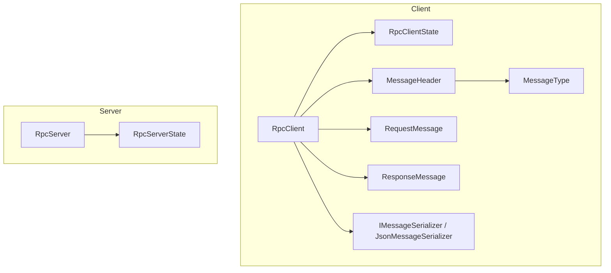
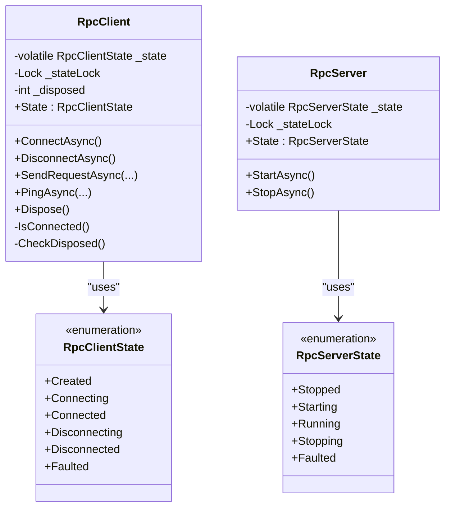
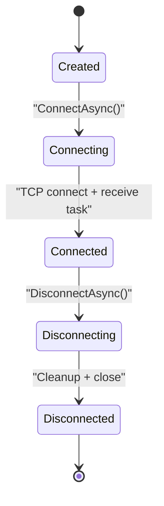
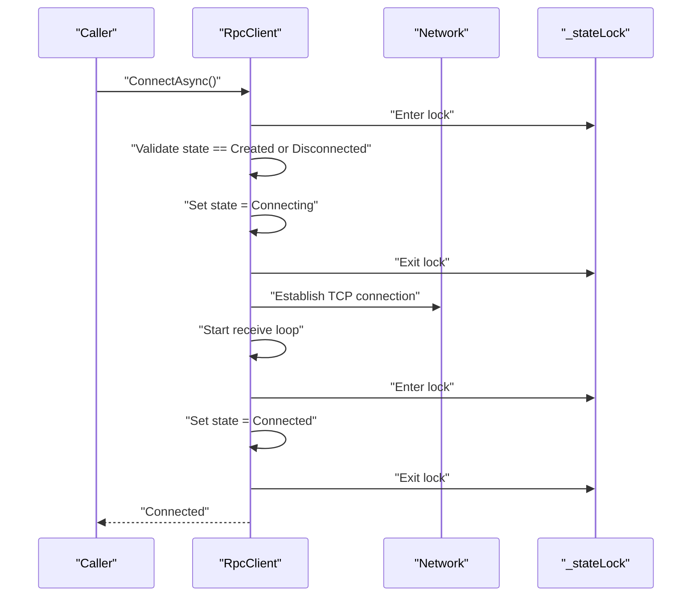
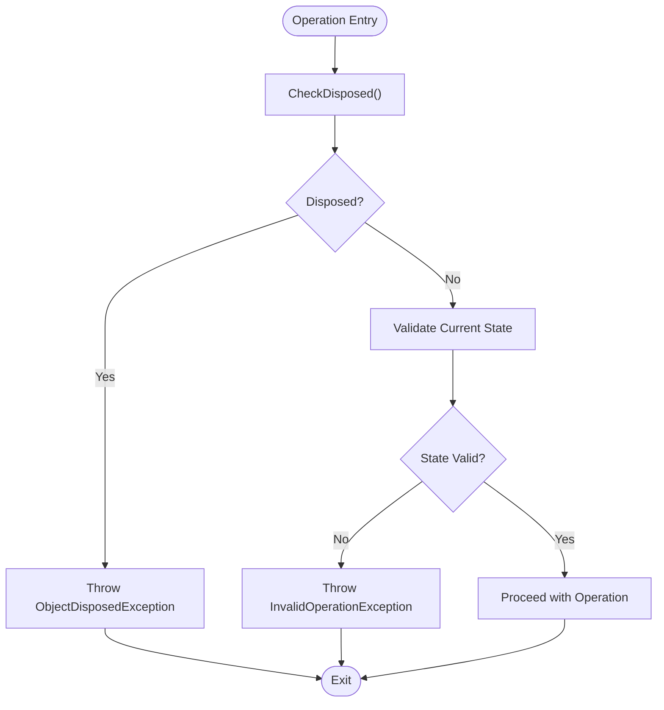
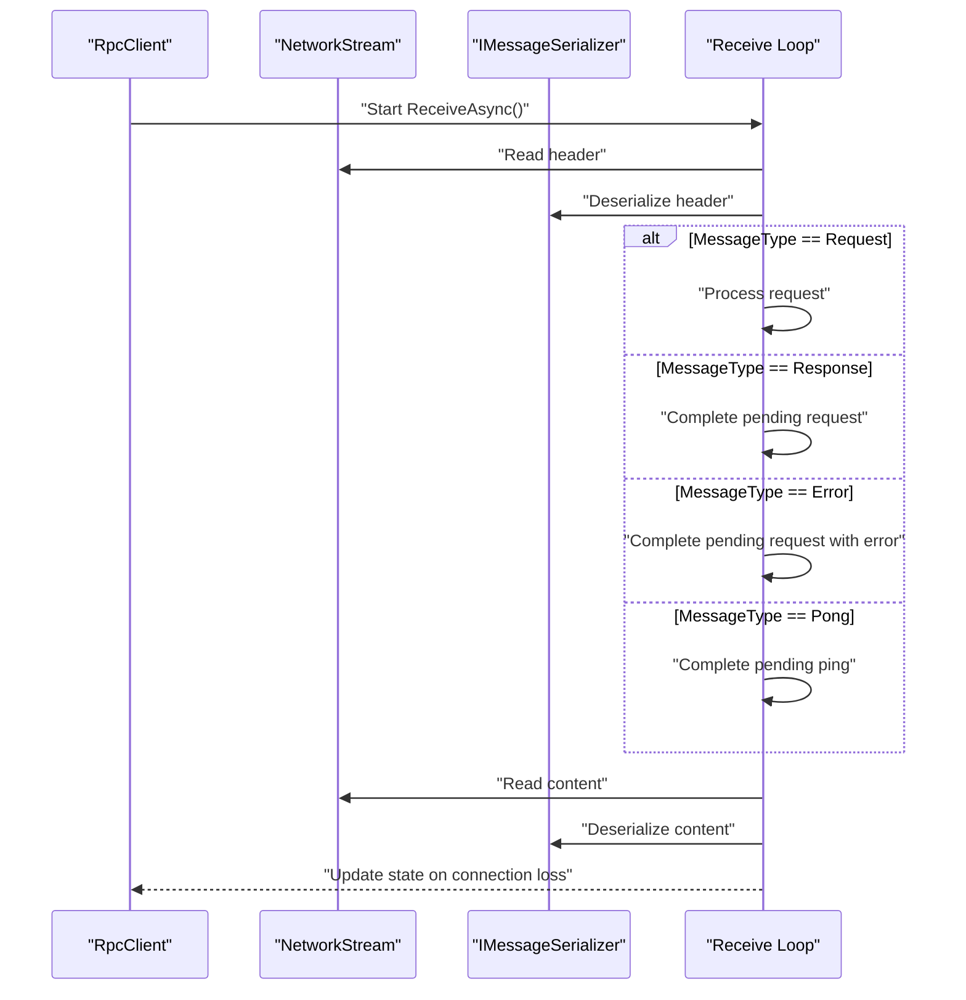
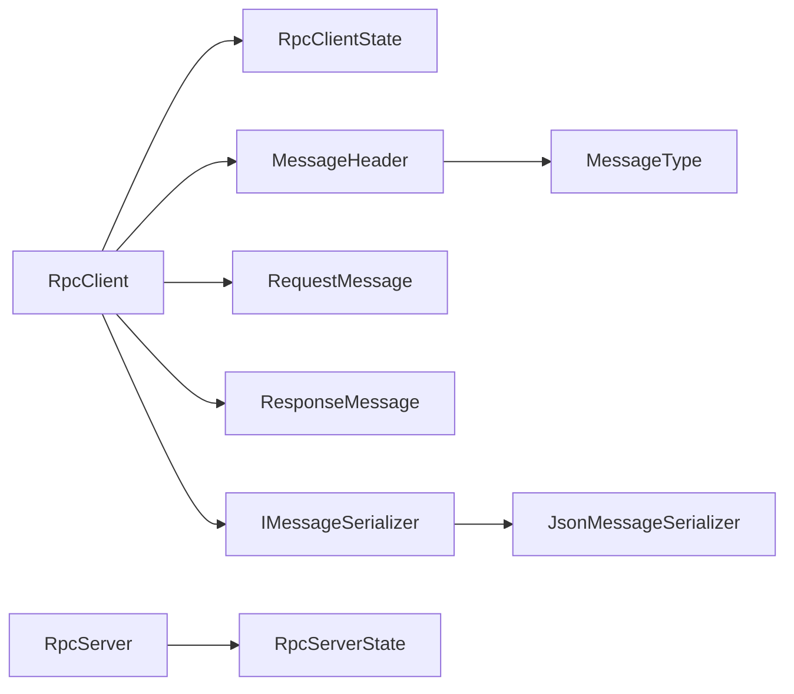

# State Management & Thread Safety

<cite>
**Referenced Files in This Document**
- [RpcClientState.cs](file://TcpRpc/Client/RpcClientState.cs)
- [TcpRpcClient.cs](file://TcpRpc/Client/TcpRpcClient.cs)
- [RpcServerState.cs](file://TcpRpc/Server/RpcServerState.cs)
- [TcpRpcServer.cs](file://TcpRpc/Server/TcpRpcServer.cs)
- [MessageHeader.cs](file://TcpRpc/Message/MessageHeader.cs)
- [MessageType.cs](file://TcpRpc/Message/MessageType.cs)
- [RequestMessage.cs](file://TcpRpc/Message/RequestMessage.cs)
- [ResponseMessage.cs](file://TcpRpc/Message/ResponseMessage.cs)
- [IMessageSerializer.cs](file://TcpRpc/Formatter/IMessageSerializer.cs)
- [JsonMessageSerializer.cs](file://TcpRpc/Formatter/JsonMessageSerializer.cs)
</cite>

## Table of Contents
1. [Introduction](#introduction)
2. [Project Structure](#project-structure)
3. [Core Components](#core-components)
4. [Architecture Overview](#architecture-overview)
5. [Detailed Component Analysis](#detailed-component-analysis)
6. [Dependency Analysis](#dependency-analysis)
7. [Performance Considerations](#performance-considerations)
8. [Troubleshooting Guide](#troubleshooting-guide)
9. [Conclusion](#conclusion)

## Introduction
This document explains the state management and thread-safety mechanisms in the RpcClient implementation. It focuses on the RpcClientState enumeration, state transitions, and the concurrency controls used to ensure safe state changes and property access. It also covers state validation in client operations, error handling, and how the client integrates with external observers through state checks and event-like patterns.

## Project Structure
The state management and thread-safety concerns are primarily implemented in the client-side components. The server-side state machine is included for comparison and context.

**Diagram sources**
- [RpcClientState.cs:1-11](file://TcpRpc/Client/RpcClientState.cs#L1-L11)
- [TcpRpcClient.cs:1-405](file://TcpRpc/Client/TcpRpcClient.cs#L1-L405)
- [RpcServerState.cs:1-10](file://TcpRpc/Server/RpcServerState.cs#L1-L10)
- [TcpRpcServer.cs:1-432](file://TcpRpc/Server/TcpRpcServer.cs#L1-L432)
- [MessageHeader.cs:1-34](file://TcpRpc/Message/MessageHeader.cs#L1-L34)
- [MessageType.cs:1-10](file://TcpRpc/Message/MessageType.cs#L1-L10)
- [RequestMessage.cs:1-8](file://TcpRpc/Message/RequestMessage.cs#L1-L8)
- [ResponseMessage.cs:1-9](file://TcpRpc/Message/ResponseMessage.cs#L1-L9)
- [IMessageSerializer.cs:1-13](file://TcpRpc/Formatter/IMessageSerializer.cs#L1-L13)
- [JsonMessageSerializer.cs:1-85](file://TcpRpc/Formatter/JsonMessageSerializer.cs#L1-L85)

**Section sources**
- [RpcClientState.cs:1-11](file://TcpRpc/Client/RpcClientState.cs#L1-L11)
- [TcpRpcClient.cs:1-405](file://TcpRpc/Client/TcpRpcClient.cs#L1-L405)
- [RpcServerState.cs:1-10](file://TcpRpc/Server/RpcServerState.cs#L1-L10)
- [TcpRpcServer.cs:1-432](file://TcpRpc/Server/TcpRpcServer.cs#L1-L432)

## Core Components
- RpcClientState: Defines the client’s lifecycle states.
- RpcClient: Implements state transitions, thread-safe state updates, and state-aware operations.
- RpcServerState and RpcServer: Provide a reference model for state management patterns in the server.

Key state management elements in RpcClient:
- Volatile state field for visibility across threads.
- Lock object for atomic state transitions and guarded property access.
- Atomic operations for lightweight flags and counters.
- Guarded operations that validate state before proceeding.

**Section sources**
- [RpcClientState.cs:1-11](file://TcpRpc/Client/RpcClientState.cs#L1-L11)
- [TcpRpcClient.cs:28-31](file://TcpRpc/Client/TcpRpcClient.cs#L28-L31)
- [TcpRpcClient.cs:47-80](file://TcpRpc/Client/TcpRpcClient.cs#L47-L80)
- [TcpRpcClient.cs:85-130](file://TcpRpc/Client/TcpRpcClient.cs#L85-L130)
- [RpcServerState.cs:1-10](file://TcpRpc/Server/RpcServerState.cs#L1-L10)
- [TcpRpcServer.cs:23-26](file://TcpRpc/Server/TcpRpcServer.cs#L23-L26)

## Architecture Overview
The RpcClient maintains a finite-state machine with explicit transitions controlled by locks and validated by state checks. Operations guard against invalid transitions by checking the current state before performing actions. The server-side state machine follows a similar pattern for comparison.

**Diagram sources**
- [RpcClientState.cs:1-11](file://TcpRpc/Client/RpcClientState.cs#L1-L11)
- [TcpRpcClient.cs:11-41](file://TcpRpc/Client/TcpRpcClient.cs#L11-L41)
- [RpcServerState.cs:1-10](file://TcpRpc/Server/RpcServerState.cs#L1-L10)
- [TcpRpcServer.cs:12-48](file://TcpRpc/Server/TcpRpcServer.cs#L12-L48)

## Detailed Component Analysis

### RpcClientState Enumeration and Transitions
The RpcClientState enumeration defines the client’s lifecycle states. The transitions are enforced by the client’s methods and guards.

States:
- Created: Initial state after construction.
- Connecting: Transitioned into before establishing a TCP connection.
- Connected: Active state after successful connection and receive loop started.
- Disconnecting: Transitioned into prior to closing streams and cleaning up.
- Disconnected: Final state after cleanup.
- Faulted: Not used in RpcClient; the server uses it for error conditions.

State transitions:
- Created → Connecting → Connected
- Connected → Disconnecting → Disconnected
- Any state → Faulted (not used in RpcClient)

**Diagram sources**
- [RpcClientState.cs:3-11](file://TcpRpc/Client/RpcClientState.cs#L3-L11)
- [TcpRpcClient.cs:47-80](file://TcpRpc/Client/TcpRpcClient.cs#L47-L80)
- [TcpRpcClient.cs:85-130](file://TcpRpc/Client/TcpRpcClient.cs#L85-L130)

**Section sources**
- [RpcClientState.cs:1-11](file://TcpRpc/Client/RpcClientState.cs#L1-L11)
- [TcpRpcClient.cs:47-80](file://TcpRpc/Client/TcpRpcClient.cs#L47-L80)
- [TcpRpcClient.cs:85-130](file://TcpRpc/Client/TcpRpcClient.cs#L85-L130)

### Thread-Safe State Management
RpcClient employs multiple concurrency primitives to ensure thread-safe state changes and property access:

- Volatile state field: Ensures visibility of state changes across threads.
- Lock object: Guards state transitions and guarded property reads/writes.
- Atomic operations: Used for disposed flag and message ID increments.
- SemaphoreSlim: Serializes send operations to prevent interleaved writes.

Concurrency controls:
- State transitions occur inside a lock to prevent race conditions.
- The disposed flag uses CompareExchange and Exchange for atomic checks and transitions.
- Message IDs are incremented atomically to ensure uniqueness.
- Send operations are serialized using a semaphore to avoid concurrent writes.

**Diagram sources**
- [TcpRpcClient.cs:47-80](file://TcpRpc/Client/TcpRpcClient.cs#L47-L80)

**Section sources**
- [TcpRpcClient.cs:28-31](file://TcpRpc/Client/TcpRpcClient.cs#L28-L31)
- [TcpRpcClient.cs:47-80](file://TcpRpc/Client/TcpRpcClient.cs#L47-L80)
- [TcpRpcClient.cs:85-130](file://TcpRpc/Client/TcpRpcClient.cs#L85-L130)
- [TcpRpcClient.cs:314-318](file://TcpRpc/Client/TcpRpcClient.cs#L314-L318)
- [TcpRpcClient.cs:332-382](file://TcpRpc/Client/TcpRpcClient.cs#L332-L382)

### State Validation in Client Operations
RpcClient validates state before performing operations to prevent invalid transitions:

- ConnectAsync: Allows transitions from Created or Disconnected; otherwise throws.
- DisconnectAsync: Only proceeds if currently Connected.
- SendRequestAsync: Requires Connected; otherwise throws.
- PingAsync: Requires Connected; returns false if not connected.

These validations ensure that operations are only performed when the client is in a compatible state.

**Diagram sources**
- [TcpRpcClient.cs:47-80](file://TcpRpc/Client/TcpRpcClient.cs#L47-L80)
- [TcpRpcClient.cs:85-130](file://TcpRpc/Client/TcpRpcClient.cs#L85-L130)
- [TcpRpcClient.cs:132-189](file://TcpRpc/Client/TcpRpcClient.cs#L132-L189)
- [TcpRpcClient.cs:325-382](file://TcpRpc/Client/TcpRpcClient.cs#L325-L382)
- [TcpRpcClient.cs:314-318](file://TcpRpc/Client/TcpRpcClient.cs#L314-L318)

**Section sources**
- [TcpRpcClient.cs:47-80](file://TcpRpc/Client/TcpRpcClient.cs#L47-L80)
- [TcpRpcClient.cs:85-130](file://TcpRpc/Client/TcpRpcClient.cs#L85-L130)
- [TcpRpcClient.cs:132-189](file://TcpRpc/Client/TcpRpcClient.cs#L132-L189)
- [TcpRpcClient.cs:325-382](file://TcpRpc/Client/TcpRpcClient.cs#L325-L382)
- [TcpRpcClient.cs:314-318](file://TcpRpc/Client/TcpRpcClient.cs#L314-L318)

### State Change Notifications and Observers
The RpcClient does not expose explicit state-change events. Instead, state changes are reflected by the State property and can be observed externally by polling State or by guarding operations with state checks. The server-side RpcServer demonstrates a similar pattern with a State property and state transitions.

Patterns for external observers:
- Polling: Periodically read State to detect changes.
- Guarded operations: Perform operations only when State equals a desired value.
- Logging: Log state transitions for diagnostics.

**Section sources**
- [TcpRpcClient.cs:33](file://TcpRpc/Client/TcpRpcClient.cs#L33)
- [RpcServerState.cs:1-10](file://TcpRpc/Server/RpcServerState.cs#L1-L10)
- [TcpRpcServer.cs:29](file://TcpRpc/Server/TcpRpcServer.cs#L29)

### Integration with External State Observers
External observers can integrate with RpcClient by:
- Monitoring State changes by polling the State property.
- Implementing state-aware behaviors around ConnectAsync, DisconnectAsync, SendRequestAsync, and PingAsync.
- Using state checks to decide whether to retry operations or handle disconnections gracefully.

Example patterns:
- Retry logic: Attempt operations only when State is Connected.
- Graceful shutdown: Call DisconnectAsync when State is Connected before disposing.

**Section sources**
- [TcpRpcClient.cs:33](file://TcpRpc/Client/TcpRpcClient.cs#L33)
- [TcpRpcClient.cs:47-80](file://TcpRpc/Client/TcpRpcClient.cs#L47-L80)
- [TcpRpcClient.cs:85-130](file://TcpRpc/Client/TcpRpcClient.cs#L85-L130)

### Message Flow and State Correlation
The client’s receive loop processes messages and can trigger state changes on errors. The message protocol supports requests, responses, pings, pongs, and errors.

**Diagram sources**
- [TcpRpcClient.cs:205-236](file://TcpRpc/Client/TcpRpcClient.cs#L205-L236)
- [TcpRpcClient.cs:258-287](file://TcpRpc/Client/TcpRpcClient.cs#L258-L287)
- [TcpRpcClient.cs:289-306](file://TcpRpc/Client/TcpRpcClient.cs#L289-L306)
- [MessageHeader.cs:13-33](file://TcpRpc/Message/MessageHeader.cs#L13-L33)
- [MessageType.cs:1-10](file://TcpRpc/Message/MessageType.cs#L1-L10)
- [RequestMessage.cs:1-8](file://TcpRpc/Message/RequestMessage.cs#L1-L8)
- [ResponseMessage.cs:1-9](file://TcpRpc/Message/ResponseMessage.cs#L1-L9)
- [IMessageSerializer.cs:1-13](file://TcpRpc/Formatter/IMessageSerializer.cs#L1-L13)
- [JsonMessageSerializer.cs:14-84](file://TcpRpc/Formatter/JsonMessageSerializer.cs#L14-L84)

**Section sources**
- [TcpRpcClient.cs:205-236](file://TcpRpc/Client/TcpRpcClient.cs#L205-L236)
- [TcpRpcClient.cs:258-287](file://TcpRpc/Client/TcpRpcClient.cs#L258-L287)
- [TcpRpcClient.cs:289-306](file://TcpRpc/Client/TcpRpcClient.cs#L289-L306)
- [MessageHeader.cs:1-34](file://TcpRpc/Message/MessageHeader.cs#L1-L34)
- [MessageType.cs:1-10](file://TcpRpc/Message/MessageType.cs#L1-L10)
- [RequestMessage.cs:1-8](file://TcpRpc/Message/RequestMessage.cs#L1-L8)
- [ResponseMessage.cs:1-9](file://TcpRpc/Message/ResponseMessage.cs#L1-L9)
- [IMessageSerializer.cs:1-13](file://TcpRpc/Formatter/IMessageSerializer.cs#L1-L13)
- [JsonMessageSerializer.cs:14-84](file://TcpRpc/Formatter/JsonMessageSerializer.cs#L14-L84)

## Dependency Analysis
The RpcClient depends on message types and serialization for protocol handling. The server-side state machine provides a reference for state management patterns.

**Diagram sources**
- [TcpRpcClient.cs:11-41](file://TcpRpc/Client/TcpRpcClient.cs#L11-L41)
- [RpcClientState.cs:1-11](file://TcpRpc/Client/RpcClientState.cs#L1-L11)
- [MessageHeader.cs:1-34](file://TcpRpc/Message/MessageHeader.cs#L1-L34)
- [MessageType.cs:1-10](file://TcpRpc/Message/MessageType.cs#L1-L10)
- [RequestMessage.cs:1-8](file://TcpRpc/Message/RequestMessage.cs#L1-L8)
- [ResponseMessage.cs:1-9](file://TcpRpc/Message/ResponseMessage.cs#L1-L9)
- [IMessageSerializer.cs:1-13](file://TcpRpc/Formatter/IMessageSerializer.cs#L1-L13)
- [JsonMessageSerializer.cs:1-85](file://TcpRpc/Formatter/JsonMessageSerializer.cs#L1-L85)
- [TcpRpcServer.cs:12-48](file://TcpRpc/Server/TcpRpcServer.cs#L12-L48)
- [RpcServerState.cs:1-10](file://TcpRpc/Server/RpcServerState.cs#L1-L10)

**Section sources**
- [TcpRpcClient.cs:11-41](file://TcpRpc/Client/TcpRpcClient.cs#L11-L41)
- [RpcClientState.cs:1-11](file://TcpRpc/Client/RpcClientState.cs#L1-L11)
- [MessageHeader.cs:1-34](file://TcpRpc/Message/MessageHeader.cs#L1-L34)
- [MessageType.cs:1-10](file://TcpRpc/Message/MessageType.cs#L1-L10)
- [RequestMessage.cs:1-8](file://TcpRpc/Message/RequestMessage.cs#L1-L8)
- [ResponseMessage.cs:1-9](file://TcpRpc/Message/ResponseMessage.cs#L1-L9)
- [IMessageSerializer.cs:1-13](file://TcpRpc/Formatter/IMessageSerializer.cs#L1-L13)
- [JsonMessageSerializer.cs:1-85](file://TcpRpc/Formatter/JsonMessageSerializer.cs#L1-L85)
- [TcpRpcServer.cs:12-48](file://TcpRpc/Server/TcpRpcServer.cs#L12-L48)
- [RpcServerState.cs:1-10](file://TcpRpc/Server/RpcServerState.cs#L1-L10)

## Performance Considerations
- Volatile state ensures visibility without heavy synchronization overhead.
- Lock scope is minimized to only critical sections for state transitions.
- Atomic increments for message IDs avoid contention on shared counters.
- SemaphoreSlim serializes sends to reduce interleaving and potential errors.
- Pending request collections are cleaned up on disconnect to prevent memory leaks.

[No sources needed since this section provides general guidance]

## Troubleshooting Guide
Common issues and resolutions:
- Invalid operation exceptions: Occur when attempting operations in incompatible states (e.g., connecting from non-Created/Disconnected, sending requests when not Connected).
- Disposed exceptions: Thrown when operations are invoked after disposal.
- Connection loss: Detected by receive loop errors; triggers state transitions to Disconnected and cancellation of pending requests.
- Timeout handling: Requests and pings use cancellation tokens; timeouts cancel operations and clean up pending entries.

Operational tips:
- Always check State before invoking operations.
- Use ConnectAsync only from Created or Disconnected.
- Use DisconnectAsync only from Connected.
- Implement retry logic with exponential backoff after Disconnected.

**Section sources**
- [TcpRpcClient.cs:47-80](file://TcpRpc/Client/TcpRpcClient.cs#L47-L80)
- [TcpRpcClient.cs:85-130](file://TcpRpc/Client/TcpRpcClient.cs#L85-L130)
- [TcpRpcClient.cs:132-189](file://TcpRpc/Client/TcpRpcClient.cs#L132-L189)
- [TcpRpcClient.cs:289-306](file://TcpRpc/Client/TcpRpcClient.cs#L289-L306)
- [TcpRpcClient.cs:314-318](file://TcpRpc/Client/TcpRpcClient.cs#L314-L318)

## Conclusion
RpcClient implements robust state management and thread-safety through a combination of volatile state fields, lock-protected transitions, atomic operations, and careful state validation in operations. While there are no explicit state-change events, the State property and guarded operations enable reliable state-aware behaviors. The server-side state machine offers a comparable pattern for reference. Together, these mechanisms ensure predictable client lifecycle management and safe concurrent access to client properties.