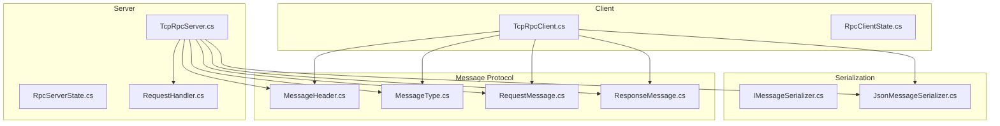
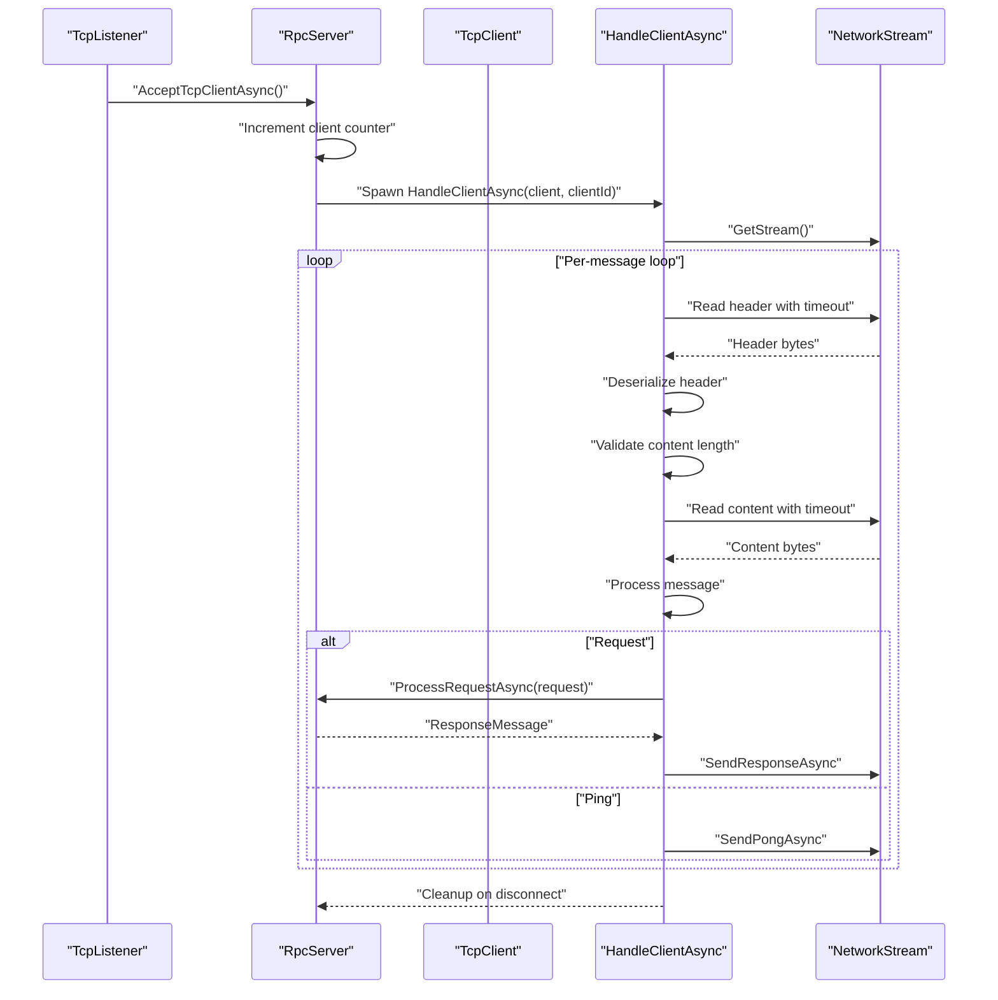
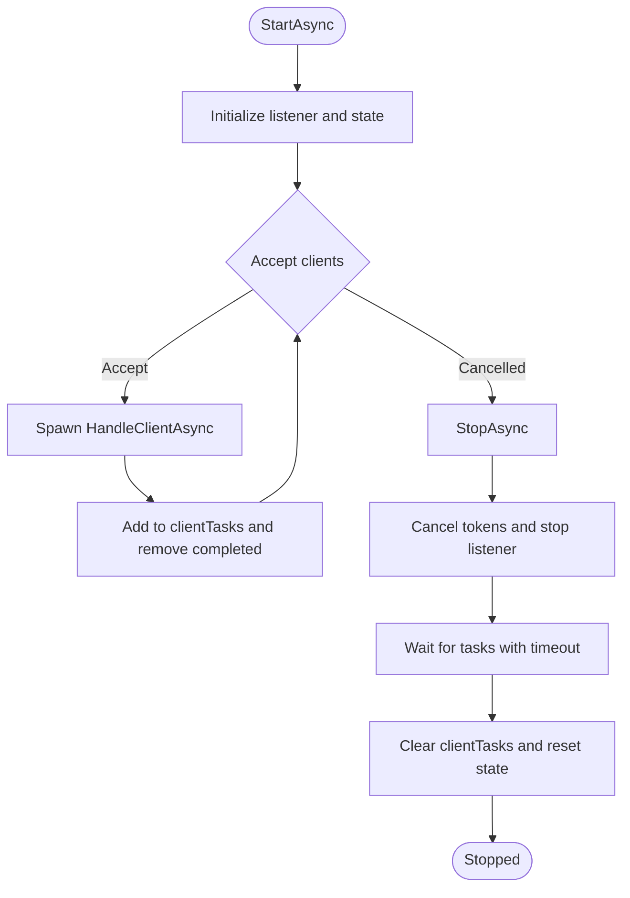
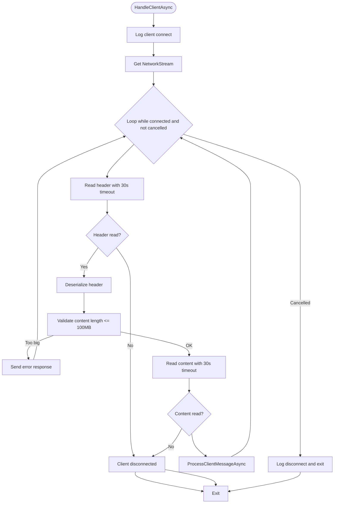
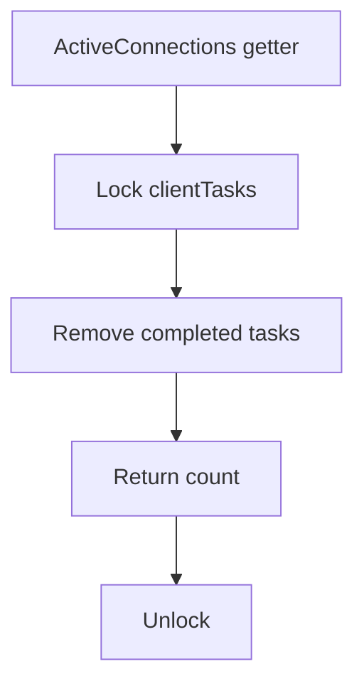
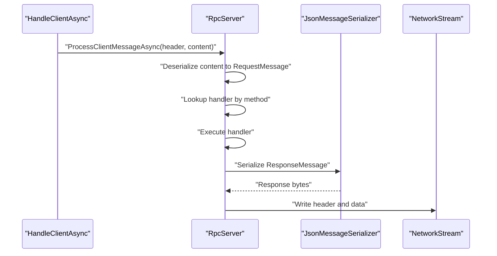
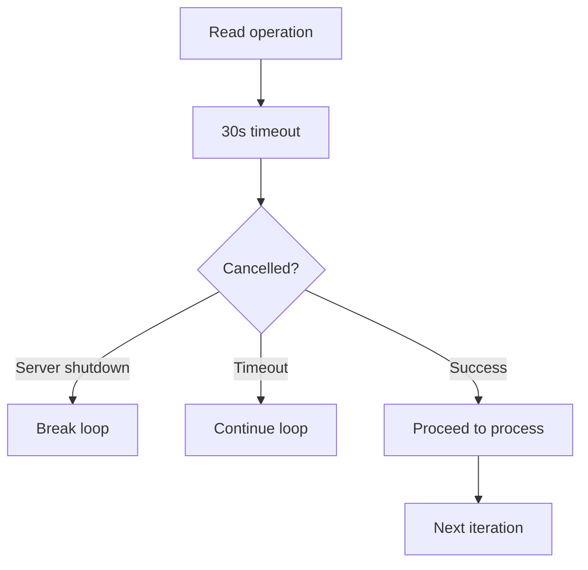
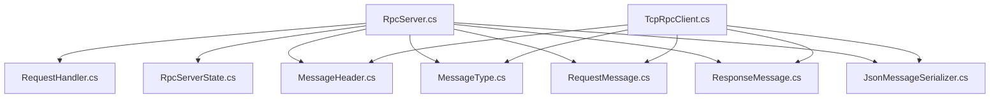

# Client Connection Management

<cite>
**Referenced Files in This Document**
- [TcpRpcServer.cs](file://TcpRpc/Server/TcpRpcServer.cs)
- [RpcServerState.cs](file://TcpRpc/Server/RpcServerState.cs)
- [RequestHandler.cs](file://TcpRpc/Server/RequestHandler.cs)
- [TcpRpcClient.cs](file://TcpRpc/Client/TcpRpcClient.cs)
- [RpcClientState.cs](file://TcpRpc/Client/RpcClientState.cs)
- [MessageHeader.cs](file://TcpRpc/Message/MessageHeader.cs)
- [MessageType.cs](file://TcpRpc/Message/MessageType.cs)
- [RequestMessage.cs](file://TcpRpc/Message/RequestMessage.cs)
- [ResponseMessage.cs](file://TcpRpc/Message/ResponseMessage.cs)
- [IMessageSerializer.cs](file://TcpRpc/Formatter/IMessageSerializer.cs)
- [JsonMessageSerializer.cs](file://TcpRpc/Formatter/JsonMessageSerializer.cs)
</cite>

## Table of Contents
1. [Introduction](#introduction)
2. [Project Structure](#project-structure)
3. [Core Components](#core-components)
4. [Architecture Overview](#architecture-overview)
5. [Detailed Component Analysis](#detailed-component-analysis)
6. [Dependency Analysis](#dependency-analysis)
7. [Performance Considerations](#performance-considerations)
8. [Troubleshooting Guide](#troubleshooting-guide)
9. [Conclusion](#conclusion)

## Introduction
This document provides comprehensive technical documentation for RpcServer client connection management. It focuses on the HandleClientAsync method implementation, including client acceptance, connection tracking, and concurrent client handling. It explains the client task management system using internal lists for active client tasks and automatic cleanup of completed connections. It covers the client connection lifecycle from initial acceptance through message processing to graceful disconnection. It documents the connection monitoring system including the ActiveConnections property, client counter management, and connection state tracking. It explains network stream handling, timeout management, and error recovery mechanisms for individual client connections. Practical examples demonstrate concurrent client handling, connection monitoring, and client-specific error scenarios. It addresses connection limits, resource cleanup, and handling of abnormal client disconnections.

## Project Structure
The project is organized around a clear separation of concerns:
- Server-side components manage TCP listener, client acceptance, concurrent client handling, and request processing.
- Client-side components handle connection establishment, message sending/receiving, and error recovery.
- Message and formatter components define the wire protocol and serialization/deserialization logic.
- The server maintains a collection of active client tasks and tracks connection counts.

**Diagram sources**
- [TcpRpcServer.cs:1-432](file://TcpRpc/Server/TcpRpcServer.cs#L1-L432)
- [RpcServerState.cs:1-10](file://TcpRpc/Server/RpcServerState.cs#L1-L10)
- [RequestHandler.cs:1-5](file://TcpRpc/Server/RequestHandler.cs#L1-L5)
- [TcpRpcClient.cs:1-405](file://TcpRpc/Client/TcpRpcClient.cs#L1-L405)
- [RpcClientState.cs:1-11](file://TcpRpc/Client/RpcClientState.cs#L1-L11)
- [MessageHeader.cs:1-34](file://TcpRpc/Message/MessageHeader.cs#L1-L34)
- [MessageType.cs:1-10](file://TcpRpc/Message/MessageType.cs#L1-L10)
- [RequestMessage.cs:1-8](file://TcpRpc/Message/RequestMessage.cs#L1-L8)
- [ResponseMessage.cs:1-9](file://TcpRpc/Message/ResponseMessage.cs#L1-L9)
- [IMessageSerializer.cs:1-13](file://TcpRpc/Formatter/IMessageSerializer.cs#L1-L13)
- [JsonMessageSerializer.cs:1-85](file://TcpRpc/Formatter/JsonMessageSerializer.cs#L1-L85)

**Section sources**
- [TcpRpcServer.cs:1-432](file://TcpRpc/Server/TcpRpcServer.cs#L1-L432)
- [TcpRpcClient.cs:1-405](file://TcpRpc/Client/TcpRpcClient.cs#L1-L405)

## Core Components
This section focuses on the core components involved in client connection management and message processing.

- RpcServer: Manages TCP listener, accepts clients, spawns per-client tasks, tracks active connections, and handles shutdown.
- RpcServerState: Enumerates server operational states.
- RequestHandler: Delegate type for request handlers registered on the server.
- TcpRpcClient: Client-side RPC implementation managing connection, message exchange, and error recovery.
- RpcClientState: Enumerates client operational states.
- MessageHeader, MessageType, RequestMessage, ResponseMessage: Define the wire protocol and message structures.
- IMessageSerializer, JsonMessageSerializer: Provide serialization/deserialization for messages.

Key responsibilities:
- Server: Accept clients, spawn HandleClientAsync tasks, maintain ActiveConnections count, enforce timeouts, and clean up completed tasks.
- Client: Establish connection, send requests, receive responses, handle errors, and clean up pending requests on disconnect.

**Section sources**
- [TcpRpcServer.cs:12-432](file://TcpRpc/Server/TcpRpcServer.cs#L12-L432)
- [RpcServerState.cs:3-10](file://TcpRpc/Server/RpcServerState.cs#L3-L10)
- [RequestHandler.cs:5-5](file://TcpRpc/Server/RequestHandler.cs#L5-L5)
- [TcpRpcClient.cs:11-405](file://TcpRpc/Client/TcpRpcClient.cs#L11-L405)
- [RpcClientState.cs:3-11](file://TcpRpc/Client/RpcClientState.cs#L3-L11)
- [MessageHeader.cs:5-34](file://TcpRpc/Message/MessageHeader.cs#L5-L34)
- [MessageType.cs:3-10](file://TcpRpc/Message/MessageType.cs#L3-L10)
- [RequestMessage.cs:3-8](file://TcpRpc/Message/RequestMessage.cs#L3-L8)
- [ResponseMessage.cs:3-9](file://TcpRpc/Message/ResponseMessage.cs#L3-L9)
- [IMessageSerializer.cs:5-13](file://TcpRpc/Formatter/IMessageSerializer.cs#L5-L13)
- [JsonMessageSerializer.cs:6-85](file://TcpRpc/Formatter/JsonMessageSerializer.cs#L6-L85)

## Architecture Overview
The server architecture centers on a single-threaded accept loop that spawns asynchronous tasks for each connected client. Each client task runs a continuous message loop that reads headers, validates sizes, reads content, processes requests, and writes responses. The server tracks active connections and cleans up completed tasks to prevent memory leaks.

**Diagram sources**
- [TcpRpcServer.cs:134-148](file://TcpRpc/Server/TcpRpcServer.cs#L134-L148)
- [TcpRpcServer.cs:228-316](file://TcpRpc/Server/TcpRpcServer.cs#L228-L316)
- [TcpRpcServer.cs:318-333](file://TcpRpc/Server/TcpRpcServer.cs#L318-L333)
- [TcpRpcServer.cs:362-376](file://TcpRpc/Server/TcpRpcServer.cs#L362-L376)
- [TcpRpcServer.cs:394-406](file://TcpRpc/Server/TcpRpcServer.cs#L394-L406)

## Detailed Component Analysis

### RpcServer: Client Acceptance and Concurrent Handling
The RpcServer manages client connections through a dedicated accept loop and per-client tasks. It registers request handlers, starts the TCP listener, and continuously accepts new clients. For each accepted client, it increments a client counter and spawns a HandleClientAsync task. The server maintains a list of client tasks and periodically removes completed tasks to keep the count accurate.

Key behaviors:
- Accept loop: Runs until cancellation, accepting TcpClient instances and spawning tasks.
- Task management: Stores tasks in a list and removes completed ones to maintain ActiveConnections accuracy.
- State transitions: Moves through Starting, Running, Stopping, and Stopped states with thread-safe locking.
- Shutdown: Cancels all operations, waits for tasks with a timeout, clears remaining tasks, and resets state.

**Diagram sources**
- [TcpRpcServer.cs:101-173](file://TcpRpc/Server/TcpRpcServer.cs#L101-L173)
- [TcpRpcServer.cs:175-226](file://TcpRpc/Server/TcpRpcServer.cs#L175-L226)
- [TcpRpcServer.cs:134-148](file://TcpRpc/Server/TcpRpcServer.cs#L134-L148)

**Section sources**
- [TcpRpcServer.cs:101-173](file://TcpRpc/Server/TcpRpcServer.cs#L101-L173)
- [TcpRpcServer.cs:175-226](file://TcpRpc/Server/TcpRpcServer.cs#L175-L226)
- [RpcServerState.cs:3-10](file://TcpRpc/Server/RpcServerState.cs#L3-L10)

### HandleClientAsync: Client Task Management and Message Processing
HandleClientAsync is the core method for managing individual client connections. It logs client connections, sets up a network stream, and enters a continuous loop that reads message headers, validates content length, reads content, processes messages, and handles errors gracefully.

Processing logic:
- Header read: Reads exactly the header size, with a 30-second timeout per read operation using a linked cancellation token.
- Content read: Reads the specified content length with the same timeout mechanism.
- Validation: Enforces a 100 MB message size limit; sends an error response and continues on overflow.
- Message processing: Routes to ProcessRequestAsync for requests or SendPongAsync for pings.
- Error handling: Catches operation canceled exceptions (shutdown vs. timeout), logs other exceptions, and continues to the next iteration.

**Diagram sources**
- [TcpRpcServer.cs:228-316](file://TcpRpc/Server/TcpRpcServer.cs#L228-L316)
- [TcpRpcServer.cs:244-304](file://TcpRpc/Server/TcpRpcServer.cs#L244-L304)
- [TcpRpcServer.cs:318-333](file://TcpRpc/Server/TcpRpcServer.cs#L318-L333)
- [TcpRpcServer.cs:378-392](file://TcpRpc/Server/TcpRpcServer.cs#L378-L392)

**Section sources**
- [TcpRpcServer.cs:228-316](file://TcpRpc/Server/TcpRpcServer.cs#L228-L316)
- [TcpRpcServer.cs:318-333](file://TcpRpc/Server/TcpRpcServer.cs#L318-L333)

### ActiveConnections Monitoring and Client Counter
ActiveConnections is a computed property that reflects the current number of connected clients. It ensures accuracy by removing completed tasks from the internal list before returning the count. The server maintains a client counter that increments for each accepted client, providing unique identifiers for logging and diagnostics.

Behavior:
- Count computation: Removes completed tasks and returns the remaining count.
- Thread safety: Uses a lock to protect the client task list during removal and counting.
- Client identity: Uses an incrementing integer for each client to track connections.

**Diagram sources**
- [TcpRpcServer.cs:31-41](file://TcpRpc/Server/TcpRpcServer.cs#L31-L41)
- [TcpRpcServer.cs:139-147](file://TcpRpc/Server/TcpRpcServer.cs#L139-L147)

**Section sources**
- [TcpRpcServer.cs:31-41](file://TcpRpc/Server/TcpRpcServer.cs#L31-L41)
- [TcpRpcServer.cs:139-147](file://TcpRpc/Server/TcpRpcServer.cs#L139-L147)

### Request Processing and Response Handling
The server routes incoming requests to registered handlers and returns structured responses. It serializes and deserializes messages using the configured serializer, constructs appropriate headers, and writes responses back to the client.

Processing pipeline:
- Request routing: Looks up handler by method name; returns error if not found.
- Handler execution: Executes the handler asynchronously and returns a ResponseMessage.
- Response construction: Serializes response data and writes header and payload to the stream.
- Error propagation: Converts exceptions into error responses with descriptive messages.

**Diagram sources**
- [TcpRpcServer.cs:318-333](file://TcpRpc/Server/TcpRpcServer.cs#L318-L333)
- [TcpRpcServer.cs:335-360](file://TcpRpc/Server/TcpRpcServer.cs#L335-L360)
- [TcpRpcServer.cs:362-376](file://TcpRpc/Server/TcpRpcServer.cs#L362-L376)
- [JsonMessageSerializer.cs:14-49](file://TcpRpc/Formatter/JsonMessageSerializer.cs#L14-L49)
- [JsonMessageSerializer.cs:51-84](file://TcpRpc/Formatter/JsonMessageSerializer.cs#L51-L84)

**Section sources**
- [TcpRpcServer.cs:318-360](file://TcpRpc/Server/TcpRpcServer.cs#L318-L360)
- [JsonMessageSerializer.cs:14-84](file://TcpRpc/Formatter/JsonMessageSerializer.cs#L14-L84)

### Network Stream Handling, Timeouts, and Error Recovery
The server implements robust stream handling with per-read timeouts and comprehensive error recovery. It uses linked cancellation tokens to combine server shutdown signals with per-operation timeouts. On timeouts, the loop continues to wait for the next message. On exceptions, it logs the error and continues processing subsequent messages.

Timeout and recovery mechanisms:
- Per-read timeout: 30 seconds for header and content reads.
- Linked cancellation: Combines server cancellation with per-operation timeout.
- Graceful disconnect detection: Zero-byte reads indicate client disconnect.
- Error logging: Logs exceptions during message processing without terminating the client task.
- Continuation: After errors, the loop proceeds to the next iteration.

**Diagram sources**
- [TcpRpcServer.cs:244-304](file://TcpRpc/Server/TcpRpcServer.cs#L244-L304)

**Section sources**
- [TcpRpcServer.cs:244-304](file://TcpRpc/Server/TcpRpcServer.cs#L244-L304)

### Connection Limits and Resource Cleanup
The server enforces a 100 MB message size limit to prevent resource exhaustion. It cleans up completed client tasks to prevent unbounded growth of the task list. During shutdown, it cancels all operations, waits for tasks with a timeout, and clears remaining tasks.

Resource management:
- Message size limit: Validates header.ContentLength against 100 MB; sends error response and continues.
- Task cleanup: Removes completed tasks from the internal list before counting.
- Shutdown cleanup: Cancels tokens, stops listener, waits for tasks with timeout, clears task list, and resets state.

**Section sources**
- [TcpRpcServer.cs:264-270](file://TcpRpc/Server/TcpRpcServer.cs#L264-L270)
- [TcpRpcServer.cs:146-147](file://TcpRpc/Server/TcpRpcServer.cs#L146-L147)
- [TcpRpcServer.cs:206-212](file://TcpRpc/Server/TcpRpcServer.cs#L206-L212)
- [TcpRpcServer.cs:214-217](file://TcpRpc/Server/TcpRpcServer.cs#L214-L217)

### Client-Specific Error Scenarios
Common client-side error scenarios include:
- Abnormal disconnections: Zero-byte reads during header/content reads trigger graceful disconnect handling.
- Timeout conditions: Per-operation timeouts occur during read operations; the server continues to process subsequent messages.
- Handler errors: Exceptions in request handlers are caught and converted to error responses.
- Serialization failures: Malformed messages cause deserialization errors; the server responds with error messages.

Recovery strategies:
- Logging: Comprehensive logging for client connect/disconnect and error conditions.
- Continuation: Errors do not terminate the client task; the loop continues.
- Graceful shutdown: On server shutdown, client tasks are terminated via cancellation.

**Section sources**
- [TcpRpcServer.cs:254-258](file://TcpRpc/Server/TcpRpcServer.cs#L254-L258)
- [TcpRpcServer.cs:279-283](file://TcpRpc/Server/TcpRpcServer.cs#L279-L283)
- [TcpRpcServer.cs:290-304](file://TcpRpc/Server/TcpRpcServer.cs#L290-L304)
- [TcpRpcServer.cs:351-359](file://TcpRpc/Server/TcpRpcServer.cs#L351-L359)

### Practical Examples

#### Example 1: Concurrent Client Handling
- Multiple clients connect simultaneously.
- Each client receives its own HandleClientAsync task.
- ActiveConnections accurately reflects the number of currently connected clients.
- The server continues accepting new clients while processing existing ones.

Implementation references:
- [TcpRpcServer.cs:138-147](file://TcpRpc/Server/TcpRpcServer.cs#L138-L147)
- [TcpRpcServer.cs:31-41](file://TcpRpc/Server/TcpRpcServer.cs#L31-L41)

#### Example 2: Connection Monitoring
- Monitor ActiveConnections to observe real-time client counts.
- Use server state transitions to coordinate administrative actions.
- Observe client counter increments for diagnostic logging.

Implementation references:
- [TcpRpcServer.cs:31-41](file://TcpRpc/Server/TcpRpcServer.cs#L31-L41)
- [RpcServerState.cs:3-10](file://TcpRpc/Server/RpcServerState.cs#L3-L10)

#### Example 3: Client-Specific Error Scenarios
- Large message triggers error response and continues processing.
- Timeout during read leads to continued loop execution.
- Handler exception results in error response to client.

Implementation references:
- [TcpRpcServer.cs:264-270](file://TcpRpc/Server/TcpRpcServer.cs#L264-L270)
- [TcpRpcServer.cs:295-299](file://TcpRpc/Server/TcpRpcServer.cs#L295-L299)
- [TcpRpcServer.cs:351-359](file://TcpRpc/Server/TcpRpcServer.cs#L351-L359)

## Dependency Analysis
The server depends on several components for message protocol and serialization. The client depends on the same protocol definitions and serialization logic. The following diagram shows key dependencies:

**Diagram sources**
- [TcpRpcServer.cs:12-432](file://TcpRpc/Server/TcpRpcServer.cs#L12-L432)
- [RequestHandler.cs:1-5](file://TcpRpc/Server/RequestHandler.cs#L1-L5)
- [RpcServerState.cs:1-10](file://TcpRpc/Server/RpcServerState.cs#L1-L10)
- [MessageHeader.cs:1-34](file://TcpRpc/Message/MessageHeader.cs#L1-L34)
- [MessageType.cs:1-10](file://TcpRpc/Message/MessageType.cs#L1-L10)
- [RequestMessage.cs:1-8](file://TcpRpc/Message/RequestMessage.cs#L1-L8)
- [ResponseMessage.cs:1-9](file://TcpRpc/Message/ResponseMessage.cs#L1-L9)
- [JsonMessageSerializer.cs:1-85](file://TcpRpc/Formatter/JsonMessageSerializer.cs#L1-L85)
- [TcpRpcClient.cs:1-405](file://TcpRpc/Client/TcpRpcClient.cs#L1-L405)

**Section sources**
- [TcpRpcServer.cs:12-432](file://TcpRpc/Server/TcpRpcServer.cs#L12-L432)
- [TcpRpcClient.cs:1-405](file://TcpRpc/Client/TcpRpcClient.cs#L1-L405)

## Performance Considerations
- Concurrency: Each client runs in its own task, enabling concurrent message processing.
- Memory: Completed client tasks are removed from the internal list to prevent accumulation.
- Timeouts: Per-read timeouts prevent indefinite blocking and improve responsiveness.
- Limits: Message size limits protect against excessive memory usage.
- Logging: Extensive logging aids in diagnosing performance and reliability issues.

## Troubleshooting Guide
Common issues and resolutions:
- Clients not appearing in ActiveConnections: Verify that completed tasks are being removed and that the property is accessed under lock.
- Frequent timeouts: Check network latency and adjust read timeouts if appropriate.
- Excessive memory usage: Ensure message size limits are enforced and that client tasks are cleaned up.
- Handler errors: Review handler implementations and ensure they return appropriate ResponseMessage objects.
- Disconnections: Investigate zero-byte reads and network stability.

**Section sources**
- [TcpRpcServer.cs:31-41](file://TcpRpc/Server/TcpRpcServer.cs#L31-L41)
- [TcpRpcServer.cs:244-304](file://TcpRpc/Server/TcpRpcServer.cs#L244-L304)
- [TcpRpcServer.cs:351-359](file://TcpRpc/Server/TcpRpcServer.cs#L351-L359)

## Conclusion
The RpcServer provides robust client connection management through a dedicated accept loop, per-client tasks, and comprehensive monitoring. The HandleClientAsync method implements reliable message processing with timeouts and error recovery. The ActiveConnections property and client counter enable accurate connection tracking. The server enforces resource limits, cleans up completed tasks, and handles abnormal disconnections gracefully. Together, these mechanisms support scalable, resilient RPC communication.