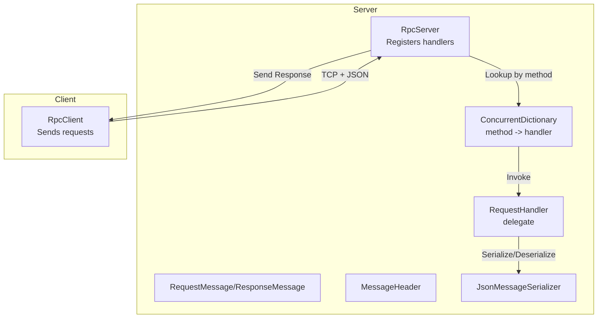
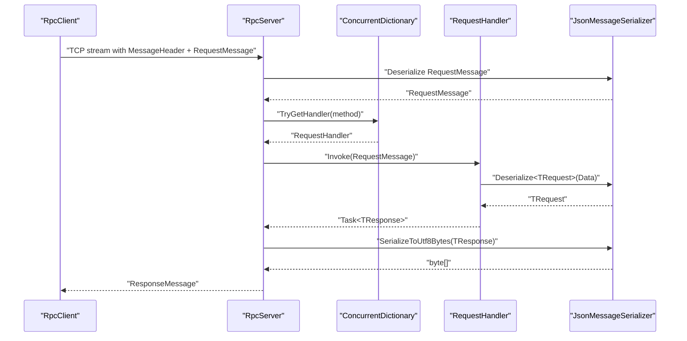
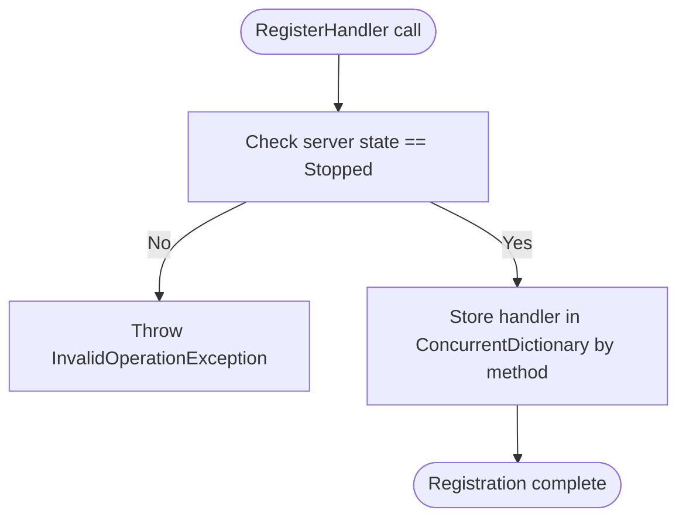
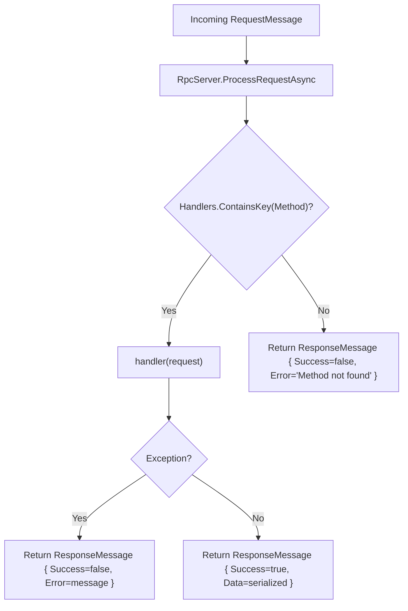
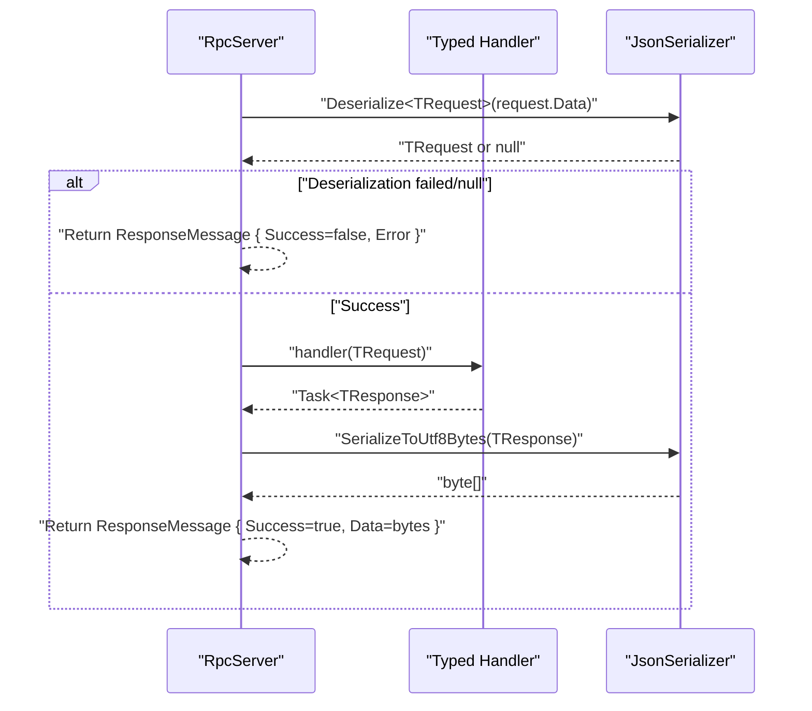
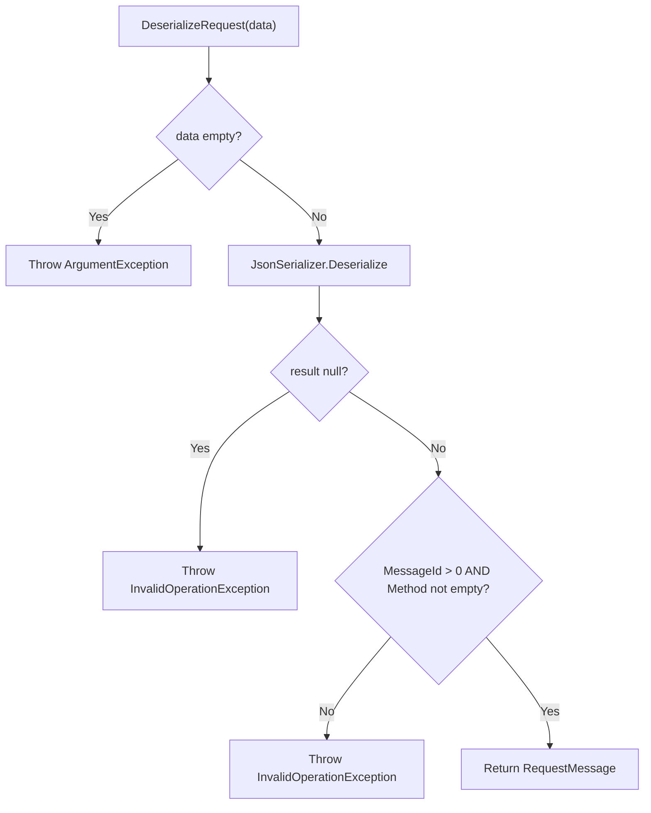
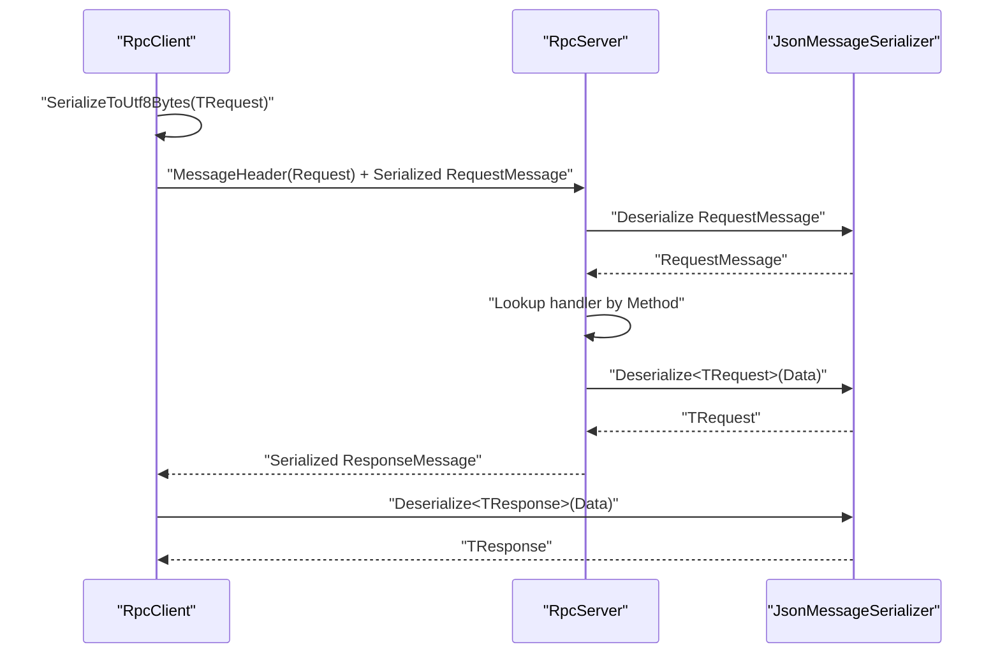
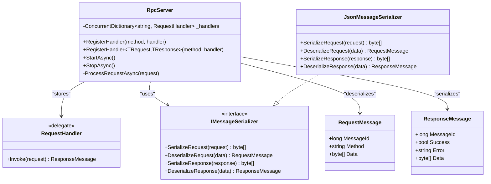

# Handler Registration System

<cite>
**Referenced Files in This Document**
- [TcpRpcServer.cs](file://TcpRpc/Server/TcpRpcServer.cs)
- [RequestHandler.cs](file://TcpRpc/Server/RequestHandler.cs)
- [RpcServerState.cs](file://TcpRpc/Server/RpcServerState.cs)
- [JsonMessageSerializer.cs](file://TcpRpc/Formatter/JsonMessageSerializer.cs)
- [IMessageSerializer.cs](file://TcpRpc/Formatter/IMessageSerializer.cs)
- [RequestMessage.cs](file://TcpRpc/Message/RequestMessage.cs)
- [ResponseMessage.cs](file://TcpRpc/Message/ResponseMessage.cs)
- [MessageHeader.cs](file://TcpRpc/Message/MessageHeader.cs)
- [MessageType.cs](file://TcpRpc/Message/MessageType.cs)
- [TcpRpcClient.cs](file://TcpRpc/Client/TcpRpcClient.cs)
- [RpcClientState.cs](file://TcpRpc/Client/RpcClientState.cs)
</cite>

## Table of Contents
1. [Introduction](#introduction)
2. [Project Structure](#project-structure)
3. [Core Components](#core-components)
4. [Architecture Overview](#architecture-overview)
5. [Detailed Component Analysis](#detailed-component-analysis)
6. [Dependency Analysis](#dependency-analysis)
7. [Performance Considerations](#performance-considerations)
8. [Troubleshooting Guide](#troubleshooting-guide)
9. [Conclusion](#conclusion)

## Introduction
This document explains the RpcServer handler registration system in the TcpRpc project. It focuses on how handlers are registered using the RequestHandler delegate pattern, how they are stored and looked up, and how requests are processed end-to-end. It covers both direct delegate registration and generic typed handler registration with automatic JSON serialization/deserialization, along with error handling, concurrency, and common pitfalls.

## Project Structure
The handler registration system spans several modules:
- Server-side RPC server and handler infrastructure
- Message types and serialization
- Client-side RPC client for testing and usage patterns

**Diagram sources**
- [TcpRpcServer.cs:50-99](file://TcpRpc/Server/TcpRpcServer.cs#L50-L99)
- [RequestHandler.cs:1-5](file://TcpRpc/Server/RequestHandler.cs#L1-L5)
- [JsonMessageSerializer.cs:6-85](file://TcpRpc/Formatter/JsonMessageSerializer.cs#L6-L85)
- [RequestMessage.cs:1-8](file://TcpRpc/Message/RequestMessage.cs#L1-L8)
- [ResponseMessage.cs:1-9](file://TcpRpc/Message/ResponseMessage.cs#L1-L9)
- [MessageHeader.cs:1-34](file://TcpRpc/Message/MessageHeader.cs#L1-L34)
- [TcpRpcClient.cs:132-203](file://TcpRpc/Client/TcpRpcClient.cs#L132-L203)

**Section sources**
- [TcpRpcServer.cs:12-48](file://TcpRpc/Server/TcpRpcServer.cs#L12-L48)
- [RequestHandler.cs:1-5](file://TcpRpc/Server/RequestHandler.cs#L1-L5)
- [JsonMessageSerializer.cs:6-85](file://TcpRpc/Formatter/JsonMessageSerializer.cs#L6-L85)
- [RequestMessage.cs:1-8](file://TcpRpc/Message/RequestMessage.cs#L1-L8)
- [ResponseMessage.cs:1-9](file://TcpRpc/Message/ResponseMessage.cs#L1-L9)
- [MessageHeader.cs:1-34](file://TcpRpc/Message/MessageHeader.cs#L1-L34)
- [TcpRpcClient.cs:132-203](file://TcpRpc/Client/TcpRpcClient.cs#L132-L203)

## Core Components
- RpcServer: Hosts the TCP listener, manages lifecycle, registers handlers, and executes them.
- RequestHandler: Delegate type representing a handler that takes a RequestMessage and returns a ResponseMessage asynchronously.
- ConcurrentDictionary<string, RequestHandler>: Thread-safe storage keyed by method name.
- JsonMessageSerializer: Implements IMessageSerializer with JSON serialization/deserialization and validation.
- RequestMessage/ResponseMessage: DTOs for transport.
- MessageHeader/MessageType: Binary framing for network messages.

Key registration APIs:
- Direct delegate registration: RegisterHandler(string method, RequestHandler handler)
- Generic typed registration: RegisterHandler<TRequest, TResponse>(string method, Func<TRequest, Task<TResponse>> handler)

Execution pipeline:
- Incoming TCP stream is parsed into MessageHeader and payload
- RequestMessage is deserialized and routed by Method
- Handler is invoked; errors are captured and returned as ResponseMessage
- ResponseMessage is serialized and sent back

**Section sources**
- [TcpRpcServer.cs:50-99](file://TcpRpc/Server/TcpRpcServer.cs#L50-L99)
- [RequestHandler.cs:1-5](file://TcpRpc/Server/RequestHandler.cs#L1-L5)
- [IMessageSerializer.cs:5-13](file://TcpRpc/Formatter/IMessageSerializer.cs#L5-L13)
- [JsonMessageSerializer.cs:14-49](file://TcpRpc/Formatter/JsonMessageSerializer.cs#L14-L49)
- [RequestMessage.cs:1-8](file://TcpRpc/Message/RequestMessage.cs#L1-L8)
- [ResponseMessage.cs:1-9](file://TcpRpc/Message/ResponseMessage.cs#L1-L9)
- [MessageHeader.cs:13-33](file://TcpRpc/Message/MessageHeader.cs#L13-L33)

## Architecture Overview
The handler registration system centers around RpcServer’s registration methods and the RequestHandler delegate. Handlers are stored in a ConcurrentDictionary keyed by method name. At runtime, incoming requests are matched to handlers by method name and executed asynchronously.

**Diagram sources**
- [TcpRpcServer.cs:318-360](file://TcpRpc/Server/TcpRpcServer.cs#L318-L360)
- [TcpRpcServer.cs:50-99](file://TcpRpc/Server/TcpRpcServer.cs#L50-L99)
- [JsonMessageSerializer.cs:22-49](file://TcpRpc/Formatter/JsonMessageSerializer.cs#L22-L49)
- [RequestMessage.cs:1-8](file://TcpRpc/Message/RequestMessage.cs#L1-L8)
- [ResponseMessage.cs:1-9](file://TcpRpc/Message/ResponseMessage.cs#L1-L9)

## Detailed Component Analysis

### Handler Registration Patterns
There are two primary registration patterns:

1) Direct delegate registration
- Signature: RegisterHandler(string method, RequestHandler handler)
- Validates server state and stores the provided RequestHandler under the given method name
- Use this when you want to handle raw RequestMessage and produce ResponseMessage manually

2) Generic typed registration
- Signature: RegisterHandler<TRequest, TResponse>(string method, Func<TRequest, Task<TResponse>> handler)
- Wraps the provided function with automatic JSON serialization/deserialization
- On invocation, deserializes request.Data to TRequest, invokes handler, serializes the result to TResponse, and returns ResponseMessage

Both patterns enforce that registration occurs only when the server is stopped and throw if the server is not in the stopped state.

**Diagram sources**
- [TcpRpcServer.cs:50-58](file://TcpRpc/Server/TcpRpcServer.cs#L50-L58)
- [RpcServerState.cs:3-10](file://TcpRpc/Server/RpcServerState.cs#L3-L10)

**Section sources**
- [TcpRpcServer.cs:50-58](file://TcpRpc/Server/TcpRpcServer.cs#L50-L58)
- [TcpRpcServer.cs:60-99](file://TcpRpc/Server/TcpRpcServer.cs#L60-L99)
- [RpcServerState.cs:3-10](file://TcpRpc/Server/RpcServerState.cs#L3-L10)

### Handler Storage and Lookup
- Storage: ConcurrentDictionary<string, RequestHandler> ensures thread-safe concurrent access
- Lookup: During request processing, RpcServer attempts to retrieve the handler by the request’s Method field
- Not found: Returns a ResponseMessage indicating method not found
- Error handling: Exceptions during handler execution are caught and returned as ResponseMessage with Success=false and Error populated

**Diagram sources**
- [TcpRpcServer.cs:335-360](file://TcpRpc/Server/TcpRpcServer.cs#L335-L360)

**Section sources**
- [TcpRpcServer.cs:19](file://TcpRpc/Server/TcpRpcServer.cs#L19)
- [TcpRpcServer.cs:339-349](file://TcpRpc/Server/TcpRpcServer.cs#L339-L349)
- [TcpRpcServer.cs:351-359](file://TcpRpc/Server/TcpRpcServer.cs#L351-L359)

### Typed Handler Execution Flow
When registering a typed handler, the server wraps it with automatic JSON serialization/deserialization:

1) Request deserialization
- Deserialize request.Data to TRequest using JsonSerializer
- If deserialization fails or yields null, return ResponseMessage with Success=false and Error set

2) Business logic execution
- Invoke handler(TRequest) and await Task<TResponse>

3) Response serialization
- Serialize TResponse to UTF-8 bytes and place into ResponseMessage.Data

4) Error handling
- Catch exceptions and return ResponseMessage with Success=false and Error set

**Diagram sources**
- [TcpRpcServer.cs:65-98](file://TcpRpc/Server/TcpRpcServer.cs#L65-L98)
- [JsonMessageSerializer.cs:8-12](file://TcpRpc/Formatter/JsonMessageSerializer.cs#L8-L12)

**Section sources**
- [TcpRpcServer.cs:65-98](file://TcpRpc/Server/TcpRpcServer.cs#L65-L98)
- [JsonMessageSerializer.cs:8-12](file://TcpRpc/Formatter/JsonMessageSerializer.cs#L8-L12)

### Serialization and Validation
- JsonMessageSerializer validates RequestMessage and ResponseMessage fields:
  - Non-positive MessageId is rejected
  - Empty or null Method is rejected
  - Throws InvalidOperationException for malformed data
- Uses camelCase naming policy and compact output

**Diagram sources**
- [JsonMessageSerializer.cs:22-49](file://TcpRpc/Formatter/JsonMessageSerializer.cs#L22-L49)

**Section sources**
- [JsonMessageSerializer.cs:22-49](file://TcpRpc/Formatter/JsonMessageSerializer.cs#L22-L49)
- [JsonMessageSerializer.cs:59-84](file://TcpRpc/Formatter/JsonMessageSerializer.cs#L59-L84)

### Request/Response Message Types
- RequestMessage: carries MessageId, Method, and Data (byte[])
- ResponseMessage: carries MessageId, Success, optional Error, optional Data
- MessageHeader: binary framing with Type, MessageId, ContentLength

These types define the wire protocol and are used throughout the server and client.

**Section sources**
- [RequestMessage.cs:1-8](file://TcpRpc/Message/RequestMessage.cs#L1-L8)
- [ResponseMessage.cs:1-9](file://TcpRpc/Message/ResponseMessage.cs#L1-L9)
- [MessageHeader.cs:13-33](file://TcpRpc/Message/MessageHeader.cs#L13-L33)
- [MessageType.cs:1-10](file://TcpRpc/Message/MessageType.cs#L1-L10)

### Client Integration and Usage Patterns
- RpcClient sends requests with a generated MessageId and waits for a ResponseMessage
- Overloads support sending raw byte arrays or strongly-typed objects (automatic JSON serialization)
- On response, RpcClient deserializes the Data into the requested type or throws if Success=false

**Diagram sources**
- [TcpRpcClient.cs:132-203](file://TcpRpc/Client/TcpRpcClient.cs#L132-L203)
- [JsonMessageSerializer.cs:14-49](file://TcpRpc/Formatter/JsonMessageSerializer.cs#L14-L49)

**Section sources**
- [TcpRpcClient.cs:132-203](file://TcpRpc/Client/TcpRpcClient.cs#L132-L203)

## Dependency Analysis
- RpcServer depends on:
  - IMessageSerializer for serialization/deserialization
  - ConcurrentDictionary for thread-safe handler storage
  - RequestHandler delegate for handler execution
- RequestHandler is a simple delegate that encapsulates handler logic
- JsonMessageSerializer implements IMessageSerializer and enforces validation
- Message types are used across the wire protocol

**Diagram sources**
- [TcpRpcServer.cs:12-48](file://TcpRpc/Server/TcpRpcServer.cs#L12-L48)
- [RequestHandler.cs:1-5](file://TcpRpc/Server/RequestHandler.cs#L1-L5)
- [IMessageSerializer.cs:5-13](file://TcpRpc/Formatter/IMessageSerializer.cs#L5-L13)
- [JsonMessageSerializer.cs:6-85](file://TcpRpc/Formatter/JsonMessageSerializer.cs#L6-L85)
- [RequestMessage.cs:1-8](file://TcpRpc/Message/RequestMessage.cs#L1-L8)
- [ResponseMessage.cs:1-9](file://TcpRpc/Message/ResponseMessage.cs#L1-L9)

**Section sources**
- [TcpRpcServer.cs:12-48](file://TcpRpc/Server/TcpRpcServer.cs#L12-L48)
- [IMessageSerializer.cs:5-13](file://TcpRpc/Formatter/IMessageSerializer.cs#L5-L13)
- [JsonMessageSerializer.cs:6-85](file://TcpRpc/Formatter/JsonMessageSerializer.cs#L6-L85)

## Performance Considerations
- ConcurrentDictionary provides O(1) average-time operations for handler lookup and insertion, suitable for high-concurrency scenarios
- JSON serialization/deserialization is performed per request; consider payload sizes and avoid excessively large messages
- The server enforces message size limits to prevent memory exhaustion
- Client-side timeouts prevent hanging requests; tune timeouts according to expected handler latency

[No sources needed since this section provides general guidance]

## Troubleshooting Guide

Common issues and resolutions:

- Handler registration timing
  - Registration must occur when the server is stopped; otherwise an InvalidOperationException is thrown
  - Ensure StartAsync has not been called before registering handlers

- Method name conflicts
  - Multiple registrations for the same method overwrite previous handlers
  - Choose unique method names or manage handler lifecycle carefully

- Handler execution timeouts
  - The client-side SendRequestAsync supports a timeout parameter
  - Configure appropriate timeouts based on expected handler duration

- Request deserialization failures
  - If request.Data cannot be deserialized to TRequest, the server returns a ResponseMessage with Success=false and Error set
  - Verify client-side serialization and ensure TRequest matches the expected shape

- Error propagation
  - Exceptions inside handlers are caught and returned as ResponseMessage with Success=false
  - Inspect Error for diagnostic information

- Concurrency
  - ConcurrentDictionary supports concurrent access; ensure handlers themselves are thread-safe if they share mutable state

**Section sources**
- [TcpRpcServer.cs:54-55](file://TcpRpc/Server/TcpRpcServer.cs#L54-L55)
- [TcpRpcServer.cs:69-78](file://TcpRpc/Server/TcpRpcServer.cs#L69-L78)
- [TcpRpcServer.cs:344-349](file://TcpRpc/Server/TcpRpcServer.cs#L344-L349)
- [TcpRpcServer.cs:351-359](file://TcpRpc/Server/TcpRpcServer.cs#L351-L359)
- [TcpRpcClient.cs:162-183](file://TcpRpc/Client/TcpRpcClient.cs#L162-L183)

## Conclusion
The RpcServer handler registration system provides a robust, thread-safe mechanism for registering and executing RPC handlers. It supports both direct delegate and generic typed registration, with automatic JSON serialization/deserialization for typed handlers. The system emphasizes safety through validation, controlled registration timing, and comprehensive error handling. By following the patterns outlined here, developers can build scalable and maintainable RPC services.