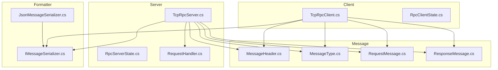
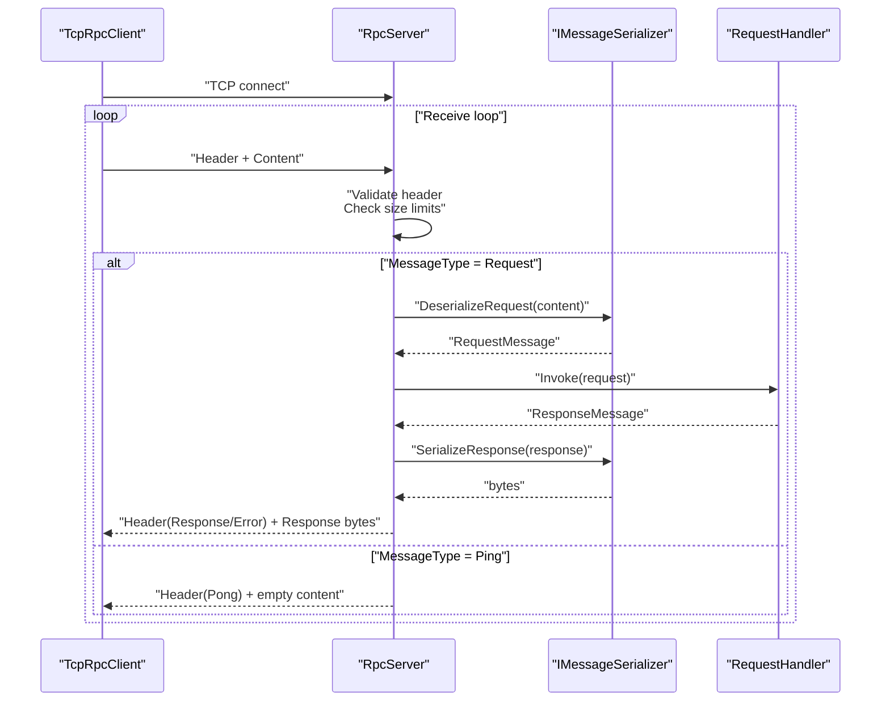
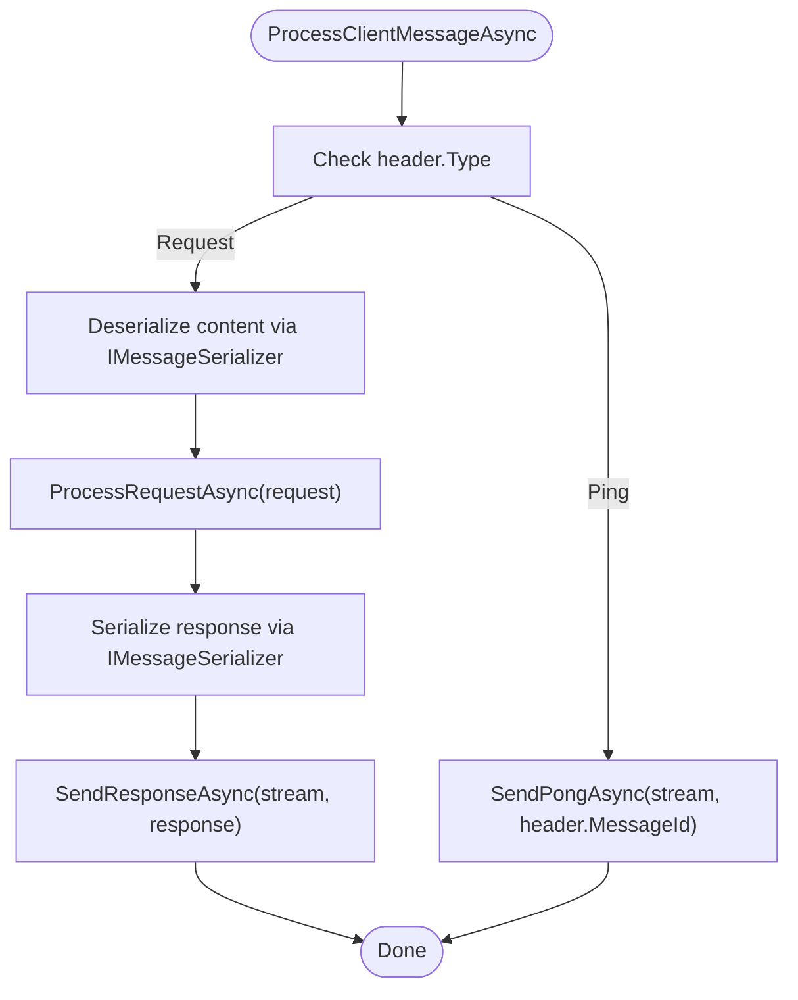
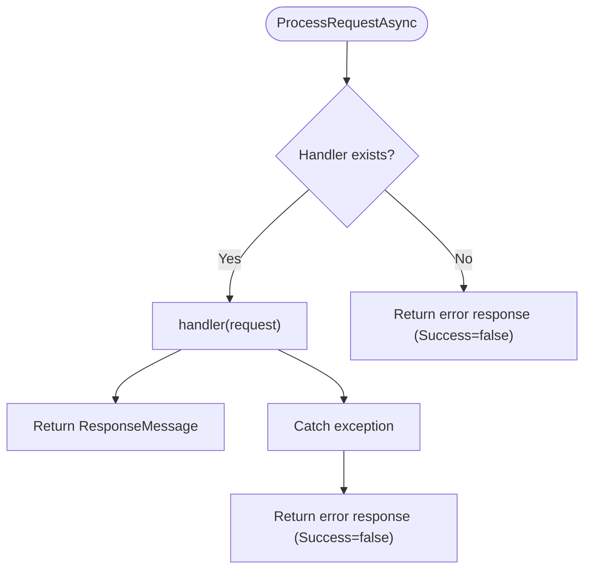
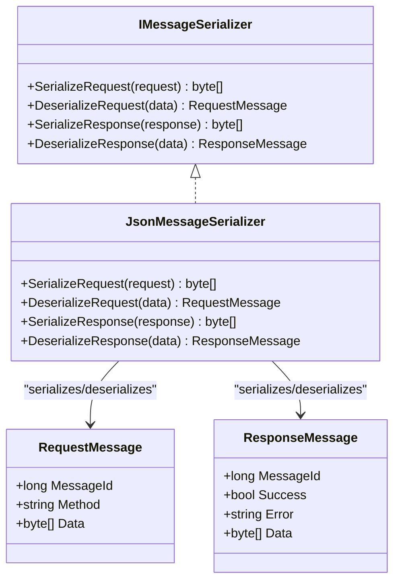
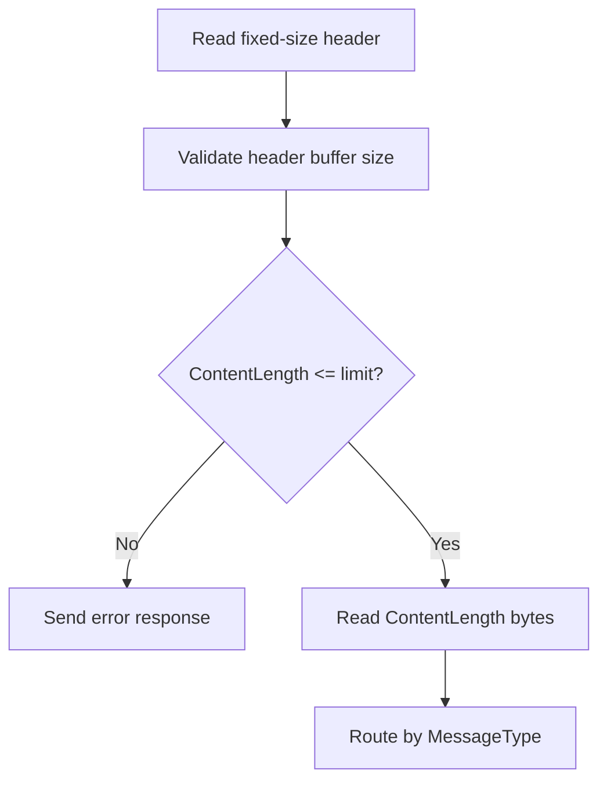
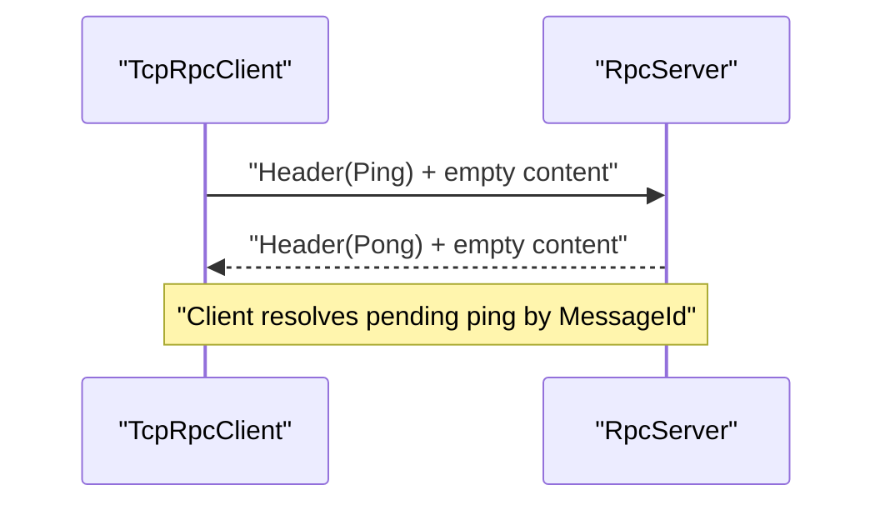
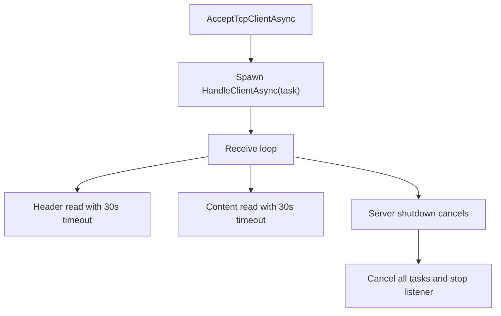
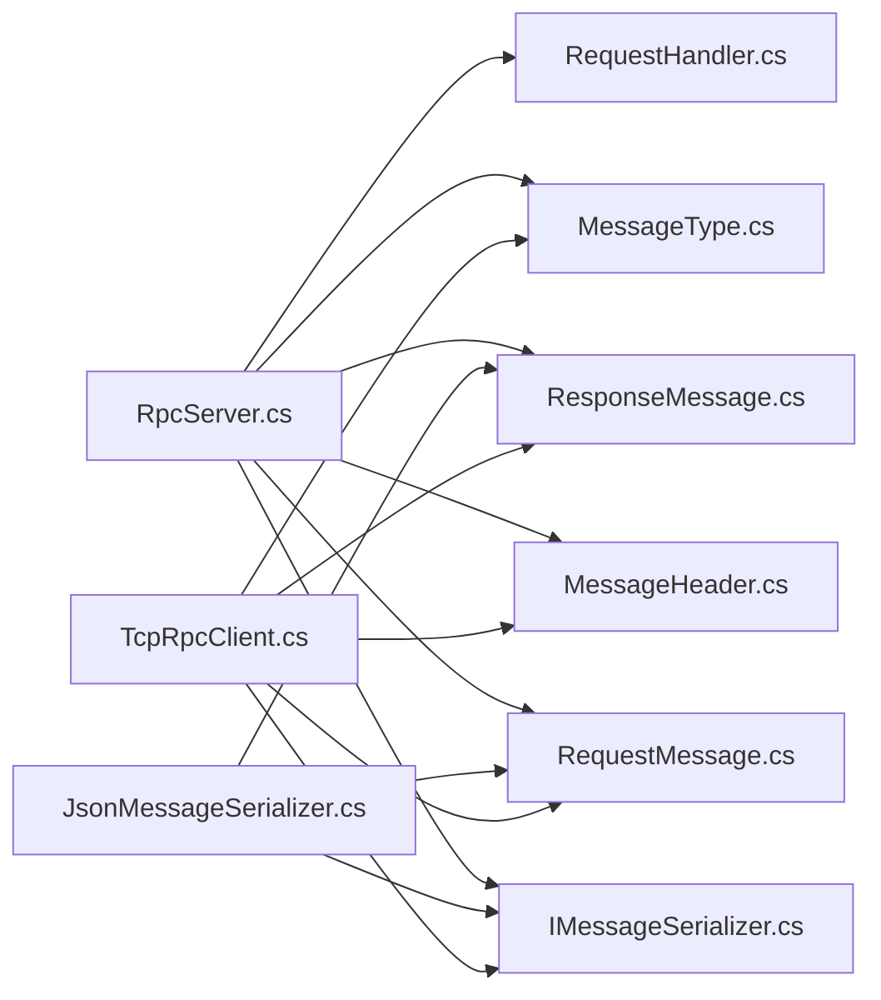

# Message Processing System

<cite>
**Referenced Files in This Document**
- [TcpRpcServer.cs](file://TcpRpc/Server/TcpRpcServer.cs)
- [RpcServerState.cs](file://TcpRpc/Server/RpcServerState.cs)
- [RequestHandler.cs](file://TcpRpc/Server/RequestHandler.cs)
- [IMessageSerializer.cs](file://TcpRpc/Formatter/IMessageSerializer.cs)
- [JsonMessageSerializer.cs](file://TcpRpc/Formatter/JsonMessageSerializer.cs)
- [MessageHeader.cs](file://TcpRpc/Message/MessageHeader.cs)
- [MessageType.cs](file://TcpRpc/Message/MessageType.cs)
- [RequestMessage.cs](file://TcpRpc/Message/RequestMessage.cs)
- [ResponseMessage.cs](file://TcpRpc/Message/ResponseMessage.cs)
- [TcpRpcClient.cs](file://TcpRpc/Client/TcpRpcClient.cs)
- [RpcClientState.cs](file://TcpRpc/Client/RpcClientState.cs)
- [TcpRpc.csproj](file://TcpRpc/TcpRpc.csproj)
</cite>

## Table of Contents
1. [Introduction](#introduction)
2. [Project Structure](#project-structure)
3. [Core Components](#core-components)
4. [Architecture Overview](#architecture-overview)
5. [Detailed Component Analysis](#detailed-component-analysis)
6. [Dependency Analysis](#dependency-analysis)
7. [Performance Considerations](#performance-considerations)
8. [Troubleshooting Guide](#troubleshooting-guide)
9. [Conclusion](#conclusion)

## Introduction
This document provides comprehensive documentation for the RpcServer message processing system. It focuses on the ProcessClientMessageAsync method for request/response handling, ping/pong processing, and message type routing. It also covers the message processing pipeline including header validation, content extraction, handler invocation, and response generation via ProcessRequestAsync. Serialization/deserialization is documented using the IMessageSerializer interface and JSON-based implementations. Error handling strategies, message size limits, timeouts, and concurrent message processing patterns are explained with practical examples.

## Project Structure
The project is organized into three primary namespaces:
- Server: RpcServer, RpcServerState, RequestHandler
- Formatter: IMessageSerializer, JsonMessageSerializer
- Message: MessageHeader, MessageType, RequestMessage, ResponseMessage
- Client: RpcClient, RpcClientState

**Diagram sources**
- [TcpRpcServer.cs:12-432](file://TcpRpc/Server/TcpRpcServer.cs#L12-L432)
- [IMessageSerializer.cs:5-13](file://TcpRpc/Formatter/IMessageSerializer.cs#L5-L13)
- [JsonMessageSerializer.cs:6-85](file://TcpRpc/Formatter/JsonMessageSerializer.cs#L6-L85)
- [MessageHeader.cs:5-34](file://TcpRpc/Message/MessageHeader.cs#L5-L34)
- [MessageType.cs:3-10](file://TcpRpc/Message/MessageType.cs#L3-L10)
- [RequestMessage.cs:3-8](file://TcpRpc/Message/RequestMessage.cs#L3-L8)
- [ResponseMessage.cs:3-9](file://TcpRpc/Message/ResponseMessage.cs#L3-L9)
- [TcpRpcClient.cs:11-405](file://TcpRpc/Client/TcpRpcClient.cs#L11-L405)

**Section sources**
- [TcpRpc.csproj:1-17](file://TcpRpc/TcpRpc.csproj#L1-L17)

## Core Components
- RpcServer: Central server that accepts TCP connections, reads message headers, validates content length, deserializes requests, routes to handlers, serializes responses, and handles ping/pong.
- IMessageSerializer and JsonMessageSerializer: Contract and JSON-based implementation for serializing/deserializing RequestMessage and ResponseMessage.
- MessageHeader and MessageType: Fixed-size binary header and message type enumeration used for framing.
- RequestMessage and ResponseMessage: DTOs representing RPC messages and responses.
- RequestHandler: Delegate type for handler functions.
- RpcServerState: Enumerates server lifecycle states.
- RpcClient: Client counterpart that sends requests, receives responses, and handles ping/pong.

Key responsibilities:
- Header validation and content extraction
- Handler lookup and execution
- Response generation and error propagation
- Ping/Pong handling for keepalive
- Concurrency and cancellation support

**Section sources**
- [TcpRpcServer.cs:12-432](file://TcpRpc/Server/TcpRpcServer.cs#L12-L432)
- [IMessageSerializer.cs:5-13](file://TcpRpc/Formatter/IMessageSerializer.cs#L5-L13)
- [JsonMessageSerializer.cs:6-85](file://TcpRpc/Formatter/JsonMessageSerializer.cs#L6-L85)
- [MessageHeader.cs:5-34](file://TcpRpc/Message/MessageHeader.cs#L5-L34)
- [MessageType.cs:3-10](file://TcpRpc/Message/MessageType.cs#L3-L10)
- [RequestMessage.cs:3-8](file://TcpRpc/Message/RequestMessage.cs#L3-L8)
- [ResponseMessage.cs:3-9](file://TcpRpc/Message/ResponseMessage.cs#L3-L9)
- [RequestHandler.cs:5-5](file://TcpRpc/Server/RequestHandler.cs#L5-L5)
- [RpcServerState.cs:3-10](file://TcpRpc/Server/RpcServerState.cs#L3-L10)
- [TcpRpcClient.cs:11-405](file://TcpRpc/Client/TcpRpcClient.cs#L11-L405)

## Architecture Overview
The server operates a per-client receive loop that:
- Reads a fixed-size header
- Validates message size limits
- Reads the content payload
- Routes by message type:
  - Request: deserializes, invokes handler, serializes response
  - Ping: responds with Pong
- Writes responses back to the client stream.

**Diagram sources**
- [TcpRpcServer.cs:228-333](file://TcpRpc/Server/TcpRpcServer.cs#L228-L333)
- [IMessageSerializer.cs:7-12](file://TcpRpc/Formatter/IMessageSerializer.cs#L7-L12)
- [JsonMessageSerializer.cs:14-57](file://TcpRpc/Formatter/JsonMessageSerializer.cs#L14-L57)
- [RequestHandler.cs:5-5](file://TcpRpc/Server/RequestHandler.cs#L5-L5)
- [MessageType.cs:3-10](file://TcpRpc/Message/MessageType.cs#L3-L10)

## Detailed Component Analysis

### ProcessClientMessageAsync: Message Routing and Processing
Responsibilities:
- Route by MessageType
- For Request: deserialize content, invoke ProcessRequestAsync, serialize response, send
- For Ping: send Pong

Behavior highlights:
- Uses IMessageSerializer.DeserializeRequest for request parsing
- Delegates handler execution to ProcessRequestAsync
- Uses SendResponseAsync or SendPongAsync for replies

**Diagram sources**
- [TcpRpcServer.cs:318-333](file://TcpRpc/Server/TcpRpcServer.cs#L318-L333)
- [IMessageSerializer.cs:7-12](file://TcpRpc/Formatter/IMessageSerializer.cs#L7-L12)
- [JsonMessageSerializer.cs:14-57](file://TcpRpc/Formatter/JsonMessageSerializer.cs#L14-L57)

**Section sources**
- [TcpRpcServer.cs:318-333](file://TcpRpc/Server/TcpRpcServer.cs#L318-L333)

### ProcessRequestAsync: Handler Lookup, Execution, and Error Response Creation
Responsibilities:
- Lookup handler by request.Method
- Invoke handler(request) returning ResponseMessage
- Return error response if method not found or handler throws

Error handling:
- Method not found: Success=false, Error indicates missing method
- Handler exception: Success=false, Error wraps exception message

**Diagram sources**
- [TcpRpcServer.cs:335-360](file://TcpRpc/Server/TcpRpcServer.cs#L335-L360)

**Section sources**
- [TcpRpcServer.cs:335-360](file://TcpRpc/Server/TcpRpcServer.cs#L335-L360)

### Message Serialization/Demarshalling Pipeline
Contract and JSON implementation:
- IMessageSerializer defines SerializeRequest, DeserializeRequest, SerializeResponse, DeserializeResponse
- JsonMessageSerializer uses System.Text.Json with camelCase naming and no indentation
- Validation:
  - RequestMessage requires MessageId > 0 and non-empty Method
  - ResponseMessage requires MessageId > 0
  - Throws InvalidOperationException for invalid deserialization or null results
  - Throws ArgumentException for empty data

**Diagram sources**
- [IMessageSerializer.cs:5-13](file://TcpRpc/Formatter/IMessageSerializer.cs#L5-L13)
- [JsonMessageSerializer.cs:6-85](file://TcpRpc/Formatter/JsonMessageSerializer.cs#L6-L85)
- [RequestMessage.cs:3-8](file://TcpRpc/Message/RequestMessage.cs#L3-L8)
- [ResponseMessage.cs:3-9](file://TcpRpc/Message/ResponseMessage.cs#L3-L9)

**Section sources**
- [IMessageSerializer.cs:5-13](file://TcpRpc/Formatter/IMessageSerializer.cs#L5-L13)
- [JsonMessageSerializer.cs:6-85](file://TcpRpc/Formatter/JsonMessageSerializer.cs#L6-L85)
- [RequestMessage.cs:3-8](file://TcpRpc/Message/RequestMessage.cs#L3-L8)
- [ResponseMessage.cs:3-9](file://TcpRpc/Message/ResponseMessage.cs#L3-L9)

### Header Framing and Size Limits
MessageHeader structure:
- Fixed size: 17 bytes
- Fields: MessageType, MessageId, ContentLength
- Little-endian encoding for numeric fields

Server-side size checks:
- Maximum content length enforced before reading content
- Exceeding limit triggers error response

Client-side size checks:
- Enforces stricter limit during receive loop
- Throws InvalidDataException on overflow

**Diagram sources**
- [MessageHeader.cs:7-33](file://TcpRpc/Message/MessageHeader.cs#L7-L33)
- [TcpRpcServer.cs:264-270](file://TcpRpc/Server/TcpRpcServer.cs#L264-L270)
- [TcpRpcClient.cs:215-218](file://TcpRpc/Client/TcpRpcClient.cs#L215-L218)

**Section sources**
- [MessageHeader.cs:7-33](file://TcpRpc/Message/MessageHeader.cs#L7-L33)
- [TcpRpcServer.cs:264-270](file://TcpRpc/Server/TcpRpcServer.cs#L264-L270)
- [TcpRpcClient.cs:215-218](file://TcpRpc/Client/TcpRpcClient.cs#L215-L218)

### Ping/Pong Message Processing
- Client sends Ping with zero-length content
- Server responds with Pong using the same MessageId
- Client tracks pending pings and resolves completion sources upon receiving Pong

**Diagram sources**
- [TcpRpcServer.cs:394-406](file://TcpRpc/Server/TcpRpcServer.cs#L394-L406)
- [TcpRpcClient.cs:258-287](file://TcpRpc/Client/TcpRpcClient.cs#L258-L287)
- [MessageType.cs:3-10](file://TcpRpc/Message/MessageType.cs#L3-L10)

**Section sources**
- [TcpRpcServer.cs:394-406](file://TcpRpc/Server/TcpRpcServer.cs#L394-L406)
- [TcpRpcClient.cs:258-287](file://TcpRpc/Client/TcpRpcClient.cs#L258-L287)

### Concurrency and Timeouts
- Per-client receive loop runs concurrently for multiple clients
- Header read and content read use linked CancellationTokenSources with timeouts
- Server shutdown uses a shared CancellationTokenSource to cancel all operations
- Client enforces per-request timeouts and protects send operations with a semaphore

**Diagram sources**
- [TcpRpcServer.cs:101-173](file://TcpRpc/Server/TcpRpcServer.cs#L101-L173)
- [TcpRpcServer.cs:228-316](file://TcpRpc/Server/TcpRpcServer.cs#L228-L316)
- [TcpRpcClient.cs:132-189](file://TcpRpc/Client/TcpRpcClient.cs#L132-L189)

**Section sources**
- [TcpRpcServer.cs:101-173](file://TcpRpc/Server/TcpRpcServer.cs#L101-L173)
- [TcpRpcServer.cs:228-316](file://TcpRpc/Server/TcpRpcServer.cs#L228-L316)
- [TcpRpcClient.cs:132-189](file://TcpRpc/Client/TcpRpcClient.cs#L132-L189)

## Dependency Analysis
- RpcServer depends on IMessageSerializer for serialization and RequestHandler for dispatch
- JsonMessageSerializer depends on System.Text.Json and validates message fields
- MessageHeader and MessageType define the wire protocol
- RpcClient mirrors server behavior for sending/receiving messages and ping/pong

**Diagram sources**
- [TcpRpcServer.cs:12-432](file://TcpRpc/Server/TcpRpcServer.cs#L12-L432)
- [IMessageSerializer.cs:5-13](file://TcpRpc/Formatter/IMessageSerializer.cs#L5-L13)
- [JsonMessageSerializer.cs:6-85](file://TcpRpc/Formatter/JsonMessageSerializer.cs#L6-L85)
- [MessageHeader.cs:5-34](file://TcpRpc/Message/MessageHeader.cs#L5-L34)
- [MessageType.cs:3-10](file://TcpRpc/Message/MessageType.cs#L3-L10)
- [RequestMessage.cs:3-8](file://TcpRpc/Message/RequestMessage.cs#L3-L8)
- [ResponseMessage.cs:3-9](file://TcpRpc/Message/ResponseMessage.cs#L3-L9)
- [RequestHandler.cs:5-5](file://TcpRpc/Server/RequestHandler.cs#L5-L5)
- [TcpRpcClient.cs:11-405](file://TcpRpc/Client/TcpRpcClient.cs#L11-L405)

**Section sources**
- [TcpRpcServer.cs:12-432](file://TcpRpc/Server/TcpRpcServer.cs#L12-L432)
- [IMessageSerializer.cs:5-13](file://TcpRpc/Formatter/IMessageSerializer.cs#L5-L13)
- [JsonMessageSerializer.cs:6-85](file://TcpRpc/Formatter/JsonMessageSerializer.cs#L6-L85)
- [MessageHeader.cs:5-34](file://TcpRpc/Message/MessageHeader.cs#L5-L34)
- [MessageType.cs:3-10](file://TcpRpc/Message/MessageType.cs#L3-L10)
- [RequestMessage.cs:3-8](file://TcpRpc/Message/RequestMessage.cs#L3-L8)
- [ResponseMessage.cs:3-9](file://TcpRpc/Message/ResponseMessage.cs#L3-L9)
- [RequestHandler.cs:5-5](file://TcpRpc/Server/RequestHandler.cs#L5-L5)
- [TcpRpcClient.cs:11-405](file://TcpRpc/Client/TcpRpcClient.cs#L11-L405)

## Performance Considerations
- Serialization overhead: JSON serialization/deserialization occurs per message; consider compression or binary formats for large payloads
- Memory usage: Large content lengths are rejected; ensure payloads stay within limits to avoid memory pressure
- Concurrency: Per-client tasks scale with active connections; monitor ActiveConnections and adjust resource limits accordingly
- Timeouts: Header/content reads enforce 30-second timeouts; tune based on network conditions and expected payload sizes
- Handler throughput: Handlers execute synchronously; consider asynchronous design and caching for CPU-bound operations

[No sources needed since this section provides general guidance]

## Troubleshooting Guide
Common error scenarios and handling:
- Invalid message header or insufficient buffer size: thrown during header deserialization
- Empty or malformed content: JsonMessageSerializer throws for empty data or invalid JSON
- Message too large: Server sends error response; client throws InvalidDataException
- Method not found: ProcessRequestAsync returns error response indicating missing method
- Handler exceptions: ProcessRequestAsync wraps exception message in error response
- Serialization errors: JsonMessageSerializer throws for invalid deserialization or null results
- Timeouts: Client-side timeouts trigger TimeoutException; server-side timeouts continue loop

Operational tips:
- Monitor server logs for error messages during message processing
- Validate client/server versions and message formats
- Ensure handlers return valid ResponseMessage with correct MessageId
- Confirm ping/pong connectivity for keepalive monitoring

**Section sources**
- [JsonMessageSerializer.cs:26-48](file://TcpRpc/Formatter/JsonMessageSerializer.cs#L26-L48)
- [JsonMessageSerializer.cs:64-83](file://TcpRpc/Formatter/JsonMessageSerializer.cs#L64-L83)
- [TcpRpcServer.cs:264-270](file://TcpRpc/Server/TcpRpcServer.cs#L264-L270)
- [TcpRpcServer.cs:344-359](file://TcpRpc/Server/TcpRpcServer.cs#L344-L359)
- [TcpRpcClient.cs:215-218](file://TcpRpc/Client/TcpRpcClient.cs#L215-L218)
- [TcpRpcClient.cs:179-188](file://TcpRpc/Client/TcpRpcClient.cs#L179-L188)

## Conclusion
The RpcServer message processing system provides a robust, extensible framework for TCP-based RPC over a simple binary header plus JSON payload. Its design emphasizes clear separation of concerns: serialization via IMessageSerializer, routing via RequestHandler, and strict header validation with size limits. The system supports ping/pong for keepalive, handles timeouts gracefully, and offers predictable error propagation. For production deployments, consider payload size budgets, serialization performance, and handler scalability to meet throughput and latency targets.