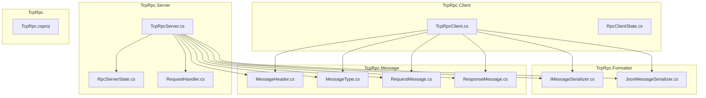
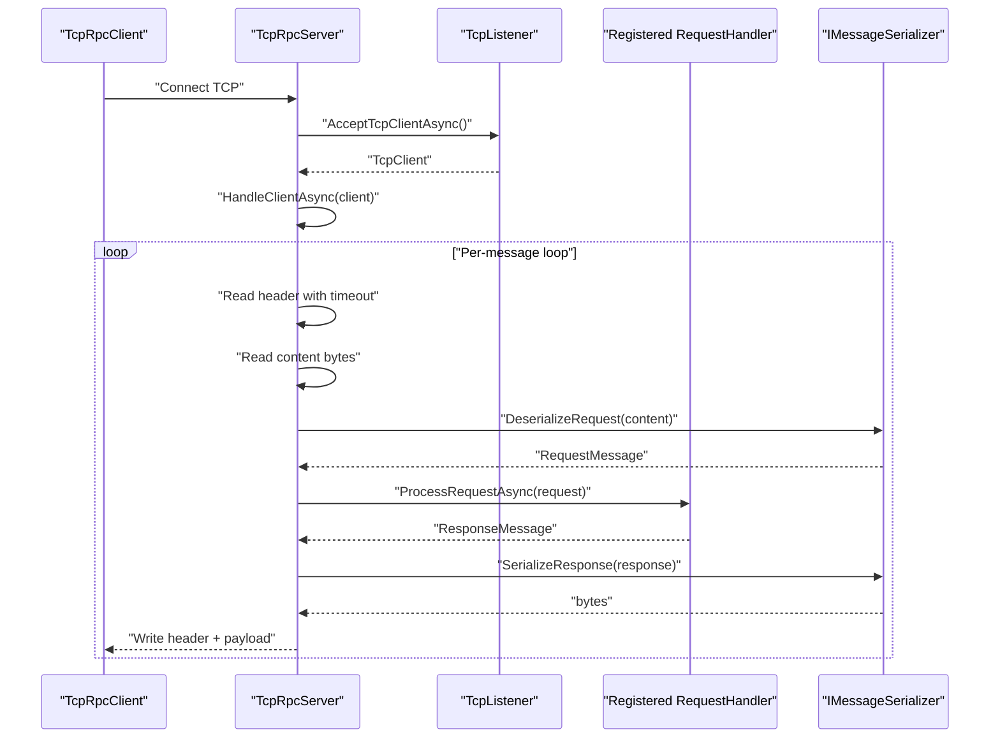
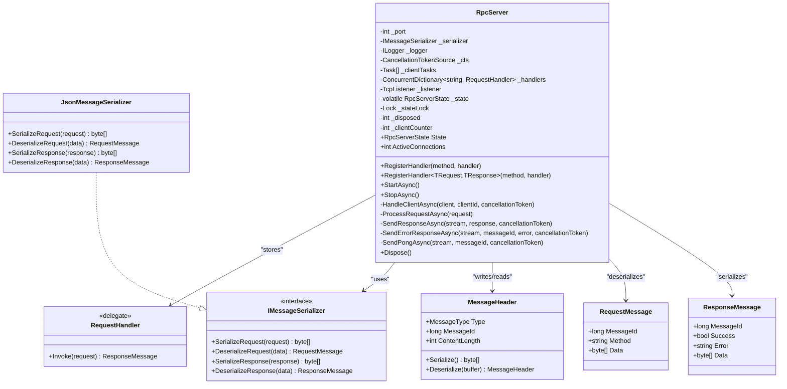
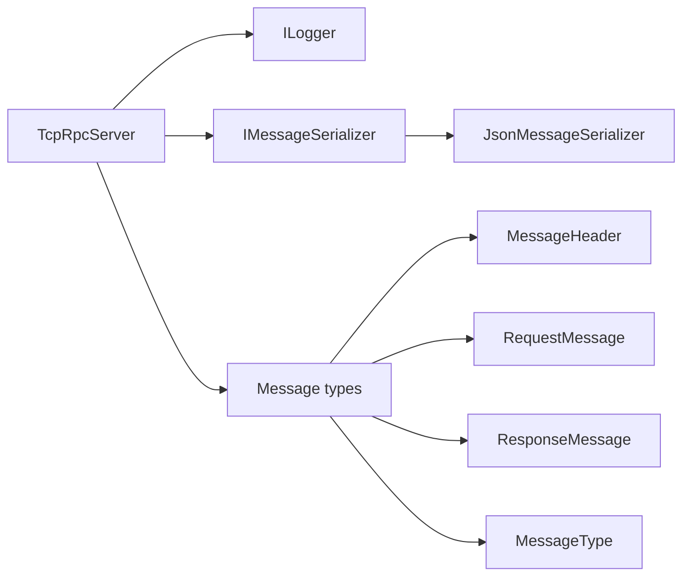

# RpcServer Implementation

<cite>
**Referenced Files in This Document**
- [TcpRpcServer.cs](file://TcpRpc/Server/TcpRpcServer.cs)
- [RpcServerState.cs](file://TcpRpc/Server/RpcServerState.cs)
- [RequestHandler.cs](file://TcpRpc/Server/RequestHandler.cs)
- [MessageHeader.cs](file://TcpRpc/Message/MessageHeader.cs)
- [MessageType.cs](file://TcpRpc/Message/MessageType.cs)
- [RequestMessage.cs](file://TcpRpc/Message/RequestMessage.cs)
- [ResponseMessage.cs](file://TcpRpc/Message/ResponseMessage.cs)
- [IMessageSerializer.cs](file://TcpRpc/Formatter/IMessageSerializer.cs)
- [JsonMessageSerializer.cs](file://TcpRpc/Formatter/JsonMessageSerializer.cs)
- [TcpRpcClient.cs](file://TcpRpc/Client/TcpRpcClient.cs)
- [RpcClientState.cs](file://TcpRpc/Client/RpcClientState.cs)
- [TcpRpc.csproj](file://TcpRpc/TcpRpc.csproj)
</cite>

## Table of Contents
1. [Introduction](#introduction)
2. [Project Structure](#project-structure)
3. [Core Components](#core-components)
4. [Architecture Overview](#architecture-overview)
5. [Detailed Component Analysis](#detailed-component-analysis)
6. [Dependency Analysis](#dependency-analysis)
7. [Performance Considerations](#performance-considerations)
8. [Troubleshooting Guide](#troubleshooting-guide)
9. [Conclusion](#conclusion)
10. [Appendices](#appendices)

## Introduction
This document provides comprehensive documentation for the RpcServer implementation, focusing on the TcpRpcServer class architecture, server lifecycle management, TCP listener setup, concurrent client connection handling, and the RpcServerState class that manages state transitions. It explains the RequestHandler delegate system for registering business logic handlers, concurrent request processing with thread safety, and client connection management. Practical examples illustrate server initialization, handler registration, concurrent client processing, and graceful shutdown sequences. Configuration options such as port binding, connection limits, timeout settings, and logging levels are documented, along with common scenarios like handler registration conflicts, concurrent client overload, and server maintenance procedures.

## Project Structure
The RpcServer resides in the TcpRpc.Server namespace and integrates with message serialization, network communication, and logging infrastructure. The project targets .NET 10 and uses Microsoft.Extensions.Logging for structured logging.

**Diagram sources**
- [TcpRpcServer.cs](file://TcpRpc/Server/TcpRpcServer.cs)
- [RpcServerState.cs](file://TcpRpc/Server/RpcServerState.cs)
- [RequestHandler.cs](file://TcpRpc/Server/RequestHandler.cs)
- [MessageHeader.cs](file://TcpRpc/Message/MessageHeader.cs)
- [MessageType.cs](file://TcpRpc/Message/MessageType.cs)
- [RequestMessage.cs](file://TcpRpc/Message/RequestMessage.cs)
- [ResponseMessage.cs](file://TcpRpc/Message/ResponseMessage.cs)
- [IMessageSerializer.cs](file://TcpRpc/Formatter/IMessageSerializer.cs)
- [JsonMessageSerializer.cs](file://TcpRpc/Formatter/JsonMessageSerializer.cs)
- [TcpRpcClient.cs](file://TcpRpc/Client/TcpRpcClient.cs)
- [RpcClientState.cs](file://TcpRpc/Client/RpcClientState.cs)
- [TcpRpc.csproj](file://TcpRpc/TcpRpc.csproj)

**Section sources**
- [TcpRpc.csproj:1-17](file://TcpRpc/TcpRpc.csproj#L1-L17)

## Core Components
- TcpRpcServer: The primary server class responsible for accepting TCP connections, managing server state, registering request handlers, processing inbound messages, and coordinating graceful shutdown.
- RpcServerState: An enumeration defining server state transitions (Stopped, Starting, Running, Stopping, Faulted).
- RequestHandler: A delegate type representing asynchronous request handlers that accept a RequestMessage and return a ResponseMessage.
- Message types and serialization: MessageHeader, MessageType, RequestMessage, ResponseMessage define the wire protocol and JSON-based serialization via IMessageSerializer and JsonMessageSerializer.
- Client counterpart: TcpRpcClient demonstrates the client-side behavior and complements the server’s message handling.

Key responsibilities:
- Lifecycle management: StartAsync, StopAsync, and disposal semantics.
- Concurrency: Per-client tasks, thread-safe state updates, and cancellation coordination.
- Handler registration: Two overloads for registering business logic handlers.
- Message processing: Header parsing, content validation, request routing, and response serialization.

**Section sources**
- [TcpRpcServer.cs:12-432](file://TcpRpc/Server/TcpRpcServer.cs#L12-L432)
- [RpcServerState.cs:1-10](file://TcpRpc/Server/RpcServerState.cs#L1-L10)
- [RequestHandler.cs:1-5](file://TcpRpc/Server/RequestHandler.cs#L1-L5)
- [IMessageSerializer.cs:1-13](file://TcpRpc/Formatter/IMessageSerializer.cs#L1-L13)
- [JsonMessageSerializer.cs:1-85](file://TcpRpc/Formatter/JsonMessageSerializer.cs#L1-L85)

## Architecture Overview
The server architecture centers around a TcpListener that accepts incoming TCP connections. Each accepted client is handled asynchronously in its own task. Messages are framed with a fixed-size header containing type, message ID, and content length. The server routes requests to registered handlers and writes responses back to the client stream. Logging is integrated via Microsoft.Extensions.Logging.

**Diagram sources**
- [TcpRpcServer.cs:101-173](file://TcpRpc/Server/TcpRpcServer.cs#L101-L173)
- [TcpRpcServer.cs:228-316](file://TcpRpc/Server/TcpRpcServer.cs#L228-L316)
- [TcpRpcServer.cs:318-360](file://TcpRpc/Server/TcpRpcServer.cs#L318-L360)
- [IMessageSerializer.cs:1-13](file://TcpRpc/Formatter/IMessageSerializer.cs#L1-L13)
- [JsonMessageSerializer.cs:14-57](file://TcpRpc/Formatter/JsonMessageSerializer.cs#L14-L57)

## Detailed Component Analysis

### TcpRpcServer
The TcpRpcServer class encapsulates the server lifecycle, TCP listener setup, concurrent client handling, and request processing pipeline.

- Constructor and Dependencies
  - Accepts port, optional IMessageSerializer, and optional ILogger.
  - Initializes cancellation token source, client task collection, handler dictionary, and state tracking.

- State Management
  - Volatile state field guarded by a lock for thread-safe transitions.
  - Exposes State property and ActiveConnections for monitoring.

- Handler Registration
  - Overload 1: RegisterHandler(string, RequestHandler) validates server is Stopped and stores the handler.
  - Overload 2: RegisterHandler<TRequest,TResponse>(string, Func<TRequest, Task<TResponse>>) wraps a typed handler into a RequestHandler delegate, performing JSON deserialization and serialization.

- Lifecycle Methods
  - StartAsync:
    - Sets state to Starting, creates TcpListener bound to IPAddress.Any on configured port, starts listening.
    - Switches state to Running and enters accept loop; for each accepted client, increments client counter and spawns HandleClientAsync.
    - Handles cancellation and faults appropriately, ensuring state transitions to Stopped or Faulted.
  - StopAsync:
    - Transitions to Stopping, stops listener, cancels all operations, waits for active client tasks with a timeout, clears client tasks, and sets state to Stopped.

- Client Handling
  - HandleClientAsync:
    - Logs client connection and endpoint.
    - Reads message headers with a per-read timeout using a linked cancellation token.
    - Validates content length against a hard limit.
    - Deserializes content to RequestMessage and routes to ProcessRequestAsync.
    - Writes responses or error responses back to the stream.
    - Continues loop until cancellation or disconnect.

- Request Processing
  - ProcessRequestAsync:
    - Looks up handler by method name; if missing, returns an error response.
    - Executes handler and returns a ResponseMessage.
    - Wraps exceptions into error responses.

- Serialization Utilities
  - SendResponseAsync, SendErrorResponseAsync, SendPongAsync: Serialize and write message headers and payloads.

- Thread Safety and Concurrency
  - State transitions protected by a lock.
  - Client task list maintained under lock and periodically pruned.
  - Per-client message processing isolated to individual tasks.
  - Cancellation tokens coordinated across operations.

- Resource Cleanup
  - Dispose calls StopAsync with a timeout, disposes cancellation token, and suppresses finalization.

Practical examples (paths only):
- Server initialization and handler registration:
  - [TcpRpcServer.cs:43-48](file://TcpRpc/Server/TcpRpcServer.cs#L43-L48)
  - [TcpRpcServer.cs:50-58](file://TcpRpc/Server/TcpRpcServer.cs#L50-L58)
  - [TcpRpcServer.cs:60-99](file://TcpRpc/Server/TcpRpcServer.cs#L60-L99)
- Concurrent client processing:
  - [TcpRpcServer.cs:134-148](file://TcpRpc/Server/TcpRpcServer.cs#L134-L148)
  - [TcpRpcServer.cs:228-316](file://TcpRpc/Server/TcpRpcServer.cs#L228-L316)
- Graceful shutdown:
  - [TcpRpcServer.cs:175-226](file://TcpRpc/Server/TcpRpcServer.cs#L175-L226)

**Section sources**
- [TcpRpcServer.cs:12-432](file://TcpRpc/Server/TcpRpcServer.cs#L12-L432)

#### Class Diagram

**Diagram sources**
- [TcpRpcServer.cs:12-432](file://TcpRpc/Server/TcpRpcServer.cs#L12-L432)
- [RequestHandler.cs:1-5](file://TcpRpc/Server/RequestHandler.cs#L1-L5)
- [IMessageSerializer.cs:1-13](file://TcpRpc/Formatter/IMessageSerializer.cs#L1-L13)
- [JsonMessageSerializer.cs:1-85](file://TcpRpc/Formatter/JsonMessageSerializer.cs#L1-L85)
- [MessageHeader.cs:1-34](file://TcpRpc/Message/MessageHeader.cs#L1-L34)
- [RequestMessage.cs:1-8](file://TcpRpc/Message/RequestMessage.cs#L1-L8)
- [ResponseMessage.cs:1-9](file://TcpRpc/Message/ResponseMessage.cs#L1-L9)

### RpcServerState
Defines the server’s state machine with five states: Stopped, Starting, Running, Stopping, and Faulted. Transitions occur during StartAsync and StopAsync, with fault handling setting the state to Faulted.

**Section sources**
- [RpcServerState.cs:1-10](file://TcpRpc/Server/RpcServerState.cs#L1-L10)

### RequestHandler Delegate
A delegate that takes a RequestMessage and returns a ResponseMessage asynchronously. Used to register business logic handlers with the server.

**Section sources**
- [RequestHandler.cs:1-5](file://TcpRpc/Server/RequestHandler.cs#L1-L5)

### Message Protocol and Serialization
- MessageHeader: Fixed-size header with Type, MessageId, and ContentLength; provides Serialize and Deserialize helpers.
- MessageType: Enumerates message types including Request, Response, Ping, Pong, and Error.
- RequestMessage and ResponseMessage: DTOs for request and response payloads.
- IMessageSerializer and JsonMessageSerializer: Contract and JSON-based implementation for serializing/deserializing messages.

**Section sources**
- [MessageHeader.cs:1-34](file://TcpRpc/Message/MessageHeader.cs#L1-L34)
- [MessageType.cs:1-10](file://TcpRpc/Message/MessageType.cs#L1-L10)
- [RequestMessage.cs:1-8](file://TcpRpc/Message/RequestMessage.cs#L1-L8)
- [ResponseMessage.cs:1-9](file://TcpRpc/Message/ResponseMessage.cs#L1-L9)
- [IMessageSerializer.cs:1-13](file://TcpRpc/Formatter/IMessageSerializer.cs#L1-L13)
- [JsonMessageSerializer.cs:1-85](file://TcpRpc/Formatter/JsonMessageSerializer.cs#L1-L85)

### Client Counterpart (Context)
TcpRpcClient demonstrates the client-side behavior, including connection lifecycle, sending requests, receiving responses, and handling timeouts. While not part of the server, it complements the server’s message handling and provides a complete picture of the RPC protocol.

**Section sources**
- [TcpRpcClient.cs:1-405](file://TcpRpc/Client/TcpRpcClient.cs#L1-L405)
- [RpcClientState.cs:1-11](file://TcpRpc/Client/RpcClientState.cs#L1-L11)

## Dependency Analysis
The server depends on:
- Microsoft.Extensions.Logging for structured logging.
- TcpRpc.Message types for framing and payload handling.
- TcpRpc.Formatter for serialization.

**Diagram sources**
- [TcpRpcServer.cs:1-8](file://TcpRpc/Server/TcpRpcServer.cs#L1-L8)
- [IMessageSerializer.cs:1-13](file://TcpRpc/Formatter/IMessageSerializer.cs#L1-L13)
- [JsonMessageSerializer.cs:1-85](file://TcpRpc/Formatter/JsonMessageSerializer.cs#L1-L85)
- [MessageHeader.cs:1-34](file://TcpRpc/Message/MessageHeader.cs#L1-L34)
- [RequestMessage.cs:1-8](file://TcpRpc/Message/RequestMessage.cs#L1-L8)
- [ResponseMessage.cs:1-9](file://TcpRpc/Message/ResponseMessage.cs#L1-L9)
- [MessageType.cs:1-10](file://TcpRpc/Message/MessageType.cs#L1-L10)

**Section sources**
- [TcpRpc.csproj:11-14](file://TcpRpc/TcpRpc.csproj#L11-L14)
- [TcpRpcServer.cs:1-8](file://TcpRpc/Server/TcpRpcServer.cs#L1-L8)

## Performance Considerations
- Concurrency model: Each client connection runs in its own task, enabling concurrent request processing. The server maintains a list of active client tasks and prunes completed ones periodically.
- Backpressure: There is no explicit connection or request queue limit. The server accepts connections continuously while running and relies on per-operation cancellation and timeouts to manage resources.
- Timeouts: Per-read timeouts are enforced using linked cancellation tokens, preventing indefinite blocking on reads. A global operation timeout is used during shutdown to prevent hanging tasks.
- Serialization overhead: JSON serialization is used for request/response payloads. Consider compression or binary serialization if throughput is critical.
- Memory limits: Content length checks enforce upper bounds on request sizes to mitigate memory pressure.

[No sources needed since this section provides general guidance]

## Troubleshooting Guide
Common scenarios and resolutions:
- Handler registration conflicts:
  - Registering a handler while the server is not Stopped throws an exception. Ensure handlers are registered before starting the server.
  - Duplicate method names overwrite previous handlers; ensure unique method names.
  - Reference: [TcpRpcServer.cs:50-58](file://TcpRpc/Server/TcpRpcServer.cs#L50-L58)
- Concurrent client overload:
  - The server does not cap active connections. Monitor ActiveConnections and consider external load balancing or scaling horizontally.
  - Use timeouts and cancellation tokens to prevent runaway tasks.
  - Reference: [TcpRpcServer.cs:31-41](file://TcpRpc/Server/TcpRpcServer.cs#L31-L41)
- Server maintenance and graceful shutdown:
  - Call StopAsync to stop accepting new connections, cancel ongoing operations, wait for clients to finish, and reset state.
  - Dispose ensures StopAsync is invoked with a timeout and resources are cleaned up.
  - Reference: [TcpRpcServer.cs:175-226](file://TcpRpc/Server/TcpRpcServer.cs#L175-L226), [TcpRpcServer.cs:415-432](file://TcpRpc/Server/TcpRpcServer.cs#L415-L432)
- Handler errors:
  - Exceptions thrown by handlers are caught and returned as error responses. Inspect logs for detailed error messages.
  - Reference: [TcpRpcServer.cs:335-360](file://TcpRpc/Server/TcpRpcServer.cs#L335-L360)
- Message size violations:
  - Requests exceeding content length limits trigger error responses. Adjust limits if necessary.
  - Reference: [TcpRpcServer.cs:264-270](file://TcpRpc/Server/TcpRpcServer.cs#L264-L270)

**Section sources**
- [TcpRpcServer.cs:31-41](file://TcpRpc/Server/TcpRpcServer.cs#L31-L41)
- [TcpRpcServer.cs:50-58](file://TcpRpc/Server/TcpRpcServer.cs#L50-L58)
- [TcpRpcServer.cs:175-226](file://TcpRpc/Server/TcpRpcServer.cs#L175-L226)
- [TcpRpcServer.cs:335-360](file://TcpRpc/Server/TcpRpcServer.cs#L335-L360)
- [TcpRpcServer.cs:264-270](file://TcpRpc/Server/TcpRpcServer.cs#L264-L270)

## Conclusion
The RpcServer implementation provides a robust foundation for a TCP-based RPC service. It offers clear lifecycle management, thread-safe state coordination, concurrent client handling, and a flexible handler registration system. The message protocol and JSON serialization enable straightforward extensibility. Proper use of timeouts, cancellation tokens, and logging ensures reliable operation under load. For production deployments, consider adding explicit connection limits, rate limiting, and health checks.

[No sources needed since this section summarizes without analyzing specific files]

## Appendices

### Configuration Options
- Port binding: Configured via constructor parameter; server binds to IPAddress.Any on the specified port.
- Connection limits: Not enforced by the server; monitor ActiveConnections and apply external controls if needed.
- Timeout settings:
  - Per-read timeout during message processing.
  - Shutdown wait timeout for client tasks.
  - Request send timeout in the client counterpart.
- Logging levels: Integrated with Microsoft.Extensions.Logging; configure provider and level externally.

**Section sources**
- [TcpRpcServer.cs:43-48](file://TcpRpc/Server/TcpRpcServer.cs#L43-L48)
- [TcpRpcServer.cs:244-247](file://TcpRpc/Server/TcpRpcServer.cs#L244-L247)
- [TcpRpcServer.cs](file://TcpRpc/Server/TcpRpcServer.cs#L206)
- [TcpRpcClient.cs:162-163](file://TcpRpc/Client/TcpRpcClient.cs#L162-L163)

### Practical Examples (Paths Only)
- Initialize server and register handlers:
  - [TcpRpcServer.cs:43-48](file://TcpRpc/Server/TcpRpcServer.cs#L43-L48)
  - [TcpRpcServer.cs:50-58](file://TcpRpc/Server/TcpRpcServer.cs#L50-L58)
  - [TcpRpcServer.cs:60-99](file://TcpRpc/Server/TcpRpcServer.cs#L60-L99)
- Start server and accept clients:
  - [TcpRpcServer.cs:101-173](file://TcpRpc/Server/TcpRpcServer.cs#L101-L173)
  - [TcpRpcServer.cs:134-148](file://TcpRpc/Server/TcpRpcServer.cs#L134-L148)
- Process requests concurrently:
  - [TcpRpcServer.cs:228-316](file://TcpRpc/Server/TcpRpcServer.cs#L228-L316)
  - [TcpRpcServer.cs:318-360](file://TcpRpc/Server/TcpRpcServer.cs#L318-L360)
- Graceful shutdown:
  - [TcpRpcServer.cs:175-226](file://TcpRpc/Server/TcpRpcServer.cs#L175-L226)
  - [TcpRpcServer.cs:415-432](file://TcpRpc/Server/TcpRpcServer.cs#L415-L432)