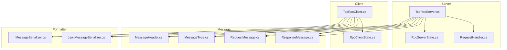
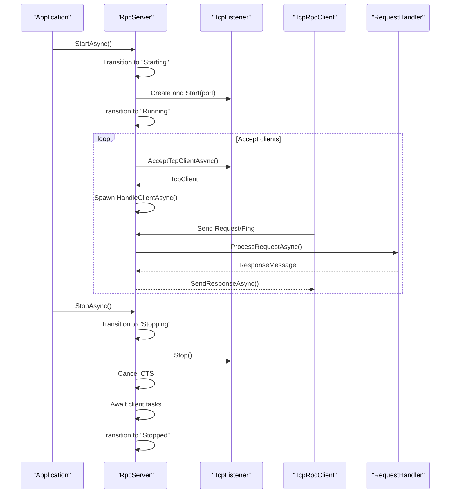
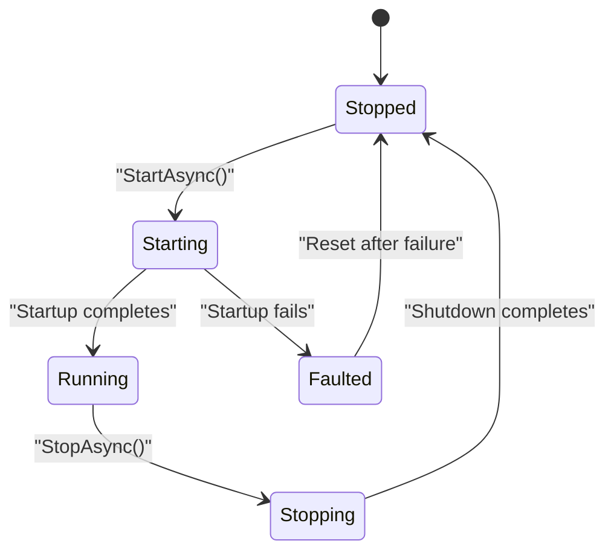
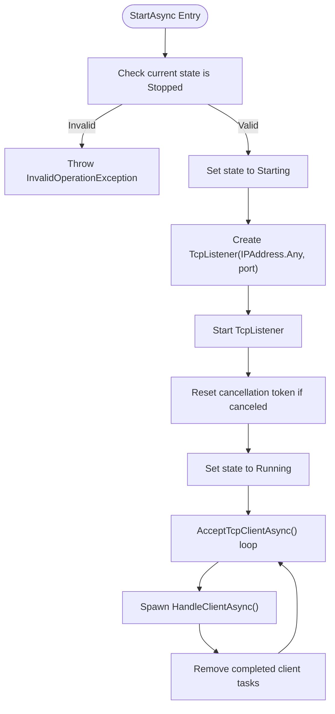
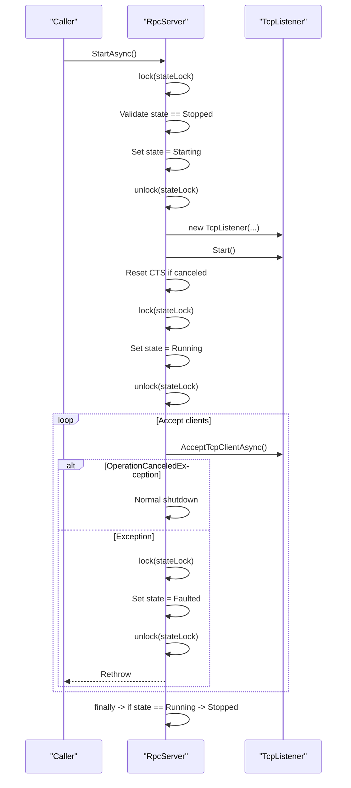
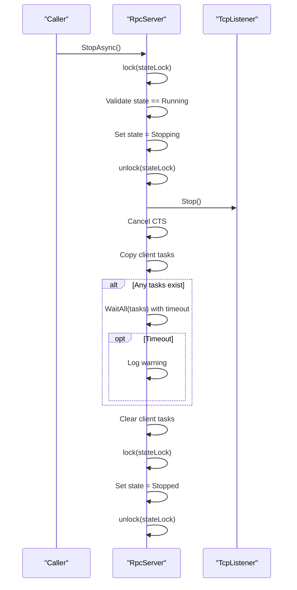
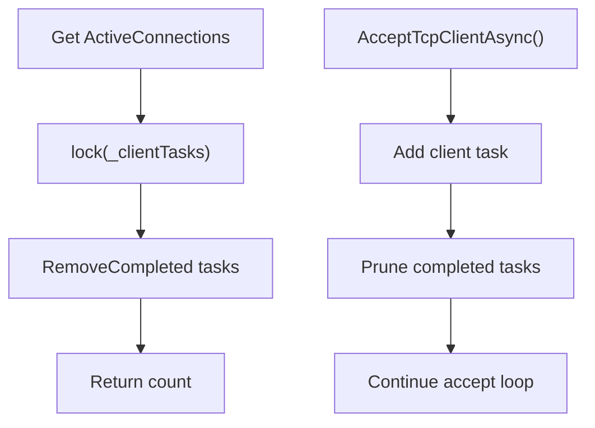
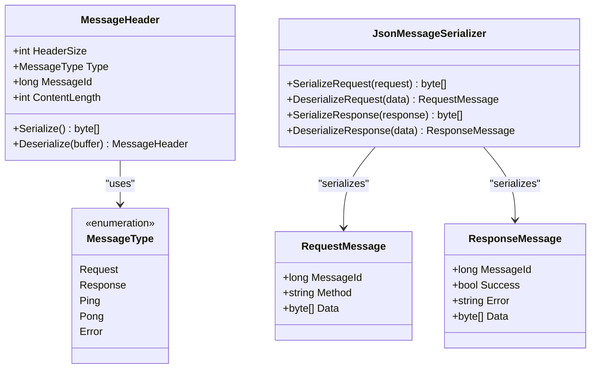
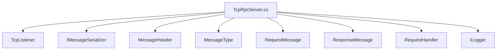

# Server Lifecycle Management

<cite>
**Referenced Files in This Document**
- [TcpRpcServer.cs](file://TcpRpc/Server/TcpRpcServer.cs)
- [RpcServerState.cs](file://TcpRpc/Server/RpcServerState.cs)
- [RequestHandler.cs](file://TcpRpc/Server/RequestHandler.cs)
- [TcpRpcClient.cs](file://TcpRpc/Client/TcpRpcClient.cs)
- [RpcClientState.cs](file://TcpRpc/Client/RpcClientState.cs)
- [MessageHeader.cs](file://TcpRpc/Message/MessageHeader.cs)
- [MessageType.cs](file://TcpRpc/Message/MessageType.cs)
- [RequestMessage.cs](file://TcpRpc/Message/RequestMessage.cs)
- [ResponseMessage.cs](file://TcpRpc/Message/ResponseMessage.cs)
- [IMessageSerializer.cs](file://TcpRpc/Formatter/IMessageSerializer.cs)
- [JsonMessageSerializer.cs](file://TcpRpc/Formatter/JsonMessageSerializer.cs)
</cite>

## Table of Contents
1. [Introduction](#introduction)
2. [Project Structure](#project-structure)
3. [Core Components](#core-components)
4. [Architecture Overview](#architecture-overview)
5. [Detailed Component Analysis](#detailed-component-analysis)
6. [Dependency Analysis](#dependency-analysis)
7. [Performance Considerations](#performance-considerations)
8. [Troubleshooting Guide](#troubleshooting-guide)
9. [Conclusion](#conclusion)
10. [Appendices](#appendices)

## Introduction
This document provides comprehensive documentation for the RpcServer lifecycle management in the TcpRpc project. It covers the server startup sequence, state transitions, graceful shutdown procedures, and operational behaviors such as concurrent client handling and connection monitoring. The focus is on the TcpRpcServer class, its state machine, and the surrounding infrastructure that enables robust TCP-based RPC communication.

## Project Structure
The TcpRpc project is organized into several namespaces that support the RPC server and client implementations:
- Server: Contains the RpcServer, state enumeration, and request handler delegate
- Client: Contains the RpcClient, client state enumeration, and client-side networking logic
- Message: Defines the message protocol, including headers, message types, and request/response models
- Formatter: Provides serialization interfaces and JSON-based implementations for messages
- Root: The main project file and solution configuration



**Diagram sources**
- [TcpRpcServer.cs:1-432](file://TcpRpc/Server/TcpRpcServer.cs#L1-L432)
- [RpcServerState.cs:1-10](file://TcpRpc/Server/RpcServerState.cs#L1-L10)
- [RequestHandler.cs:1-5](file://TcpRpc/Server/RequestHandler.cs#L1-L5)
- [TcpRpcClient.cs:1-405](file://TcpRpc/Client/TcpRpcClient.cs#L1-L405)
- [RpcClientState.cs:1-11](file://TcpRpc/Client/RpcClientState.cs#L1-L11)
- [MessageHeader.cs:1-34](file://TcpRpc/Message/MessageHeader.cs#L1-L34)
- [MessageType.cs:1-10](file://TcpRpc/Message/MessageType.cs#L1-L10)
- [RequestMessage.cs:1-8](file://TcpRpc/Message/RequestMessage.cs#L1-L8)
- [ResponseMessage.cs:1-9](file://TcpRpc/Message/ResponseMessage.cs#L1-L9)
- [IMessageSerializer.cs:1-13](file://TcpRpc/Formatter/IMessageSerializer.cs#L1-L13)
- [JsonMessageSerializer.cs:1-85](file://TcpRpc/Formatter/JsonMessageSerializer.cs#L1-L85)

**Section sources**
- [TcpRpcServer.cs:1-432](file://TcpRpc/Server/TcpRpcServer.cs#L1-L432)
- [RpcServerState.cs:1-10](file://TcpRpc/Server/RpcServerState.cs#L1-L10)
- [RequestHandler.cs:1-5](file://TcpRpc/Server/RequestHandler.cs#L1-L5)
- [TcpRpcClient.cs:1-405](file://TcpRpc/Client/TcpRpcClient.cs#L1-L405)
- [RpcClientState.cs:1-11](file://TcpRpc/Client/RpcClientState.cs#L1-L11)
- [MessageHeader.cs:1-34](file://TcpRpc/Message/MessageHeader.cs#L1-L34)
- [MessageType.cs:1-10](file://TcpRpc/Message/MessageType.cs#L1-L10)
- [RequestMessage.cs:1-8](file://TcpRpc/Message/RequestMessage.cs#L1-L8)
- [ResponseMessage.cs:1-9](file://TcpRpc/Message/ResponseMessage.cs#L1-L9)
- [IMessageSerializer.cs:1-13](file://TcpRpc/Formatter/IMessageSerializer.cs#L1-L13)
- [JsonMessageSerializer.cs:1-85](file://TcpRpc/Formatter/JsonMessageSerializer.cs#L1-L85)

## Core Components
This section focuses on the RpcServer lifecycle and state management, including startup, runtime behavior, and shutdown.

- TcpRpcServer: Implements the RPC server with lifecycle management, handler registration, client handling, and state transitions
- RpcServerState: Enumerates server states (Stopped, Starting, Running, Stopping, Faulted)
- RequestHandler: Delegate type for request processing handlers
- ActiveConnections: Property that tracks currently connected clients
- StartAsync/StopAsync: Methods controlling server lifecycle
- Client handling: Asynchronous task management per client connection

Key responsibilities:
- Initialize TcpListener and bind to the configured port
- Manage state transitions with thread-safety
- Handle incoming client connections and process requests
- Gracefully shut down by stopping listener, canceling operations, and awaiting client disconnections
- Monitor active connections and clean up completed tasks

**Section sources**
- [TcpRpcServer.cs:12-432](file://TcpRpc/Server/TcpRpcServer.cs#L12-L432)
- [RpcServerState.cs:3-10](file://TcpRpc/Server/RpcServerState.cs#L3-L10)
- [RequestHandler.cs:5-5](file://TcpRpc/Server/RequestHandler.cs#L5-L5)

## Architecture Overview
The server architecture centers around TcpListener for accepting connections and per-client tasks for handling requests. The state machine ensures safe transitions and prevents invalid operations during lifecycle events.



**Diagram sources**
- [TcpRpcServer.cs:101-173](file://TcpRpc/Server/TcpRpcServer.cs#L101-L173)
- [TcpRpcServer.cs:175-226](file://TcpRpc/Server/TcpRpcServer.cs#L175-L226)
- [TcpRpcServer.cs:228-316](file://TcpRpc/Server/TcpRpcServer.cs#L228-L316)
- [TcpRpcServer.cs:335-360](file://TcpRpc/Server/TcpRpcServer.cs#L335-L360)
- [TcpRpcServer.cs:362-376](file://TcpRpc/Server/TcpRpcServer.cs#L362-L376)

## Detailed Component Analysis

### RpcServer State Machine and Transitions
The RpcServer maintains a finite state machine with five states:
- Stopped: Initial state; no listener is active
- Starting: Server is initializing and preparing to accept connections
- Running: Server is accepting and processing client connections
- Stopping: Server is shutting down gracefully
- Faulted: Server encountered an error during startup

State transitions are guarded by a lock to ensure thread safety. The state field is volatile to ensure visibility across threads.



**Diagram sources**
- [RpcServerState.cs:3-10](file://TcpRpc/Server/RpcServerState.cs#L3-L10)
- [TcpRpcServer.cs:101-173](file://TcpRpc/Server/TcpRpcServer.cs#L101-L173)
- [TcpRpcServer.cs:175-226](file://TcpRpc/Server/TcpRpcServer.cs#L175-L226)

Operational notes:
- StartAsync sets state to Starting, initializes TcpListener, and transitions to Running upon successful startup
- Exceptions during startup set state to Faulted and rethrow
- StopAsync sets state to Stopping, stops the listener, cancels operations, awaits client tasks, and transitions to Stopped
- Finalizers ensure state is reset to Stopped in finally blocks

**Section sources**
- [RpcServerState.cs:3-10](file://TcpRpc/Server/RpcServerState.cs#L3-L10)
- [TcpRpcServer.cs:101-173](file://TcpRpc/Server/TcpRpcServer.cs#L101-L173)
- [TcpRpcServer.cs:175-226](file://TcpRpc/Server/TcpRpcServer.cs#L175-L226)

### Startup Sequence: TcpListener Initialization and Port Binding
The server startup sequence performs the following steps:
1. Validate state and throw if already running
2. Transition to Starting
3. Create and start TcpListener bound to IPAddress.Any and the configured port
4. Reset cancellation token if previously canceled
5. Transition to Running
6. Enter accept loop to handle incoming connections



**Diagram sources**
- [TcpRpcServer.cs:101-173](file://TcpRpc/Server/TcpRpcServer.cs#L101-L173)

Key behaviors:
- Port binding occurs immediately upon listener creation
- Cancellation token is recreated if previously canceled to support restart scenarios
- ActiveConnections property removes completed tasks before returning counts

**Section sources**
- [TcpRpcServer.cs:101-173](file://TcpRpc/Server/TcpRpcServer.cs#L101-L173)
- [TcpRpcServer.cs:31-41](file://TcpRpc/Server/TcpRpcServer.cs#L31-L41)

### StartAsync Implementation: Exception Handling and Cancellation
StartAsync manages exceptions and cancellation as follows:
- Throws if server is not in Stopped state
- On success, transitions to Running and enters accept loop
- On exception during startup, transitions to Faulted and rethrows
- During accept loop, handles OperationCanceledException as normal shutdown
- Finally block ensures state is Stopped if still Running



**Diagram sources**
- [TcpRpcServer.cs:101-173](file://TcpRpc/Server/TcpRpcServer.cs#L101-L173)

**Section sources**
- [TcpRpcServer.cs:101-173](file://TcpRpc/Server/TcpRpcServer.cs#L101-L173)

### Shutdown Procedure: StopAsync and Graceful Disconnection
The StopAsync method performs a controlled shutdown:
1. Validate state is Running; return early if not
2. Transition to Stopping
3. Stop TcpListener to prevent new connections
4. Cancel the cancellation token to signal all operations to stop
5. Wait for all client tasks to complete with a timeout
6. Clear remaining client tasks
7. Transition to Stopped



**Diagram sources**
- [TcpRpcServer.cs:175-226](file://TcpRpc/Server/TcpRpcServer.cs#L175-L226)

Graceful handling:
- New connections are rejected after Stop() is called
- Existing client tasks receive cancellation signals and exit cleanly
- Timeout ensures shutdown does not hang indefinitely

**Section sources**
- [TcpRpcServer.cs:175-226](file://TcpRpc/Server/TcpRpcServer.cs#L175-L226)

### ActiveConnections Monitoring and Client Task Management
ActiveConnections provides a live count of currently connected clients:
- Removes completed tasks before counting
- Uses a lock to protect the client task list
- Returns the current count for monitoring

Client task management:
- Each accepted client spawns a HandleClientAsync task
- Tasks are tracked in a concurrent list
- Completed tasks are pruned to prevent memory growth
- During shutdown, all tasks are awaited with a timeout



**Diagram sources**
- [TcpRpcServer.cs:31-41](file://TcpRpc/Server/TcpRpcServer.cs#L31-L41)
- [TcpRpcServer.cs:134-148](file://TcpRpc/Server/TcpRpcServer.cs#L134-L148)

**Section sources**
- [TcpRpcServer.cs:31-41](file://TcpRpc/Server/TcpRpcServer.cs#L31-L41)
- [TcpRpcServer.cs:134-148](file://TcpRpc/Server/TcpRpcServer.cs#L134-L148)
- [TcpRpcServer.cs:196-212](file://TcpRpc/Server/TcpRpcServer.cs#L196-L212)

### Request Handling and Message Protocol
The server processes client messages using a structured protocol:
- MessageHeader defines fixed-size header with type, message ID, and content length
- MessageType enumerates supported message types (Request, Response, Ping, Pong, Error)
- RequestMessage and ResponseMessage define payload structures
- JsonMessageSerializer handles serialization/deserialization with validation



**Diagram sources**
- [MessageHeader.cs:5-34](file://TcpRpc/Message/MessageHeader.cs#L5-L34)
- [MessageType.cs:3-10](file://TcpRpc/Message/MessageType.cs#L3-L10)
- [RequestMessage.cs:3-8](file://TcpRpc/Message/RequestMessage.cs#L3-L8)
- [ResponseMessage.cs:3-9](file://TcpRpc/Message/ResponseMessage.cs#L3-L9)
- [JsonMessageSerializer.cs:6-85](file://TcpRpc/Formatter/JsonMessageSerializer.cs#L6-L85)

**Section sources**
- [MessageHeader.cs:5-34](file://TcpRpc/Message/MessageHeader.cs#L5-L34)
- [MessageType.cs:3-10](file://TcpRpc/Message/MessageType.cs#L3-L10)
- [RequestMessage.cs:3-8](file://TcpRpc/Message/RequestMessage.cs#L3-L8)
- [ResponseMessage.cs:3-9](file://TcpRpc/Message/ResponseMessage.cs#L3-L9)
- [JsonMessageSerializer.cs:6-85](file://TcpRpc/Formatter/JsonMessageSerializer.cs#L6-L85)

### Client Connection Handling and Timeout Management
Each client connection is handled asynchronously with built-in timeouts:
- Reads a fixed-size header with a per-read timeout
- Validates content length against limits
- Reads content with a per-operation timeout
- Processes requests and sends responses
- Handles cancellation during shutdown and timeouts gracefully

```mermaid
sequenceDiagram
participant Server as "RpcServer"
participant Client as "TcpRpcClient"
participant Stream as "NetworkStream"
Server->>Client : AcceptTcpClientAsync()
Client-->>Server : TcpClient
Server->>Server : HandleClientAsync(client, id, ct)
loop Until disconnected or cancelled
Server->>Stream : Read header with timeout
alt EOF
Server->>Server : Log disconnect
Server->>Server : Return
else Header OK
Server->>Server : Validate content length
Server->>Stream : Read content with timeout
alt OperationCanceledException
Server->>Server : Check cancellation
opt Cancelled
Server->>Server : Break
else Timeout
Server->>Server : Continue loop
end
else Exception
Server->>Server : Log error
Server->>Server : Continue
end
Server->>Server : ProcessClientMessageAsync()
Server->>Stream : SendResponseAsync()
end
end
Server->>Server : Log disconnect
```

**Diagram sources**
- [TcpRpcServer.cs:228-316](file://TcpRpc/Server/TcpRpcServer.cs#L228-L316)
- [TcpRpcServer.cs:318-333](file://TcpRpc/Server/TcpRpcServer.cs#L318-L333)
- [TcpRpcServer.cs:362-376](file://TcpRpc/Server/TcpRpcServer.cs#L362-L376)

**Section sources**
- [TcpRpcServer.cs:228-316](file://TcpRpc/Server/TcpRpcServer.cs#L228-L316)
- [TcpRpcServer.cs:318-333](file://TcpRpc/Server/TcpRpcServer.cs#L318-L333)
- [TcpRpcServer.cs:362-376](file://TcpRpc/Server/TcpRpcServer.cs#L362-L376)

### Practical Examples

#### Proper Server Initialization
- Instantiate RpcServer with desired port and optional serializer/logger
- Register handlers for methods before starting
- Call StartAsync and monitor State transitions
- Use ActiveConnections to observe client counts

Example references:
- [TcpRpcServer.cs:43-48](file://TcpRpc/Server/TcpRpcServer.cs#L43-L48)
- [TcpRpcServer.cs:50-58](file://TcpRpc/Server/TcpRpcServer.cs#L50-L58)
- [TcpRpcServer.cs:101-173](file://TcpRpc/Server/TcpRpcServer.cs#L101-L173)
- [TcpRpcServer.cs:31-41](file://TcpRpc/Server/TcpRpcServer.cs#L31-L41)

#### Concurrent Client Handling
- Multiple clients can connect concurrently; each spawns a separate task
- Client tasks are tracked and pruned automatically
- Requests are processed independently per client

Example references:
- [TcpRpcServer.cs:134-148](file://TcpRpc/Server/TcpRpcServer.cs#L134-L148)
- [TcpRpcServer.cs:31-41](file://TcpRpc/Server/TcpRpcServer.cs#L31-L41)

#### Graceful Shutdown Sequence
- Call StopAsync to initiate shutdown
- Server stops accepting new connections and cancels existing operations
- Waits up to a timeout for clients to disconnect
- Ensures state transitions to Stopped

Example references:
- [TcpRpcServer.cs:175-226](file://TcpRpc/Server/TcpRpcServer.cs#L175-L226)

#### Common Scenarios
- Startup failures: StartAsync transitions to Faulted and rethrows; caller should handle and reset state if needed
- Unexpected shutdowns: StopAsync handles cancellation and cleanup; ActiveConnections helps assess lingering connections
- Connection overload: Use ActiveConnections to monitor and scale capacity; consider adjusting timeouts and limits

Example references:
- [TcpRpcServer.cs:155-162](file://TcpRpc/Server/TcpRpcServer.cs#L155-L162)
- [TcpRpcServer.cs:175-226](file://TcpRpc/Server/TcpRpcServer.cs#L175-L226)
- [TcpRpcServer.cs:31-41](file://TcpRpc/Server/TcpRpcServer.cs#L31-L41)

## Dependency Analysis
The RpcServer depends on:
- TcpListener for network acceptance
- IMessageSerializer for message serialization
- Message types for protocol definition
- RequestHandler delegate for request processing
- Logging infrastructure for diagnostics



**Diagram sources**
- [TcpRpcServer.cs:1-432](file://TcpRpc/Server/TcpRpcServer.cs#L1-L432)
- [IMessageSerializer.cs:5-13](file://TcpRpc/Formatter/IMessageSerializer.cs#L5-L13)
- [MessageHeader.cs:5-34](file://TcpRpc/Message/MessageHeader.cs#L5-L34)
- [MessageType.cs:3-10](file://TcpRpc/Message/MessageType.cs#L3-L10)
- [RequestMessage.cs:3-8](file://TcpRpc/Message/RequestMessage.cs#L3-L8)
- [ResponseMessage.cs:3-9](file://TcpRpc/Message/ResponseMessage.cs#L3-L9)
- [RequestHandler.cs:5-5](file://TcpRpc/Server/RequestHandler.cs#L5-L5)

**Section sources**
- [TcpRpcServer.cs:1-432](file://TcpRpc/Server/TcpRpcServer.cs#L1-L432)
- [IMessageSerializer.cs:5-13](file://TcpRpc/Formatter/IMessageSerializer.cs#L5-L13)
- [MessageHeader.cs:5-34](file://TcpRpc/Message/MessageHeader.cs#L5-L34)
- [MessageType.cs:3-10](file://TcpRpc/Message/MessageType.cs#L3-L10)
- [RequestMessage.cs:3-8](file://TcpRpc/Message/RequestMessage.cs#L3-L8)
- [ResponseMessage.cs:3-9](file://TcpRpc/Message/ResponseMessage.cs#L3-L9)
- [RequestHandler.cs:5-5](file://TcpRpc/Server/RequestHandler.cs#L5-L5)

## Performance Considerations
- Concurrency: Each client runs in its own task; ensure adequate system resources for high concurrency
- Timeouts: Per-read and per-operation timeouts prevent stalls; adjust based on expected load
- Memory: Client task list is pruned; monitor ActiveConnections to detect leaks
- Serialization: JSON serialization is straightforward; consider binary serializers for higher throughput
- Backpressure: Content length limits protect against oversized messages; enforce reasonable limits

[No sources needed since this section provides general guidance]

## Troubleshooting Guide
Common issues and resolutions:
- Startup failures: Verify port availability and permissions; inspect logs for exceptions; state transitions to Faulted indicate startup errors
- Port conflicts: Ensure no other service binds to the same port before StartAsync
- Slow shutdown: Increase timeout in StopAsync wait; check for long-running client operations
- Excessive connections: Monitor ActiveConnections; consider rate limiting or connection pooling
- Message size errors: Server enforces content length limits; adjust limits or client payloads accordingly

**Section sources**
- [TcpRpcServer.cs:155-162](file://TcpRpc/Server/TcpRpcServer.cs#L155-L162)
- [TcpRpcServer.cs:175-226](file://TcpRpc/Server/TcpRpcServer.cs#L175-L226)
- [TcpRpcServer.cs:264-270](file://TcpRpc/Server/TcpRpcServer.cs#L264-L270)
- [TcpRpcServer.cs:31-41](file://TcpRpc/Server/TcpRpcServer.cs#L31-L41)

## Conclusion
The RpcServer lifecycle is designed for reliability and clarity. Its state machine ensures safe transitions, while StartAsync and StopAsync provide robust startup and shutdown procedures. The ActiveConnections property offers real-time monitoring, and the per-client task model scales with concurrent demand. By following the patterns outlined here, developers can build resilient RPC servers capable of handling various operational scenarios.

[No sources needed since this section summarizes without analyzing specific files]

## Appendices

### RpcServerState Enumeration Details
- Stopped: No listener; ready for StartAsync
- Starting: Preparing to accept connections; not yet serving
- Running: Accepting and processing requests
- Stopping: Shutting down; rejecting new connections and awaiting clients
- Faulted: Startup error occurred; requires reset before restart

**Section sources**
- [RpcServerState.cs:3-10](file://TcpRpc/Server/RpcServerState.cs#L3-L10)

### RequestHandler Registration
Handlers can be registered either as delegates or typed handlers. Registration is only permitted when the server is Stopped.

**Section sources**
- [TcpRpcServer.cs:50-58](file://TcpRpc/Server/TcpRpcServer.cs#L50-L58)
- [TcpRpcServer.cs:60-99](file://TcpRpc/Server/TcpRpcServer.cs#L60-L99)

### Client-Server Interaction Example References
- Client connection and request sending: [TcpRpcClient.cs:47-80](file://TcpRpc/Client/TcpRpcClient.cs#L47-L80)
- Client request sending with timeout: [TcpRpcClient.cs:132-189](file://TcpRpc/Client/TcpRpcClient.cs#L132-L189)
- Client receive loop and message processing: [TcpRpcClient.cs:205-287](file://TcpRpc/Client/TcpRpcClient.cs#L205-L287)