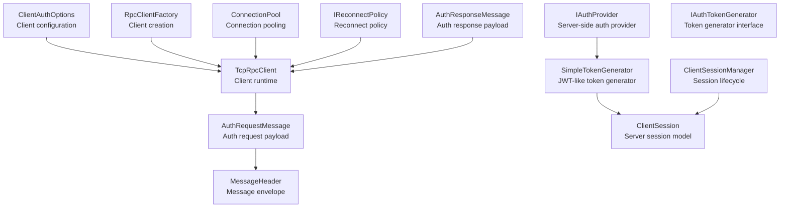
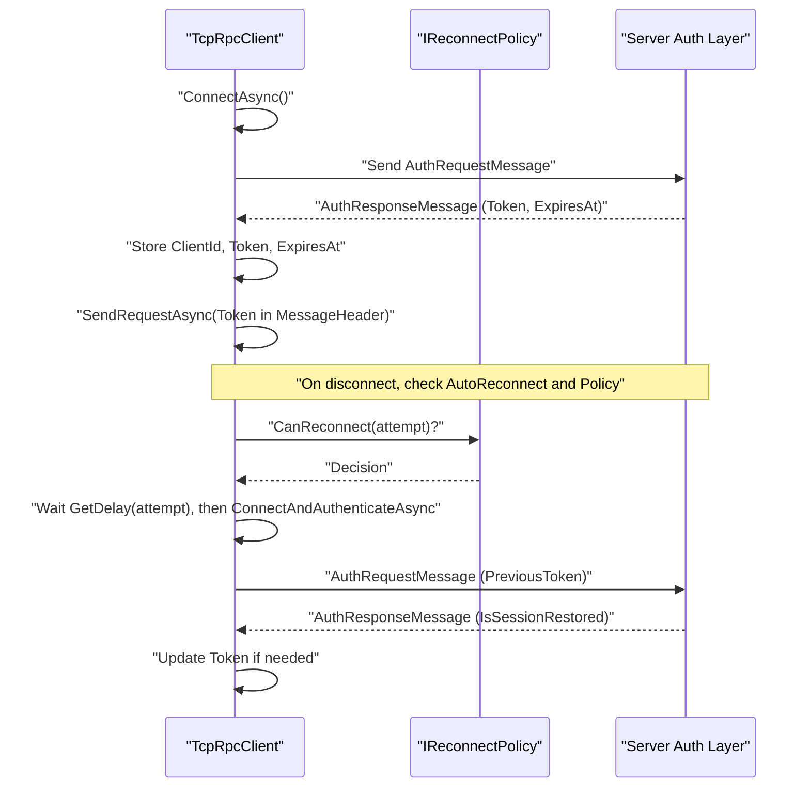
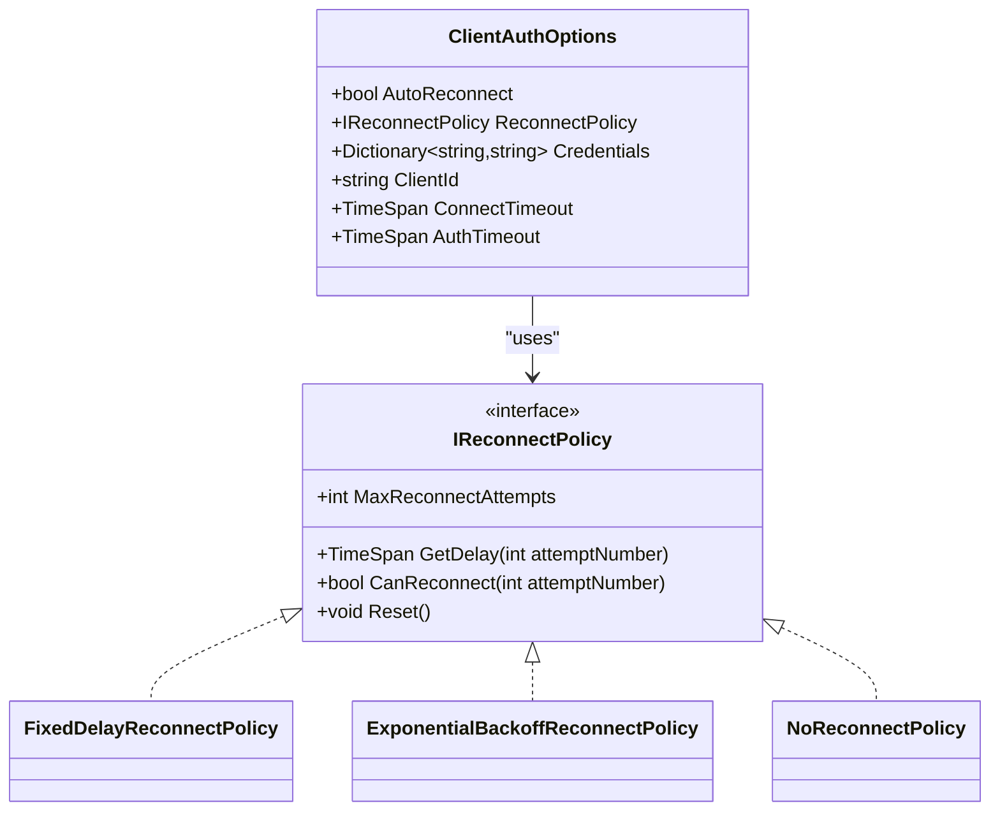
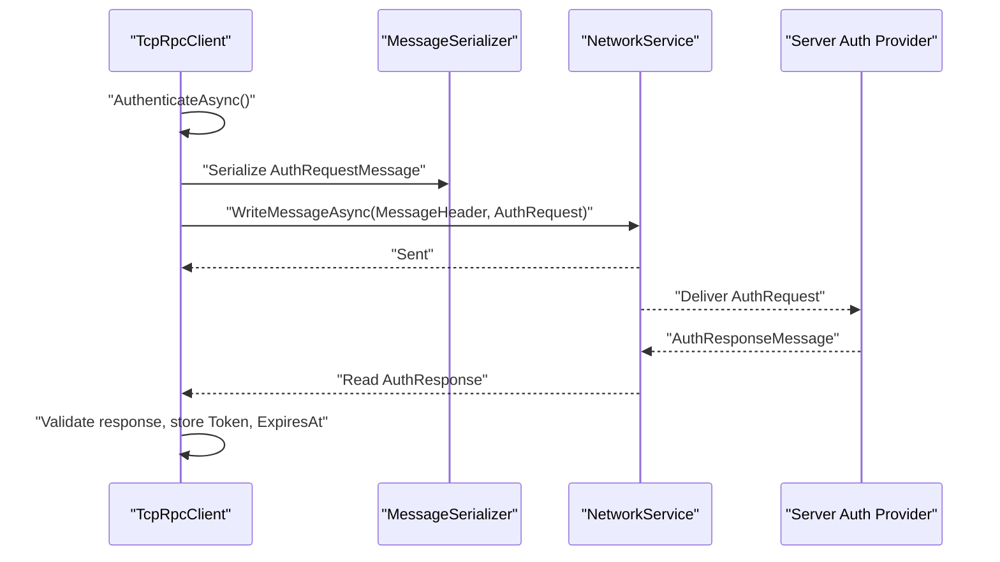
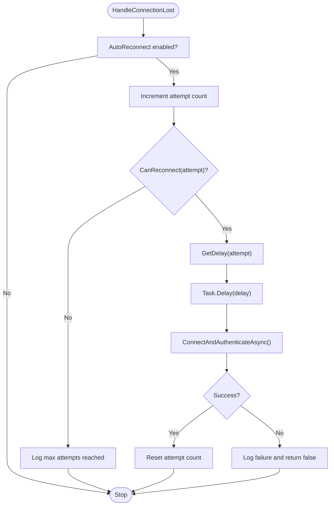
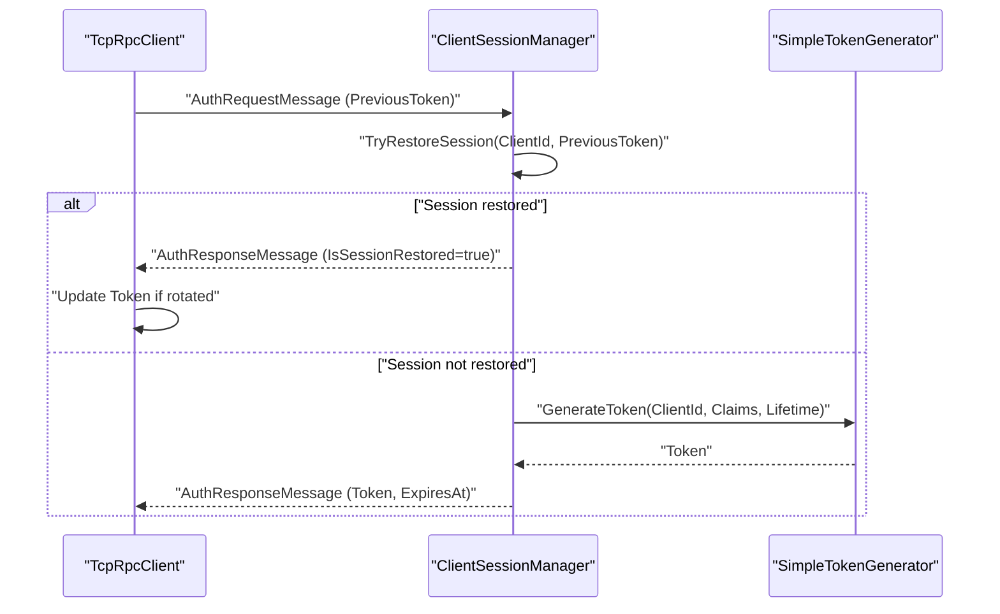
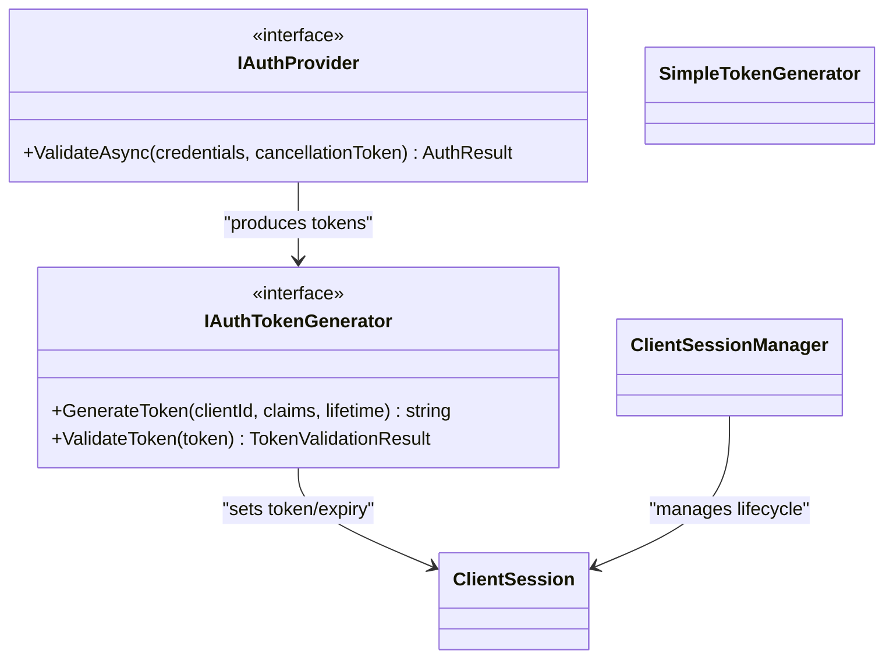
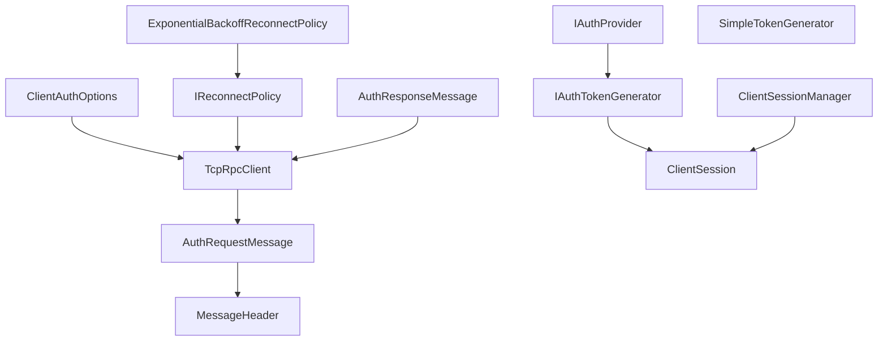

# Client Authentication Options

<cite>
**Referenced Files in This Document**
- [ClientAuthOptions.cs](file://TcpRpc/Client/ClientAuthOptions.cs)
- [TcpRpcClient.cs](file://TcpRpc/Client/TcpRpcClient.cs)
- [RpcClientFactory.cs](file://TcpRpc/Client/RpcClientFactory.cs)
- [ConnectionPool.cs](file://TcpRpc/Client/ConnectionPool.cs)
- [IReconnectPolicy.cs](file://TcpRpc/Client/IReconnectPolicy.cs)
- [RpcClientState.cs](file://TcpRpc/Client/RpcClientState.cs)
- [AuthRequestMessage.cs](file://TcpRpc/Message/AuthRequestMessage.cs)
- [AuthResponseMessage.cs](file://TcpRpc/Message/AuthResponseMessage.cs)
- [MessageHeader.cs](file://TcpRpc/Message/MessageHeader.cs)
- [IAuthProvider.cs](file://TcpRpc/Server/Auth/IAuthProvider.cs)
- [IAuthTokenGenerator.cs](file://TcpRpc/Server/Auth/IAuthTokenGenerator.cs)
- [SimpleTokenGenerator.cs](file://TcpRpc/Server/Auth/SimpleTokenGenerator.cs)
- [ClientSession.cs](file://TcpRpc/Server/Auth/ClientSession.cs)
- [ClientSessionManager.cs](file://TcpRpc/Server/Auth/ClientSessionManager.cs)
- [Program.cs (Client)](file://TcpRpc.Client/Program.cs)
- [Program.cs (Server)](file://TcpRpc.Server/Program.cs)
</cite>

## Table of Contents
1. [Introduction](#introduction)
2. [Project Structure](#project-structure)
3. [Core Components](#core-components)
4. [Architecture Overview](#architecture-overview)
5. [Detailed Component Analysis](#detailed-component-analysis)
6. [Dependency Analysis](#dependency-analysis)
7. [Performance Considerations](#performance-considerations)
8. [Troubleshooting Guide](#troubleshooting-guide)
9. [Conclusion](#conclusion)
10. [Appendices](#appendices)

## Introduction
This document provides comprehensive documentation for the ClientAuthOptions configuration class used by the TCP-RPC client. It explains how authentication-related configuration properties influence client behavior, connection establishment, and session management. It also covers credential storage best practices, token handling, security considerations, authentication timeout configurations, retry policies, failure handling strategies, integration with authentication providers, token refresh mechanisms, and session restoration logic. Practical configuration examples for various deployment scenarios are included to guide secure and robust setups.

## Project Structure
The authentication subsystem spans client-side configuration, client runtime behavior, message serialization, and server-side authentication provider and token generation. The following diagram shows the primary components involved in client authentication.

**Diagram sources**
- [ClientAuthOptions.cs:1-38](file://TcpRpc/Client/ClientAuthOptions.cs#L1-L38)
- [TcpRpcClient.cs:1-684](file://TcpRpc/Client/TcpRpcClient.cs#L1-L684)
- [RpcClientFactory.cs:1-110](file://TcpRpc/Client/RpcClientFactory.cs#L1-L110)
- [ConnectionPool.cs:1-189](file://TcpRpc/Client/ConnectionPool.cs#L1-L189)
- [IReconnectPolicy.cs:1-100](file://TcpRpc/Client/IReconnectPolicy.cs#L1-L100)
- [AuthRequestMessage.cs:1-28](file://TcpRpc/Message/AuthRequestMessage.cs#L1-L28)
- [AuthResponseMessage.cs:1-43](file://TcpRpc/Message/AuthResponseMessage.cs#L1-L43)
- [MessageHeader.cs:1-73](file://TcpRpc/Message/MessageHeader.cs#L1-L73)
- [IAuthProvider.cs:1-41](file://TcpRpc/Server/Auth/IAuthProvider.cs#L1-L41)
- [IAuthTokenGenerator.cs:1-55](file://TcpRpc/Server/Auth/IAuthTokenGenerator.cs#L1-L55)
- [SimpleTokenGenerator.cs:1-163](file://TcpRpc/Server/Auth/SimpleTokenGenerator.cs#L1-L163)
- [ClientSession.cs:1-95](file://TcpRpc/Server/Auth/ClientSession.cs#L1-L95)
- [ClientSessionManager.cs:1-188](file://TcpRpc/Server/Auth/ClientSessionManager.cs#L1-L188)

**Section sources**
- [ClientAuthOptions.cs:1-38](file://TcpRpc/Client/ClientAuthOptions.cs#L1-L38)
- [TcpRpcClient.cs:1-684](file://TcpRpc/Client/TcpRpcClient.cs#L1-L684)
- [RpcClientFactory.cs:1-110](file://TcpRpc/Client/RpcClientFactory.cs#L1-L110)
- [ConnectionPool.cs:1-189](file://TcpRpc/Client/ConnectionPool.cs#L1-L189)
- [IReconnectPolicy.cs:1-100](file://TcpRpc/Client/IReconnectPolicy.cs#L1-L100)
- [AuthRequestMessage.cs:1-28](file://TcpRpc/Message/AuthRequestMessage.cs#L1-L28)
- [AuthResponseMessage.cs:1-43](file://TcpRpc/Message/AuthResponseMessage.cs#L1-L43)
- [MessageHeader.cs:1-73](file://TcpRpc/Message/MessageHeader.cs#L1-L73)
- [IAuthProvider.cs:1-41](file://TcpRpc/Server/Auth/IAuthProvider.cs#L1-L41)
- [IAuthTokenGenerator.cs:1-55](file://TcpRpc/Server/Auth/IAuthTokenGenerator.cs#L1-L55)
- [SimpleTokenGenerator.cs:1-163](file://TcpRpc/Server/Auth/SimpleTokenGenerator.cs#L1-L163)
- [ClientSession.cs:1-95](file://TcpRpc/Server/Auth/ClientSession.cs#L1-L95)
- [ClientSessionManager.cs:1-188](file://TcpRpc/Server/Auth/ClientSessionManager.cs#L1-L188)

## Core Components
This section documents the ClientAuthOptions configuration class and its role in shaping client authentication behavior.

- AutoReconnect
  - Purpose: Enables automatic reconnection attempts when connectivity is lost.
  - Behavior: When enabled, the client triggers reconnect logic upon connection loss or authentication failures, subject to the configured reconnect policy.
  - Impact: Improves resilience but increases resource usage during transient network issues.

- ReconnectPolicy
  - Purpose: Defines the strategy for retry delays and maximum attempts.
  - Implementation: Supports fixed delay, exponential backoff, and no-reconnect policies via IReconnectPolicy.
  - Impact: Controls jitter and backoff behavior to avoid overwhelming the server and to respect client timeouts.

- Credentials
  - Purpose: Provides authentication credentials for initial authentication.
  - Data type: Dictionary<string, string>.
  - Security: Treat credentials as sensitive data; avoid logging or persisting plaintext credentials unnecessarily.
  - Usage: Sent in AuthRequestMessage during authentication.

- ClientId
  - Purpose: Identifies the client for session restoration during reconnect.
  - Behavior: Used to correlate reconnection attempts with existing server-side sessions.
  - Impact: Facilitates seamless session continuity across brief disconnections.

- ConnectTimeout
  - Purpose: Maximum wait time for TCP connection establishment.
  - Behavior: Applied when connecting to the server; connection attempts exceeding this timeout fail fast.
  - Impact: Balances responsiveness with network variability.

- AuthTimeout
  - Purpose: Maximum wait time for authentication completion.
  - Behavior: Applied when sending AuthRequestMessage and awaiting AuthResponseMessage.
  - Impact: Prevents indefinite blocking and enables timely failure reporting.

**Section sources**
- [ClientAuthOptions.cs:8-36](file://TcpRpc/Client/ClientAuthOptions.cs#L8-L36)
- [TcpRpcClient.cs:75-130](file://TcpRpc/Client/TcpRpcClient.cs#L75-L130)
- [TcpRpcClient.cs:144-227](file://TcpRpc/Client/TcpRpcClient.cs#L144-L227)
- [TcpRpcClient.cs:232-269](file://TcpRpc/Client/TcpRpcClient.cs#L232-L269)
- [AuthRequestMessage.cs:8-26](file://TcpRpc/Message/AuthRequestMessage.cs#L8-L26)
- [AuthResponseMessage.cs:8-36](file://TcpRpc/Message/AuthResponseMessage.cs#L8-L36)

## Architecture Overview
The client authenticates by establishing a TCP connection, sending an AuthRequestMessage, and receiving an AuthResponseMessage. The client stores the returned token and associated metadata, and includes the token in subsequent requests via MessageHeader. On connection loss, the client consults the reconnect policy and attempts to restore the session using ClientId and PreviousToken when applicable.

**Diagram sources**
- [TcpRpcClient.cs:75-130](file://TcpRpc/Client/TcpRpcClient.cs#L75-L130)
- [TcpRpcClient.cs:144-227](file://TcpRpc/Client/TcpRpcClient.cs#L144-L227)
- [TcpRpcClient.cs:232-269](file://TcpRpc/Client/TcpRpcClient.cs#L232-L269)
- [AuthRequestMessage.cs:8-26](file://TcpRpc/Message/AuthRequestMessage.cs#L8-L26)
- [AuthResponseMessage.cs:8-36](file://TcpRpc/Message/AuthResponseMessage.cs#L8-L36)
- [MessageHeader.cs:23-23](file://TcpRpc/Message/MessageHeader.cs#L23-L23)
- [IReconnectPolicy.cs:6-31](file://TcpRpc/Client/IReconnectPolicy.cs#L6-L31)

**Section sources**
- [TcpRpcClient.cs:75-130](file://TcpRpc/Client/TcpRpcClient.cs#L75-L130)
- [TcpRpcClient.cs:144-227](file://TcpRpc/Client/TcpRpcClient.cs#L144-L227)
- [TcpRpcClient.cs:232-269](file://TcpRpc/Client/TcpRpcClient.cs#L232-L269)
- [AuthRequestMessage.cs:8-26](file://TcpRpc/Message/AuthRequestMessage.cs#L8-L26)
- [AuthResponseMessage.cs:8-36](file://TcpRpc/Message/AuthResponseMessage.cs#L8-L36)
- [MessageHeader.cs:23-23](file://TcpRpc/Message/MessageHeader.cs#L23-L23)
- [IReconnectPolicy.cs:6-31](file://TcpRpc/Client/IReconnectPolicy.cs#L6-L31)

## Detailed Component Analysis

### ClientAuthOptions Class
ClientAuthOptions encapsulates all client-side authentication configuration. It influences connection establishment, authentication flow, and session restoration.

**Diagram sources**
- [ClientAuthOptions.cs:6-37](file://TcpRpc/Client/ClientAuthOptions.cs#L6-L37)
- [IReconnectPolicy.cs:6-100](file://TcpRpc/Client/IReconnectPolicy.cs#L6-L100)

**Section sources**
- [ClientAuthOptions.cs:6-37](file://TcpRpc/Client/ClientAuthOptions.cs#L6-L37)
- [IReconnectPolicy.cs:6-100](file://TcpRpc/Client/IReconnectPolicy.cs#L6-L100)

### Authentication Flow and Message Exchange
The client sends an AuthRequestMessage containing credentials or previous token and client ID, and receives an AuthResponseMessage with token, expiry, and session restoration status.

**Diagram sources**
- [TcpRpcClient.cs:144-227](file://TcpRpc/Client/TcpRpcClient.cs#L144-L227)
- [AuthRequestMessage.cs:6-27](file://TcpRpc/Message/AuthRequestMessage.cs#L6-L27)
- [AuthResponseMessage.cs:6-42](file://TcpRpc/Message/AuthResponseMessage.cs#L6-L42)

**Section sources**
- [TcpRpcClient.cs:144-227](file://TcpRpc/Client/TcpRpcClient.cs#L144-L227)
- [AuthRequestMessage.cs:6-27](file://TcpRpc/Message/AuthRequestMessage.cs#L6-L27)
- [AuthResponseMessage.cs:6-42](file://TcpRpc/Message/AuthResponseMessage.cs#L6-L42)

### Reconnect Policies and Retry Strategies
The client evaluates reconnect feasibility using IReconnectPolicy and applies delays between attempts. The policy determines maximum attempts and delay progression.

**Diagram sources**
- [TcpRpcClient.cs:542-581](file://TcpRpc/Client/TcpRpcClient.cs#L542-L581)
- [TcpRpcClient.cs:232-269](file://TcpRpc/Client/TcpRpcClient.cs#L232-L269)
- [IReconnectPolicy.cs:6-31](file://TcpRpc/Client/IReconnectPolicy.cs#L6-L31)

**Section sources**
- [TcpRpcClient.cs:542-581](file://TcpRpc/Client/TcpRpcClient.cs#L542-L581)
- [TcpRpcClient.cs:232-269](file://TcpRpc/Client/TcpRpcClient.cs#L232-L269)
- [IReconnectPolicy.cs:6-31](file://TcpRpc/Client/IReconnectPolicy.cs#L6-L31)

### Session Restoration and Token Handling
During reconnection, the client may send a PreviousToken to restore an existing session. The server validates the token and ClientId and either restores the session or issues a new token.

**Diagram sources**
- [TcpRpcClient.cs:144-227](file://TcpRpc/Client/TcpRpcClient.cs#L144-L227)
- [AuthRequestMessage.cs:14-16](file://TcpRpc/Message/AuthRequestMessage.cs#L14-L16)
- [AuthResponseMessage.cs:24-36](file://TcpRpc/Message/AuthResponseMessage.cs#L24-L36)
- [ClientSessionManager.cs:88-116](file://TcpRpc/Server/Auth/ClientSessionManager.cs#L88-L116)
- [SimpleTokenGenerator.cs:38-77](file://TcpRpc/Server/Auth/SimpleTokenGenerator.cs#L38-L77)

**Section sources**
- [TcpRpcClient.cs:144-227](file://TcpRpc/Client/TcpRpcClient.cs#L144-L227)
- [AuthRequestMessage.cs:14-16](file://TcpRpc/Message/AuthRequestMessage.cs#L14-L16)
- [AuthResponseMessage.cs:24-36](file://TcpRpc/Message/AuthResponseMessage.cs#L24-L36)
- [ClientSessionManager.cs:88-116](file://TcpRpc/Server/Auth/ClientSessionManager.cs#L88-L116)
- [SimpleTokenGenerator.cs:38-77](file://TcpRpc/Server/Auth/SimpleTokenGenerator.cs#L38-L77)

### Credential Storage Best Practices and Security Considerations
- Treat credentials as sensitive data. Avoid hardcoding in production; prefer secure vaults or environment-specific configuration.
- Do not log credentials or tokens. Mask or redact sensitive values in logs.
- Use short-lived tokens and implement token rotation strategies where supported by the server.
- Ensure transport security (e.g., TLS) is enforced at the network layer to protect credentials and tokens in transit.
- Validate and sanitize ClientId to prevent injection or mismatch scenarios during session restoration.
- Limit the number of retries and apply exponential backoff to mitigate brute-force and denial-of-service risks.

[No sources needed since this section provides general guidance]

### Integration with Authentication Providers and Token Generators
- Client sends credentials to the server’s IAuthProvider for validation.
- The server generates tokens using IAuthTokenGenerator (e.g., SimpleTokenGenerator) and attaches claims and expiry.
- Client stores the token and includes it in MessageHeader for subsequent requests.

**Diagram sources**
- [IAuthProvider.cs:32-40](file://TcpRpc/Server/Auth/IAuthProvider.cs#L32-L40)
- [IAuthTokenGenerator.cs:37-54](file://TcpRpc/Server/Auth/IAuthTokenGenerator.cs#L37-L54)
- [SimpleTokenGenerator.cs:11-163](file://TcpRpc/Server/Auth/SimpleTokenGenerator.cs#L11-L163)
- [ClientSession.cs:6-95](file://TcpRpc/Server/Auth/ClientSession.cs#L6-L95)
- [ClientSessionManager.cs:9-188](file://TcpRpc/Server/Auth/ClientSessionManager.cs#L9-L188)

**Section sources**
- [IAuthProvider.cs:32-40](file://TcpRpc/Server/Auth/IAuthProvider.cs#L32-L40)
- [IAuthTokenGenerator.cs:37-54](file://TcpRpc/Server/Auth/IAuthTokenGenerator.cs#L37-L54)
- [SimpleTokenGenerator.cs:11-163](file://TcpRpc/Server/Auth/SimpleTokenGenerator.cs#L11-L163)
- [ClientSession.cs:6-95](file://TcpRpc/Server/Auth/ClientSession.cs#L6-L95)
- [ClientSessionManager.cs:9-188](file://TcpRpc/Server/Auth/ClientSessionManager.cs#L9-L188)

### Examples of Authentication Option Configurations
- Basic authenticated client with exponential backoff:
  - Configure AutoReconnect to true, set Credentials, optionally set ClientId, and choose ExponentialBackoffReconnectPolicy with appropriate max attempts and delays.
  - Reference: [Program.cs (Client):19-38](file://TcpRpc.Client/Program.cs#L19-L38)

- Connection pool with authenticated clients:
  - Use ConnectionPool with ClientAuthOptions to manage multiple authenticated connections efficiently.
  - Reference: [ConnectionPool.cs:26-38](file://TcpRpc/Client/ConnectionPool.cs#L26-L38), [Program.cs (Client):104-116](file://TcpRpc.Client/Program.cs#L104-L116)

- Factory-based authenticated proxies:
  - Use RpcClientFactory to create authenticated proxies automatically.
  - Reference: [RpcClientFactory.cs:18-31](file://TcpRpc/Client/RpcClientFactory.cs#L18-L31), [Program.cs (Client):40-45](file://TcpRpc.Client/Program.cs#L40-L45)

- Server-side authentication configuration:
  - Configure ServerAuthOptions with IAuthProvider and IAuthTokenGenerator for robust server-side authentication.
  - Reference: [Program.cs (Server):20-38](file://TcpRpc.Server/Program.cs#L20-L38)

**Section sources**
- [Program.cs (Client):19-38](file://TcpRpc.Client/Program.cs#L19-L38)
- [ConnectionPool.cs:26-38](file://TcpRpc/Client/ConnectionPool.cs#L26-L38)
- [Program.cs (Client):104-116](file://TcpRpc.Client/Program.cs#L104-L116)
- [RpcClientFactory.cs:18-31](file://TcpRpc/Client/RpcClientFactory.cs#L18-L31)
- [Program.cs (Server):20-38](file://TcpRpc.Server/Program.cs#L20-L38)

## Dependency Analysis
The client’s authentication behavior depends on ClientAuthOptions, TcpRpcClient, reconnect policy implementations, and message serialization. The server-side components (IAuthProvider, IAuthTokenGenerator, ClientSessionManager) provide the backend for authentication and session management.

**Diagram sources**
- [ClientAuthOptions.cs:6-37](file://TcpRpc/Client/ClientAuthOptions.cs#L6-L37)
- [TcpRpcClient.cs:1-684](file://TcpRpc/Client/TcpRpcClient.cs#L1-L684)
- [IReconnectPolicy.cs:6-100](file://TcpRpc/Client/IReconnectPolicy.cs#L6-L100)
- [AuthRequestMessage.cs:6-27](file://TcpRpc/Message/AuthRequestMessage.cs#L6-L27)
- [AuthResponseMessage.cs:6-42](file://TcpRpc/Message/AuthResponseMessage.cs#L6-L42)
- [MessageHeader.cs:1-73](file://TcpRpc/Message/MessageHeader.cs#L1-L73)
- [IAuthProvider.cs:32-40](file://TcpRpc/Server/Auth/IAuthProvider.cs#L32-L40)
- [IAuthTokenGenerator.cs:37-54](file://TcpRpc/Server/Auth/IAuthTokenGenerator.cs#L37-L54)
- [SimpleTokenGenerator.cs:11-163](file://TcpRpc/Server/Auth/SimpleTokenGenerator.cs#L11-L163)
- [ClientSession.cs:6-95](file://TcpRpc/Server/Auth/ClientSession.cs#L6-L95)
- [ClientSessionManager.cs:9-188](file://TcpRpc/Server/Auth/ClientSessionManager.cs#L9-L188)

**Section sources**
- [ClientAuthOptions.cs:6-37](file://TcpRpc/Client/ClientAuthOptions.cs#L6-L37)
- [TcpRpcClient.cs:1-684](file://TcpRpc/Client/TcpRpcClient.cs#L1-L684)
- [IReconnectPolicy.cs:6-100](file://TcpRpc/Client/IReconnectPolicy.cs#L6-L100)
- [AuthRequestMessage.cs:6-27](file://TcpRpc/Message/AuthRequestMessage.cs#L6-L27)
- [AuthResponseMessage.cs:6-42](file://TcpRpc/Message/AuthResponseMessage.cs#L6-L42)
- [MessageHeader.cs:1-73](file://TcpRpc/Message/MessageHeader.cs#L1-L73)
- [IAuthProvider.cs:32-40](file://TcpRpc/Server/Auth/IAuthProvider.cs#L32-L40)
- [IAuthTokenGenerator.cs:37-54](file://TcpRpc/Server/Auth/IAuthTokenGenerator.cs#L37-L54)
- [SimpleTokenGenerator.cs:11-163](file://TcpRpc/Server/Auth/SimpleTokenGenerator.cs#L11-L163)
- [ClientSession.cs:6-95](file://TcpRpc/Server/Auth/ClientSession.cs#L6-L95)
- [ClientSessionManager.cs:9-188](file://TcpRpc/Server/Auth/ClientSessionManager.cs#L9-L188)

## Performance Considerations
- Tune ConnectTimeout and AuthTimeout to match network conditions and service latency to minimize unnecessary waits.
- Choose a reconnect policy appropriate for the environment: exponential backoff for unstable networks, fixed delay for predictable environments.
- Limit the number of concurrent authenticated connections via ConnectionPool to control resource usage.
- Avoid excessive logging of authentication events to reduce I/O overhead.

[No sources needed since this section provides general guidance]

## Troubleshooting Guide
Common issues and resolutions:
- Authentication timeout
  - Symptom: OperationCanceledException during AuthenticateAsync.
  - Resolution: Increase AuthTimeout or investigate server responsiveness.
  - Reference: [TcpRpcClient.cs:215-226](file://TcpRpc/Client/TcpRpcClient.cs#L215-L226)

- Connection errors leading to reconnection attempts
  - Symptom: Requests fail due to IOException/SocketException; client attempts reconnect.
  - Resolution: Verify network stability; adjust reconnect policy and AutoReconnect setting.
  - Reference: [TcpRpcClient.cs:390-400](file://TcpRpc/Client/TcpRpcClient.cs#L390-L400), [TcpRpcClient.cs:542-581](file://TcpRpc/Client/TcpRpcClient.cs#L542-L581)

- Invalid credentials
  - Symptom: RpcException indicating authentication failure.
  - Resolution: Validate credentials and ensure IAuthProvider configuration matches client inputs.
  - Reference: [Program.cs (Client):144-166](file://TcpRpc.Client/Program.cs#L144-L166), [IAuthProvider.cs:32-40](file://TcpRpc/Server/Auth/IAuthProvider.cs#L32-L40)

- Session restoration failure
  - Symptom: PreviousToken not accepted; server cannot restore session.
  - Resolution: Confirm ClientId matches original session and token is still valid; review server-side session timeout.
  - Reference: [ClientSessionManager.cs:88-116](file://TcpRpc/Server/Auth/ClientSessionManager.cs#L88-L116), [AuthRequestMessage.cs:14-16](file://TcpRpc/Message/AuthRequestMessage.cs#L14-L16)

**Section sources**
- [TcpRpcClient.cs:215-226](file://TcpRpc/Client/TcpRpcClient.cs#L215-L226)
- [TcpRpcClient.cs:390-400](file://TcpRpc/Client/TcpRpcClient.cs#L390-L400)
- [TcpRpcClient.cs:542-581](file://TcpRpc/Client/TcpRpcClient.cs#L542-L581)
- [Program.cs (Client):144-166](file://TcpRpc.Client/Program.cs#L144-L166)
- [IAuthProvider.cs:32-40](file://TcpRpc/Server/Auth/IAuthProvider.cs#L32-L40)
- [ClientSessionManager.cs:88-116](file://TcpRpc/Server/Auth/ClientSessionManager.cs#L88-L116)
- [AuthRequestMessage.cs:14-16](file://TcpRpc/Message/AuthRequestMessage.cs#L14-L16)

## Conclusion
ClientAuthOptions provides a concise yet powerful configuration surface for enabling secure, resilient client authentication. By combining appropriate credentials, timeouts, reconnect policies, and session restoration logic, applications can achieve reliable connectivity and secure token handling. Integrating with server-side authentication providers and token generators ensures a cohesive authentication ecosystem, while adherence to best practices safeguards sensitive data and improves operational stability.

[No sources needed since this section summarizes without analyzing specific files]

## Appendices
- Client state transitions during authentication and reconnection:
  - Created → Connecting → Connected → Disconnected/Faulted.
  - Reference: [RpcClientState.cs:3-11](file://TcpRpc/Client/RpcClientState.cs#L3-L11)

- Example usage patterns:
  - Factory-based authenticated proxies and connection pools.
  - Reference: [Program.cs (Client):40-45](file://TcpRpc.Client/Program.cs#L40-L45), [Program.cs (Client):102-136](file://TcpRpc.Client/Program.cs#L102-L136)

**Section sources**
- [RpcClientState.cs:3-11](file://TcpRpc/Client/RpcClientState.cs#L3-L11)
- [Program.cs (Client):40-45](file://TcpRpc.Client/Program.cs#L40-L45)
- [Program.cs (Client):102-136](file://TcpRpc.Client/Program.cs#L102-L136)