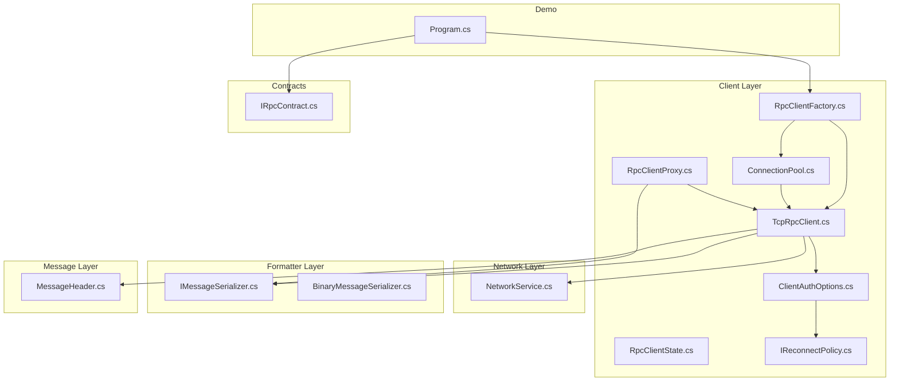
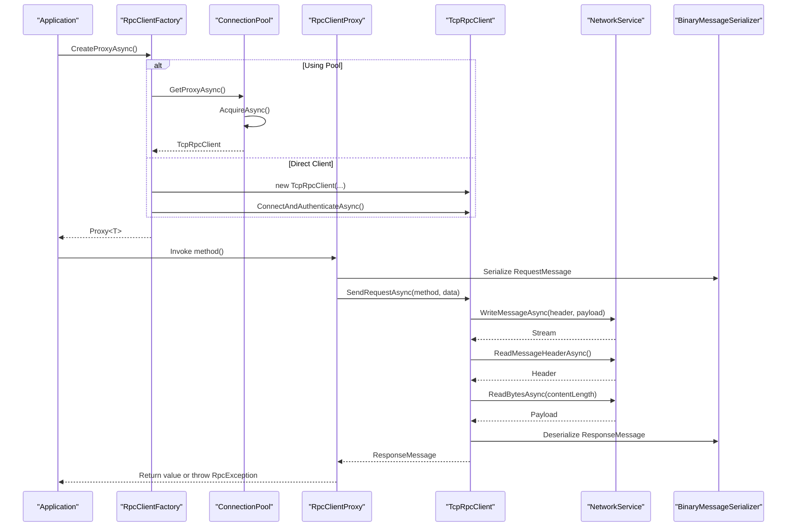
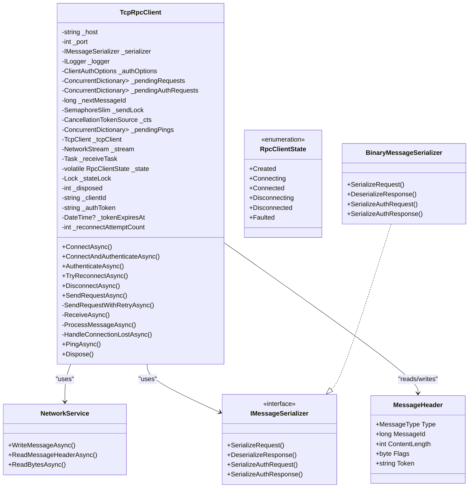
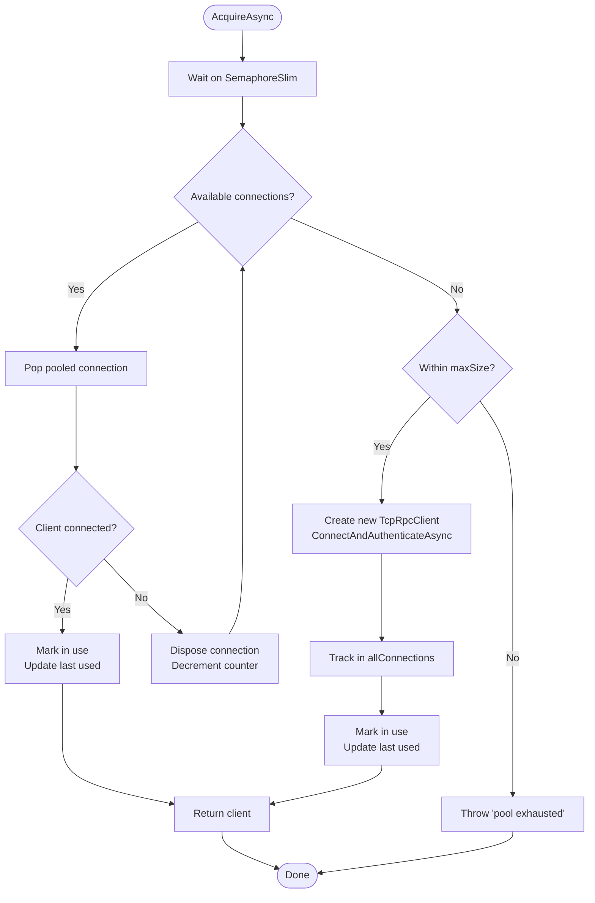
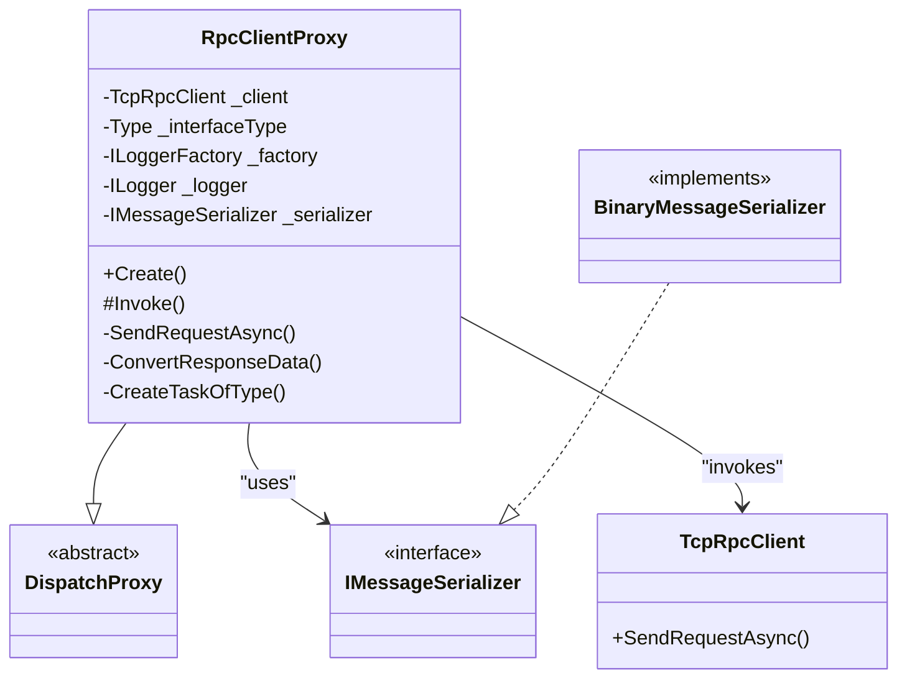
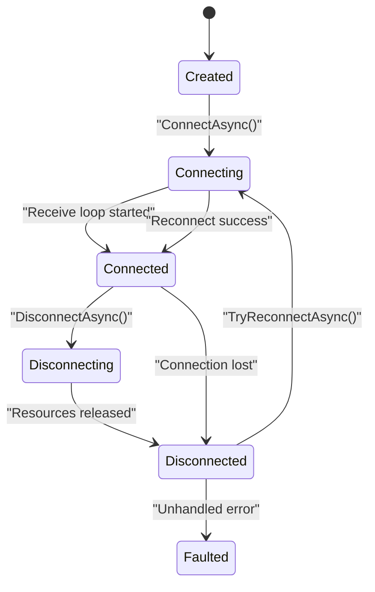
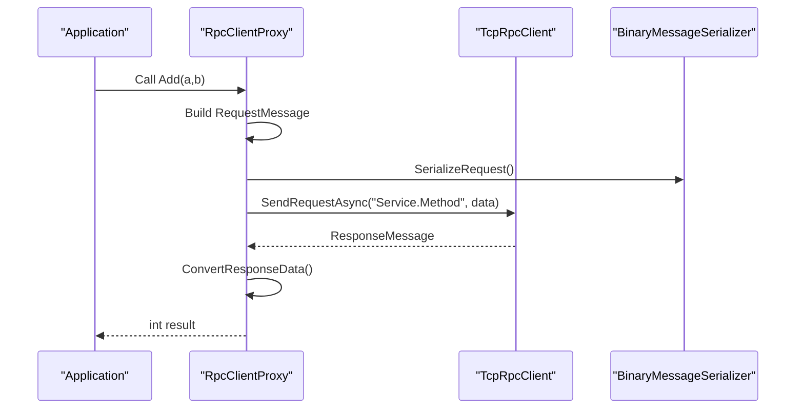
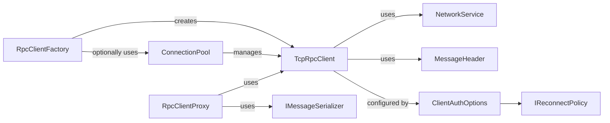

# Client Components

<cite>
**Referenced Files in This Document**
- [TcpRpcClient.cs](file://TcpRpc/Client/TcpRpcClient.cs)
- [RpcClientFactory.cs](file://TcpRpc/Client/RpcClientFactory.cs)
- [ConnectionPool.cs](file://TcpRpc/Client/ConnectionPool.cs)
- [RpcClientProxy.cs](file://TcpRpc/Client/RpcClientProxy.cs)
- [RpcClientState.cs](file://TcpRpc/Client/RpcClientState.cs)
- [ClientAuthOptions.cs](file://TcpRpc/Client/ClientAuthOptions.cs)
- [IReconnectPolicy.cs](file://TcpRpc/Client/IReconnectPolicy.cs)
- [NetworkService.cs](file://TcpRpc/Network/NetworkService.cs)
- [MessageHeader.cs](file://TcpRpc/Message/MessageHeader.cs)
- [IMessageSerializer.cs](file://TcpRpc/Formatter/IMessageSerializer.cs)
- [BinaryMessageSerializer.cs](file://TcpRpc/Formatter/BinaryMessageSerializer.cs)
- [IRpcContract.cs](file://TcpRpc.Contract/IRpcContract.cs)
- [Program.cs](file://TcpRpc.Client/Program.cs)
</cite>

## Table of Contents
1. [Introduction](#introduction)
2. [Project Structure](#project-structure)
3. [Core Components](#core-components)
4. [Architecture Overview](#architecture-overview)
5. [Detailed Component Analysis](#detailed-component-analysis)
6. [Dependency Analysis](#dependency-analysis)
7. [Performance Considerations](#performance-considerations)
8. [Troubleshooting Guide](#troubleshooting-guide)
9. [Conclusion](#conclusion)
10. [Appendices](#appendices)

## Introduction
This document explains the TcpRpc client-side architecture with a focus on four core components: TcpRpcClient, RpcClientFactory, ConnectionPool, and RpcClientProxy. It covers client lifecycle, connection management, authentication, automatic reconnection, and the proxy pattern that enables transparent method calls. Practical examples are drawn from the actual codebase to show how to create clients, configure authentication options, and manage connections efficiently. Guidance is included for performance optimization and production best practices, balancing accessibility for beginners with technical depth for experienced developers.

## Project Structure
The client stack resides under TcpRpc/Client and integrates with formatter, network, and message layers. The TcpRpc.Client demo program demonstrates real-world usage patterns.

**Diagram sources**
- [TcpRpcClient.cs:1-684](file://TcpRpc/Client/TcpRpcClient.cs#L1-L684)
- [RpcClientFactory.cs:1-110](file://TcpRpc/Client/RpcClientFactory.cs#L1-L110)
- [ConnectionPool.cs:1-189](file://TcpRpc/Client/ConnectionPool.cs#L1-L189)
- [RpcClientProxy.cs:1-160](file://TcpRpc/Client/RpcClientProxy.cs#L1-L160)
- [RpcClientState.cs:1-11](file://TcpRpc/Client/RpcClientState.cs#L1-L11)
- [ClientAuthOptions.cs:1-38](file://TcpRpc/Client/ClientAuthOptions.cs#L1-L38)
- [IReconnectPolicy.cs:1-100](file://TcpRpc/Client/IReconnectPolicy.cs#L1-L100)
- [NetworkService.cs:1-99](file://TcpRpc/Network/NetworkService.cs#L1-L99)
- [IMessageSerializer.cs:1-35](file://TcpRpc/Formatter/IMessageSerializer.cs#L1-L35)
- [BinaryMessageSerializer.cs:1-444](file://TcpRpc/Formatter/BinaryMessageSerializer.cs#L1-L444)
- [MessageHeader.cs:1-73](file://TcpRpc/Message/MessageHeader.cs#L1-L73)
- [IRpcContract.cs:1-61](file://TcpRpc.Contract/IRpcContract.cs#L1-L61)
- [Program.cs:1-169](file://TcpRpc.Client/Program.cs#L1-L169)

**Section sources**
- [TcpRpcClient.cs:1-684](file://TcpRpc/Client/TcpRpcClient.cs#L1-L684)
- [RpcClientFactory.cs:1-110](file://TcpRpc/Client/RpcClientFactory.cs#L1-L110)
- [ConnectionPool.cs:1-189](file://TcpRpc/Client/ConnectionPool.cs#L1-L189)
- [RpcClientProxy.cs:1-160](file://TcpRpc/Client/RpcClientProxy.cs#L1-L160)
- [Program.cs:1-169](file://TcpRpc.Client/Program.cs#L1-L169)

## Core Components
- TcpRpcClient: Manages TCP transport, authentication, request/response lifecycle, and automatic reconnection. It tracks state, pending requests, and handles network receive loops.
- RpcClientFactory: Simplifies creation of proxies and clients, optionally using a connection pool. Provides convenience methods to set credentials and client identifiers.
- ConnectionPool: Maintains a bounded set of reusable TcpRpcClient instances, with idle cleanup and semaphore-based acquisition/release.
- RpcClientProxy: Implements DispatchProxy to enable transparent method calls against typed interfaces. Handles serialization, invocation, and exception propagation.

**Section sources**
- [TcpRpcClient.cs:10-684](file://TcpRpc/Client/TcpRpcClient.cs#L10-L684)
- [RpcClientFactory.cs:9-110](file://TcpRpc/Client/RpcClientFactory.cs#L9-L110)
- [ConnectionPool.cs:10-189](file://TcpRpc/Client/ConnectionPool.cs#L10-L189)
- [RpcClientProxy.cs:11-160](file://TcpRpc/Client/RpcClientProxy.cs#L11-L160)

## Architecture Overview
The client architecture follows a layered design:
- Transport and messaging: TcpRpcClient uses NetworkService to write/read messages with MessageHeader framing.
- Serialization: IMessageSerializer (default BinaryMessageSerializer) serializes/deserializes requests, responses, and auth messages.
- Authentication: ClientAuthOptions drives credential handling and reconnection policy.
- Proxy pattern: RpcClientProxy intercepts interface calls and forwards them to TcpRpcClient.
- Pooling: ConnectionPool manages multiple TcpRpcClient instances for concurrency and reuse.

**Diagram sources**
- [RpcClientFactory.cs:36-61](file://TcpRpc/Client/RpcClientFactory.cs#L36-L61)
- [ConnectionPool.cs:109-121](file://TcpRpc/Client/ConnectionPool.cs#L109-L121)
- [RpcClientProxy.cs:115-126](file://TcpRpc/Client/RpcClientProxy.cs#L115-L126)
- [TcpRpcClient.cs:324-407](file://TcpRpc/Client/TcpRpcClient.cs#L324-L407)
- [NetworkService.cs:10-52](file://TcpRpc/Network/NetworkService.cs#L10-L52)
- [BinaryMessageSerializer.cs:30-112](file://TcpRpc/Formatter/BinaryMessageSerializer.cs#L30-L112)

## Detailed Component Analysis

### TcpRpcClient
Responsibilities:
- Transport lifecycle: connect, authenticate, disconnect, and graceful shutdown.
- Request/response orchestration: send requests, track pending requests, process incoming messages, and handle timeouts.
- Authentication: send AuthRequest, persist tokens, and restore sessions on reconnect.
- Automatic reconnection: configurable policy, exponential backoff by default, and background reconnection attempts.
- Heartbeat: Ping/Pong support for liveness checks.

Key implementation patterns:
- State machine: RpcClientState tracks transitions from Created to Connecting to Connected to Disconnecting/Disconnected/Faulted.
- Pending request tracking: ConcurrentDictionary<long, TaskCompletionSource<T>> ensures per-request completion and cancellation safety.
- Concurrency control: SemaphoreSlim protects send operations; lock and volatile state guard state transitions.
- Network loop: ReceiveAsync reads headers and content, dispatching to ProcessMessageAsync; errors trigger HandleConnectionLostAsync.
- Retry logic: SendRequestWithRetryAsync attempts reconnection on connection errors when enabled.

**Diagram sources**
- [TcpRpcClient.cs:10-684](file://TcpRpc/Client/TcpRpcClient.cs#L10-L684)
- [RpcClientState.cs:3-11](file://TcpRpc/Client/RpcClientState.cs#L3-L11)
- [NetworkService.cs:7-99](file://TcpRpc/Network/NetworkService.cs#L7-L99)
- [IMessageSerializer.cs:8-35](file://TcpRpc/Formatter/IMessageSerializer.cs#L8-L35)
- [BinaryMessageSerializer.cs:11-444](file://TcpRpc/Formatter/BinaryMessageSerializer.cs#L11-L444)
- [MessageHeader.cs:9-73](file://TcpRpc/Message/MessageHeader.cs#L9-L73)

**Section sources**
- [TcpRpcClient.cs:75-130](file://TcpRpc/Client/TcpRpcClient.cs#L75-L130)
- [TcpRpcClient.cs:144-227](file://TcpRpc/Client/TcpRpcClient.cs#L144-L227)
- [TcpRpcClient.cs:232-269](file://TcpRpc/Client/TcpRpcClient.cs#L232-L269)
- [TcpRpcClient.cs:324-407](file://TcpRpc/Client/TcpRpcClient.cs#L324-L407)
- [TcpRpcClient.cs:414-581](file://TcpRpc/Client/TcpRpcClient.cs#L414-L581)
- [TcpRpcClient.cs:599-658](file://TcpRpc/Client/TcpRpcClient.cs#L599-L658)

### RpcClientFactory
Responsibilities:
- Centralized creation of proxies and clients.
- Optional pooling: delegates to ConnectionPool when enabled.
- Credential and identity management: SetCredentials, SetClientId.
- Direct client creation: with or without authentication.

Usage patterns:
- CreateProxyAsync<T>() returns a typed proxy bound to a TcpRpcClient (from pool or fresh).
- CreateClientAsync() returns a TcpRpcClient ready for manual use.
- ReleaseClient() returns a pooled client to the pool.

**Section sources**
- [RpcClientFactory.cs:18-61](file://TcpRpc/Client/RpcClientFactory.cs#L18-L61)
- [RpcClientFactory.cs:89-104](file://TcpRpc/Client/RpcClientFactory.cs#L89-L104)

### ConnectionPool
Responsibilities:
- Manage a fixed-size pool of TcpRpcClient instances.
- Acquire/release with semaphore-based fairness.
- Idle cleanup timer removes stale connections.
- Proxy creation: returns a proxy bound to an acquired client.

Key behaviors:
- AcquireAsync waits on semaphore, tries available connections, or creates new ones up to maxSize.
- Release marks client as unused and returns it to the pool.
- CleanupIdleConnections periodically disposes idle connections.

**Diagram sources**
- [ConnectionPool.cs:43-89](file://TcpRpc/Client/ConnectionPool.cs#L43-L89)
- [ConnectionPool.cs:116-121](file://TcpRpc/Client/ConnectionPool.cs#L116-L121)
- [ConnectionPool.cs:137-163](file://TcpRpc/Client/ConnectionPool.cs#L137-L163)

**Section sources**
- [ConnectionPool.cs:43-104](file://TcpRpc/Client/ConnectionPool.cs#L43-L104)
- [ConnectionPool.cs:109-121](file://TcpRpc/Client/ConnectionPool.cs#L109-L121)
- [ConnectionPool.cs:137-163](file://TcpRpc/Client/ConnectionPool.cs#L137-L163)

### RpcClientProxy
Responsibilities:
- Transparent method dispatch via DispatchProxy.
- Serialize method calls into RequestMessage and deserialize ResponseMessage.
- Handle return types: void, Task, Task<T>, and synchronous T.
- Propagate remote exceptions as RpcException with RemoteExceptionType and StackTrace.

Implementation highlights:
- Create<T>() initializes internal state and returns a proxy instance.
- Invoke() builds RequestMessage, sends via TcpRpcClient, and converts response to the expected return type.
- ConvertResponseData handles type conversion and null fallbacks.
- CreateTaskOfType uses reflection to construct Task.FromResult<T>.

**Diagram sources**
- [RpcClientProxy.cs:11-160](file://TcpRpc/Client/RpcClientProxy.cs#L11-L160)
- [IMessageSerializer.cs:8-35](file://TcpRpc/Formatter/IMessageSerializer.cs#L8-L35)
- [BinaryMessageSerializer.cs:11-444](file://TcpRpc/Formatter/BinaryMessageSerializer.cs#L11-L444)
- [TcpRpcClient.cs:324-407](file://TcpRpc/Client/TcpRpcClient.cs#L324-L407)

**Section sources**
- [RpcClientProxy.cs:22-36](file://TcpRpc/Client/RpcClientProxy.cs#L22-L36)
- [RpcClientProxy.cs:38-113](file://TcpRpc/Client/RpcClientProxy.cs#L38-L113)
- [RpcClientProxy.cs:115-156](file://TcpRpc/Client/RpcClientProxy.cs#L115-L156)

### Client Lifecycle, Connection Management, and Reconnection
Lifecycle stages:
- Created: Initialized with host/port and serializer.
- Connecting: TCP connect initiated; receive loop starts after successful connection.
- Connected: Ready for requests; pending requests tracked; authentication token stored.
- Disconnecting/Disconnected: Graceful shutdown; pending requests canceled; resources disposed.
- Faulted: Not directly exposed here; state transitions guarded by locks.

Connection management strategies:
- Single-use client: RpcClientFactory.CreateClientAsync() returns a TcpRpcClient that is manually managed.
- Pooled client: RpcClientFactory.CreateProxyAsync() returns a proxy backed by a pooled TcpRpcClient; release via ConnectionPool.Release().
- Idle cleanup: ConnectionPool periodically disposes idle connections exceeding maxIdleTime.

Automatic reconnection:
- Enabled by ClientAuthOptions.AutoReconnect and configured via IReconnectPolicy.
- Default policy is ExponentialBackoffReconnectPolicy with configurable max attempts, initial delay, and max delay.
- TryReconnectAsync() computes delay, waits, and reconnects; failures are logged and retried according to policy.
- Background reconnection: HandleConnectionLostAsync triggers a fire-and-forget reconnect attempt when AutoReconnect is enabled.

**Diagram sources**
- [RpcClientState.cs:3-11](file://TcpRpc/Client/RpcClientState.cs#L3-L11)
- [TcpRpcClient.cs:75-130](file://TcpRpc/Client/TcpRpcClient.cs#L75-L130)
- [TcpRpcClient.cs:232-269](file://TcpRpc/Client/TcpRpcClient.cs#L232-L269)
- [TcpRpcClient.cs:542-581](file://TcpRpc/Client/TcpRpcClient.cs#L542-L581)

**Section sources**
- [ClientAuthOptions.cs:6-37](file://TcpRpc/Client/ClientAuthOptions.cs#L6-L37)
- [IReconnectPolicy.cs:6-100](file://TcpRpc/Client/IReconnectPolicy.cs#L6-L100)
- [TcpRpcClient.cs:232-269](file://TcpRpc/Client/TcpRpcClient.cs#L232-L269)
- [TcpRpcClient.cs:542-581](file://TcpRpc/Client/TcpRpcClient.cs#L542-L581)

### Proxy Pattern Implementation
The proxy pattern enables transparent method calls:
- DispatchProxy.Invoke() captures the method metadata and arguments.
- RequestMessage is constructed with service type, method name, parameters, and parameter types.
- TcpRpcClient.SendRequestAsync() transmits the serialized request and awaits a ResponseMessage.
- RpcClientProxy.ConvertResponseData() maps the response to the expected return type, including Task<T> and void variants.
- Exceptions are propagated as RpcException with RemoteExceptionType and StackTrace.

**Diagram sources**
- [RpcClientProxy.cs:38-113](file://TcpRpc/Client/RpcClientProxy.cs#L38-L113)
- [RpcClientProxy.cs:115-126](file://TcpRpc/Client/RpcClientProxy.cs#L115-L126)
- [TcpRpcClient.cs:324-407](file://TcpRpc/Client/TcpRpcClient.cs#L324-L407)
- [BinaryMessageSerializer.cs:30-112](file://TcpRpc/Formatter/BinaryMessageSerializer.cs#L30-L112)

**Section sources**
- [RpcClientProxy.cs:38-113](file://TcpRpc/Client/RpcClientProxy.cs#L38-L113)
- [BinaryMessageSerializer.cs:30-112](file://TcpRpc/Formatter/BinaryMessageSerializer.cs#L30-L112)

### Authentication Options and Configuration
ClientAuthOptions controls:
- AutoReconnect: Enable/disable automatic reconnection.
- ReconnectPolicy: Pluggable policy (FixedDelay, ExponentialBackoff, NoReconnect).
- Credentials: Dictionary of key-value pairs passed during authentication.
- ClientId: Used to restore sessions on reconnect.
- ConnectTimeout and AuthTimeout: Per-operation timeouts.

Examples from the demo program illustrate:
- Creating ClientAuthOptions with ExponentialBackoffReconnectPolicy.
- Setting Credentials and ClientId.
- Using RpcClientFactory with pooling and authentication.

**Section sources**
- [ClientAuthOptions.cs:6-37](file://TcpRpc/Client/ClientAuthOptions.cs#L6-L37)
- [IReconnectPolicy.cs:36-85](file://TcpRpc/Client/IReconnectPolicy.cs#L36-L85)
- [Program.cs:20-33](file://TcpRpc.Client/Program.cs#L20-L33)
- [Program.cs:104-113](file://TcpRpc.Client/Program.cs#L104-L113)

### Practical Examples from the Codebase
- Creating a proxy with authentication and pooling:
  - [Program.cs:41-44](file://TcpRpc.Client/Program.cs#L41-L44)
- Direct client creation with authentication:
  - [RpcClientFactory.cs:51-61](file://TcpRpc/Client/RpcClientFactory.cs#L51-L61)
- Using connection pool with parallel tasks:
  - [Program.cs:115-136](file://TcpRpc.Client/Program.cs#L115-L136)
- Testing reconnection behavior:
  - [Program.cs:139-142](file://TcpRpc.Client/Program.cs#L139-L142)
- Testing invalid credentials:
  - [Program.cs:146-166](file://TcpRpc.Client/Program.cs#L146-L166)

**Section sources**
- [Program.cs:41-44](file://TcpRpc.Client/Program.cs#L41-L44)
- [RpcClientFactory.cs:51-61](file://TcpRpc/Client/RpcClientFactory.cs#L51-L61)
- [Program.cs:115-136](file://TcpRpc.Client/Program.cs#L115-L136)
- [Program.cs:139-142](file://TcpRpc.Client/Program.cs#L139-L142)
- [Program.cs:146-166](file://TcpRpc.Client/Program.cs#L146-L166)

## Dependency Analysis
Component relationships:
- TcpRpcClient depends on NetworkService for IO, IMessageSerializer for serialization, and ClientAuthOptions for configuration.
- RpcClientFactory composes TcpRpcClient and optionally ConnectionPool.
- ConnectionPool composes TcpRpcClient and manages lifecycle and pooling semantics.
- RpcClientProxy depends on TcpRpcClient and IMessageSerializer to serialize/deserialize messages.
- IReconnectPolicy is injected into ClientAuthOptions to control reconnection behavior.

**Diagram sources**
- [RpcClientFactory.cs:18-61](file://TcpRpc/Client/RpcClientFactory.cs#L18-L61)
- [ConnectionPool.cs:109-121](file://TcpRpc/Client/ConnectionPool.cs#L109-L121)
- [RpcClientProxy.cs:115-126](file://TcpRpc/Client/RpcClientProxy.cs#L115-L126)
- [TcpRpcClient.cs:324-407](file://TcpRpc/Client/TcpRpcClient.cs#L324-L407)
- [ClientAuthOptions.cs:6-37](file://TcpRpc/Client/ClientAuthOptions.cs#L6-L37)
- [IReconnectPolicy.cs:6-31](file://TcpRpc/Client/IReconnectPolicy.cs#L6-L31)

**Section sources**
- [RpcClientFactory.cs:18-61](file://TcpRpc/Client/RpcClientFactory.cs#L18-L61)
- [ConnectionPool.cs:109-121](file://TcpRpc/Client/ConnectionPool.cs#L109-L121)
- [RpcClientProxy.cs:115-126](file://TcpRpc/Client/RpcClientProxy.cs#L115-L126)
- [TcpRpcClient.cs:324-407](file://TcpRpc/Client/TcpRpcClient.cs#L324-L407)
- [ClientAuthOptions.cs:6-37](file://TcpRpc/Client/ClientAuthOptions.cs#L6-L37)
- [IReconnectPolicy.cs:6-31](file://TcpRpc/Client/IReconnectPolicy.cs#L6-L31)

## Performance Considerations
- Connection pooling: Use RpcClientFactory with pooling enabled to reduce connection churn and improve throughput under load. Tune pool size based on expected concurrency and server capacity.
- Serialization overhead: BinaryMessageSerializer is efficient; keep parameter types simple and avoid excessively large payloads.
- Timeouts: Configure ClientAuthOptions.ConnectTimeout and AuthTimeout appropriately for your network conditions to prevent hanging operations.
- Reconnection backoff: Prefer ExponentialBackoffReconnectPolicy to avoid thundering herd on server restarts; adjust max attempts and max delay for production stability.
- Idle cleanup: ConnectionPool cleans idle connections; ensure maxIdleTime aligns with workload patterns to balance resource usage and latency.
- Concurrency: Use RpcClientProxy for synchronous and asynchronous calls; avoid blocking calls in hot paths. For high-throughput scenarios, prefer Task-returning methods and async/await.

[No sources needed since this section provides general guidance]

## Troubleshooting Guide
Common client-side issues and resolutions:
- Authentication failures:
  - Verify ClientAuthOptions.Credentials and ClientId are set correctly.
  - Check server logs for rejected tokens or invalid credentials.
  - Example: [Program.cs:146-166](file://TcpRpc.Client/Program.cs#L146-L166)
- Connection timeouts:
  - Increase ClientAuthOptions.ConnectTimeout and AuthTimeout.
  - Validate network connectivity and firewall rules.
  - Inspect TcpRpcClient logs for timeout exceptions.
  - Reference: [TcpRpcClient.cs:179-226](file://TcpRpc/Client/TcpRpcClient.cs#L179-L226)
- Request timeouts:
  - Adjust per-call timeout in SendRequestAsync or configure global defaults.
  - Review server responsiveness and resource utilization.
  - Reference: [TcpRpcClient.cs:365-407](file://TcpRpc/Client/TcpRpcClient.cs#L365-L407)
- Connection loss and reconnection:
  - Ensure AutoReconnect is enabled and ReconnectPolicy is configured.
  - Monitor HandleConnectionLostAsync behavior and background reconnect attempts.
  - Reference: [TcpRpcClient.cs:542-581](file://TcpRpc/Client/TcpRpcClient.cs#L542-L581)
- Proxy exceptions:
  - RpcClientProxy propagates remote exceptions as RpcException with RemoteExceptionType and StackTrace.
  - Catch RpcException on the client to inspect remote error details.
  - Reference: [RpcClientProxy.cs:74-84](file://TcpRpc/Client/RpcClientProxy.cs#L74-L84)
- Pool exhaustion:
  - Increase pool size or reduce concurrent usage; monitor semaphore wait times.
  - Reference: [ConnectionPool.cs:80-82](file://TcpRpc/Client/ConnectionPool.cs#L80-L82)

**Section sources**
- [Program.cs:146-166](file://TcpRpc.Client/Program.cs#L146-L166)
- [TcpRpcClient.cs:179-226](file://TcpRpc/Client/TcpRpcClient.cs#L179-L226)
- [TcpRpcClient.cs:365-407](file://TcpRpc/Client/TcpRpcClient.cs#L365-L407)
- [TcpRpcClient.cs:542-581](file://TcpRpc/Client/TcpRpcClient.cs#L542-L581)
- [RpcClientProxy.cs:74-84](file://TcpRpc/Client/RpcClientProxy.cs#L74-L84)
- [ConnectionPool.cs:80-82](file://TcpRpc/Client/ConnectionPool.cs#L80-L82)

## Conclusion
The TcpRpc client components provide a robust, production-ready foundation for building distributed applications. TcpRpcClient encapsulates transport, authentication, and reconnection; RpcClientFactory simplifies creation and configuration; ConnectionPool optimizes resource usage; and RpcClientProxy delivers transparent method calls. By tuning authentication options, reconnection policies, and pool sizing, teams can achieve reliable, high-performance communication with minimal boilerplate.

[No sources needed since this section summarizes without analyzing specific files]

## Appendices

### Best Practices for Production Deployments
- Enable AutoReconnect with ExponentialBackoffReconnectPolicy and appropriate max attempts.
- Use RpcClientFactory with pooling for high-concurrency scenarios; size the pool based on measured concurrency and server capacity.
- Configure timeouts conservatively to avoid long-hanging operations.
- Monitor RpcClient logs for connection errors, timeouts, and reconnection events.
- Use RpcClientProxy for strongly-typed contracts; define clear interfaces in TcpRpc.Contract.
- Keep credentials secure; rotate tokens and update ClientId for session restoration.

[No sources needed since this section provides general guidance]