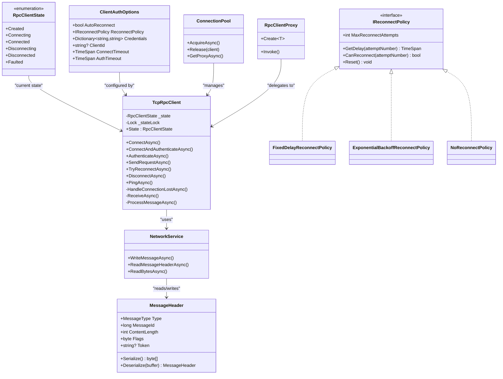
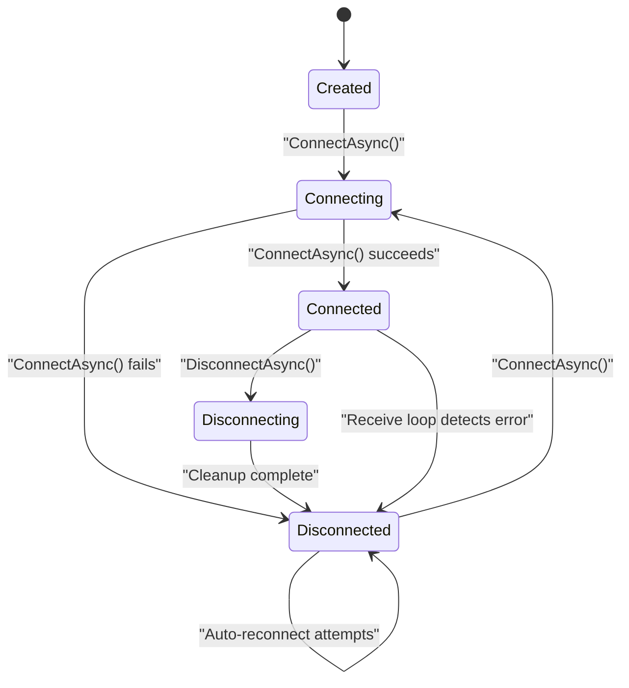
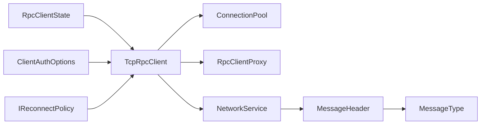

# Client State Management

<cite>
**Referenced Files in This Document**
- [RpcClientState.cs](file://TcpRpc/Client/RpcClientState.cs)
- [TcpRpcClient.cs](file://TcpRpc/Client/TcpRpcClient.cs)
- [ClientAuthOptions.cs](file://TcpRpc/Client/ClientAuthOptions.cs)
- [IReconnectPolicy.cs](file://TcpRpc/Client/IReconnectPolicy.cs)
- [ConnectionPool.cs](file://TcpRpc/Client/ConnectionPool.cs)
- [RpcClientProxy.cs](file://TcpRpc/Client/RpcClientProxy.cs)
- [NetworkService.cs](file://TcpRpc/Network/NetworkService.cs)
- [MessageHeader.cs](file://TcpRpc/Message/MessageHeader.cs)
- [MessageType.cs](file://TcpRpc/Message/MessageType.cs)
- [RpcException.cs](file://TcpRpc/RpcException.cs)
</cite>

## Table of Contents
1. [Introduction](#introduction)
2. [Project Structure](#project-structure)
3. [Core Components](#core-components)
4. [Architecture Overview](#architecture-overview)
5. [Detailed Component Analysis](#detailed-component-analysis)
6. [Dependency Analysis](#dependency-analysis)
7. [Performance Considerations](#performance-considerations)
8. [Troubleshooting Guide](#troubleshooting-guide)
9. [Conclusion](#conclusion)
10. [Appendices](#appendices)

## Introduction
This document explains the client-side state management model used by the TCP-based RPC client. It focuses on the RpcClientState enumeration, the state machine design, state transitions, and validation logic. It also covers synchronization mechanisms, thread-safety considerations, notifications, integration with connection lifecycle and authentication, reconnection logic, and practical guidance for monitoring, decision-making, debugging, persistence, and recovery in distributed environments.

## Project Structure
The client state management spans several core files:
- RpcClientState defines the legal states.
- TcpRpcClient implements the state machine, lifecycle, authentication, reconnection, and request handling.
- ClientAuthOptions configures timeouts, auto-reconnect, and credentials.
- IReconnectPolicy and its implementations define retry policies.
- ConnectionPool coordinates pooled connections and uses RpcClientState for availability checks.
- RpcClientProxy exposes typed proxies that rely on TcpRpcClient’s state and connectivity.
- NetworkService and MessageHeader provide transport-level primitives used during state transitions.

```mermaid
graph TB
subgraph "Client"
State["RpcClientState"]
Client["TcpRpcClient"]
AuthOpts["ClientAuthOptions"]
Policy["IReconnectPolicy<br/>FixedDelayReconnectPolicy<br/>ExponentialBackoffReconnectPolicy<br/>NoReconnectPolicy"]
Pool["ConnectionPool"]
Proxy["RpcClientProxy"]
end
subgraph "Transport"
Net["NetworkService"]
Header["MessageHeader"]
MsgType["MessageType"]
end
State --> Client
AuthOpts --> Client
Policy --> Client
Pool --> Client
Proxy --> Client
Client --> Net
Net --> Header
Header --> MsgType
```

**Diagram sources**
- [RpcClientState.cs:3-11](file://TcpRpc/Client/RpcClientState.cs#L3-L11)
- [TcpRpcClient.cs:10-684](file://TcpRpc/Client/TcpRpcClient.cs#L10-L684)
- [ClientAuthOptions.cs:6-37](file://TcpRpc/Client/ClientAuthOptions.cs#L6-L37)
- [IReconnectPolicy.cs:6-100](file://TcpRpc/Client/IReconnectPolicy.cs#L6-L100)
- [ConnectionPool.cs:10-189](file://TcpRpc/Client/ConnectionPool.cs#L10-L189)
- [RpcClientProxy.cs:11-160](file://TcpRpc/Client/RpcClientProxy.cs#L11-L160)
- [NetworkService.cs:7-99](file://TcpRpc/Network/NetworkService.cs#L7-L99)
- [MessageHeader.cs:9-73](file://TcpRpc/Message/MessageHeader.cs#L9-L73)
- [MessageType.cs:3-13](file://TcpRpc/Message/MessageType.cs#L3-L13)

**Section sources**
- [RpcClientState.cs:3-11](file://TcpRpc/Client/RpcClientState.cs#L3-L11)
- [TcpRpcClient.cs:10-684](file://TcpRpc/Client/TcpRpcClient.cs#L10-L684)
- [ClientAuthOptions.cs:6-37](file://TcpRpc/Client/ClientAuthOptions.cs#L6-L37)
- [IReconnectPolicy.cs:6-100](file://TcpRpc/Client/IReconnectPolicy.cs#L6-L100)
- [ConnectionPool.cs:10-189](file://TcpRpc/Client/ConnectionPool.cs#L10-L189)
- [RpcClientProxy.cs:11-160](file://TcpRpc/Client/RpcClientProxy.cs#L11-L160)
- [NetworkService.cs:7-99](file://TcpRpc/Network/NetworkService.cs#L7-L99)
- [MessageHeader.cs:9-73](file://TcpRpc/Message/MessageHeader.cs#L9-L73)
- [MessageType.cs:3-13](file://TcpRpc/Message/MessageType.cs#L3-L13)

## Core Components
- RpcClientState: Defines the finite set of client states used to coordinate lifecycle, authentication, and reconnection.
- TcpRpcClient: Implements the state machine, enforces state transitions, handles authentication, manages requests, and orchestrates reconnection.
- ClientAuthOptions: Provides configuration for timeouts, auto-reconnect, credentials, and client ID.
- IReconnectPolicy and implementations: Define retry policy behavior for reconnection attempts.
- ConnectionPool: Uses RpcClientState to select usable connections from a pool.
- RpcClientProxy: A typed proxy that delegates RPC calls to TcpRpcClient and relies on its state and connectivity.
- NetworkService and MessageHeader: Transport primitives used during state transitions and message processing.

**Section sources**
- [RpcClientState.cs:3-11](file://TcpRpc/Client/RpcClientState.cs#L3-L11)
- [TcpRpcClient.cs:10-684](file://TcpRpc/Client/TcpRpcClient.cs#L10-L684)
- [ClientAuthOptions.cs:6-37](file://TcpRpc/Client/ClientAuthOptions.cs#L6-L37)
- [IReconnectPolicy.cs:6-100](file://TcpRpc/Client/IReconnectPolicy.cs#L6-L100)
- [ConnectionPool.cs:10-189](file://TcpRpc/Client/ConnectionPool.cs#L10-L189)
- [RpcClientProxy.cs:11-160](file://TcpRpc/Client/RpcClientProxy.cs#L11-L160)
- [NetworkService.cs:7-99](file://TcpRpc/Network/NetworkService.cs#L7-L99)
- [MessageHeader.cs:9-73](file://TcpRpc/Message/MessageHeader.cs#L9-L73)

## Architecture Overview
The client state machine is centralized in TcpRpcClient and coordinated via:
- A volatile state field guarded by a dedicated lock for atomic transitions.
- Strict entry/exit conditions enforced around connection establishment, authentication, disconnecting, and cleanup.
- Integration with network receive loop and error handling to trigger state changes on connection loss.
- Optional automatic reconnection governed by ClientAuthOptions and IReconnectPolicy.



**Diagram sources**
- [RpcClientState.cs:3-11](file://TcpRpc/Client/RpcClientState.cs#L3-L11)
- [TcpRpcClient.cs:10-684](file://TcpRpc/Client/TcpRpcClient.cs#L10-L684)
- [ClientAuthOptions.cs:6-37](file://TcpRpc/Client/ClientAuthOptions.cs#L6-L37)
- [IReconnectPolicy.cs:6-100](file://TcpRpc/Client/IReconnectPolicy.cs#L6-L100)
- [ConnectionPool.cs:10-189](file://TcpRpc/Client/ConnectionPool.cs#L10-L189)
- [RpcClientProxy.cs:11-160](file://TcpRpc/Client/RpcClientProxy.cs#L11-L160)
- [NetworkService.cs:7-99](file://TcpRpc/Network/NetworkService.cs#L7-L99)
- [MessageHeader.cs:9-73](file://TcpRpc/Message/MessageHeader.cs#L9-L73)

## Detailed Component Analysis

### RpcClientState Enumeration
- Purpose: Enumerates the legal states of the client lifecycle.
- Values:
  - Created: Initial state after construction.
  - Connecting: Transitioning to Connected; guard against invalid transitions.
  - Connected: Fully established and authenticated.
  - Disconnecting: Transitioning to Disconnected; guard against invalid transitions.
  - Disconnected: Not connected; may attempt reconnection depending on policy.
  - Faulted: Not currently used in TcpRpcClient; reserved for future use or extended semantics.

Validation and constraints:
- Transitions are validated by TcpRpcClient methods before changing state.
- Guard blocks prevent illegal transitions (e.g., ConnectAsync requires Created or Disconnected).

**Section sources**
- [RpcClientState.cs:3-11](file://TcpRpc/Client/RpcClientState.cs#L3-L11)
- [TcpRpcClient.cs:75-130](file://TcpRpc/Client/TcpRpcClient.cs#L75-L130)
- [TcpRpcClient.cs:274-322](file://TcpRpc/Client/TcpRpcClient.cs#L274-L322)

### State Machine Design and Transitions
The state machine is implemented in TcpRpcClient with explicit guards and synchronized updates.



Key transitions and guards:
- ConnectAsync: Only allows transitions from Created or Disconnected; sets Connecting then Connected on success, Disconnected on failure.
- DisconnectAsync: Only operates from Connected; sets Disconnecting then Disconnected after cleanup.
- Receive loop: On connection errors, transitions to Disconnected and triggers background reconnection if enabled.
- TryReconnectAsync: Uses ClientAuthOptions.AutoReconnect and IReconnectPolicy to decide whether and when to retry.

Thread-safety:
- _state is volatile; transitions are protected by _stateLock to avoid race conditions.
- Cancellation tokens and separate cancellation source ensure orderly shutdown.

**Diagram sources**
- [TcpRpcClient.cs:75-130](file://TcpRpc/Client/TcpRpcClient.cs#L75-L130)
- [TcpRpcClient.cs:274-322](file://TcpRpc/Client/TcpRpcClient.cs#L274-L322)
- [TcpRpcClient.cs:414-475](file://TcpRpc/Client/TcpRpcClient.cs#L414-L475)
- [TcpRpcClient.cs:542-581](file://TcpRpc/Client/TcpRpcClient.cs#L542-L581)

**Section sources**
- [TcpRpcClient.cs:75-130](file://TcpRpc/Client/TcpRpcClient.cs#L75-L130)
- [TcpRpcClient.cs:274-322](file://TcpRpc/Client/TcpRpcClient.cs#L274-L322)
- [TcpRpcClient.cs:414-475](file://TcpRpc/Client/TcpRpcClient.cs#L414-L475)
- [TcpRpcClient.cs:542-581](file://TcpRpc/Client/TcpRpcClient.cs#L542-L581)

### State Synchronization and Thread Safety
- Volatile state field ensures visibility across threads.
- Dedicated lock (_stateLock) serializes state transitions.
- Separate cancellation source (_cts) enables cooperative cancellation of receive loop and send operations.
- SemaphoreSlim (_sendLock) protects concurrent send operations.

Behavioral implications:
- State reads are safe without locks; state writes require _stateLock.
- Send operations are serialized to prevent interleaved writes.
- Cancellation tokens are combined with operation-specific timeouts to avoid deadlocks.

**Section sources**
- [TcpRpcClient.cs:29-32](file://TcpRpc/Client/TcpRpcClient.cs#L29-L32)
- [TcpRpcClient.cs:182-192](file://TcpRpc/Client/TcpRpcClient.cs#L182-L192)
- [TcpRpcClient.cs:368-378](file://TcpRpc/Client/TcpRpcClient.cs#L368-L378)

### Authentication Workflow and State Integration
- ConnectAndAuthenticateAsync: Establishes connection then performs authentication.
- AuthenticateAsync: Sends AuthRequest, waits for AuthResponse, stores token and metadata.
- Token propagation: MessageHeader carries Token for subsequent requests.
- Session restoration: AuthResponse indicates session restoration; logs accordingly.

State effects:
- Authentication occurs only when state is Connected.
- On authentication failure, exceptions are raised; state remains Connected but credentials may be invalid.
- On authentication success, token and expiration are stored; subsequent requests carry Token.

**Section sources**
- [TcpRpcClient.cs:135-227](file://TcpRpc/Client/TcpRpcClient.cs#L135-L227)
- [MessageHeader.cs:23](file://TcpRpc/Message/MessageHeader.cs#L23)
- [MessageType.cs:9-12](file://TcpRpc/Message/MessageType.cs#L9-L12)

### Reconnection Logic and State
- TryReconnectAsync: Checks AutoReconnect and ReconnectPolicy, delays, then ConnectAndAuthenticateAsync.
- HandleConnectionLostAsync: On receive-loop errors, transitions to Disconnected and cancels pending tasks; optionally schedules background reconnection.
- ReconnectAttemptCount tracks attempts; policy limits retries.

Integration:
- SendRequestWithRetryAsync: If not Connected, attempts reconnection once; if successful, retries the request.
- ConnectionPool: Uses RpcClientState to filter available connections; disposes stale connections.

**Section sources**
- [TcpRpcClient.cs:232-269](file://TcpRpc/Client/TcpRpcClient.cs#L232-L269)
- [TcpRpcClient.cs:542-581](file://TcpRpc/Client/TcpRpcClient.cs#L542-L581)
- [TcpRpcClient.cs:334-407](file://TcpRpc/Client/TcpRpcClient.cs#L334-L407)
- [ConnectionPool.cs:54-62](file://TcpRpc/Client/ConnectionPool.cs#L54-L62)

### Request Lifecycle and State Validation
- SendRequestAsync delegates to SendRequestWithRetryAsync.
- Validation: If state is not Connected, it attempts reconnection once; if still not Connected, throws.
- Pending requests are tracked and completed or faulted upon state changes or timeouts.
- Connection errors detected during send trigger reconnection logic.

**Section sources**
- [TcpRpcClient.cs:324-407](file://TcpRpc/Client/TcpRpcClient.cs#L324-L407)
- [TcpRpcClient.cs:409-412](file://TcpRpc/Client/TcpRpcClient.cs#L409-L412)

### Heartbeat and Monitoring
- PingAsync: Sends Ping, expects Pong; useful for liveness checks.
- State-dependent behavior: Returns false if not Connected or client disposed.
- Pending pings tracked separately; cleared on completion or timeout.

**Section sources**
- [TcpRpcClient.cs:599-658](file://TcpRpc/Client/TcpRpcClient.cs#L599-L658)

### Typed Proxy Integration
- RpcClientProxy creates typed proxies that call TcpRpcClient.SendRequestAsync internally.
- Proxies rely on client connectivity and state; they surface RpcException for remote errors.

**Section sources**
- [RpcClientProxy.cs:11-160](file://TcpRpc/Client/RpcClientProxy.cs#L11-L160)
- [RpcException.cs:6-37](file://TcpRpc/RpcException.cs#L6-L37)

### Transport Primitives
- NetworkService: Writes/reads message headers and bodies with cancellation support.
- MessageHeader: Carries type, message ID, content length, flags, and optional token.

**Section sources**
- [NetworkService.cs:10-99](file://TcpRpc/Network/NetworkService.cs#L10-L99)
- [MessageHeader.cs:41-72](file://TcpRpc/Message/MessageHeader.cs#L41-L72)

## Dependency Analysis
- TcpRpcClient depends on RpcClientState for state transitions and validation.
- ClientAuthOptions configures timeouts and reconnection behavior.
- IReconnectPolicy implementations encapsulate retry strategies.
- ConnectionPool uses RpcClientState to select usable connections and to dispose stale ones.
- RpcClientProxy depends on TcpRpcClient’s state and connectivity for RPC invocation.
- NetworkService and MessageHeader underpin state transitions by enabling connect, authenticate, send, and receive operations.



**Diagram sources**
- [RpcClientState.cs:3-11](file://TcpRpc/Client/RpcClientState.cs#L3-L11)
- [TcpRpcClient.cs:10-684](file://TcpRpc/Client/TcpRpcClient.cs#L10-L684)
- [ClientAuthOptions.cs:6-37](file://TcpRpc/Client/ClientAuthOptions.cs#L6-L37)
- [IReconnectPolicy.cs:6-100](file://TcpRpc/Client/IReconnectPolicy.cs#L6-L100)
- [ConnectionPool.cs:10-189](file://TcpRpc/Client/ConnectionPool.cs#L10-L189)
- [RpcClientProxy.cs:11-160](file://TcpRpc/Client/RpcClientProxy.cs#L11-L160)
- [NetworkService.cs:7-99](file://TcpRpc/Network/NetworkService.cs#L7-L99)
- [MessageHeader.cs:9-73](file://TcpRpc/Message/MessageHeader.cs#L9-L73)
- [MessageType.cs:3-13](file://TcpRpc/Message/MessageType.cs#L3-L13)

**Section sources**
- [TcpRpcClient.cs:10-684](file://TcpRpc/Client/TcpRpcClient.cs#L10-L684)
- [ConnectionPool.cs:10-189](file://TcpRpc/Client/ConnectionPool.cs#L10-L189)

## Performance Considerations
- State transitions are fast and lock-protected only during writes.
- Serialization/deserialization overhead is minimized by reusing serializers and avoiding unnecessary allocations.
- Send operations are serialized to reduce contention; consider batching if latency-sensitive.
- Reconnection backoff policies balance resilience and resource usage; choose ExponentialBackoff for unstable networks.
- Connection pooling reduces connection churn; ensure pool size aligns with concurrency needs.

[No sources needed since this section provides general guidance]

## Troubleshooting Guide
Common issues and diagnostics:
- Illegal state transitions: ConnectAsync/DisconnectAsync throw when called from invalid states; check current State before invoking.
- Authentication failures: Inspect AuthResponse.Success and error messages; ensure credentials and ClientId are configured.
- Timeouts: ConnectTimeout and AuthTimeout govern operation deadlines; adjust based on network conditions.
- Connection loss: Receive loop triggers HandleConnectionLostAsync; verify AutoReconnect and ReconnectPolicy settings.
- Pending tasks: On disconnect, pending requests and auth requests are faulted; ensure callers handle exceptions.
- Debugging tips:
  - Log State changes and transitions.
  - Monitor reconnect attempt counts and delays.
  - Verify token presence in MessageHeader for authenticated requests.

**Section sources**
- [TcpRpcClient.cs:75-130](file://TcpRpc/Client/TcpRpcClient.cs#L75-L130)
- [TcpRpcClient.cs:144-227](file://TcpRpc/Client/TcpRpcClient.cs#L144-L227)
- [TcpRpcClient.cs:232-269](file://TcpRpc/Client/TcpRpcClient.cs#L232-L269)
- [TcpRpcClient.cs:414-475](file://TcpRpc/Client/TcpRpcClient.cs#L414-L475)
- [ClientAuthOptions.cs:31-36](file://TcpRpc/Client/ClientAuthOptions.cs#L31-L36)

## Conclusion
The client state management model centers on a well-defined RpcClientState enumeration and a disciplined TcpRpcClient implementation that enforces strict transitions, synchronizes state changes, and integrates authentication and reconnection. The design supports robust operation in distributed environments with clear hooks for monitoring, diagnostics, and recovery.

[No sources needed since this section summarizes without analyzing specific files]

## Appendices

### State Transition Reference
- Created → Connecting: ConnectAsync invoked from Created or Disconnected.
- Connecting → Connected: ConnectAsync succeeds; receive loop started.
- Connecting → Disconnected: ConnectAsync fails; state reset to Disconnected.
- Connected → Disconnecting: DisconnectAsync invoked.
- Disconnecting → Disconnected: Cleanup complete; streams and tasks finalized.
- Connected → Disconnected: Receive loop detects error; triggers HandleConnectionLostAsync.
- Disconnected → Disconnected: Background reconnection attempts per policy.

**Section sources**
- [TcpRpcClient.cs:75-130](file://TcpRpc/Client/TcpRpcClient.cs#L75-L130)
- [TcpRpcClient.cs:274-322](file://TcpRpc/Client/TcpRpcClient.cs#L274-L322)
- [TcpRpcClient.cs:414-475](file://TcpRpc/Client/TcpRpcClient.cs#L414-L475)
- [TcpRpcClient.cs:542-581](file://TcpRpc/Client/TcpRpcClient.cs#L542-L581)

### State Monitoring and Decision-Making Examples
- Monitoring:
  - Observe State property changes to log or alert on transitions.
  - Track IsAuthenticated to gate sensitive operations.
- Decision-making:
  - Before sending requests, check State == Connected; otherwise, attempt reconnection or fail fast.
  - Use PingAsync to probe liveness when State == Connected.
  - Respect AutoReconnect and ReconnectPolicy to avoid excessive retries.

**Section sources**
- [TcpRpcClient.cs:40-60](file://TcpRpc/Client/TcpRpcClient.cs#L40-L60)
- [TcpRpcClient.cs:599-658](file://TcpRpc/Client/TcpRpcClient.cs#L599-L658)
- [ClientAuthOptions.cs:11-16](file://TcpRpc/Client/ClientAuthOptions.cs#L11-L16)
- [IReconnectPolicy.cs:6-31](file://TcpRpc/Client/IReconnectPolicy.cs#L6-L31)

### Persistence and Recovery Considerations
- ClientId in ClientAuthOptions supports session restoration on reconnect.
- Token and expiration are stored post-authentication; ensure secure storage if persistence is required.
- ConnectionPool maintains pooled connections; consider re-authentication on acquisition.
- Best practices:
  - Persist ClientId and tokens securely if cross-process recovery is needed.
  - Configure appropriate ReconnectPolicy for your environment.
  - Monitor and log state transitions for incident analysis.

**Section sources**
- [ClientAuthOptions.cs:24-26](file://TcpRpc/Client/ClientAuthOptions.cs#L24-L26)
- [TcpRpcClient.cs:201-213](file://TcpRpc/Client/TcpRpcClient.cs#L201-L213)
- [ConnectionPool.cs:54-62](file://TcpRpc/Client/ConnectionPool.cs#L54-L62)