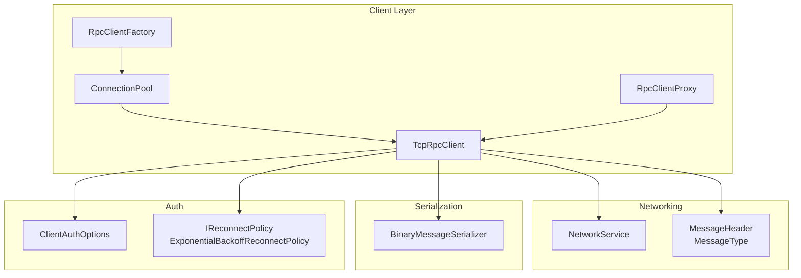
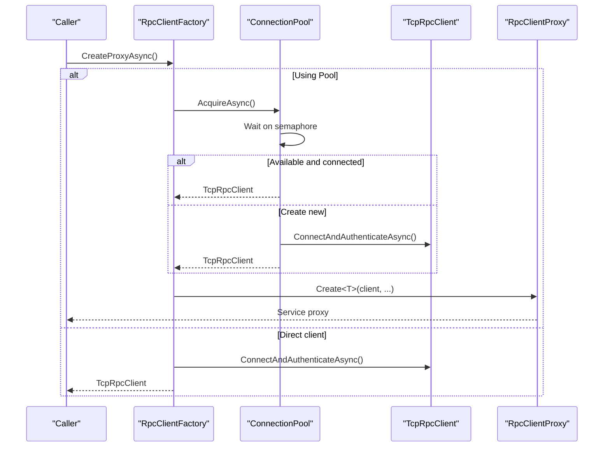
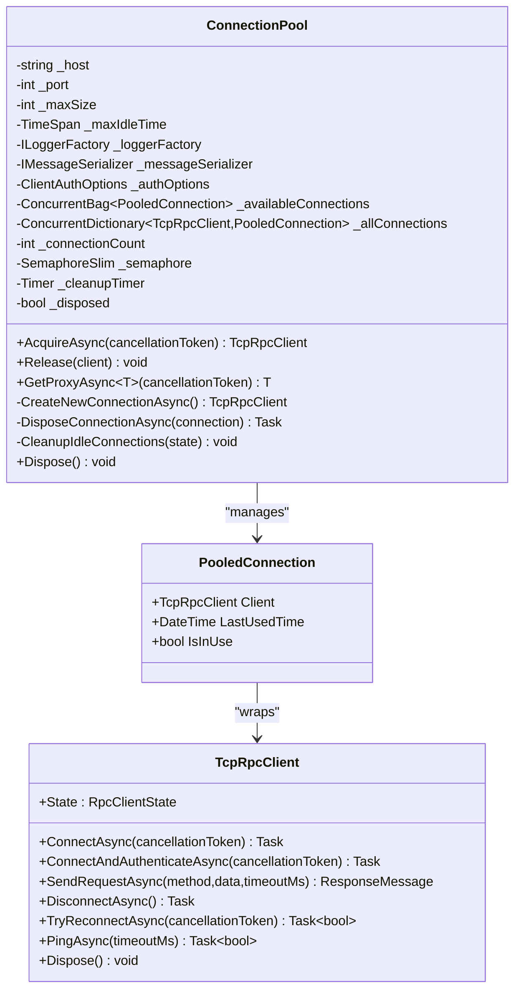
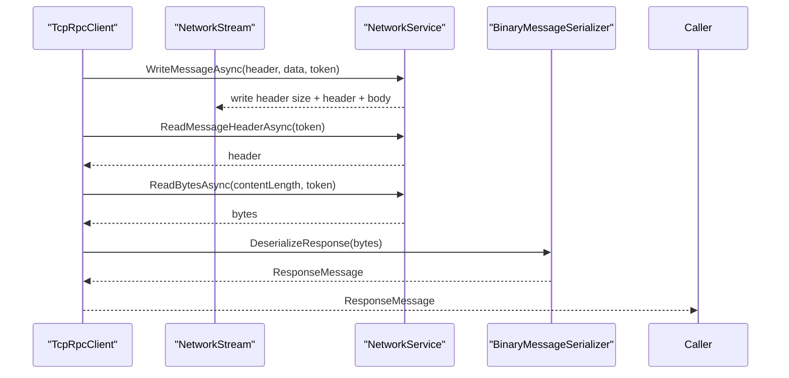
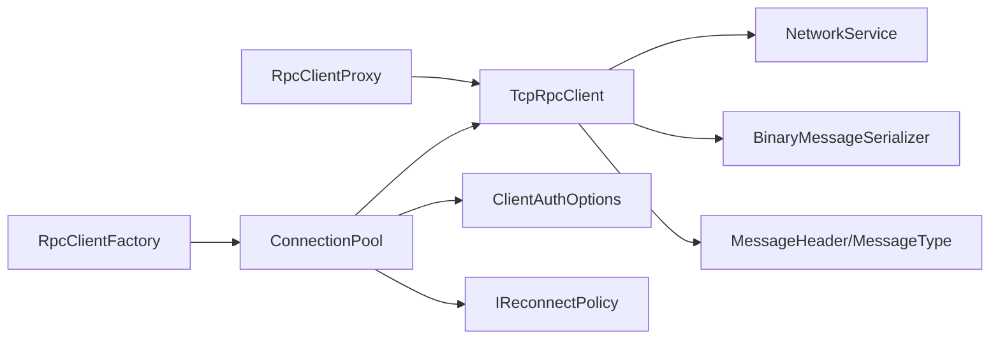

# ConnectionPool

<cite>
**Referenced Files in This Document**
- [ConnectionPool.cs](file://TcpRpc/Client/ConnectionPool.cs)
- [TcpRpcClient.cs](file://TcpRpc/Client/TcpRpcClient.cs)
- [RpcClientFactory.cs](file://TcpRpc/Client/RpcClientFactory.cs)
- [RpcClientState.cs](file://TcpRpc/Client/RpcClientState.cs)
- [ClientAuthOptions.cs](file://TcpRpc/Client/ClientAuthOptions.cs)
- [IReconnectPolicy.cs](file://TcpRpc/Client/IReconnectPolicy.cs)
- [RpcClientProxy.cs](file://TcpRpc/Client/RpcClientProxy.cs)
- [NetworkService.cs](file://TcpRpc/Network/NetworkService.cs)
- [BinaryMessageSerializer.cs](file://TcpRpc/Formatter/BinaryMessageSerializer.cs)
- [MessageHeader.cs](file://TcpRpc/Message/MessageHeader.cs)
- [MessageType.cs](file://TcpRpc/Message/MessageType.cs)
</cite>

## Table of Contents
1. [Introduction](#introduction)
2. [Project Structure](#project-structure)
3. [Core Components](#core-components)
4. [Architecture Overview](#architecture-overview)
5. [Detailed Component Analysis](#detailed-component-analysis)
6. [Dependency Analysis](#dependency-analysis)
7. [Performance Considerations](#performance-considerations)
8. [Troubleshooting Guide](#troubleshooting-guide)
9. [Conclusion](#conclusion)

## Introduction
This document provides comprehensive documentation for the ConnectionPool class and its role in client connection management. It explains the connection pooling strategy, pool sizing algorithms, and connection lifecycle management. It documents pool acquisition and release mechanisms, connection validation and health checking processes, thread safety considerations, concurrent access patterns, and resource contention handling. It also clarifies the relationship between connection pools and individual TcpRpcClient instances, and includes examples of pool configuration, connection reuse patterns, performance optimization techniques, monitoring and statistics collection, troubleshooting, and best practices for pool sizing, connection timeouts, and graceful degradation.

## Project Structure
The connection pooling functionality resides in the client-side TcpRpc library. The primary components involved are:
- ConnectionPool: central pool manager for TcpRpcClient instances
- TcpRpcClient: individual TCP-based RPC client with connection, authentication, and request lifecycle
- RpcClientFactory: factory that creates proxies or clients backed by a pool or direct connections
- Supporting types: ClientAuthOptions, IReconnectPolicy, RpcClientState, RpcClientProxy, NetworkService, BinaryMessageSerializer, MessageHeader, MessageType

**Diagram sources**
- [ConnectionPool.cs:10-189](file://TcpRpc/Client/ConnectionPool.cs#L10-L189)
- [RpcClientFactory.cs:9-110](file://TcpRpc/Client/RpcClientFactory.cs#L9-L110)
- [TcpRpcClient.cs:10-684](file://TcpRpc/Client/TcpRpcClient.cs#L10-L684)
- [NetworkService.cs:7-99](file://TcpRpc/Network/NetworkService.cs#L7-L99)
- [BinaryMessageSerializer.cs:11-444](file://TcpRpc/Formatter/BinaryMessageSerializer.cs#L11-L444)
- [MessageHeader.cs:9-73](file://TcpRpc/Message/MessageHeader.cs#L9-L73)
- [MessageType.cs:3-13](file://TcpRpc/Message/MessageType.cs#L3-L13)
- [ClientAuthOptions.cs:6-38](file://TcpRpc/Client/ClientAuthOptions.cs#L6-L38)
- [IReconnectPolicy.cs:6-100](file://TcpRpc/Client/IReconnectPolicy.cs#L6-L100)

**Section sources**
- [ConnectionPool.cs:10-189](file://TcpRpc/Client/ConnectionPool.cs#L10-L189)
- [RpcClientFactory.cs:9-110](file://TcpRpc/Client/RpcClientFactory.cs#L9-L110)
- [TcpRpcClient.cs:10-684](file://TcpRpc/Client/TcpRpcClient.cs#L10-L684)

## Core Components
- ConnectionPool: Manages a bounded set of TcpRpcClient instances, enforces concurrency limits, and performs idle cleanup. It exposes AcquireAsync, Release, and GetProxyAsync methods.
- TcpRpcClient: Encapsulates a single TCP connection, handles authentication, request/response lifecycle, automatic reconnection, and ping/pong health checks.
- RpcClientFactory: Provides convenience APIs to create proxies or clients, optionally backed by a ConnectionPool.
- Supporting types: ClientAuthOptions controls timeouts and reconnection policy; IReconnectPolicy defines retry behavior; RpcClientState tracks connection state; RpcClientProxy enables dynamic invocation of remote services; NetworkService handles low-level message framing; BinaryMessageSerializer serializes/deserializes messages; MessageHeader/MessageType define the wire protocol.

**Section sources**
- [ConnectionPool.cs:10-189](file://TcpRpc/Client/ConnectionPool.cs#L10-L189)
- [TcpRpcClient.cs:10-684](file://TcpRpc/Client/TcpRpcClient.cs#L10-L684)
- [RpcClientFactory.cs:9-110](file://TcpRpc/Client/RpcClientFactory.cs#L9-L110)
- [ClientAuthOptions.cs:6-38](file://TcpRpc/Client/ClientAuthOptions.cs#L6-L38)
- [IReconnectPolicy.cs:6-100](file://TcpRpc/Client/IReconnectPolicy.cs#L6-L100)
- [RpcClientState.cs:3-11](file://TcpRpc/Client/RpcClientState.cs#L3-L11)
- [RpcClientProxy.cs:11-160](file://TcpRpc/Client/RpcClientProxy.cs#L11-L160)
- [NetworkService.cs:7-99](file://TcpRpc/Network/NetworkService.cs#L7-L99)
- [BinaryMessageSerializer.cs:11-444](file://TcpRpc/Formatter/BinaryMessageSerializer.cs#L11-L444)
- [MessageHeader.cs:9-73](file://TcpRpc/Message/MessageHeader.cs#L9-L73)
- [MessageType.cs:3-13](file://TcpRpc/Message/MessageType.cs#L3-L13)

## Architecture Overview
ConnectionPool orchestrates a fixed-size pool of TcpRpcClient instances. It uses a semaphore to enforce concurrency limits and a concurrent bag for available connections. On acquisition, it attempts to reuse an existing connected client; otherwise, it creates a new one up to the configured maximum. On release, it marks the client as available and signals the semaphore. A periodic timer cleans up idle connections exceeding the configured maximum idle time.

**Diagram sources**
- [RpcClientFactory.cs:36-46](file://TcpRpc/Client/RpcClientFactory.cs#L36-L46)
- [ConnectionPool.cs:43-89](file://TcpRpc/Client/ConnectionPool.cs#L43-L89)
- [TcpRpcClient.cs:135-139](file://TcpRpc/Client/TcpRpcClient.cs#L135-L139)
- [RpcClientProxy.cs:22-36](file://TcpRpc/Client/RpcClientProxy.cs#L22-L36)

## Detailed Component Analysis

### ConnectionPool
- Purpose: Manage a bounded pool of TcpRpcClient instances, coordinate acquisition/release, and perform idle cleanup.
- Pool sizing and concurrency:
  - Maximum pool size is configurable; the constructor accepts a maxSize parameter.
  - A SemaphoreSlim limits concurrent acquisitions to maxSize.
  - Connection count is tracked with an atomic counter to prevent oversubscription.
- Acquisition strategy:
  - Attempts to take an available connection from a concurrent bag.
  - Validates that the connection is still connected; disposes stale connections.
  - Creates a new connection if under the limit; otherwise throws an exception indicating exhaustion.
- Release strategy:
  - Marks the client as not in use, updates last-used time, and returns it to the available bag.
  - Releases the semaphore to allow another waiter.
- Health and cleanup:
  - A timer periodically scans all pooled connections.
  - Removes idle connections (not in use and older than maxIdleTime).
  - Disposes removed connections and releases the semaphore.
- Thread safety:
  - Uses ConcurrentBag and ConcurrentDictionary for availability tracking.
  - Uses SemaphoreSlim for mutual exclusion during acquisition.
  - Uses Interlocked operations for connection count.
  - Guards against disposal with an internal disposed flag.
- Relationship to TcpRpcClient:
  - Each pooled connection wraps a TcpRpcClient instance.
  - The pool does not directly validate connectivity; it relies on TcpRpcClient’s state and disposal logic to handle broken connections.

**Diagram sources**
- [ConnectionPool.cs:10-189](file://TcpRpc/Client/ConnectionPool.cs#L10-L189)
- [TcpRpcClient.cs:10-684](file://TcpRpc/Client/TcpRpcClient.cs#L10-L684)

**Section sources**
- [ConnectionPool.cs:10-189](file://TcpRpc/Client/ConnectionPool.cs#L10-L189)

### TcpRpcClient
- Connection lifecycle:
  - ConnectAsync establishes a TCP connection and starts a receive loop.
  - ConnectAndAuthenticateAsync connects and authenticates.
  - DisconnectAsync cancels the receive loop and closes streams.
- Authentication:
  - AuthenticateAsync sends an AuthRequest and awaits AuthResponse.
  - Supports session restoration and token expiration tracking.
- Request lifecycle:
  - SendRequestAsync constructs a message header with token and serializes payload.
  - Tracks pending requests and completes them upon receiving Response/Error.
  - Implements retry logic on connection errors when auto-reconnect is enabled.
- Health checks:
  - PingAsync sends a Ping and expects a Pong within a timeout.
- Reconnection:
  - TryReconnectAsync uses a pluggable IReconnectPolicy to compute delays.
  - Resets counters and policies on successful reconnect.
- Thread safety:
  - Uses locks for state transitions and a send lock for serialized writes.
  - Uses cancellation tokens to coordinate shutdown and timeouts.

**Diagram sources**
- [TcpRpcClient.cs:324-407](file://TcpRpc/Client/TcpRpcClient.cs#L324-L407)
- [NetworkService.cs:10-28](file://TcpRpc/Network/NetworkService.cs#L10-L28)
- [NetworkService.cs:30-52](file://TcpRpc/Network/NetworkService.cs#L30-L52)
- [NetworkService.cs:55-98](file://TcpRpc/Network/NetworkService.cs#L55-L98)
- [BinaryMessageSerializer.cs:68-112](file://TcpRpc/Formatter/BinaryMessageSerializer.cs#L68-L112)

**Section sources**
- [TcpRpcClient.cs:75-130](file://TcpRpc/Client/TcpRpcClient.cs#L75-L130)
- [TcpRpcClient.cs:135-227](file://TcpRpc/Client/TcpRpcClient.cs#L135-L227)
- [TcpRpcClient.cs:324-407](file://TcpRpc/Client/TcpRpcClient.cs#L324-L407)
- [TcpRpcClient.cs:599-658](file://TcpRpc/Client/TcpRpcClient.cs#L599-L658)
- [TcpRpcClient.cs:232-269](file://TcpRpc/Client/TcpRpcClient.cs#L232-L269)

### RpcClientFactory
- Provides convenience methods to create proxies or clients.
- When pooling is enabled, delegates to ConnectionPool.AcquireAsync and ConnectionPool.GetProxyAsync.
- Offers methods to create clients without authentication and to release clients back to the pool.

**Section sources**
- [RpcClientFactory.cs:18-84](file://TcpRpc/Client/RpcClientFactory.cs#L18-L84)

### ClientAuthOptions and Reconnect Policies
- ClientAuthOptions controls AutoReconnect, ReconnectPolicy, Credentials, ClientId, ConnectTimeout, and AuthTimeout.
- IReconnectPolicy defines MaxReconnectAttempts, GetDelay, CanReconnect, and Reset.
- ExponentialBackoffReconnectPolicy implements exponential backoff with configurable bounds.

**Section sources**
- [ClientAuthOptions.cs:6-38](file://TcpRpc/Client/ClientAuthOptions.cs#L6-L38)
- [IReconnectPolicy.cs:6-100](file://TcpRpc/Client/IReconnectPolicy.cs#L6-L100)

### RpcClientProxy
- Enables dynamic invocation of remote services through a typed proxy.
- Serializes requests using BinaryMessageSerializer and delegates sending to TcpRpcClient.
- Handles exceptions and converts responses to appropriate return types.

**Section sources**
- [RpcClientProxy.cs:22-160](file://TcpRpc/Client/RpcClientProxy.cs#L22-L160)
- [BinaryMessageSerializer.cs:30-62](file://TcpRpc/Formatter/BinaryMessageSerializer.cs#L30-L62)
- [BinaryMessageSerializer.cs:68-112](file://TcpRpc/Formatter/BinaryMessageSerializer.cs#L68-L112)

### Protocol and Serialization
- MessageHeader carries type, message ID, content length, flags, and optional token.
- MessageType enumerates supported message types including Request, Response, Ping, Pong, AuthRequest, AuthResponse, AuthRenew, and Error.
- NetworkService handles framing: header size prefix, header serialization, and content reads/writes.
- BinaryMessageSerializer supports compact binary encoding for primitives and JSON fallback for complex objects.

**Section sources**
- [MessageHeader.cs:9-73](file://TcpRpc/Message/MessageHeader.cs#L9-L73)
- [MessageType.cs:3-13](file://TcpRpc/Message/MessageType.cs#L3-L13)
- [NetworkService.cs:10-28](file://TcpRpc/Network/NetworkService.cs#L10-L28)
- [NetworkService.cs:30-52](file://TcpRpc/Network/NetworkService.cs#L30-L52)
- [NetworkService.cs:55-98](file://TcpRpc/Network/NetworkService.cs#L55-L98)
- [BinaryMessageSerializer.cs:30-62](file://TcpRpc/Formatter/BinaryMessageSerializer.cs#L30-L62)
- [BinaryMessageSerializer.cs:68-112](file://TcpRpc/Formatter/BinaryMessageSerializer.cs#L68-L112)
- [BinaryMessageSerializer.cs:325-440](file://TcpRpc/Formatter/BinaryMessageSerializer.cs#L325-L440)

## Dependency Analysis
- ConnectionPool depends on:
  - TcpRpcClient for connection creation and authentication
  - Concurrent collections for thread-safe availability tracking
  - SemaphoreSlim for concurrency control
  - Timer for periodic cleanup
  - ClientAuthOptions for timeouts and reconnection policy
- TcpRpcClient depends on:
  - NetworkService for message framing
  - BinaryMessageSerializer for serialization
  - MessageHeader/MessageType for protocol definition
  - ClientAuthOptions and IReconnectPolicy for behavior
- RpcClientFactory depends on ConnectionPool when pooling is enabled.

**Diagram sources**
- [ConnectionPool.cs:26-37](file://TcpRpc/Client/ConnectionPool.cs#L26-L37)
- [TcpRpcClient.cs:62-69](file://TcpRpc/Client/TcpRpcClient.cs#L62-L69)
- [RpcClientFactory.cs:18-31](file://TcpRpc/Client/RpcClientFactory.cs#L18-L31)
- [RpcClientProxy.cs:22-36](file://TcpRpc/Client/RpcClientProxy.cs#L22-L36)

**Section sources**
- [ConnectionPool.cs:26-37](file://TcpRpc/Client/ConnectionPool.cs#L26-L37)
- [TcpRpcClient.cs:62-69](file://TcpRpc/Client/TcpRpcClient.cs#L62-L69)
- [RpcClientFactory.cs:18-31](file://TcpRpc/Client/RpcClientFactory.cs#L18-L31)

## Performance Considerations
- Pool sizing:
  - Choose maxSize based on expected concurrency and server capacity. Larger pools increase memory and connection overhead but reduce wait times.
  - Monitor semaphore waits and connection creation rates to tune the pool size.
- Idle cleanup:
  - Adjust maxIdleTime to balance resource retention versus cleanup overhead. Shorter idle times free resources faster but may increase churn.
- Concurrency control:
  - SemaphoreSlim ensures bounded concurrency. Avoid blocking operations inside critical sections to prevent deadlocks.
- Serialization overhead:
  - BinaryMessageSerializer minimizes overhead for primitives; complex objects incur JSON serialization costs.
- Network framing:
  - NetworkService efficiently writes header size and content; ensure buffers are sized appropriately to minimize allocations.
- Reconnection strategy:
  - Use ExponentialBackoffReconnectPolicy to avoid thundering herds and reduce load on failing servers.
- Timeouts:
  - Configure ConnectTimeout and AuthTimeout to prevent indefinite blocking during connection establishment and authentication.

[No sources needed since this section provides general guidance]

## Troubleshooting Guide
- Connection pool exhausted:
  - Symptom: An exception indicates the pool is exhausted.
  - Actions: Increase maxSize, reduce concurrent usage, or shorten maxIdleTime to free connections.
- Stale connections:
  - Symptom: Acquired connections are not connected.
  - Actions: Ensure TcpRpcClient state is checked; the pool disposes stale connections automatically.
- Authentication failures:
  - Symptom: AuthenticateAsync fails or throws RpcException.
  - Actions: Verify credentials and ClientId; check AuthTimeout; review server logs.
- Request timeouts:
  - Symptom: SendRequestAsync throws TimeoutException.
  - Actions: Increase timeoutMs, check server responsiveness, and monitor network latency.
- Reconnection issues:
  - Symptom: TryReconnectAsync fails repeatedly.
  - Actions: Review IReconnectPolicy settings, ensure AutoReconnect is enabled, and check server availability.
- Health checks:
  - Symptom: PingAsync returns false.
  - Actions: Investigate network stability, firewall rules, and server load.
- Resource leaks:
  - Symptom: Connections not released back to the pool.
  - Actions: Ensure Release is called after use; dispose RpcClientFactory to clean up.

**Section sources**
- [ConnectionPool.cs:81-82](file://TcpRpc/Client/ConnectionPool.cs#L81-L82)
- [TcpRpcClient.cs:196-226](file://TcpRpc/Client/TcpRpcClient.cs#L196-L226)
- [TcpRpcClient.cs:384-406](file://TcpRpc/Client/TcpRpcClient.cs#L384-L406)
- [TcpRpcClient.cs:244-248](file://TcpRpc/Client/TcpRpcClient.cs#L244-L248)
- [TcpRpcClient.cs:644-657](file://TcpRpc/Client/TcpRpcClient.cs#L644-L657)

## Conclusion
ConnectionPool provides a robust, thread-safe mechanism for managing a bounded set of TcpRpcClient instances. It enforces concurrency limits, supports connection reuse, and performs idle cleanup to optimize resource utilization. TcpRpcClient encapsulates connection, authentication, request/response handling, and health checks, integrating with ConnectionPool through acquisition and release semantics. RpcClientFactory simplifies proxy and client creation, optionally leveraging the pool. Proper configuration of pool size, timeouts, and reconnection policies, combined with health checks and monitoring, ensures reliable and efficient client-server communication.