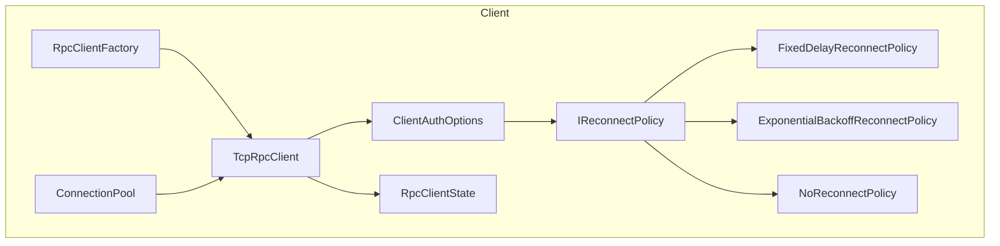
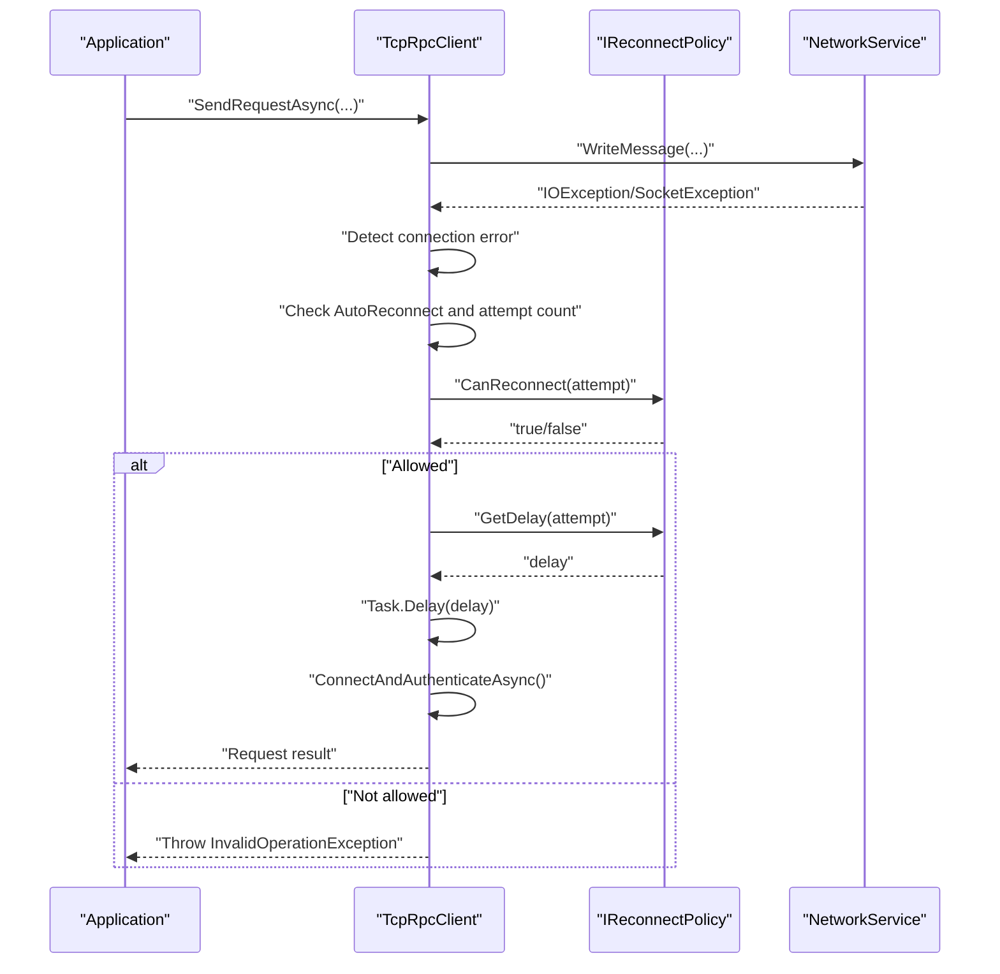
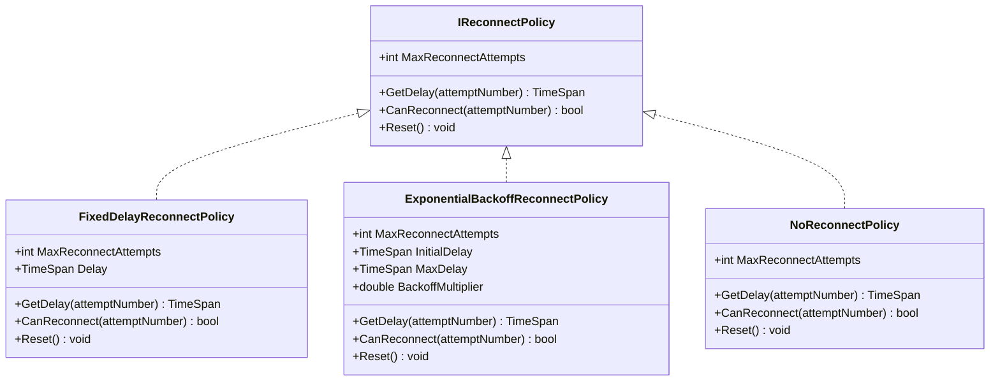
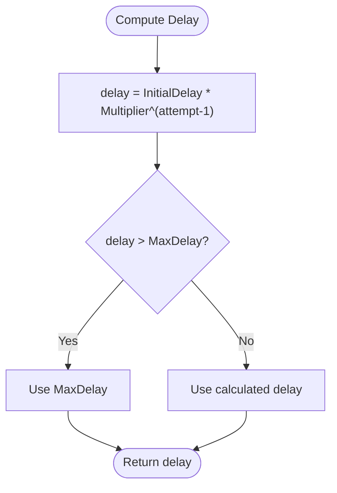
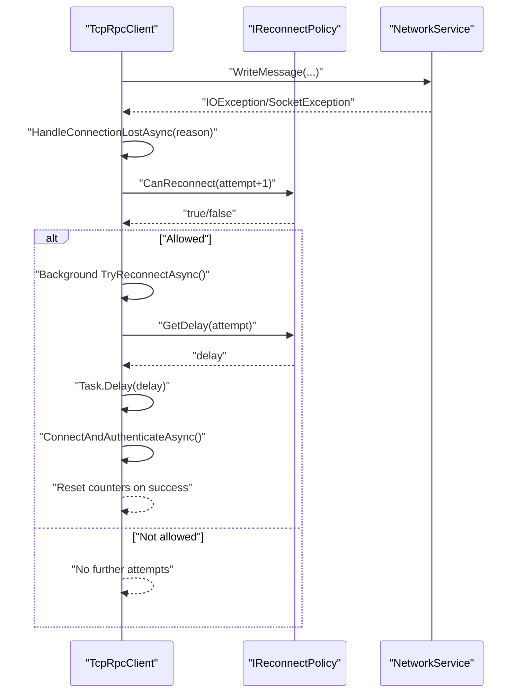
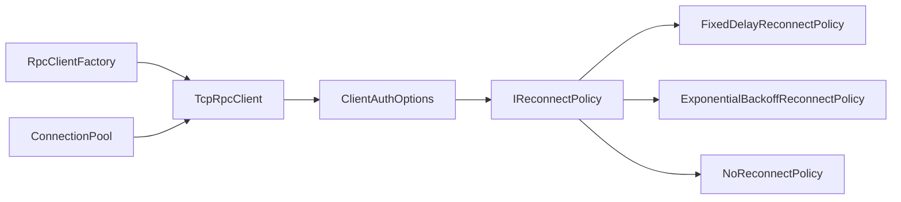

# Reconnection Policy

<cite>
**Referenced Files in This Document**
- [IReconnectPolicy.cs](file://TcpRpc/Client/IReconnectPolicy.cs)
- [ClientAuthOptions.cs](file://TcpRpc/Client/ClientAuthOptions.cs)
- [TcpRpcClient.cs](file://TcpRpc/Client/TcpRpcClient.cs)
- [RpcClientState.cs](file://TcpRpc/Client/RpcClientState.cs)
- [ConnectionPool.cs](file://TcpRpc/Client/ConnectionPool.cs)
- [RpcClientFactory.cs](file://TcpRpc/Client/RpcClientFactory.cs)
</cite>

## Table of Contents
1. [Introduction](#introduction)
2. [Project Structure](#project-structure)
3. [Core Components](#core-components)
4. [Architecture Overview](#architecture-overview)
5. [Detailed Component Analysis](#detailed-component-analysis)
6. [Dependency Analysis](#dependency-analysis)
7. [Performance Considerations](#performance-considerations)
8. [Troubleshooting Guide](#troubleshooting-guide)
9. [Conclusion](#conclusion)
10. [Appendices](#appendices)

## Introduction
This document explains the reconnection policy system used by the TCP-based RPC client. It covers the pluggable reconnection strategy pattern, built-in policy implementations (fixed delay, exponential backoff, and no-reconnect), and how these policies integrate with client state management and automatic reconnection logic. It also provides guidance on configuring policies, tracking reconnection attempts, setting maximum retry limits, and optimizing for different network conditions.

## Project Structure
The reconnection policy system resides in the client-side library and is composed of:
- An interface defining the contract for reconnection strategies
- Built-in implementations for common strategies
- Client configuration that selects and applies a policy
- The client runtime that triggers reconnection attempts based on the selected policy

**Diagram sources**
- [TcpRpcClient.cs:10-684](file://TcpRpc/Client/TcpRpcClient.cs#L10-L684)
- [ClientAuthOptions.cs:6-37](file://TcpRpc/Client/ClientAuthOptions.cs#L6-L37)
- [IReconnectPolicy.cs:6-99](file://TcpRpc/Client/IReconnectPolicy.cs#L6-L99)
- [RpcClientState.cs:3-11](file://TcpRpc/Client/RpcClientState.cs#L3-L11)
- [ConnectionPool.cs:10-189](file://TcpRpc/Client/ConnectionPool.cs#L10-L189)
- [RpcClientFactory.cs:9-110](file://TcpRpc/Client/RpcClientFactory.cs#L9-L110)

**Section sources**
- [IReconnectPolicy.cs:1-99](file://TcpRpc/Client/IReconnectPolicy.cs#L1-L99)
- [ClientAuthOptions.cs:1-38](file://TcpRpc/Client/ClientAuthOptions.cs#L1-L38)
- [TcpRpcClient.cs:1-684](file://TcpRpc/Client/TcpRpcClient.cs#L1-L684)
- [RpcClientState.cs:1-11](file://TcpRpc/Client/RpcClientState.cs#L1-L11)
- [ConnectionPool.cs:1-189](file://TcpRpc/Client/ConnectionPool.cs#L1-L189)
- [RpcClientFactory.cs:1-110](file://TcpRpc/Client/RpcClientFactory.cs#L1-L110)

## Core Components
- IReconnectPolicy: Defines the contract for reconnection strategies, including maximum attempts, delay calculation, connectivity checks, and reset semantics.
- FixedDelayReconnectPolicy: Implements a constant delay between retries up to a configurable maximum.
- ExponentialBackoffReconnectPolicy: Implements exponential growth of delays with a cap and configurable multiplier.
- NoReconnectPolicy: Disables reconnection attempts.
- ClientAuthOptions: Holds the active reconnection policy and global auto-reconnect flag.
- TcpRpcClient: Orchestrates automatic reconnection using the configured policy and tracks reconnection attempts.
- RpcClientState: Enumerates client lifecycle states used to gate operations and detect disconnections.
- ConnectionPool and RpcClientFactory: Provide higher-level client creation and pooling; they pass through the configured policy to clients.

Key responsibilities:
- Policy contract: MaxReconnectAttempts, GetDelay, CanReconnect, Reset
- Client integration: Automatic reconnection trigger, attempt counting, and state transitions
- Configuration: Selecting a policy and enabling/disabling auto-reconnect

**Section sources**
- [IReconnectPolicy.cs:6-31](file://TcpRpc/Client/IReconnectPolicy.cs#L6-L31)
- [FixedDelayReconnectPolicy.cs:36-52](file://TcpRpc/Client/IReconnectPolicy.cs#L36-L52)
- [ExponentialBackoffReconnectPolicy.cs:57-85](file://TcpRpc/Client/IReconnectPolicy.cs#L57-L85)
- [NoReconnectPolicy.cs:90-99](file://TcpRpc/Client/IReconnectPolicy.cs#L90-L99)
- [ClientAuthOptions.cs:6-16](file://TcpRpc/Client/ClientAuthOptions.cs#L6-L16)
- [TcpRpcClient.cs:232-269](file://TcpRpc/Client/TcpRpcClient.cs#L232-L269)
- [RpcClientState.cs:3-11](file://TcpRpc/Client/RpcClientState.cs#L3-L11)
- [ConnectionPool.cs:10-38](file://TcpRpc/Client/ConnectionPool.cs#L10-L38)
- [RpcClientFactory.cs:9-31](file://TcpRpc/Client/RpcClientFactory.cs#L9-L31)

## Architecture Overview
The client’s automatic reconnection is driven by the configured policy. When a connection is lost or a request fails due to a connection error, the client evaluates whether to attempt reconnection based on:
- AutoReconnect flag
- Current reconnection attempt count
- Policy’s CanReconnect and GetDelay

If allowed, the client waits for the computed delay and then reconnects (connect + authenticate). On success, counters are reset; on failure, the process repeats until the policy allows no more retries.

**Diagram sources**
- [TcpRpcClient.cs:334-407](file://TcpRpc/Client/TcpRpcClient.cs#L334-L407)
- [TcpRpcClient.cs:232-269](file://TcpRpc/Client/TcpRpcClient.cs#L232-L269)
- [IReconnectPolicy.cs:6-31](file://TcpRpc/Client/IReconnectPolicy.cs#L6-L31)

**Section sources**
- [TcpRpcClient.cs:334-407](file://TcpRpc/Client/TcpRpcClient.cs#L334-L407)
- [TcpRpcClient.cs:232-269](file://TcpRpc/Client/TcpRpcClient.cs#L232-L269)
- [IReconnectPolicy.cs:6-31](file://TcpRpc/Client/IReconnectPolicy.cs#L6-L31)

## Detailed Component Analysis

### IReconnectPolicy Contract
The interface defines:
- MaxReconnectAttempts: Upper bound on retries
- GetDelay(attemptNumber): Computes delay for the given attempt (1-based)
- CanReconnect(attemptNumber): Predicate to decide if another attempt is allowed
- Reset(): Hook to reset internal state if needed

**Diagram sources**
- [IReconnectPolicy.cs:6-99](file://TcpRpc/Client/IReconnectPolicy.cs#L6-L99)

**Section sources**
- [IReconnectPolicy.cs:6-31](file://TcpRpc/Client/IReconnectPolicy.cs#L6-L31)
- [FixedDelayReconnectPolicy.cs:36-52](file://TcpRpc/Client/IReconnectPolicy.cs#L36-L52)
- [ExponentialBackoffReconnectPolicy.cs:57-85](file://TcpRpc/Client/IReconnectPolicy.cs#L57-L85)
- [NoReconnectPolicy.cs:90-99](file://TcpRpc/Client/IReconnectPolicy.cs#L90-L99)

### FixedDelayReconnectPolicy
Behavior:
- Constant delay between attempts
- Retries up to MaxReconnectAttempts
- No internal state requiring reset

Implementation highlights:
- Delay property controls the fixed interval
- GetDelay returns the fixed delay regardless of attempt number
- CanReconnect compares attempt number to MaxReconnectAttempts

**Section sources**
- [FixedDelayReconnectPolicy.cs:36-52](file://TcpRpc/Client/IReconnectPolicy.cs#L36-L52)

### ExponentialBackoffReconnectPolicy
Behavior:
- Delays grow exponentially with a base multiplier
- Caps delays at MaxDelay
- Retries up to MaxReconnectAttempts
- No internal state requiring reset

Implementation highlights:
- InitialDelay sets the baseline
- BackoffMultiplier controls growth rate
- MaxDelay prevents unbounded waits
- GetDelay computes delay with exponential scaling and caps it

**Diagram sources**
- [ExponentialBackoffReconnectPolicy.cs:76-80](file://TcpRpc/Client/IReconnectPolicy.cs#L76-L80)

**Section sources**
- [ExponentialBackoffReconnectPolicy.cs:57-85](file://TcpRpc/Client/IReconnectPolicy.cs#L57-L85)

### NoReconnectPolicy
Behavior:
- Disables reconnection attempts
- MaxReconnectAttempts is zero
- GetDelay returns zero and CanReconnect is always false

**Section sources**
- [NoReconnectPolicy.cs:90-99](file://TcpRpc/Client/IReconnectPolicy.cs#L90-L99)

### ClientAuthOptions and Policy Selection
- AutoReconnect: Global toggle for automatic reconnection
- ReconnectPolicy: Active policy instance injected into TcpRpcClient
- Defaults to ExponentialBackoffReconnectPolicy

Integration points:
- TcpRpcClient reads AutoReconnect and delegates to the policy for CanReconnect and GetDelay
- RpcClientFactory constructs TcpRpcClient with the provided ClientAuthOptions

**Section sources**
- [ClientAuthOptions.cs:6-16](file://TcpRpc/Client/ClientAuthOptions.cs#L6-L16)
- [RpcClientFactory.cs:18-31](file://TcpRpc/Client/RpcClientFactory.cs#L18-L31)

### TcpRpcClient Integration and Automatic Reconnection
Automatic reconnection logic:
- Attempt count is tracked per client instance
- TryReconnectAsync increments the attempt counter and consults the policy
- If allowed, the client waits for the computed delay and reconnects
- On success, counters are reset; on failure, the process repeats

Request-level fallback:
- When a request fails due to connection errors, the client attempts reconnection before failing the request
- This ensures resilience against transient network issues

State management:
- RpcClientState governs allowed operations and influences reconnection triggers
- Disconnection clears pending requests and initiates background reconnection if allowed

**Diagram sources**
- [TcpRpcClient.cs:542-581](file://TcpRpc/Client/TcpRpcClient.cs#L542-L581)
- [TcpRpcClient.cs:232-269](file://TcpRpc/Client/TcpRpcClient.cs#L232-L269)
- [IReconnectPolicy.cs:6-31](file://TcpRpc/Client/IReconnectPolicy.cs#L6-L31)

**Section sources**
- [TcpRpcClient.cs:232-269](file://TcpRpc/Client/TcpRpcClient.cs#L232-L269)
- [TcpRpcClient.cs:334-407](file://TcpRpc/Client/TcpRpcClient.cs#L334-L407)
- [TcpRpcClient.cs:542-581](file://TcpRpc/Client/TcpRpcClient.cs#L542-L581)
- [RpcClientState.cs:3-11](file://TcpRpc/Client/RpcClientState.cs#L3-L11)

### ConnectionPool and Factory Integration
- RpcClientFactory passes ClientAuthOptions (including ReconnectPolicy) to TcpRpcClient instances
- ConnectionPool creates and manages TcpRpcClient instances, inheriting the same policy configuration
- Policies apply uniformly across pooled clients

**Section sources**
- [RpcClientFactory.cs:18-31](file://TcpRpc/Client/RpcClientFactory.cs#L18-L31)
- [ConnectionPool.cs:116-121](file://TcpRpc/Client/ConnectionPool.cs#L116-L121)

## Dependency Analysis
- TcpRpcClient depends on ClientAuthOptions for AutoReconnect and ReconnectPolicy
- ClientAuthOptions holds an IReconnectPolicy instance
- Built-in policies implement IReconnectPolicy
- RpcClientFactory and ConnectionPool propagate the policy to clients

**Diagram sources**
- [ClientAuthOptions.cs:6-16](file://TcpRpc/Client/ClientAuthOptions.cs#L6-L16)
- [IReconnectPolicy.cs:6-99](file://TcpRpc/Client/IReconnectPolicy.cs#L6-L99)
- [RpcClientFactory.cs:18-31](file://TcpRpc/Client/RpcClientFactory.cs#L18-L31)
- [ConnectionPool.cs:116-121](file://TcpRpc/Client/ConnectionPool.cs#L116-L121)
- [TcpRpcClient.cs:62-69](file://TcpRpc/Client/TcpRpcClient.cs#L62-L69)

**Section sources**
- [ClientAuthOptions.cs:6-16](file://TcpRpc/Client/ClientAuthOptions.cs#L6-L16)
- [IReconnectPolicy.cs:6-99](file://TcpRpc/Client/IReconnectPolicy.cs#L6-L99)
- [RpcClientFactory.cs:18-31](file://TcpRpc/Client/RpcClientFactory.cs#L18-L31)
- [ConnectionPool.cs:116-121](file://TcpRpc/Client/ConnectionPool.cs#L116-L121)
- [TcpRpcClient.cs:62-69](file://TcpRpc/Client/TcpRpcClient.cs#L62-L69)

## Performance Considerations
- Exponential backoff reduces load on servers during repeated failures and avoids thundering herd effects
- Caps on delay prevent unbounded wait times; tune MaxDelay according to expected recovery time windows
- Fixed delay is simpler and suitable for environments where predictable timing is preferred
- NoReconnectPolicy disables retries and is appropriate for applications that require explicit control or immediate failure reporting
- Consider jitter-based strategies to mitigate synchronized retries across clients (see Best Practices)

[No sources needed since this section provides general guidance]

## Troubleshooting Guide
Common issues and remedies:
- Reconnection not triggering
  - Verify AutoReconnect is enabled in ClientAuthOptions
  - Confirm the policy allows more attempts (MaxReconnectAttempts > current attempt count)
- Excessive delays
  - Adjust InitialDelay and MaxDelay in ExponentialBackoffReconnectPolicy
  - Consider switching to FixedDelayReconnectPolicy for predictable timing
- Immediate failure after disconnect
  - Ensure the policy’s CanReconnect returns true for the current attempt
  - Check that the client is not disposed or already in a terminal state
- Requests timing out despite reconnection
  - Review request timeouts and authentication timeouts in ClientAuthOptions
  - Confirm that reconnection completes before request timeout elapses

Operational logging:
- TcpRpcClient logs reconnection attempts, delays, and outcomes
- Use logs to correlate reconnection events with policy configuration and network conditions

**Section sources**
- [ClientAuthOptions.cs:10-36](file://TcpRpc/Client/ClientAuthOptions.cs#L10-L36)
- [TcpRpcClient.cs:250-252](file://TcpRpc/Client/TcpRpcClient.cs#L250-L252)
- [TcpRpcClient.cs:264-268](file://TcpRpc/Client/TcpRpcClient.cs#L264-L268)

## Conclusion
The reconnection policy system provides a flexible, pluggable mechanism to handle transient network failures. By selecting an appropriate policy and tuning its parameters, applications can balance responsiveness, fairness, and reliability. The built-in strategies cover common scenarios, while the interface enables custom implementations for specialized needs.

[No sources needed since this section summarizes without analyzing specific files]

## Appendices

### Policy Configuration Examples
- Using ExponentialBackoffReconnectPolicy with custom parameters
  - Configure MaxReconnectAttempts, InitialDelay, MaxDelay, and BackoffMultiplier
  - Assign to ClientAuthOptions.ReconnectPolicy
- Using FixedDelayReconnectPolicy
  - Set MaxReconnectAttempts and Delay
  - Assign to ClientAuthOptions.ReconnectPolicy
- Using NoReconnectPolicy
  - Assign to ClientAuthOptions.ReconnectPolicy to disable retries

**Section sources**
- [ClientAuthOptions.cs:6-16](file://TcpRpc/Client/ClientAuthOptions.cs#L6-L16)
- [IReconnectPolicy.cs:36-99](file://TcpRpc/Client/IReconnectPolicy.cs#L36-L99)

### Custom Reconnection Policy Implementation
To implement a custom strategy:
- Implement IReconnectPolicy
- Define MaxReconnectAttempts, GetDelay, CanReconnect, and Reset
- Inject the policy into ClientAuthOptions.ReconnectPolicy
- Use RpcClientFactory or ConnectionPool to create clients with the custom policy

Best practices:
- Ensure GetDelay is monotonic and bounded
- Respect MaxReconnectAttempts to avoid infinite loops
- Consider jitter to randomize delays around a base value
- Log reconnection attempts and outcomes for observability

**Section sources**
- [IReconnectPolicy.cs:6-31](file://TcpRpc/Client/IReconnectPolicy.cs#L6-L31)
- [ClientAuthOptions.cs:6-16](file://TcpRpc/Client/ClientAuthOptions.cs#L6-L16)
- [RpcClientFactory.cs:18-31](file://TcpRpc/Client/RpcClientFactory.cs#L18-L31)
- [ConnectionPool.cs:116-121](file://TcpRpc/Client/ConnectionPool.cs#L116-L121)

### Reconnection Attempt Tracking and Limits
- TcpRpcClient maintains an internal reconnection attempt counter
- The counter resets on successful reconnection
- The policy’s MaxReconnectAttempts enforces upper bounds
- Background reconnection is triggered when AutoReconnect is enabled and the policy allows more attempts

**Section sources**
- [TcpRpcClient.cs:38-38](file://TcpRpc/Client/TcpRpcClient.cs#L38-L38)
- [TcpRpcClient.cs:242-248](file://TcpRpc/Client/TcpRpcClient.cs#L242-L248)
- [TcpRpcClient.cs:261-261](file://TcpRpc/Client/TcpRpcClient.cs#L261-L261)
- [TcpRpcClient.cs:565-578](file://TcpRpc/Client/TcpRpcClient.cs#L565-L578)

### Best Practices for Policy Selection
- High-latency networks: Prefer exponential backoff with conservative multiplier and reasonable MaxDelay
- Low-latency networks: Fixed delay may reduce perceived latency spikes
- Sensitive real-time systems: Consider jitter around base delays to avoid synchronized retries
- Resource-constrained environments: Limit MaxReconnectAttempts and MaxDelay to preserve resources
- Graceful degradation: Use NoReconnectPolicy when immediate failure reporting is desired

[No sources needed since this section provides general guidance]