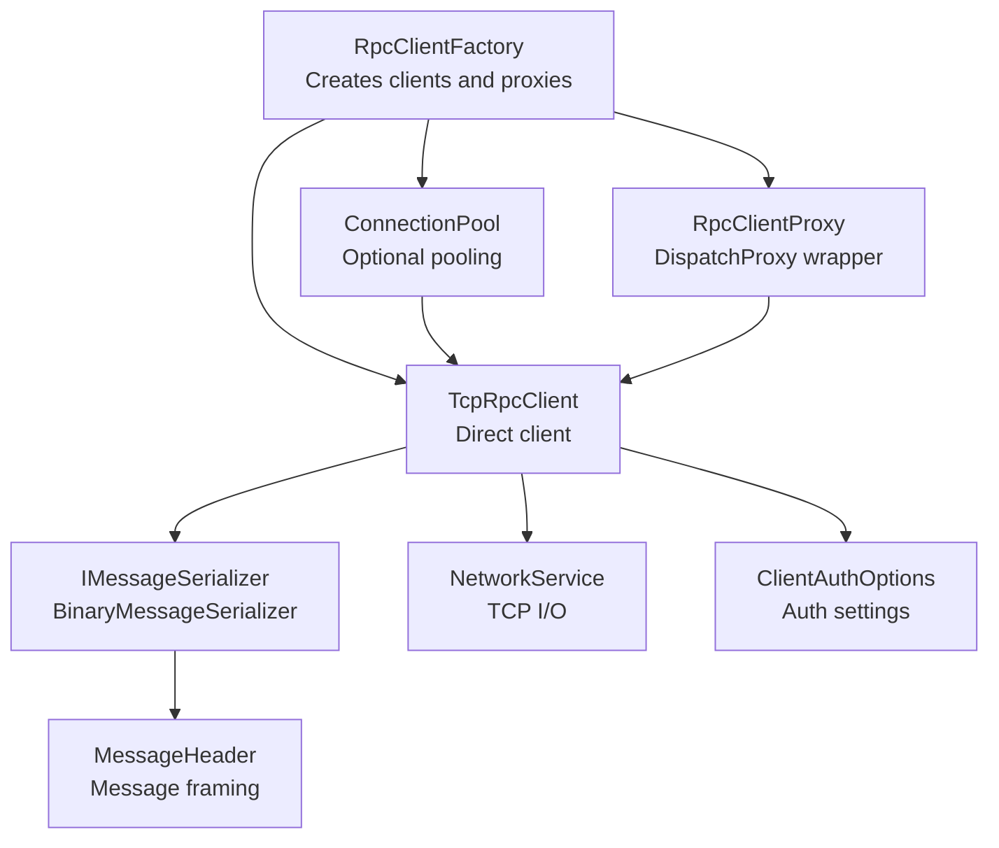
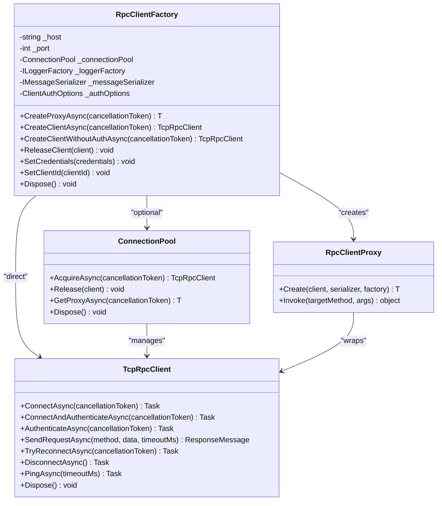
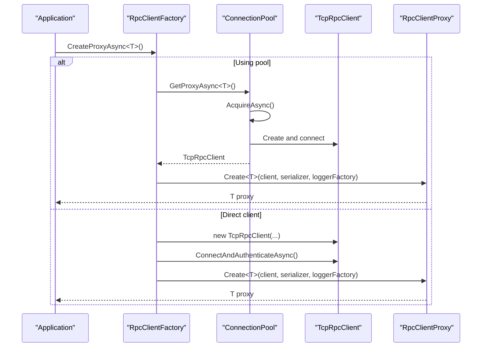
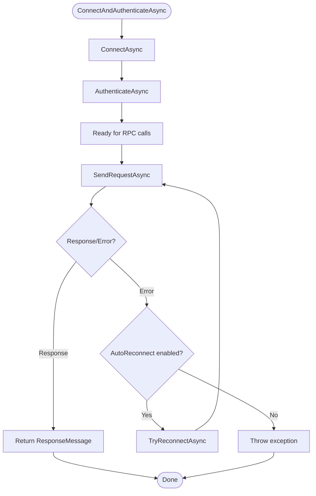
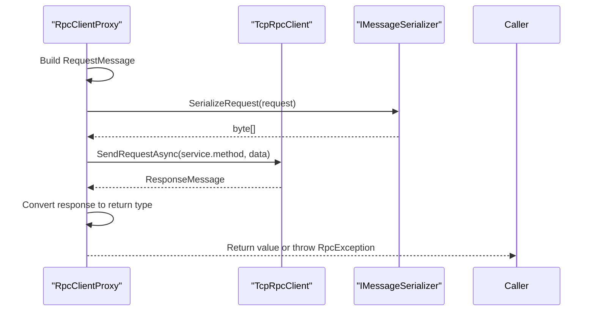
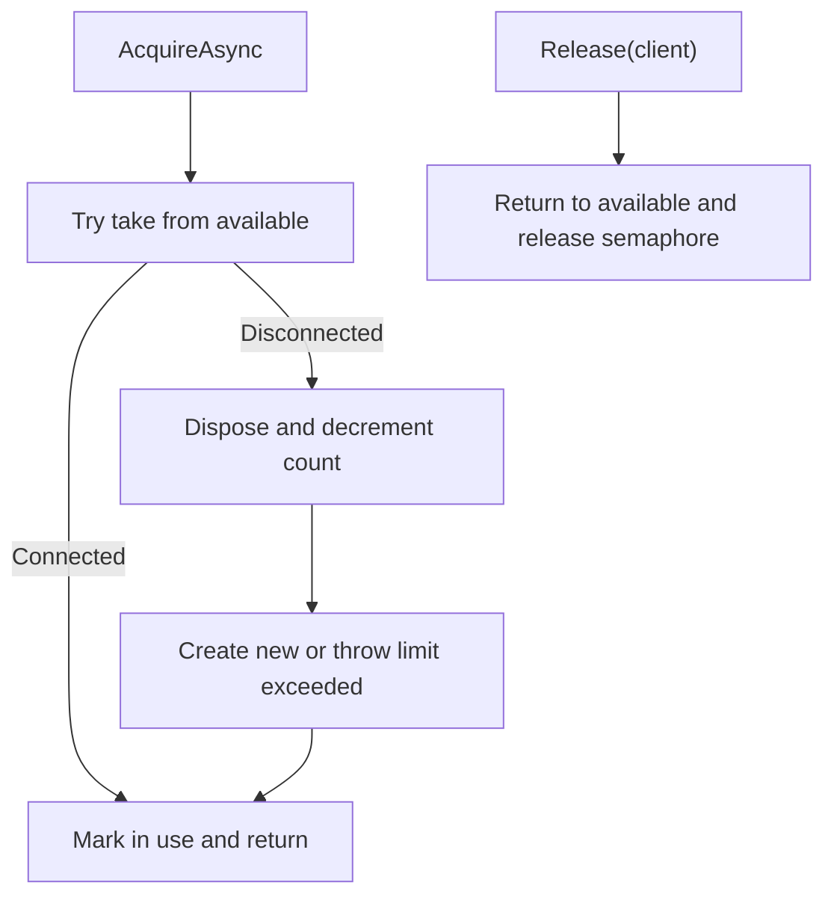
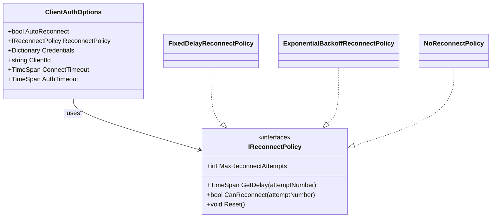
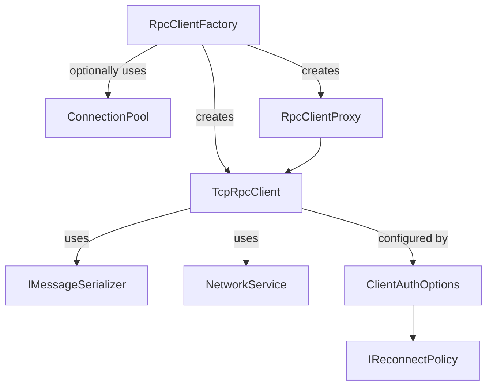

# RpcClientFactory

<cite>
**Referenced Files in This Document**
- [RpcClientFactory.cs](file://TcpRpc/Client/RpcClientFactory.cs)
- [TcpRpcClient.cs](file://TcpRpc/Client/TcpRpcClient.cs)
- [RpcClientProxy.cs](file://TcpRpc/Client/RpcClientProxy.cs)
- [ConnectionPool.cs](file://TcpRpc/Client/ConnectionPool.cs)
- [ClientAuthOptions.cs](file://TcpRpc/Client/ClientAuthOptions.cs)
- [IMessageSerializer.cs](file://TcpRpc/Formatter/IMessageSerializer.cs)
- [BinaryMessageSerializer.cs](file://TcpRpc/Formatter/BinaryMessageSerializer.cs)
- [NetworkService.cs](file://TcpRpc/Network/NetworkService.cs)
- [IReconnectPolicy.cs](file://TcpRpc/Client/IReconnectPolicy.cs)
- [MessageHeader.cs](file://TcpRpc/Message/MessageHeader.cs)
- [RpcException.cs](file://TcpRpc/RpcException.cs)
- [RpcClientState.cs](file://TcpRpc/Client/RpcClientState.cs)
</cite>

## Table of Contents
1. [Introduction](#introduction)
2. [Project Structure](#project-structure)
3. [Core Components](#core-components)
4. [Architecture Overview](#architecture-overview)
5. [Detailed Component Analysis](#detailed-component-analysis)
6. [Dependency Analysis](#dependency-analysis)
7. [Performance Considerations](#performance-considerations)
8. [Troubleshooting Guide](#troubleshooting-guide)
9. [Conclusion](#conclusion)

## Introduction
This document provides comprehensive documentation for the RpcClientFactory class, focusing on how the factory pattern is implemented to create TcpRpcClient instances with proper configuration. It covers factory methods, parameter validation, dependency injection integration, client configuration options (host/port, serializer selection, logger factory integration, authentication), and the relationships between the factory and other client components such as ConnectionPool and RpcClientProxy. It also includes practical usage examples for singleton client management, multiple client instances, and dependency injection container integration, along with best practices for lifecycle management, resource disposal, and performance optimization.

## Project Structure
The RpcClientFactory resides in the TcpRpc.Client namespace alongside TcpRpcClient, RpcClientProxy, and ConnectionPool. It integrates with the formatter subsystem (IMessageSerializer and BinaryMessageSerializer), the network layer (NetworkService), and authentication options (ClientAuthOptions and IReconnectPolicy). The RpcException and RpcClientState types support robust error handling and state management.

**Diagram sources**
- [RpcClientFactory.cs:1-110](file://TcpRpc/Client/RpcClientFactory.cs#L1-L110)
- [ConnectionPool.cs:1-189](file://TcpRpc/Client/ConnectionPool.cs#L1-L189)
- [TcpRpcClient.cs:1-684](file://TcpRpc/Client/TcpRpcClient.cs#L1-L684)
- [RpcClientProxy.cs:1-160](file://TcpRpc/Client/RpcClientProxy.cs#L1-L160)
- [IMessageSerializer.cs:1-35](file://TcpRpc/Formatter/IMessageSerializer.cs#L1-L35)
- [BinaryMessageSerializer.cs:1-444](file://TcpRpc/Formatter/BinaryMessageSerializer.cs#L1-L444)
- [NetworkService.cs:1-99](file://TcpRpc/Network/NetworkService.cs#L1-L99)
- [ClientAuthOptions.cs:1-38](file://TcpRpc/Client/ClientAuthOptions.cs#L1-L38)
- [MessageHeader.cs:1-73](file://TcpRpc/Message/MessageHeader.cs#L1-L73)

**Section sources**
- [RpcClientFactory.cs:1-110](file://TcpRpc/Client/RpcClientFactory.cs#L1-L110)
- [ConnectionPool.cs:1-189](file://TcpRpc/Client/ConnectionPool.cs#L1-L189)
- [TcpRpcClient.cs:1-684](file://TcpRpc/Client/TcpRpcClient.cs#L1-L684)
- [RpcClientProxy.cs:1-160](file://TcpRpc/Client/RpcClientProxy.cs#L1-L160)
- [IMessageSerializer.cs:1-35](file://TcpRpc/Formatter/IMessageSerializer.cs#L1-L35)
- [BinaryMessageSerializer.cs:1-444](file://TcpRpc/Formatter/BinaryMessageSerializer.cs#L1-L444)
- [NetworkService.cs:1-99](file://TcpRpc/Network/NetworkService.cs#L1-L99)
- [ClientAuthOptions.cs:1-38](file://TcpRpc/Client/ClientAuthOptions.cs#L1-L38)
- [MessageHeader.cs:1-73](file://TcpRpc/Message/MessageHeader.cs#L1-L73)

## Core Components
- RpcClientFactory: Implements the factory pattern to create TcpRpcClient instances and RpcClientProxy wrappers. It supports optional connection pooling and dynamic authentication updates.
- TcpRpcClient: Represents a single TCP-based RPC client with connection, authentication, request/response handling, and automatic reconnection capabilities.
- RpcClientProxy: A DispatchProxy-based wrapper that converts strongly-typed interface calls into RPC requests and deserializes responses.
- ConnectionPool: Manages a pool of TcpRpcClient instances with acquisition/release semantics and idle cleanup.
- ClientAuthOptions: Encapsulates authentication and reconnection configuration including credentials, client ID, timeouts, and reconnect policy.
- IMessageSerializer and BinaryMessageSerializer: Define and implement serialization/deserialization for RPC messages, including authentication messages.
- NetworkService: Provides low-level TCP I/O helpers for writing/reading framed messages.
- IReconnectPolicy: Defines the contract for reconnect policies (fixed delay, exponential backoff, none).
- RpcException: Wraps remote exceptions with type and stack trace information.
- RpcClientState: Enumerates client lifecycle states.

**Section sources**
- [RpcClientFactory.cs:1-110](file://TcpRpc/Client/RpcClientFactory.cs#L1-L110)
- [TcpRpcClient.cs:1-684](file://TcpRpc/Client/TcpRpcClient.cs#L1-L684)
- [RpcClientProxy.cs:1-160](file://TcpRpc/Client/RpcClientProxy.cs#L1-L160)
- [ConnectionPool.cs:1-189](file://TcpRpc/Client/ConnectionPool.cs#L1-L189)
- [ClientAuthOptions.cs:1-38](file://TcpRpc/Client/ClientAuthOptions.cs#L1-L38)
- [IMessageSerializer.cs:1-35](file://TcpRpc/Formatter/IMessageSerializer.cs#L1-L35)
- [BinaryMessageSerializer.cs:1-444](file://TcpRpc/Formatter/BinaryMessageSerializer.cs#L1-L444)
- [NetworkService.cs:1-99](file://TcpRpc/Network/NetworkService.cs#L1-L99)
- [IReconnectPolicy.cs:1-100](file://TcpRpc/Client/IReconnectPolicy.cs#L1-L100)
- [RpcException.cs:1-37](file://TcpRpc/RpcException.cs#L1-L37)
- [RpcClientState.cs:1-11](file://TcpRpc/Client/RpcClientState.cs#L1-L11)

## Architecture Overview
The factory encapsulates creation logic and configuration, delegating to either a pooled or direct client path. Proxies are created around clients to provide a seamless typed interface to remote services.

**Diagram sources**
- [RpcClientFactory.cs:1-110](file://TcpRpc/Client/RpcClientFactory.cs#L1-L110)
- [ConnectionPool.cs:1-189](file://TcpRpc/Client/ConnectionPool.cs#L1-L189)
- [TcpRpcClient.cs:1-684](file://TcpRpc/Client/TcpRpcClient.cs#L1-L684)
- [RpcClientProxy.cs:1-160](file://TcpRpc/Client/RpcClientProxy.cs#L1-L160)

## Detailed Component Analysis

### RpcClientFactory Implementation
- Constructor parameters:
  - Host and port define the target server address.
  - IMessageSerializer provides serialization for RPC messages.
  - ILoggerFactory supplies logging infrastructure.
  - usePool controls whether to initialize a ConnectionPool.
  - poolSize sets the maximum concurrent connections managed by the pool.
  - authOptions holds authentication and reconnection settings.
- Factory methods:
  - CreateProxyAsync<T>: Returns a typed proxy that forwards calls to the server via a pooled or direct client.
  - CreateClientAsync: Returns a TcpRpcClient instance that is connected and authenticated.
  - CreateClientWithoutAuthAsync: Returns a TcpRpcClient instance that is connected but not authenticated.
  - ReleaseClient: Returns a pooled client to the pool for reuse.
  - SetCredentials/SetClientId: Updates authentication options dynamically.
  - Dispose: Releases pooled resources.
- Parameter validation:
  - Host is validated during TcpRpcClient construction.
  - ConnectionPool enforces maximum size and semaphore-based concurrency.
- Dependency injection integration:
  - The factory accepts ILoggerFactory and IMessageSerializer, enabling DI container registration and resolution.

**Diagram sources**
- [RpcClientFactory.cs:36-61](file://TcpRpc/Client/RpcClientFactory.cs#L36-L61)
- [ConnectionPool.cs:109-114](file://TcpRpc/Client/ConnectionPool.cs#L109-L114)
- [TcpRpcClient.cs:135-139](file://TcpRpc/Client/TcpRpcClient.cs#L135-L139)
- [RpcClientProxy.cs:22-36](file://TcpRpc/Client/RpcClientProxy.cs#L22-L36)

**Section sources**
- [RpcClientFactory.cs:18-110](file://TcpRpc/Client/RpcClientFactory.cs#L18-L110)
- [ConnectionPool.cs:26-114](file://TcpRpc/Client/ConnectionPool.cs#L26-L114)
- [TcpRpcClient.cs:62-139](file://TcpRpc/Client/TcpRpcClient.cs#L62-L139)
- [RpcClientProxy.cs:22-36](file://TcpRpc/Client/RpcClientProxy.cs#L22-L36)

### TcpRpcClient Behavior
- Connection lifecycle:
  - ConnectAsync validates state and performs TCP connect, starts receive loop, and transitions to Connected.
  - DisconnectAsync cancels operations, closes streams, and clears pending requests.
- Authentication:
  - ConnectAndAuthenticateAsync and AuthenticateAsync send AuthRequest and process AuthResponse.
  - Supports session restoration via PreviousToken and manages token expiration.
- Request handling:
  - SendRequestAsync serializes requests, sends via NetworkService, and waits for Response/Error messages.
  - Automatic reconnection via TryReconnectAsync guided by ClientAuthOptions and IReconnectPolicy.
- Heartbeat:
  - PingAsync sends Ping and expects Pong to validate connectivity.
- State machine:
  - RpcClientState tracks lifecycle transitions and guards operations accordingly.

**Diagram sources**
- [TcpRpcClient.cs:135-139](file://TcpRpc/Client/TcpRpcClient.cs#L135-L139)
- [TcpRpcClient.cs:144-227](file://TcpRpc/Client/TcpRpcClient.cs#L144-L227)
- [TcpRpcClient.cs:232-269](file://TcpRpc/Client/TcpRpcClient.cs#L232-L269)
- [TcpRpcClient.cs:324-407](file://TcpRpc/Client/TcpRpcClient.cs#L324-L407)

**Section sources**
- [TcpRpcClient.cs:75-139](file://TcpRpc/Client/TcpRpcClient.cs#L75-L139)
- [TcpRpcClient.cs:144-227](file://TcpRpc/Client/TcpRpcClient.cs#L144-L227)
- [TcpRpcClient.cs:232-269](file://TcpRpc/Client/TcpRpcClient.cs#L232-L269)
- [TcpRpcClient.cs:324-407](file://TcpRpc/Client/TcpRpcClient.cs#L324-L407)
- [RpcClientState.cs:1-11](file://TcpRpc/Client/RpcClientState.cs#L1-L11)

### RpcClientProxy Mechanics
- Creation:
  - Create<T> initializes internal state and binds the proxy to a TcpRpcClient.
- Invocation:
  - Invoke constructs RequestMessage, serializes via IMessageSerializer, and delegates to client.SendRequestAsync.
  - Handles Void returns, Task<T>, and synchronous returns.
  - Propagates remote exceptions as RpcException with original type and stack trace.
- Logging:
  - Uses ILoggerFactory to create a logger for diagnostics.

**Diagram sources**
- [RpcClientProxy.cs:38-126](file://TcpRpc/Client/RpcClientProxy.cs#L38-L126)
- [IMessageSerializer.cs:10-14](file://TcpRpc/Formatter/IMessageSerializer.cs#L10-L14)
- [TcpRpcClient.cs:324-407](file://TcpRpc/Client/TcpRpcClient.cs#L324-L407)

**Section sources**
- [RpcClientProxy.cs:22-126](file://TcpRpc/Client/RpcClientProxy.cs#L22-L126)
- [IMessageSerializer.cs:10-14](file://TcpRpc/Formatter/IMessageSerializer.cs#L10-L14)
- [RpcException.cs:6-37](file://TcpRpc/RpcException.cs#L6-L37)

### ConnectionPool Management
- Acquisition:
  - AcquireAsync waits on a semaphore, reuses connected pooled clients, or creates new ones up to maxSize.
- Release:
  - Release marks a client as unused and returns it to the pool.
- Proxy creation:
  - GetProxyAsync<T> acquires a client and wraps it in a proxy.
- Cleanup:
  - Periodic timer removes idle connections exceeding maxIdleTime.

**Diagram sources**
- [ConnectionPool.cs:43-89](file://TcpRpc/Client/ConnectionPool.cs#L43-L89)
- [ConnectionPool.cs:94-104](file://TcpRpc/Client/ConnectionPool.cs#L94-L104)
- [ConnectionPool.cs:137-163](file://TcpRpc/Client/ConnectionPool.cs#L137-L163)

**Section sources**
- [ConnectionPool.cs:43-114](file://TcpRpc/Client/ConnectionPool.cs#L43-L114)
- [ConnectionPool.cs:137-163](file://TcpRpc/Client/ConnectionPool.cs#L137-L163)

### Authentication Options and Policies
- ClientAuthOptions:
  - AutoReconnect, ReconnectPolicy, Credentials, ClientId, ConnectTimeout, AuthTimeout.
- IReconnectPolicy implementations:
  - FixedDelayReconnectPolicy, ExponentialBackoffReconnectPolicy, NoReconnectPolicy.
- Integration:
  - TcpRpcClient uses these options for timeouts, retries, and session restoration.

**Diagram sources**
- [ClientAuthOptions.cs:6-37](file://TcpRpc/Client/ClientAuthOptions.cs#L6-L37)
- [IReconnectPolicy.cs:6-100](file://TcpRpc/Client/IReconnectPolicy.cs#L6-L100)

**Section sources**
- [ClientAuthOptions.cs:6-37](file://TcpRpc/Client/ClientAuthOptions.cs#L6-L37)
- [IReconnectPolicy.cs:36-85](file://TcpRpc/Client/IReconnectPolicy.cs#L36-L85)

## Dependency Analysis
- Factory-to-client relationships:
  - Direct path: RpcClientFactory constructs TcpRpcClient and optionally connects/authenticates.
  - Pooled path: RpcClientFactory delegates to ConnectionPool for acquisition and release.
- Serialization and networking:
  - TcpRpcClient depends on IMessageSerializer and NetworkService for message framing and transport.
- Proxy-to-client:
  - RpcClientProxy wraps TcpRpcClient to expose typed interfaces.
- Authentication and reconnection:
  - ClientAuthOptions and IReconnectPolicy influence TcpRpcClient behavior for timeouts and retries.

**Diagram sources**
- [RpcClientFactory.cs:18-110](file://TcpRpc/Client/RpcClientFactory.cs#L18-L110)
- [ConnectionPool.cs:109-114](file://TcpRpc/Client/ConnectionPool.cs#L109-L114)
- [TcpRpcClient.cs:62-139](file://TcpRpc/Client/TcpRpcClient.cs#L62-L139)
- [RpcClientProxy.cs:22-36](file://TcpRpc/Client/RpcClientProxy.cs#L22-L36)
- [IMessageSerializer.cs:8-35](file://TcpRpc/Formatter/IMessageSerializer.cs#L8-L35)
- [NetworkService.cs:10-28](file://TcpRpc/Network/NetworkService.cs#L10-L28)
- [ClientAuthOptions.cs:6-37](file://TcpRpc/Client/ClientAuthOptions.cs#L6-L37)
- [IReconnectPolicy.cs:6-31](file://TcpRpc/Client/IReconnectPolicy.cs#L6-L31)

**Section sources**
- [RpcClientFactory.cs:18-110](file://TcpRpc/Client/RpcClientFactory.cs#L18-L110)
- [ConnectionPool.cs:26-114](file://TcpRpc/Client/ConnectionPool.cs#L26-L114)
- [TcpRpcClient.cs:62-139](file://TcpRpc/Client/TcpRpcClient.cs#L62-L139)
- [RpcClientProxy.cs:22-36](file://TcpRpc/Client/RpcClientProxy.cs#L22-L36)
- [IMessageSerializer.cs:8-35](file://TcpRpc/Formatter/IMessageSerializer.cs#L8-L35)
- [NetworkService.cs:10-28](file://TcpRpc/Network/NetworkService.cs#L10-L28)
- [ClientAuthOptions.cs:6-37](file://TcpRpc/Client/ClientAuthOptions.cs#L6-L37)
- [IReconnectPolicy.cs:6-31](file://TcpRpc/Client/IReconnectPolicy.cs#L6-L31)

## Performance Considerations
- Connection pooling:
  - Use RpcClientFactory with usePool=true and an appropriate poolSize to reduce connection churn and authentication overhead.
  - ConnectionPool cleans idle connections periodically to reclaim resources.
- Serialization:
  - BinaryMessageSerializer efficiently encodes parameters and responses; ensure compatible serializers on both ends.
- Timeouts:
  - Tune ClientAuthOptions.ConnectTimeout and AuthTimeout to balance responsiveness and reliability.
- Reconnection:
  - Choose an appropriate IReconnectPolicy to minimize disruption under transient failures.
- Logging:
  - Use ILoggerFactory to enable structured logging for diagnostics without impacting production throughput.

[No sources needed since this section provides general guidance]

## Troubleshooting Guide
- Authentication failures:
  - Verify ClientAuthOptions.Credentials and ClientId are set correctly. Review logs for authentication errors and token expiration.
- Connection issues:
  - Check RpcClientState transitions and TcpRpcClient.ConnectAsync error paths. Validate host/port and firewall settings.
- Request timeouts:
  - Increase timeoutMs in SendRequestAsync or adjust ClientAuthOptions.AuthTimeout and ConnectTimeout.
- Proxy invocation errors:
  - RpcClientProxy throws RpcException with RemoteExceptionType and RemoteStackTrace; inspect these for remote causes.
- Resource leaks:
  - Ensure RpcClientFactory.Dispose and TcpRpcClient.Dispose are called to release sockets, timers, and semaphores.

**Section sources**
- [RpcClientFactory.cs:106-110](file://TcpRpc/Client/RpcClientFactory.cs#L106-L110)
- [TcpRpcClient.cs:660-684](file://TcpRpc/Client/TcpRpcClient.cs#L660-L684)
- [RpcException.cs:6-37](file://TcpRpc/RpcException.cs#L6-L37)

## Conclusion
RpcClientFactory provides a clean, configurable entry point for creating TcpRpcClient instances and typed proxies. By integrating with ConnectionPool, IMessageSerializer, ILoggerFactory, and ClientAuthOptions, it supports flexible deployment scenarios from singleton clients to pooled, high-throughput setups. Proper configuration of authentication, timeouts, and reconnect policies ensures robust operation, while careful lifecycle management and disposal prevent resource leaks and improve performance.