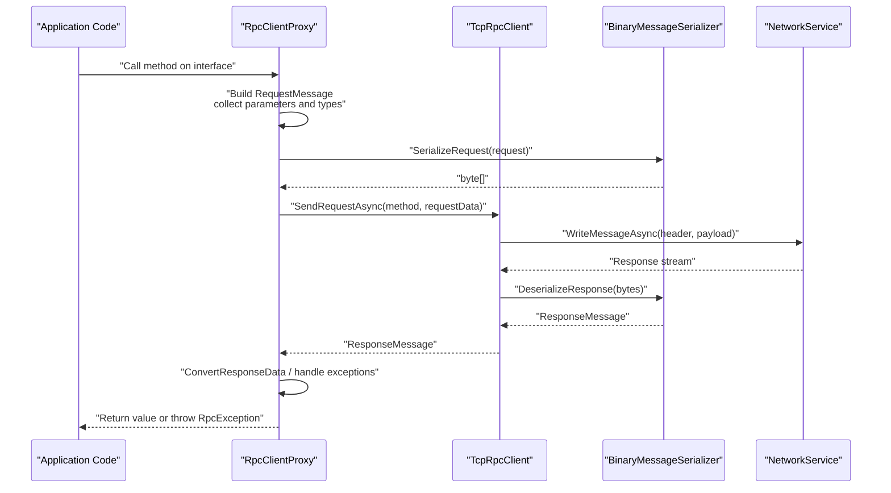
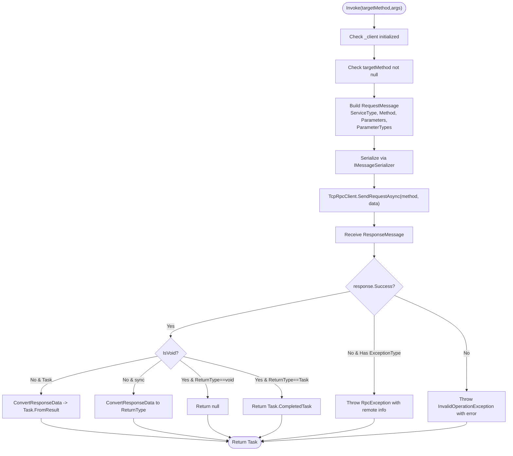
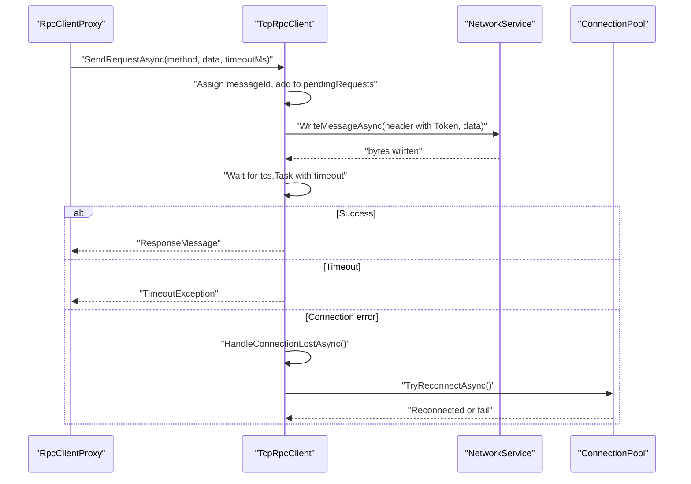
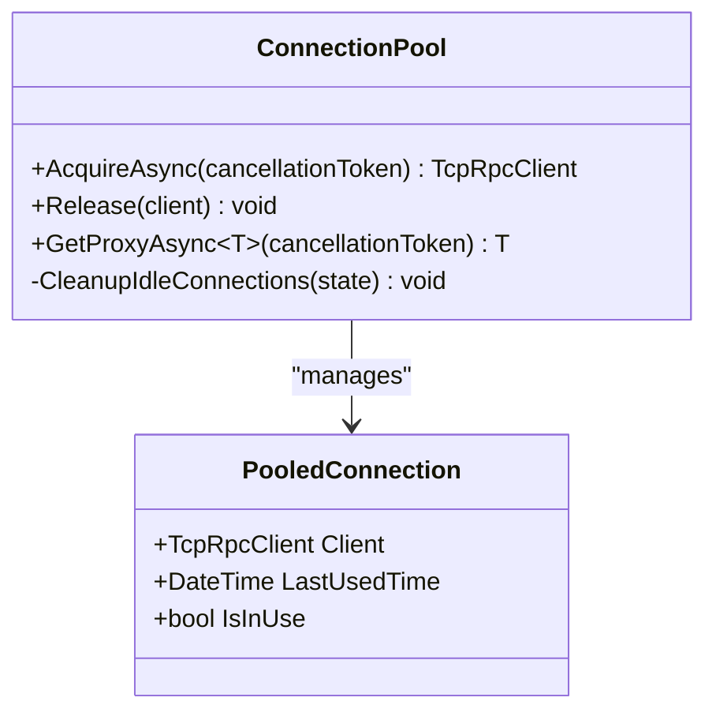
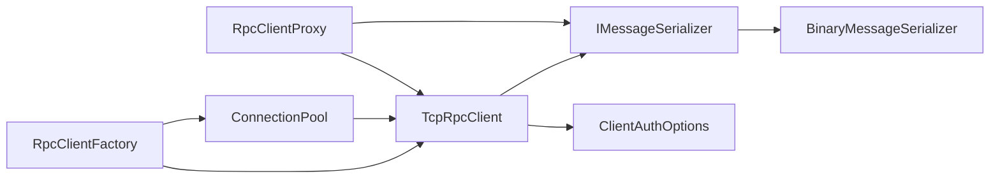

# RpcClientProxy

<cite>
**Referenced Files in This Document**
- [RpcClientProxy.cs](file://TcpRpc/TcpRpc/Client/RpcClientProxy.cs)
- [TcpRpcClient.cs](file://TcpRpc/TcpRpc/Client/TcpRpcClient.cs)
- [ConnectionPool.cs](file://TcpRpc/TcpRpc/Client/ConnectionPool.cs)
- [RpcClientFactory.cs](file://TcpRpc/TcpRpc/Client/RpcClientFactory.cs)
- [RpcClientState.cs](file://TcpRpc/TcpRpc/Client/RpcClientState.cs)
- [ClientAuthOptions.cs](file://TcpRpc/TcpRpc/Client/ClientAuthOptions.cs)
- [BinaryMessageSerializer.cs](file://TcpRpc/TcpRpc/Formatter/BinaryMessageSerializer.cs)
- [IMessageSerializer.cs](file://TcpRpc/TcpRpc/Formatter/IMessageSerializer.cs)
- [RequestMessage.cs](file://TcpRpc/TcpRpc/Message/RequestMessage.cs)
- [ResponseMessage.cs](file://TcpRpc/TcpRpc/Message/ResponseMessage.cs)
- [RpcException.cs](file://TcpRpc/TcpRpc/RpcException.cs)
- [IRpcContract.cs](file://TcpRpc/TcpRpc.Contract/IRpcContract.cs)
- [Program.cs (Client)](file://TcpRpc/TcpRpc.Client/Program.cs)
- [Program.cs (Server)](file://TcpRpc/TcpRpc.Server/Program.cs)
</cite>

## Table of Contents
1. [Introduction](#introduction)
2. [Project Structure](#project-structure)
3. [Core Components](#core-components)
4. [Architecture Overview](#architecture-overview)
5. [Detailed Component Analysis](#detailed-component-analysis)
6. [Dependency Analysis](#dependency-analysis)
7. [Performance Considerations](#performance-considerations)
8. [Troubleshooting Guide](#troubleshooting-guide)
9. [Conclusion](#conclusion)
10. [Appendices](#appendices)

## Introduction
This document explains the RpcClientProxy implementation and its role in enabling transparent method calls over TCP. It covers how the proxy pattern is implemented, how dynamic method invocation maps to RPC calls, parameter serialization and response deserialization, and how RpcClientProxy integrates with TcpRpcClient and ConnectionPool. It also documents lifecycle management, connection acquisition/release patterns, error handling strategies, configuration options, performance considerations, and best practices for large-scale usage.

## Project Structure
The RpcClientProxy lives in the TcpRpc.Client namespace alongside TcpRpcClient, ConnectionPool, and RpcClientFactory. Serialization is handled by IMessageSerializer implementations, with BinaryMessageSerializer being the default. Contracts are defined in TcpRpc.Contract, and example usage appears in TcpRpc.Client.Program.

```mermaid
graph TB
subgraph "Client"
Proxy["RpcClientProxy"]
Factory["RpcClientFactory"]
Pool["ConnectionPool"]
Client["TcpRpcClient"]
State["RpcClientState"]
AuthOpts["ClientAuthOptions"]
end
subgraph "Serialization"
ISer["IMessageSerializer"]
BinSer["BinaryMessageSerializer"]
end
subgraph "Contracts"
Contract["IRpcContract"]
end
Proxy --> Client
Factory --> Pool
Factory --> Client
Pool --> Client
Client --> ISer
BinSer --> ISer
Proxy --> Contract
Client --> State
Client --> AuthOpts
```

**Diagram sources**
- [RpcClientProxy.cs:11-36](file://TcpRpc/TcpRpc/Client/RpcClientProxy.cs#L11-L36)
- [RpcClientFactory.cs:36-46](file://TcpRpc/TcpRpc/Client/RpcClientFactory.cs#L36-L46)
- [ConnectionPool.cs:109-114](file://TcpRpc/TcpRpc/Client/ConnectionPool.cs#L109-L114)
- [TcpRpcClient.cs:62-69](file://TcpRpc/TcpRpc/Client/TcpRpcClient.cs#L62-L69)
- [BinaryMessageSerializer.cs:11](file://TcpRpc/TcpRpc/Formatter/BinaryMessageSerializer.cs#L11)
- [IMessageSerializer.cs:8](file://TcpRpc/TcpRpc/Formatter/IMessageSerializer.cs#L8)
- [IRpcContract.cs:6](file://TcpRpc/TcpRpc.Contract/IRpcContract.cs#L6)

**Section sources**
- [RpcClientProxy.cs:11-36](file://TcpRpc/TcpRpc/Client/RpcClientProxy.cs#L11-L36)
- [RpcClientFactory.cs:36-46](file://TcpRpc/TcpRpc/Client/RpcClientFactory.cs#L36-L46)
- [ConnectionPool.cs:109-114](file://TcpRpc/TcpRpc/Client/ConnectionPool.cs#L109-L114)
- [TcpRpcClient.cs:62-69](file://TcpRpc/TcpRpc/Client/TcpRpcClient.cs#L62-L69)
- [BinaryMessageSerializer.cs:11](file://TcpRpc/TcpRpc/Formatter/BinaryMessageSerializer.cs#L11)
- [IMessageSerializer.cs:8](file://TcpRpc/TcpRpc/Formatter/IMessageSerializer.cs#L8)
- [IRpcContract.cs:6](file://TcpRpc/TcpRpc.Contract/IRpcContract.cs#L6)

## Core Components
- RpcClientProxy: Implements DispatchProxy to intercept calls on strongly-typed interfaces and translate them into RPC requests. It serializes arguments, sends them via TcpRpcClient, and deserializes responses, including propagating exceptions.
- TcpRpcClient: Manages the TCP connection, authentication, message send/receive, timeouts, retries, and automatic reconnection policy.
- ConnectionPool: Provides connection pooling with semaphore-based concurrency control, idle cleanup, and acquisition/release semantics.
- RpcClientFactory: Simplifies creation of proxies and clients, optionally backed by a ConnectionPool.
- BinaryMessageSerializer: Implements IMessageSerializer to serialize/deserialize RequestMessage, ResponseMessage, and authentication messages.
- IRpcContract: Example contract interface demonstrating various method signatures (sync, async, void, complex objects).

**Section sources**
- [RpcClientProxy.cs:11-160](file://TcpRpc/TcpRpc/Client/RpcClientProxy.cs#L11-L160)
- [TcpRpcClient.cs:10-684](file://TcpRpc/TcpRpc/Client/TcpRpcClient.cs#L10-L684)
- [ConnectionPool.cs:10-189](file://TcpRpc/TcpRpc/Client/ConnectionPool.cs#L10-L189)
- [RpcClientFactory.cs:9-110](file://TcpRpc/TcpRpc/Client/RpcClientFactory.cs#L9-L110)
- [BinaryMessageSerializer.cs:11-444](file://TcpRpc/TcpRpc/Formatter/BinaryMessageSerializer.cs#L11-L444)
- [IMessageSerializer.cs:8-35](file://TcpRpc/TcpRpc/Formatter/IMessageSerializer.cs#L8-L35)
- [IRpcContract.cs:6-61](file://TcpRpc/TcpRpc.Contract/IRpcContract.cs#L6-L61)

## Architecture Overview
The proxy sits between the application and TcpRpcClient. When a typed method is invoked on the proxy, RpcClientProxy captures the call, builds a RequestMessage, serializes it, and delegates sending to TcpRpcClient. Responses are deserialized and returned to the caller, with exceptions reconstructed on the client side.



**Diagram sources**
- [RpcClientProxy.cs:38-126](file://TcpRpc/TcpRpc/Client/RpcClientProxy.cs#L38-L126)
- [TcpRpcClient.cs:324-407](file://TcpRpc/TcpRpc/Client/TcpRpcClient.cs#L324-L407)
- [BinaryMessageSerializer.cs:30-112](file://TcpRpc/TcpRpc/Formatter/BinaryMessageSerializer.cs#L30-L112)

## Detailed Component Analysis

### RpcClientProxy
- Purpose: Transparently forward interface method calls to a remote service over TCP.
- Creation: Static Create<T> initializes internal state and returns a DispatchProxy-derived instance.
- Invocation: Override of Invoke captures MethodInfo, parameter types, constructs RequestMessage, serializes, sends via TcpRpcClient, and deserializes response.
- Return handling:
  - Void and Task<void>: Returns null or Task.CompletedTask when response indicates IsVoid.
  - Task<T>: Uses reflection to call Task.FromResult<T> with converted result.
  - Sync return: Converts response data to target type.
- Exception propagation: If response.Success is false and ExceptionType is present, throws RpcException with remote metadata; otherwise throws InvalidOperationException with error message.
- Logging: Uses ILogger<RpcClientProxy> to log method invocations and errors.



**Diagram sources**
- [RpcClientProxy.cs:38-126](file://TcpRpc/TcpRpc/Client/RpcClientProxy.cs#L38-L126)
- [ResponseMessage.cs:6-30](file://TcpRpc/TcpRpc/Message/ResponseMessage.cs#L6-L30)
- [RpcException.cs:6-37](file://TcpRpc/TcpRpc/RpcException.cs#L6-L37)

**Section sources**
- [RpcClientProxy.cs:11-160](file://TcpRpc/TcpRpc/Client/RpcClientProxy.cs#L11-L160)
- [ResponseMessage.cs:6-30](file://TcpRpc/TcpRpc/Message/ResponseMessage.cs#L6-L30)
- [RpcException.cs:6-37](file://TcpRpc/TcpRpc/RpcException.cs#L6-L37)

### TcpRpcClient
- Responsibilities: Connection lifecycle, authentication, sending requests, receiving responses, timeouts, retries, and automatic reconnection.
- State machine: Created → Connecting → Connected → Disconnecting → Disconnected → Faulted.
- Request flow: Assigns message IDs, tracks pending requests, writes headers and payloads, waits for responses with cancellation tokens, handles connection loss, and triggers reconnect.
- Authentication: Sends AuthRequest, manages tokens, supports session restoration.
- Reconnection: Configurable policy, exponential backoff by default, attempts reconnect and re-authentication.
- Concurrency: Uses SemaphoreSlim for send locking and concurrent dictionaries for pending requests.



**Diagram sources**
- [TcpRpcClient.cs:324-407](file://TcpRpc/TcpRpc/Client/TcpRpcClient.cs#L324-L407)
- [ConnectionPool.cs:232-269](file://TcpRpc/TcpRpc/Client/ConnectionPool.cs#L232-L269)

**Section sources**
- [TcpRpcClient.cs:10-684](file://TcpRpc/TcpRpc/Client/TcpRpcClient.cs#L10-L684)
- [RpcClientState.cs:3-11](file://TcpRpc/TcpRpc/Client/RpcClientState.cs#L3-L11)
- [ClientAuthOptions.cs:6-38](file://TcpRpc/TcpRpc/Client/ClientAuthOptions.cs#L6-L38)

### ConnectionPool
- Purpose: Manage a bounded set of TcpRpcClient instances, enabling reuse and limiting resource consumption.
- Acquisition: Waits on semaphore, tries to reuse an existing Connected client, or creates a new one up to maxSize.
- Release: Marks client as not in use, adds back to available bag, releases semaphore.
- Cleanup: Periodic timer removes idle connections exceeding maxIdleTime.
- Proxy integration: GetProxyAsync<T> acquires a client and wraps it in RpcClientProxy.



**Diagram sources**
- [ConnectionPool.cs:10-189](file://TcpRpc/TcpRpc/Client/ConnectionPool.cs#L10-L189)

**Section sources**
- [ConnectionPool.cs:10-189](file://TcpRpc/TcpRpc/Client/ConnectionPool.cs#L10-L189)

### RpcClientFactory
- Purpose: Simplifies creation of proxies and clients, optionally using ConnectionPool.
- Methods:
  - CreateProxyAsync<T>: Returns a strongly-typed proxy bound to a pooled or standalone client.
  - CreateClientAsync/CreateClientWithoutAuthAsync: Return TcpRpcClient instances.
  - ReleaseClient: Returns a client to the pool.
  - SetCredentials/SetClientId: Updates authentication options.

**Section sources**
- [RpcClientFactory.cs:9-110](file://TcpRpc/TcpRpc/Client/RpcClientFactory.cs#L9-L110)

### Serialization and Message Contracts
- IMessageSerializer defines methods for serializing/deserializing requests, responses, and auth messages.
- BinaryMessageSerializer implements compact binary encoding with type markers and JSON fallback for complex objects.
- RequestMessage and ResponseMessage carry method metadata, parameters, types, and result data.

**Section sources**
- [IMessageSerializer.cs:8-35](file://TcpRpc/TcpRpc/Formatter/IMessageSerializer.cs#L8-L35)
- [BinaryMessageSerializer.cs:11-444](file://TcpRpc/TcpRpc/Formatter/BinaryMessageSerializer.cs#L11-L444)
- [RequestMessage.cs:6-18](file://TcpRpc/TcpRpc/Message/RequestMessage.cs#L6-L18)
- [ResponseMessage.cs:6-30](file://TcpRpc/TcpRpc/Message/ResponseMessage.cs#L6-L30)

### Example Usage Patterns
- Factory-based proxy creation with authentication and pooling.
- Direct proxy creation against a pooled or standalone client.
- Parallel usage of pooled clients with proper release.
- Asynchronous and synchronous method invocation patterns.
- Exception propagation and logging.

**Section sources**
- [Program.cs (Client):40-101](file://TcpRpc/TcpRpc.Client/Program.cs#L40-L101)
- [Program.cs (Client):102-136](file://TcpRpc/TcpRpc.Client/Program.cs#L102-L136)
- [Program.cs (Server):40-67](file://TcpRpc/TcpRpc.Server/Program.cs#L40-L67)

## Dependency Analysis
- RpcClientProxy depends on TcpRpcClient for transport, IMessageSerializer for serialization, and ILogger for diagnostics.
- TcpRpcClient depends on IMessageSerializer, NetworkService, and ClientAuthOptions.
- ConnectionPool depends on TcpRpcClient creation, IMessageSerializer, and ClientAuthOptions.
- RpcClientFactory orchestrates ConnectionPool and TcpRpcClient creation and exposes simplified APIs.



**Diagram sources**
- [RpcClientProxy.cs:13-17](file://TcpRpc/TcpRpc/Client/RpcClientProxy.cs#L13-L17)
- [TcpRpcClient.cs:62-69](file://TcpRpc/TcpRpc/Client/TcpRpcClient.cs#L62-L69)
- [ConnectionPool.cs:26-36](file://TcpRpc/TcpRpc/Client/ConnectionPool.cs#L26-L36)
- [RpcClientFactory.cs:18-31](file://TcpRpc/TcpRpc/Client/RpcClientFactory.cs#L18-L31)
- [BinaryMessageSerializer.cs:11](file://TcpRpc/TcpRpc/Formatter/BinaryMessageSerializer.cs#L11)

**Section sources**
- [RpcClientProxy.cs:13-17](file://TcpRpc/TcpRpc/Client/RpcClientProxy.cs#L13-L17)
- [TcpRpcClient.cs:62-69](file://TcpRpc/TcpRpc/Client/TcpRpcClient.cs#L62-L69)
- [ConnectionPool.cs:26-36](file://TcpRpc/TcpRpc/Client/ConnectionPool.cs#L26-L36)
- [RpcClientFactory.cs:18-31](file://TcpRpc/TcpRpc/Client/RpcClientFactory.cs#L18-L31)
- [BinaryMessageSerializer.cs:11](file://TcpRpc/TcpRpc/Formatter/BinaryMessageSerializer.cs#L11)

## Performance Considerations
- Prefer RpcClientFactory with ConnectionPool for high-throughput scenarios to reduce connection churn and authentication overhead.
- Tune pool size and max idle time according to workload characteristics.
- Use appropriate timeouts for SendRequestAsync to avoid blocking threads under load.
- Minimize argument sizes and leverage efficient parameter types to reduce serialization overhead.
- Monitor RpcClient state transitions and reconnection attempts to detect network instability early.

[No sources needed since this section provides general guidance]

## Troubleshooting Guide
- Authentication failures: Verify ClientAuthOptions credentials and ClientId; check server-side auth provider configuration.
- Timeouts: Increase request timeouts or enable auto-reconnect; inspect network latency and server load.
- Connection drops: TcpRpcClient triggers HandleConnectionLostAsync and attempts reconnect; confirm ReconnectPolicy settings.
- Exception propagation: RpcException carries RemoteExceptionType and RemoteStackTrace for accurate diagnostics.
- Logging: Enable debug logs on RpcClientProxy and TcpRpcClient to trace method invocations and errors.

**Section sources**
- [ClientAuthOptions.cs:6-38](file://TcpRpc/TcpRpc/Client/ClientAuthOptions.cs#L6-L38)
- [TcpRpcClient.cs:542-581](file://TcpRpc/TcpRpc/Client/TcpRpcClient.cs#L542-L581)
- [RpcException.cs:6-37](file://TcpRpc/TcpRpc/RpcException.cs#L6-L37)
- [Program.cs (Client):9-13](file://TcpRpc/TcpRpc.Client/Program.cs#L9-L13)

## Conclusion
RpcClientProxy enables transparent, interface-based RPC calls by leveraging .NET’s DispatchProxy to intercept method calls, serialize parameters, and route them to TcpRpcClient. TcpRpcClient manages transport, authentication, and resilience, while ConnectionPool optimizes resource usage. Together, these components provide a robust foundation for distributed service calls with strong typing, exception propagation, and scalable connection management.

[No sources needed since this section summarizes without analyzing specific files]

## Appendices

### Proxy Lifecycle Management
- Creation: Use RpcClientProxy.Create<T> or RpcClientFactory.CreateProxyAsync<T>.
- Usage: Invoke interface methods as if local; proxy handles serialization and transport.
- Release: For pooled clients, call RpcClientFactory.ReleaseClient or ConnectionPool.Release to return the client to the pool.
- Disposal: Dispose RpcClientFactory or ConnectionPool to clean up resources; TcpRpcClient.Dispose disconnects and cleans up.

**Section sources**
- [RpcClientProxy.cs:22-36](file://TcpRpc/TcpRpc/Client/RpcClientProxy.cs#L22-L36)
- [RpcClientFactory.cs:36-46](file://TcpRpc/TcpRpc/Client/RpcClientFactory.cs#L36-L46)
- [ConnectionPool.cs:94-104](file://TcpRpc/TcpRpc/Client/ConnectionPool.cs#L94-L104)
- [TcpRpcClient.cs:660-684](file://TcpRpc/TcpRpc/Client/TcpRpcClient.cs#L660-L684)

### Configuration Options
- ClientAuthOptions: AutoReconnect, ReconnectPolicy, Credentials, ClientId, ConnectTimeout, AuthTimeout.
- ConnectionPool: maxSize, maxIdleTime, authOptions, messageSerializer, loggerFactory.
- RpcClientFactory: usePool flag, poolSize, authOptions.

**Section sources**
- [ClientAuthOptions.cs:6-38](file://TcpRpc/TcpRpc/Client/ClientAuthOptions.cs#L6-L38)
- [ConnectionPool.cs:26-38](file://TcpRpc/TcpRpc/Client/ConnectionPool.cs#L26-L38)
- [RpcClientFactory.cs:18-31](file://TcpRpc/TcpRpc/Client/RpcClientFactory.cs#L18-L31)

### Best Practices for Large-Scale Usage
- Use RpcClientFactory with ConnectionPool to share connections efficiently.
- Keep proxies short-lived per call when appropriate; reuse pooled clients across multiple calls.
- Monitor RpcClient state and reconnection metrics; adjust ReconnectPolicy for production environments.
- Prefer Task-returning methods for asynchronous workloads to avoid thread blocking.
- Validate and constrain request payload sizes; use primitive types where possible.

[No sources needed since this section provides general guidance]