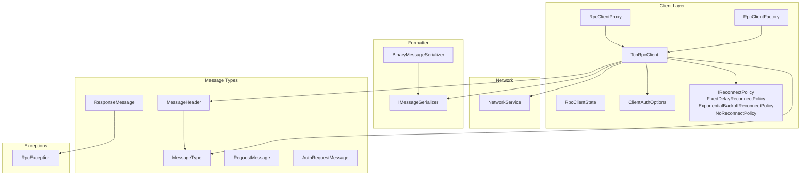
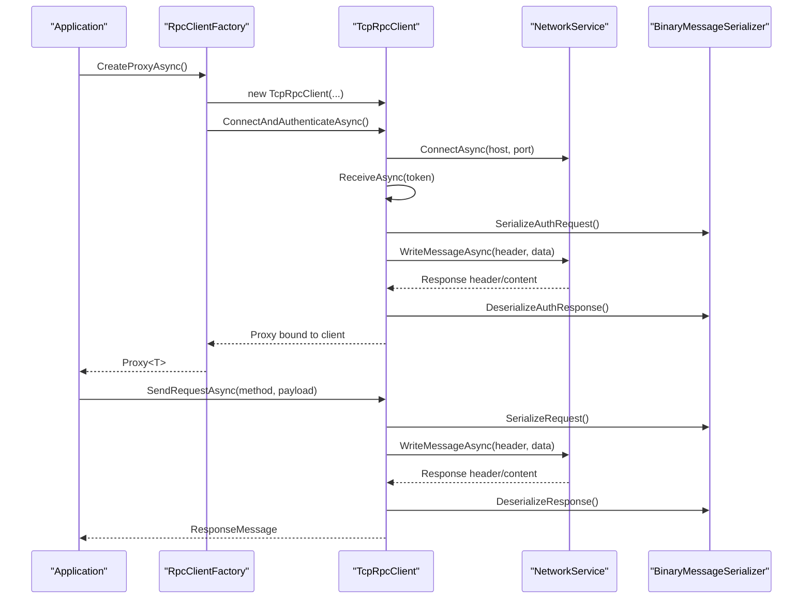
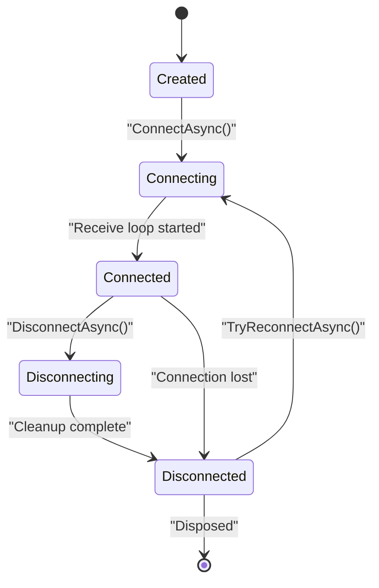
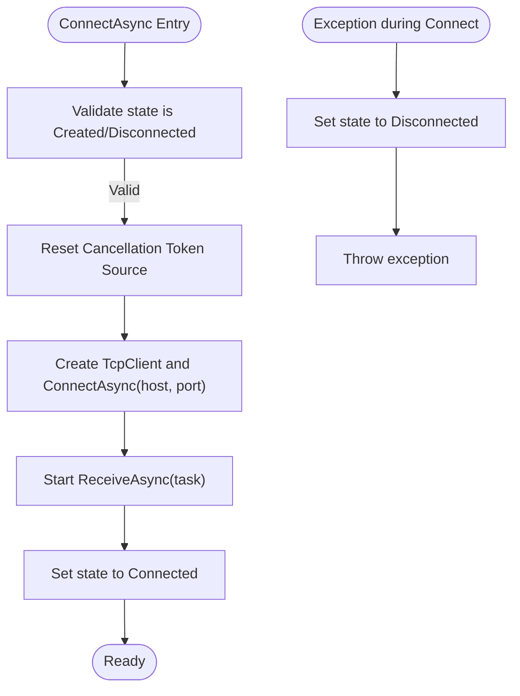
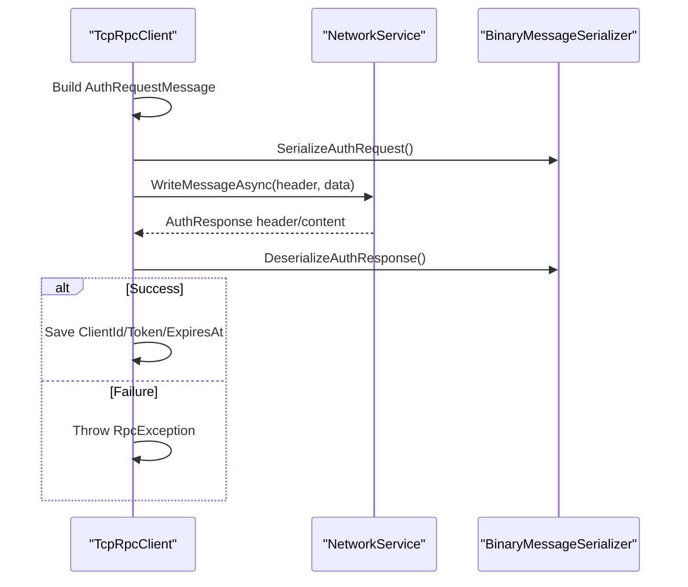
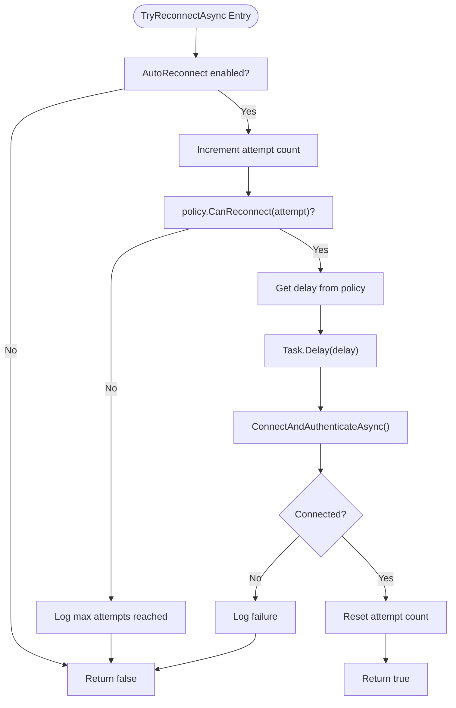
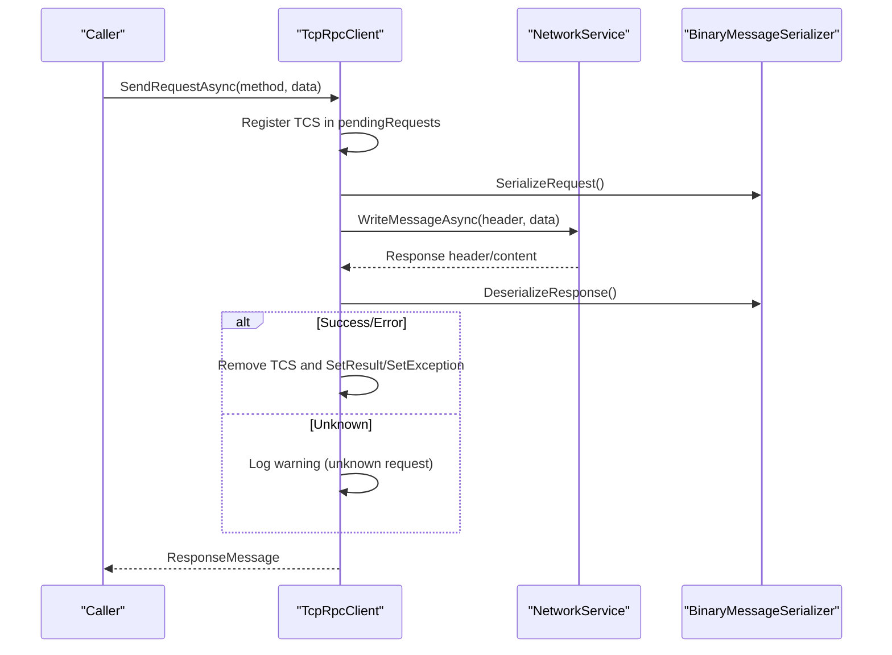
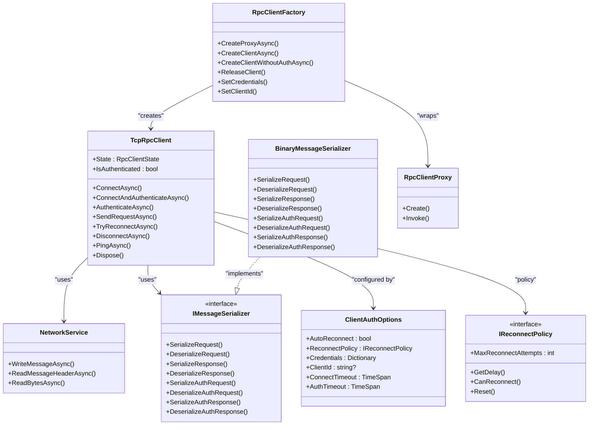

# TcpRpcClient Implementation

<cite>
**Referenced Files in This Document**
- [TcpRpcClient.cs](file://TcpRpc/Client/TcpRpcClient.cs)
- [RpcClientState.cs](file://TcpRpc/Client/RpcClientState.cs)
- [ClientAuthOptions.cs](file://TcpRpc/Client/ClientAuthOptions.cs)
- [IReconnectPolicy.cs](file://TcpRpc/Client/IReconnectPolicy.cs)
- [NetworkService.cs](file://TcpRpc/Network/NetworkService.cs)
- [MessageHeader.cs](file://TcpRpc/Message/MessageHeader.cs)
- [MessageType.cs](file://TcpRpc/Message/MessageType.cs)
- [IMessageSerializer.cs](file://TcpRpc/Formatter/IMessageSerializer.cs)
- [BinaryMessageSerializer.cs](file://TcpRpc/Formatter/BinaryMessageSerializer.cs)
- [RequestMessage.cs](file://TcpRpc/Message/RequestMessage.cs)
- [ResponseMessage.cs](file://TcpRpc/Message/ResponseMessage.cs)
- [AuthRequestMessage.cs](file://TcpRpc/Message/AuthRequestMessage.cs)
- [RpcException.cs](file://TcpRpc/RpcException.cs)
- [RpcClientFactory.cs](file://TcpRpc/Client/RpcClientFactory.cs)
- [RpcClientProxy.cs](file://TcpRpc/Client/RpcClientProxy.cs)
</cite>

## Table of Contents
1. [Introduction](#introduction)
2. [Project Structure](#project-structure)
3. [Core Components](#core-components)
4. [Architecture Overview](#architecture-overview)
5. [Detailed Component Analysis](#detailed-component-analysis)
6. [Dependency Analysis](#dependency-analysis)
7. [Performance Considerations](#performance-considerations)
8. [Troubleshooting Guide](#troubleshooting-guide)
9. [Conclusion](#conclusion)
10. [Appendices](#appendices)

## Introduction
This document provides comprehensive documentation for the TcpRpcClient class, focusing on connection management, request/response handling, authentication workflow, automatic reconnection mechanisms, lifecycle states, concurrency controls, and operational best practices. It explains the message processing pipeline, concurrent dictionary usage for pending requests, send/receive synchronization, cancellation token management, and proper resource cleanup. Practical examples demonstrate instantiation, connection establishment, authentication, and method invocation, along with error handling and recovery strategies.

## Project Structure
The TcpRpcClient resides in the client layer alongside supporting components for authentication, serialization, network I/O, and proxy generation. The structure emphasizes separation of concerns:
- Client: TcpRpcClient, RpcClientState, ClientAuthOptions, IReconnectPolicy, RpcClientFactory, RpcClientProxy
- Network: NetworkService for low-level I/O
- Formatter: IMessageSerializer and BinaryMessageSerializer for message encoding/decoding
- Message: MessageHeader, MessageType, RequestMessage, ResponseMessage, AuthRequestMessage
- Exceptions: RpcException for propagating server-side exceptions

**Diagram sources**
- [TcpRpcClient.cs:10-684](file://TcpRpc/Client/TcpRpcClient.cs#L10-L684)
- [RpcClientState.cs:3-11](file://TcpRpc/Client/RpcClientState.cs#L3-L11)
- [ClientAuthOptions.cs:6-38](file://TcpRpc/Client/ClientAuthOptions.cs#L6-L38)
- [IReconnectPolicy.cs:6-100](file://TcpRpc/Client/IReconnectPolicy.cs#L6-L100)
- [NetworkService.cs:7-99](file://TcpRpc/Network/NetworkService.cs#L7-L99)
- [IMessageSerializer.cs:8-35](file://TcpRpc/Formatter/IMessageSerializer.cs#L8-L35)
- [BinaryMessageSerializer.cs:11-444](file://TcpRpc/Formatter/BinaryMessageSerializer.cs#L11-L444)
- [MessageHeader.cs:9-73](file://TcpRpc/Message/MessageHeader.cs#L9-L73)
- [MessageType.cs:3-13](file://TcpRpc/Message/MessageType.cs#L3-L13)
- [RequestMessage.cs:6-18](file://TcpRpc/Message/RequestMessage.cs#L6-L18)
- [ResponseMessage.cs:6-30](file://TcpRpc/Message/ResponseMessage.cs#L6-L30)
- [AuthRequestMessage.cs:6-28](file://TcpRpc/Message/AuthRequestMessage.cs#L6-L28)
- [RpcException.cs:6-37](file://TcpRpc/RpcException.cs#L6-L37)
- [RpcClientFactory.cs:9-110](file://TcpRpc/Client/RpcClientFactory.cs#L9-L110)
- [RpcClientProxy.cs:11-160](file://TcpRpc/Client/RpcClientProxy.cs#L11-L160)

**Section sources**
- [TcpRpcClient.cs:10-684](file://TcpRpc/Client/TcpRpcClient.cs#L10-L684)
- [RpcClientFactory.cs:9-110](file://TcpRpc/Client/RpcClientFactory.cs#L9-L110)

## Core Components
- TcpRpcClient: Central orchestrator for connection lifecycle, authentication, request/response handling, and automatic reconnection.
- RpcClientState: Enumerates client states (Created, Connecting, Connected, Disconnecting, Disconnected, Faulted).
- ClientAuthOptions: Configures auto-reconnect, reconnect policy, credentials, client ID, and timeouts.
- IReconnectPolicy and implementations: Define retry strategies (fixed delay, exponential backoff, none).
- NetworkService: Provides async read/write helpers for headers and content.
- IMessageSerializer and BinaryMessageSerializer: Encode/decode messages for transport.
- Message types: Header, request/response, and auth messages define the wire protocol.
- RpcException: Propagates server-side exceptions to clients.
- RpcClientFactory and RpcClientProxy: Factory and proxy for simplified client usage and method invocation.

**Section sources**
- [TcpRpcClient.cs:10-684](file://TcpRpc/Client/TcpRpcClient.cs#L10-L684)
- [RpcClientState.cs:3-11](file://TcpRpc/Client/RpcClientState.cs#L3-L11)
- [ClientAuthOptions.cs:6-38](file://TcpRpc/Client/ClientAuthOptions.cs#L6-L38)
- [IReconnectPolicy.cs:6-100](file://TcpRpc/Client/IReconnectPolicy.cs#L6-L100)
- [NetworkService.cs:7-99](file://TcpRpc/Network/NetworkService.cs#L7-L99)
- [IMessageSerializer.cs:8-35](file://TcpRpc/Formatter/IMessageSerializer.cs#L8-L35)
- [BinaryMessageSerializer.cs:11-444](file://TcpRpc/Formatter/BinaryMessageSerializer.cs#L11-L444)
- [MessageHeader.cs:9-73](file://TcpRpc/Message/MessageHeader.cs#L9-L73)
- [MessageType.cs:3-13](file://TcpRpc/Message/MessageType.cs#L3-L13)
- [RequestMessage.cs:6-18](file://TcpRpc/Message/RequestMessage.cs#L6-L18)
- [ResponseMessage.cs:6-30](file://TcpRpc/Message/ResponseMessage.cs#L6-L30)
- [AuthRequestMessage.cs:6-28](file://TcpRpc/Message/AuthRequestMessage.cs#L6-L28)
- [RpcException.cs:6-37](file://TcpRpc/RpcException.cs#L6-L37)
- [RpcClientFactory.cs:9-110](file://TcpRpc/Client/RpcClientFactory.cs#L9-L110)
- [RpcClientProxy.cs:11-160](file://TcpRpc/Client/RpcClientProxy.cs#L11-L160)

## Architecture Overview
The TcpRpcClient implements a robust asynchronous TCP-based RPC client with:
- Thread-safe state transitions guarded by a lock
- Async receive loop decoupled from state checks
- Concurrent dictionaries for correlating requests/responses
- SemaphoreSlim for serialized send operations
- Cancellation tokens for cooperative cancellation
- Pluggable reconnect policies for resilience
- Proxy-based invocation for ergonomic API consumption

**Diagram sources**
- [RpcClientFactory.cs:36-46](file://TcpRpc/Client/RpcClientFactory.cs#L36-L46)
- [TcpRpcClient.cs:75-139](file://TcpRpc/Client/TcpRpcClient.cs#L75-L139)
- [TcpRpcClient.cs:324-407](file://TcpRpc/Client/TcpRpcClient.cs#L324-L407)
- [NetworkService.cs:10-28](file://TcpRpc/Network/NetworkService.cs#L10-L28)
- [BinaryMessageSerializer.cs:30-48](file://TcpRpc/Formatter/BinaryMessageSerializer.cs#L30-L48)
- [BinaryMessageSerializer.cs:97-112](file://TcpRpc/Formatter/BinaryMessageSerializer.cs#L97-L112)

## Detailed Component Analysis

### TcpRpcClient Lifecycle and State Management
- States: Created, Connecting, Connected, Disconnecting, Disconnected, Faulted
- Transitions:
  - Created → Connecting on ConnectAsync
  - Connecting → Connected after successful connection and receive task start
  - Connected → Disconnecting on explicit DisconnectAsync
  - Disconnecting → Disconnected after cleanup
  - Any state → Disconnected on connection loss with automatic reconnection trigger
- Thread-safety:
  - State updates are guarded by a dedicated lock
  - Volatile state field ensures visibility across threads
  - Lightweight disposed flag prevents reuse after disposal

**Diagram sources**
- [RpcClientState.cs:3-11](file://TcpRpc/Client/RpcClientState.cs#L3-L11)
- [TcpRpcClient.cs:75-130](file://TcpRpc/Client/TcpRpcClient.cs#L75-L130)
- [TcpRpcClient.cs:274-322](file://TcpRpc/Client/TcpRpcClient.cs#L274-L322)
- [TcpRpcClient.cs:542-581](file://TcpRpc/Client/TcpRpcClient.cs#L542-L581)

**Section sources**
- [RpcClientState.cs:3-11](file://TcpRpc/Client/RpcClientState.cs#L3-L11)
- [TcpRpcClient.cs:30-32](file://TcpRpc/Client/TcpRpcClient.cs#L30-L32)
- [TcpRpcClient.cs:75-130](file://TcpRpc/Client/TcpRpcClient.cs#L75-L130)
- [TcpRpcClient.cs:274-322](file://TcpRpc/Client/TcpRpcClient.cs#L274-L322)
- [TcpRpcClient.cs:542-581](file://TcpRpc/Client/TcpRpcClient.cs#L542-L581)

### Connection Management and Receive Loop
- ConnectAsync:
  - Validates state, resets cancellation, creates TcpClient, connects with timeout, starts ReceiveAsync, sets state to Connected
  - On failure, sets state to Disconnected and logs error
- ReceiveAsync:
  - Reads headers and content asynchronously
  - Processes messages via ProcessMessageAsync (Response, Error, AuthResponse, Pong)
  - Handles connection loss by transitioning to Disconnected and triggering background reconnection
- Disconnection:
  - Cancels all operations via CTS, waits for receive task completion with timeout, closes streams, clears pending requests

**Diagram sources**
- [TcpRpcClient.cs:75-130](file://TcpRpc/Client/TcpRpcClient.cs#L75-L130)
- [TcpRpcClient.cs:414-475](file://TcpRpc/Client/TcpRpcClient.cs#L414-L475)
- [TcpRpcClient.cs:274-322](file://TcpRpc/Client/TcpRpcClient.cs#L274-L322)

**Section sources**
- [TcpRpcClient.cs:75-130](file://TcpRpc/Client/TcpRpcClient.cs#L75-L130)
- [TcpRpcClient.cs:414-475](file://TcpRpc/Client/TcpRpcClient.cs#L414-L475)
- [TcpRpcClient.cs:274-322](file://TcpRpc/Client/TcpRpcClient.cs#L274-L322)

### Authentication Workflow
- AuthenticateAsync:
  - Builds AuthRequestMessage with ClientId, PreviousToken (on reconnect), and Credentials
  - Registers TaskCompletionSource in pendingAuthRequests, serializes and sends with write lock
  - Waits for AuthResponse with combined cancellation tokens (connect, operation, caller)
  - On success, stores ClientId, Token, ExpiresAt; logs session restore or new auth
- Auth message types:
  - MessageType.AuthRequest/AuthResponse
  - AuthRequestMessage/AuthResponseMessage

**Diagram sources**
- [TcpRpcClient.cs:144-227](file://TcpRpc/Client/TcpRpcClient.cs#L144-L227)
- [BinaryMessageSerializer.cs:325-382](file://TcpRpc/Formatter/BinaryMessageSerializer.cs#L325-L382)
- [BinaryMessageSerializer.cs:411-440](file://TcpRpc/Formatter/BinaryMessageSerializer.cs#L411-L440)
- [AuthRequestMessage.cs:6-28](file://TcpRpc/Message/AuthRequestMessage.cs#L6-L28)

**Section sources**
- [TcpRpcClient.cs:144-227](file://TcpRpc/Client/TcpRpcClient.cs#L144-L227)
- [BinaryMessageSerializer.cs:325-382](file://TcpRpc/Formatter/BinaryMessageSerializer.cs#L325-L382)
- [BinaryMessageSerializer.cs:411-440](file://TcpRpc/Formatter/BinaryMessageSerializer.cs#L411-L440)
- [AuthRequestMessage.cs:6-28](file://TcpRpc/Message/AuthRequestMessage.cs#L6-L28)

### Automatic Reconnection Mechanisms
- TryReconnectAsync:
  - Checks AutoReconnect and policy.CanReconnect
  - Computes delay via policy.GetDelay, logs attempt, delays, then ConnectAndAuthenticateAsync
  - Resets reconnectAttemptCount on success
- HandleConnectionLostAsync:
  - Transitions to Disconnected, cancels pending requests with connection lost exceptions
  - Triggers background reconnection if policy allows

**Diagram sources**
- [TcpRpcClient.cs:232-269](file://TcpRpc/Client/TcpRpcClient.cs#L232-L269)
- [IReconnectPolicy.cs:57-85](file://TcpRpc/Client/IReconnectPolicy.cs#L57-L85)
- [TcpRpcClient.cs:542-581](file://TcpRpc/Client/TcpRpcClient.cs#L542-L581)

**Section sources**
- [TcpRpcClient.cs:232-269](file://TcpRpc/Client/TcpRpcClient.cs#L232-L269)
- [IReconnectPolicy.cs:57-85](file://TcpRpc/Client/IReconnectPolicy.cs#L57-L85)
- [TcpRpcClient.cs:542-581](file://TcpRpc/Client/TcpRpcClient.cs#L542-L581)

### Message Processing Pipeline: Requests, Responses, Correlation, Timeouts
- Pending correlation:
  - ConcurrentDictionary<long, TaskCompletionSource<ResponseMessage>> for RPC requests
  - ConcurrentDictionary<long, TaskCompletionSource<AuthResponseMessage>> for auth
  - ConcurrentDictionary<long, TaskCompletionSource<bool>> for ping/pong
- Send/Receive synchronization:
  - SemaphoreSlim ensures single-threaded writes to avoid interleaved frames
  - CancellationTokenSource per operation supports cooperative cancellation
- Request flow:
  - SendRequestAsync increments message ID, registers TCS, serializes RequestMessage, writes header+payload
  - Waits for correlated response; handles timeouts and connection errors
- Response handling:
  - ProcessMessageAsync deserializes and resolves TCS for matching MessageId
  - Error responses create RpcException with remote details

**Diagram sources**
- [TcpRpcClient.cs:324-407](file://TcpRpc/Client/TcpRpcClient.cs#L324-L407)
- [TcpRpcClient.cs:478-540](file://TcpRpc/Client/TcpRpcClient.cs#L478-L540)
- [BinaryMessageSerializer.cs:30-48](file://TcpRpc/Formatter/BinaryMessageSerializer.cs#L30-L48)
- [BinaryMessageSerializer.cs:97-112](file://TcpRpc/Formatter/BinaryMessageSerializer.cs#L97-L112)

**Section sources**
- [TcpRpcClient.cs:18-23](file://TcpRpc/Client/TcpRpcClient.cs#L18-L23)
- [TcpRpcClient.cs:324-407](file://TcpRpc/Client/TcpRpcClient.cs#L324-L407)
- [TcpRpcClient.cs:478-540](file://TcpRpc/Client/TcpRpcClient.cs#L478-L540)
- [BinaryMessageSerializer.cs:30-48](file://TcpRpc/Formatter/BinaryMessageSerializer.cs#L30-L48)
- [BinaryMessageSerializer.cs:97-112](file://TcpRpc/Formatter/BinaryMessageSerializer.cs#L97-L112)

### Ping and Heartbeat
- PingAsync:
  - Sends MessageType.Ping, registers TCS in pendingPings, waits for MessageType.Pong with timeout
  - Returns boolean indicating success/failure

**Section sources**
- [TcpRpcClient.cs:599-658](file://TcpRpc/Client/TcpRpcClient.cs#L599-L658)

### Serialization and Protocol
- MessageHeader:
  - Encodes Type, MessageId, ContentLength, Flags, optional Token
  - Supports IsVoid, HasException, IsCompressed flags
- BinaryMessageSerializer:
  - Serializes/deserializes RequestMessage, ResponseMessage, AuthRequestMessage, AuthResponseMessage
  - Uses typed markers and JSON fallback for complex objects
- NetworkService:
  - Writes/reads header length prefix, header bytes, and content bytes with cancellation support

**Section sources**
- [MessageHeader.cs:9-73](file://TcpRpc/Message/MessageHeader.cs#L9-L73)
- [BinaryMessageSerializer.cs:11-444](file://TcpRpc/Formatter/BinaryMessageSerializer.cs#L11-L444)
- [NetworkService.cs:7-99](file://TcpRpc/Network/NetworkService.cs#L7-L99)

### Concurrency and Resource Management
- SemaphoreSlim(_sendLock): Single-threaded send operations
- CancellationTokenSource(_cts): Central cancellation for connection lifetime
- ConcurrentDictionary usage:
  - pendingRequests: correlation of RPC requests
  - pendingAuthRequests: correlation of auth requests
  - pendingPings: correlation of heartbeat
- Dispose pattern:
  - Safely disconnects, disposes locks and streams, suppresses finalizer

**Section sources**
- [TcpRpcClient.cs:18-23](file://TcpRpc/Client/TcpRpcClient.cs#L18-L23)
- [TcpRpcClient.cs:660-683](file://TcpRpc/Client/TcpRpcClient.cs#L660-L683)

### Practical Usage Examples
- Factory-based creation and proxy usage:
  - RpcClientFactory.CreateProxyAsync<T>() returns a strongly-typed proxy bound to a connected and authenticated client
  - RpcClientFactory.CreateClientAsync() returns a direct client instance
- Manual client usage:
  - new TcpRpcClient(host, port, serializer, loggerFactory, authOptions)
  - await client.ConnectAndAuthenticateAsync()
  - await client.SendRequestAsync("Service.Method", payload)
- Proxy invocation:
  - RpcClientProxy.Create<T>(client, serializer, loggerFactory) enables natural method calls

**Section sources**
- [RpcClientFactory.cs:36-76](file://TcpRpc/Client/RpcClientFactory.cs#L36-L76)
- [RpcClientProxy.cs:22-36](file://TcpRpc/Client/RpcClientProxy.cs#L22-L36)
- [RpcClientProxy.cs:115-126](file://TcpRpc/Client/RpcClientProxy.cs#L115-L126)

## Dependency Analysis
TcpRpcClient depends on:
- NetworkService for low-level I/O
- IMessageSerializer/BinaryMessageSerializer for message encoding/decoding
- ClientAuthOptions/IReconnectPolicy for configuration and retry behavior
- RpcClientFactory/RpcClientProxy for ergonomic usage patterns

**Diagram sources**
- [TcpRpcClient.cs:10-684](file://TcpRpc/Client/TcpRpcClient.cs#L10-L684)
- [NetworkService.cs:7-99](file://TcpRpc/Network/NetworkService.cs#L7-L99)
- [IMessageSerializer.cs:8-35](file://TcpRpc/Formatter/IMessageSerializer.cs#L8-L35)
- [BinaryMessageSerializer.cs:11-444](file://TcpRpc/Formatter/BinaryMessageSerializer.cs#L11-L444)
- [ClientAuthOptions.cs:6-38](file://TcpRpc/Client/ClientAuthOptions.cs#L6-L38)
- [IReconnectPolicy.cs:6-100](file://TcpRpc/Client/IReconnectPolicy.cs#L6-L100)
- [RpcClientFactory.cs:9-110](file://TcpRpc/Client/RpcClientFactory.cs#L9-L110)
- [RpcClientProxy.cs:11-160](file://TcpRpc/Client/RpcClientProxy.cs#L11-L160)

**Section sources**
- [TcpRpcClient.cs:10-684](file://TcpRpc/Client/TcpRpcClient.cs#L10-L684)
- [RpcClientFactory.cs:9-110](file://TcpRpc/Client/RpcClientFactory.cs#L9-L110)

## Performance Considerations
- Serialization overhead: BinaryMessageSerializer minimizes allocations for primitive types and uses JSON fallback for complex objects
- I/O efficiency: NetworkService reads/writes in chunks and validates header sizes to prevent excessive buffering
- Concurrency control: SemaphoreSlim prevents interleaving and reduces contention on the stream
- Memory management: ConcurrentDictionary entries are removed on completion or cancellation; disposal releases all resources
- Timeouts: Operation-specific cancellation tokens bound to connect/operation lifetimes prevent indefinite waits
- Reconnection backoff: Exponential backoff reduces server load during transient failures

[No sources needed since this section provides general guidance]

## Troubleshooting Guide
Common scenarios and handling:
- Connection failures during ConnectAsync:
  - State transitions to Disconnected; inspect logs and verify host/port/connect timeout
- Authentication timeouts:
  - Logs warning and throws TimeoutException; adjust AuthTimeout or server responsiveness
- Request timeouts:
  - Throws TimeoutException; consider increasing timeout or optimizing server processing
- Connection lost during request:
  - Pending requests are canceled with connection lost exceptions; client attempts reconnection if configured
- RpcException propagation:
  - Server-side exceptions are reconstructed client-side with RemoteExceptionType and RemoteStackTrace
- Disposal and resource leaks:
  - Ensure Dispose is called; client cleans up streams, tokens, and pending tasks

**Section sources**
- [TcpRpcClient.cs:121-129](file://TcpRpc/Client/TcpRpcClient.cs#L121-L129)
- [TcpRpcClient.cs:215-226](file://TcpRpc/Client/TcpRpcClient.cs#L215-L226)
- [TcpRpcClient.cs:384-406](file://TcpRpc/Client/TcpRpcClient.cs#L384-L406)
- [TcpRpcClient.cs:542-581](file://TcpRpc/Client/TcpRpcClient.cs#L542-L581)
- [RpcException.cs:6-37](file://TcpRpc/RpcException.cs#L6-L37)

## Conclusion
TcpRpcClient delivers a resilient, high-performance RPC client over TCP with robust state management, thread-safe operations, and comprehensive error handling. Its design supports automatic reconnection, structured authentication, efficient serialization, and ergonomic proxy-based invocation. Production deployments should tune reconnect policies, timeouts, and monitor logs for optimal reliability.

[No sources needed since this section summarizes without analyzing specific files]

## Appendices

### API Reference Summary
- TcpRpcClient
  - ConnectAsync(), ConnectAndAuthenticateAsync(), AuthenticateAsync()
  - SendRequestAsync(), TryReconnectAsync(), DisconnectAsync(), PingAsync()
  - State, IsAuthenticated, AuthToken, ClientId, TokenExpiresAt
- RpcClientFactory
  - CreateProxyAsync<T>(), CreateClientAsync(), CreateClientWithoutAuthAsync(), ReleaseClient()
- RpcClientProxy
  - Create<T>(), Invoke() for transparent method calls
- ClientAuthOptions
  - AutoReconnect, ReconnectPolicy, Credentials, ClientId, ConnectTimeout, AuthTimeout
- IReconnectPolicy
  - MaxReconnectAttempts, GetDelay(), CanReconnect(), Reset()

**Section sources**
- [TcpRpcClient.cs:75-139](file://TcpRpc/Client/TcpRpcClient.cs#L75-L139)
- [TcpRpcClient.cs:324-407](file://TcpRpc/Client/TcpRpcClient.cs#L324-L407)
- [TcpRpcClient.cs:232-269](file://TcpRpc/Client/TcpRpcClient.cs#L232-L269)
- [TcpRpcClient.cs:599-658](file://TcpRpc/Client/TcpRpcClient.cs#L599-L658)
- [RpcClientFactory.cs:36-76](file://TcpRpc/Client/RpcClientFactory.cs#L36-L76)
- [RpcClientProxy.cs:22-36](file://TcpRpc/Client/RpcClientProxy.cs#L22-L36)
- [ClientAuthOptions.cs:6-38](file://TcpRpc/Client/ClientAuthOptions.cs#L6-L38)
- [IReconnectPolicy.cs:6-31](file://TcpRpc/Client/IReconnectPolicy.cs#L6-L31)