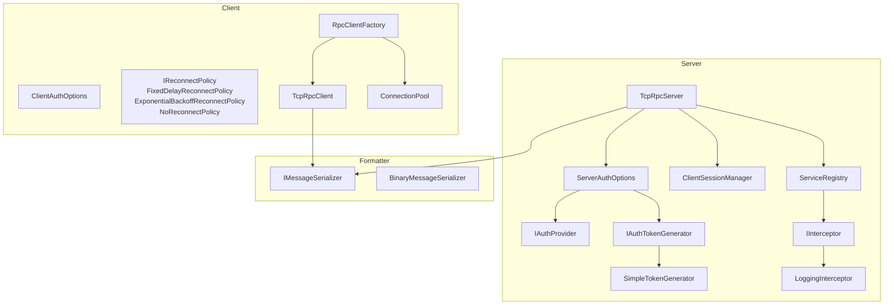
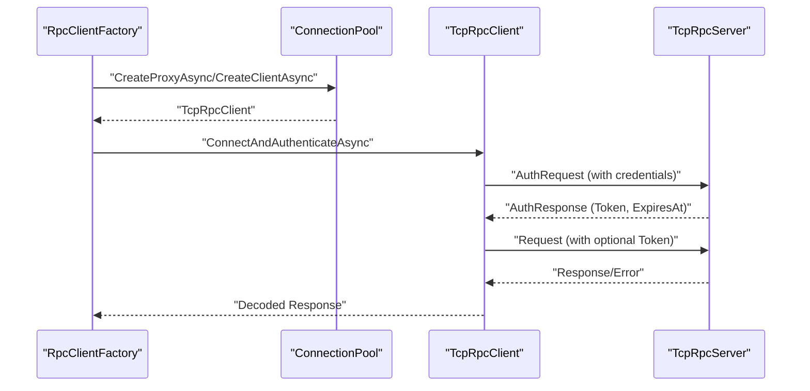
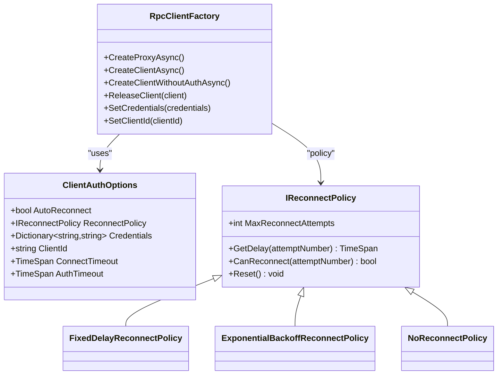
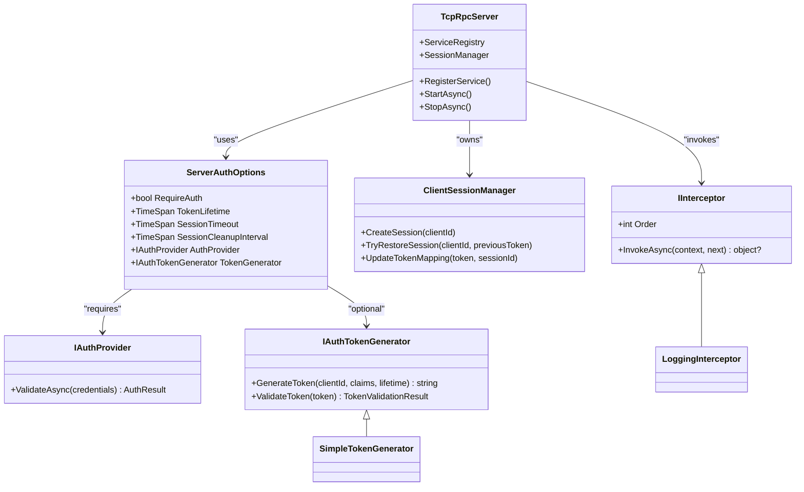
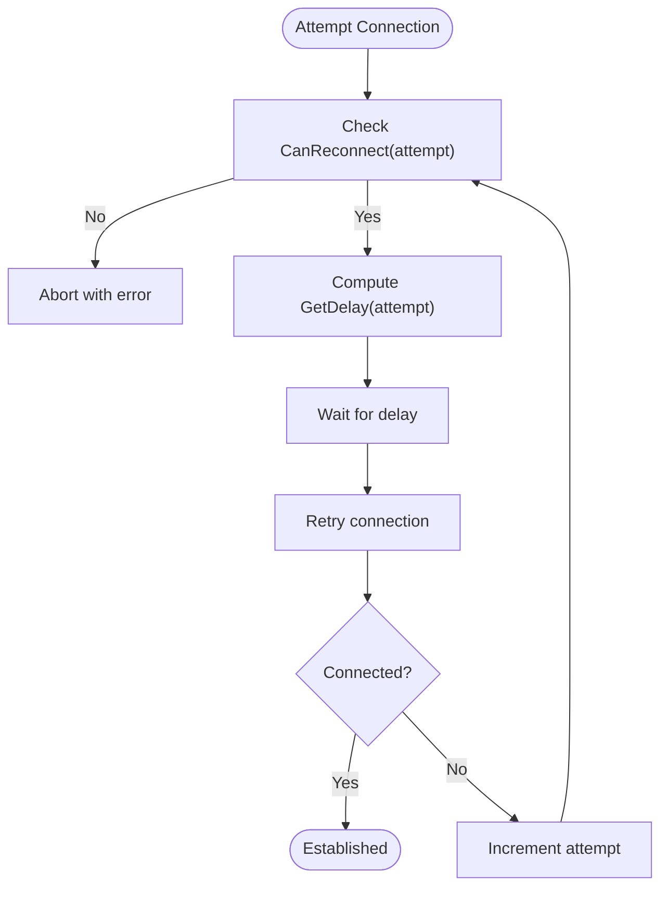
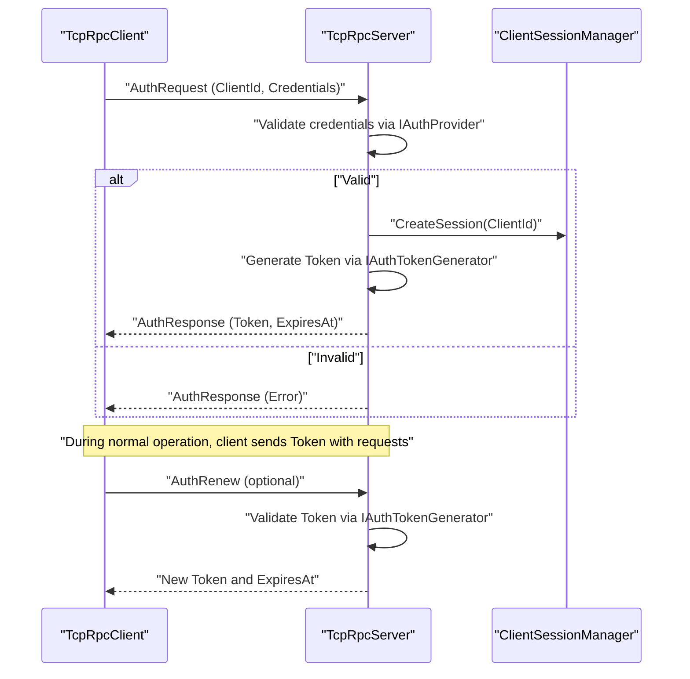
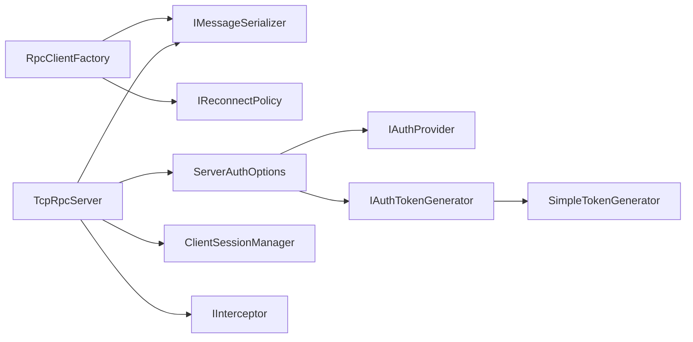

# Configuration & Customization

<cite>
**Referenced Files in This Document**
- [RpcClientFactory.cs](file://TcpRpc/Client/RpcClientFactory.cs)
- [ClientAuthOptions.cs](file://TcpRpc/Client/ClientAuthOptions.cs)
- [IReconnectPolicy.cs](file://TcpRpc/Client/IReconnectPolicy.cs)
- [TcpRpcServer.cs](file://TcpRpc/Server/TcpRpcServer.cs)
- [ServerAuthOptions.cs](file://TcpRpc/Server/ServerAuthOptions.cs)
- [IAuthProvider.cs](file://TcpRpc/Server/Auth/IAuthProvider.cs)
- [IAuthTokenGenerator.cs](file://TcpRpc/Server/Auth/IAuthTokenGenerator.cs)
- [SimpleTokenGenerator.cs](file://TcpRpc/Server/Auth/SimpleTokenGenerator.cs)
- [ClientSessionManager.cs](file://TcpRpc/Server/Auth/ClientSessionManager.cs)
- [IMessageSerializer.cs](file://TcpRpc/Formatter/IMessageSerializer.cs)
- [BinaryMessageSerializer.cs](file://TcpRpc/Formatter/BinaryMessageSerializer.cs)
- [IInterceptor.cs](file://TcpRpc/Server/IInterceptor.cs)
- [LoggingInterceptor.cs](file://TcpRpc.Server/LoggingInterceptor.cs)
</cite>

## Table of Contents
1. [Introduction](#introduction)
2. [Project Structure](#project-structure)
3. [Core Components](#core-components)
4. [Architecture Overview](#architecture-overview)
5. [Detailed Component Analysis](#detailed-component-analysis)
6. [Dependency Analysis](#dependency-analysis)
7. [Performance Considerations](#performance-considerations)
8. [Troubleshooting Guide](#troubleshooting-guide)
9. [Conclusion](#conclusion)
10. [Appendices](#appendices)

## Introduction
This document explains how to configure and customize TcpRpc for both client and server components. It covers connection parameters, authentication settings, performance tuning, and extensibility points such as reconnect policies, logging interceptors, and custom message serializers. It also documents the plugin-style extension points and provides best practices for production deployment, monitoring, and troubleshooting.

## Project Structure
TcpRpc is organized into client, server, formatter, and message packages. The server-side supports pluggable authentication providers and token generators, while the client supports configurable reconnect policies and connection pooling. Both sides rely on a pluggable IMessageSerializer for message serialization.

**Diagram sources**
- [RpcClientFactory.cs:18-31](file://TcpRpc/Client/RpcClientFactory.cs#L18-L31)
- [ClientAuthOptions.cs:6-37](file://TcpRpc/Client/ClientAuthOptions.cs#L6-L37)
- [IReconnectPolicy.cs:6-31](file://TcpRpc/Client/IReconnectPolicy.cs#L6-L31)
- [TcpRpcServer.cs:66-74](file://TcpRpc/Server/TcpRpcServer.cs#L66-L74)
- [ServerAuthOptions.cs:8-39](file://TcpRpc/Server/ServerAuthOptions.cs#L8-L39)
- [IAuthProvider.cs:32-40](file://TcpRpc/Server/Auth/IAuthProvider.cs#L32-L40)
- [IAuthTokenGenerator.cs:37-54](file://TcpRpc/Server/Auth/IAuthTokenGenerator.cs#L37-L54)
- [SimpleTokenGenerator.cs:11-25](file://TcpRpc/Server/Auth/SimpleTokenGenerator.cs#L11-L25)
- [ClientSessionManager.cs:9-25](file://TcpRpc/Server/Auth/ClientSessionManager.cs#L9-L25)
- [IMessageSerializer.cs:8-35](file://TcpRpc/Formatter/IMessageSerializer.cs#L8-L35)
- [BinaryMessageSerializer.cs:11-13](file://TcpRpc/Formatter/BinaryMessageSerializer.cs#L11-L13)
- [IInterceptor.cs:6-17](file://TcpRpc/Server/IInterceptor.cs#L6-L17)
- [LoggingInterceptor.cs:8-17](file://TcpRpc.Server/LoggingInterceptor.cs#L8-L17)

**Section sources**
- [RpcClientFactory.cs:18-31](file://TcpRpc/Client/RpcClientFactory.cs#L18-L31)
- [TcpRpcServer.cs:66-74](file://TcpRpc/Server/TcpRpcServer.cs#L66-L74)
- [IMessageSerializer.cs:8-35](file://TcpRpc/Formatter/IMessageSerializer.cs#L8-L35)

## Core Components
- Client side
  - RpcClientFactory: central factory for creating proxies and clients, optionally backed by a ConnectionPool.
  - ClientAuthOptions: controls auto-reconnect, reconnect policy, credentials, client ID, connect/auth timeouts.
  - IReconnectPolicy and implementations: fixed delay, exponential backoff, and no reconnect.
- Server side
  - TcpRpcServer: main server hosting, service registry, authentication, session management, and message processing.
  - ServerAuthOptions: toggles authentication, token lifetime, session timeout/cleanup, and pluggable AuthProvider/TokenGenerator.
  - IAuthProvider/IAuthTokenGenerator: authentication and token generation interfaces.
  - SimpleTokenGenerator: default HMAC-based JWT-like token generator.
  - ClientSessionManager: manages sessions, token-to-session mapping, and periodic cleanup.
- Serialization
  - IMessageSerializer: contract for serializing requests, responses, and auth messages.
  - BinaryMessageSerializer: concrete binary serializer with type markers and JSON fallback for complex objects.
- Interceptors
  - IInterceptor: AOP-style interception with invocation context.
  - LoggingInterceptor: example interceptor logging method calls and durations.

**Section sources**
- [RpcClientFactory.cs:9-110](file://TcpRpc/Client/RpcClientFactory.cs#L9-L110)
- [ClientAuthOptions.cs:6-37](file://TcpRpc/Client/ClientAuthOptions.cs#L6-L37)
- [IReconnectPolicy.cs:6-100](file://TcpRpc/Client/IReconnectPolicy.cs#L6-L100)
- [TcpRpcServer.cs:15-707](file://TcpRpc/Server/TcpRpcServer.cs#L15-L707)
- [ServerAuthOptions.cs:8-39](file://TcpRpc/Server/ServerAuthOptions.cs#L8-L39)
- [IAuthProvider.cs:32-40](file://TcpRpc/Server/Auth/IAuthProvider.cs#L32-L40)
- [IAuthTokenGenerator.cs:37-54](file://TcpRpc/Server/Auth/IAuthTokenGenerator.cs#L37-L54)
- [SimpleTokenGenerator.cs:11-163](file://TcpRpc/Server/Auth/SimpleTokenGenerator.cs#L11-L163)
- [ClientSessionManager.cs:9-188](file://TcpRpc/Server/Auth/ClientSessionManager.cs#L9-L188)
- [IMessageSerializer.cs:8-35](file://TcpRpc/Formatter/IMessageSerializer.cs#L8-L35)
- [BinaryMessageSerializer.cs:11-444](file://TcpRpc/Formatter/BinaryMessageSerializer.cs#L11-L444)
- [IInterceptor.cs:6-64](file://TcpRpc/Server/IInterceptor.cs#L6-L64)
- [LoggingInterceptor.cs:8-41](file://TcpRpc.Server/LoggingInterceptor.cs#L8-L41)

## Architecture Overview
The client and server communicate via a framed protocol with typed headers. The server supports optional authentication and session management, while the client supports configurable reconnect policies and connection pooling. Serialization is pluggable, enabling custom protocols or formats.

**Diagram sources**
- [RpcClientFactory.cs:36-61](file://TcpRpc/Client/RpcClientFactory.cs#L36-L61)
- [TcpRpcServer.cs:380-451](file://TcpRpc/Server/TcpRpcServer.cs#L380-L451)
- [IMessageSerializer.cs:10-34](file://TcpRpc/Formatter/IMessageSerializer.cs#L10-L34)

## Detailed Component Analysis

### Client Configuration and Customization
- Connection parameters
  - Host/port and optional connection pooling are configured via RpcClientFactory constructor parameters.
  - When pooling is enabled, RpcClientFactory delegates proxy/client creation to ConnectionPool.
- Authentication settings
  - ClientAuthOptions exposes Credentials, ClientId, ConnectTimeout, AuthTimeout, AutoReconnect, and ReconnectPolicy.
  - RpcClientFactory.SetCredentials and SetClientId update runtime credentials and client identity.
- Reconnect policies
  - IReconnectPolicy defines MaxReconnectAttempts, GetDelay, CanReconnect, and Reset.
  - Built-in implementations include FixedDelayReconnectPolicy, ExponentialBackoffReconnectPolicy, and NoReconnectPolicy.
- Performance tuning
  - Use RpcClientFactory with pooling for concurrent workloads.
  - Tune ClientAuthOptions.ConnectTimeout and AuthTimeout to match network conditions.
  - Choose an appropriate IReconnectPolicy to balance resilience and resource usage.

**Diagram sources**
- [RpcClientFactory.cs:9-110](file://TcpRpc/Client/RpcClientFactory.cs#L9-L110)
- [ClientAuthOptions.cs:6-37](file://TcpRpc/Client/ClientAuthOptions.cs#L6-L37)
- [IReconnectPolicy.cs:6-100](file://TcpRpc/Client/IReconnectPolicy.cs#L6-L100)

**Section sources**
- [RpcClientFactory.cs:18-104](file://TcpRpc/Client/RpcClientFactory.cs#L18-L104)
- [ClientAuthOptions.cs:6-37](file://TcpRpc/Client/ClientAuthOptions.cs#L6-L37)
- [IReconnectPolicy.cs:6-100](file://TcpRpc/Client/IReconnectPolicy.cs#L6-L100)

### Server Configuration and Customization
- Authentication and session management
  - ServerAuthOptions toggles RequireAuth, sets TokenLifetime, SessionTimeout, SessionCleanupInterval, and requires an IAuthProvider.
  - If TokenGenerator is not provided, TcpRpcServer initializes a default SimpleTokenGenerator.
  - ClientSessionManager handles session creation, token mapping, restoration, and periodic cleanup.
- Token generation/validation
  - SimpleTokenGenerator implements IAuthTokenGenerator with HMAC-SHA256 signing and Base64Url encoding.
- Message processing and service invocation
  - TcpRpcServer reads headers, authenticates if required, validates tokens, deserializes requests, invokes handlers/services, and writes responses.
- Interceptors
  - IInterceptor enables AOP-style cross-cutting concerns. LoggingInterceptor demonstrates timing and error logging around invocations.

**Diagram sources**
- [TcpRpcServer.cs:66-111](file://TcpRpc/Server/TcpRpcServer.cs#L66-L111)
- [ServerAuthOptions.cs:8-39](file://TcpRpc/Server/ServerAuthOptions.cs#L8-L39)
- [IAuthProvider.cs:32-40](file://TcpRpc/Server/Auth/IAuthProvider.cs#L32-L40)
- [IAuthTokenGenerator.cs:37-54](file://TcpRpc/Server/Auth/IAuthTokenGenerator.cs#L37-L54)
- [SimpleTokenGenerator.cs:11-25](file://TcpRpc/Server/Auth/SimpleTokenGenerator.cs#L11-L25)
- [ClientSessionManager.cs:9-25](file://TcpRpc/Server/Auth/ClientSessionManager.cs#L9-L25)
- [IInterceptor.cs:6-17](file://TcpRpc/Server/IInterceptor.cs#L6-L17)
- [LoggingInterceptor.cs:8-17](file://TcpRpc.Server/LoggingInterceptor.cs#L8-L17)

**Section sources**
- [TcpRpcServer.cs:85-171](file://TcpRpc/Server/TcpRpcServer.cs#L85-L171)
- [ServerAuthOptions.cs:8-39](file://TcpRpc/Server/ServerAuthOptions.cs#L8-L39)
- [SimpleTokenGenerator.cs:11-163](file://TcpRpc/Server/Auth/SimpleTokenGenerator.cs#L11-L163)
- [ClientSessionManager.cs:9-188](file://TcpRpc/Server/Auth/ClientSessionManager.cs#L9-L188)
- [IInterceptor.cs:6-64](file://TcpRpc/Server/IInterceptor.cs#L6-L64)
- [LoggingInterceptor.cs:8-41](file://TcpRpc.Server/LoggingInterceptor.cs#L8-L41)

### Extensibility Points and Customization Examples
- Custom authentication provider
  - Implement IAuthProvider.ValidateAsync to integrate with your credential store or identity system. Assign an instance to ServerAuthOptions.AuthProvider.
  - Reference: [IAuthProvider.cs:32-40](file://TcpRpc/Server/Auth/IAuthProvider.cs#L32-L40), [TcpRpcServer.cs:503-512](file://TcpRpc/Server/TcpRpcServer.cs#L503-L512)
- Custom token generator
  - Implement IAuthTokenGenerator.GenerateToken and ValidateToken to support alternative schemes. Assign to ServerAuthOptions.TokenGenerator or leave unset to use SimpleTokenGenerator.
  - Reference: [IAuthTokenGenerator.cs:37-54](file://TcpRpc/Server/Auth/IAuthTokenGenerator.cs#L37-L54), [TcpRpcServer.cs:108-111](file://TcpRpc/Server/TcpRpcServer.cs#L108-L111)
- Custom message serializer
  - Implement IMessageSerializer to define a custom framing or encoding. Replace BinaryMessageSerializer in server and client factories.
  - Reference: [IMessageSerializer.cs:8-35](file://TcpRpc/Formatter/IMessageSerializer.cs#L8-L35), [BinaryMessageSerializer.cs:11-444](file://TcpRpc/Formatter/BinaryMessageSerializer.cs#L11-L444)
- Logging interceptor
  - Implement IInterceptor and register it in the service registry to add cross-cutting logging, metrics, or tracing.
  - Reference: [IInterceptor.cs:6-64](file://TcpRpc/Server/IInterceptor.cs#L6-L64), [LoggingInterceptor.cs:8-41](file://TcpRpc.Server/LoggingInterceptor.cs#L8-L41)

**Section sources**
- [IAuthProvider.cs:32-40](file://TcpRpc/Server/Auth/IAuthProvider.cs#L32-L40)
- [IAuthTokenGenerator.cs:37-54](file://TcpRpc/Server/Auth/IAuthTokenGenerator.cs#L37-L54)
- [IMessageSerializer.cs:8-35](file://TcpRpc/Formatter/IMessageSerializer.cs#L8-L35)
- [BinaryMessageSerializer.cs:11-444](file://TcpRpc/Formatter/BinaryMessageSerializer.cs#L11-L444)
- [IInterceptor.cs:6-64](file://TcpRpc/Server/IInterceptor.cs#L6-L64)
- [LoggingInterceptor.cs:8-41](file://TcpRpc.Server/LoggingInterceptor.cs#L8-L41)

### Reconnect Policy Implementation Flow

**Diagram sources**
- [IReconnectPolicy.cs:6-31](file://TcpRpc/Client/IReconnectPolicy.cs#L6-L31)

**Section sources**
- [IReconnectPolicy.cs:6-100](file://TcpRpc/Client/IReconnectPolicy.cs#L6-L100)

### Authentication and Session Restoration Flow

**Diagram sources**
- [TcpRpcServer.cs:453-547](file://TcpRpc/Server/TcpRpcServer.cs#L453-L547)
- [ClientSessionManager.cs:30-42](file://TcpRpc/Server/Auth/ClientSessionManager.cs#L30-L42)
- [IAuthProvider.cs:32-40](file://TcpRpc/Server/Auth/IAuthProvider.cs#L32-L40)
- [IAuthTokenGenerator.cs:37-54](file://TcpRpc/Server/Auth/IAuthTokenGenerator.cs#L37-L54)

**Section sources**
- [TcpRpcServer.cs:380-451](file://TcpRpc/Server/TcpRpcServer.cs#L380-L451)
- [ClientSessionManager.cs:88-116](file://TcpRpc/Server/Auth/ClientSessionManager.cs#L88-L116)

## Dependency Analysis
- Client depends on IMessageSerializer and IReconnectPolicy; RpcClientFactory orchestrates connections and proxies.
- Server depends on IMessageSerializer, ServerAuthOptions, IAuthProvider, IAuthTokenGenerator, and ClientSessionManager.
- Interceptors are invoked by the service registry during request processing.

**Diagram sources**
- [RpcClientFactory.cs:18-31](file://TcpRpc/Client/RpcClientFactory.cs#L18-L31)
- [TcpRpcServer.cs:66-74](file://TcpRpc/Server/TcpRpcServer.cs#L66-L74)
- [ServerAuthOptions.cs:8-39](file://TcpRpc/Server/ServerAuthOptions.cs#L8-L39)
- [IAuthProvider.cs:32-40](file://TcpRpc/Server/Auth/IAuthProvider.cs#L32-L40)
- [IAuthTokenGenerator.cs:37-54](file://TcpRpc/Server/Auth/IAuthTokenGenerator.cs#L37-L54)
- [SimpleTokenGenerator.cs:11-25](file://TcpRpc/Server/Auth/SimpleTokenGenerator.cs#L11-L25)
- [ClientSessionManager.cs:9-25](file://TcpRpc/Server/Auth/ClientSessionManager.cs#L9-L25)
- [IMessageSerializer.cs:8-35](file://TcpRpc/Formatter/IMessageSerializer.cs#L8-L35)
- [IInterceptor.cs:6-17](file://TcpRpc/Server/IInterceptor.cs#L6-L17)

**Section sources**
- [RpcClientFactory.cs:18-31](file://TcpRpc/Client/RpcClientFactory.cs#L18-L31)
- [TcpRpcServer.cs:66-74](file://TcpRpc/Server/TcpRpcServer.cs#L66-L74)

## Performance Considerations
- Connection pooling
  - Enable pooling via RpcClientFactory constructor to reduce connection overhead under load.
  - Tune pool size according to concurrency needs and server capacity.
- Serialization
  - BinaryMessageSerializer minimizes overhead with typed markers and JSON fallback for complex types.
  - Consider implementing a custom IMessageSerializer tailored to your payload shapes for further gains.
- Authentication and sessions
  - Adjust ServerAuthOptions.TokenLifetime and SessionTimeout to balance security and performance.
  - Increase SessionCleanupInterval to reduce cleanup overhead if acceptable.
- Reconnect policies
  - Prefer ExponentialBackoffReconnectPolicy for transient failures; tune MaxReconnectAttempts and delays to avoid thundering herds.
- Interceptors
  - Keep logging interceptors lightweight; avoid heavy synchronous operations inside InvokeAsync.

[No sources needed since this section provides general guidance]

## Troubleshooting Guide
- Authentication failures
  - Verify IAuthProvider returns valid AuthResult with proper ClientId and Claims.
  - Ensure IAuthTokenGenerator is compatible between server and client; check token format and expiration.
  - References: [IAuthProvider.cs:32-40](file://TcpRpc/Server/Auth/IAuthProvider.cs#L32-L40), [IAuthTokenGenerator.cs:37-54](file://TcpRpc/Server/Auth/IAuthTokenGenerator.cs#L37-L54), [SimpleTokenGenerator.cs:79-137](file://TcpRpc/Server/Auth/SimpleTokenGenerator.cs#L79-L137)
- Session restoration issues
  - Confirm ClientId matches between client and server during AuthRequest.
  - Check SessionTimeout and cleanup intervals; expired sessions cannot be restored.
  - References: [TcpRpcServer.cs:466-500](file://TcpRpc/Server/TcpRpcServer.cs#L466-L500), [ClientSessionManager.cs:88-116](file://TcpRpc/Server/Auth/ClientSessionManager.cs#L88-L116)
- Serialization errors
  - Ensure IMessageSerializer implementations on client and server match.
  - Validate complex object types are resolvable on deserialization.
  - References: [IMessageSerializer.cs:8-35](file://TcpRpc/Formatter/IMessageSerializer.cs#L8-L35), [BinaryMessageSerializer.cs:300-314](file://TcpRpc/Formatter/BinaryMessageSerializer.cs#L300-L314)
- Reconnect storms
  - Reduce MaxReconnectAttempts or switch to FixedDelayReconnectPolicy for stability.
  - References: [IReconnectPolicy.cs:6-100](file://TcpRpc/Client/IReconnectPolicy.cs#L6-L100)
- Interceptor conflicts
  - Order interceptors appropriately; ensure logging or metrics do not block requests.
  - References: [IInterceptor.cs:6-17](file://TcpRpc/Server/IInterceptor.cs#L6-L17), [LoggingInterceptor.cs:8-41](file://TcpRpc.Server/LoggingInterceptor.cs#L8-L41)

**Section sources**
- [IAuthProvider.cs:32-40](file://TcpRpc/Server/Auth/IAuthProvider.cs#L32-L40)
- [IAuthTokenGenerator.cs:37-54](file://TcpRpc/Server/Auth/IAuthTokenGenerator.cs#L37-L54)
- [SimpleTokenGenerator.cs:79-137](file://TcpRpc/Server/Auth/SimpleTokenGenerator.cs#L79-L137)
- [TcpRpcServer.cs:466-500](file://TcpRpc/Server/TcpRpcServer.cs#L466-L500)
- [ClientSessionManager.cs:88-116](file://TcpRpc/Server/Auth/ClientSessionManager.cs#L88-L116)
- [IMessageSerializer.cs:8-35](file://TcpRpc/Formatter/IMessageSerializer.cs#L8-L35)
- [BinaryMessageSerializer.cs:300-314](file://TcpRpc/Formatter/BinaryMessageSerializer.cs#L300-L314)
- [IReconnectPolicy.cs:6-100](file://TcpRpc/Client/IReconnectPolicy.cs#L6-L100)
- [IInterceptor.cs:6-17](file://TcpRpc/Server/IInterceptor.cs#L6-L17)
- [LoggingInterceptor.cs:8-41](file://TcpRpc.Server/LoggingInterceptor.cs#L8-L41)

## Conclusion
TcpRpc offers a flexible configuration model for clients and servers, with strong extensibility points for authentication, serialization, and interceptors. By tuning reconnect policies, authentication lifetimes, and serialization formats, teams can optimize for reliability, security, and performance. The provided interfaces enable seamless integration with existing identity and observability systems.

[No sources needed since this section summarizes without analyzing specific files]

## Appendices

### Best Practices for Production
- Security
  - Use a robust IAuthProvider and a secure IAuthTokenGenerator; rotate keys regularly.
  - Enforce RequireAuth and set reasonable TokenLifetime and SessionTimeout.
- Reliability
  - Enable connection pooling on the client; choose ExponentialBackoffReconnectPolicy for transient faults.
  - Monitor ActiveConnections and session counts; adjust cleanup intervals accordingly.
- Observability
  - Add IInterceptor-based logging/metrics; ensure low-latency implementations.
- Compatibility
  - Keep IMessageSerializer unchanged across environments; version message contracts carefully.
  - Validate token formats and claims consistently between client and server.

[No sources needed since this section provides general guidance]