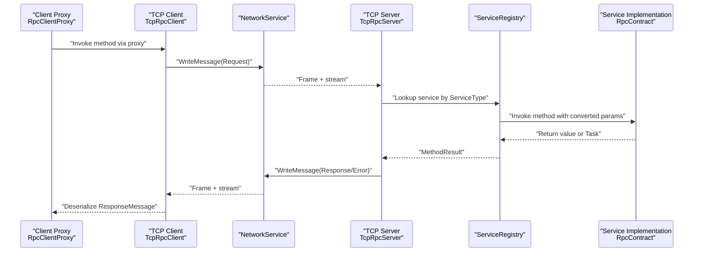
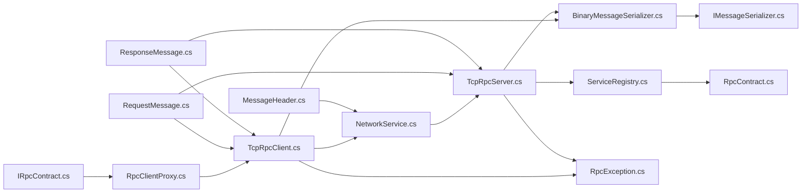

# Contracts & API Reference

<cite>
**Referenced Files in This Document**
- [IRpcContract.cs](file://TcpRpc.Contract/IRpcContract.cs)
- [RpcRequest.cs](file://TcpRpc.Contract/RpcRequest.cs)
- [RpcResponse.cs](file://TcpRpc.Contract/RpcResponse.cs)
- [RpcContract.cs](file://TcpRpc.Server/RpcContract.cs)
- [TcpRpcServer.cs](file://TcpRpc/TcpRpcServer.cs)
- [TcpRpcClient.cs](file://TcpRpc/TcpRpcClient.cs)
- [RpcClientProxy.cs](file://TcpRpc.Client/RpcClientProxy.cs)
- [IMessageSerializer.cs](file://TcpRpc/Formatter/IMessageSerializer.cs)
- [BinaryMessageSerializer.cs](file://TcpRpc/Formatter/BinaryMessageSerializer.cs)
- [RequestMessage.cs](file://TcpRpc/Message/RequestMessage.cs)
- [ResponseMessage.cs](file://TcpRpc/Message/ResponseMessage.cs)
- [MessageHeader.cs](file://TcpRpc/Message/MessageHeader.cs)
- [NetworkService.cs](file://TcpRpc/Network/NetworkService.cs)
- [ServiceRegistry.cs](file://TcpRpc/Server/ServiceRegistry.cs)
- [RpcException.cs](file://TcpRpc/RpcException.cs)
</cite>

## Table of Contents
1. [Introduction](#introduction)
2. [Project Structure](#project-structure)
3. [Core Components](#core-components)
4. [Architecture Overview](#architecture-overview)
5. [Detailed Component Analysis](#detailed-component-analysis)
6. [Dependency Analysis](#dependency-analysis)
7. [Performance Considerations](#performance-considerations)
8. [Troubleshooting Guide](#troubleshooting-guide)
9. [Conclusion](#conclusion)

## Introduction
This document provides a comprehensive API reference for the TcpRpc contracts and interfaces. It focuses on:
- The IRpcContract interface and its method signatures
- The RpcRequest and RpcResponse data structures for legacy compatibility
- The modern RequestMessage and ResponseMessage used by the runtime
- Parameter serialization, response formatting, and error propagation
- How contracts relate to service implementations
- Usage patterns for synchronous and asynchronous methods
- Guidelines for designing robust contracts, versioning, and backward compatibility
- Validation approaches and performance optimization techniques

## Project Structure
The TcpRpc solution separates concerns across contracts, client, server, formatter, message, and network layers. Contracts define the service surface; the client and server implement transport and invocation; the formatter serializes requests/responses; the network layer handles framing and IO.

```mermaid
graph TB
subgraph "Contracts"
IRPC["IRpcContract.cs"]
RReq["RpcRequest.cs"]
RRes["RpcResponse.cs"]
end
subgraph "Client"
Proxy["RpcClientProxy.cs"]
Client["TcpRpcClient.cs"]
end
subgraph "Server"
Srv["TcpRpcServer.cs"]
Impl["RpcContract.cs"]
Reg["ServiceRegistry.cs"]
end
subgraph "Runtime"
ReqMsg["RequestMessage.cs"]
ResMsg["ResponseMessage.cs"]
Header["MessageHeader.cs"]
Net["NetworkService.cs"]
Ser["BinaryMessageSerializer.cs"]
ISer["IMessageSerializer.cs"]
Ex["RpcException.cs"]
end
IRPC --> Proxy
Proxy --> Client
Client --> Net
Net --> Srv
Srv --> Reg
Reg --> Impl
Ser --> Client
Ser --> Srv
ISer --> Ser
ReqMsg --> Client
ReqMsg --> Srv
ResMsg --> Client
ResMsg --> Srv
Header --> Net
Ex --> Client
Ex --> Srv
```

**Diagram sources**
- [IRpcContract.cs:1-61](file://TcpRpc.Contract/IRpcContract.cs#L1-L61)
- [RpcRequest.cs:1-11](file://TcpRpc.Contract/RpcRequest.cs#L1-L11)
- [RpcResponse.cs:1-7](file://TcpRpc.Contract/RpcResponse.cs#L1-L7)
- [RpcClientProxy.cs:1-160](file://TcpRpc.Client/RpcClientProxy.cs#L1-L160)
- [TcpRpcClient.cs:1-684](file://TcpRpc/TcpRpcClient.cs#L1-L684)
- [TcpRpcServer.cs:1-707](file://TcpRpc/TcpRpcServer.cs#L1-L707)
- [RpcContract.cs:1-83](file://TcpRpc.Server/RpcContract.cs#L1-L83)
- [ServiceRegistry.cs:1-272](file://TcpRpc/Server/ServiceRegistry.cs#L1-L272)
- [RequestMessage.cs:1-18](file://TcpRpc/Message/RequestMessage.cs#L1-L18)
- [ResponseMessage.cs:1-30](file://TcpRpc/Message/ResponseMessage.cs#L1-L30)
- [MessageHeader.cs:1-73](file://TcpRpc/Message/MessageHeader.cs#L1-L73)
- [NetworkService.cs:1-99](file://TcpRpc/Network/NetworkService.cs#L1-L99)
- [BinaryMessageSerializer.cs:1-444](file://TcpRpc/Formatter/BinaryMessageSerializer.cs#L1-L444)
- [IMessageSerializer.cs:1-35](file://TcpRpc/Formatter/IMessageSerializer.cs#L1-L35)
- [RpcException.cs:1-37](file://TcpRpc/RpcException.cs#L1-L37)

**Section sources**
- [IRpcContract.cs:1-61](file://TcpRpc.Contract/IRpcContract.cs#L1-L61)
- [RpcRequest.cs:1-11](file://TcpRpc.Contract/RpcRequest.cs#L1-L11)
- [RpcResponse.cs:1-7](file://TcpRpc.Contract/RpcResponse.cs#L1-L7)
- [RpcClientProxy.cs:1-160](file://TcpRpc.Client/RpcClientProxy.cs#L1-L160)
- [TcpRpcClient.cs:1-684](file://TcpRpc/TcpRpcClient.cs#L1-L684)
- [TcpRpcServer.cs:1-707](file://TcpRpc/TcpRpcServer.cs#L1-L707)
- [RpcContract.cs:1-83](file://TcpRpc.Server/RpcContract.cs#L1-L83)
- [ServiceRegistry.cs:1-272](file://TcpRpc/Server/ServiceRegistry.cs#L1-L272)
- [RequestMessage.cs:1-18](file://TcpRpc/Message/RequestMessage.cs#L1-L18)
- [ResponseMessage.cs:1-30](file://TcpRpc/Message/ResponseMessage.cs#L1-L30)
- [MessageHeader.cs:1-73](file://TcpRpc/Message/MessageHeader.cs#L1-L73)
- [NetworkService.cs:1-99](file://TcpRpc/Network/NetworkService.cs#L1-L99)
- [BinaryMessageSerializer.cs:1-444](file://TcpRpc/Formatter/BinaryMessageSerializer.cs#L1-L444)
- [IMessageSerializer.cs:1-35](file://TcpRpc/Formatter/IMessageSerializer.cs#L1-L35)
- [RpcException.cs:1-37](file://TcpRpc/RpcException.cs#L1-L37)

## Core Components
This section documents the primary contract and data structures, along with their roles in the system.

- IRpcContract
  - Purpose: Defines the service contract surface for RPC calls.
  - Methods:
    - Call(RpcRequest): Legacy synchronous call returning RpcResponse.
    - Add(int, int): Returns int.
    - Greet(string, string): Returns string.
    - LogMessage(string, LogLevel): void.
    - ProcessAsync(string, int): Returns Task<string>.
    - ProcessAsyncWithoutReturn(string, int): Returns Task.
    - GetUserInfo(int, bool): Returns UserInfo.
    - ThrowException(string): void.
  - Notes:
    - Supports synchronous, asynchronous, void-returning, and complex-object-returning methods.
    - Includes an enum LogLevel and a data class UserInfo for payload types.

- RpcRequest and RpcResponse (Legacy)
  - RpcRequest: Contains a single required string Message for simple legacy calls.
  - RpcResponse: Contains a single required string Message for simple legacy responses.

- Modern RequestMessage and ResponseMessage
  - RequestMessage: Carries Method, ServiceType, Parameters, and ParameterTypes for typed invocation.
  - ResponseMessage: Carries Success, Error, ExceptionType, StackTrace, Data, DataType, and IsVoid for structured results and errors.

- MessageHeader and NetworkService
  - MessageHeader: Framing metadata including Type, MessageId, ContentLength, Flags, and optional Token.
  - NetworkService: Writes/reads framed messages with defensive checks and streaming reads.

- BinaryMessageSerializer and IMessageSerializer
  - IMessageSerializer: Contract for serializing/deserializing RequestMessage, ResponseMessage, and auth messages.
  - BinaryMessageSerializer: Concrete implementation using a compact binary format with type markers and JSON fallback for complex objects.

- RpcException
  - Transportable exception carrying RemoteExceptionType and RemoteStackTrace for faithful client-side exception reconstruction.

**Section sources**
- [IRpcContract.cs:6-44](file://TcpRpc.Contract/IRpcContract.cs#L6-L44)
- [IRpcContract.cs:46-61](file://TcpRpc.Contract/IRpcContract.cs#L46-L61)
- [RpcRequest.cs:6-9](file://TcpRpc.Contract/RpcRequest.cs#L6-L9)
- [RpcResponse.cs:4-7](file://TcpRpc.Contract/RpcResponse.cs#L4-L7)
- [RequestMessage.cs:6-18](file://TcpRpc/Message/RequestMessage.cs#L6-L18)
- [ResponseMessage.cs:6-30](file://TcpRpc/Message/ResponseMessage.cs#L6-L30)
- [MessageHeader.cs:9-73](file://TcpRpc/Message/MessageHeader.cs#L9-L73)
- [NetworkService.cs:7-99](file://TcpRpc/Network/NetworkService.cs#L7-L99)
- [IMessageSerializer.cs:8-35](file://TcpRpc/Formatter/IMessageSerializer.cs#L8-L35)
- [BinaryMessageSerializer.cs:11-444](file://TcpRpc/Formatter/BinaryMessageSerializer.cs#L11-L444)
- [RpcException.cs:6-37](file://TcpRpc/RpcException.cs#L6-L37)

## Architecture Overview
The system uses a client-server RPC model with a binary protocol:
- Clients generate RequestMessage instances and send them via TcpRpcClient.
- Servers receive framed messages, deserialize them, and dispatch to registered services.
- Responses are serialized back and delivered to the client, which reconstructs results or exceptions.



**Diagram sources**
- [RpcClientProxy.cs:38-126](file://TcpRpc.Client/RpcClientProxy.cs#L38-L126)
- [TcpRpcClient.cs:324-407](file://TcpRpc/TcpRpcClient.cs#L324-L407)
- [NetworkService.cs:10-52](file://TcpRpc/Network/NetworkService.cs#L10-L52)
- [TcpRpcServer.cs:380-451](file://TcpRpc/TcpRpcServer.cs#L380-L451)
- [ServiceRegistry.cs:72-138](file://TcpRpc/Server/ServiceRegistry.cs#L72-L138)
- [RpcContract.cs:19-82](file://TcpRpc.Server/RpcContract.cs#L19-L82)

## Detailed Component Analysis

### IRpcContract Interface
- Design intent: Provide a canonical contract surface for RPC services.
- Supported patterns:
  - Synchronous methods returning primitives, strings, or complex objects.
  - Asynchronous methods returning Task or Task<T>.
  - Methods with multiple parameters and void return.
  - Methods that throw exceptions to propagate errors.

Usage patterns:
- Define a service interface that inherits from IRpcContract or another marker interface.
- Implement methods with clear parameter and return types.
- For complex objects, ensure types are serializable and versioned appropriately.

**Section sources**
- [IRpcContract.cs:6-44](file://TcpRpc.Contract/IRpcContract.cs#L6-L44)
- [IRpcContract.cs:46-61](file://TcpRpc.Contract/IRpcContract.cs#L46-L61)

### RpcRequest and RpcResponse (Legacy)
- RpcRequest: Single-message payload for simple legacy calls.
- RpcResponse: Single-message response for simple legacy responses.
- These types are compatible with older clients but lack multi-parameter support.

Guidelines:
- Prefer modern RequestMessage for new development.
- If maintaining backward compatibility, ensure RpcRequest/RpcResponse mapping remains stable.

**Section sources**
- [RpcRequest.cs:6-9](file://TcpRpc.Contract/RpcRequest.cs#L6-L9)
- [RpcResponse.cs:4-7](file://TcpRpc.Contract/RpcResponse.cs#L4-L7)

### RequestMessage and ResponseMessage
- RequestMessage carries:
  - ServiceType: Full type name of the target interface.
  - Method: Name of the method to invoke.
  - Parameters: Array of arguments.
  - ParameterTypes: Array of argument type names for deserialization.
- ResponseMessage carries:
  - Success: Whether the call succeeded.
  - Error: Human-readable error message.
  - ExceptionType and StackTrace: For exception propagation.
  - Data and DataType: Serialized return value and its type.
  - IsVoid: Indicates void-returning methods.

Serialization:
- BinaryMessageSerializer writes/reads these structures efficiently, with type markers and JSON fallback for complex objects.

**Section sources**
- [RequestMessage.cs:6-18](file://TcpRpc/Message/RequestMessage.cs#L6-L18)
- [ResponseMessage.cs:6-30](file://TcpRpc/Message/ResponseMessage.cs#L6-L30)
- [BinaryMessageSerializer.cs:30-112](file://TcpRpc/Formatter/BinaryMessageSerializer.cs#L30-L112)

### MessageHeader and NetworkService
- MessageHeader includes:
  - Type, MessageId, ContentLength, Flags, Token.
  - Flags bits for void return, exception presence, and compression.
- NetworkService:
  - Writes/reads header length prefix and header bytes.
  - Reads/writes content safely with cancellation and defensive checks.

**Section sources**
- [MessageHeader.cs:9-73](file://TcpRpc/Message/MessageHeader.cs#L9-L73)
- [NetworkService.cs:10-99](file://TcpRpc/Network/NetworkService.cs#L10-L99)

### BinaryMessageSerializer and IMessageSerializer
- IMessageSerializer defines the serialization contract for all message types.
- BinaryMessageSerializer:
  - Uses type markers for primitives and arrays.
  - Falls back to JSON for complex objects, storing assembly-qualified type names.
  - Ensures deterministic framing and safe deserialization.

Validation and safety:
- Validates header sizes and content lengths.
- Throws on invalid data to prevent corruption.

**Section sources**
- [IMessageSerializer.cs:8-35](file://TcpRpc/Formatter/IMessageSerializer.cs#L8-L35)
- [BinaryMessageSerializer.cs:11-444](file://TcpRpc/Formatter/BinaryMessageSerializer.cs#L11-L444)

### RpcClientProxy
- Purpose: Provides a strongly-typed proxy over TcpRpcClient.
- Behavior:
  - Captures method info and parameters.
  - Builds RequestMessage and sends via TcpRpcClient.
  - Converts ResponseMessage into return values or throws RpcException.
  - Handles Task<T>, Task, and void returns.

Error propagation:
- On response.Success=false, constructs RpcException with RemoteExceptionType and RemoteStackTrace.

**Section sources**
- [RpcClientProxy.cs:11-160](file://TcpRpc.Client/RpcClientProxy.cs#L11-L160)

### TcpRpcClient
- Responsibilities:
  - Manages connection lifecycle and authentication.
  - Sends framed requests and receives responses.
  - Maintains pending request maps keyed by MessageId.
  - Handles timeouts, connection loss, and automatic reconnection policies.
- Authentication:
  - Sends AuthRequest and stores token for subsequent requests.

Error handling:
- Wraps server errors in RpcException with exception type and stack trace.

**Section sources**
- [TcpRpcClient.cs:10-684](file://TcpRpc/TcpRpcClient.cs#L10-L684)

### TcpRpcServer
- Responsibilities:
  - Accepts connections and processes messages.
  - Routes requests to either legacy handlers or ServiceRegistry.
  - Serializes responses and writes them back to clients.
- Service routing:
  - First tries legacy method handlers by name.
  - Otherwise resolves by ServiceType and invokes via ServiceRegistry.

Error handling:
- Catches exceptions and returns structured error responses with exception metadata.

**Section sources**
- [TcpRpcServer.cs:15-707](file://TcpRpc/TcpRpcServer.cs#L15-L707)

### ServiceRegistry and RpcContract
- ServiceRegistry:
  - Registers implementations by interface type.
  - Builds method maps and converts parameters by type names.
  - Executes methods via reflection, handling Task-returning methods and interceptors.
- RpcContract:
  - Example implementation of IRpcContract with logging and exception throwing.

**Section sources**
- [ServiceRegistry.cs:10-272](file://TcpRpc/Server/ServiceRegistry.cs#L10-L272)
- [RpcContract.cs:10-83](file://TcpRpc.Server/RpcContract.cs#L10-L83)

### RpcException
- Purpose: Reconstructs server-side exceptions on the client.
- Properties:
  - RemoteExceptionType, RemoteStackTrace, and overridden ToString/StackTrace.

**Section sources**
- [RpcException.cs:6-37](file://TcpRpc/RpcException.cs#L6-L37)

## Dependency Analysis
The following diagram shows key dependencies among components:



**Diagram sources**
- [IRpcContract.cs:6-44](file://TcpRpc.Contract/IRpcContract.cs#L6-L44)
- [RpcClientProxy.cs:11-160](file://TcpRpc.Client/RpcClientProxy.cs#L11-L160)
- [TcpRpcClient.cs:10-684](file://TcpRpc/TcpRpcClient.cs#L10-L684)
- [TcpRpcServer.cs:15-707](file://TcpRpc/TcpRpcServer.cs#L15-L707)
- [ServiceRegistry.cs:10-272](file://TcpRpc/Server/ServiceRegistry.cs#L10-L272)
- [RpcContract.cs:10-83](file://TcpRpc.Server/RpcContract.cs#L10-L83)
- [BinaryMessageSerializer.cs:11-444](file://TcpRpc/Formatter/BinaryMessageSerializer.cs#L11-L444)
- [IMessageSerializer.cs:8-35](file://TcpRpc/Formatter/IMessageSerializer.cs#L8-L35)
- [RpcException.cs:6-37](file://TcpRpc/RpcException.cs#L6-L37)
- [RequestMessage.cs:6-18](file://TcpRpc/Message/RequestMessage.cs#L6-L18)
- [ResponseMessage.cs:6-30](file://TcpRpc/Message/ResponseMessage.cs#L6-L30)
- [MessageHeader.cs:9-73](file://TcpRpc/Message/MessageHeader.cs#L9-L73)

**Section sources**
- [IRpcContract.cs:6-44](file://TcpRpc.Contract/IRpcContract.cs#L6-L44)
- [RpcClientProxy.cs:11-160](file://TcpRpc.Client/RpcClientProxy.cs#L11-L160)
- [TcpRpcClient.cs:10-684](file://TcpRpc/TcpRpcClient.cs#L10-L684)
- [TcpRpcServer.cs:15-707](file://TcpRpc/TcpRpcServer.cs#L15-L707)
- [ServiceRegistry.cs:10-272](file://TcpRpc/Server/ServiceRegistry.cs#L10-L272)
- [RpcContract.cs:10-83](file://TcpRpc.Server/RpcContract.cs#L10-L83)
- [BinaryMessageSerializer.cs:11-444](file://TcpRpc/Formatter/BinaryMessageSerializer.cs#L11-L444)
- [IMessageSerializer.cs:8-35](file://TcpRpc/Formatter/IMessageSerializer.cs#L8-L35)
- [RpcException.cs:6-37](file://TcpRpc/RpcException.cs#L6-L37)
- [RequestMessage.cs:6-18](file://TcpRpc/Message/RequestMessage.cs#L6-L18)
- [ResponseMessage.cs:6-30](file://TcpRpc/Message/ResponseMessage.cs#L6-L30)
- [MessageHeader.cs:9-73](file://TcpRpc/Message/MessageHeader.cs#L9-L73)

## Performance Considerations
- Serialization efficiency:
  - Use BinaryMessageSerializer for compact binary payloads.
  - Prefer primitive and string parameters for minimal overhead.
  - Avoid excessively large objects; consider pagination or streaming.
- Asynchronous design:
  - Implement async methods (Task/Task<T>) to avoid blocking threads.
  - Use RpcClientProxy’s Task<T> conversion to maintain async semantics.
- Concurrency:
  - TcpRpcClient and TcpRpcServer manage concurrent clients and requests with thread-safe maps and locks.
- Backpressure and timeouts:
  - Configure request timeouts and retry policies in TcpRpcClient.
  - Monitor ActiveConnections on TcpRpcServer to detect overload.
- Compression:
  - MessageHeader supports a compression flag; implement compression-aware serializers if needed.

[No sources needed since this section provides general guidance]

## Troubleshooting Guide
Common issues and resolutions:
- Authentication failures:
  - Verify credentials and token generation/renewal.
  - Check server logs for auth provider errors.
- Timeouts:
  - Increase request timeouts or reduce payload size.
  - Ensure network stability and firewall rules.
- Type mismatches:
  - Confirm ParameterTypes match the service implementation.
  - Use assembly-qualified type names for complex objects.
- Exceptions:
  - RpcException on client mirrors RemoteExceptionType and RemoteStackTrace.
  - Inspect server logs for stack traces and error messages.
- Connection drops:
  - TcpRpcClient attempts automatic reconnection based on policy.
  - Pending requests are cleared on disconnect; callers should retry.

**Section sources**
- [TcpRpcClient.cs:144-227](file://TcpRpc/TcpRpcClient.cs#L144-L227)
- [TcpRpcClient.cs:324-407](file://TcpRpc/TcpRpcClient.cs#L324-L407)
- [TcpRpcServer.cs:549-614](file://TcpRpc/TcpRpcServer.cs#L549-L614)
- [RpcException.cs:18-36](file://TcpRpc/RpcException.cs#L18-L36)

## Conclusion
TcpRpc provides a flexible, extensible RPC framework:
- Contracts define the service surface with support for sync, async, void, and complex return types.
- The client and server communicate using a compact binary protocol with robust framing and error propagation.
- ServiceRegistry enables dynamic invocation and interception.
- Design contracts with versioning and backward compatibility in mind, leverage async patterns, and apply the performance and troubleshooting guidance for production-grade deployments.