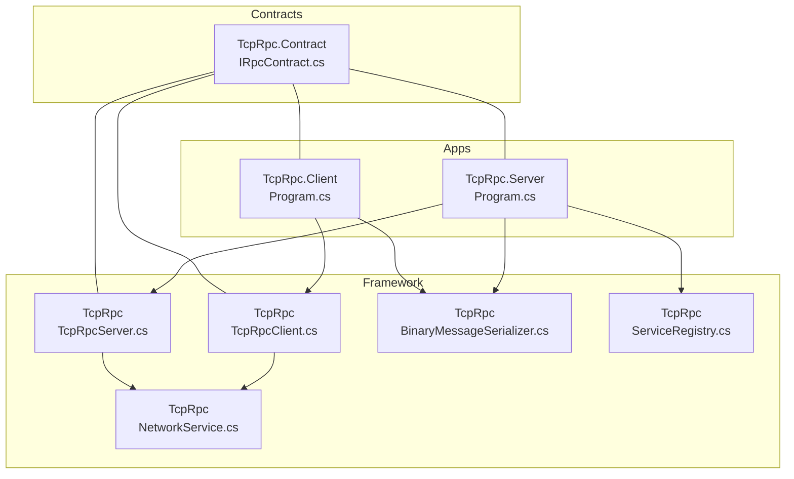
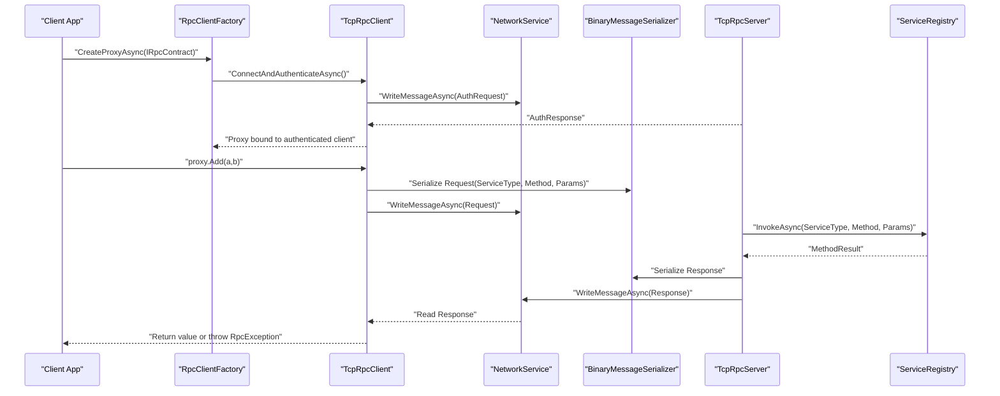
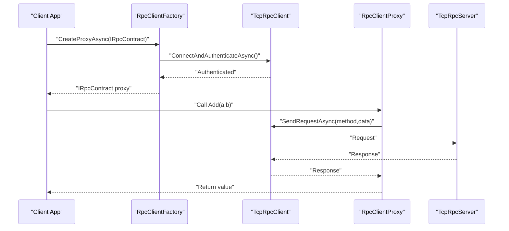
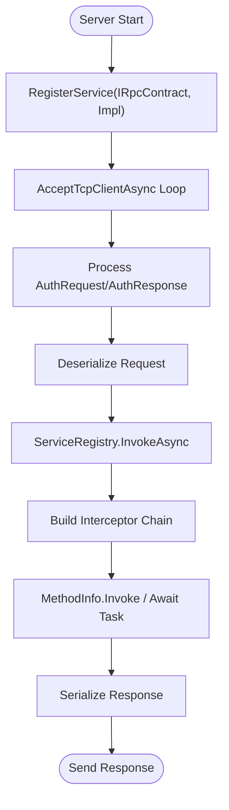
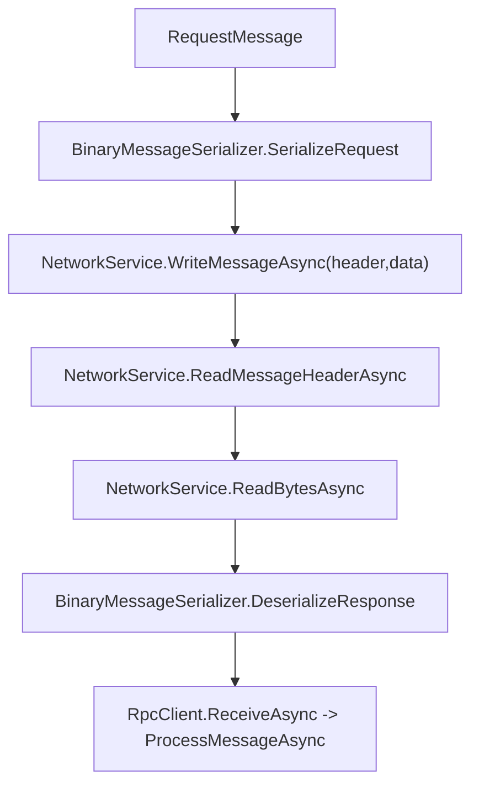
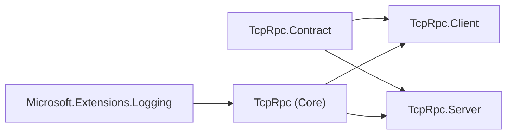

# Getting Started

<cite>
**Referenced Files in This Document**
- [TcpRpc.csproj](file://TcpRpc/TcpRpc.csproj)
- [TcpRpc.Contract.csproj](file://TcpRpc.Contract/TcpRpc.Contract.csproj)
- [TcpRpc.Client.csproj](file://TcpRpc.Client/TcpRpc.Client.csproj)
- [TcpRpc.Server.csproj](file://TcpRpc.Server/TcpRpc.Server.csproj)
- [TcpRpcClient.cs](file://TcpRpc/Client/TcpRpcClient.cs)
- [RpcClientFactory.cs](file://TcpRpc/Client/RpcClientFactory.cs)
- [BinaryMessageSerializer.cs](file://TcpRpc/Formatter/BinaryMessageSerializer.cs)
- [NetworkService.cs](file://TcpRpc/Network/NetworkService.cs)
- [TcpRpcServer.cs](file://TcpRpc/Server/TcpRpcServer.cs)
- [ServiceRegistry.cs](file://TcpRpc/Server/ServiceRegistry.cs)
- [Program.cs (Server)](file://TcpRpc.Server/Program.cs)
- [Program.cs (Client)](file://TcpRpc.Client/Program.cs)
- [IRpcContract.cs](file://TcpRpc.Contract/IRpcContract.cs)
- [RpcRequest.cs](file://TcpRpc.Contract/RpcRequest.cs)
</cite>

## Table of Contents
1. [Introduction](#introduction)
2. [Project Structure](#project-structure)
3. [Core Components](#core-components)
4. [Architecture Overview](#architecture-overview)
5. [Installation and Environment Setup](#installation-and-environment-setup)
6. [Quick Start: First RPC Service](#quick-start-first-rpc-service)
7. [Detailed Component Analysis](#detailed-component-analysis)
8. [Dependency Analysis](#dependency-analysis)
9. [Performance Considerations](#performance-considerations)
10. [Troubleshooting Guide](#troubleshooting-guide)
11. [Conclusion](#conclusion)

## Introduction
This guide helps you quickly build and run a client-server RPC service using the TcpRpc framework. It covers prerequisites, environment setup, step-by-step instructions to launch a server and a client, and practical examples of contracts, authentication, and invocation. By the end, you will have a working RPC pipeline and a solid understanding of the framework’s architecture and capabilities.

## Project Structure
The repository is organized into four primary projects:
- TcpRpc: Core RPC framework (client, server, serialization, network, auth)
- TcpRpc.Contract: Shared contract definitions used by both client and server
- TcpRpc.Server: Example server executable demonstrating registration, authentication, and logging
- TcpRpc.Client: Example client executable demonstrating proxy creation, authentication, and method invocation

**Diagram sources**
- [TcpRpcClient.cs:10-684](file://TcpRpc/Client/TcpRpcClient.cs#L10-L684)
- [TcpRpcServer.cs:15-707](file://TcpRpc/Server/TcpRpcServer.cs#L15-L707)
- [BinaryMessageSerializer.cs:11-444](file://TcpRpc/Formatter/BinaryMessageSerializer.cs#L11-L444)
- [NetworkService.cs:7-99](file://TcpRpc/Network/NetworkService.cs#L7-L99)
- [ServiceRegistry.cs:10-272](file://TcpRpc/Server/ServiceRegistry.cs#L10-L272)
- [Program.cs (Server):1-74](file://TcpRpc.Server/Program.cs#L1-L74)
- [Program.cs (Client):1-169](file://TcpRpc.Client/Program.cs#L1-L169)
- [IRpcContract.cs:6-61](file://TcpRpc.Contract/IRpcContract.cs#L6-L61)

**Section sources**
- [TcpRpc.csproj:1-17](file://TcpRpc/TcpRpc.csproj#L1-L17)
- [TcpRpc.Contract.csproj:1-10](file://TcpRpc.Contract/TcpRpc.Contract.csproj#L1-L10)
- [TcpRpc.Client.csproj:1-16](file://TcpRpc.Client/TcpRpc.Client.csproj#L1-L16)
- [TcpRpc.Server.csproj:1-16](file://TcpRpc.Server/TcpRpc.Server.csproj#L1-L16)

## Core Components
- TcpRpcClient: Asynchronous TCP client with connection lifecycle, authentication, request/response handling, ping, and automatic reconnection.
- TcpRpcServer: TCP listener that accepts clients, authenticates, routes requests to registered services, and manages sessions.
- BinaryMessageSerializer: Binary serialization for requests, responses, and auth messages with support for primitives, arrays, and JSON-backed complex objects.
- NetworkService: Low-level wire protocol helpers for writing/reading message headers and payloads.
- ServiceRegistry: Registers service implementations behind interfaces and supports interceptors and async method invocation.
- RpcClientFactory: Simplifies proxy creation with optional connection pooling and built-in authentication.

Key responsibilities:
- Transport and framing: NetworkService
- Serialization: BinaryMessageSerializer
- Client-side orchestration: TcpRpcClient, RpcClientFactory
- Server-side orchestration: TcpRpcServer, ServiceRegistry

**Section sources**
- [TcpRpcClient.cs:10-684](file://TcpRpc/Client/TcpRpcClient.cs#L10-L684)
- [TcpRpcServer.cs:15-707](file://TcpRpc/Server/TcpRpcServer.cs#L15-L707)
- [BinaryMessageSerializer.cs:11-444](file://TcpRpc/Formatter/BinaryMessageSerializer.cs#L11-L444)
- [NetworkService.cs:7-99](file://TcpRpc/Network/NetworkService.cs#L7-L99)
- [ServiceRegistry.cs:10-272](file://TcpRpc/Server/ServiceRegistry.cs#L10-L272)
- [RpcClientFactory.cs:9-110](file://TcpRpc/Client/RpcClientFactory.cs#L9-L110)

## Architecture Overview
The framework implements a request-response RPC over TCP with optional authentication and session management. Clients send typed requests; servers route them to registered services, optionally through interceptors, and return structured responses.

**Diagram sources**
- [Program.cs (Client):40-46](file://TcpRpc.Client/Program.cs#L40-L46)
- [RpcClientFactory.cs:36-46](file://TcpRpc/Client/RpcClientFactory.cs#L36-L46)
- [TcpRpcClient.cs:135-227](file://TcpRpc/Client/TcpRpcClient.cs#L135-L227)
- [NetworkService.cs:10-28](file://TcpRpc/Network/NetworkService.cs#L10-L28)
- [BinaryMessageSerializer.cs:30-62](file://TcpRpc/Formatter/BinaryMessageSerializer.cs#L30-L62)
- [TcpRpcServer.cs:549-614](file://TcpRpc/Server/TcpRpcServer.cs#L549-L614)
- [ServiceRegistry.cs:72-138](file://TcpRpc/Server/ServiceRegistry.cs#L72-L138)

## Installation and Environment Setup
Prerequisites
- C# development environment with .NET SDK matching the project targets
- Basic understanding of TCP networking and asynchronous programming
- Familiarity with dependency injection/logging via Microsoft.Extensions.* (as used by the framework)

Environment setup steps
1. Install .NET SDK matching the target frameworks used by the projects (net10.0).
2. Clone or open the solution in your IDE.
3. Restore packages and build the solution to ensure dependencies resolve.

Project targets and references
- TcpRpc: Targets net10.0 and references Microsoft.Extensions.Logging.
- TcpRpc.Contract: Targets net10.0; shared contract project.
- TcpRpc.Server: Targets net10.0; references TcpRpc and TcpRpc.Contract.
- TcpRpc.Client: Targets net10.0; references TcpRpc and TcpRpc.Contract.

Verification
- Confirm builds succeed for all projects.
- Ensure console logs show debug-level output when running examples.

**Section sources**
- [TcpRpc.csproj:3-9](file://TcpRpc/TcpRpc.csproj#L3-L9)
- [TcpRpc.Contract.csproj:3-7](file://TcpRpc.Contract/TcpRpc.Contract.csproj#L3-L7)
- [TcpRpc.Server.csproj:3-8](file://TcpRpc.Server/TcpRpc.Server.csproj#L3-L8)
- [TcpRpc.Client.csproj:3-8](file://TcpRpc.Client/TcpRpc.Client.csproj#L3-L8)

## Quick Start: First RPC Service
Goal: Run a server that exposes a contract and a client that invokes methods against it.

Step 1: Define the contract
- Use the shared interface and types in TcpRpc.Contract.
- Reference the contract project from both server and client projects.

References
- [IRpcContract.cs:6-44](file://TcpRpc.Contract/IRpcContract.cs#L6-L44)
- [RpcRequest.cs:6-11](file://TcpRpc.Contract/RpcRequest.cs#L6-L11)

Step 2: Implement a service
- Implement the contract interface on the server side.
- Register the service with the server’s ServiceRegistry.

References
- [Program.cs (Server):44-45](file://TcpRpc.Server/Program.cs#L44-L45)

Step 3: Start the server
- Configure authentication options (optional).
- Create TcpRpcServer, register the service, and call StartAsync.

References
- [Program.cs (Server):21-41](file://TcpRpc.Server/Program.cs#L21-L41)
- [TcpRpcServer.cs:85-171](file://TcpRpc/Server/TcpRpcServer.cs#L85-L171)

Step 4: Create a client proxy
- Use RpcClientFactory to create a proxy with authentication.
- Invoke methods on the proxy.

References
- [Program.cs (Client):41-45](file://TcpRpc.Client/Program.cs#L41-L45)
- [RpcClientFactory.cs:36-46](file://TcpRpc/Client/RpcClientFactory.cs#L36-L46)

Step 5: Run and test
- Start the server, then the client.
- Observe console output for successful invocations and error propagation.

References
- [Program.cs (Server):67-69](file://TcpRpc.Server/Program.cs#L67-L69)
- [Program.cs (Client):168-169](file://TcpRpc.Client/Program.cs#L168-L169)

## Detailed Component Analysis

### Client-Side Flow: Proxy Creation and Invocation

**Diagram sources**
- [RpcClientFactory.cs:36-46](file://TcpRpc/Client/RpcClientFactory.cs#L36-L46)
- [TcpRpcClient.cs:135-227](file://TcpRpc/Client/TcpRpcClient.cs#L135-L227)
- [Program.cs (Client):40-46](file://TcpRpc.Client/Program.cs#L40-L46)

**Section sources**
- [RpcClientFactory.cs:9-110](file://TcpRpc/Client/RpcClientFactory.cs#L9-L110)
- [TcpRpcClient.cs:135-227](file://TcpRpc/Client/TcpRpcClient.cs#L135-L227)
- [Program.cs (Client):40-46](file://TcpRpc.Client/Program.cs#L40-L46)

### Server-Side Flow: Registration, Interception, and Invocation

**Diagram sources**
- [ServiceRegistry.cs:72-138](file://TcpRpc/Server/ServiceRegistry.cs#L72-L138)
- [TcpRpcServer.cs:549-614](file://TcpRpc/Server/TcpRpcServer.cs#L549-L614)
- [Program.cs (Server):44-45](file://TcpRpc.Server/Program.cs#L44-L45)

**Section sources**
- [ServiceRegistry.cs:10-272](file://TcpRpc/Server/ServiceRegistry.cs#L10-L272)
- [TcpRpcServer.cs:549-614](file://TcpRpc/Server/TcpRpcServer.cs#L549-L614)
- [Program.cs (Server):44-45](file://TcpRpc.Server/Program.cs#L44-L45)

### Serialization and Wire Protocol

**Diagram sources**
- [BinaryMessageSerializer.cs:30-62](file://TcpRpc/Formatter/BinaryMessageSerializer.cs#L30-L62)
- [NetworkService.cs:10-28](file://TcpRpc/Network/NetworkService.cs#L10-L28)
- [TcpRpcClient.cs:414-540](file://TcpRpc/Client/TcpRpcClient.cs#L414-L540)

**Section sources**
- [BinaryMessageSerializer.cs:11-444](file://TcpRpc/Formatter/BinaryMessageSerializer.cs#L11-L444)
- [NetworkService.cs:7-99](file://TcpRpc/Network/NetworkService.cs#L7-L99)
- [TcpRpcClient.cs:414-540](file://TcpRpc/Client/TcpRpcClient.cs#L414-L540)

## Dependency Analysis
- TcpRpc.Client depends on TcpRpc and TcpRpc.Contract.
- TcpRpc.Server depends on TcpRpc and TcpRpc.Contract.
- TcpRpc uses Microsoft.Extensions.Logging for diagnostics.
- TcpRpcServer composes ServiceRegistry and optional authentication/session management.

**Diagram sources**
- [TcpRpc.Client.csproj:10-13](file://TcpRpc.Client/TcpRpc.Client.csproj#L10-L13)
- [TcpRpc.Server.csproj:10-13](file://TcpRpc.Server/TcpRpc.Server.csproj#L10-L13)
- [TcpRpc.csproj:12-13](file://TcpRpc/TcpRpc.csproj#L12-L13)

**Section sources**
- [TcpRpc.Client.csproj:10-13](file://TcpRpc.Client/TcpRpc.Client.csproj#L10-L13)
- [TcpRpc.Server.csproj:10-13](file://TcpRpc.Server/TcpRpc.Server.csproj#L10-L13)
- [TcpRpc.csproj:12-13](file://TcpRpc/TcpRpc.csproj#L12-L13)

## Performance Considerations
- Prefer connection pooling for high-throughput scenarios using RpcClientFactory with a pool.
- Use binary serialization for compact payloads; complex objects are serialized as JSON with type metadata.
- Tune authentication timeouts and reconnect policies to balance resilience and resource usage.
- Monitor active connections and adjust server concurrency limits accordingly.

[No sources needed since this section provides general guidance]

## Troubleshooting Guide
Common issues and resolutions
- Authentication failures
  - Symptom: RpcException during authentication or “Not authenticated” errors.
  - Checks: Verify credentials match server AuthProvider configuration and that RequireAuth is set appropriately.
  - References: [Program.cs (Server):21-38](file://TcpRpc.Server/Program.cs#L21-L38), [TcpRpcServer.cs:396-403](file://TcpRpc/Server/TcpRpcServer.cs#L396-L403)

- Connection refused or timeouts
  - Symptom: ConnectAsync or SendRequestAsync throws timeout or connection errors.
  - Checks: Ensure server is listening on the configured port and firewall allows traffic.
  - References: [TcpRpcClient.cs:75-130](file://TcpRpc/Client/TcpRpcClient.cs#L75-L130), [NetworkService.cs:30-52](file://TcpRpc/Network/NetworkService.cs#L30-L52)

- Invalid content length or malformed headers
  - Symptom: Exceptions indicating invalid header sizes or lengths.
  - Checks: Validate serializer compatibility on both ends and avoid oversized payloads.
  - References: [NetworkService.cs:37-43](file://TcpRpc/Network/NetworkService.cs#L37-L43), [BinaryMessageSerializer.cs:317-442](file://TcpRpc/Formatter/BinaryMessageSerializer.cs#L317-L442)

- Method not found or type conversion errors
  - Symptom: “Method not found” or invocation exceptions.
  - Checks: Confirm service registration and parameter types match the contract.
  - References: [ServiceRegistry.cs:72-138](file://TcpRpc/Server/ServiceRegistry.cs#L72-L138), [TcpRpcServer.cs:553-602](file://TcpRpc/Server/TcpRpcServer.cs#L553-L602)

- Disposed or disposed object exceptions
  - Symptom: ObjectDisposedException when using disposed clients/servers.
  - Checks: Ensure proper disposal order and avoid reusing disposed instances.
  - References: [TcpRpcClient.cs:682-687](file://TcpRpc/Client/TcpRpcClient.cs#L682-L687), [TcpRpcServer.cs:682-687](file://TcpRpc/Server/TcpRpcServer.cs#L682-L687)

**Section sources**
- [Program.cs (Server):21-38](file://TcpRpc.Server/Program.cs#L21-L38)
- [TcpRpcServer.cs:396-403](file://TcpRpc/Server/TcpRpcServer.cs#L396-L403)
- [TcpRpcClient.cs:75-130](file://TcpRpc/Client/TcpRpcClient.cs#L75-L130)
- [NetworkService.cs:30-52](file://TcpRpc/Network/NetworkService.cs#L30-L52)
- [BinaryMessageSerializer.cs:317-442](file://TcpRpc/Formatter/BinaryMessageSerializer.cs#L317-L442)
- [ServiceRegistry.cs:72-138](file://TcpRpc/Server/ServiceRegistry.cs#L72-L138)
- [TcpRpcClient.cs:682-687](file://TcpRpc/Client/TcpRpcClient.cs#L682-L687)
- [TcpRpcServer.cs:682-687](file://TcpRpc/Server/TcpRpcServer.cs#L682-L687)

## Conclusion
You now have a complete path to run a TcpRpc-based client-server RPC service: define a contract, implement a server service, register it, start the server, create an authenticated client proxy, and invoke methods. The examples demonstrate authentication, error propagation, async methods, and connection pooling. Use the troubleshooting section to diagnose common issues and adapt the configuration to your environment.