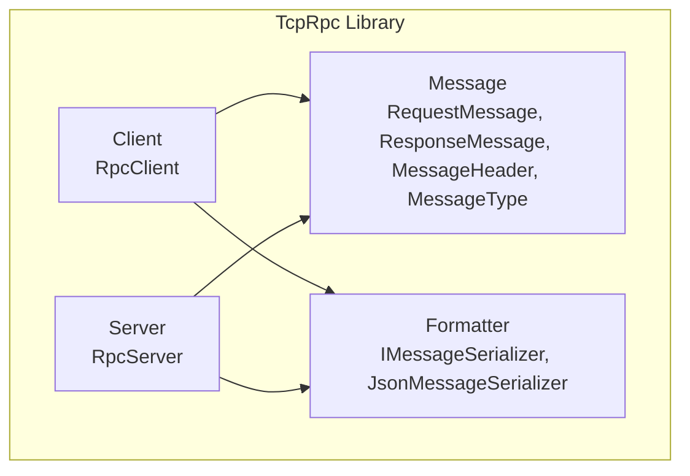
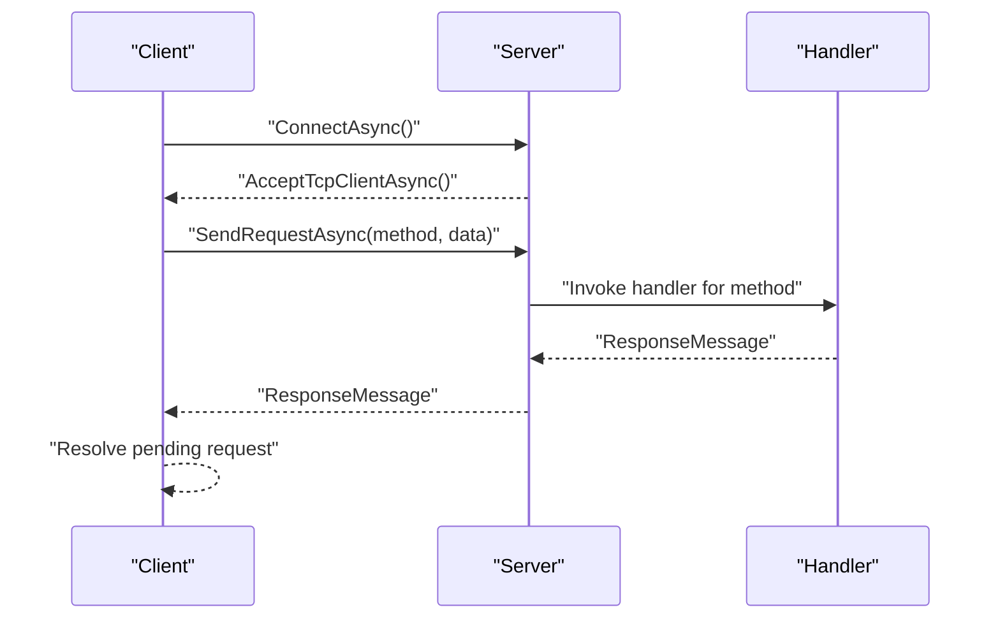

# Getting Started

<cite>
**Referenced Files in This Document**
- [TcpRpc.csproj](file://TcpRpc/TcpRpc.csproj)
- [TcpRpcClient.cs](file://TcpRpc/Client/TcpRpcClient.cs)
- [RpcClientState.cs](file://TcpRpc/Client/RpcClientState.cs)
- [TcpRpcServer.cs](file://TcpRpc/Server/TcpRpcServer.cs)
- [RpcServerState.cs](file://TcpRpc/Server/RpcServerState.cs)
- [RequestHandler.cs](file://TcpRpc/Server/RequestHandler.cs)
- [RequestMessage.cs](file://TcpRpc/Message/RequestMessage.cs)
- [ResponseMessage.cs](file://TcpRpc/Message/ResponseMessage.cs)
- [MessageHeader.cs](file://TcpRpc/Message/MessageHeader.cs)
- [MessageType.cs](file://TcpRpc/Message/MessageType.cs)
- [IMessageSerializer.cs](file://TcpRpc/Formatter/IMessageSerializer.cs)
- [JsonMessageSerializer.cs](file://TcpRpc/Formatter/JsonMessageSerializer.cs)
</cite>

## Table of Contents
1. [Introduction](#introduction)
2. [Project Structure](#project-structure)
3. [Core Components](#core-components)
4. [Architecture Overview](#architecture-overview)
5. [Installation and Setup](#installation-and-setup)
6. [Basic Usage Examples](#basic-usage-examples)
7. [Essential Classes Reference](#essential-classes-reference)
8. [Logging Integration](#logging-integration)
9. [Heartbeats and Error Handling](#heartbeats-and-error-handling)
10. [Graceful Shutdown](#graceful-shutdown)
11. [Troubleshooting Guide](#troubleshooting-guide)
12. [Conclusion](#conclusion)

## Introduction
This guide helps you quickly build a client-server RPC application using the TcpRpc framework. It covers prerequisites, installation via NuGet, basic project setup, and complete working examples for creating a simple RPC client and server, establishing connections, sending requests, handling responses, managing heartbeats, error handling, and graceful shutdown. You will also learn how to integrate Microsoft.Extensions.Logging for comprehensive application logging.

## Project Structure
The TcpRpc library is organized into cohesive modules:
- Client: RpcClient and client-side state machine
- Server: RpcServer with request handlers and connection lifecycle
- Message: Typed request/response messages and protocol headers
- Formatter: Pluggable JSON serialization contract
- Core project: Target framework and logging dependencies

**Diagram sources**
- [TcpRpcClient.cs:11-405](file://TcpRpc/Client/TcpRpcClient.cs#L11-L405)
- [TcpRpcServer.cs:12-432](file://TcpRpc/Server/TcpRpcServer.cs#L12-L432)
- [RequestMessage.cs:3-8](file://TcpRpc/Message/RequestMessage.cs#L3-L8)
- [ResponseMessage.cs:3-9](file://TcpRpc/Message/ResponseMessage.cs#L3-L9)
- [MessageHeader.cs:5-34](file://TcpRpc/Message/MessageHeader.cs#L5-L34)
- [MessageType.cs:3-10](file://TcpRpc/Message/MessageType.cs#L3-L10)
- [IMessageSerializer.cs:5-13](file://TcpRpc/Formatter/IMessageSerializer.cs#L5-L13)
- [JsonMessageSerializer.cs:6-85](file://TcpRpc/Formatter/JsonMessageSerializer.cs#L6-L85)

**Section sources**
- [TcpRpc.csproj:1-17](file://TcpRpc/TcpRpc.csproj#L1-L17)

## Core Components
- RpcClient: Asynchronous TCP client that connects to a server, sends requests, receives responses, manages timeouts, and supports heartbeats.
- RpcServer: TCP listener that accepts clients, routes requests to registered handlers, and manages graceful shutdown.
- Message types: Strongly typed RequestMessage and ResponseMessage with MessageHeader framing.
- IMessageSerializer: Contract for serializing/deserializing messages; JsonMessageSerializer is provided by default.

Key responsibilities:
- Client: connection lifecycle, request/response correlation, cancellation, timeouts, heartbeats, and cleanup.
- Server: accepting connections, dispatching to handlers, error handling, and coordinated shutdown.

**Section sources**
- [TcpRpcClient.cs:11-405](file://TcpRpc/Client/TcpRpcClient.cs#L11-L405)
- [TcpRpcServer.cs:12-432](file://TcpRpc/Server/TcpRpcServer.cs#L12-L432)
- [RequestMessage.cs:3-8](file://TcpRpc/Message/RequestMessage.cs#L3-L8)
- [ResponseMessage.cs:3-9](file://TcpRpc/Message/ResponseMessage.cs#L3-L9)
- [MessageHeader.cs:5-34](file://TcpRpc/Message/MessageHeader.cs#L5-L34)
- [IMessageSerializer.cs:5-13](file://TcpRpc/Formatter/IMessageSerializer.cs#L5-L13)

## Architecture Overview
The framework implements a simple framed protocol over TCP:
- Each message begins with a fixed-size header containing type, message ID, and content length.
- Requests and responses are serialized using the configured IMessageSerializer.
- The server maintains a dictionary of method handlers and dispatches accordingly.
- The client tracks pending requests by message ID and resolves them upon receiving responses.

**Diagram sources**
- [TcpRpcClient.cs:47-80](file://TcpRpc/Client/TcpRpcClient.cs#L47-L80)
- [TcpRpcServer.cs:138-148](file://TcpRpc/Server/TcpRpcServer.cs#L138-L148)
- [RequestHandler.cs:5-5](file://TcpRpc/Server/RequestHandler.cs#L5-L5)
- [MessageHeader.cs:13-33](file://TcpRpc/Message/MessageHeader.cs#L13-L33)
- [IMessageSerializer.cs:7-12](file://TcpRpc/Formatter/IMessageSerializer.cs#L7-L12)

## Installation and Setup
- Prerequisites: .NET 10.0 SDK
- Install the TcpRpc NuGet package into your project using the Package Manager UI or CLI.

Steps:
1. Create a new console application targeting net10.0.
2. Add the TcpRpc NuGet package reference.
3. Optionally add Microsoft.Extensions.Logging packages for structured logging.

Verification:
- Confirm TargetFramework is net10.0.
- Verify Microsoft.Extensions.Logging references are present.

**Section sources**
- [TcpRpc.csproj:3-14](file://TcpRpc/TcpRpc.csproj#L3-L14)

## Basic Usage Examples
Below are complete working examples demonstrating a minimal client-server pair. Replace placeholders with your actual host/port and handler logic.

Example 1: Simple server with a handler
- Create RpcServer on a chosen port.
- Register a handler for a method name.
- Start the server asynchronously.
- Track ActiveConnections for diagnostics.

Example 2: Simple client sending a request
- Create RpcClient with host and port.
- Connect to the server.
- Send a request with a method name and payload.
- Handle the response or error.
- Disconnect gracefully.

Example 3: Handler registration patterns
- Register a RequestHandler delegate.
- Or register a strongly-typed handler that deserializes request data and returns a typed response.

Notes:
- Use timeouts when sending requests to avoid indefinite waits.
- Handle exceptions for network errors and timeouts.
- Use PingAsync periodically to detect dead connections.

**Section sources**
- [TcpRpcServer.cs:43-99](file://TcpRpc/Server/TcpRpcServer.cs#L43-L99)
- [TcpRpcClient.cs:35-189](file://TcpRpc/Client/TcpRpcClient.cs#L35-L189)

## Essential Classes Reference
- RpcClient
  - Constructor: RpcClient(host, port, serializer?, logger?)
  - Key methods: ConnectAsync(), DisconnectAsync(), SendRequestAsync(method, data, timeoutMs), SendRequestAsync<T>(method, data, timeoutMs), PingAsync(timeoutMs)
  - Properties: State (RpcClientState)
  - Typical usage: Connect -> SendRequest -> Handle response -> Disconnect

- RpcServer
  - Constructor: RpcServer(port, serializer?, logger?)
  - Key methods: RegisterHandler(method, handler), RegisterHandler<TRequest,TResponse>(method, func), StartAsync(), StopAsync()
  - Properties: State (RpcServerState), ActiveConnections
  - Typical usage: Register handlers -> StartAsync() -> Serve until StopAsync()

- Message types
  - RequestMessage: MessageId, Method, Data
  - ResponseMessage: MessageId, Success, Error?, Data?
  - MessageHeader: Type, MessageId, ContentLength
  - MessageType: Request, Response, Ping, Pong, Error

- Serializer
  - IMessageSerializer: Serialize/Deserialize for both requests and responses
  - JsonMessageSerializer: Default JSON implementation with camelCase naming

**Section sources**
- [RpcClientState.cs:3-11](file://TcpRpc/Client/RpcClientState.cs#L3-L11)
- [RpcServerState.cs:3-10](file://TcpRpc/Server/RpcServerState.cs#L3-L10)
- [RequestMessage.cs:3-8](file://TcpRpc/Message/RequestMessage.cs#L3-L8)
- [ResponseMessage.cs:3-9](file://TcpRpc/Message/ResponseMessage.cs#L3-L9)
- [MessageHeader.cs:5-34](file://TcpRpc/Message/MessageHeader.cs#L5-L34)
- [MessageType.cs:3-10](file://TcpRpc/Message/MessageType.cs#L3-L10)
- [IMessageSerializer.cs:5-13](file://TcpRpc/Formatter/IMessageSerializer.cs#L5-L13)
- [JsonMessageSerializer.cs:6-85](file://TcpRpc/Formatter/JsonMessageSerializer.cs#L6-L85)

## Logging Integration
The framework integrates with Microsoft.Extensions.Logging:
- RpcClient and RpcServer accept ILogger<T> instances in their constructors.
- Logging includes connection events, errors, timeouts, and warnings.
- Recommended packages: Microsoft.Extensions.Logging and Microsoft.Extensions.Logging.Console.

Usage:
- Pass an ILogger<RpcClient> or ILogger<RpcServer> to constructors.
- Configure providers (Console, Debug, etc.) in your application startup.

Benefits:
- Structured logs for operational visibility.
- Easy filtering and routing to sinks.

**Section sources**
- [TcpRpcClient.cs:16-40](file://TcpRpc/Client/TcpRpcClient.cs#L16-L40)
- [TcpRpcServer.cs:16-48](file://TcpRpc/Server/TcpRpcServer.cs#L16-L48)
- [TcpRpc.csproj:12-13](file://TcpRpc/TcpRpc.csproj#L12-L13)

## Heartbeats and Error Handling
Heartbeats:
- Use PingAsync(timeoutMs) to probe the server.
- The server responds with a Pong; failures indicate connectivity issues.

Error handling patterns:
- Client-side timeouts: SendRequestAsync throws TimeoutException when exceeded.
- Connection loss: Pending requests are faulted; state transitions to Disconnected.
- Server-side errors: Handlers returning failure populate ResponseMessage.Error; server logs errors.

Common scenarios:
- Network interruptions: Client automatically cleans up pending requests and transitions state.
- Handler exceptions: Server returns an error response with the exception message.

**Section sources**
- [TcpRpcClient.cs:325-382](file://TcpRpc/Client/TcpRpcClient.cs#L325-L382)
- [TcpRpcServer.cs:318-333](file://TcpRpc/Server/TcpRpcServer.cs#L318-L333)
- [TcpRpcClient.cs:289-306](file://TcpRpc/Client/TcpRpcClient.cs#L289-L306)

## Graceful Shutdown
Server shutdown:
- Call StopAsync() to stop accepting new connections, cancel ongoing operations, and wait for active clients to finish.
- The server sets State to Stopping, then Stopped.

Client shutdown:
- Call DisconnectAsync() to cancel pending operations, close streams, and clean up state.
- Pending requests are faulted with a disconnection error.

Best practices:
- Always dispose RpcClient and RpcServer instances.
- Use timeouts during shutdown to prevent hanging.

**Section sources**
- [TcpRpcServer.cs:175-226](file://TcpRpc/Server/TcpRpcServer.cs#L175-L226)
- [TcpRpcClient.cs:85-130](file://TcpRpc/Client/TcpRpcClient.cs#L85-L130)
- [TcpRpcServer.cs:415-432](file://TcpRpc/Server/TcpRpcServer.cs#L415-L432)
- [TcpRpcClient.cs:384-405](file://TcpRpc/Client/TcpRpcClient.cs#L384-L405)

## Troubleshooting Guide
Common issues and resolutions:
- Cannot connect from current state: Ensure RpcClient.State is Created or Disconnected before calling ConnectAsync().
- Port already in use: Change the server port or stop the conflicting process.
- TimeoutException on SendRequestAsync: Increase timeoutMs or investigate server responsiveness.
- Method not found: Ensure the server has a handler registered for the requested method name.
- Serialization errors: Verify request/response types match the handler’s generic parameters.
- Connection lost: Check network stability; use PingAsync to detect liveness; reconnect as needed.
- Logging not appearing: Ensure a logging provider is configured and the logger instance is passed to constructors.

**Section sources**
- [TcpRpcClient.cs:47-80](file://TcpRpc/Client/TcpRpcClient.cs#L47-L80)
- [TcpRpcServer.cs:50-58](file://TcpRpc/Server/TcpRpcServer.cs#L50-L58)
- [TcpRpcClient.cs:179-188](file://TcpRpc/Client/TcpRpcClient.cs#L179-L188)
- [TcpRpcServer.cs:339-359](file://TcpRpc/Server/TcpRpcServer.cs#L339-L359)

## Conclusion
You now have everything needed to build a functional RPC application with TcpRpc. Start with the provided examples, integrate logging, add heartbeats for reliability, and follow graceful shutdown procedures. Extend handlers to support your domain types and leverage timeouts and error handling for robust production deployments.