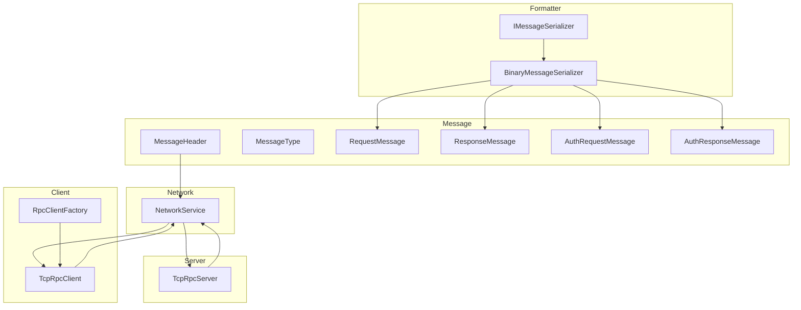
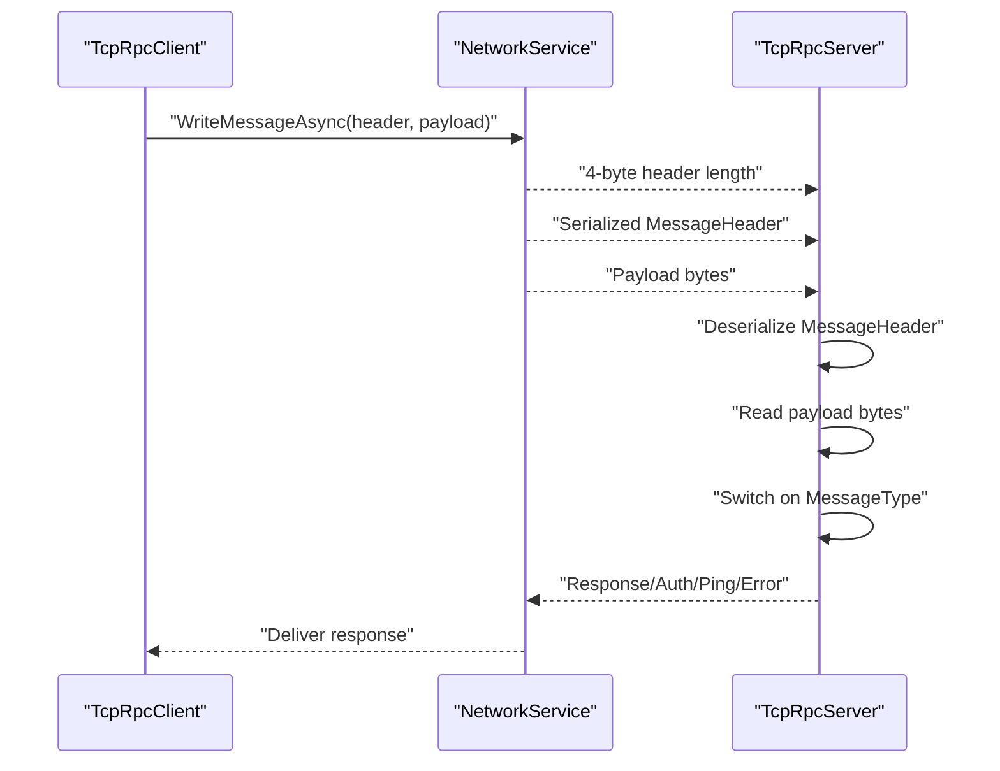
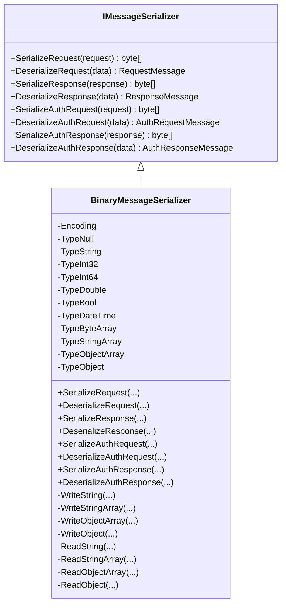
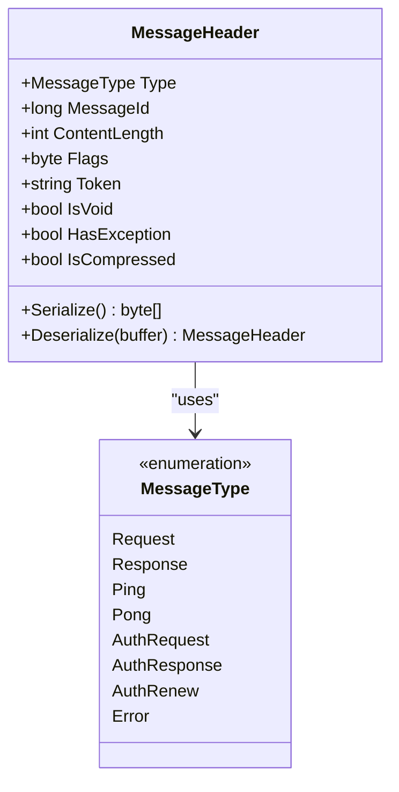
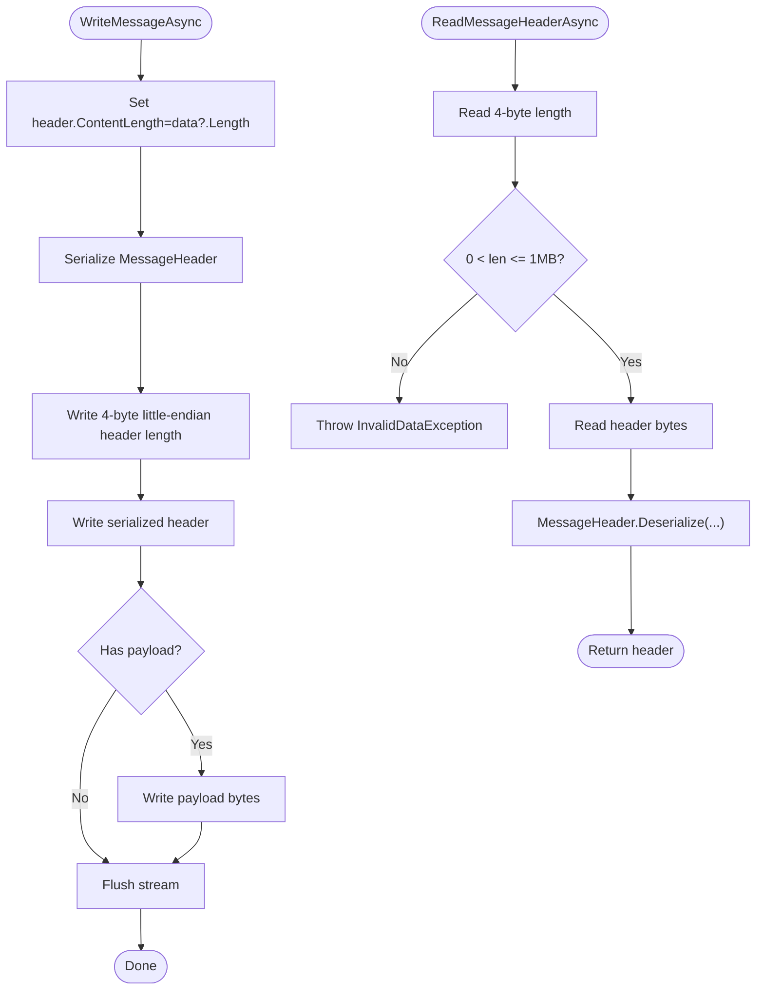
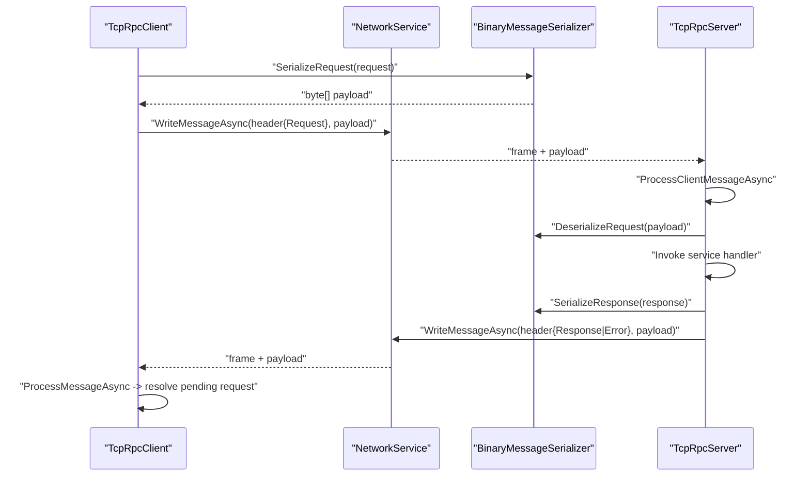
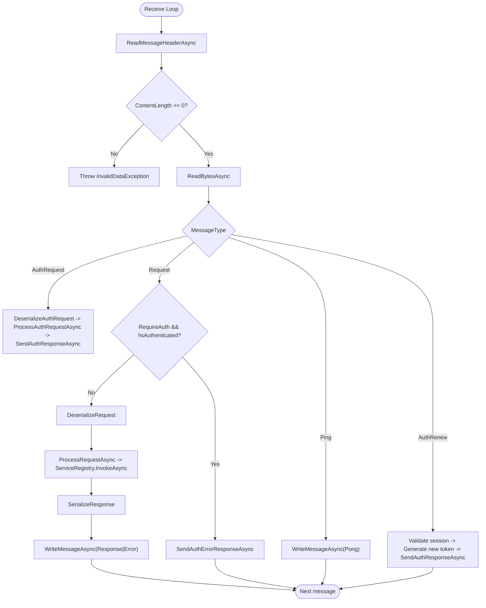
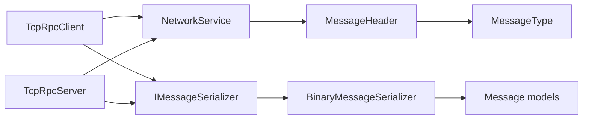

# Message Handling & Serialization

<cite>
**Referenced Files in This Document**
- [IMessageSerializer.cs](file://TcpRpc/Formatter/IMessageSerializer.cs)
- [BinaryMessageSerializer.cs](file://TcpRpc/Formatter/BinaryMessageSerializer.cs)
- [MessageHeader.cs](file://TcpRpc/Message/MessageHeader.cs)
- [MessageType.cs](file://TcpRpc/Message/MessageType.cs)
- [RequestMessage.cs](file://TcpRpc/Message/RequestMessage.cs)
- [ResponseMessage.cs](file://TcpRpc/Message/ResponseMessage.cs)
- [AuthRequestMessage.cs](file://TcpRpc/Message/AuthRequestMessage.cs)
- [AuthResponseMessage.cs](file://TcpRpc/Message/AuthResponseMessage.cs)
- [NetworkService.cs](file://TcpRpc/Network/NetworkService.cs)
- [TcpRpcClient.cs](file://TcpRpc/Client/TcpRpcClient.cs)
- [TcpRpcServer.cs](file://TcpRpc/Server/TcpRpcServer.cs)
- [RpcException.cs](file://TcpRpc/RpcException.cs)
- [Program.cs (Client)](file://TcpRpc.Client/Program.cs)
- [Program.cs (Server)](file://TcpRpc.Server/Program.cs)
- [RpcClientFactory.cs](file://TcpRpc/Client/RpcClientFactory.cs)
</cite>

## Table of Contents
1. [Introduction](#introduction)
2. [Project Structure](#project-structure)
3. [Core Components](#core-components)
4. [Architecture Overview](#architecture-overview)
5. [Detailed Component Analysis](#detailed-component-analysis)
6. [Dependency Analysis](#dependency-analysis)
7. [Performance Considerations](#performance-considerations)
8. [Troubleshooting Guide](#troubleshooting-guide)
9. [Conclusion](#conclusion)
10. [Appendices](#appendices)

## Introduction
This document explains the TcpRpc message handling and serialization subsystem. It focuses on the binary serialization approach used by BinaryMessageSerializer, the IMessageSerializer interface contract, the complete message format including MessageHeader and MessageType, and the specialized message types for requests, responses, and authentication. It also covers how messages are serialized, transmitted, and deserialized across the network, along with routing mechanisms, error handling, size limits, compression strategies, and extensibility options for custom serializers.

## Project Structure
The messaging stack spans several namespaces:
- Formatter: Serializer interfaces and implementations
- Message: Message models and header
- Network: Transport utilities for writing/reading framed messages
- Client and Server: Endpoints that assemble headers, serialize payloads, and route messages
- Examples: Client and server console programs demonstrate usage

**Diagram sources**
- [IMessageSerializer.cs:8-35](file://TcpRpc/Formatter/IMessageSerializer.cs#L8-L35)
- [BinaryMessageSerializer.cs:11-444](file://TcpRpc/Formatter/BinaryMessageSerializer.cs#L11-L444)
- [MessageHeader.cs:9-73](file://TcpRpc/Message/MessageHeader.cs#L9-L73)
- [MessageType.cs:3-13](file://TcpRpc/Message/MessageType.cs#L3-L13)
- [RequestMessage.cs:6-18](file://TcpRpc/Message/RequestMessage.cs#L6-L18)
- [ResponseMessage.cs:6-30](file://TcpRpc/Message/ResponseMessage.cs#L6-L30)
- [AuthRequestMessage.cs:6-28](file://TcpRpc/Message/AuthRequestMessage.cs#L6-L28)
- [AuthResponseMessage.cs:6-43](file://TcpRpc/Message/AuthResponseMessage.cs#L6-L43)
- [NetworkService.cs:7-99](file://TcpRpc/Network/NetworkService.cs#L7-L99)
- [TcpRpcClient.cs:10-684](file://TcpRpc/Client/TcpRpcClient.cs#L10-L684)
- [TcpRpcServer.cs:15-707](file://TcpRpc/Server/TcpRpcServer.cs#L15-L707)
- [RpcClientFactory.cs:9-110](file://TcpRpc/Client/RpcClientFactory.cs#L9-L110)

**Section sources**
- [IMessageSerializer.cs:8-35](file://TcpRpc/Formatter/IMessageSerializer.cs#L8-L35)
- [BinaryMessageSerializer.cs:11-444](file://TcpRpc/Formatter/BinaryMessageSerializer.cs#L11-L444)
- [MessageHeader.cs:9-73](file://TcpRpc/Message/MessageHeader.cs#L9-L73)
- [MessageType.cs:3-13](file://TcpRpc/Message/MessageType.cs#L3-L13)
- [NetworkService.cs:7-99](file://TcpRpc/Network/NetworkService.cs#L7-L99)
- [TcpRpcClient.cs:10-684](file://TcpRpc/Client/TcpRpcClient.cs#L10-L684)
- [TcpRpcServer.cs:15-707](file://TcpRpc/Server/TcpRpcServer.cs#L15-L707)
- [RpcClientFactory.cs:9-110](file://TcpRpc/Client/RpcClientFactory.cs#L9-L110)

## Core Components
- IMessageSerializer: Defines the contract for serializing/deserializing RequestMessage, ResponseMessage, and authentication messages.
- BinaryMessageSerializer: Implements a compact binary format with type markers and UTF-8 string encoding, supporting primitive arrays, complex objects via JSON fallback, and null safety.
- MessageHeader: Framing metadata with MessageType, MessageId, ContentLength, Flags, and optional Token.
- MessageType: Enumerates supported message categories including Request, Response, Ping/Pong, AuthRequest/AuthResponse, AuthRenew, and Error.
- Specialized messages: RequestMessage, ResponseMessage, AuthRequestMessage, AuthResponseMessage define payload structures.

Key responsibilities:
- Serialization: Convert strongly-typed messages to byte arrays and back.
- Transport framing: NetworkService writes a 4-byte little-endian header length followed by the serialized MessageHeader and payload.
- Routing: TcpRpcServer switches on MessageType to dispatch to appropriate handlers.
- Error propagation: Errors are returned as ResponseMessage with Success=false and exception metadata, or as dedicated Error messages.

**Section sources**
- [IMessageSerializer.cs:8-35](file://TcpRpc/Formatter/IMessageSerializer.cs#L8-L35)
- [BinaryMessageSerializer.cs:11-444](file://TcpRpc/Formatter/BinaryMessageSerializer.cs#L11-L444)
- [MessageHeader.cs:9-73](file://TcpRpc/Message/MessageHeader.cs#L9-L73)
- [MessageType.cs:3-13](file://TcpRpc/Message/MessageType.cs#L3-L13)
- [RequestMessage.cs:6-18](file://TcpRpc/Message/RequestMessage.cs#L6-L18)
- [ResponseMessage.cs:6-30](file://TcpRpc/Message/ResponseMessage.cs#L6-L30)
- [AuthRequestMessage.cs:6-28](file://TcpRpc/Message/AuthRequestMessage.cs#L6-L28)
- [AuthResponseMessage.cs:6-43](file://TcpRpc/Message/AuthResponseMessage.cs#L6-L43)
- [NetworkService.cs:7-99](file://TcpRpc/Network/NetworkService.cs#L7-L99)
- [TcpRpcServer.cs:380-451](file://TcpRpc/Server/TcpRpcServer.cs#L380-L451)

## Architecture Overview
The transport protocol frames each message as:
- 4-byte little-endian length of the serialized MessageHeader
- Serialized MessageHeader (including MessageType, MessageId, ContentLength, Flags, optional Token)
- Payload bytes (serialized message body)

**Diagram sources**
- [NetworkService.cs:10-52](file://TcpRpc/Network/NetworkService.cs#L10-L52)
- [MessageHeader.cs:41-72](file://TcpRpc/Message/MessageHeader.cs#L41-L72)
- [TcpRpcServer.cs:380-451](file://TcpRpc/Server/TcpRpcServer.cs#L380-L451)
- [TcpRpcClient.cs:478-540](file://TcpRpc/Client/TcpRpcClient.cs#L478-L540)

## Detailed Component Analysis

### BinaryMessageSerializer
Implements IMessageSerializer with a compact binary format:
- Header layout: [length prefix][type marker][data]
- Type markers distinguish null, string, int32/int64, double, bool, DateTime, byte[], string[], object[], and object (complex).
- Complex objects are serialized to JSON and stored with their assembly-qualified type name for later deserialization.
- Arrays are encoded with a -1 sentinel for null and length-prefixed entries.

Serialization highlights:
- RequestMessage: ServiceType, Method, Parameters (object[]), ParameterTypes (string[]).
- ResponseMessage: Success, Error, ExceptionType, StackTrace, Data (object), DataType, IsVoid.
- AuthRequestMessage: ClientId, PreviousToken, Credentials dictionary.
- AuthResponseMessage: Success, ErrorMessage, ClientId, Token, ExpiresAt, IsSessionRestored, Message.

Deserialization validates presence of required fields and reconstructs objects, including complex types via JSON.

**Diagram sources**
- [IMessageSerializer.cs:8-35](file://TcpRpc/Formatter/IMessageSerializer.cs#L8-L35)
- [BinaryMessageSerializer.cs:11-444](file://TcpRpc/Formatter/BinaryMessageSerializer.cs#L11-L444)

**Section sources**
- [IMessageSerializer.cs:8-35](file://TcpRpc/Formatter/IMessageSerializer.cs#L8-L35)
- [BinaryMessageSerializer.cs:11-444](file://TcpRpc/Formatter/BinaryMessageSerializer.cs#L11-L444)

### MessageHeader and MessageType
MessageHeader carries framing and routing metadata:
- Type: MessageType discriminator
- MessageId: correlation identifier for request/response pairing
- ContentLength: payload length
- Flags: bitfield for IsVoid, HasException, IsCompressed
- Token: optional authentication token for protected requests

MessageType enumerates:
- Request, Response, Ping, Pong, AuthRequest, AuthResponse, AuthRenew, Error

**Diagram sources**
- [MessageHeader.cs:9-73](file://TcpRpc/Message/MessageHeader.cs#L9-L73)
- [MessageType.cs:3-13](file://TcpRpc/Message/MessageType.cs#L3-L13)

**Section sources**
- [MessageHeader.cs:9-73](file://TcpRpc/Message/MessageHeader.cs#L9-L73)
- [MessageType.cs:3-13](file://TcpRpc/Message/MessageType.cs#L3-L13)

### Specialized Message Types
- RequestMessage: Method, ServiceType, Parameters, ParameterTypes
- ResponseMessage: Success, Error, ExceptionType, StackTrace, Data, DataType, IsVoid
- AuthRequestMessage: ClientId, PreviousToken, Credentials; IsReconnect computed property
- AuthResponseMessage: Success, ErrorMessage, ClientId, Token, ExpiresAt, IsSessionRestored, Message

These types are serialized/deserialized by BinaryMessageSerializer and routed by TcpRpcServer/TcpRpcClient.

**Section sources**
- [RequestMessage.cs:6-18](file://TcpRpc/Message/RequestMessage.cs#L6-L18)
- [ResponseMessage.cs:6-30](file://TcpRpc/Message/ResponseMessage.cs#L6-L30)
- [AuthRequestMessage.cs:6-28](file://TcpRpc/Message/AuthRequestMessage.cs#L6-L28)
- [AuthResponseMessage.cs:6-43](file://TcpRpc/Message/AuthResponseMessage.cs#L6-L43)

### Transport Framing and Flow
NetworkService enforces safe framing:
- Writes 4-byte little-endian header length, then serialized MessageHeader, then payload
- Reads header length, validates bounds, then reads header and payload
- Defensive checks prevent oversized headers and negative content lengths

**Diagram sources**
- [NetworkService.cs:10-52](file://TcpRpc/Network/NetworkService.cs#L10-L52)

**Section sources**
- [NetworkService.cs:10-99](file://TcpRpc/Network/NetworkService.cs#L10-L99)

### Client-Side Flow: Requests, Responses, Authentication, Ping
TcpRpcClient composes MessageHeader, serializes payload via IMessageSerializer, and sends using NetworkService. It tracks pending requests and authentications using concurrent dictionaries keyed by MessageId. On receive, it routes to handlers based on MessageType and resolves TaskCompletionSource.

**Diagram sources**
- [TcpRpcClient.cs:324-407](file://TcpRpc/Client/TcpRpcClient.cs#L324-L407)
- [TcpRpcServer.cs:380-451](file://TcpRpc/Server/TcpRpcServer.cs#L380-L451)
- [BinaryMessageSerializer.cs:30-112](file://TcpRpc/Formatter/BinaryMessageSerializer.cs#L30-L112)
- [NetworkService.cs:10-52](file://TcpRpc/Network/NetworkService.cs#L10-L52)

**Section sources**
- [TcpRpcClient.cs:324-540](file://TcpRpc/Client/TcpRpcClient.cs#L324-L540)
- [TcpRpcServer.cs:380-451](file://TcpRpc/Server/TcpRpcServer.cs#L380-L451)
- [BinaryMessageSerializer.cs:30-112](file://TcpRpc/Formatter/BinaryMessageSerializer.cs#L30-L112)
- [NetworkService.cs:10-52](file://TcpRpc/Network/NetworkService.cs#L10-L52)

### Server-Side Flow: Authentication, Request Processing, Error Handling
TcpRpcServer reads headers and content, validates ContentLength, and dispatches by MessageType. It supports:
- AuthRequest: Validates credentials or restores sessions, responds with AuthResponse
- Request: Validates auth/token, deserializes RequestMessage, invokes service, serializes ResponseMessage
- Ping: Responds with Pong
- AuthRenew: Regenerates token for active session

Error responses are sent as ResponseMessage with Success=false and exception metadata, or as MessageType.Error with textual error.

**Diagram sources**
- [TcpRpcServer.cs:226-451](file://TcpRpc/Server/TcpRpcServer.cs#L226-L451)
- [BinaryMessageSerializer.cs:325-442](file://TcpRpc/Formatter/BinaryMessageSerializer.cs#L325-L442)
- [NetworkService.cs:55-99](file://TcpRpc/Network/NetworkService.cs#L55-L99)

**Section sources**
- [TcpRpcServer.cs:226-681](file://TcpRpc/Server/TcpRpcServer.cs#L226-L681)
- [BinaryMessageSerializer.cs:325-442](file://TcpRpc/Formatter/BinaryMessageSerializer.cs#L325-L442)
- [NetworkService.cs:55-99](file://TcpRpc/Network/NetworkService.cs#L55-L99)

### Error Propagation and Exceptions
- RpcException carries RemoteExceptionType and RemoteStackTrace for faithful client-side reconstruction of server exceptions.
- TcpRpcServer constructs ResponseMessage with exception metadata and sends it as either Response (Success=false) or Error message.
- TcpRpcClient detects MessageType.Error and converts to RpcException with original type and stack trace.

**Section sources**
- [RpcException.cs:6-37](file://TcpRpc/RpcException.cs#L6-L37)
- [TcpRpcServer.cs:549-614](file://TcpRpc/Server/TcpRpcServer.cs#L549-L614)
- [TcpRpcClient.cs:497-511](file://TcpRpc/Client/TcpRpcClient.cs#L497-L511)

## Dependency Analysis
- TcpRpcClient depends on IMessageSerializer and NetworkService to send/receive messages.
- TcpRpcServer depends on IMessageSerializer and NetworkService to process incoming frames and send responses.
- BinaryMessageSerializer depends on System.Text.Json for complex object serialization and UTF-8 encoding.
- MessageHeader and MessageType are foundational types used by both sides for framing and routing.

**Diagram sources**
- [TcpRpcClient.cs:10-684](file://TcpRpc/Client/TcpRpcClient.cs#L10-L684)
- [TcpRpcServer.cs:15-707](file://TcpRpc/Server/TcpRpcServer.cs#L15-L707)
- [NetworkService.cs:7-99](file://TcpRpc/Network/NetworkService.cs#L7-L99)
- [IMessageSerializer.cs:8-35](file://TcpRpc/Formatter/IMessageSerializer.cs#L8-L35)
- [BinaryMessageSerializer.cs:11-444](file://TcpRpc/Formatter/BinaryMessageSerializer.cs#L11-L444)
- [MessageHeader.cs:9-73](file://TcpRpc/Message/MessageHeader.cs#L9-L73)
- [MessageType.cs:3-13](file://TcpRpc/Message/MessageType.cs#L3-L13)

**Section sources**
- [TcpRpcClient.cs:10-684](file://TcpRpc/Client/TcpRpcClient.cs#L10-L684)
- [TcpRpcServer.cs:15-707](file://TcpRpc/Server/TcpRpcServer.cs#L15-L707)
- [NetworkService.cs:7-99](file://TcpRpc/Network/NetworkService.cs#L7-L99)
- [IMessageSerializer.cs:8-35](file://TcpRpc/Formatter/IMessageSerializer.cs#L8-L35)
- [BinaryMessageSerializer.cs:11-444](file://TcpRpc/Formatter/BinaryMessageSerializer.cs#L11-L444)
- [MessageHeader.cs:9-73](file://TcpRpc/Message/MessageHeader.cs#L9-L73)
- [MessageType.cs:3-13](file://TcpRpc/Message/MessageType.cs#L3-L13)

## Performance Considerations
- Binary serialization: Uses compact type markers and length prefixes to minimize overhead compared to text-based formats.
- Primitive arrays and strings: Efficiently encoded with explicit lengths; null represented by sentinel (-1) to avoid ambiguity.
- Complex objects: Serialized to JSON with type metadata; acceptable for moderate-size payloads but consider alternatives for very large objects.
- Streaming reads/writes: NetworkService uses buffered reads and writes; large payloads are handled safely with defensive checks.
- Message size limits:
  - Header size validated up to 1 MB.
  - Content length validated; oversized content is discarded and an error response is sent.
- Compression: Not implemented in the current codebase; MessageHeader supports an IsCompressed flag for future extension.

Recommendations:
- Prefer primitives and small DTOs for high-frequency RPC calls.
- For large payloads, consider external storage with references or chunking strategies.
- Monitor ContentLength thresholds and implement application-level compression if needed.

**Section sources**
- [BinaryMessageSerializer.cs:119-227](file://TcpRpc/Formatter/BinaryMessageSerializer.cs#L119-L227)
- [NetworkService.cs:40-43](file://TcpRpc/Network/NetworkService.cs#L40-L43)
- [NetworkService.cs:67-82](file://TcpRpc/Network/NetworkService.cs#L67-L82)
- [MessageHeader.cs:18-28](file://TcpRpc/Message/MessageHeader.cs#L18-L28)

## Troubleshooting Guide
Common issues and diagnostics:
- Invalid header size or negative content length: Thrown by NetworkService; indicates malformed frames or tampered data.
- Unknown type marker: BinaryMessageSerializer throws on unrecognized type markers during deserialization.
- Type not found: Deserialization of complex objects fails if the type cannot be resolved by Type.GetType.
- Authentication failures: TcpRpcServer returns AuthResponseMessage with Success=false and ErrorMessage; TcpRpcClient throws RpcException on auth errors.
- Request timeouts: TcpRpcClient cancels pending requests after configured timeout; check network latency and server load.
- Connection loss: Pending tasks are canceled and auto-reconnect is triggered if enabled.

Operational tips:
- Enable logging to observe message IDs, types, and sizes.
- Validate client credentials and tokens before sending protected requests.
- Ensure server-side service registration matches client-side expectations.

**Section sources**
- [NetworkService.cs:32-51](file://TcpRpc/Network/NetworkService.cs#L32-L51)
- [NetworkService.cs:55-99](file://TcpRpc/Network/NetworkService.cs#L55-L99)
- [BinaryMessageSerializer.cs:316-318](file://TcpRpc/Formatter/BinaryMessageSerializer.cs#L316-L318)
- [BinaryMessageSerializer.cs:308-314](file://TcpRpc/Formatter/BinaryMessageSerializer.cs#L308-L314)
- [TcpRpcClient.cs:196-226](file://TcpRpc/Client/TcpRpcClient.cs#L196-L226)
- [TcpRpcServer.cs:400-414](file://TcpRpc/Server/TcpRpcServer.cs#L400-L414)
- [RpcException.cs:6-37](file://TcpRpc/RpcException.cs#L6-L37)

## Conclusion
TcpRpc’s messaging system combines a compact binary serialization format with robust transport framing and clear message routing. BinaryMessageSerializer efficiently encodes primitives, arrays, and complex objects, while MessageHeader and MessageType provide reliable framing and dispatch. The client and server implementations demonstrate secure request/response flows, authentication, and error propagation. The design supports future enhancements such as compression and custom serializers through the IMessageSerializer abstraction.

## Appendices

### Example Usage References
- Client program demonstrates authentication, proxy creation, and various RPC calls.
- Server program demonstrates enabling authentication, registering services, and starting the server.

**Section sources**
- [Program.cs (Client):17-45](file://TcpRpc.Client/Program.cs#L17-L45)
- [Program.cs (Server):18-45](file://TcpRpc.Server/Program.cs#L18-L45)
- [RpcClientFactory.cs:36-61](file://TcpRpc/Client/RpcClientFactory.cs#L36-L61)