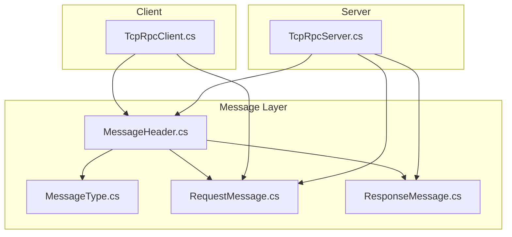
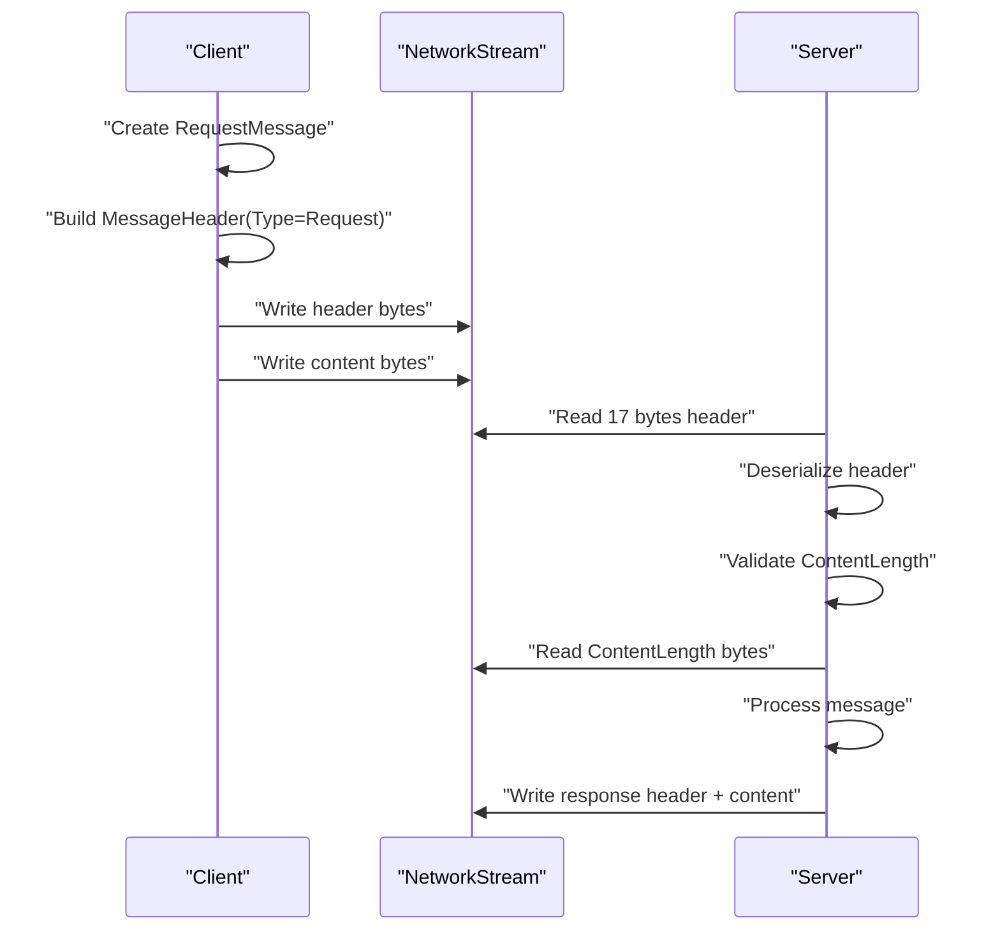
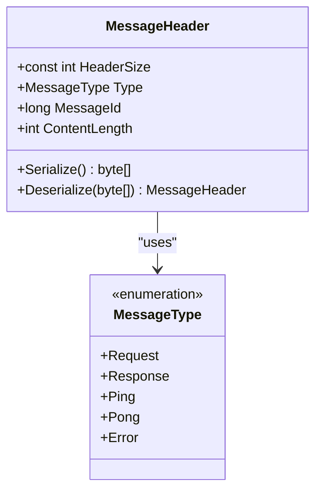
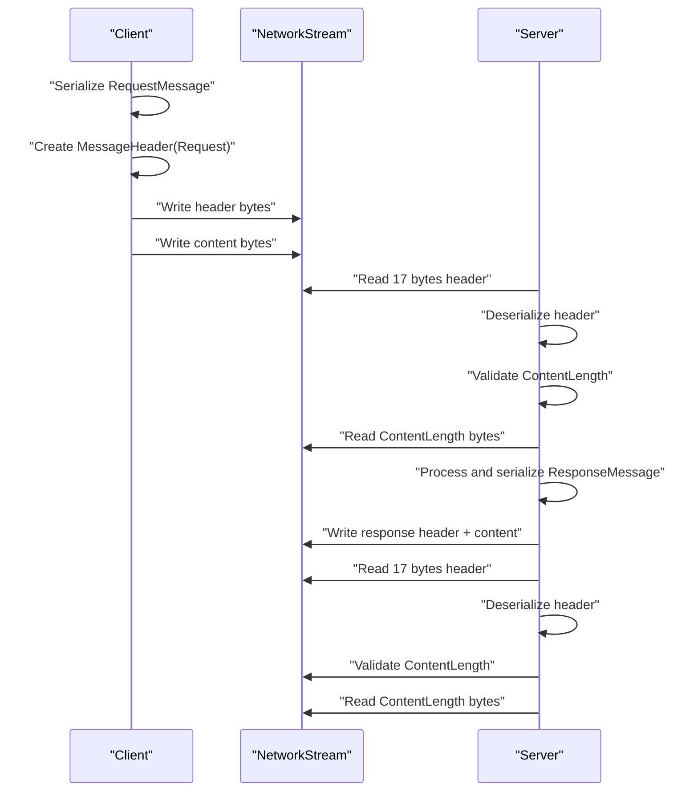
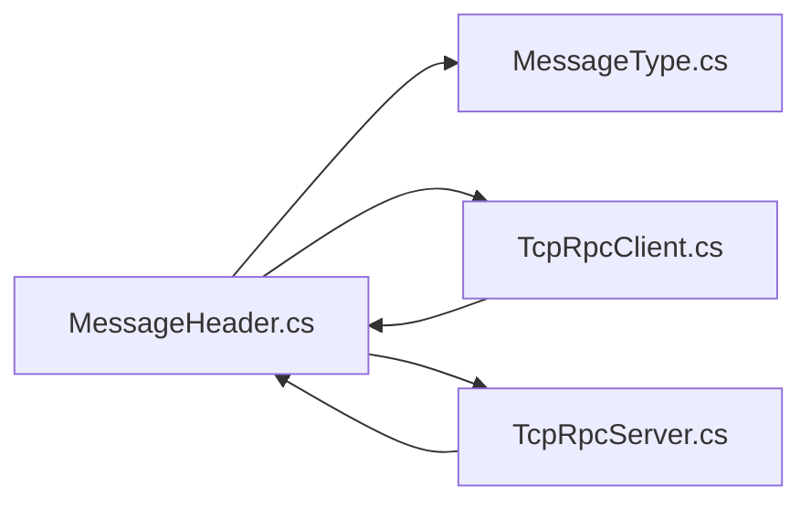

# Message Header Format

<cite>
**Referenced Files in This Document**
- [MessageHeader.cs](file://TcpRpc/Message/MessageHeader.cs)
- [MessageType.cs](file://TcpRpc/Message/MessageType.cs)
- [RequestMessage.cs](file://TcpRpc/Message/RequestMessage.cs)
- [ResponseMessage.cs](file://TcpRpc/Message/ResponseMessage.cs)
- [TcpRpcClient.cs](file://TcpRpc/Client/TcpRpcClient.cs)
- [TcpRpcServer.cs](file://TcpRpc/Server/TcpRpcServer.cs)
</cite>

## Table of Contents
1. [Introduction](#introduction)
2. [Project Structure](#project-structure)
3. [Core Components](#core-components)
4. [Architecture Overview](#architecture-overview)
5. [Detailed Component Analysis](#detailed-component-analysis)
6. [Dependency Analysis](#dependency-analysis)
7. [Performance Considerations](#performance-considerations)
8. [Troubleshooting Guide](#troubleshooting-guide)
9. [Conclusion](#conclusion)

## Introduction
This document provides comprehensive documentation for the MessageHeader class and its binary protocol format used in the TCP-based RPC system. It explains the fixed-size 17-byte header layout, endianness handling, and the Serialize()/Deserialize() methods. It also covers network framing implications, practical usage in client and server implementations, memory efficiency, performance characteristics, error handling, and debugging techniques for protocol violations.

## Project Structure
The message header resides in the Message namespace alongside related message types and payload models. The client and server implementations demonstrate how headers are framed around serialized payloads on the wire.

**Diagram sources**
- [MessageHeader.cs:1-34](file://TcpRpc/Message/MessageHeader.cs#L1-L34)
- [MessageType.cs:1-10](file://TcpRpc/Message/MessageType.cs#L1-L10)
- [RequestMessage.cs:1-8](file://TcpRpc/Message/RequestMessage.cs#L1-L8)
- [ResponseMessage.cs:1-9](file://TcpRpc/Message/ResponseMessage.cs#L1-L9)
- [TcpRpcClient.cs:1-405](file://TcpRpc/Client/TcpRpcClient.cs#L1-L405)
- [TcpRpcServer.cs:1-432](file://TcpRpc/Server/TcpRpcServer.cs#L1-L432)

**Section sources**
- [MessageHeader.cs:1-34](file://TcpRpc/Message/MessageHeader.cs#L1-L34)
- [MessageType.cs:1-10](file://TcpRpc/Message/MessageType.cs#L1-L10)
- [RequestMessage.cs:1-8](file://TcpRpc/Message/RequestMessage.cs#L1-L8)
- [ResponseMessage.cs:1-9](file://TcpRpc/Message/ResponseMessage.cs#L1-L9)
- [TcpRpcClient.cs:1-405](file://TcpRpc/Client/TcpRpcClient.cs#L1-L405)
- [TcpRpcServer.cs:1-432](file://TcpRpc/Server/TcpRpcServer.cs#L1-L432)

## Core Components
- MessageHeader: Defines the 17-byte binary header with fields for message type, message identifier, and content length. Provides Serialize() to produce a little-endian byte array and Deserialize() to parse a buffer into typed fields.
- MessageType: Enumerates supported message categories (Request, Response, Ping, Pong, Error) stored as a single byte.
- RequestMessage and ResponseMessage: Payload models used with the header to carry method names, data, success flags, errors, and optional data.

Key protocol constants and fields:
- HeaderSize: 17 bytes total (1 byte Type + 8 bytes MessageId + 8 bytes ContentLength).
- Type: Single-byte enum value indicating message category.
- MessageId: 64-bit signed integer used for correlation across request-response and ping-pong exchanges.
- ContentLength: 32-bit unsigned integer representing the length of the following content payload.

**Section sources**
- [MessageHeader.cs:7-11](file://TcpRpc/Message/MessageHeader.cs#L7-L11)
- [MessageType.cs:3-10](file://TcpRpc/Message/MessageType.cs#L3-L10)
- [RequestMessage.cs:5-7](file://TcpRpc/Message/RequestMessage.cs#L5-L7)
- [ResponseMessage.cs:5-8](file://TcpRpc/Message/ResponseMessage.cs#L5-L8)

## Architecture Overview
The client and server implement a simple framing protocol:
- Each message consists of a 17-byte header followed immediately by a content payload of length ContentLength.
- The client writes the header, then the serialized content.
- The server reads the fixed-size header, validates ContentLength against limits, then reads the exact amount of content.

**Diagram sources**
- [TcpRpcClient.cs:153-170](file://TcpRpc/Client/TcpRpcClient.cs#L153-L170)
- [TcpRpcServer.cs:238-288](file://TcpRpc/Server/TcpRpcServer.cs#L238-L288)

## Detailed Component Analysis

### MessageHeader Binary Protocol
Fixed-size layout (17 bytes):
- Offset 0: 1 byte MessageType
- Offset 1: 8 bytes MessageId (little-endian)
- Offset 9: 4 bytes ContentLength (little-endian)

Endianness handling:
- MessageId is written/read as a 64-bit little-endian value.
- ContentLength is written/read as a 32-bit little-endian value.

Validation:
- Deserialize() enforces a minimum buffer size equal to HeaderSize.
- Additional runtime checks enforce upper bounds on ContentLength to prevent excessive memory allocation.

**Diagram sources**
- [MessageHeader.cs:5-34](file://TcpRpc/Message/MessageHeader.cs#L5-L34)
- [MessageType.cs:3-10](file://TcpRpc/Message/MessageType.cs#L3-L10)

**Section sources**
- [MessageHeader.cs:7-33](file://TcpRpc/Message/MessageHeader.cs#L7-L33)
- [MessageType.cs:3-10](file://TcpRpc/Message/MessageType.cs#L3-L10)

### Serialize() Method
Purpose: Produce a 17-byte little-endian byte array representing the header.

Step-by-step buffer manipulation:
- Allocate a 17-byte buffer.
- Write the MessageType as a single byte at offset 0.
- Write MessageId as a little-endian 64-bit integer starting at offset 1.
- Write ContentLength as a little-endian 32-bit integer starting at offset 9.

Endianness handling:
- Uses little-endian primitives for cross-platform compatibility and efficient CPU-native conversion.

Validation:
- No explicit validation is performed in Serialize(); callers must ensure fields are valid before calling.

Memory efficiency:
- Allocates exactly HeaderSize bytes.
- Uses Span-based writes to minimize overhead.

**Section sources**
- [MessageHeader.cs:13-20](file://TcpRpc/Message/MessageHeader.cs#L13-L20)

### Deserialize() Method
Purpose: Parse a 17-byte buffer into a MessageHeader instance.

Step-by-step buffer manipulation:
- Validate buffer length is at least HeaderSize; otherwise throw an argument exception.
- Construct a new MessageHeader.
- Read MessageType from offset 0.
- Read MessageId as a little-endian 64-bit integer from offset 1.
- Read ContentLength as a little-endian 32-bit integer from offset 9.

Endianness handling:
- Reads values using little-endian primitives.

Validation:
- Enforces minimum buffer size.
- Additional upper-bound checks are applied by consumers (see client/server usage).

**Section sources**
- [MessageHeader.cs:22-33](file://TcpRpc/Message/MessageHeader.cs#L22-L33)

### HeaderSize Constant and Framing Implications
- HeaderSize is defined as 17, enabling deterministic framing.
- Clients and servers consistently read/write the exact number of header bytes.
- ContentLength drives the subsequent read of the payload, ensuring strict boundary separation.

Practical implications:
- Network I/O is split into two operations: header read/write and content read/write.
- Efficient buffering strategies can reuse buffers for headers while allocating separate buffers for content.

**Section sources**
- [MessageHeader.cs:7-7](file://TcpRpc/Message/MessageHeader.cs#L7-L7)

### Practical Usage Examples
These examples illustrate typical header creation, serialization, and deserialization in the client and server.

- Client sends a request:
  - Build a RequestMessage.
  - Create a MessageHeader with Type=Request, MessageId from the request, and ContentLength equal to the serialized request payload length.
  - Serialize the header and write it to the stream, followed by the serialized content.

- Server receives a request:
  - Read exactly 17 bytes for the header.
  - Deserialize the header.
  - Validate ContentLength against configured limits.
  - Read the exact number of content bytes.
  - Process the message and send a response.

- Client handles responses and pings:
  - Read a header, validate ContentLength, read content, and route to the appropriate continuation.

- Server responds to requests:
  - Serialize a ResponseMessage or ErrorResponse.
  - Create a MessageHeader with Type=Response or Type=Error, set MessageId and ContentLength.
  - Write header followed by content.

**Diagram sources**
- [TcpRpcClient.cs:153-170](file://TcpRpc/Client/TcpRpcClient.cs#L153-L170)
- [TcpRpcServer.cs:238-288](file://TcpRpc/Server/TcpRpcServer.cs#L238-L288)
- [TcpRpcServer.cs:362-376](file://TcpRpc/Server/TcpRpcServer.cs#L362-L376)

**Section sources**
- [TcpRpcClient.cs:153-170](file://TcpRpc/Client/TcpRpcClient.cs#L153-L170)
- [TcpRpcServer.cs:238-288](file://TcpRpc/Server/TcpRpcServer.cs#L238-L288)
- [TcpRpcServer.cs:362-376](file://TcpRpc/Server/TcpRpcServer.cs#L362-L376)

### Error Handling and Protocol Violations
Common failure modes and handling:
- Buffer too small: Deserialize() throws an argument exception.
- Connection closed mid-read: ReadBytesAsync detects zero-length reads and triggers connection loss handling.
- Oversized messages: Servers reject messages exceeding configured ContentLength limits and may send an error response.
- Timeouts: Operations use cancellation tokens to abort on timeouts or shutdown.

Client-side error handling:
- ReadBytesAsync loops until the requested number of bytes are received or connection closes.
- ReceiveAsync catches exceptions, logs, and transitions to disconnected state.

Server-side error handling:
- HandleClientAsync reads headers and content with timeouts and continues on transient errors.
- ProcessClientMessageAsync routes messages and sends appropriate responses or errors.

**Section sources**
- [MessageHeader.cs:24-25](file://TcpRpc/Message/MessageHeader.cs#L24-L25)
- [TcpRpcClient.cs:238-256](file://TcpRpc/Client/TcpRpcClient.cs#L238-L256)
- [TcpRpcClient.cs:205-236](file://TcpRpc/Client/TcpRpcClient.cs#L205-L236)
- [TcpRpcServer.cs:238-306](file://TcpRpc/Server/TcpRpcServer.cs#L238-L306)

## Dependency Analysis
MessageHeader depends on:
- MessageType enumeration for the Type field.
- System.Buffers.Binary primitives for efficient little-endian conversions.
- Client and server implementations for framing and validation.

**Diagram sources**
- [MessageHeader.cs:1-34](file://TcpRpc/Message/MessageHeader.cs#L1-L34)
- [MessageType.cs:1-10](file://TcpRpc/Message/MessageType.cs#L1-L10)
- [TcpRpcClient.cs:1-405](file://TcpRpc/Client/TcpRpcClient.cs#L1-L405)
- [TcpRpcServer.cs:1-432](file://TcpRpc/Server/TcpRpcServer.cs#L1-L432)

**Section sources**
- [MessageHeader.cs:1-34](file://TcpRpc/Message/MessageHeader.cs#L1-L34)
- [MessageType.cs:1-10](file://TcpRpc/Message/MessageType.cs#L1-L10)
- [TcpRpcClient.cs:1-405](file://TcpRpc/Client/TcpRpcClient.cs#L1-L405)
- [TcpRpcServer.cs:1-432](file://TcpRpc/Server/TcpRpcServer.cs#L1-L432)

## Performance Considerations
- Fixed-size header enables zero-copy framing and predictable I/O batching.
- Little-endian primitives minimize overhead and improve cross-platform compatibility.
- Reuse of buffers for headers and content reduces allocations; however, content buffers are sized dynamically by ContentLength.
- Upper bounds on ContentLength protect against memory exhaustion and support backpressure.
- Asynchronous I/O with cancellation tokens prevents blocking and improves responsiveness.

[No sources needed since this section provides general guidance]

## Troubleshooting Guide
Symptoms and diagnostics:
- Header parsing failures:
  - Verify the incoming buffer length equals HeaderSize before calling Deserialize().
  - Confirm endianness expectations match the sender’s platform.
- Connection drops:
  - Inspect ReadBytesAsync behavior; zero-length reads indicate peer closure.
  - Review ReceiveAsync/HandleClientAsync error handling paths.
- Oversized messages:
  - Check ContentLength limits in client/server receive loops.
  - Consider adjusting limits or compressing payloads.
- Timeouts:
  - Validate cancellation token propagation and timeout values.
  - Ensure ping/pong mechanisms are functioning to detect stale connections.

Debugging techniques:
- Log header fields (Type, MessageId, ContentLength) after deserialization.
- Compare expected vs. actual buffer sizes and offsets.
- Instrument network I/O to track partial reads/writes.
- Validate message boundaries by asserting that header + content lengths match the total received.

**Section sources**
- [MessageHeader.cs:24-25](file://TcpRpc/Message/MessageHeader.cs#L24-L25)
- [TcpRpcClient.cs:238-256](file://TcpRpc/Client/TcpRpcClient.cs#L238-L256)
- [TcpRpcServer.cs:264-270](file://TcpRpc/Server/TcpRpcServer.cs#L264-L270)

## Conclusion
The MessageHeader class defines a compact, deterministic 17-byte binary protocol suitable for efficient TCP-based RPC communication. Its Serialize()/Deserialize() methods leverage little-endian primitives for cross-platform compatibility, while client and server implementations enforce strict framing and robust error handling. Adhering to the fixed header layout and ContentLength limits ensures reliable message delivery and simplifies debugging and performance tuning.