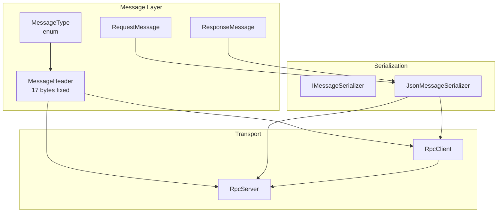
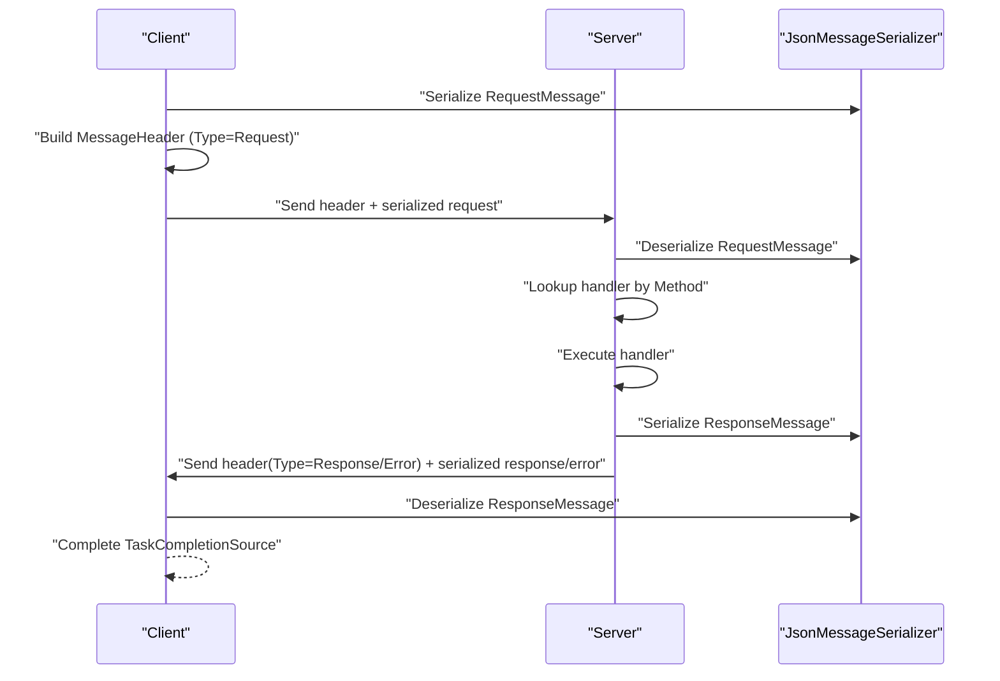
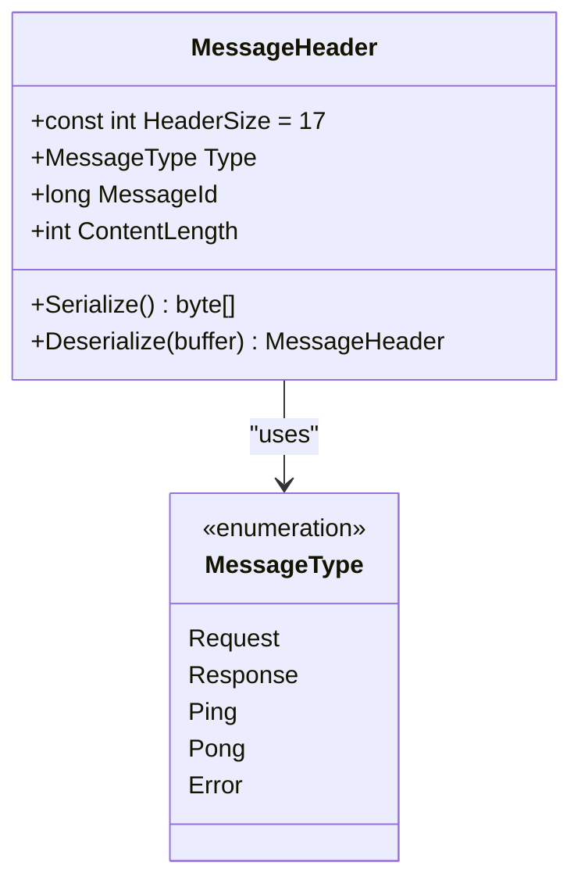
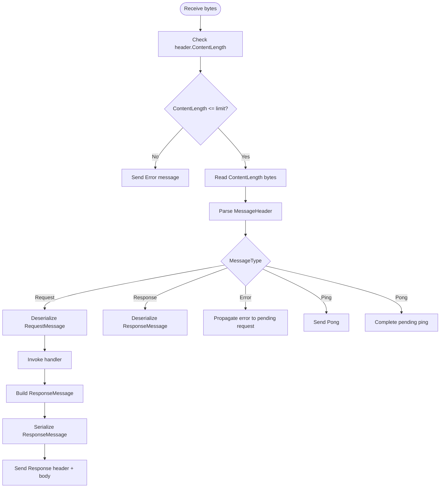
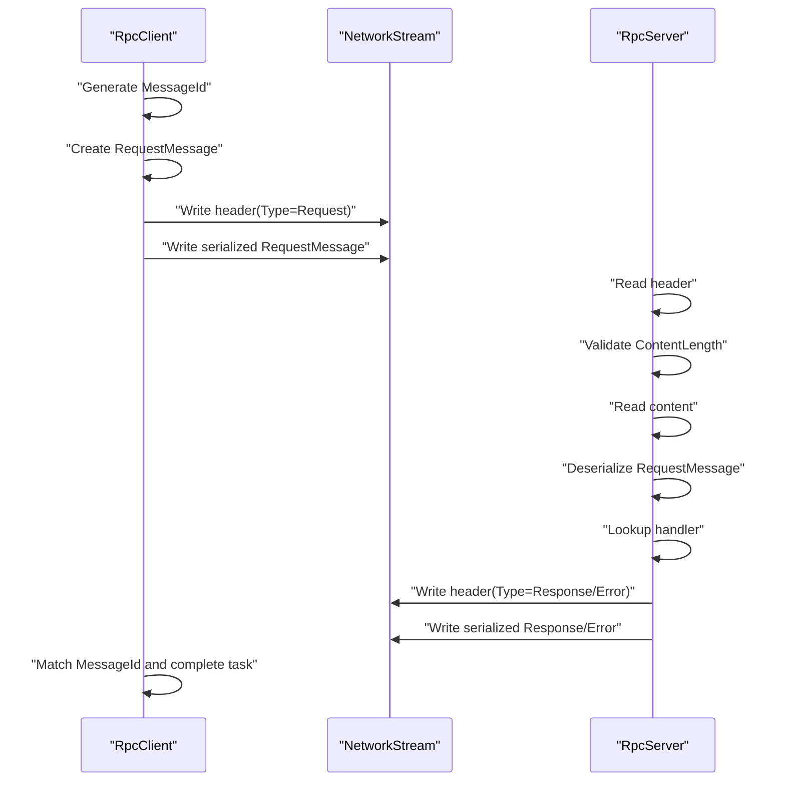
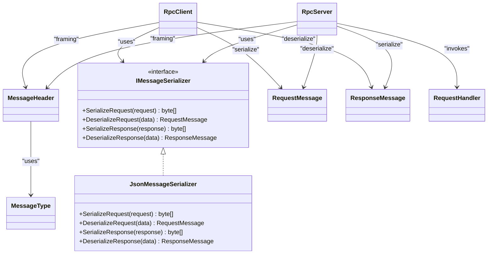

# Message Protocol & Data Models

<cite>
**Referenced Files in This Document**
- [MessageHeader.cs](file://TcpRpc/Message/MessageHeader.cs)
- [MessageType.cs](file://TcpRpc/Message/MessageType.cs)
- [RequestMessage.cs](file://TcpRpc/Message/RequestMessage.cs)
- [ResponseMessage.cs](file://TcpRpc/Message/ResponseMessage.cs)
- [JsonMessageSerializer.cs](file://TcpRpc/Formatter/JsonMessageSerializer.cs)
- [IMessageSerializer.cs](file://TcpRpc/Formatter/IMessageSerializer.cs)
- [TcpRpcClient.cs](file://TcpRpc/Client/TcpRpcClient.cs)
- [RpcClientState.cs](file://TcpRpc/Client/RpcClientState.cs)
- [TcpRpcServer.cs](file://TcpRpc/Server/TcpRpcServer.cs)
- [RpcServerState.cs](file://TcpRpc/Server/RpcServerState.cs)
- [RequestHandler.cs](file://TcpRpc/Server/RequestHandler.cs)
</cite>

## Table of Contents
1. [Introduction](#introduction)
2. [Project Structure](#project-structure)
3. [Core Components](#core-components)
4. [Architecture Overview](#architecture-overview)
5. [Detailed Component Analysis](#detailed-component-analysis)
6. [Dependency Analysis](#dependency-analysis)
7. [Performance Considerations](#performance-considerations)
8. [Troubleshooting Guide](#troubleshooting-guide)
9. [Conclusion](#conclusion)

## Introduction
This document specifies the TcpRpc binary message protocol and its data models. It defines the fixed-size message header format, the message type enumeration, and the request/response message structures. It also documents the framing rules, endianness handling, validation procedures, and error propagation mechanisms. Implementation details for serialization/deserialization, protocol validation, and error handling are included, along with performance considerations and extensibility options.

## Project Structure
The protocol and data models live under the TcpRpc/Message namespace, with serializers and transport implementations in TcpRpc/Formatter and TcpRpc/Client/Server respectively. The client and server coordinate message framing and processing around these core models.

**Diagram sources**
- [MessageHeader.cs:5-34](file://TcpRpc/Message/MessageHeader.cs#L5-L34)
- [MessageType.cs:3-10](file://TcpRpc/Message/MessageType.cs#L3-L10)
- [RequestMessage.cs:3-8](file://TcpRpc/Message/RequestMessage.cs#L3-L8)
- [ResponseMessage.cs:3-9](file://TcpRpc/Message/ResponseMessage.cs#L3-L9)
- [IMessageSerializer.cs:5-13](file://TcpRpc/Formatter/IMessageSerializer.cs#L5-L13)
- [JsonMessageSerializer.cs:6-85](file://TcpRpc/Formatter/JsonMessageSerializer.cs#L6-L85)
- [TcpRpcClient.cs:11-405](file://TcpRpc/Client/TcpRpcClient.cs#L11-L405)
- [TcpRpcServer.cs:12-432](file://TcpRpc/Server/TcpRpcServer.cs#L12-L432)

**Section sources**
- [MessageHeader.cs:5-34](file://TcpRpc/Message/MessageHeader.cs#L5-L34)
- [MessageType.cs:3-10](file://TcpRpc/Message/MessageType.cs#L3-L10)
- [RequestMessage.cs:3-8](file://TcpRpc/Message/RequestMessage.cs#L3-L8)
- [ResponseMessage.cs:3-9](file://TcpRpc/Message/ResponseMessage.cs#L3-L9)
- [IMessageSerializer.cs:5-13](file://TcpRpc/Formatter/IMessageSerializer.cs#L5-L13)
- [JsonMessageSerializer.cs:6-85](file://TcpRpc/Formatter/JsonMessageSerializer.cs#L6-L85)
- [TcpRpcClient.cs:11-405](file://TcpRpc/Client/TcpRpcClient.cs#L11-L405)
- [TcpRpcServer.cs:12-432](file://TcpRpc/Server/TcpRpcServer.cs#L12-L432)

## Core Components
This section documents the protocol’s core data structures and their roles in message framing and processing.

- MessageHeader: Fixed 17-byte header containing message type, message identifier, and content length. Uses little-endian encoding for numeric fields.
- MessageType: Enumeration of supported message types: Request, Response, Ping, Pong, Error.
- RequestMessage: Encapsulates method name, correlation MessageId, and serialized data payload.
- ResponseMessage: Encapsulates correlation MessageId, success flag, optional error text, and optional data payload.

Key protocol characteristics:
- Framing: Each message consists of a 17-byte header followed by a content buffer whose length equals ContentLength.
- Endianness: Numeric fields in the header are encoded in little-endian order.
- Validation: Both client and server enforce minimum buffer sizes and content-length limits.

**Section sources**
- [MessageHeader.cs:5-34](file://TcpRpc/Message/MessageHeader.cs#L5-L34)
- [MessageType.cs:3-10](file://TcpRpc/Message/MessageType.cs#L3-L10)
- [RequestMessage.cs:3-8](file://TcpRpc/Message/RequestMessage.cs#L3-L8)
- [ResponseMessage.cs:3-9](file://TcpRpc/Message/ResponseMessage.cs#L3-L9)

## Architecture Overview
The client and server exchange framed messages. The client sends requests and receives responses; the server routes requests to registered handlers and returns responses or errors. Serialization is delegated to a pluggable IMessageSerializer implementation.

**Diagram sources**
- [TcpRpcClient.cs:132-189](file://TcpRpc/Client/TcpRpcClient.cs#L132-L189)
- [TcpRpcServer.cs:318-376](file://TcpRpc/Server/TcpRpcServer.cs#L318-L376)
- [JsonMessageSerializer.cs:14-84](file://TcpRpc/Formatter/JsonMessageSerializer.cs#L14-L84)

## Detailed Component Analysis

### MessageHeader
Fixed 17-byte header layout:
- 1 byte: MessageType discriminator
- 8 bytes: MessageId (little-endian)
- 4 bytes: ContentLength (little-endian)

Validation and behavior:
- Serialize writes the type, MessageId, and ContentLength into a pre-sized buffer.
- Deserialize validates minimum buffer size and reads fields in little-endian order.
- Used by both client and server to frame and parse messages.

**Diagram sources**
- [MessageHeader.cs:5-34](file://TcpRpc/Message/MessageHeader.cs#L5-L34)
- [MessageType.cs:3-10](file://TcpRpc/Message/MessageType.cs#L3-L10)

**Section sources**
- [MessageHeader.cs:5-34](file://TcpRpc/Message/MessageHeader.cs#L5-L34)

### MessageType
Enumeration of message types:
- Request: Client-to-server request.
- Response: Successful server-to-client response.
- Ping/Pong: Heartbeat messages.
- Error: Server-to-client error propagated as a message with zero-length content.

Values are single-byte discriminators suitable for framing.

**Section sources**
- [MessageType.cs:3-10](file://TcpRpc/Message/MessageType.cs#L3-L10)

### RequestMessage
Structure for client requests:
- MessageId: Correlation identifier used for response matching.
- Method: String identifying the target handler.
- Data: Serialized payload (typically JSON) passed to the handler.

Validation:
- JsonMessageSerializer enforces non-empty Method and positive MessageId.

**Section sources**
- [RequestMessage.cs:3-8](file://TcpRpc/Message/RequestMessage.cs#L3-L8)
- [JsonMessageSerializer.cs:36-48](file://TcpRpc/Formatter/JsonMessageSerializer.cs#L36-L48)

### ResponseMessage
Structure for server responses:
- MessageId: Must match the originating request’s MessageId.
- Success: Indicates whether the operation succeeded.
- Error: Optional error text when Success is false.
- Data: Optional serialized result payload when Success is true.

Validation:
- JsonMessageSerializer enforces positive MessageId and presence of required fields.

**Section sources**
- [ResponseMessage.cs:3-9](file://TcpRpc/Message/ResponseMessage.cs#L3-L9)
- [JsonMessageSerializer.cs:74-83](file://TcpRpc/Formatter/JsonMessageSerializer.cs#L74-L83)

### Serialization and Deserialization
The default JsonMessageSerializer serializes RequestMessage and ResponseMessage to UTF-8 JSON. It also performs validation checks during deserialization.

- SerializeRequest/DeserializeRequest: Validates Method and MessageId.
- SerializeResponse/DeserializeResponse: Validates MessageId.
- Error propagation: On server-side failures, an Error message is sent with UTF-8 error text.

**Diagram sources**
- [TcpRpcClient.cs:205-287](file://TcpRpc/Client/TcpRpcClient.cs#L205-L287)
- [TcpRpcServer.cs:318-406](file://TcpRpc/Server/TcpRpcServer.cs#L318-L406)
- [JsonMessageSerializer.cs:14-84](file://TcpRpc/Formatter/JsonMessageSerializer.cs#L14-L84)

**Section sources**
- [JsonMessageSerializer.cs:6-85](file://TcpRpc/Formatter/JsonMessageSerializer.cs#L6-L85)
- [IMessageSerializer.cs:5-13](file://TcpRpc/Formatter/IMessageSerializer.cs#L5-L13)

### Transport and State Management
Client and server manage connection state and message correlation:

- RpcClient:
  - Maintains a concurrent dictionary of pending requests keyed by MessageId.
  - Uses a semaphore to serialize outbound writes.
  - Implements timeouts and cancellation for requests and pings.
  - Handles connection loss by completing pending tasks with exceptions.

- RpcServer:
  - Accepts connections and processes messages in a loop.
  - Enforces content-length limits and handles malformed messages gracefully.
  - Sends either Response or Error messages depending on handler outcome.

**Diagram sources**
- [TcpRpcClient.cs:132-189](file://TcpRpc/Client/TcpRpcClient.cs#L132-L189)
- [TcpRpcServer.cs:318-376](file://TcpRpc/Server/TcpRpcServer.cs#L318-L376)

**Section sources**
- [RpcClientState.cs:3-11](file://TcpRpc/Client/RpcClientState.cs#L3-L11)
- [RpcServerState.cs:3-10](file://TcpRpc/Server/RpcServerState.cs#L3-L10)
- [TcpRpcClient.cs:11-405](file://TcpRpc/Client/TcpRpcClient.cs#L11-L405)
- [TcpRpcServer.cs:12-432](file://TcpRpc/Server/TcpRpcServer.cs#L12-L432)

## Dependency Analysis
The protocol depends on a small set of core types and delegates serialization to an interface. The client and server depend on the header and message models for framing and dispatch.

**Diagram sources**
- [IMessageSerializer.cs:5-13](file://TcpRpc/Formatter/IMessageSerializer.cs#L5-L13)
- [JsonMessageSerializer.cs:6-85](file://TcpRpc/Formatter/JsonMessageSerializer.cs#L6-L85)
- [MessageHeader.cs:5-34](file://TcpRpc/Message/MessageHeader.cs#L5-L34)
- [MessageType.cs:3-10](file://TcpRpc/Message/MessageType.cs#L3-L10)
- [RequestMessage.cs:3-8](file://TcpRpc/Message/RequestMessage.cs#L3-L8)
- [ResponseMessage.cs:3-9](file://TcpRpc/Message/ResponseMessage.cs#L3-L9)
- [TcpRpcClient.cs:11-405](file://TcpRpc/Client/TcpRpcClient.cs#L11-L405)
- [TcpRpcServer.cs:12-432](file://TcpRpc/Server/TcpRpcServer.cs#L12-L432)
- [RequestHandler.cs:5-5](file://TcpRpc/Server/RequestHandler.cs#L5-L5)

**Section sources**
- [IMessageSerializer.cs:5-13](file://TcpRpc/Formatter/IMessageSerializer.cs#L5-L13)
- [JsonMessageSerializer.cs:6-85](file://TcpRpc/Formatter/JsonMessageSerializer.cs#L6-L85)
- [MessageHeader.cs:5-34](file://TcpRpc/Message/MessageHeader.cs#L5-L34)
- [MessageType.cs:3-10](file://TcpRpc/Message/MessageType.cs#L3-L10)
- [RequestMessage.cs:3-8](file://TcpRpc/Message/RequestMessage.cs#L3-L8)
- [ResponseMessage.cs:3-9](file://TcpRpc/Message/ResponseMessage.cs#L3-L9)
- [TcpRpcClient.cs:11-405](file://TcpRpc/Client/TcpRpcClient.cs#L11-L405)
- [TcpRpcServer.cs:12-432](file://TcpRpc/Server/TcpRpcServer.cs#L12-L432)
- [RequestHandler.cs:5-5](file://TcpRpc/Server/RequestHandler.cs#L5-L5)

## Performance Considerations
- Fixed header size: The 17-byte header enables efficient framing and reduces parsing overhead.
- Little-endian primitives: Using built-in primitives ensures fast, allocation-free serialization/deserialization.
- Buffer reuse: The server allocates a header buffer once per connection and reuses it for reads.
- Backpressure: Client uses a semaphore to serialize writes and avoids interleaving frames.
- Payload limits: Both client and server enforce upper bounds on content length to prevent memory exhaustion.
- JSON serialization: The default serializer uses UTF-8 JSON; consider compression or alternative serializers for large payloads.

[No sources needed since this section provides general guidance]

## Troubleshooting Guide
Common issues and their handling:

- Header size mismatch:
  - Client/Server throw exceptions when the received header buffer is smaller than the required size.
  - Ensure the entire header is read before attempting deserialization.

- Oversized messages:
  - Client enforces a 10 MB limit; server enforces a 100 MB limit.
  - Exceeding these thresholds triggers an error message and continues processing.

- Connection loss:
  - Client completes pending requests with exceptions and transitions to Disconnected state.
  - Server logs disconnections and cleans up client tasks.

- Timeout scenarios:
  - Client request timeouts cancel the associated TaskCompletionSource and remove pending entries.
  - Ping timeouts return false and log warnings.

- Handler errors:
  - Server returns Response messages with Success=false and Error populated.
  - Client throws on unsuccessful responses when using typed helpers.

**Section sources**
- [MessageHeader.cs:22-33](file://TcpRpc/Message/MessageHeader.cs#L22-L33)
- [TcpRpcClient.cs:215-218](file://TcpRpc/Client/TcpRpcClient.cs#L215-L218)
- [TcpRpcServer.cs:264-270](file://TcpRpc/Server/TcpRpcServer.cs#L264-L270)
- [TcpRpcClient.cs:289-306](file://TcpRpc/Client/TcpRpcClient.cs#L289-L306)
- [TcpRpcServer.cs:378-392](file://TcpRpc/Server/TcpRpcServer.cs#L378-L392)
- [TcpRpcClient.cs:179-188](file://TcpRpc/Client/TcpRpcClient.cs#L179-L188)
- [TcpRpcClient.cs:368-382](file://TcpRpc/Client/TcpRpcClient.cs#L368-L382)

## Conclusion
The TcpRpc protocol defines a compact, efficient binary framing model with a fixed 17-byte header and little-endian encoding. The MessageType enumeration covers request/response/error/ping/pong semantics, while RequestMessage and ResponseMessage encapsulate method invocation and results. The JsonMessageSerializer provides robust validation and error propagation. Together, these components enable reliable, high-performance RPC over TCP with clear separation of concerns and extensible serialization.