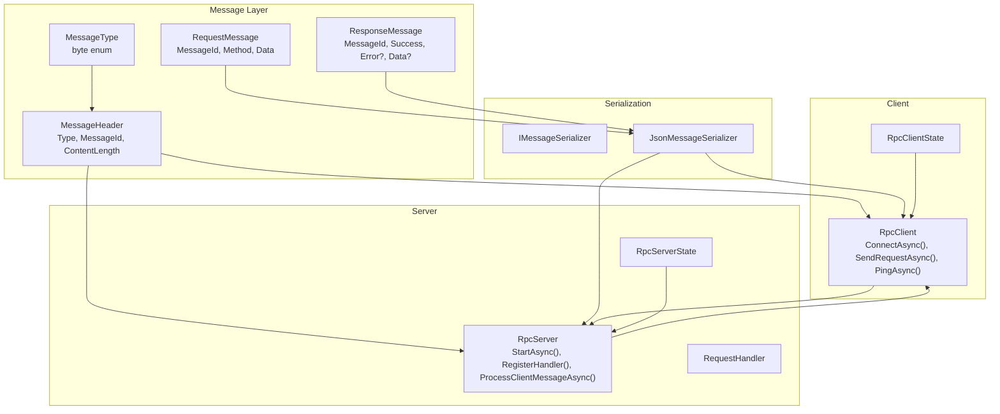
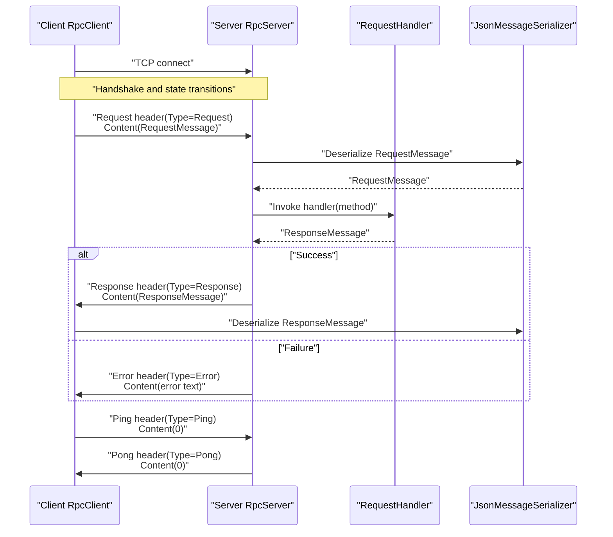
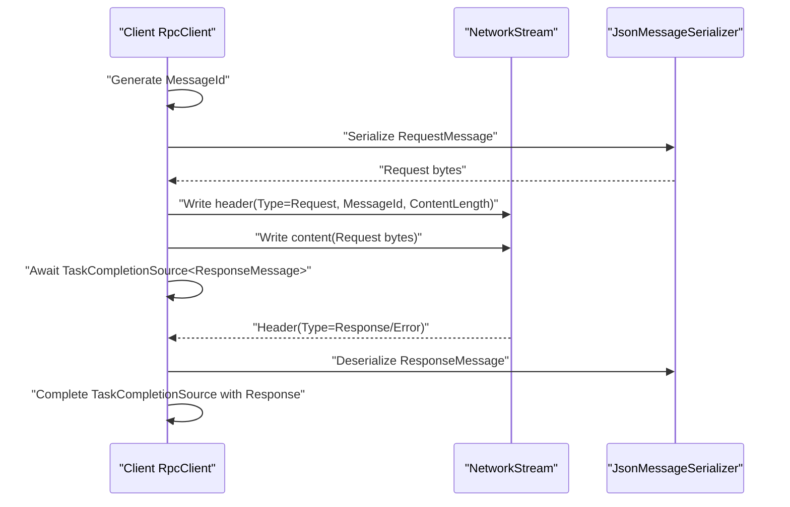
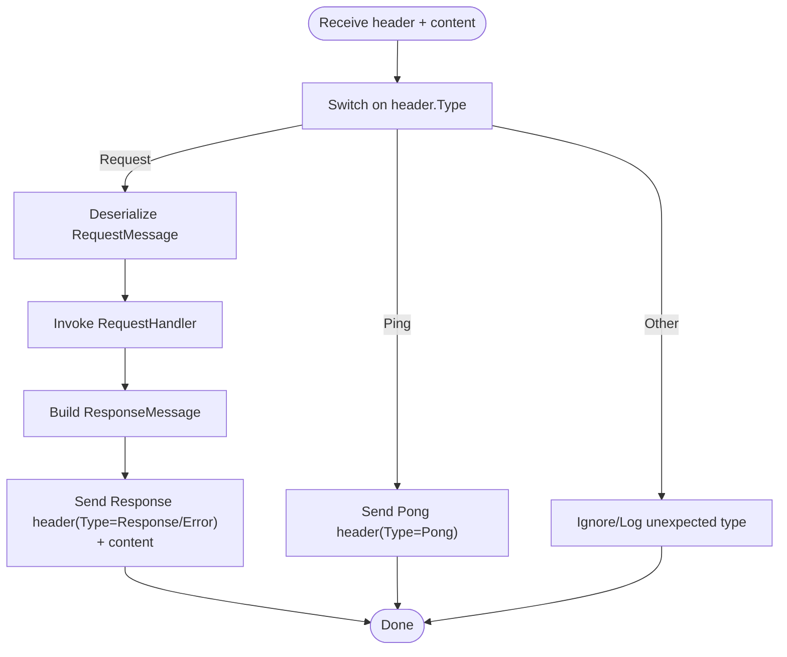
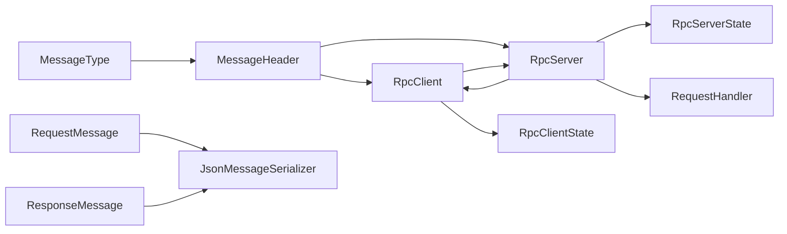

# Message Types & Enumerations

<cite>
**Referenced Files in This Document**
- [MessageType.cs](file://TcpRpc/Message/MessageType.cs)
- [MessageHeader.cs](file://TcpRpc/Message/MessageHeader.cs)
- [RequestMessage.cs](file://TcpRpc/Message/RequestMessage.cs)
- [ResponseMessage.cs](file://TcpRpc/Message/ResponseMessage.cs)
- [TcpRpcClient.cs](file://TcpRpc/Client/TcpRpcClient.cs)
- [TcpRpcServer.cs](file://TcpRpc/Server/TcpRpcServer.cs)
- [RequestHandler.cs](file://TcpRpc/Server/RequestHandler.cs)
- [RpcClientState.cs](file://TcpRpc/Client/RpcClientState.cs)
- [RpcServerState.cs](file://TcpRpc/Server/RpcServerState.cs)
- [JsonMessageSerializer.cs](file://TcpRpc/Formatter/JsonMessageSerializer.cs)
- [IMessageSerializer.cs](file://TcpRpc/Formatter/IMessageSerializer.cs)
</cite>

## Table of Contents
1. [Introduction](#introduction)
2. [Project Structure](#project-structure)
3. [Core Components](#core-components)
4. [Architecture Overview](#architecture-overview)
5. [Detailed Component Analysis](#detailed-component-analysis)
6. [Dependency Analysis](#dependency-analysis)
7. [Performance Considerations](#performance-considerations)
8. [Troubleshooting Guide](#troubleshooting-guide)
9. [Conclusion](#conclusion)

## Introduction
This document provides comprehensive documentation for the MessageType enumeration and its role in the TCP-based RPC protocol. It explains how each message type drives protocol behavior, the underlying byte representation, and how message types integrate into the overall RPC workflow. It also covers usage scenarios, protocol extensibility, backward compatibility considerations, and troubleshooting guidance for common issues such as message type mismatches and protocol state inconsistencies.

## Project Structure
The RPC protocol is implemented with a clear separation of concerns:
- Message types and headers define the wire protocol.
- Request and response message models encapsulate payload data.
- The client and server implement the protocol behavior and state machines.
- A serializer handles JSON encoding/decoding of messages.

**Diagram sources**
- [MessageType.cs:1-10](file://TcpRpc/Message/MessageType.cs#L1-L10)
- [MessageHeader.cs:1-34](file://TcpRpc/Message/MessageHeader.cs#L1-L34)
- [RequestMessage.cs:1-8](file://TcpRpc/Message/RequestMessage.cs#L1-L8)
- [ResponseMessage.cs:1-9](file://TcpRpc/Message/ResponseMessage.cs#L1-L9)
- [IMessageSerializer.cs:1-13](file://TcpRpc/Formatter/IMessageSerializer.cs#L1-L13)
- [JsonMessageSerializer.cs:1-85](file://TcpRpc/Formatter/JsonMessageSerializer.cs#L1-L85)
- [TcpRpcClient.cs:1-405](file://TcpRpc/Client/TcpRpcClient.cs#L1-L405)
- [RpcClientState.cs:1-11](file://TcpRpc/Client/RpcClientState.cs#L1-L11)
- [TcpRpcServer.cs:1-432](file://TcpRpc/Server/TcpRpcServer.cs#L1-L432)
- [RpcServerState.cs:1-10](file://TcpRpc/Server/RpcServerState.cs#L1-L10)
- [RequestHandler.cs:1-5](file://TcpRpc/Server/RequestHandler.cs#L1-L5)

**Section sources**
- [MessageType.cs:1-10](file://TcpRpc/Message/MessageType.cs#L1-L10)
- [MessageHeader.cs:1-34](file://TcpRpc/Message/MessageHeader.cs#L1-L34)
- [RequestMessage.cs:1-8](file://TcpRpc/Message/RequestMessage.cs#L1-L8)
- [ResponseMessage.cs:1-9](file://TcpRpc/Message/ResponseMessage.cs#L1-L9)
- [IMessageSerializer.cs:1-13](file://TcpRpc/Formatter/IMessageSerializer.cs#L1-L13)
- [JsonMessageSerializer.cs:1-85](file://TcpRpc/Formatter/JsonMessageSerializer.cs#L1-L85)
- [TcpRpcClient.cs:1-405](file://TcpRpc/Client/TcpRpcClient.cs#L1-L405)
- [RpcClientState.cs:1-11](file://TcpRpc/Client/RpcClientState.cs#L1-L11)
- [TcpRpcServer.cs:1-432](file://TcpRpc/Server/TcpRpcServer.cs#L1-L432)
- [RpcServerState.cs:1-10](file://TcpRpc/Server/RpcServerState.cs#L1-L10)
- [RequestHandler.cs:1-5](file://TcpRpc/Server/RequestHandler.cs#L1-L5)

## Core Components
- MessageType: Defines the wire-level message type discriminator as a single byte. Values include Request, Response, Ping, Pong, and Error.
- MessageHeader: Encodes the message type, a 64-bit message identifier, and a 32-bit content length into a fixed-size header. Serialization uses little-endian encoding for numeric fields.
- RequestMessage: Carries the method name and serialized data payload for RPC calls.
- ResponseMessage: Carries the result of an RPC call, including success flag, optional error text, and optional data payload.
- JsonMessageSerializer: Implements IMessageSerializer to serialize/deserialize RequestMessage and ResponseMessage using UTF-8 JSON.

These components form the backbone of the RPC protocol’s framing and payload handling.

**Section sources**
- [MessageType.cs:1-10](file://TcpRpc/Message/MessageType.cs#L1-L10)
- [MessageHeader.cs:1-34](file://TcpRpc/Message/MessageHeader.cs#L1-L34)
- [RequestMessage.cs:1-8](file://TcpRpc/Message/RequestMessage.cs#L1-L8)
- [ResponseMessage.cs:1-9](file://TcpRpc/Message/ResponseMessage.cs#L1-L9)
- [JsonMessageSerializer.cs:1-85](file://TcpRpc/Formatter/JsonMessageSerializer.cs#L1-L85)

## Architecture Overview
The RPC protocol operates over TCP with a strict framing model:
- Each message consists of a fixed-size header followed by a variable-length content body.
- The client initiates requests and tracks outstanding requests by MessageId.
- The server routes requests to registered handlers and responds with either a Response or Error based on success.

**Diagram sources**
- [TcpRpcClient.cs:132-189](file://TcpRpc/Client/TcpRpcClient.cs#L132-L189)
- [TcpRpcServer.cs:318-333](file://TcpRpc/Server/TcpRpcServer.cs#L318-L333)
- [TcpRpcServer.cs:335-360](file://TcpRpc/Server/TcpRpcServer.cs#L335-L360)
- [TcpRpcServer.cs:362-376](file://TcpRpc/Server/TcpRpcServer.cs#L362-L376)
- [TcpRpcServer.cs:394-406](file://TcpRpc/Server/TcpRpcServer.cs#L394-L406)
- [JsonMessageSerializer.cs:14-49](file://TcpRpc/Formatter/JsonMessageSerializer.cs#L14-L49)
- [JsonMessageSerializer.cs:51-84](file://TcpRpc/Formatter/JsonMessageSerializer.cs#L51-L84)

## Detailed Component Analysis

### MessageType Enumeration
- Purpose: Discriminator for the wire protocol indicating the semantic meaning of a message.
- Byte Representation: Stored as a single byte on the wire. The enum is declared as byte with explicit values:
  - Request = 0x01
  - Response = 0x02
  - Ping = 0x03
  - Pong = 0x04
  - Error = 0xFF
- Implications:
  - Backward compatibility: Adding new types after Error requires careful consideration to avoid conflicts with future reserved ranges.
  - Extensibility: New message types can be introduced by extending the enum and updating both client and server logic.

**Section sources**
- [MessageType.cs:1-10](file://TcpRpc/Message/MessageType.cs#L1-L10)

### MessageHeader: Framing and Wire Protocol
- Fixed Size: 17 bytes (1 byte Type + 8 bytes MessageId + 4 bytes ContentLength).
- Serialization:
  - Type: 1 byte from MessageType.
  - MessageId: 8-byte little-endian integer.
  - ContentLength: 4-byte little-endian integer.
- Deserialization:
  - Validates minimum header size before parsing.
  - Extracts Type, MessageId, and ContentLength using little-endian primitives.
- Behavior:
  - Client sets Type and MessageId when sending Request/Ping.
  - Server sets Type to Response or Error depending on outcome.
  - Client sets Type to Pong when responding to Ping.

**Section sources**
- [MessageHeader.cs:1-34](file://TcpRpc/Message/MessageHeader.cs#L1-L34)

### RequestMessage and ResponseMessage
- RequestMessage:
  - Fields: MessageId, Method (string), Data (byte[]).
  - Used by client to send RPC calls and by server to receive them.
- ResponseMessage:
  - Fields: MessageId, Success (bool), Error (optional string), Data (optional byte[]).
  - Used by server to reply with success or failure and by client to process results.
- Validation:
  - Serializer enforces non-empty Method and positive MessageId for both directions.

**Section sources**
- [RequestMessage.cs:1-8](file://TcpRpc/Message/RequestMessage.cs#L1-L8)
- [ResponseMessage.cs:1-9](file://TcpRpc/Message/ResponseMessage.cs#L1-L9)
- [JsonMessageSerializer.cs:14-49](file://TcpRpc/Formatter/JsonMessageSerializer.cs#L14-L49)
- [JsonMessageSerializer.cs:51-84](file://TcpRpc/Formatter/JsonMessageSerializer.cs#L51-L84)

### Client-Side Workflow
- Connection and State:
  - ConnectAsync transitions state from Created/Disconnected to Connecting and then Connected.
  - DisconnectAsync cancels pending operations and clears pending request maps.
- Request Flow:
  - SendRequestAsync builds RequestMessage, serializes it, writes header(Type=Request) and content, waits for Response or Error by MessageId.
  - Pending requests tracked in a concurrent dictionary keyed by MessageId.
- Heartbeat:
  - PingAsync sends Ping header and waits for Pong; timeouts handled gracefully.
- Message Processing:
  - Receive loop reads header, validates size, reads content, and dispatches to ProcessMessageAsync based on Type.
  - Handles Response, Error, and Pong; removes pending entries appropriately.

**Diagram sources**
- [TcpRpcClient.cs:132-189](file://TcpRpc/Client/TcpRpcClient.cs#L132-L189)
- [TcpRpcClient.cs:258-287](file://TcpRpc/Client/TcpRpcClient.cs#L258-L287)
- [JsonMessageSerializer.cs:14-49](file://TcpRpc/Formatter/JsonMessageSerializer.cs#L14-L49)
- [JsonMessageSerializer.cs:59-84](file://TcpRpc/Formatter/JsonMessageSerializer.cs#L59-L84)

**Section sources**
- [RpcClientState.cs:1-11](file://TcpRpc/Client/RpcClientState.cs#L1-L11)
- [TcpRpcClient.cs:47-80](file://TcpRpc/Client/TcpRpcClient.cs#L47-L80)
- [TcpRpcClient.cs:132-189](file://TcpRpc/Client/TcpRpcClient.cs#L132-L189)
- [TcpRpcClient.cs:205-236](file://TcpRpc/Client/TcpRpcClient.cs#L205-L236)
- [TcpRpcClient.cs:258-287](file://TcpRpc/Client/TcpRpcClient.cs#L258-L287)
- [TcpRpcClient.cs:325-382](file://TcpRpc/Client/TcpRpcClient.cs#L325-L382)

### Server-Side Workflow
- Handler Registration:
  - RegisterHandler allows binding method names to RequestHandler delegates.
- Message Processing:
  - ProcessClientMessageAsync switches on header.Type to handle Request or Ping.
  - For Request: deserializes, invokes handler, serializes ResponseMessage, and writes Response or Error based on Success.
  - For Ping: writes Pong header.
- Error Propagation:
  - Large messages trigger Error responses with descriptive text.
  - Exceptions in handlers produce Error responses with error text.

**Diagram sources**
- [TcpRpcServer.cs:318-333](file://TcpRpc/Server/TcpRpcServer.cs#L318-L333)
- [TcpRpcServer.cs:335-360](file://TcpRpc/Server/TcpRpcServer.cs#L335-L360)
- [TcpRpcServer.cs:362-376](file://TcpRpc/Server/TcpRpcServer.cs#L362-L376)
- [TcpRpcServer.cs:394-406](file://TcpRpc/Server/TcpRpcServer.cs#L394-L406)

**Section sources**
- [RequestHandler.cs:1-5](file://TcpRpc/Server/RequestHandler.cs#L1-L5)
- [TcpRpcServer.cs:50-99](file://TcpRpc/Server/TcpRpcServer.cs#L50-L99)
- [TcpRpcServer.cs:228-316](file://TcpRpc/Server/TcpRpcServer.cs#L228-L316)
- [TcpRpcServer.cs:318-333](file://TcpRpc/Server/TcpRpcServer.cs#L318-L333)
- [TcpRpcServer.cs:362-376](file://TcpRpc/Server/TcpRpcServer.cs#L362-L376)
- [TcpRpcServer.cs:378-392](file://TcpRpc/Server/TcpRpcServer.cs#L378-L392)
- [RpcServerState.cs:1-10](file://TcpRpc/Server/RpcServerState.cs#L1-L10)

### Message Type Semantics and Usage Scenarios

- Request (0x01)
  - Generated by client when calling SendRequestAsync.
  - Serialized RequestMessage is sent with header.Type=Request.
  - Server deserializes, invokes handler, and replies with Response or Error.
  - Typical usage: Remote procedure calls initiated by the client.

- Response (0x02)
  - Generated by server upon successful handler execution.
  - Header.Type=Response; content carries serialized ResponseMessage with Success=true and optional Data.
  - Client deserializes and completes the pending request.

- Ping (0x03)
  - Generated by client via PingAsync.
  - Header.Type=Ping; content length is zero.
  - Server responds with Pong to maintain connectivity.

- Pong (0x04)
  - Generated by server in response to Ping.
  - Header.Type=Pong; content length is zero.
  - Client validates the MessageId to confirm heartbeat success.

- Error (0xFF)
  - Generated by server for failures:
    - Handler exceptions produce Error responses.
    - Messages exceeding size limits produce Error responses.
  - Header.Type=Error; content carries UTF-8 error text.
  - Client treats Error as exceptional completion of the pending request.

**Section sources**
- [MessageType.cs:1-10](file://TcpRpc/Message/MessageType.cs#L1-L10)
- [TcpRpcClient.cs:132-189](file://TcpRpc/Client/TcpRpcClient.cs#L132-L189)
- [TcpRpcClient.cs:258-287](file://TcpRpc/Client/TcpRpcClient.cs#L258-L287)
- [TcpRpcClient.cs:325-382](file://TcpRpc/Client/TcpRpcClient.cs#L325-L382)
- [TcpRpcServer.cs:318-333](file://TcpRpc/Server/TcpRpcServer.cs#L318-L333)
- [TcpRpcServer.cs:362-376](file://TcpRpc/Server/TcpRpcServer.cs#L362-L376)
- [TcpRpcServer.cs:378-392](file://TcpRpc/Server/TcpRpcServer.cs#L378-L392)
- [TcpRpcServer.cs:394-406](file://TcpRpc/Server/TcpRpcServer.cs#L394-L406)

### Protocol Extensibility and Backward Compatibility
- Extending MessageType:
  - Add new enum values after Error (0xFF) to reserve space for future standardized types.
  - Ensure both client and server support the new type before deployment.
- Backward Compatibility:
  - Unknown types should be ignored or logged to prevent protocol breakdown.
  - Version negotiation can be achieved by introducing a version field in the header or a dedicated handshake message type.
- Serialization Compatibility:
  - New fields in RequestMessage/ResponseMessage should be optional and defaulted to safe values to maintain compatibility with older peers.

[No sources needed since this section provides general guidance]

## Dependency Analysis
The following diagram shows how components depend on each other and how message types influence control flow.

**Diagram sources**
- [MessageType.cs:1-10](file://TcpRpc/Message/MessageType.cs#L1-L10)
- [MessageHeader.cs:1-34](file://TcpRpc/Message/MessageHeader.cs#L1-L34)
- [RequestMessage.cs:1-8](file://TcpRpc/Message/RequestMessage.cs#L1-L8)
- [ResponseMessage.cs:1-9](file://TcpRpc/Message/ResponseMessage.cs#L1-L9)
- [JsonMessageSerializer.cs:1-85](file://TcpRpc/Formatter/JsonMessageSerializer.cs#L1-L85)
- [TcpRpcClient.cs:1-405](file://TcpRpc/Client/TcpRpcClient.cs#L1-L405)
- [RpcClientState.cs:1-11](file://TcpRpc/Client/RpcClientState.cs#L1-L11)
- [TcpRpcServer.cs:1-432](file://TcpRpc/Server/TcpRpcServer.cs#L1-L432)
- [RpcServerState.cs:1-10](file://TcpRpc/Server/RpcServerState.cs#L1-L10)
- [RequestHandler.cs:1-5](file://TcpRpc/Server/RequestHandler.cs#L1-L5)

**Section sources**
- [IMessageSerializer.cs:1-13](file://TcpRpc/Formatter/IMessageSerializer.cs#L1-L13)
- [JsonMessageSerializer.cs:1-85](file://TcpRpc/Formatter/JsonMessageSerializer.cs#L1-L85)
- [TcpRpcClient.cs:1-405](file://TcpRpc/Client/TcpRpcClient.cs#L1-L405)
- [TcpRpcServer.cs:1-432](file://TcpRpc/Server/TcpRpcServer.cs#L1-L432)

## Performance Considerations
- Header overhead is minimal (17 bytes fixed) and enables efficient framing.
- Little-endian encoding is fast and widely supported.
- Message size limits prevent memory exhaustion:
  - Client enforces a 10 MB cap on incoming content.
  - Server enforces a 100 MB cap on incoming content and sends Error for oversized messages.
- Concurrency:
  - Client uses a semaphore to serialize writes and concurrent dictionaries for pending requests/pings.
  - Server uses concurrent collections and per-client tasks to scale.

[No sources needed since this section provides general guidance]

## Troubleshooting Guide

Common Issues and Resolutions:
- Message Type Mismatch
  - Symptom: Client receives unexpected Response/Error for a Request, or vice versa.
  - Causes: Incorrect header.Type, mismatched MessageId, or corrupted stream.
  - Resolution: Verify header.Type and MessageId match the expected request; re-establish connection if stream corruption is suspected.

- Timeout on Request
  - Symptom: SendRequestAsync throws a timeout exception.
  - Causes: Server overload, network latency, or missing handler registration.
  - Resolution: Increase timeout, verify handler registration, monitor server load.

- Heartbeat Failure (Ping)
  - Symptom: PingAsync returns false or logs warnings.
  - Causes: Network issues, server busy, or Pong not received.
  - Resolution: Check connectivity, reduce ping frequency, ensure server is responsive.

- Protocol State Inconsistencies
  - Symptom: Client stuck in Connecting/Disconnecting or server stuck in Starting/Stopping.
  - Causes: Improper shutdown sequences or race conditions.
  - Resolution: Use proper lifecycle methods (ConnectAsync/DisconnectAsync, StartAsync/StopAsync) and avoid concurrent state changes.

- Error Responses
  - Symptom: Client receives Error header with error text.
  - Causes: Handler exceptions, invalid request payload, or oversized messages.
  - Resolution: Inspect server logs, validate request payload, adjust size limits.

**Section sources**
- [TcpRpcClient.cs:179-188](file://TcpRpc/Client/TcpRpcClient.cs#L179-L188)
- [TcpRpcClient.cs:215-218](file://TcpRpc/Client/TcpRpcClient.cs#L215-L218)
- [TcpRpcServer.cs:264-270](file://TcpRpc/Server/TcpRpcServer.cs#L264-L270)
- [TcpRpcServer.cs:378-392](file://TcpRpc/Server/TcpRpcServer.cs#L378-L392)

## Conclusion
MessageType is the cornerstone of the RPC protocol’s wire semantics. Together with MessageHeader, RequestMessage, and ResponseMessage, it defines a compact, extensible, and robust framing model. The client and server implementations enforce strict message routing and state management, while the serializer ensures consistent payload encoding. By following the guidelines for extensibility and troubleshooting, teams can evolve the protocol safely and maintain backward compatibility.