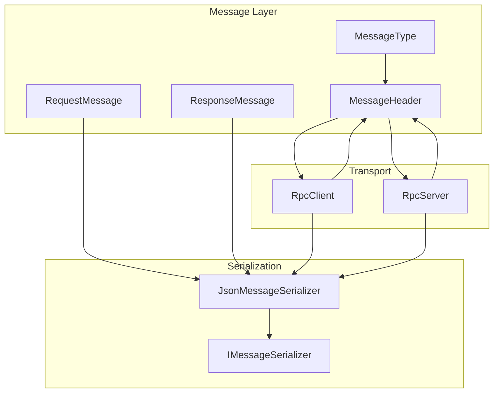
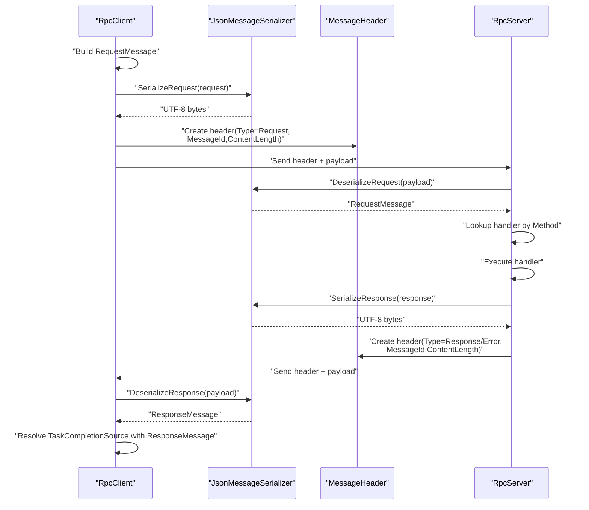
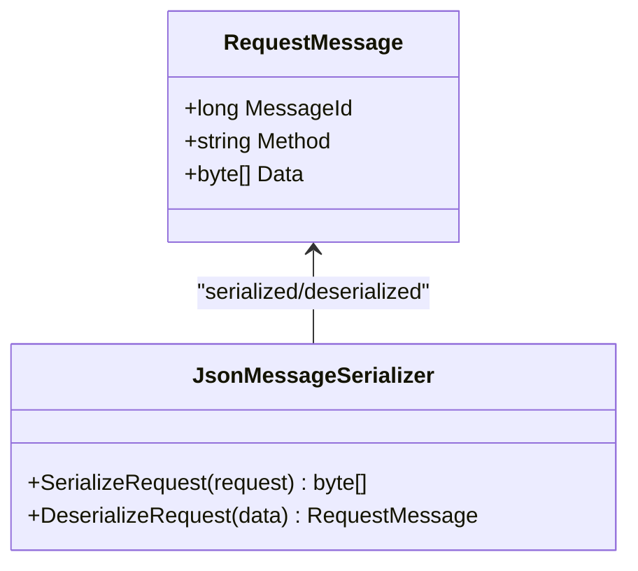
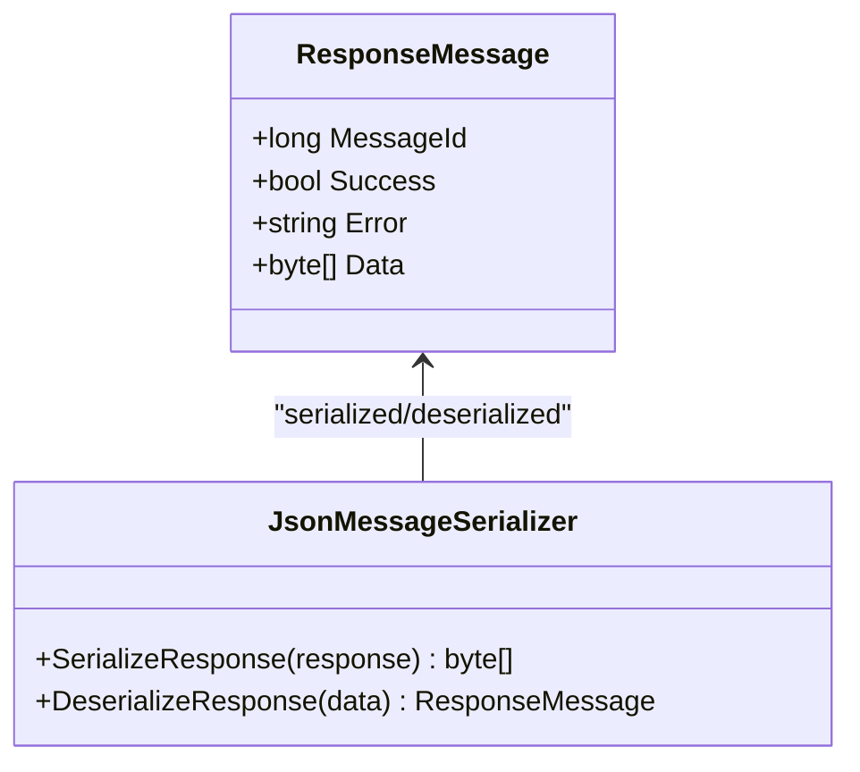
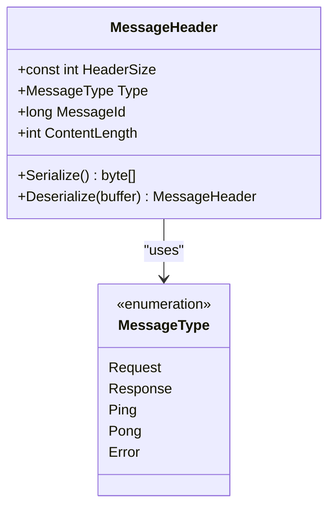
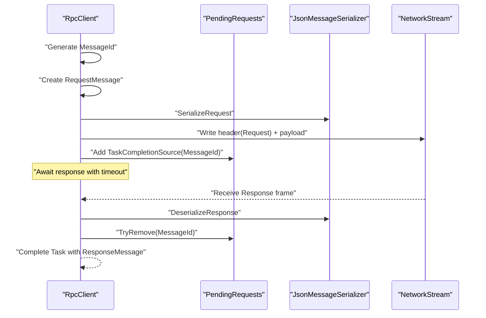
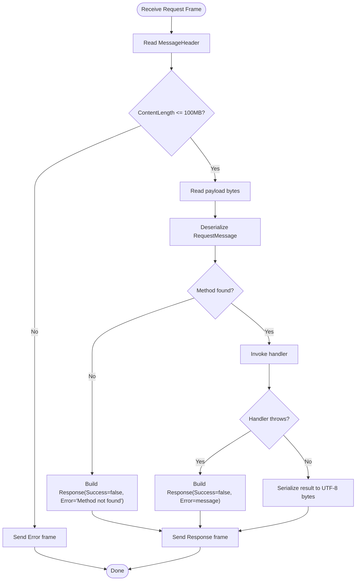
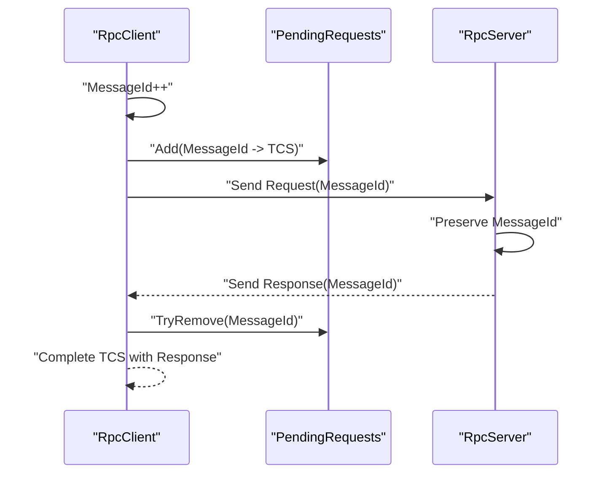
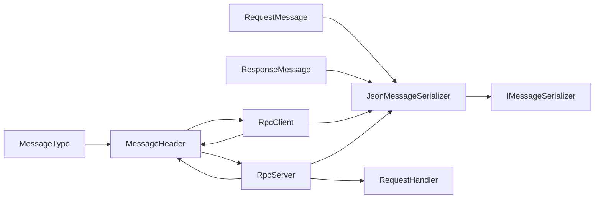

# Request & Response Data Models

<cite>
**Referenced Files in This Document**
- [RequestMessage.cs](file://TcpRpc/Message/RequestMessage.cs)
- [ResponseMessage.cs](file://TcpRpc/Message/ResponseMessage.cs)
- [JsonMessageSerializer.cs](file://TcpRpc/Formatter/JsonMessageSerializer.cs)
- [IMessageSerializer.cs](file://TcpRpc/Formatter/IMessageSerializer.cs)
- [MessageHeader.cs](file://TcpRpc/Message/MessageHeader.cs)
- [MessageType.cs](file://TcpRpc/Message/MessageType.cs)
- [TcpRpcClient.cs](file://TcpRpc/Client/TcpRpcClient.cs)
- [RpcClientState.cs](file://TcpRpc/Client/RpcClientState.cs)
- [TcpRpcServer.cs](file://TcpRpc/Server/TcpRpcServer.cs)
- [RpcServerState.cs](file://TcpRpc/Server/RpcServerState.cs)
- [RequestHandler.cs](file://TcpRpc/Server/RequestHandler.cs)
</cite>

## Table of Contents
1. [Introduction](#introduction)
2. [Project Structure](#project-structure)
3. [Core Components](#core-components)
4. [Architecture Overview](#architecture-overview)
5. [Detailed Component Analysis](#detailed-component-analysis)
6. [Dependency Analysis](#dependency-analysis)
7. [Performance Considerations](#performance-considerations)
8. [Troubleshooting Guide](#troubleshooting-guide)
9. [Conclusion](#conclusion)

## Introduction
This document provides comprehensive documentation for the RequestMessage and ResponseMessage data models that define the core payload structures in TcpRpc. It explains the properties and semantics of each model, the serialization and deserialization pipeline, correlation mechanisms between requests and responses, timeout handling, and cleanup procedures. It also covers payload size limits, JSON formatting expectations, and performance considerations for large payloads and streaming scenarios.

## Project Structure
The TcpRpc library organizes message models, serialization, and transport framing under dedicated namespaces:
- Message models: RequestMessage and ResponseMessage
- Serialization: JsonMessageSerializer implementing IMessageSerializer
- Transport framing: MessageHeader and MessageType enums
- Client and server orchestration: RpcClient and RpcServer manage request/response lifecycle, timeouts, and cleanup

**Diagram sources**
- [RequestMessage.cs:1-8](file://TcpRpc/Message/RequestMessage.cs#L1-L8)
- [ResponseMessage.cs:1-9](file://TcpRpc/Message/ResponseMessage.cs#L1-L9)
- [JsonMessageSerializer.cs:1-85](file://TcpRpc/Formatter/JsonMessageSerializer.cs#L1-L85)
- [IMessageSerializer.cs:1-13](file://TcpRpc/Formatter/IMessageSerializer.cs#L1-L13)
- [MessageHeader.cs:1-34](file://TcpRpc/Message/MessageHeader.cs#L1-L34)
- [MessageType.cs:1-10](file://TcpRpc/Message/MessageType.cs#L1-L10)
- [TcpRpcClient.cs:1-405](file://TcpRpc/Client/TcpRpcClient.cs#L1-L405)
- [TcpRpcServer.cs:1-432](file://TcpRpc/Server/TcpRpcServer.cs#L1-L432)

**Section sources**
- [RequestMessage.cs:1-8](file://TcpRpc/Message/RequestMessage.cs#L1-L8)
- [ResponseMessage.cs:1-9](file://TcpRpc/Message/ResponseMessage.cs#L1-L9)
- [JsonMessageSerializer.cs:1-85](file://TcpRpc/Formatter/JsonMessageSerializer.cs#L1-L85)
- [IMessageSerializer.cs:1-13](file://TcpRpc/Formatter/IMessageSerializer.cs#L1-L13)
- [MessageHeader.cs:1-34](file://TcpRpc/Message/MessageHeader.cs#L1-L34)
- [MessageType.cs:1-10](file://TcpRpc/Message/MessageType.cs#L1-L10)
- [TcpRpcClient.cs:1-405](file://TcpRpc/Client/TcpRpcClient.cs#L1-L405)
- [TcpRpcServer.cs:1-432](file://TcpRpc/Server/TcpRpcServer.cs#L1-L432)

## Core Components
This section documents the two primary data models and their roles in the RPC protocol.

- RequestMessage
  - Purpose: Encapsulates a remote procedure call request.
  - Properties:
    - MessageId: Correlation identifier for request-response pairing.
    - Method: Target method name for the server-side handler.
    - Data: Serialized parameter payload as UTF-8 bytes.
  - Validation: Deserialization enforces non-empty Method and positive MessageId.

- ResponseMessage
  - Purpose: Encapsulates a response to a request.
  - Properties:
    - MessageId: Must match the originating request’s MessageId.
    - Success: Boolean indicating whether the operation succeeded.
    - Error: Human-readable error message when Success is false.
    - Data: Serialized return payload as UTF-8 bytes when Success is true.

- Serialization
  - JsonMessageSerializer serializes/deserializes RequestMessage and ResponseMessage using System.Text.Json with camelCase property naming and compact output.
  - Both models are validated post-deserialization for structural correctness.

- Transport Framing
  - MessageHeader carries Type, MessageId, and ContentLength for each TCP frame.
  - MessageType enumerates Request, Response, Ping, Pong, and Error frames.

**Section sources**
- [RequestMessage.cs:1-8](file://TcpRpc/Message/RequestMessage.cs#L1-L8)
- [ResponseMessage.cs:1-9](file://TcpRpc/Message/ResponseMessage.cs#L1-L9)
- [JsonMessageSerializer.cs:1-85](file://TcpRpc/Formatter/JsonMessageSerializer.cs#L1-L85)
- [MessageHeader.cs:1-34](file://TcpRpc/Message/MessageHeader.cs#L1-L34)
- [MessageType.cs:1-10](file://TcpRpc/Message/MessageType.cs#L1-L10)

## Architecture Overview
The request-response flow integrates message models, serialization, and transport framing across client and server.

**Diagram sources**
- [TcpRpcClient.cs:132-189](file://TcpRpc/Client/TcpRpcClient.cs#L132-L189)
- [TcpRpcServer.cs:318-376](file://TcpRpc/Server/TcpRpcServer.cs#L318-L376)
- [JsonMessageSerializer.cs:14-84](file://TcpRpc/Formatter/JsonMessageSerializer.cs#L14-L84)
- [MessageHeader.cs:13-33](file://TcpRpc/Message/MessageHeader.cs#L13-L33)

## Detailed Component Analysis

### RequestMessage Model
- Structure and purpose:
  - Holds the correlation MessageId, target Method, and serialized Data payload.
- Serialization expectations:
  - Data is treated as raw UTF-8 bytes; clients typically serialize parameters using System.Text.Json before constructing the RequestMessage.
- Validation:
  - Deserialization validates Method is non-empty and MessageId is positive.

**Diagram sources**
- [RequestMessage.cs:1-8](file://TcpRpc/Message/RequestMessage.cs#L1-L8)
- [JsonMessageSerializer.cs:14-49](file://TcpRpc/Formatter/JsonMessageSerializer.cs#L14-L49)

**Section sources**
- [RequestMessage.cs:1-8](file://TcpRpc/Message/RequestMessage.cs#L1-L8)
- [JsonMessageSerializer.cs:14-49](file://TcpRpc/Formatter/JsonMessageSerializer.cs#L14-L49)

### ResponseMessage Model
- Structure and purpose:
  - Carries correlation MessageId, success/failure flag, optional error message, and optional serialized return payload.
- Propagation of errors:
  - On handler exceptions or invalid requests, Success is false and Error contains a descriptive message.
- Serialization expectations:
  - Data is serialized UTF-8 bytes; clients deserialize to strongly typed results when Success is true.

**Diagram sources**
- [ResponseMessage.cs:1-9](file://TcpRpc/Message/ResponseMessage.cs#L1-L9)
- [JsonMessageSerializer.cs:51-84](file://TcpRpc/Formatter/JsonMessageSerializer.cs#L51-L84)

**Section sources**
- [ResponseMessage.cs:1-9](file://TcpRpc/Message/ResponseMessage.cs#L1-L9)
- [JsonMessageSerializer.cs:51-84](file://TcpRpc/Formatter/JsonMessageSerializer.cs#L51-L84)

### Transport Framing and Message Types
- MessageHeader:
  - Fixed-size header with Type, MessageId, and ContentLength.
  - Provides Serialize/Deserialize helpers for little-endian binary encoding.
- MessageType:
  - Enumerates Request, Response, Ping, Pong, and Error frames.

**Diagram sources**
- [MessageHeader.cs:1-34](file://TcpRpc/Message/MessageHeader.cs#L1-L34)
- [MessageType.cs:1-10](file://TcpRpc/Message/MessageType.cs#L1-L10)

**Section sources**
- [MessageHeader.cs:1-34](file://TcpRpc/Message/MessageHeader.cs#L1-L34)
- [MessageType.cs:1-10](file://TcpRpc/Message/MessageType.cs#L1-L10)

### Client-Side Request Construction and Response Handling
- Request construction:
  - RpcClient constructs RequestMessage with an auto-incremented MessageId, sets Method, and serializes parameters to Data.
  - Serializes RequestMessage to UTF-8 bytes and sends a Request frame with MessageHeader.
- Response handling:
  - RpcClient maintains a concurrent dictionary keyed by MessageId to resolve TaskCompletionSource upon receiving a Response frame.
  - On timeout or connection loss, pending requests are canceled or faulted.
- Timeout handling:
  - SendRequestAsync uses a linked cancellation token with a configurable timeout; on cancellation, the pending request is removed and a TimeoutException is thrown.
- Cleanup:
  - DisconnectAsync clears pending requests and transitions state to Disconnected.
  - Dispose ensures graceful shutdown and resource release.

**Diagram sources**
- [TcpRpcClient.cs:132-189](file://TcpRpc/Client/TcpRpcClient.cs#L132-L189)
- [JsonMessageSerializer.cs:14-20](file://TcpRpc/Formatter/JsonMessageSerializer.cs#L14-L20)
- [MessageHeader.cs:13-20](file://TcpRpc/Message/MessageHeader.cs#L13-L20)

**Section sources**
- [TcpRpcClient.cs:132-189](file://TcpRpc/Client/TcpRpcClient.cs#L132-L189)
- [RpcClientState.cs:1-11](file://TcpRpc/Client/RpcClientState.cs#L1-L11)

### Server-Side Handler Execution and Response Generation
- Handler registration:
  - RpcServer.RegisterHandler associates a Method name with a RequestHandler delegate or a typed handler that deserializes request Data and returns a strongly typed result.
- Request processing:
  - RpcServer reads MessageHeader, validates ContentLength limits, deserializes RequestMessage, and invokes the registered handler.
- Response generation:
  - On success, RpcServer serializes the result to UTF-8 bytes and sends a Response frame.
  - On failure, RpcServer sends an Error frame with the error message.
- Ping/Pong:
  - RpcServer responds to Ping frames with Pong frames.

**Diagram sources**
- [TcpRpcServer.cs:228-376](file://TcpRpc/Server/TcpRpcServer.cs#L228-L376)
- [RequestHandler.cs:1-5](file://TcpRpc/Server/RequestHandler.cs#L1-L5)
- [JsonMessageSerializer.cs:51-84](file://TcpRpc/Formatter/JsonMessageSerializer.cs#L51-L84)

**Section sources**
- [TcpRpcServer.cs:50-99](file://TcpRpc/Server/TcpRpcServer.cs#L50-L99)
- [TcpRpcServer.cs:318-376](file://TcpRpc/Server/TcpRpcServer.cs#L318-L376)
- [RequestHandler.cs:1-5](file://TcpRpc/Server/RequestHandler.cs#L1-L5)

### Correlation Mechanism Between Requests and Responses
- MessageId:
  - RpcClient auto-increments MessageId per request and stores a TaskCompletionSource keyed by MessageId.
  - RpcServer preserves MessageId in ResponseMessage so RpcClient can correlate incoming responses to pending requests.
- Error propagation:
  - RpcServer can send Error frames for malformed messages or oversized payloads; RpcClient treats these as faults and removes the pending request.

**Diagram sources**
- [TcpRpcClient.cs:139-143](file://TcpRpc/Client/TcpRpcClient.cs#L139-L143)
- [TcpRpcClient.cs:263-267](file://TcpRpc/Client/TcpRpcClient.cs#L263-L267)
- [TcpRpcServer.cs:343-359](file://TcpRpc/Server/TcpRpcServer.cs#L343-L359)

**Section sources**
- [TcpRpcClient.cs:139-143](file://TcpRpc/Client/TcpRpcClient.cs#L139-L143)
- [TcpRpcClient.cs:263-267](file://TcpRpc/Client/TcpRpcClient.cs#L263-L267)
- [TcpRpcServer.cs:343-359](file://TcpRpc/Server/TcpRpcServer.cs#L343-L359)

### Timeout Handling and Cleanup Procedures
- Timeouts:
  - RpcClient.SendRequestAsync uses a linked cancellation token with a configurable timeout; on cancellation, the pending request is removed and a TimeoutException is thrown.
- Cleanup:
  - RpcClient.DisconnectAsync cancels receive loop, closes streams, and completes all pending requests with exceptions.
  - RpcServer.StopAsync cancels all operations, stops accepting connections, and waits for client tasks to finish.
  - Both Dispose methods ensure resources are released.

**Section sources**
- [TcpRpcClient.cs:162-188](file://TcpRpc/Client/TcpRpcClient.cs#L162-L188)
- [TcpRpcClient.cs:85-130](file://TcpRpc/Client/TcpRpcClient.cs#L85-L130)
- [TcpRpcServer.cs:175-226](file://TcpRpc/Server/TcpRpcServer.cs#L175-L226)

## Dependency Analysis
The following diagram shows how components depend on each other to implement the request-response protocol.

**Diagram sources**
- [RequestMessage.cs:1-8](file://TcpRpc/Message/RequestMessage.cs#L1-L8)
- [ResponseMessage.cs:1-9](file://TcpRpc/Message/ResponseMessage.cs#L1-L9)
- [JsonMessageSerializer.cs:1-85](file://TcpRpc/Formatter/JsonMessageSerializer.cs#L1-L85)
- [IMessageSerializer.cs:1-13](file://TcpRpc/Formatter/IMessageSerializer.cs#L1-L13)
- [MessageHeader.cs:1-34](file://TcpRpc/Message/MessageHeader.cs#L1-L34)
- [MessageType.cs:1-10](file://TcpRpc/Message/MessageType.cs#L1-L10)
- [TcpRpcClient.cs:1-405](file://TcpRpc/Client/TcpRpcClient.cs#L1-L405)
- [TcpRpcServer.cs:1-432](file://TcpRpc/Server/TcpRpcServer.cs#L1-L432)
- [RequestHandler.cs:1-5](file://TcpRpc/Server/RequestHandler.cs#L1-L5)

**Section sources**
- [IMessageSerializer.cs:1-13](file://TcpRpc/Formatter/IMessageSerializer.cs#L1-L13)
- [JsonMessageSerializer.cs:1-85](file://TcpRpc/Formatter/JsonMessageSerializer.cs#L1-L85)
- [TcpRpcClient.cs:1-405](file://TcpRpc/Client/TcpRpcClient.cs#L1-L405)
- [TcpRpcServer.cs:1-432](file://TcpRpc/Server/TcpRpcServer.cs#L1-L432)

## Performance Considerations
- Payload size limits:
  - Client enforces a 10 MB limit when reading content; oversized messages cause an InvalidDataException and connection handling is adjusted accordingly.
  - Server enforces a 100 MB limit for incoming messages; oversized messages trigger an Error frame.
- Large payloads:
  - Prefer streaming or chunked transfer strategies if payloads exceed these limits. Consider breaking large data into smaller requests or using separate channels for large transfers.
- JSON formatting:
  - JsonMessageSerializer uses camelCase and compact output; avoid unnecessary whitespace or extra fields to reduce payload size.
- Concurrency and throughput:
  - RpcClient uses a semaphore to serialize writes and a concurrent dictionary for pending requests; ensure handlers execute efficiently to minimize queue buildup.
- Memory usage:
  - Avoid retaining large byte arrays unnecessarily; dispose streams and buffers promptly after sending/receiving.

**Section sources**
- [TcpRpcClient.cs:215-218](file://TcpRpc/Client/TcpRpcClient.cs#L215-L218)
- [TcpRpcServer.cs:264-270](file://TcpRpc/Server/TcpRpcServer.cs#L264-L270)

## Troubleshooting Guide
- Invalid request/response deserialization:
  - JsonMessageSerializer throws when data is null, empty, or fails JSON parsing. Verify that the payload is a valid UTF-8 JSON representation of the expected model.
- Invalid MessageId:
  - Deserialization validates MessageId must be positive; ensure MessageId is generated and preserved correctly.
- Missing Method:
  - RpcServer returns Success=false with an error indicating the method was not found; confirm handler registration and Method name.
- Handler exceptions:
  - RpcServer wraps handler exceptions in a Response with Success=false and the exception message; inspect Error for diagnostics.
- Oversized messages:
  - Client and Server enforce size limits; adjust payload size or implement chunking.
- Timeouts:
  - RpcClient throws TimeoutException when the server does not respond within the configured timeout; increase timeout or investigate server responsiveness.
- Connection loss:
  - RpcClient completes pending requests with exceptions when the connection is lost; reconnect and resend as needed.

**Section sources**
- [JsonMessageSerializer.cs:22-49](file://TcpRpc/Formatter/JsonMessageSerializer.cs#L22-L49)
- [JsonMessageSerializer.cs:59-84](file://TcpRpc/Formatter/JsonMessageSerializer.cs#L59-L84)
- [TcpRpcServer.cs:343-359](file://TcpRpc/Server/TcpRpcServer.cs#L343-L359)
- [TcpRpcClient.cs:179-188](file://TcpRpc/Client/TcpRpcClient.cs#L179-L188)

## Conclusion
RequestMessage and ResponseMessage are the core payload structures in TcpRpc, designed for efficient JSON serialization and robust correlation via MessageId. The JsonMessageSerializer enforces structural validation, while RpcClient and RpcServer coordinate request/response lifecycles, timeouts, and cleanup. Adhering to payload size limits and efficient handler execution ensures reliable performance for both small and large payloads.